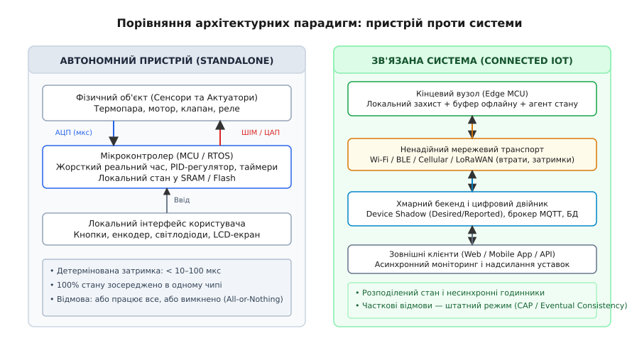
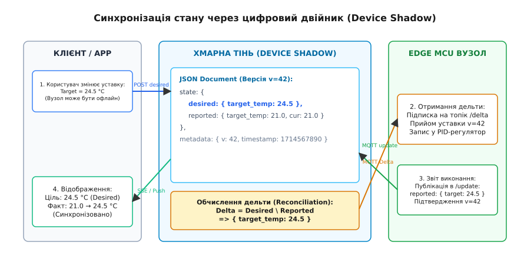
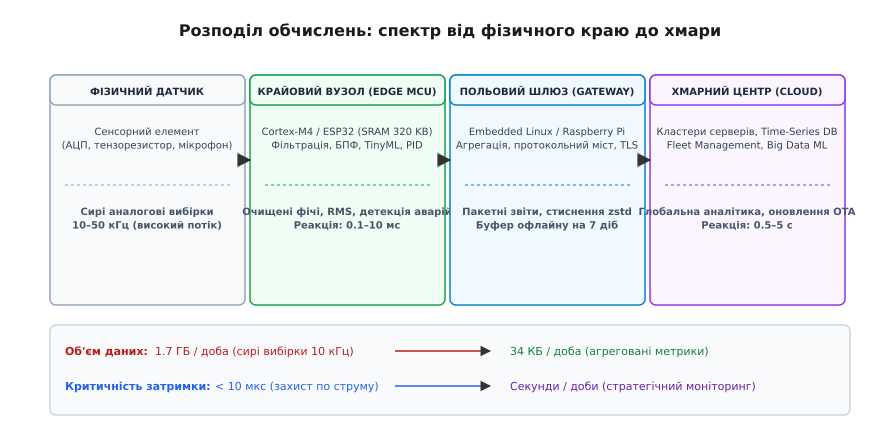

# Що таке зв'язана система і чим вона відрізняється від пристрою

<preknowlist>
- [Анатомія вбудованого пристрою](root:embedded/anatomiia-vbudovanoho-prystroiu) — чотири апаратні підсистеми автономного контролера, часовий детермінізм та робота з фізичним світом.
- [Семирівнева модель OSI як карта місцевості](root:com-transport/osi-model) — інкапсуляція даних, рівні протоколів від фізичного до прикладного.
- [Вісім оман розподілених обчислень](root:sf-distributed/distributed-fallacies) — чому мережа не є надійною, затримка не дорівнює нулю, а топологія змінюється.
</preknowlist>

Автономний контролер промислової вентиляційної установки роками працює в замкненому просторі щитової: аналого-цифровий перетворювач кожні десять мілісекунд зчитує показники термопари, пропорційно-інтегрально-диференціальний (ПІД) регулятор у пам'яті SRAM розраховує шпаруватість сигналу, а таймер формує ШІМ для відкриття водяного клапана. Якщо живлення стабільне і кристал непошкоджений, реакція контуру детермінована до мікросекунди: будь-яке коливання температури миттєво викликає рух заслінки. Але варто інженерам додати на плату модуль Wi-Fi або стільниковий модем, щоб вивести графіки в хмарний дашборд і дозволити диспетчеру змінювати уставку зі смартфона, як поведінка системи кардинально змінюється. Перший же обрив зв'язку тривалістю в кілька секунд розкриває приховану пастку: якщо прошивка контролера блокує головний цикл в очікуванні відповіді від сервера або вважає, що хмара завжди володіє актуальним станом клапана, локальний контур безпеки зависає, двигун перегрівається, а мобільний додаток показує користувачеві «Уставка: 22 °C, стан: норма», хоча фізичний клапан давно заклинило у відкритому положенні.

Додавання мережевого інтерфейсу не просто додає пристрою функцію віддаленого моніторингу — воно здійснює фундаментальний архітектурний перехід. Одиночний контролер перестає бути замкненим монолітом і стає кінцевим вузлом **розподіленої зв'язаної системи** (англ. *connected system*, в контексті Інтернету речей — *IoT ecosystem*). У цьому новому середовищі звичні гарантії мікроконтролерного світу — єдиний часовий домен, нульова затримка доступу до власної пам'яті та бінарний стан надійності («працює все або вимкнено все») — більше не діють. Розберімо анатомію зв'язаної системи: закони розподілених обчислень у польових умовах, механізми узгодження стану через цифрові двійники, баланс обчислень між краєм і хмарою та програмні патерни, що рятують прошивку від мережевого хаосу.

---

### Трансформація парадигми: від замкненого контролера до розподіленого вузла

Щоб зрозуміти масштаби змін, зіставмо дві моделі функціонування вбудованого обчислювача.

#### Автономний вбудований пристрій (Standalone Embedded Node)

В автономному пристрої контур керування повністю зосереджений на одній друкованій платі або в межах локального кабельного джгута:
1. **Локальний зворотний зв'язок:** Сенсори напряму підключені до шин I2C/SPI або пінів АЦП. Обчислювальне ядро отримує сирі вибірки з фіксованою частотою дискретизації (наприклад, 1 кГц), обробляє їх у перериванні або задачі RTOS і видає керівний вплив на виконавчий механізм через силовий ключ, ЦАП або ШІМ.
2. **Єдине джерело правди:** Весь стан системи (поточні виміри, змінні регулятора, лічильники помилок, конфігураційні байти) міститься в регістрах процесора, локальній SRAM та енергонезалежній Flash/EEPROM. Немає жодного іншого компонента в природі, який міг би мати «іншу думку» про те, увімкнене реле чи ні.
3. **Бінарна модель відмов (All-or-Nothing):** Система або функціонує повністю, або повністю виходить з ладу при зникненні напруги чи зависанні тактового генератора. Якщо контролер завис, апаратний сторожовий таймер (Watchdog) перезавантажує чип за 50–500 мс, повертаючи його до відомого початкового стану.


*Принципова відмінність архітектур. Ліворуч — автономний пристрій із жорстким часовим детермінізмом та локальним станом. Праворуч — зв'язана система, де зв'язок із хмарою розриває миттєвий зворотний зв'язок, вимагаючи асинхронного узгодження станів та обробки часткових відмов.*

#### Зв'язана система (Connected IoT Ecosystem)

Щойно ми інтегруємо зв'язок із зовнішнім світом, пристрій перетворюється на один із багатьох елементів складного розподіленого графа:
- **Розщеплення контурів зворотного зв'язку:** Виникає поділ на *локальний захисний контур* (високошвидкісний, критичний до затримок: струмовий захист, PID-стабілізація за 0.1–10 мс) та *глобальний інформаційний контур* (асинхронний, що проходить через радіоканал, Інтернет, брокери повідомлень і бази даних із затримками від 100 мс до десятків секунд або навіть діб у разі офлайну).
- **Розподілений стан:** Стан системи тепер фрагментований. Користувач у мобільному застосунку бачить одне значення температури, реляційна база даних у хмарі зберігає інше (останнє зафіксоване вчора), а сам польовий датчик у цю секунду вимірює третє. Жоден вузол не має миттєвого й гарантовано точного знання про стан інших вузлів.
- **Часткові відмови (Partial Failures):** Мережа не падає цілком — вона деградує фрагментарно. Мікроконтролер може справно зчитувати сенсор, але стільниковий модуль не може зареєструватися в мережі оператора через перевантаження базової станції; або MQTT-брокер приймає пакети, але хмарна черга сповіщень переповнена. Прошивка більше не може вважати помилку зв'язку фатальною катастрофою: робота в умовах тривалої відсутності зв'язку стає її штатним повсякденним режимом.

```
+------------------------------------+---------------------------------------+
| Автономний пристрій (Standalone)   | Зв'язана система (Connected IoT)      |
+------------------------------------+---------------------------------------+
| Замкнений локальний контур (мкс)   | Розподілені контури (Edge + Cloud)    |
| Стан повністю зосереджений у SRAM  | Стан рознесений між вузлом і хмарою   |
| Єдиний локальний годинник чипа     | Несинхронізовані годинники (дрейф RTC)|
| Оновлення прошивки: завод / сервіс | Віддалене масове оновлення (FOTA)     |
| Фізична ізоляція периметра         | Загрози атак із публічної мережі      |
| Відмова: стоп або перезавантаження | Часткова відмова — штатний стан       |
+------------------------------------+---------------------------------------+
```

---

### Закони розподілених систем у світі мікроконтролерів

Програмісти класичних вбудованих систем звикли до того, що виклик функції `read_sensor()` повертає значення за фіксовану кількість тактів процесора. У розподіленому середовищі віддалене звернення підпорядковується законам теорії розподілених систем, найважливішими з яких є теореми CAP та PACELC.

#### Фізична неминучість розриву зв'язку: `P` у польових умовах

Класична **теорема CAP** (сформульована Еріком Брюером, лат. *partitio* — поділ, поділ на частини) стверджує, що будь-яка розподілена система збереження даних може одночасно забезпечити не більше двох із трьох властивостей:
1. **Узгодженість (Consistency, `C`):** Кожне читання повертає найсвіжіший результат останнього запису або помилку. Усі клієнти бачать однакові дані в один і той самий фізичний момент часу.
2. **Доступність (Availability, `A`):** Кожен робочий вузол завжди повертає успішну відповідь на запит без гарантії, що вона містить найновіший запис.
3. **Стійкість до розділення мережі (Partition Tolerance, `P`):** Система продовжує функціонувати навіть тоді, коли довільна кількість повідомлень між вузлами губиться або затримується через фізичний обрив зв'язку.

У розподілених серверах усередині дата-центру розділення мережі (`P`) є рідкісним інцидентом (аварія комутатора чи оптоволокна). Проте в польовому IoT **розділення мережі (`P`) — це щоденний, фундаментальний і неминучий стан системи**:
- Автономні трекери заїжджають у підземні паркінги або тунелі, де сигнал GPS та LTE повністю зникає на години.
- Радіомодулі діапазону 2.4 ГГц або 868 МГц стикаються з інтерференцією, індустріальними радіозавадами та завмиранням сигналу через перешкоди (будівлі, рельєф, металеві конструкції).
- Батарейні бездротові датчики 99.9% свого часу проводять у стані глибокого сну (Deep Sleep) зі струмом споживання 2–5 мкА заради збереження заряду батареї на 5–10 років, прокидаючись на 50 мс раз на годину. З погляду хмари такий пристрій фізично недоступний майже весь час.

Оскільки стійкість до розділення (`P`) у світі IoT диктується законами фізики і від неї неможливо відмовитися, інженер завжди стоїть перед вибором: **AP чи CP**.

```
                           CAP у польовому IoT
                          /                   \
                         /                     \
       AP (Availability + Partition)      CP (Consistency + Partition)
      ------------------------------      ----------------------------
      • Автономність на місці             • Блокування небезпечних дій
      • Локальний кеш та виконання        • Відмова без глобальної згоди
      • Телеметрія в Flash-буфер          • Захист від подвійних витрат
      • Eventual Consistency              • Платіжні та пресові системи
```

#### AP-стратегія: локальна автономність (Local Autonomy)

Більшість польових IoT-систем будуються за моделлю **AP**. Якщо зв'язок із сервером зникає:
- Контролер опалення не вимикає котел, а продовжує регулювати температуру за останньою закешованою локальною уставкою.
- Електронний замок дверей відкривається за локальною копією списку дозволених RFID-карток чи ключів, записаних у Flash-пам'ять.
- Датчики вібрації та струму продовжують вимірювання, записуючи агреговані звіти в циклічний буфер (Flash Ring Buffer). Коли радіоканал відновлюється, накопичена черга телеметрії відправляється в хмару.

Ціною доступності є **узгодженість у кінцевому підсумку** (англ. *Eventual Consistency*): протягом годин дані в мобільному додатку можуть відрізнятися від реального фізичного стану датчика, але система продовжує виконувати свою базову фізичну функцію.

#### CP-стратегія: пріоритет безпеки та строгий консенсус

Стратегія **CP** застосовується там, де виконання дії без підтвердження з хмари несе загрозу людському життю або прямі фінансові збитки:
- Зарядний термінал електромобілів або платіжний автомат блокує видачу енергії/послуги, якщо не може зв'язатися з білінговим сервером для резервування коштів (запобігання шахрайству).
- Важкий промисловий маніпулятор відмовляється починати рух за розкладом, якщо не отримав підтвердження від хмарної системи диспетчеризації про те, що робоча зона вільна від персоналу.

При втраті зв'язку вузол переходить у безпечний аварійний стан (Fail-Safe), відмовляючи клієнтам у виконанні операцій заради збереження глобальної цілісності.

#### Теорема PACELC: плата за зв'язок у штатному режимі

Теорема **PACELC** (запропонована Даніелем Абаді в 2012 році) розширює CAP, описуючи поведінку системи не лише під час аварій (`P`), але й під час нормальної роботи:
- **If Partition (`P`):** вибираємо між Доступністю (**`A`**) та Узгодженістю (**`C`**);
- **Else (`E`):** за наявності зв'язку вибираємо між Затримкою (**`L`**, англ. *Latency*) та Узгодженістю (**`C`**).

Вбудований розробник щодня стикається з правою частиною теореми (ELC): чи повинен мікроконтролер при зміні локального стану (наприклад, натисканні фізичної кнопки настінного вимикача) чекати відповіді від хмарного сервера про фіксацію події перед тим, як перемкнути вихідне реле?
- Якщо чекати підтвердження від хмари (Consistency `C`), користувач відчує затримку від 200 мс до 2 с між натисканням клавіші та загорянням лампочки, що викликає відчуття бракованого приладу.
- Якщо перемикати реле миттєво (Latency `L`), ми отримуємо відгук за 5 мілісекунд, але беремо на себе обов'язок асинхронно синхронізувати стан із сервером і вирішувати можливі конфлікти, якщо в цей самий момент інший користувач надіслав команду вимкнення через додаток.

---

### Архітектура збереження стану: локальний кеш проти цифрового двійника

Найбільша практична помилка під час перетворення пристрою на зв'язану систему полягає у спробі застосувати синхронну модель клієнт-сервер (RPC, REST HTTP GET/POST безпосередньо до IP-адреси мікроконтролера). Якщо мікроконтролер спить, перебуває за NAT мобільного оператора або тимчасово втратив Wi-Fi, прямий HTTP-запит від мобільного додатку завершиться помилкою `504 Gateway Timeout`.

Щоб розв'язати цю проблему, в сучасній архітектурі IoT використовують патерн **цифрового двійника** або **тіні пристрою** (англ. *Device Shadow* або *Digital Twin*).


*Синхронізація стану за патерном Device Shadow. Мобільний додаток взаємодіє виключно з хмарним двійником через стан Desired. Хмарний брокер обчислює різницю (Delta) і шле її на MCU, коли той онлайн. Виконавши команду, MCU підтверджує факт оновленням Reported.*

#### Концепція Desired та Reported State

Тінь пристрою — це постійно доступний у хмарі JSON-документ (або структура в базі даних), який зберігає два незалежні погляди на стан фізичного вузла:
1. **Бажаний стан (`desired`):** Те, яким пристрій *має стати* за бажанням зовнішніх клієнтів (мобільного додатку, оператора чи хмарного планувальника). Користувач може записати в `desired` нову цільову температуру `24.5 °C` навіть тоді, коли кондиціонер вимкнений з розетки або спить у полі.
2. **Повідомлений стан (`reported`):** Останній фактичний стан, про який *реально відзвітував сам фізичний контролер* під час останнього сеансу зв'язку (наприклад, `target_temp: 21.0 °C, current_temp: 20.8 °C`).

#### Механізм узгодження (Delta Reconciliation)

Хмарний сервіс постійно порівнює секції `desired` та `reported`. Якщо між ними виникає розбіжність, сервіс формує документ **дельти** (англ. *delta document*):

```
Delta = Desired \ Reported      [вилучення полів, де фактичний стан збігається з бажаним]
```

Процес узгодження (англ. *reconciliation*, від лат. *reconciliatio* — відновлення єдності) відбувається за наступним алгоритмом:
1. Коли мікроконтролер прокидається і встановлює захищене TLS/MQTT-з'єднання з брокером, він підписується на топік дельти `$aws/things/<device_id>/shadow/update/delta`.
2. Якщо дельта ненульова, брокер надсилає вузлу компактне повідомлення, що містить *лише змінені параметри*.
3. Агент розподіленого стану в прошивці MCU валідує отримані значення (перевіряє фізичні ліміти напруги, температури, струму), записує їх у конфігураційну структуру та передає локальному ПІД-регулятору.
4. Після фізичного застосування конфігурації MCU публікує повідомлення в топік оновлення тіні `$aws/things/<device_id>/shadow/update` із секцією `reported`, у якій повідомляє про новий фактичний стан.
5. Хмарний сервіс отримує підтвердження, оновлює секцію `reported` у базі даних, внаслідок чого дельта стає порожньою (`null`), а мобільний додаток користувача отримує сповіщення: «Уставка 24.5 °C успішно застосована на пристрої».

#### Монотонні версії та захист від гонок станів

У ненадійному радіоканалі пакети можуть дублюватися, затримуватися на базових станціях і приходити з порушенням первинного порядку (англ. *out-of-order delivery*). Якщо користувач спочатку встановив швидкість насоса `50%`, а за хвилину передумав і відправив `80%`, затриманий пакет на `50%` може прийти на MCU *після* пакета на `80%`.

Щоб запобігти застосуванню застарілих команд, документ тіні містить цілочисельний монотонний лічильник версії (`version` або `sequence_id`). Контролер зберігає номер останньої успішно застосованої версії:
- Якщо приходить повідомлення з версією `v_new <= v_current`, прошивка негайно відкидає пакет як застарілий дублікат без застосування до апаратури.
- Якщо `v_new > v_current`, прошивка застосовує команду та оновлює локальний лічильник до `v_new`.

---

### Розподіл обов'язків: Edge Computing проти централізованої аналітики

Поширена омана початківців — намагатися передавати в хмару «все, що вимірює датчик». У реальних виробах такий підхід призводить до катастрофічного перевитрачання енергії батареї, вичерпання лімітів стільникового трафіку та перевантаження хмарної інфраструктури.

Розглянемо практичний розрахунок для вібромоніторингу промислового електродвигуна.


*Спектр розподілу обчислень. На рівні мікроконтролера виконується високочастотна фільтрація та стиснення зі скороченням трафіку в 50 000 разів, тоді як хмара отримує компактні агреговані метрики для довгострокового аналізу.*

#### Розрахунок «на серветці»: вартість сирих даних

Датчик вібрації (трьохосьовий цифровий акселерометр або п'єзоелектричний перетворювач) здійснює вибірку вібраційного прискорення з частотою дискретизації `10 кГц` (10 000 вибірок на секунду, розрядність 16 біт = 2 байти на відлік).

Обчислимо об'єм сирих даних за одну добу безперервної роботи:
```
V_sec   = 10 000 відліків/с · 2 байти = 20 000 байтів/с [потік сирих даних за секунду]
V_daily = 20 000 байтів/с · 86 400 с                    [множення на кількість секунд у добі]
        = 1 728 000 000 байтів                          [≈ 1.728 ГБ на добу на один датчик]
```

Якщо на підприємстві встановлено парк із 1000 таких двигунів:
- Сумарний трафік становитиме `1.728 ТБ` на добу (понад 50 ТБ на місяць).
- Вартість передачі такого об'єму через мережі LTE-M/NB-IoT вимірюватиметься тисячами доларів щомісяця.
- Передавач модему повинен бути увімкненим постійно, що розрядить будь-яку буферну батарею за кілька годин.

#### Рішення на краю (Edge Computing)

Замість потокового передавання сирих даних мікроконтролер на базі ядра ARM Cortex-M4/M33 із блоком обчислень із плаваючою комою (FPU) виконує обробку на місці:
1. Заповнює локальний буфер SRAM розміром 1024 або 2048 відліків через прямий доступ до пам'яті (DMA).
2. Застосовує віконну функцію Ханна та розраховує швидке перетворення Фур'є (FFT) за допомогою оптимізованих бібліотек CMSIS-DSP за 1.2 мс.
3. Обчислює ключові діагностичні показники вібрації: середньоквадратичне значення віброшвидкості (RMS, ISO 10816), пік-фактор (Crest Factor) та енергію в характерних смугах частот дефектів підшипників.
4. Формує компактний бінарний пакет телеметрії розміром 4 байти (або JSON на 40 байтів) раз на 10 секунд.

Розрахуємо новий добовий трафік:
```
N_packets = 86 400 с ÷ 10 с = 8 640 пакетів/добу       [кількість звітів на добу]
V_edge    = 8 640 пакетів · 4 байти = 34 560 байтів    [≈ 34.5 КБ на добу на датчик]
```

Коефіцієнт стиснення та економії мережевого трафіку становить:
```
K_compression = 1 728 000 000 байтів ÷ 34 560 байтів   [зіставлення об'ємів даних]
              = 50 000 разів                            [економія трафіку та енергії]
```

#### Матриця розподілу функцій

```
+---------------------------+-----------------------+------------------------+
| Задача / Функція          | Де виконується        | Чому саме там          |
+---------------------------+-----------------------+------------------------+
| Аварійний захист по струму| Крайовий MCU (< 1 мс) | Мережа занадто повільна|
| Фільтрація, FFT, TinyML   | Крайовий MCU (10 мс)  | Економія 99.99% трафіку|
| Буферизація офлайн-пакетів| MCU Flash / Локальний | Переживає обрив зв'язку|
| Протокольний міст (Bridge)| Польовий шлюз (Linux) | Ізоляція польових шин  |
| Довгостроковий трендинг   | Хмарна Time-Series DB | Потрібні гігабайти диска|
| Масове оновлення (FOTA)   | Хмарний оркестратор   | Координація всього парку|
| Білінг, мобільні сповіщення| Хмарні сервери / API  | Інтеграція з сервісами |
+---------------------------+-----------------------+------------------------+
```

---

### Архітектурні виклики та життєвий цикл зв'язаної системи

Перехід до розподіленої архітектури приносить три ключові інженерні виклики, які не існують в ізольованому мікроконтролері.

#### 1. Безпека наскрізного ланцюга (End-to-End Security)

Ізольований контролер захищений фізичним периметром: щоб перепрограмувати пральну машину, зловмисник має розібрати корпус і під'єднати програматор до контактів SWD. Щойно на платі з'являється мережевий стек, пристрій стає мішенню для автоматизованих сканерів уразливостей, ботнетів (як-от Mirai) та атак типу «людина посередині» (MitM).

Архітектура безпеки зв'язаного вузла спирається на три рівні:
- **Апаратний корінь довіри (Hardware Root of Trust):** Захищене завантаження (Secure Boot), зашите в незмінну ROM процесора. ROM верифікує криптографічний підпис першого завантажувача перед передачею керування.
- **Зберігання криптографічних секретів:** Закриті ключі пристрою ніколи не зберігаються у відкритому Flash-масиві. Їх розміщують у захищеній пам'яті апаратних криптографічних чипів (Secure Element, ATECC608A / OPTIGA Trust M), eFuse-регістрах із блокуванням читання або апаратних анклавах (ARM TrustZone).
- **Взаємна автентифікація (Mutual TLS, mTLS):** Вузол не просто перевіряє сертифікат сервера за ланцюжком X.509, але й сам надає власний унікальний клієнтський сертифікат, підписаний кореневим центром сертифікації (CA) виробника під час заводської прошивки.

#### 2. Масове оновлення прошивки повітрям (FOTA / Fleet Management)

Прошивка зв'язаного пристрою неминуче містить помилки, які виявляються вже після продажу, а також потребує оновлення сертифікатів безпеки та криптографічних протоколів. Оновлення прошивки «повітрям» (FOTA — Firmware Over-The-Air) вимагає суворої апаратно-програмної організації:
- **Двосекційна схема пам'яті (A/B Partitioning):** Flash-пам'ять ділиться на дві рівні робочі зони (Slot A та Slot B). Новий бінарний образ завантажується у неактивний слот, поки пристрій продовжує працювати з активного.
- **Криптографічна перевірка цілісності:** Образ розпаковується та перевіряється за допомогою цифрового підпису (ECDSA P-256 або Ed25519) та хешу SHA-256. Пошкоджений або підроблений файл відкидається без перезавантаження.
- **Захист від перетворення на «цеглину» (Anti-Brick Rollback):** Завантажувач перемикає активний прапорець на новий слот і запускає прошивку. Якщо нова прошивка не змогла успішно встановити зв'язок із сервером і скинути апаратний прапорець валідації протягом 3 хвилин, сторожовий таймер перезавантажує чип, а завантажувач автоматично повертається до попереднього гарантовано робочого слота.

```
+-------------------------------------------------------------------------+
|                        Flash-пам'ять мікроконтролера                    |
+-------------------+--------------------+--------------------------------+
| Слот A (Active)   | Слот B (Download)  | Зона конфігурації (NVS / NVRAM)|
| Поточна прошивка  | Новий образ v2.1.0 | Device ID, сертифікати TLS,    |
| v2.0.4 (виконується)| (перевірка хешу)  | офлайн-буфер телеметрії        |
+-------------------+--------------------+--------------------------------+
```

#### 3. Управління парком пристроїв (Fleet Management)

Коли в експлуатації перебувають не 5 тестових плат, а 50 000 пристроїв різних апаратних ревізій:
- Оновлення накочуються не одночасно, а хвилями (**Canary Deployment**): спочатку на 1% пристроїв, потім на 10%, і лише за відсутності зростання аномалій — на решту парку.
- Кожен пристрій зобов'язаний передавати метадані діагностики: версію заліза (HW Rev), версію прошивки (FW Build), рівень сигналу RSSI, рівень заряду батареї, кількість перезавантажень та причину останнього скидання (Reset Reason: Power-on, Watchdog, Brown-out, Software Crash).

---

### Повний модуль менеджера розподіленого стану кінцевого вузла

Розглянемо повноцінний інженерний модуль агента розподіленого стану для кінцевого IoT-вузла. Модуль вирішує фундаментальні задачі зв'язаної системи:
1. Зберігає та синхронізує локальний стан із бажаним станом (Desired) та повідомленим станом (Reported).
2. Запобігає застосуванню застарілих команд за допомогою монотонних Sequence ID.
3. Буферизує телеметрію в локальний кільцевий буфер під час обриву зв'язку та виконує вивантаження (дренаж) при відновленні мережі.
4. Обчислює та застосовує дельту конфігурації з верифікацією фізичних меж.

Почнемо з нижнього шару — офлайн-буфера телеметрії. Це кільцева черга на статичній пам'яті, яка переживає розділення мережі: коли комірок більше немає, вона затирає найстаріший вимір, а не свіжий. Вилучення розділене на `peek` і `pop` навмисно — звіт залишає буфер лише після підтвердженої відправки.

:::tabs
:::code shcho-take-zviazana-systema-i-chym-vona-d/c/telemetry_queue.h
:::code shcho-take-zviazana-systema-i-chym-vona-d/c/telemetry_queue.c
:::code shcho-take-zviazana-systema-i-chym-vona-d/cpp/telemetry_queue.hpp
:::

Далі — типи розподіленого стану й контракт агента: три погляди на конфігурацію (`desired`, `active`, `reported`), часткова дельта та фізичні межі об'єкта. У версії мовою C дельта несе маску присутніх полів, у C++ — набір `std::optional`, і компілятор сам не дає прочитати поле, якого хмара не надсилала.

:::tabs
:::code shcho-take-zviazana-systema-i-chym-vona-d/c/state_manager.h
:::code shcho-take-zviazana-systema-i-chym-vona-d/cpp/node_state.hpp
:::

Серце модуля — сам агент: відсів застарілих версій, валідація фізичних меж, обчислення локальної дельти між бажаним станом і тим, що справді залито в залізо, та дренаж накопиченої телеметрії при поверненні каналу.

:::tabs
:::code shcho-take-zviazana-systema-i-chym-vona-d/c/state_manager.c
:::code shcho-take-zviazana-systema-i-chym-vona-d/cpp/shadow_agent.hpp
:::code shcho-take-zviazana-systema-i-chym-vona-d/cpp/shadow_agent.cpp
:::

Документи тіні приходять і йдуть текстом, тому поруч живе розбір плаского JSON дельти й складання payload зі станом `reported`. Цей шар судить лише синтаксис і типи — фізичні межі лишаються справою агента.

:::tabs
:::code shcho-take-zviazana-systema-i-chym-vona-d/c/shadow_json.h
:::code shcho-take-zviazana-systema-i-chym-vona-d/c/shadow_json.c
:::code shcho-take-zviazana-systema-i-chym-vona-d/cpp/shadow_json.hpp
:::code shcho-take-zviazana-systema-i-chym-vona-d/cpp/shadow_json.cpp
:::

Нарешті — сценарій, який проганяє модуль крізь усі чотири випробування зв'язаної системи: доба без каналу з переповненням буфера, дельти з дублями й порушеним порядком, спроба виставити 5200 об/хв поза фізичним лімітом, узгодження заліза та дренаж черги у два коротких вікна зв'язку.

:::tabs
:::code shcho-take-zviazana-systema-i-chym-vona-d/c/main.c
:::code shcho-take-zviazana-systema-i-chym-vona-d/cpp/main.cpp
:::

---

### Підсумок

Зв'язана система відрізняється від автономного пристрою не наявністю антени чи Wi-Fi-чипа, а **принциповою зміною простору станів та моделі надійності**:
1. **Фізична автономність на краю:** Швидкі контури захисту (струм, напруга, аварійна зупинка, локальний ПІД) завжди залишаються на мікроконтролері. Мережа ніколи не повинна ставати блокуючою залежністю для фізичної безпеки об'єкта.
2. **Асинхронний поділ стану:** Взаємодія з зовнішнім світом будується через патерн цифрового двійника (Device Shadow) з розділенням бажаного (`desired`) та фактичного (`reported`) стану, захищеного монотонними версіями від гонок станів.
3. **Економія через обчислення:** Крайова фільтрація, спектральний аналіз та TinyML дозволяють скоротити мережевий трафік у десятки тисяч разів, зберігаючи батарею та пропускну здатність каналів.
4. **Неперервна адаптація до відмов:** Часткова втрата зв'язку є штатним станом IoT-вузла, який переживається через локальне кешування, буферизацію в циклічні черги пам'яті Flash та подальшу синхронізацію за моделлю Eventual Consistency.
