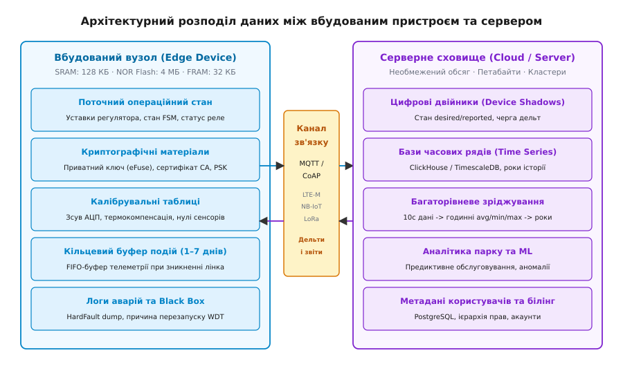
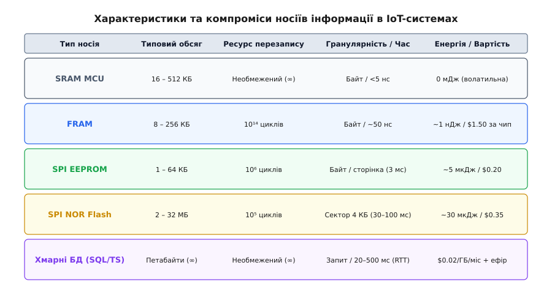
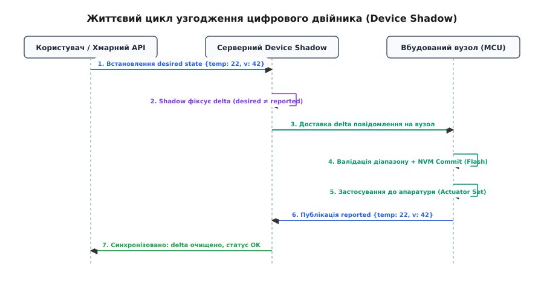

# Що тримати на пристрої, а що на сервері

<preknowlist>
- [Часові ряди: темп запису, зріджування, строк зберігання](root:sf-data/chasovi-riady) — поведінка незмінних метрик, потокові агрегації та життєвий цикл вимірювань.
- [Спектр консистентності, CAP і PACELC](root:sf-distributed/consistency-models) — узгодженість розподіленого стану при мережевих розривах та асинхронній передачі.
- [Край чи хмара: що рахувати на місці](root:embedded/krai-chy-khmara) — енергетичний та обчислювальний баланс між локальною обробкою та радіопередачею.
- [Черга офлайну](root:embedded/cherha-oflainu) — буферизування телеметрії у локальній енергонезалежній пам'яті під час втрати каналу зв'язку.
- [Журнал попереднього запису (WAL)](root:sf-data/write-ahead-log) — забезпечення атомарності змін та стійкості до раптового знеструмлення.
- [EEPROM та FRAM](root:embedded/eeprom-fram) — фізика комірок енергонезалежної пам'яті, ресурс циклів перезапису та гранулярність доступу.
</preknowlist>

Команда розробників вводить в експлуатацію партію з 500 автономних насосних станцій зрошення з живленням від акумуляторів і сонячних панелей під керуванням мікроконтролера STM32 та модема LTE-M. У першій версії прошивки архітектори вирішили зберігати всю телеметрію (тиск, вібрацію вала, струм двигуна) на сервері, транслюючи щосекундні вимірювання безпосередньо через стільниковий зв'язок, а поточний стан регулятора тримати виключно в базі даних бекенда: пристрій запитував у сервера дозвіл перед кожним перемиканням клапана. Через три доби акумулятори ємністю 10 А·год повністю розрядилися через постійно активний радіомодем, а під час першої ж грози, коли стільникова вежа знеструмилася на дві години, станція не змогла виконати аварійне вимкнення при критичному стрибку тиску понад 25 бар і розірвала магістральний трубопровід.

Спроба «виправити» помилку протилежним крайнощем — записувати щосекундні сирі дані у внутрішню Flash-пам'ять мікроконтролера розміром 1 МБ із сектором стирання 4 КБ — призвела до іншої катастрофи: за чотири місяці ресурс у 100 000 циклів стирання вичерпався, комірки пам'яті деградували, і прошивка втратила здатність зберігати навіть базові калібрувальні коефіцієнти.

Ці дві аварії демонструють фундаментальну проблему архітектури зв'язаних систем (*Connected Embedded Systems*): **розподіл даних та розміщення стану** (*Data Partitioning and State Placement*). Вбудований пристрій і сервер мають принципово різну фізику, вартість і надійність збереження інформації. Помилка у визначенні того, які байти належать кремнію мікроконтролера, а які — хмарним базам даних, руйнує енергетичний бюджет, випалює ресурс кремнію і позбавляє систему автономної безпеки.


*Розподіл обов'язків між вбудованим вузлом та сервером: локальний контур зберігає критичний стан, ключі та короткостроковий буфер, тоді як сервер агрегує історію, виконує аналітику парку та веде цифрові двійники.*

---

### Фізика та вартість зберігання: кремній MCU проти хмарних баз даних

Щоб побудувати надійний розподіл даних, необхідно зіставити фізичні характеристики та економіку носіїв на боці пристрою та на боці сервера.

На вбудованому вузлі доступні три основні класи пам'яті:
1. **Оперативна пам'ять (SRAM)**: розмір від 16 до 512 КБ. Час доступу — одиниці наносекунд. Енергія запису нульова (в межах споживання ядра), ресурси перезапису нескінченні. Проте це волатильна пам'ять: будь-яке знеструмлення, спрацювання сторожового таймера (*Watchdog*) або перехід у глибокий сон (*Deep Sleep*) без утримання живлення домену пам'яті повністю знищує її вміст.
2. **Внутрішня та зовнішня Flash-пам'ять (NOR Flash)**: розмір від 64 КБ до 32 МБ. Головне фізичне обмеження — **асиметрія читання та стирання**. Запис окремого байта можливий лише шляхом скидання бітів з `1` в `0`. Щоб повернути біти в стан `1`, необхідно виконати стирання цілого сектора (типово 4 КБ) або блока (32–64 КБ). Стирання сектора вимагає подачі підвищеної напруги на плаваючий затвор (тунелювання Фаулера — Нордгейма), що займає від 20 до 150 мс і споживає струм 15–30 мА. Фізичний ресурс оксидного шару обмежений: після 10 000 – 100 000 циклів стирання сектор перестає утримувати заряд.
3. **Сегнетоелектрична (FRAM) та магніторезистивна (MRAM) пам'ять**: розмір від 8 до 512 КБ. Забезпечує побайтовий енергонезалежний запис зі швидкістю шини SPI/I2C (час доступу ~50 нс), енергією запису близько 1 нДж на байт і ресурсом понад 10¹⁴ циклів (фактично необмежений). Головний недолік — висока питома вартість чипа (від $1.50 за 32 КБ проти $0.30 за 4 МБ SPI Flash).


*Порівняльна піраміда носіїв: від високошвидкісної, але обмеженої пам'яті мікроконтролера до необмежених, але віддалених серверних сховищ.*

На серверному боці діють інші закони:
- Дискові сховища (NVMe SSD, мережеві блокові пристрої AWS EBS, об'єктні сховища S3) надають практично необмежену ємність (петабайти).
- Спеціалізовані бази даних часових рядів (ClickHouse, TimescaleDB, InfluxDB) використовують колоночне стиснення (алгоритми Gorilla для чисел з рухомою комою, дельта-кодування для міток часу), знижуючи вартість зберігання однієї точки телеметрії до часток цента на рік.
- Реляційні системи (PostgreSQL) гарантують повну транзакційну узгодженість (*ACID*) для складних бізнес-правил та метаданих.

#### Економічний та енергетичний бар'єр передачі

Чому не можна просто передавати всі дані на сервер у реальному часі? Відповідь полягає у фізиці радіоканалу.

Передача 1 КБ даних через енергоефективний стільниковий модуль LTE-M/NB-IoT вимагає пробудження радіотракту, синхронізації з базовою станцією, проходження процедури автентифікації та передачі пакетів TCP/TLS. На цей сеанс витрачається від 100 до 300 мДж енергії (середній струм 150 мА при напрузі 3.6 В протягом 0.5–2 секунд). Для батареї CR123A (номінал 1500 мА·год, енергія близько 16 000 Дж) щосекундна передача вичерпає весь заряд за 2–3 доби. Якщо ж накопичувати вимірювання в локальній Flash-пам'яті й надсилати стиснений пакет 1 раз на 6 годин, та сама батарея забезпечить 5–7 років автономної роботи.

#### Фізика деградації комірок Flash та розрахунок ресурсу

Розглянемо типовий провал проектування: розробник записує структуру конфігурації розміром 64 байти у фіксований сектор Flash-пам'яті (4096 байтів) щоразу, коли змінюється поточний лічильник мотогодин (наприклад, кожні 5 хвилин).

Оскільки Flash-пам'ять не дозволяє перезаписати байти без попереднього стирання сектора, кожен запис 64 байтів змушує драйвер зчитувати 4 КБ в оперативну пам'ять, прати весь фізичний сектор і записувати 4 КБ назад.

```
Стирань на добу = (24 години · 60 хв) / 5 хв = 288 стирань/добу
Ресурс сектора NOR Flash = 100 000 циклів
Термін служби носія = 100 000 / 288 ≈ 347 діб (менше 1 року)
```

Через 11 місяців оксидний діелектрик затворів втрачає здатність ізолювати електрони, виникають бітові помилки, і пристрій не може завантажити власні налаштування.

Щоб запобігти цьому, застосовують дві стратегії:
1. **Апаратна заміна на FRAM/EEPROM**: для лічильників і параметрів, що змінюються щохвилини, встановлюють мікросхему FRAM, де ресурс $10^{14}$ циклів гарантує понад 100 років роботи без деградації.
2. **Лог-структуровані сховища (Log-Structured NVS / LittleFS)**: замість стирання сектора нові 64-байтні записи дописуються послідовно в кінець вільного простору сектора (*Append-only*). Сектор стирається лише тоді, коли всі його 4096 байтів заповнені (через $4096 / 64 = 64$ записи). Це знижує частоту стирань у 64 рази й подовжує життя Flash-пам'яті до 60 років.

> 🔧 **Навіщо це.** Локальна пам'ять пристрою призначена для підтримки безперервного, безпечного й енергоефективного функціонування в умовах відсутності мережі. Серверне сховище призначене для глобального аналізу, ретроспективи, координації парку та взаємодії з користувачами.

---

### Декомпозиція даних: що життєво необхідно тримати на вузлі

На основі фізичних обмежень виділяють чотири категорії даних, які зобов'язані перебувати в локальній пам'яті вбудованого вузла.

```
┌──────────────────────────────────────────────────────────────────────────┐
│                   КАТЕГОРІЇ ЛОКАЛЬНИХ ДАНИХ ВУЗЛА                        │
├────────────────────────────────┬─────────────────────────────────────────┤
│ 1. Операційний стан (Runtime)  │ FSM, активні уставки, контури безпеки   │
│ 2. Криптографія та ідентичність│ Приватний ключ, апаратний UID, CA cert  │
│ 3. Калібрувальні матриці       │ Зсув нуля АЦП, термодрейф, коефіцієнти  │
│ 4. Кільцевий буфер подій       │ FIFO-черга на 1–7 днів, краш-дампи WDT  │
└────────────────────────────────┴─────────────────────────────────────────┘
```

#### 1. Поточний операційний стан і локальні уставки (Operational State)
Вбудований вузол керує фізичними процесами: клапанами, нагрівачами, реле, силовими мостами інверторів. Час реакції на аварійний стан (перевантаження за струмом, вихід температури за критичну межу, відсутність потоку рідини) повинен складати від мікросекунд до десятків мілісекунд.

Якщо контур захисту залежить від зв'язку з хмарою, затримка передачі пакета (*RTT — Round Trip Time*) плюс час обробки на сервері (сумарно 100–2000 мс) або мережевий збій приведуть до фізичного руйнування обладнання. Тому **всі активні уставки регуляторів (Setpoints), поточний стан кінцевого автомата (FSM) та аварійні пороги зберігаються локально в NVM** (FRAM або емульованому EEPROM на Flash) і миттєво зчитуються під час завантаження ядра.

#### 2. Криптографічні матеріали та апаратна ідентичність (Security Credentials)
Пристрій повинен однозначно підтверджувати свою автентичність серверу без ризику компрометації всього парку.
- **Приватний асимметричний ключ** (наприклад, ECDSA secp256r1 або Ed25519) генерується на етапі виробництва і записується в захищену апаратну область (*Secure Element* ATECC608, eFuse мікроконтролера або зону ARM TrustZone). Цей ключ **ніколи не передається мережею** і не залишає межі кремнію.
- **Кореневий сертифікат центра сертифікації (Root CA)**: публічний сертифікат, зашитий у прошивку, за допомогою якого клієнт TLS верифікує справжність хмарного сервера при підключенні та перевіряє цифровий підпис бінарних оновлень (*Firmware OTA*).
- **Унікальний серійний номер (Hardware UID)**: зчитується з фабричного регістра мікроконтролера (наприклад, 96-бітний `UID` у STM32 або 48-бітний `MAC` в ESP32).

#### 3. Заводські калібрувальні таблиці (Calibration Parameters)
Жоден аналоговий датчик чи перетворювач не є ідеальним. Технологічний розкид кремнію, похибки резистивних дільників і температурний дрейф створюють індивідуальні зміщення.
- Зсув нуля (*Offset*) і крутизна характеристики (*Gain*) внутрішнього АЦП.
- Матриці компенсації взаємного впливу осей триосьового акселерометра та гіроскопа.
- Таблиці перерахунку опору NTC-термісторів у температуру (поліноми Стейнхарта — Харта).

Ці параметри визначаються індивідуально на тестовому стенді під час виготовлення плати й записуються в захищений сектор Flash/EEPROM. Вузол повинен виконувати перетворення сирих кодів АЦП у фізичні одиниці (вольти, бари, градуси) на місці. Це дозволяє локальній бізнес-логіці ухвалювати коректні рішення без звернення до сервера.

#### 4. Короткостроковий кільцевий буфер подій та «Чорна скринька» (Telemetry Buffer & Crash Log)
Втрата каналу зв'язку — це штатний режим роботи будь-якої бездротової системи. Локальна Flash-пам'ять організовується як кільцевий буфер (*Circular Log Buffer*), який забезпечує збереження телеметрії на період від 1 до 7 діб:
- Під час штатної роботи нові записи додаються в буфер, а фоновий процес передає їх на сервер і зміщує вказівник підтверджених даних (*Tail Pointer*).
- Якщо мережа недоступна, буфер заповнюється. При досягненні 100% ємності вмикається стратегія FIFO-витіснення: найстаріші рутинні вимірювання перезаписуються новими.
- **Аварійні дампи (Crash Dumps)**: стан регістрів процесора під час виникнення `HardFault`, трасування стека (*Stack Unwinding*) та лічильники скидань сторожового таймера записуються в окрему фіксовану зону пам'яті, яка **ніколи не затирається рутинною телеметрією**.

#### Формати серіалізації: накладні витрати JSON проти CBOR та Protobuf

Коли дані передаються між пристроєм і сервером, вибір формату серіалізації прямо впливає на споживання пам'яті та енергетичний бюджет.

```
┌──────────────────────────────────────────────────────────────────────────┐
│             ПОРІВНЯННЯ ФОРМАТІВ СЕРІАЛІЗАЦІЇ ДЛЯ ВУЗЛІВ                  │
├─────────────────┬──────────┬──────────────┬──────────────┬───────────────┤
│ Формат          │ Розмір   │ RAM (Парсер) │ CPU навантаж.│ Схема даних   │
├─────────────────┼──────────┼──────────────┼──────────────┼───────────────┤
│ JSON (текст)    │ 240 Б    │ 2–8 КБ (Купа)│ Високе       │ Неявна        │
│ CBOR (бінарний) │ 68 Б     │ 256–512 Б    │ Середнє      │ Самоописова   │
│ Protocol Buffers│ 22 Б     │ 0 Б (Статика)│ Мінімальне   │ Жорстка (.proto)│
└─────────────────┴──────────┴──────────────┴──────────────┴───────────────┘
```

Розглянемо типовий пакет телеметрії: мітка часу, 3 канали аналогових сенсорів, статус прапорців та заряд батареї:
- **JSON**: вимагає передачі текстових ключів `{"timestamp":1700000000,"temp":23.45,"pressure":101.3,"batt_v":3.82,"status":"OK"}`. Розмір корисного навантаження — близько 90 байтів плюс заголовки. Парсинг вимагає сканування рядків і часто динамічного виділення пам'яті (`malloc`), що на мікроконтролерах із 32 КБ RAM створює ризик фрагментації купи.
- **Protocol Buffers (NanoPB)** або плоска бінарна C-структура: ті самі дані упаковуються у 16–22 байти за допомогою кодування змінної довжини (*Varint*) та упакованих чисел з рухомою комою. Десеріалізація на мікроконтролері зводиться до перевірки розміру та прямого копіювання полів без жодного виділення пам'яті з купи.

Зменшення пакета з 240 байтів до 22 байтів знижує час роботи передавача в ефірі у 10 разів, зберігаючи роки роботи акумулятора для парку з тисяч пристроїв.

---

### Серверні сховища: часові ряди, аналітика та цифрові двійники

Серверна частина системи бере на себе завдання, які неможливо вирішити в межах ресурсів окремого мікроконтролера.

```
┌──────────────────────────────────────────────────────────────────────────┐
│                   КАТЕГОРІЇ СЕРВЕРНИХ ДАНИХ                              │
├────────────────────────────────┬─────────────────────────────────────────┤
│ 1. Бази часових рядів          │ ClickHouse/Timescale, роки вимірювань   │
│ 2. Багаторівневе зріджування   │ Raw (14 днів) -> 1 год -> 1 доба (3 р.) │
│ 3. Аналітика парку та ML       │ Предиктивне обслуговування, кореляції   │
│ 4. Метадані та права доступу   │ PostgreSQL, прив'язка до акаунтів, RBAC │
│ 5. Цифровий двійник (Shadow)   │ Стан desired vs reported, черга дельт   │
└────────────────────────────────┴─────────────────────────────────────────┘
```

#### 1. Довгострокова історія та багаторівневе зріджування (Downsampling)
Сервер агрегує потоки даних від тисяч пристроїв за роки експлуатації. Для оптимізації вартості сховища застосовують конвеєри зріджування:
- **Рівень 1 (Hot Storage)**: сирі секундні дані зберігаються протягом 14–30 днів для оперативної діагностики інцидентів.
- **Рівень 2 (Warm Storage)**: фоновий процес щогодини агрегує секундні точки у середні значення, мінімуми, максимуми та перцентилі (p₅₀, p₉₅, p₉₉). Дані зберігаються 90–180 днів.
- **Рівень 3 (Cold Storage)**: добові агрегати зберігаються 3–5 років у колоночних сховищах для побудови річних звітів та аналізу сезонних трендів.

#### 2. Аналітика всього парку (Fleet Intelligence & Predictive Maintenance)
Жоден окремий пристрій не може оцінити загальну картину деградації компонентів. Маючи телеметрію від 100 000 вузлів, серверні алгоритми машинного навчання виявляють системні закономірності:
- Виявлення бракованих партій акумуляторів за швидкістю росту внутрішнього еквівалентного послідовного опору (ESR) при однакових температурних циклах.
- Прогнозування виходу підшипника помпи з ладу шляхом спектрального аналізу вібрацій і зіставлення його з історичними поломками інших станцій (*Predictive Maintenance*).
- Кореляція енергоспоживання з погодними умовами в конкретному географічному регіоні.

#### 3. Метадані користувачів та бізнес-правила
Інформація про те, якому фермерському господарству належить насосна станція, які права доступу має конкретний оператор (рольова модель RBAC), історія платежів за зв'язок та географічні межі дозволеної експлуатації (*Geofencing*) зберігаються виключно в реляційній базі даних сервера. Вбудований мікроконтролер не повинен знати імен користувачів чи тарифних планів.

#### 4. Цифрові двійники (Device Shadows / Digital Twins)
Головний архітектурний шаблон зв'язку між асинхронним вебом і вбудованим вузлом — **цифровий двійник**.

Оскільки кінцевий вузол 99% часу спить або може бути тимчасово недоступний через перешкоди зв'язку, користувач мобільного застосунку не може безпосередньо надсилати синхронні RPC-запити на плату. Замість цього сервер підтримує JSON/CBOR-документ стану, розділений на дві гілки:
- `desired`: бажаний стан, який встановив користувач або бізнес-логіка бекенда (наприклад, увімкнути полив, цільовий тиск 4.5 бар).
- `reported`: фактичний стан, який вузол востаннє підтвердив апаратними вимірюваннями.

Коли пристрій виходить на зв'язок, він отримує різницю (`delta = desired - reported`), застосовує зміни до своїх регістрів і публікує новий `reported`.

---

### Інваріанти узгодженості та проблема джерела правди (Source of Truth)

Найнебезпечніша помилка проектування розподіленої системи — розмивання меж відповідальності за дані (*Data Ownership*). Якщо одне й те саме поле конфігурації можуть одночасно змінювати і сервер, і локальний пристрій без чіткого арбітражу, виникає стан перегонів (*Race Condition*), що веде до розсинхронізації та аварій.

```
┌──────────────────────────────────────────────────────────────────────────┐
│                   МАТРИЦЯ ДЖЕРЕЛ ПРАВДИ (SOURCE OF TRUTH)                │
├──────────────────────────────────┬───────────────────────────────────────┤
│ Джерело правди — ПРИСТРІЙ        │ Джерело правди — СЕРВЕР               │
├──────────────────────────────────┼───────────────────────────────────────┤
│ • Фактичний стан реле та моторів │ • Цільові уставки (Target Setpoints)  │
│ • Напруга та температура батареї │ • Розклад роботи та тайм-слоти        │
│ • Фізичні покази сенсорів        │ • Версія цільової прошивки (OTA)      │
│ • Локальний одометр/мотогодини   │ • Геозони та ліміти споживання        │
│ • Апаратні коди аварій (Faults)  │ • Дозволи на активацію функцій        │
└──────────────────────────────────┴───────────────────────────────────────┘
```

#### Правило 1: Фізичні факти належать виключно пристрою
Сервер ніколи не може «призначити» пристрою напругу акумулятора `3.85 В` або змусити його «вважати», що температура підшипника дорівнює `40 °C`. Будь-які дані, що є результатом прямого фізичного вимірювання сенсорами або відображають поточний стан силових ключів (реле увімкнене/вимкнене), мають єдине джерело правди — **вбудований вузол**. Сервер лише фіксує отримані звіти (`reported`).

#### Правило 2: Бізнес-наміри та глобальні уставки належать серверу
Бажані режими роботи, розклади активації, тарифні обмеження та політики оновлення прошивки формуються користувачем чи хмарною платформою. Сервер є єдиним джерелом правди для гілки `desired`.

#### Правило 3: Локальний пріоритет безпеки (Local Safety Precedence)
Якщо сервер надіслав команду встановити оберти помпи на 3000 об/хв (`desired`), але локальний сенсор тиску зафіксував перевищення критичної позначки 30 бар, вбудований вузол **зобов'язаний відхилити серверне налаштування**, вимкнути двигун через локальний аварійний контур і опублікувати у відповідь статус помилки:

```json
{
  "reported": {
    "pump_state": "EMERGENCY_STOP",
    "pressure_bar": 31.2,
    "last_error": "ERR_OVERPRESSURE_LOCKOUT",
    "config_version": 42
  }
}
```

Серверний цифровий двійник, отримавши такий звіт, скидає гілку `desired`, синхронізуючи віртуальний стан із фізичною реальністю.

#### Локальне ручне керування (Manual Override) та арбітраж перегонів

Типовий інженерний випадок: на шафі керування насосною станцією встановлено фізичний перемикач «Ручний пуск / Автомат». Якщо оператор на місці вручну перемикає тумблер у положення «Увімкнено», виникає конфлікт із серверним розкладом.

Архітектурний патерн вирішення конфлікту:
1. **Локальний пріоритет дії**: Вузол негайно виконує команду фізичного тумблера, встановлюючи внутрішній прапорець `manual_override = true`.
2. **Публікація оновленого стану**: Вузол формує звіт `reported: { pump_state: "RUNNING", manual_override: true, version: 105 }`.
3. **Реакція сервера**: Отримавши повідомлення про ручне керування, хмарний сервіс тимчасово блокує автоматичні команди за розкладом і надсилає сповіщення диспетчеру в веб-інтерфейс.
4. **Скидання блокування**: Автоматичне керування відновлюється лише тоді, коли тумблер на місці повертають у режим «Автомат», або після вичерпання апаратного таймауту безпеки.

#### Життєвий цикл трифазної синхронізації з версіонуванням

Для запобігання втраті оновлень та усунення дублювання конфігурація супроводжується монотонним цілочисельним лічильником версій (`config_version`).


*Послідовність синхронізації: користувач задає бажаний стан у хмарі, вузол отримує дельту, перевіряє її, фіксує в NVM, застосовує до апаратури та звітує про новий стан.*

Кроки протоколу:
1. **Ініціація зміни**: Користувач змінює цільову температуру в додатку. Сервер формує запис у двійнику:
   `desired: { target_temp: 24.0 }, version: 105`.
2. **Формування дельти**: Сервер обчислює різницю між `desired` та `reported` і відправляє у топік `$shadow/delta` лише змінені поля разом із номером версії `105`.
3. **Приймання та валідація на вузлі**:
   - Вузол перевіряє, що отримана версія більша за поточну збережену (`105 > 104`).
   - Виконується перевірка меж (*Sanity Check*): наприклад, `-20.0 <= target_temp <= 80.0`.
4. **Атомарна фіксація в NVM**: Нова структура конфігурації з новою версією `105` і контрольною сумою CRC32 записується в енергонезалежну пам'ять (Flash/FRAM).
5. **Застосування до апаратури**: Нові коефіцієнти передаються у виконавчий контур регулятора.
6. **Звіт про узгодження**: Вузол публікує повідомлення в топік `$shadow/reported`:
   `reported: { target_temp: 24.0, status: "OK" }, version: 105`.
7. **Закриття дельти на сервері**: Сервер фіксує збіг `desired == reported` і очищає активну дельту.

---

### Повний модуль розподіленого керування конфігурацією та станом на C/C++

Нижче наведено промисловий модуль синхронізації конфігурації та стану пристрою (*Device Shadow State Synchronizer*).

Модуль реалізує:
1. Захищене збереження конфігурації в енергонезалежній пам'яті (NVM) з перевіркою магічного числа `0x43464731` ("CFG1"), монотонної версії та контрольної суми CRC-32.
2. Валідацію діапазонів значень для захисту фізичного обладнання.
3. Обробку вхідної дельти від хмари, оновлення апаратного стану та генерацію пакета підтвердження `reported`.

:::tabs
:::code shcho-trymaty-na-prystroi-a-shcho-na-serveri-d/c/main.c
:::code shcho-trymaty-na-prystroi-a-shcho-na-serveri-d/cpp/main.cpp
:::

---

### Підсумок інженерних правил розміщення даних

Чітке розмежування відповідальності між вбудованим вузлом і сервером базується на трьох непорушних інженерних правилах:

1. **Правило автономної безпеки**: Все, що необхідно для запобігання фізичній аварії та підтримки локального контуру регулювання (FSM, калібрування, уставки захисту), живе в енергонезалежній пам'яті мікроконтролера. Пристрій не має права чекати на відповідь сервера, коли тиск або температура перетинають критичну межу.
2. **Правило збереження кремнію та батареї**: Високочастотні сирі вимірювання агрегуються та фільтруються на місці в SRAM. Довгострокова телеметрія пишеться у Flash-буфер лише пакетами, узгодженими з розміром сторінки, а радіоканал активується з мінімально допустимою періодичністю.
3. **Правило цифрового двійника з монотонним версіонуванням**: Будь-яка двостороння зміна параметрів проходить через модель `desired / reported` з інваріантом «фізичні факти належать пристрою, бізнес-наміри — серверу». Відхилення неприпустимих значень та обробка розривів мережі закладаються в код як штатний базовий сценарій.
