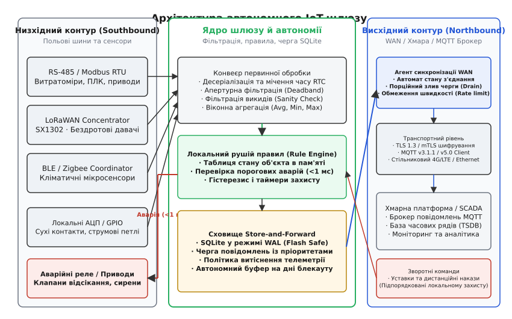
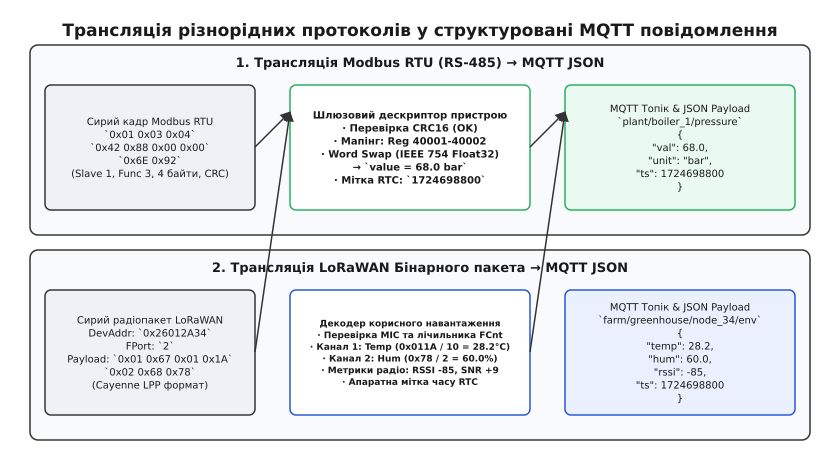
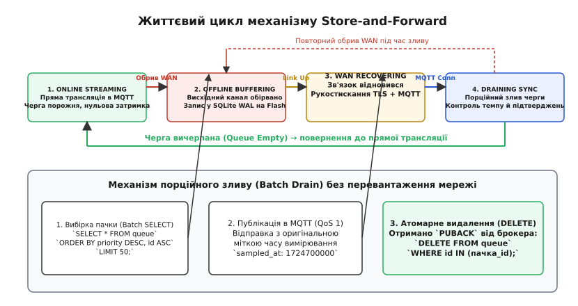
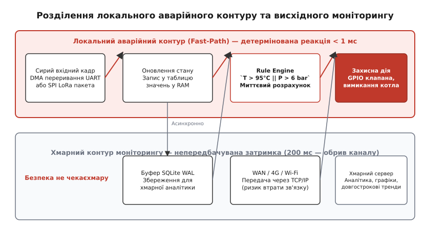

# Шлюз і локальна автономія (детально)

<preknowlist>
- [Ролі: вузол, шлюз, брокер, служба, сховище, клієнт](root:embedded/roli-vuzol-shliuz-broker-sluzhba-skhovyshche-kliient) — призначення та місце шлюзу в загальній ієрархії IoT-системи.
- [Вузол розумного дому: давач + MQTT + автономна логіка](root:embedded/smart-home-node) — базова автономія кінцевого пристрою та архітектура розділених петель.
- [Шлюз: міст між протоколами й межа автономії](root:embedded/shliuz-mist-mizh-protokolamy-i-mezha-avtonomii) — поняття мостового з'єднання та фізична ізоляція шин.
- [MQTT](root:com-protocol/mqtt) — механіка публікації/підписки (Pub/Sub), рівні якості доставки (QoS 0/1/2) та прапорець утримання (retain).
- [Modbus RTU](root:com-protocol/modbus) — кадрова структура, інтервали t1.5/t3.5, коди функцій та регістрова модель польової шини.
- [LoRaWAN](root:com-transport/lorawan) — радіоінтерфейс великого радіуса дії, структура кадрів, FPort і часовий бюджет ефіру.
</preknowlist>

Коли на теплопункті багатоповерхового будинку або в автономному агрокомплексі одночасно працюють двадцять ультразвукових лічильників тепла на дротовій шині RS-485 Modbus, десяток бездротових давачів витоку газу на радіомодулях LoRaWAN і кілька сервоприводів змішувальних контурів, система щосекунди генерує щільний потік різнорідних сигналів. Якщо екскаватор перебиває магістральне оптоволокно провайдера або знеструмлюється найближча базова станція стільникового зв'язку LTE, цей локальний світ не має права зупинитися. Тиск у паровому котлі не повинен піднятися до критичної межі через те, що хмарний сервер перестав надсилати команди регулювання; циркуляційні насоси не мають згоріти на сухому ході; а терабайти показників комерційного обліку енергії за три доби блекауту не сміють безслідно зникнути.

Кінцевий мікроконтролер окремого сенсорного вузла фізично не здатен взяти на себе координацію цілого об'єкта: йому бракує оперативної пам'яті для тривалої буферизації мегабайтів вимірювань, він не має стійкої до раптових вимкнень файлової системи та не вміє одночасно обслуговувати важкий криптографічний стек mTLS поруч із низькорівневим тактуванням кількох польових трансиверів. Цю межу тримає **локальний IoT-шлюз** (*Edge Gateway*). Він бере на себе дві взаємопов'язані ролі: виступає **мостом трансляції протоколів та агрегації даних**, який перетворює сирі бінарні кадри польових шин на стандартизовані повідомлення IP/MQTT, і функціонує як **автономний центр керування**, що за повної відсутності зв'язку з хмарою самостійно ухвалює захисні рішення та надійно зберігає хронологію подій у локальному енергонезалежному сховищі.


*Архітектура автономного IoT-шлюзу: розділення низхідного польового периметра (Southbound) від висхідного (Northbound), конвеєр первинної фільтрації, локальний аварійний рушій правил та відмовостійка черга Store-and-Forward на базі SQLite WAL.*

---

## Межа двох світів: чому польовий сегмент вимагає шлюзу

Неможливість підключити польові контролери безпосередньо до хмарного брокера або бази даних часових рядів зумовлена трьома фундаментальними бар'єрами: фізично-електричним, обчислювально-криптографічним та парадигмальним.

```
+-------------------------------------------------------------------------------+
|                       ХМАРНИЙ БРОКЕР ТА SCADA (WAN)                           |
|       Стек: TCP/IP · TLS 1.3 (mTLS) · MQTT v5.0 / HTTPS · JSON/Protobuf       |
+-------------------------------------------------------------------------------+
                                      ▲
                                      │ Висхідний канал (Ethernet / 4G / LTE)
                                      ▼
+-------------------------------------------------------------------------------+
|                           ЛОКАЛЬНИЙ ШЛЮЗ (GATEWAY)                            |
|  · Гальванічна розв'язка 2.5 кВ            · SQLite WAL (Store-and-Forward)   |
|  · Апаратний RTC (NTP / GPS Timestamping)  · Fast-Path Rule Engine (< 1 мс)   |
|  · Планувальник опитування Modbus          · Концентратор LoRaWAN (SX1302)    |
+-------------------------------------------------------------------------------+
         ▲                            ▲                            ▲
         │ RS-485 (Диференційна пара) │ SPI / Радіоефір 868 МГц    │ UART / BLE
         ▼                            ▼                            ▼
+--------------------+      +--------------------+      +--------------------+
| Лічильник тепла    |      | Сенсор газу LoRa   |      | Кліматичний датчик |
| Modbus RTU (Slave) |      | Батарейне живлення |      | BLE GATT Сервер    |
+--------------------+      +--------------------+      +--------------------+
```

### 1. Фізичний та електричний бар'єр
Польові пристрої використовують промислові та бездротові інтерфейси, позбавлені адресації IP та концепції мережевих маршрутизаторів:
* **RS-485 (Modbus RTU)** передає сигнал диференційною парою напівдуплексних ліній `A` та `B`. Лінії зв'язку довжиною до 1200 метрів проходять поруч із потужними силовими кабелями двигунів і частотних перетворювачів. Різниця потенціалів між «землями» в різних точках споруди досягає десятків вольтів. Пряме з'єднання мікроконтролера з такою лінією без апаратної гальванічної розв'язки на 2.5–5 кВ (наприклад, оптичних або магнітних ізоляторів `ADuM1411` чи `ISO1410`) та каскадів супресорів (TVS-діодів) неминуче призведе до вигоряння кристала від першої синфазної завади або утворення земляної петлі (*Ground Loop*).
* **LoRaWAN** оперує радіомодуляцією з розширенням спектра (Chirp Spread Spectrum) на неліцензованих частотах 868/915 МГц. Батарейний сенсор передає короткий пакет тривалістю кілька десятків мілісекунд раз на 10 хвилин, щоб зберегти заряд джерела живлення на 5–10 років. Він не підтримує протокол TCP з його трикроковим рукостисканням (SYN-ACK) та повторними передачами, оскільки це миттєво спустошило б батарею.

### 2. Ресурсний та криптографічний бар'єр
Сучасні стандарти кібербезпеки вимагають обов'язкового взаємного шифрування транспортного рівня (TLS 1.3 / mTLS з алгоритмами ECDSA та ChaCha20-Poly1305 або AES-GCM). Щоб провести криптографічне рукостискання, верифікувати ланцюжок сертифікатів X.509 і тримати в пам'яті сесійні ключі та буфери фрагментації TCP, пристрою потрібно щонайменше 50–120 КБ виділеної оперативної пам'яті (RAM).

Польовий датчик температури на базі 8-бітного ядра або ощадливого мікроконтролера ARM Cortex-M0+ має усього 8–16 КБ усієї пам'яті SRAM. Він не здатний виконати TLS-рукостискання ані за обсягом пам'яті, ані за обчислювальною швидкодією. Шлюз бере цю криптографічну роботу на себе: він підтримує захищену TLS-сесію з хмарою, виступаючи єдиною довіреною точкою виходу об'єкта у зовнішній світ.

### 3. Парадигмальний бар'єр
Польові протоколи здебільшого синхронні та циклічні: майстер на шині Modbus послідовно запитує регістри підлеглих пристроїв за жорстким розкладом. Хмарні платформи та системи диспетчеризації працюють за асинхронною моделлю публікації/підписки (MQTT) або подієво-орієнтованою моделлю (REST/Webhooks). Шлюз транслює синхронний цикл опитування у потік асинхронних семантичних подій.

> 🔧 **Навіщо це.** Шлюз — це не просто кабельний перехідник і не «німа труба» (*dumb pipe*), яка пересилає байти з одного сокета в інший. Шлюз є локальним хазяїном об'єкта. Він володіє знанням про структуру підключених приладів, правила їх опитування, одиниці вимірювання та фізичні межі безпеки.

---

## Конвеєр вхідних даних: мостове перетворення, фільтрація й агрегація

Трансляція протоколів у шлюзі вимагає суворого детермінізму. Розгляньмо послідовний шлях обробки вимірювань від фізичного порту до готового до відправки MQTT-пакета.


*Трансляція моделей: перетворення синхронного кадру Modbus RTU та бінарного пакета LoRaWAN Cayenne LPP у стандартизовані асинхронні повідомлення MQTT із збереженням апаратних міток часу.*

### 1. Низхідний прийом (Southbound Ingestion) та контроль таймінгів

#### Modbus RTU (RS-485)
Шлюз працює як `Modbus Master`. Планувальник опитування активує запити до підлеглих вузлів (`Slave ID: 1..247`) згідно з конфігураційними дескрипторами. 

Приймання кадру вимагає апаратного контролю інтервалів тиші на шині:
* Інтервал між байтами всередині кадру не повинен перевищувати `t1.5` (1.5 символу).
* Інтервал між окремими кадрами повинен бути не меншим за `t3.5` (3.5 символу). При швидкості 9600 біт/с час одного байта (11 бітів) дорівнює 1.145 мс, отже пауза `t3.5` становить 4.01 мс.

Драйвер UART шлюзу використовує апаратні таймери бездіяльності (наприклад, функцію *Receiver Timeout* у мікроконтролерах STM32/ESP32) або переривання DMA, щоб зафіксувати кінець кадру без навантаження центрального процесора. Після прийому шлюз розраховує та перевіряє 16-бітну контрольну суму `CRC-16/MODBUS` (поліном `0xA001`). Якщо контрольна сума зійшлася, сирі байти надходять у транслятор.

#### LoRaWAN Concentrator
Шлюз на базі мікросхеми концентратора (наприклад, Semtech SX1302/SX1303) одночасно прослуховує 8 радіоканалів і кілька коефіцієнтів розширення спектра (SF7–SF12). Демодульований радіопакет передається в процесор шлюзу через шину SPI. 

Шлюз витягує заголовок `FHDR`:
* Перевіряє адресу пристрою `DevAddr` (32 біти).
* Перевіряє лічильник кадрів `FCnt` для захисту від атак повторного відтворення (Replay Attacks).
* Валідує код автентичності повідомлення `MIC` (Message Integrity Code) за допомогою ключа `NwkSKey` (алгоритм AES-CMAC-128).
* Розшифровує корисне навантаження `FRMPayload` ключем `AppSKey` (алгоритм AES-CTR-128).

### 2. Розбір байтового порядку (Endianness) та бітових полів

Польові протоколи пакують дані в компактні бінарні структури. Для їх перетворення на дійсні інженерні величини шлюз використовує карту регістрів:

* **Modbus Word Swapping:** Стандарт Modbus не регламентує порядок слів у 32-бітних числах з рухомою комою (IEEE 754 Float). Якщо теплолічильник повертає два 16-бітні регістри `0x4288` та `0x0000`, шлюз має знати конфігурацію пристрою:
  * *Big-Endian (ABCD):* `0x42880000` = `68.0`
  * *Little-Endian Word Swap (CDAB):* `0x00004288` = `0.0000000000...` (сміття)
* **LoRaWAN Cayenne LPP / Packed Binary:** Формати кодування пакують тип сенсора, номер каналу та масштабоване ціле число. Наприклад, байти `0x01 0x67 0x01 0x1A` означають:
  * `0x01` — Канал 1
  * `0x67` — Тип: Давач температури (роздільна здатність 0.1 °C, знакове int16)
  * `0x011A` = `282` → `282 × 0.1` = `28.2 °C`

### 3. Апаратне мічення часу (Hardware Timestamping)

Критична помилка недосвідчених систем — ставити мітку часу в хмарі в момент отримання повідомлення. Якщо висхідний канал упаде на дві доби, хмарний сервер після відновлення зв'язку отримає 100 000 накопичених точок і запише їх під однією поточною секундою, перетворивши часовий ряд на вертикальну стіну некоректних даних.

Шлюз має власний апаратний годинник реального часу (RTC), який періодично синхронізується через NTP або GPS. Мітка часу `sampled_at` (UNIX Timestamp у мікросекундах або мілісекундах) формується шлюзом у момент фізичного переривання UART або SPI прийому пакета і назавжди вшивається в структуру вимірювання.

### 4. Апертурна фільтрація (Deadband) та фільтрація викидів

Якщо давач температури теплоносія опитується раз на секунду, але температура змінюється повільно, надсилати 86 400 ідентичних повідомлень на добу через платний стільниковий трафік 4G — марнотратство.

Шлюз застосовує **апертурну фільтрацію** (*Report-by-Exception / Deadband*):

```
Поточне значення: v
Останнє передане: v_last
Поріг апертури:   Δv
Максимальний час тиші: T_heartbeat

Умова відправки:
(|v - v_last| ≥ Δv)  АБО  (now - t_last_sent ≥ T_heartbeat)
```

1. Якщо зміна величини перевищує дельту `Δv` (наприклад, `|T - T_last| ≥ 0.2 °C`), подія негайно генерується та передається далі.
2. Якщо величина не змінюється, шлюз мовчить, але не довше за `T_heartbeat` (наприклад, 15 хвилин). Примусове повідомлення серцебиття підтверджує, що датчик і шлюз живі, а канал зв'язку справний.

Паралельно працює **фільтрація викидів** (*Sanity Check*):
* Якщо давач тиску води в побутовій системі повертає значення `999.9 bar` або `-50.0 bar`, це апаратний обрив струмової петлі або помилка АЦП.
* Шлюз відкидає такі точки з потоку телеметрії, але генерує діагностичну подію `SENSOR_HARDWARE_FAULT` у локальний журнал.

### 5. Віконна агрегація (Time-Window Aggregation)

Для високочастотних сигналів (наприклад, вимірювання вібрації підшипника насоса на частоті 1 кГц або струму двигуна на 50 Гц) передача сирих відліків у хмару неможлива через обмеження пропускної здатності.

Шлюз накопичує ковзне вікно відліків тривалістю `W` (наприклад, 10 секунд) і розраховує статистичний вектор:
* `avg` (середнє арифметичне значення)
* `rms` (середнє квадратичне значення для оцінки діючого струму / потужності)
* `min` та `max` (екстремуми напруги або тиску)
* `variance` / `std_dev` (дисперсія як індикатор механічного зносу)

У висхідний канал вирушає один компактний агрегований запис раз на 10 секунд замість 10 000 сирих чисел.

---

## Механізм автономії (Store-and-Forward): надійність на дні блекауту

Головний виклик для автономного шлюзу — поведінка під час тривалого обриву висхідного каналу (*WAN Outage*). Обрив може тривати від кількох секунд (короткочасний збій базової станції) до кількох діб (пошкодження оптоволоконної лінії внаслідок аварії).


*Скінченний автомат синхронізації: перемикання між прямою трансляцією, збереженням у SQLite WAL під час блекауту та транзакційним порційним зливом без перевантаження висхідного каналу зв'язку.*

### Чому буферизація в RAM непридатна

Якщо система генерує 10 повідомлень на секунду розміром 200 байтів кожне, за годину блекауту обсяг даних становить:

```
10 пов/с × 200 байт × 3600 с = 7.2 МБ / год
За добу: 7.2 МБ × 24 = 172.8 МБ
```

Для вбудованого контролера з 16–32 МБ оперативної пам'яті вичерпання RAM настане вже за кілька годин. Крім того, будь-яке раптове перезавантаження шлюзу через стрибок живлення миттєво знищить увесь накопичений у RAM буфер. Дані мусять зберігатися в енергонезалежній пам'яті (Flash / eMMC / microSD).

### Архітектура локального сховища на SQLite у режимі WAL

Класичні реляційні бази даних на вбудованих Linux-системах за замовчуванням використовують режим відкатного журналу (*Rollback Journal*). У цьому режимі кожен запис викликає блокування файлу бази, скидання сторінок на диск через `fsync()` і подвійний перезапис блоків флеш-пам'яті, що викликає катастрофічне зношення флешу (*Flash Wear-Out*) і гальмує систему.

Стандартом промислових IoT-шлюзів є вбудована база **SQLite у режимі журналу випереджального запису (Write-Ahead Log, WAL)**.

Переваги режиму WAL для вбудованих систем:
1. **Паралельне читання та запис:** Читачі черги (потік синхронізації з хмарою) не блокують запис нових вимірювань від польових шин. Запис здійснюється послідовним додаванням в кінець файлу `*-wal`.
2. **Стійкість до збоїв живлення (Power-Cut Safety):** Якщо живлення зникає посеред запису транзакції, неповний кадр у WAL просто ігнорується під час наступного старту. Основний файл бази даних `gateway.db` ніколи не пошкоджується.
3. **Оптимальна взаємодія з Flash-пам'яттю:** Завдяки послідовному запису сторінок і відсутності частих хаотичних перезаписів контролер eMMC/Flash ефективно виконує вирівнювання зносу (*Wear Leveling*).

Налаштування SQLite для автономного шлюзу:

```sql
PRAGMA journal_mode = WAL;          -- Вмикаємо режим Write-Ahead Log
PRAGMA synchronous = NORMAL;         -- Баланс між надійністю та швидкістю fsync
PRAGMA temp_store = MEMORY;          -- Тимчасові таблиці тримаємо в RAM
PRAGMA wal_autocheckpoint = 1000;    -- Скидання журналу у файл кожні 1000 сторінок
PRAGMA mmap_size = 67108864;         -- 64 МБ Memory-Mapped I/O для швидкого читання
```

### Схема таблиці черги Store-and-Forward

:::code shliuz-i-lokalna-avtonomiia-d/sql/main.sql

### Політика витіснення при переповненні накопичувача (Eviction Strategy)

Якщо блекаут триває тижнями, а обсяг виділеного розділу Flash (наприклад, 2 ГБ) заповнюється на 85%, шлюз застосовує політику **пріоритетного витіснення**:

1. **Аварійні події (Priority 2 - Alarms) та аудит-логи** зберігаються безстроково і ніколи не видаляються автоматично.
2. **Високочастотна телеметрія (Priority 0)** витісняється за принципом FIFO: найстаріші регулярні точки видаляються пакетами по 1000 штук, щоб звільнити місце для свіжих вимірювань та аварійних подій.
3. Шлюз фіксує факт втрати точок і формує діагностичний прапорець `DATA_EVICTION_OCCURRED`, який буде відправлено в хмару першим повідомленням після відновлення зв'язку.

```sql
-- Видалення найстаріших 500 записів низького пріоритету при досягненні ліміту диска
DELETE FROM outbound_queue 
WHERE id IN (
    SELECT id FROM outbound_queue 
    WHERE priority = 0 AND status = 0 
    ORDER BY id ASC 
    LIMIT 500
);
```

### Автомат станів відновлення зв'язку та порційний злив (Batch Drain)

Коли інтернет-канал відновлюється, наївна спроба «вивалити» всі накопичені 500 000 повідомлень одночасно призведе до колапсу: переповниться черга модему, брокер розірве з'єднання через перевищення ліміту частоти повідомлень (*Rate Limit*), а процесор шлюзу зависне в блокувальних мережевих викликах.

Синхронізація виконується через чотиристадійний автомат:

```
[1. ONLINE_STREAMING] ────(Втрата WAN)────► [2. OFFLINE_BUFFERING]
        ▲                                            │
        │                                            │ (Відновлення лінка)
 (Черга порожня)                                     ▼
        │                                   [3. WAN_RECOVERING]
        │                                            │
        │                                   (TLS/MQTT підключено)
        │                                            ▼
[4. DRAINING_SYNC] ◄─────────────────────────────────┘
```

1. **ONLINE_STREAMING:** Канал активний, черга на диску порожня. Свіжі дані після фільтрації публікуються в MQTT напряму (затримка < 5 мс).
2. **OFFLINE_BUFFERING:** Фіксація обриву (провал MQTT Keep-Alive / TCP RST). Усі повідомлення записуються виключно в SQLite WAL.
3. **WAN_RECOVERING:** Відновлення інтерфейсу WAN (отримання IP по DHCP / підняття LTE сесії). Виконання TLS-рукостискання та підключення до MQTT-брокера.
4. **DRAINING_SYNC (Порційний злив):**
   * Шлюз вибирає з бази транзакційну пачку `BATCH_SIZE = 50` записів найвищого пріоритету:
     ```sql
     SELECT id, topic, payload FROM outbound_queue 
     WHERE status = 0 
     ORDER BY priority DESC, id ASC 
     LIMIT 50;
     ```
   * Переводить їх у статус `IN_FLIGHT` (`status = 1`).
   * Публікує пачку в MQTT з рівнем якості **QoS 1**.
   * Тільки після отримання від брокера пакетів підтвердження `PUBACK` на всі повідомлення пачки виконується атомарне видалення:
     ```sql
     DELETE FROM outbound_queue WHERE id IN (101, 102, ... 150);
     ```
   * Між пачками встановлюється регульована пауза (наприклад, 50 мс), що обмежує висхідний потік на рівні безпечних 100–200 кбіт/с.
   * Коли черга стає порожньою (`SELECT COUNT(*) FROM outbound_queue == 0`), шлюз повертається в стан `ONLINE_STREAMING`.

---

## Локальне аварійне реагування (Local Rule Engine)

Головна відмінність промислового шлюзу від простого ретранслятора — наявність вбудованого **рушія локальних правил** (*Edge Rule Engine*).


*Швидкий локальний аварійний шлях (Fast-Path) виконується за частки мілісекунди безпосередньо в оперативній пам'яті шлюзу, повністю ізолюючи захисну автоматику від затримок та збоїв глобальної мережі.*

### Бюджет часу аварійного реагування

У технологічних процесах критичні аварії розвиваються за лічені частки секунди:
* Кавітація та сухий хід насоса руйнують крильчатку за 1–2 секунди.
* Гідроудар при різкому закритті магістрального клапана поширюється зі швидкістю звуку у воді (1400 м/с).
* Перегрів літієвого акумулятора (Thermal Runaway) переходить у некероване займання за секунди.

Час проходження сигналу через хмару складається з неконтрольованих затримок:

```
T_реакції_хмари = T_модем + T_стільниковий_канал + T_інтернет_маршрутизація + 
                  T_хмарна_черга + T_обробка_сервером + T_зворотний_шлях
```

Навіть в ідеальних умовах 4G/LTE цей час становить 150–500 мс, а за нестабільного сигналу чи повторних передач TCP — 5–30 секунд. Під час обриву зв'язку час реакції хмари дорівнює **нескінченності**.

Локальний рушій правил шлюзу працює за детермінованим **швидким шляхом (Fast-Path)**:
```
T_локальної_реакції = T_прийом_кадру (DMA) + T_перевірка_правил (RAM) + T_GPIO_вихід
                     = 200 мкс + 50 мкс + 5 мкс ≈ 0.255 мс
```

Реакція менше ніж за 1 мілісекунду виконується локально і не залежить від стану глобальної мережі.

### Архітектура Fast-Path Rule Engine

1. **Таблиця стану об'єкта в пам'яті (Shared State Table):** Шлюз тримає в пам'яті атомарну таблицю останніх валідних значень усіх фізичних величин:

:::tabs
```c
typedef struct {
    float value;
    uint64_t timestamp_ms;
    bool is_valid;
    bool is_alarm;
} MetricState;
```
```cpp
struct MetricState {
    float value{0.0f};
    std::chrono::milliseconds timestamp{0};
    bool is_valid{false};
    bool is_alarm{false};
};
```
:::

2. **Конфігурація правил:** Правило описується декларативно або у вигляді автомата станів:
   * *Умова спрацьовування:* `IF (boiler_pressure > 6.0 bar) AND (valve_feedback == CLOSED)`
   * *Захисна дія:* `ACTION: gpio_set_emergency_relay(HIGH); modbus_write_coil(PUMP_RELAY_ADDR, 0);`
   * *Діагностичне сповіщення:* Сформувати подію найвищого пріоритету (`priority = 2`) в чергу SQLite.
3. **Гістерезис та антибрязкіт аварій (Debounce / Hysteresis):** Щоб виключити багаторазове клацання потужного силового контактора при коливаннях тиску навколо порогового значення (наприклад, 6.01 -> 5.99 -> 6.02 bar), правило містить гістерезис (поріг скидання 5.5 bar) і таймер затримки повернення (*Hold-off Timer*).
4. **Конфлікт пріоритетів (Локальний захист проти хмарних команд):** Якщо оператор із мобільного застосунку через хмару надсилає команду `FORCE_START_HEATER`, але локальний шлюз фіксує тиск `6.5 bar` (аварія), шлюз **блокує виконання дистанційної команди**, повертаючи статус `CMD_REJECTED_LOCAL_SAFETY_OVERRIDE`. Локальна безпека завжди має вищий пріоритет над віддаленими командами.
5. **Сторожовий таймер зв'язку з периферією (Node Watchdog):** Якщо підлеглий польовий давач перестав відповідати на опитування довше за тайм-аут `T_sensor_timeout` (наприклад, обрив дроту термопари), шлюз не має права тримати останнє старе значення — він негайно переводить контур у безпечний стан (*Fail-Safe Default*): зупиняє нагрів і активує аварійну сигналізацію.

---

## Модуль надійного шлюзу на C та C++

Розгляньмо повну реалізацію ядра автономного шлюзу: мостове перетворення, виконання аварійних правил, локальна черга повідомлень із пріоритетами та автомат порційного зливу Store-and-Forward.

:::tabs
:::code shliuz-i-lokalna-avtonomiia-d/c/gateway_core.h
:::code shliuz-i-lokalna-avtonomiia-d/cpp/gateway_core.hpp
:::

Тепер реалізуємо логіку обробки:

:::tabs
:::code shliuz-i-lokalna-avtonomiia-d/c/gateway_core.c
:::code shliuz-i-lokalna-avtonomiia-d/cpp/gateway_core.cpp
:::

---

## Інженерні крайові випадки, ресурс флешу та вартість відмов

У польових умовах надійність шлюзу перевіряється не в штатному режимі, а в моменти збігів кількох несприятливих факторів.

### 1. Збій живлення під час запису черги (Power Cut during Flash Write)
Раптове відключення живлення під час скидання сторінки на флеш-накопичувач eMMC/SD — головна причина перетворення файлових систем на нечитабельний стан (*RAW/Corrupted*).

* **Апаратний захист:** Промислові шлюзи обладнуються блоком резервного живлення на іоністорах (суперконденсаторах), які утримують напругу живлення 3.3/5 В протягом 200–500 мс після зникнення входу. Сигнал `POWER_FAIL` надходить на лінію переривання мікроконтролера, який негайно завершує відкриті транзакції SQLite та переводить флеш-контролер у стан сну.
* **Програмний захист:** Режим SQLite WAL із `PRAGMA synchronous = NORMAL` гарантує, що навіть у разі раптового знеструмлення без суперконденсаторів цілісність бази даних не порушується: під час наступного завантаження шлюз просто ігнорує пошкоджений хвостовий сектор журналу WAL.

### 2. Стрибок годинника після тривалого блекауту (Clock Jump / Drift)
Якщо шлюз перезавантажився під час повного блекауту за відсутності батарейки RTC, його внутрішній системний годинник стартує з дефолтної епохи (`1970-01-01 00:00:00`). Протягом двох діб автономної роботи він записує в базу 50 000 вимірювань із відносним часом від старту.

Коли зв'язок відновлюється і шлюз отримує точний час від NTP-сервера, годинник стрибає вперед на 56 років:
* **Неприпустимо:** Залишити в базі старі точки з датою 1970 року (вони загубляться на початку часового ряду в хмарі).
* **Неприпустимо:** Переписати всі старі точки поточним моментом NTP (хронологія стиснеться в одну точку).
* **Правильне рішення:** Шлюз обчислює дельту коригування:
  ```
  Δt_зсуву = t_NTP_синхронізований - t_монотонний_на_момент_синхронізації
  ```
  Перед початком зливу черги шлюз виконує одноразовий SQL-запит коригування відносного часу:
  ```sql
  UPDATE outbound_queue 
  SET created_at = created_at + :delta_offset 
  WHERE created_at < 1000000000;
  ```
  Це зміщує всю накопичену хронологію на реальну вісь часу з точністю до мілісекунди.

### 3. Розрахунок ресурсу та зносу флеш-пам'яті (Flash Endurance)

Розрахуймо знос промислової карти microSD / eMMC ємністю 16 ГБ на базі пам'яті 3D TLC (ресурс ~3000 циклів перезапису P/E).

```
Обсяг одного запису в чергу:      256 байтів
Кількість вимірювань:             10 точок/сек = 864 000 точок/добу
Сирий обсяг даних на добу:        864 000 × 256 Б ≈ 221 МБ/добу
Коефіцієнт підсилення запису (WA): ≈ 3 (з урахуванням сторінок файлової системи)
Реальний запис на флеш:           221 МБ × 3 ≈ 663 МБ/добу

Річний обсяг запису:              663 МБ × 365 ≈ 242 ГБ/рік
Сумарний ресурс накопичувача:     16 ГБ × 3000 циклів = 48 000 ГБ (48 ТБ TBW)
Розрахунковий термін служби:      48 000 ГБ ÷ 242 ГБ/рік ≈ 198 років
```

Завдяки пакетуванню в SQLite WAL та апертурній фільтрації (яка зменшує потік точок на 80–90%), знос флеш-пам'яті становить менше 1% ресурсу за 10 років експлуатації.

### 4. Захист від стільникових штормів під час перепідключень
Коли стільникова мережа LTE працює нестабільно, модем може рвати й відновлювати з'єднання кожні кілька секунд. Якщо шлюз намагатиметься миттєво підключатися до MQTT-брокера після кожного підняття інтерфейсу, оператор мобільного зв'язку заблокує SIM-картку за флуд сигнальними повідомленнями в мережі (Signaling Storm).

Шлюз застосовує алгоритм **експоненційного відкату з випадковим джитером** (*Exponential Backoff with Full Jitter*):

```
T_backoff = min(T_max, T_base × 2ⁿ)
T_затримки = Uniform(0, T_backoff)
```

Де `T_base = 2 с`, `T_max = 300 с`, `n` — номер невдалої спроби підключення. Джитер запобігає одночасному штурму хмарного сервера тисячами шлюзів після відновлення живлення на цілій підстанції.

---

## Підсумок: архітектурний баланс автономного шлюзу

Автономний шлюз забезпечує цілісність розподіленої системи шляхом чіткого розмежування обов'язків:
1. **Низхідний контур (Southbound)** бере на себе всю складність фізичних інтерфейсів (гальванічна ізоляція, жорсткі таймінги RS-485, демодуляція LoRaWAN).
2. **Внутрішній конвеєр (Ingestion & Rules)** усуває надлишковий трафік через апертурну фільтрацію та забезпечує миттєву безпеку об'єкта (< 1 мс) незалежно від стану глобальної мережі.
3. **Енергонезалежне сховище (Store-and-Forward)** гарантує збереження хронології подій під час блекаутів будь-якої тривалості завдяки транзакційній природі SQLite WAL.
4. **Висхідний контур (Northbound)** синхронізує накопичені дані порціями з обмеженням швидкості, зберігаючи точні первинні мітки часу вимірювань для хмарної аналітики.
