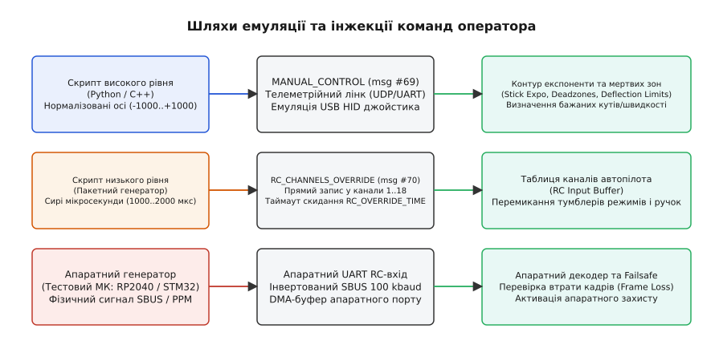
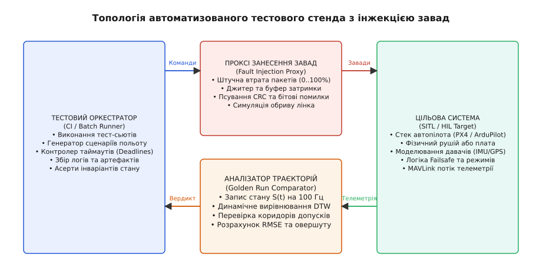
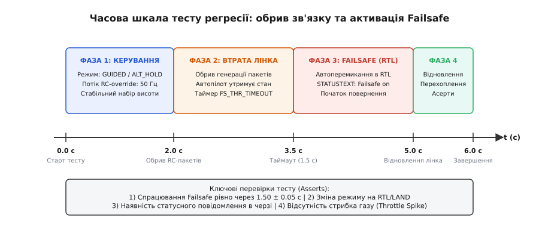
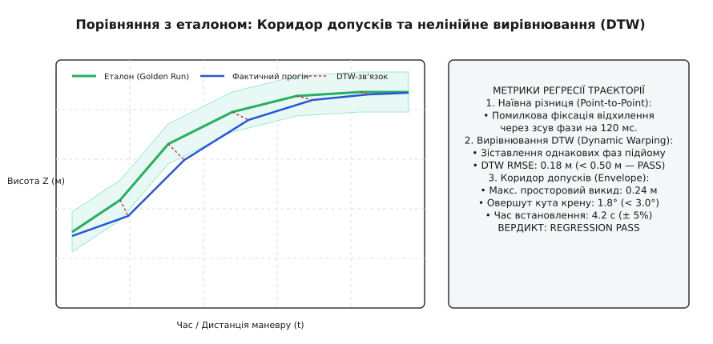

# Скриптований оператор: пакетні команди, стенд, регресія

<preknowlist>
- [Пакетний протокол pymavlink](root:embedded/pymavlink) — взаємодія з бортом через MAVLink, кадри, фільтрація повідомлень і таймаути.
- [Python для наземних скриптів](root:embedded/python-ground-scripts) — неблокуючі сокети, черги подій та обробка телеметрії на наземній станції.
- [Телекерування та затримка лінка](root:embedded/teleoperation-latency) — бюджети часу реакції, переривання зв'язку й активація аварійних режимів (failsafe).
</preknowlist>

Коли інженер вносить зміну в алгоритм стабілізації польотного контролера чи в навігаційний автомат станів, ручна перевірка на симуляторі вимагає повноцінного чотирихвилинного польоту: зведення двигунів (*arm*), набір висоти до 20 метрів, проходження трьох точок повороту з креном 35°, симуляція обриву радіолінка та відновлення ручного контролю. Якщо в репозиторій надходить сорок комітів на день, інженер витрачає 160 хвилин на монотонне смикання ручок джойстика. До п'ятнадцятого польоту людська увага притупляється: швидкість відхилення стіків змінюється на ±25%, затримка реакції оператора коливається від 160 до 420 мс, а короткочасний затик автопілота на 40 мс залишається непоміченим, бо погляд спрямовано на тривимірний візуалізатор, а не на часові мітки телеметрії. До вісімдесятого прогону ручне тестування стає статистично неповторним і не здатне виявити тонкі регресії прошивки.

Автоматизована верифікація вбудованих систем вимагає заміни фізичної людини **скриптованим оператором** (англ. *scripted operator*). Це детермінований програмний агент, який бере на себе генерацію сигналів керування з мікросекундною точністю, надсилає пакетні черги команд, відстежує дотримання протокольних інваріантів і вносить штучні завади в лінію зв'язку саме в ту мілісекунду, коли система проходить критичну фазу маневру.

> 🔧 **Навіщо це.** У неперервній інтеграції (CI/CD) кожна зміна коду прошивки мусить пройти сотні автоматизованих сценаріїв польоту без втручання людини. Скриптований оператор гарантує, що крок джойстика, порив вітру та скидання пакетів у сотому тесті будуть абсолютно ідентичними першому.

---

## Інтерфейси емуляції: від сирого PPM до віртуального джойстика

Аби емулювати дії оператора, тестовий скрипт мусить спілкуватися з автопілотом тими самими каналами, якими надходять команди від реального пульта або наземної станції. У вбудованих польотних контролерах (таких як PX4 чи ArduPilot) існують два принципово різні рівні інжекції: низькорівневе емулювання каналів радіокерування (RC) та високорівневі пакетні команди протоколу телеметрії.


*Три способи емуляції дій оператора: високорівневий `MANUAL_CONTROL` з автокалібруванням експоненти, низькорівневий `RC_CHANNELS_OVERRIDE` для прямого запису в канали PWM, та апаратний генератор SBUS для апаратного тестування портів.*

### 1. Низькорівнева інжекція RC-каналів

Низькорівневе керування імітує фізичні сигнали з приймача радіоапаратури. Тут виділяють три механізми:

* **Повідомлення `RC_CHANNELS_OVERRIDE` (MAVLink msg #70):** дозволяє наземному скрипту напряму перезаписувати значення каналів у внутрішньому буфері автопілота. Значення передаються у сирих мікросекундах PWM (типово від 1000 до 2000 мкс із нейтраллю 1500 мкс). Перевага методу полягає в тому, що скрипт може безпосередньо смикати віртуальні тумблери режимів (наприклад, канал 5 або 6), перемикаючи прошивку між режимами *STABILIZE*, *ALT_HOLD* чи *AUTO*. Однак автопілот захищає цей інтерфейс сторожовим таймером `RC_OVERRIDE_TIME` (зазвичай 1.0–2.0 с): якщо скрипт припиняє надсилати пакети з частотою щонайменше 10–20 Гц, автопілот автоматично скидає оверрайд і повертається до прослуховування фізичного порту або активує аварійний режим (*Failsafe*).
* **Повідомлення `MANUAL_CONTROL` (MAVLink msg #69):** емулює стандартний USB HID джойстик оператора. Замість сирих мікросекунд скрипт передає нормалізовані осі: `x` (тангаж / pitch, -1000..+1000), `y` (крен / roll, -1000..+1000), `z` (газ / thrust, 0..1000 для коптерів або -1000..+1000 для літаків), `r` (рискання / yaw, -1000..+1000) та 16-бітну бітову маску натиснутих кнопок. На відміну від оверрайду каналів, автопілот пропускає ці нормалізовані значення через власну математику кривих чутливості (експоненти / *expo*), фільтри мертвих зон (*deadbands*) та обмеження швидкості наростання сигналу.
* **Апаратна генерація сигналу (PPM / SBUS / CRSF):** застосовується на апаратних стендах тестування (*Hardware-in-the-Loop*, HIL). Окремий мікроконтролер стенда (наприклад, RP2040 або STM32) формує фізичний цифровий потік на апаратному UART-порті автопілота. Розгляньмо бітову структуру цих сигналів детальніше, адже вони задають апаратні межі точності стенда.

#### Апаратні протоколи інжекції на стенді (SBUS, CRSF, PPM)

1. **SBUS (Serial Bus):** послідовний протокол з інвертованими логічними рівнями на фіксованій швидкості 100000 бод (конфігурація 8E2: 8 бітів даних, парність *even*, 2 стоп-біти). Кадр має фіксовану довжину 25 байтів:
   * Байт 0: стартовий маркер `0x0F`.
   * Байти 1–22: 16 пропорційних каналів, щільно упакованих по 11 бітів на канал (16 × 11 = 176 бітів = 22 байти). Кожен канал приймає значення від 0 до 2047, що лінійно відображається в інтервал 880–2156 мкс PWM (де значення 1024 відповідає нейтралі 1500 мкс).
   * Байт 23: прапорці стану: біт 0 — дискретний канал 17, біт 1 — дискретний канал 18, біт 2 — втрата кадру (*frame loss*), біт 3 — активація апаратного захисту (*failsafe*).
   * Байт 24: завершальний маркер `0x00`.
   Кадри транслюються кожні 9 або 14 мс. Емулюючи SBUS на стенді через DMA UART, тестовий мікроконтролер може виставити біт *frame loss* у довільному кадрі, тестуючи фільтрацію випадкових втрат без обриву самого фізичного лінка.

2. **CRSF (Crossfire / ExpressLRS):** сучасний високошвидкісний неінвертований протокол на швидкості 420000 або 1875000 бод (8N1). Кадр складається з адреси пристрою (`0xC8` для польотного контролера), довжини корисного навантаження, типу кадру (`0x16` для RC-каналів), 22 байтів 11-бітових каналів та 8-бітної контрольної суми CRC8 (поліном DVB-S2 `0xD5`). Завдяки високій швидкості затримка оновлення каналів на стенді знижується з 14 мс до 1.2–2.0 мс, що є критичним для перевірки високочастотних контурів керування FPV-дронів і стабілізаторів корисного навантаження.

3. **PPM (Pulse Position Modulation):** аналогово-часовий протокол, де всі канали (від 6 до 8) передаються послідовно через один сигнальний дріт у вигляді серії коротких імпульсів (0.3 мс) із часовими проміжками між ними (0.7–1.7 мс). Завершує 20-мілісекундний фрейм довгий синхронізаційний імпульс тривалістю понад 3.0 мс. Оскільки автопілот розпізнає канали за допомогою таймерів захоплення (*Timer Input Capture*), тест на PPM-інжекцію перевіряє стійкість системи до фазового тремтіння переривань (MCU interrupt jitter) при високому завантаженні процесора.

### 2. Пакетні команди високого рівня

Коли сценарій вимагає перевірки автономної навігації чи зміни параметрів, скриптований оператор надсилає дискретні пакети протоколу MAVLink або робить виклики через REST/gRPC інтерфейси бортових комп'ютерів:

* `COMMAND_LONG` / `COMMAND_INT`: надсилання команд дії (`MAV_CMD_NAV_TAKEOFF`, `MAV_CMD_COMPONENT_ARM_DISARM`, `MAV_CMD_DO_SET_MODE`). Відправник зобов'язаний вимагати та аналізувати зворотний кадр `COMMAND_ACK` з результатом виконання (`MAV_RESULT_ACCEPTED`, `MAV_RESULT_TEMPORARILY_REJECTED`, `MAV_RESULT_DENIED`, `MAV_RESULT_UNSUPPORTED`, `MAV_RESULT_FAILED`, `MAV_RESULT_IN_PROGRESS`). Відмінність між `COMMAND_LONG` та `COMMAND_INT` суттєва: `COMMAND_LONG` передає координати як 32-бітні числа з рухомою комою (`float`), що дає похибку округлення до 1–2 метрів на великих широтах, тоді як `COMMAND_INT` оперує 32-бітними цілими числами (`int32_t`, масштабованими на 10⁷), забезпечуючи міліметрову точність позиціонування точок маршруту.
* `MISSION_ITEM_INT`: пакетне завантаження польотної місії (масиву точок маршруту з висотами, радіусами проходження та діями на точці) з покроковою транзакцією підтвердження (`MISSION_REQUEST`, `MISSION_ACK`).
* `PARAM_SET`: зміна конфігураційних констант автопілота на льоту (наприклад, коефіцієнтів PID-регуляторів або порогів напруги спрацювання батарейного захисту) з обов'язковою верифікацією кадру `PARAM_VALUE`.

---

## Архітектура автоматизованого стенда: SITL та HIL

Автоматизований стенд тестування регресії об'єднує тестовий оркестратор, модель середовища або фізичний контролер, а також спеціалізований вузол контрольованого внесення завад (*Fault Injection Proxy*).


*Архітектура стенда: оркестратор шле сценарій через проксі внесення завад, автопілот повертає телеметрію на 100 Гц в аналізатор, який порівнює відгук з еталоном і перевіряє часові інваріанти.*

У такій конфігурації кожен вузол виконує строго розмежовану роль:

1. **Тестовий оркестратор (Test Runner):** головний процес тестування (наприклад, на базі pytest у Python або тестового фреймворка на C++). Він ініціалізує середовище, виставляє початкові координати, запускає необхідний набір сценаріїв, слідкує за абсолютними дедлайнами виконання операцій та фіксує підсумковий статус проходження.
2. **Проксі внесення завад (Fault Injection Proxy):** мережевий або послідовний міст, через який проходять усі пакети між оркестратором і цільовою системою. На відміну від прямого сокетного з'єднання, проксі може в режимі реального часу імітувати погіршення фізичного середовища за детермінованими математичними моделями:
   * *Модель Бернуллі (Uniform Drop Rate):* кожен пакет відкидається з фіксованою ймовірністю `p` (наприклад, `p = 0.20`).
   * *Модель Гілберта-Елліотта (Burst Loss Model):* двостановий марковський ланцюг, що моделює реальні радіозавмирання. У доброму стані (*Good*) втрати мінімальні (`p_G = 0.01`), але система з імовірністю `p_GB` переходить у поганий стан (*Bad*), де втрати сягають `p_B = 0.90` (наприклад, проліт за залізобетонною спорудою), і повертається назад з імовірністю `p_BG`. Це дозволяє тестувати роботу буферів безперервного потоку.
   * *Буфер джитера та перевпорядкування:* пакети затримуються за нормальним розподілом Гауса `N(mu, sigma^2)` або випускаються з черги у зворотному порядку, що тестує перевірку лічильника послідовності MAVLink `seq` (0..255).
   * *Бітові спотворення та CRC-файл:* інверсія випадкового біта в тілі корисного навантаження кадру для перевірки коректності мовчазного відкидання розбирачем.
3. **Цільова система (SITL або HIL):**
   * *SITL (Software-in-the-Loop):* бінарний файл прошивки компілюється як нативний виконуваний файл операційної системи. Фізика руху (динаміка польоту, аеродинаміка, вітер, гравітація) обраховується симулятором (наприклад, JSBSim, Gazebo або легковагою математичною моделлю). SITL дозволяє запускати десятки екземплярів паралельно та прискорювати час симуляції у 5–10 разів швидше за астрономічний.
   * *HIL (Hardware-in-the-Loop):* реальна плата польотного контролера зі справжнім мікроконтролером живиться від стенда. Давачі (акселерометр, гіроскоп, барометр, компас) емулюються стендовими інтерфейсами SPI/I2C або отримують синтетичні виміри через MAVLink-повідомлення `HIL_SENSOR` і `HIL_GPS`. HIL верифікує завантаження CPU, таймінги переривань та роботу реальної пам'яті.
4. **Аналізатор телеметрії та порівняння з еталоном:** окремий потік збирає високочастотний потік телеметрії (`ATTITUDE`, `GLOBAL_POSITION_INT`, `SYS_STATUS`, `STATUSTEXT`) із частотою до 100 Гц, серіалізує його в лог-файл та передає в модуль перевірки інваріантів і динамічного вирівнювання траєкторій.

> 🔧 **Навіщо це.** Якщо тестовий скрипт намагатиметься імітувати втрату зв'язку просто «не викликаючи функцію відправки», він не перевірить поведінку мережевих сокетів операційної системи, заповнення буферів UART та скидання внутрішніх станів черг драйверів. Проксі на рівні сокетів або байтового потоку створює фізично достовірну відмову, невидиму для самого автопілота.

---

## Сценарії регресійного тестування: відмови, джитер і таймінги

Головна цінність скриптованого оператора проявляється у відтворенні граничних режимів (*edge cases*), які людина-пілот фізично не може згенерувати з повторюваною точністю. Розглянемо базові регресійні сценарії, обов'язкові для валідації вбудованих систем керування.

### 1. Верифікація часових меж Failsafe при відмові RC-лінка

У польотному контролері затримка виявлення обриву зв'язку задається параметром (наприклад, `FS_THR_TIMEOUT = 1.5` секунди). Якщо автопілот перейде в аварійний режим занадто рано (наприклад, через 200 мс після одиничної втрати пакету), апарат безпідставно зірве виконання місії. Якщо ж перемикання запізниться (триватиме довше ніж 1.6 с), некерований апарат на швидкості 20 м/с пролетить понад 30 метрів у напрямку перешкоди.


*Часова шкала тесту відмови: обрив пакетів на 2.0 с, детерміноване очікування таймауту 1.5 с, перемикання автопілота в аварійний режим RTL на 3.5 с та перехоплення керування на 5.0 с.*

Скриптований тест виконує таку послідовність кроків:
1. **Виведення в режим:** апарат злітає в режимі *GUIDED*, підіймається на 15 метрів, перемикається в ручний режим *ALT_HOLD*, скрипт шле потік `RC_CHANNELS_OVERRIDE` з частотою 50 Гц.
2. **Внесення відмови:** на часовій мітці `t = 2.000` с проксі миттєво блокує всі вихідні пакети оверрайду каналів.
3. **Вимірювання часу спрацювання:** аналізатор фіксує мітку часу кадру `HEARTBEAT`, у якому прапорець режиму змінюється на *RTL* (Return to Launch) або *LAND*, а в черзі `STATUSTEXT` з'являється повідомлення з рівнем суворості *WARNING*: `"Failsafe: RC link loss"`.
4. **Асерт таймінгу:** час спрацювання `t_trigger - t_loss` мусить потрапляти в суворий допуск:
```
1.45 c <= t_trigger - t_loss <= 1.55 c
```
5. **Відновлення зв'язку та перехоплення:** на мітці `t = 5.000` с потік пакетів відновлюється. Скрипт перевіряє, чи дозволяє прошивка безпечно перехопити керування перемиканням віртуального тумблера режиму, чи вимагає примусового скидання аварійного стану.

### 2. Пакетний джитер і стійкість контуру стабілізації

Радіоканали цифрового зв'язку в умовах міських перешкод демонструють різкі сплески затримки. Замість рівномірного надходження пакетів кожні 20 мс, пакети приходять групами: 100 мс тиші, після чого пачка з 5 пакетів надходить одночасно.

Тестовий проксі генерує такий профіль джитера, а аналізатор перевіряє поведінку контуру кутової стабілізації. Якщо фільтр низьких частот у контурі розрахунку кутової швидкості (*setpoint rate filter*) реалізований некоректно, різкий перепад похідної від пачки пакетів спричинить сильний удар по моторах (сплеск ШІМ до 100%), що на реальному апараті веде до зриву синхронізації безколекторних двигунів або механічного удару по редукторах. Тест фіксує відсутність сплесків похідної керуючого сигналу понад допустимий поріг:
```
|d(PWM)/dt| <= 8000 мкс/с
```

### 3. Відмова давачів та валідація відхилення некоректних команд (Pre-Arm Rejection)

Скриптований оператор повинен перевіряти не лише успішні сценарії (*happy path*), а й коректність відмов. Скрипт через інтерфейс інжекції параметрів або MAVLink-повідомлення емуляції давачів штучно погіршує точність GPS (підіймає значення `eph` / HDOP понад 4.0 м) і надсилає команду `MAV_CMD_COMPONENT_ARM_DISARM`.

Тестовий інваріант:
* Автопілот **не має права** завести двигуни.
* У відповідь на команду автопілот зобов'язаний повернути кадр `COMMAND_ACK` із кодом `MAV_RESULT_DENIED`.
* У потік `STATUSTEXT` мусить бути надіслано діагностичне повідомлення: `"PreArm: High GPS HDOP"`.

---

## Збір логів та порівняння з еталоном (Golden Run Comparison)

Після виконання польотного маневру необхідно відповісти на запитання: чи відпрацювала нова версія прошивки алгоритм траєкторного слідування так само якісно, як еталонна версія?

Наївний підхід полягає у покадровому відніманні значень векторів стану (координат, швидкостей, кутів) у фіксовані моменти часу: `delta(t) = |X_actual(t) - X_ref(t)|`. Проте в аеродинамічній симуляції навіть незначний зсув кроку інтегрування фізики на 10 мс призводить до того, що апарат починає гальмування на частку секунди пізніше. Просторова траєкторія при цьому залишається бездоганною, але покадрове віднімання фіксує штучну просторову помилку в 3–5 метрів через фазовий зсув у часі, породжуючи хибнопозитивні спрацьовування тестів (*flaky tests*).


*Порівняння з еталоном: наївне віднімання дає фальшиву помилку через часовий зсув, тоді як DTW вирівнює фази маневру й перевіряє відповідність траєкторії захисному коридору допусків.*

Для надійного порівняння застосовують комбінацію **динамічного вирівнювання часових шкал** (*Dynamic Time Warping*, DTW) та **коридорів допусків** (*Tolerance Corridors*).

### Математичний механізм Dynamic Time Warping (DTW)

Нехай еталонний прогін (*Golden Run*) представлено послідовністю векторів стану довжиною `N`:
```
R = [r[1], r[2], ..., r[N]],  де r[i] = [x, y, z, roll, pitch, yaw]
```
А фактичний тестовий прогін — послідовністю довжиною `M`:
```
A = [a[1], a[2], ..., a[M]]
```

DTW знаходить оптимальний шлях вирівнювання `W = (w[1], w[2], ..., w[K])`, де кожен елемент `w[k] = (i, j)` зв'язує точку еталона `r[i]` з відповідною точкою тесту `a[j]`, мінімізуючи сумарну просторово-кутову відстань.

Матриця кумулятивної вартості `D` розміром `(N+1) × (M+1)` обчислюється за рекурентним співвідношенням:
```
D[i, j] = dist(r[i], a[j]) + min(D[i-1, j],    [пропуск кроку в тесті]
                                 D[i, j-1],    [пропуск кроку в еталоні]
                                 D[i-1, j-1])  [діагональне вирівнювання фаз]
```
де евклідова відстань зважує координати й орієнтацію:
```
dist(r[i], a[j]) = sqrt( (x_r - x_a)² + (y_r - y_a)² + (z_r - z_a)² + w_att·(roll_r - roll_a)² )
```

Початкові умови: `D[0, 0] = 0`, усі інші `D[0, j] = ∞` та `D[i, 0] = ∞`.

#### Обмеження Сакое-Чіба (Sakoe-Chiba Band)

У чистій реалізації DTW можливе вироджене вирівнювання, коли одна точка еталона зв'язується з тривалою ділянкою тесту (нефізичне стиснення часу в десятки разів). Аби запобігти цьому, алгоритм обмежують смугою Сакое-Чіба шириною `W_band`:
```
|i - j| <= W_band  (наприклад, W_band = 0.15 · max(N, M))
```
Усі комірки матриці за межами цієї смуги автоматично отримують значення `∞`. Це гарантує, що динамічне вирівнювання компенсує лише реальні фазові затримки (100–300 мс), але не пропускає справжні затяжні провали в динаміці апарата.

Після побудови матриці відновлюється шлях вирівнювання від точки `(N, M)` до `(1, 1)`. Середньоквадратичне відхилення вздовж DTW-шляху визначає інтегральну метрику регресії:
```
DTW_RMSE = sqrt( (1 / K) · ∑ dist(r[i_k], a[j_k])² )
```

### Коридори допусків (Tolerance Envelope)

На додаток до інтегрального DTW_RMSE, тестовий фреймворк накладає локальні інваріанти:

1. **Просторовий коридор:** у будь-який момент часу фактична позиція не повинна відхилятися від вирівняного еталона більш ніж на радіус коридору `R_tol`:
```
sqrt( (x_a - x_r)² + (y_a - y_r)² ) <= 0.50 м  [у зависанні]
sqrt( (x_a - x_r)² + (y_a - y_r)² ) <= 1.50 м  [на розвороті 45°]
```
2. **Висотна смуга:** відхилення по вертикалі `|z_a - z_r| <= 0.30 м`.
3. **Овершут кута крену:** динамічний переліт кута понад задане цільове значення:
```
max(roll_actual) - max(roll_ref) <= 3.0°
```
4. **Час встановлення (Settling Time):** час, за який коливання після різкого маневру спадають до рівня ±5% від амплітуди, не повинен зростати більш ніж на 10% відносно еталону.
5. **Спектральний аналіз шуму (FFT Jitter):** швидке перетворення Фур'є над залишковим сигналом кутової швидкості гіроскопа `omega_residual = omega_actual - omega_ref`. Якщо амплітуда гармонік у діапазоні 40–80 Гц перевищує граничний рівень 0.05 рад/с, це сигналізує про виникнення резонансних автоколивань у контурі D-складової регулятора після зміни коефіцієнтів.

### 2. Покрокова синхронізація симуляції (Lockstep Architecture)

У класичній асинхронній симуляції фізичний рушій (Gazebo, JSBSim чи X-Plane) та процес автопілота обмінюються даними через мережеві сокети без блокування. Якщо тестовий оркестратор виконує важкий аналіз логів або збирає сміття (GC pause у Python), процес автопілота пропускає такти фізики, що призводить до накопичення розбіжностей інтегрування.

Для усунення цієї проблеми в сучасних стендах використовують **покрокову синхронізацію** (*Lockstep Simulation*):
1. Симулятор надсилає кадр вимірів давачів `HIL_SENSOR` разом із міткою симуляційного часу `time_usec` і **зупиняє** таймер фізики.
2. Процес автопілота обробляє виміри, проганяє розрахунок розширеного фільтра Калмана (EKF), обраховує керуючі зусилля регуляторів PID і надсилає назад кадр `HIL_ACTUATOR_CONTROLS`.
3. Лише після отримання відповіді симулятор робить рівно один крок інтегрування диференціальних рівнянь руху на крок `dt` (типово 2.5 мс, що відповідає частоті 400 Гц) і відновлює цикл.

Скриптований оператор у режимі *lockstep* може виконувати будь-які складні обчислення між тактами керування без ризику спотворення фізики: час симуляції стоїть на паузі, доки тестовий стенд не підтвердить прийом наступного кроку.

### 3. Матриця пакетного тестування та параметричний свип (Parameter Sweep)

Окремий одиночний прогін підтверджує працездатність лише в одній фіксованій точці простору станів. Справжня регресійна перевірка вимагає **параметричного сканування** (*Parameter Sweep*), де скриптований оператор автоматично проганяє сітку сценаріїв:
* **Варіація маси та центрівки:** маса апарата змінюється від 1.8 кг до 3.2 кг із кроком 0.2 кг, а центр мас зміщується вздовж поздовжньої осі на `±30 мм`.
* **Вітрові збурення:** ступінчастий порив вітру від 0 до 14 м/с із випадковими азимутами атаки (0..360°).
* **Просідання живлення:** емуляція внутрішнього опору батареї при різкому даванні газу (просідання напруги з 24.0 В до 19.5 В під струмом 80 А).

Для кожного вузла цієї тривимірної матриці (наприклад, 8 × 5 × 3 = 120 польотів) скриптований оператор обраховує інтегральний індекс якості перехідного процесу (інтеграл від квадрата помилки керування):
```
ITSE = ∫ t · (roll_actual(t) - roll_target(t))² dt
```
Якщо оновлення прошивки призводить до зростання ITSE на понад 15% бодай в одній комірці матриці параметрів, білд бракується, навіть якщо на номінальній масі політ виглядав стабільним.

### 4. Автоматизоване вивантаження та аналіз бортових логів (DataFlash / ULog)

MAVLink-телеметрія, що транслюється по бездротовому каналу, піддається проріджуванню (*decimation*): повідомлення `ATTITUDE` надходять із частотою 50 Гц, а `GLOBAL_POSITION_INT` — лише 10 Гц. Проте тонкі механічні вібрації та реакція D-складової регулятора відбуваються на частотах 100–400 Гц.

Тому після завершення кожного польотного сценарію скриптований оператор виконує автоматичний збір повного бортового бінарного журналу (`.bin` у ArduPilot або `.ulg` у PX4):
1. **Зупинка запису:** надсилання кадру `MAV_CMD_LOGGING_STOP`.
2. **Вивантаження через MAVLink FTP:** використання протоколу блокової передачі `FILE_TRANSFER_PROTOCOL` (MAVLink msg #110) для зчитування бінарного файлу з емульованої або фізичної SD-карти на швидкості до 2–4 Мбіт/с.
3. **Автоматизований парсинг:** розпакування повідомлень `VIBE` (рівні вібрацій по осях X, Y, Z), `IMU_ACCEL_RAW` (сирі значення акселерометра на частоті 1 кГц) та `ESC_TELEMETRY` (оберти мотора RPM, напруга, струм і температура транзисторів інвертора).
4. **Перевірка інваріантів вібрації:** максимальне значення вібрації по осі Z під час усталеного зависання не повинно перевищувати 15 м/с²:
```
max(VIBE.vibe_z) <= 15.0 м/с²  та  VIBE.clipping_count == 0
```
Кліпінг (*clipping*) — це насичення вимірювальної шкали сенсора акселерометра (виліт за межі `±16g`), що свідчить про резонанс кріплення польотного контролера і є критичною апаратною відмовою.

---

## Повний тестовий стенд: реалізація на Python та C++

Розглянемо повний робочий стенд пакетного тестування. Тестовий скрипт підключається до автопілота через сокет, перевіряє зв'язок, переводить апарат у керований стан, виконує задану послідовність маневрів через `RC_CHANNELS_OVERRIDE`, інжектує втрату лінка, записує потік стану `S(t)` на частоті 50 Гц та виконує порівняння з еталоном за алгоритмом DTW зі смугою Сакое-Чіба.

:::tabs
:::code skryptovanyi-operator-d/py/main.py
:::code skryptovanyi-operator-d/cpp/scripted_operator_bench.cpp
:::

---

## Типові пастки та інженерні уроки стендового тестування

Впровадження автоматизованого скриптованого оператора у виробничий конвеєр пов'язане з кількома специфічними проблемами вбудованих систем, які не виникають під час звичайного ручного пілотування.

### 1. Конфлікт ідентифікаторів (System ID Collision)

За замовчуванням популярні наземні станції (QGroundControl, Mission Planner) використовують системний ідентифікатор `source_system = 255`. Якщо розробник запускає GUI станції паралельно з автоматизованим скриптом для візуального моніторингу тесту, виникає колізія: автопілот надсилає підтвердження `COMMAND_ACK` на адресу 255. Пакет перехоплюється QGC, а сокет тестового скрипта отримує таймаут.
* **Правило:** скриптований оператор завжди реєструється з виділеним унікальним System ID (наприклад, `source_system = 254` або `source_system = 250`) та Component ID `MAV_COMP_ID_MISSIONPLANNER` (190).

### 2. Розбіжність астрономічного часу та часу симуляції (Wall-Clock vs Sim-Time)

У швидкісних тестах на SITL симуляція запускається з коефіцієнтом прискорення `SPEEDUP = 5` або `SPEEDUP = 10`. Використання стандартних системних затримок `time.sleep(1.0)` у коді тесту призводить до краху: поки скрипт очікує 1 секунду реального часу, симулятор пролітає 10 секунд польотного часу, і всі таймаути оверрайду каналів гарантовано порушуються.
* **Правило:** усі дедлайни та часові кроки скриптованого оператора повинні прив'язуватися до польотного часу автопілота, який транслюється в повідомленні `SYSTEM_TIME.time_unix_usec` або `SIMSTATE.time_us`, або використовувати блокуючий покроковий синхронізатор (*Lockstep Simulation*).

### 3. Накопичення залишкового стану між прогонами (State Bleeding)

Якщо тестовий набір складається з 50 послідовних тестів, виконання другого тесту без повного перезавантаження пам'яті автопілота успадковує змінені параметри PID, інтегральні суми фільтрів EKF (Extended Kalman Filter) та координати домашньої точки (*Home Position*).
* **Правило:** кожен сценарій регресії зобов'язаний починатися або з холодного перезапуску процесу SITL (`reboot`), або з явного скидання параметрів до заводського профілю за допомогою команди `PARAM_SET` та очищення точок місії через `MISSION_CLEAR_ALL`.

### 4. Невиправдана жорсткість допусків (Flaky Tests проти реальних багів)

Спроба затиснути допуск кута крену до `±0.5°` на динамічному розвороті з вітровими завадами призводить до того, що 30% прогонів у CI завершуються збоєм без наявності помилки в коді (тестовий шум). Розробники звикають перезапускати пайплайн і перестають звертати увагу на реальні червоні білди.
* **Правило:** допуски регресійного коридору мусять виводитися статистично за правилом трьох сигм (`3*sigma`) на вибірці з щонайменше 100 контрольних прогонів еталонної версії прошивки на тому самому апаратному або симуляційному стенді.
