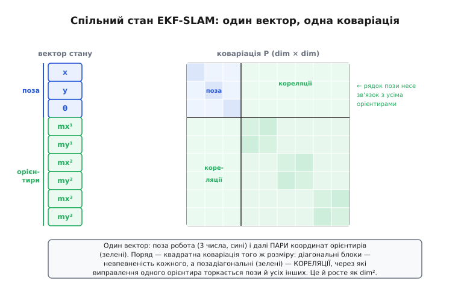

# ⚙️ Робочий 2D EKF-SLAM на C: один кадр від руху до карти

У статті-власниці ми побачили **фільтрову школу** SLAM згори: стан роздувають так, щоб він тримав і позу робота, і координати всіх орієнтирів в одному великому векторі, а їхні кореляції — у спільній матриці невизначеності; кожен крок руху це передбачення, кожне спостереження орієнтира — корекція, що оновлює весь стан разом із кореляціями. Сказати це абзацом легко. Та коли сідаєш писати прошивку, виявляється, що ціна кожного слова — конкретний шматок коду, і саме там народжуються і вся краса, і всі пастки. Тут ми пройдемо рівно один повний кадр EKF-SLAM **живим C** — від руху колеса до підправленої карти — і побачимо, як абстрактні «спільний стан» і «спільна коваріація» стають масивами в пам'яті мікроконтролера.

Це той самий двотактний ритм Калмана, який ми вже знаємо: передбачення штовхає оцінку вперед і роздуває невпевненість, корекція підтягує її до виміру. Якщо машина [розширеного фільтра Калмана](root:com-signal/kalman-ekf) — лінеаризація нелінійної моделі похідними-якобіанами навколо поточної оцінки — вже зрозуміла, то весь EKF-SLAM це той самий EKF, застосований до особливого, дуже великого стану. Особливість одна, але вона все й вирішує: **розмір стану не сталий**. Робот в'їжджає в незнайомий світ, бачить новий орієнтир — і стан мусить **вирости**, увібравши дві нові координати. Цей момент — роздування стану першою зустріччю — і є те, чого нема у звичайному фільтрі Калмана й що робить SLAM собою.

> 🔧 **Навіщо це.** Прочитати, що «EKF тримає позу й карту разом», і **написати** це — дві різні глибини розуміння. У коді вилазить усе, що проза ховає: де саме затікає кореляція, чому одне спостереження торкається всієї матриці, де O(N²) перетворюється з рядка теорії на реальні мілісекунди, як симетрія коваріації тихо ламається від округлення й валить фільтр. Хто хоч раз провів кадр EKF-SLAM руками в C, той назавжди розуміє, **чому** карта це єдине пружне полотно, а не купа точок, — бо бачив, як зв'язки живуть у пам'яті.

### Задача

Поставимо конкретний апарат. Маємо невеликого наземного робота на двох ведучих колесах — диференційний привід. Він їде площиною, тож його **поза** це три числа: дві координати `(x, y)` і курс `θ`. З енкодерів коліс він знає, наскільки просунувся вперед і на скільки повернув за такт, — це його одометрія, і вона, як ми вже з'ясували, [дрейфує без меж](root:com-signal/odometry): похибки кожного кроку накопичуються, і гола оцінка повільно сповзає від істини.

Щоб боротися з дрейфом, на роботі стоїть давач, що бачить **орієнтири** — точкові прикмети у площині: стовпчики, кутки, відбивачі, ніжки стільців. Для кожного видимого орієнтира давач дає **дальність і пеленг**: «щось є за `r` метрів під кутом `φ` від мого носа». Це класичний вимір range-bearing, і він нелінійний — звідси й потреба в EKF, а не в простому Калмані.

Завдання прошивки: на кожному такті взяти команду руху з енкодерів, **передбачити** нову позу й роздути невпевненість; для кожного видимого орієнтира або, якщо він новий, **вписати** його в карту, або, якщо вже відомий, **виправити** ним і позу, і всю карту. І все це — на мікроконтролері, у `float`, з фіксованою пам'яттю, бо динамічного `malloc` у польоті ми собі не дозволимо.

Намалюймо чесну межу одразу. EKF-SLAM добрий, поки орієнтирів **небагато** — десятки, добре якщо до сотні-двох. Спільна матриця невизначеності росте квадратично з їхнім числом, і це не вада реалізації, а вроджена властивість, яку ми зараз побачимо на власні очі в коді. Тому наш робот — не картограф цілого міста, а апарат, що впевнено тримається у **скромному** просторі: одна кімната, один склад, одна ділянка теплиці. Саме там фільтровий EKF-SLAM сяє простотою.

### Ідея

Уся побудова тримається на трьох рухах, і ми вже знаємо кожен поодинці — лишається сплести їх у живому стані, що вміє рости.

**Перший рух — спільний стан.** Ми не тримаємо позу окремо, а кожен орієнтир окремим фільтриком (це, як ми бачили, викинуло б кореляції й повернуло нас до дрейфу). Ми складаємо **один** вектор: спершу три числа пози `(x, y, θ)`, а далі парами координати кожного орієнтира `(mₓ¹, m_y¹, mₓ², m_y², …)`. Поряд із ним живе **одна** квадратна матриця коваріації `P` розміру `(3+2N)×(3+2N)`, де `N` — скільки орієнтирів уже в карті. Її діагональ це невпевненість кожного числа окремо, а **позадіагональні** блоки — це ті самі кореляції, через які одне спостереження лікує всю карту.

**Другий рух — передбачення за рухом.** Команда руху штовхає **лише позу**: орієнтири нерухомі, їхні справжні координати команда не міняє. Але невпевненість пози від руху **росте** (одометрія додала похибку), і — ось тонкість, яку проза легко проминає — ця зросла невпевненість пози мусить **перетекти** в кореляції пози з кожним орієнтиром. Бо орієнтири ми колись наносили зі своєї пози; тепер поза стала непевнішою, отже й наше знання, де орієнтири **відносно нас**, теж розмилося.

**Третій рух — роздування й корекція.** Робот бачить орієнтир. Якщо він **новий**, ми дописуємо в кінець стану дві координати, обчислені з нашої пози й виміру дальності-пеленга, і розширюємо `P` новим рядком і стовпцем — причому новий блок одразу **скорельований** із позою, бо орієнтир народився з неї. Якщо орієнтир **відомий**, ми робимо звичайну корекцію EKF: рахуємо, де орієнтир мав би бачитися за поточною оцінкою, порівнюємо з тим, де він бачиться насправді (нев'язку), і — через єдиний рядок якобіана й одне калманове підсилення — **підправляємо весь стан і всю матрицю** разом. Те, що корекція одного орієнтира торкається й пози, і **всіх інших** орієнтирів, — не побічний ефект, а вся суть.

Серцевий нерв усієї задачі один: **усе пов'язано через позу**. Поза це спільний предок усіх орієнтирів на карті, тож будь-яка дія з нею проростає в усю матрицю. Тримати це в голові — означає розуміти, чому EKF-SLAM могутній і чому він квадратичний. Напишемо найчистіший варіант, а тоді чесно розберемо, де він кусає.


*Розкладка спільного стану EKF-SLAM у пам'яті. Вектор стану — це поза робота (3 числа) і далі пари координат кожного орієнтира. Поряд — квадратна матриця коваріації того ж розміру: на діагоналі блоки невпевненості пози й кожного орієнтира, а позадіагональні блоки (зелені) — кореляції, через які виправлення одного торкається всіх. Саме ці зв'язки роблять карту єдиним полотном — і саме вони ростуть квадратично.*

### Робочий C: спільний стан і фіксована пам'ять

Почнемо з кістяка — як спільний стан і коваріація лежать у пам'яті. Ніякого динамічного виділення: заводимо буфери на максимум орієнтирів `LM_MAX` і працюємо в їхніх межах. Так робиться реальна вбудована математика — пам'ять відома наперед, фрагментації нема.

:::code proj-ekf-slam/c/robochyi-c-spilnyi-stan-i.c

Зверніть увагу на дрібницю, яка насправді глибока: початкову коваріацію пози ми ставимо **майже нульовою**. Це не помилка й не самовпевненість. Старт ми **оголошуємо** початком координат — це наша власна система відліку, і відносно неї ми за визначенням стоїмо точно в нулі. Уся карта буде узгоджена відносно цієї точки. Як ми бачили в статті, SLAM не дає **абсолютної** прив'язки до світу — карта «висить у власних координатах», і ось тут, у трьох нулях стартової коваріації, ця властивість і закладається: ми прибиваємо одну точку відліку, а все інше міряємо відносно неї.

### Робочий C: крок передбачення за рухом

Тепер перший такт — рух. Робот за такт проїхав уперед `dr` метрів і повернув на `dθ` радіан (це дає одометрія з енкодерів). Нова поза за моделлю диференційного приводу:

```text
x'     = x + dr·cos(θ + dθ/2)
y'     = y + dr·sin(θ + dθ/2)
θ'     = θ + dθ
```

Координати орієнтирів команда **не чіпає** — вони нерухомі. Але невпевненість пози росте, і ця зросла невпевненість мусить перетекти й у кореляції пози з орієнтирами. Робить це формула передбачення коваріації `P ← FₓPFₓᵀ + Q`, де `Fₓ` — якобіан руху. У SLAM `Fₓ` має особливу будову: він одиничний усюди, крім блоку пози 3×3, бо рух міняє лише позу. Скористаймося цим і **не множитимемо повну матрицю на повну** — це було б марнотратство; оновимо тільки те, що справді міняється.

:::code proj-ekf-slam/c/robochyi-c-krok.c

Крок п'ятий — це той самий абзац теорії, що в статті, тепер у вигляді коду: «зросла невпевненість пози мусить перетекти в кореляції пози з кожним орієнтиром». Ми не торкаємося блоків орієнтир-орієнтир (рух їх не міняє), але **рядки й стовпці, що зв'язують позу з орієнтирами**, проганяємо через якобіан руху. Якби ми цей крок забули — а спокуса велика, бо «орієнтири ж нерухомі» — фільтр почав би вважати, що знає положення орієнтирів **відносно себе** точніше, ніж насправді, і наступна корекція повірила б старій, уже неправдивій кореляції. Тихий шлях до розваленої карти.

> 🔧 **Навіщо це.** Передбачення — єдине місце, де невпевненість **росте**; усе інше її лише стискає. Тому довіра до одометрії (`sigma_dr`, `sigma_dth` у `Q`) — найважливіша ручка налаштування фільтра. Поставите шум руху замалим — фільтр повірить дрейфу більше, ніж вимірам, і не дасть їм себе виправити; завеликим — занадто хитатиметься від кожного шумного спостереження. Це той самий баланс «здогад проти виміру», що в будь-якому Калмані, але тут від нього залежить, чи зшиється карта взагалі.

### Робочий C: роздування стану новим орієнтиром

Найцікавіший крок — той, якого нема у звичайному Калмані. Робот побачив орієнтир, якого ще нема в карті. Стан мусить **вирости** на дві координати. Де ці координати? Робот бачить орієнтир за дальністю `r` і пеленгом `φ` від свого носа, тож у світових координатах орієнтир тут:

```text
mx = x + r·cos(θ + φ)
my = y + r·sin(θ + φ)
```

Орієнтир народжується **з пози** — отже, у його координати одразу затікає невпевненість пози, і нова матриця мусить це відобразити: новий блок коваріації орієнтира скорельований із позою з першої секунди. Це й є той момент зі статті, коли «у координати орієнтира затікає помилка пози робота».

:::code proj-ekf-slam/c/robochyi-c-rozduvannia.c

Крок четвертий — те, заради чого все. Новий орієнтир **миттєво** скорельований не лише з позою, а й, через позу, з **усіма** вже наявними орієнтирами (`Gp*Prest` проходить по всьому стану). Він народився зі спільного предка — пози, — і успадкував усі її зв'язки. Ось де народжується «єдине пружне полотно»: новачок одразу вплетений у тканину карти, і коли пізніше якесь точне спостереження виправить позу, виправиться й він — хоча його ще ніхто повторно не бачив.

> 🔧 **Навіщо це.** Перший доданок коваріації нового орієнтира — `Gp·Ppp·Gpᵀ`, успадкована невпевненість пози — пояснює парадокс, який бентежить новачків: чому щойно доданий орієнтир уже **дуже невпевнений**, навіть якщо давач точний? Бо його невпевненість це не лише шум давача (другий доданок), а й уся накопичена невпевненість пози, з якої його наносили. Якщо забути перший доданок і вписати орієнтир із самим лише шумом давача, фільтр повірить у карту куди сильніше, ніж має право, — і розсиплеться при першому ж замиканні петлі, бо вважатиме давні орієнтири точними, коли вони насправді попливли разом із позою.

### Робочий C: корекція повторним спостереженням

Останній такт — корекція. Робот бачить орієнтир, який **уже** в карті. Це шанс стиснути невпевненість. Спершу питаємо: де орієнтир `i` **мав би** бачитися за поточною оцінкою? Це функція виміру `h` — обернена до народження: з різниці координат орієнтира й пози рахуємо очікувані дальність і пеленг.

```text
dx = mx − x;  dy = my − y;  q = dx² + dy²
ẑ = [ √q ,  atan2(dy, dx) − θ ]      (очікувані дальність і пеленг)
```

Порівнюємо очікуване `ẑ` з фактичним виміром `z` — різниця це **нев'язка** (innovation). А далі звичайна машина EKF: один рядок якобіана `H` (як вимір залежить від стану), калманове підсилення `K`, і оновлення `x ← x + K·нев'язка`, `P ← (I − K·H)·P`. Уся хитрість у тому, що `H` ненульовий **лише** у двох місцях — у стовпцях пози й у стовпцях саме цього орієнтира; решта стану на цей вимір не впливає **напряму**. Але підсилення `K` через коваріацію розносить виправлення на **весь** стан — і це той самий ефект, коли одне спостереження лікує всю карту.

:::code proj-ekf-slam/c/robochyi-c-korektsiia.c

Подивіться на крок шостий — там, у подвійному циклі `row × col` по всьому стану, і живе славнозвісне квадратичне зростання. Якобіан `H` розріджений (ненульовий лише в п'яти стовпцях), і ми цим скористалися, щоб не множити повні матриці даремно. Але **результат** `(I − KH)P` все одно **щільний** `d×d`, бо підсилення `K` щільне — кожен рядок стану дістає поправку. Тому навіть з усіма оптимізаціями розрідженості один крок корекції коштує **порядку d²** операцій, а `d = 3 + 2N`. Подвоїли орієнтири — учетверо більше роботи **щокроку**. Ось воно, те саме «тисяча орієнтирів — мільйон зв'язків», тільки тепер ви бачите його як два вкладені цикли, від яких нікуди не дітися у фільтровій школі.

> 🔧 **Навіщо це.** Крок сьомий — примусова симетризація `P` — виглядає як косметика, а насправді рятує фільтр від тихої смерті. Коваріація **зобов'язана** бути симетричною (`P[i][j] = P[j][i]` за означенням), але формула `(I−KH)P` у `float` дає трошки несиметричний результат через округлення. Крихітна асиметрія накопичується крок за кроком, матриця перестає бути додатно визначеною, і одного разу `S` виходить «від'ємно невпевненим» — фільтр обчислює безглузде підсилення й вибухає. Один прохід усереднення `P[i][j]` і `P[j][i]` після кожної корекції коштує копійки й тримає матрицю в законі. У серйозних реалізаціях ідуть далі — тримають не `P`, а її корінь (форми Джозефа чи квадратного кореня), — але для нашого масштабу симетризації досить.

### Робочий C: один повний кадр

Складемо такт цілком — як це викликається в головному циклі прошивки. Спершу рух, тоді по кожному видимому орієнтиру рішення «новий чи відомий», і відповідно роздування або корекція.

:::code proj-ekf-slam/c/robochyi-c-odyn-povnyi.c

І все. Ці кілька рядків — повний цикл життя SLAM: робот рухається й непевнішає, бачить світ і або розширює карту новим орієнтиром, або стискає невпевненість виправленням знайомого. Замикання петлі, про яке стільки говорила стаття, тут **не окремий код** — воно стається саме собою: коли робот після довгого кола знову бачить орієнтир, доданий на старті, `find_lm` його впізнає, виклик піде в `slam_update`, а той через накопичені кореляції розкине поправку по всьому стану — і весь контур стягнеться. Уся драма замикання петлі схована в одному рядку «`else slam_update`», за умови, що ми **впізнали** орієнтир правильно. А це «якщо» — найбільша пастка з усіх.

### Складність і пастки

Код працює, але навколо нього стільки гострих кутів, що кожен вартий уваги: жоден не дає помилки компіляції, кожен валить фільтр тихо.

- **Асоціація даних — найбільша й найнебезпечніша.** Увесь наш код спирається на те, що `obs[k].id` уже **правильно** каже, який це орієнтир. У реальності давач не вручає ідентифікатор — він дає лише «щось за `r` під кутом `φ`», а ви мусите самі вирішити, чи це орієнтир №7, чи новий. Помилитесь — і катастрофа двобічна: вписали відомий орієнтир як новий — карта засмічується дублями, дрейф не гаситься; виправили **не тим** орієнтиром — фільтр упевнено стягне позу до брехні, бо корекція EKF не сумнівається, вона **довіряє**. Це той самий ризик хибного замикання петлі зі статті, тільки на рівні кожного виміру. Правильний шлях — рахувати **махаланобісову відстань** виміру до кожного кандидата (нев'язка, зважена оберненою `S`) і приймати збіг лише якщо він певний, а спірні відкидати. Асоціація даних — окрема велика тема; як її роблять строго, [розібрано в асоціації даних](root:sf-visual/measurement-to-track-association). Запам'ятайте правило: **сумнівне спостереження краще викинути, ніж зв'язати навмання** — пропущена корекція це трохи більший дрейф, а хибна це зруйнована карта.

- **Лінеаризація бреше на великих кутах і далеких орієнтирах.** EKF лінеаризує нелінійний вимір якобіаном навколо **поточної** оцінки. Якщо оцінка пози вже сильно помилкова (великий накопичений дрейф) або орієнтир далеко й під гострим кутом, дотична погано наближає справжню функцію, нев'язка рахується криво, і корекція тягне стан **не туди**. Гірше — помилка лінеаризації систематично робить фільтр **самовпевненим**: він докладає поправку за поправкою, вважаючи себе точнішим, ніж є насправді (відоме явище заниженої коваріації EKF-SLAM). Ліки практичні: коригуйте частіше (поки оцінка свіжа й похибка мала), не приймайте виміри з шаленою нев'язкою (вони або хибна асоціація, або зона, де лінеаризація померла), і пам'ятайте, що EKF добрий лише поки нелінійність на масштабі вашої невпевненості майже лінійна.

- **Циклічність кута — тиха міна в кожному відніманні пеленга.** Курс `θ` і пеленг `φ` живуть на колі: `+179°` і `−179°` майже однакові, а наївне віднімання дасть `358°` — гігантську хибну нев'язку, що рвоне фільтр одним ударом. Тому **кожне** віднімання кутів треба нормувати в `(−π, π]` через `atan2f(sinf(d), cosf(d))` — і в нев'язці пеленга (крок 1 корекції), і в оновленні курсу (кроки руху й корекції). Я зробив це явно в коді; забути бодай одне місце — отримати фільтр, що раз на кілька кадрів незрозуміло смикається. Циклічність кута не прощає недогляду.

- **Симетрія й додатна визначеність `P` — повільна корозія.** Уже згадана в рамці вище, але вартує місця серед пасток, бо вбиває найпідступніше: не одразу, а через хвилини роботи. Формула `(I−KH)P` у `float` дає трохи несиметричну `P`; асиметрія копичиться, матриця втрачає додатну визначеність, `S` виходить виродженою або «від'ємною», і фільтр вибухає `NaN`-ами. Мінімум — симетризувати `P` після кожної корекції (крок 7). Максимум — форма Джозефа `P ← (I−KH)P(I−KH)ᵀ + KRKᵀ`, що зберігає симетрію конструктивно, або фільтр у квадратному корені. Для десятків орієнтирів симетризації досить; знати про запасні форми треба на випадок довгих місій.

- **Квадратна пам'ять і квадратний час — стеля масштабу, не баг.** `P` це `(3+2N)²` чисел: 30 орієнтирів — матриця 63×63, майже 4000 `float`, 16 КБ; 100 орієнтирів — 203×203, 165 КБ, що вже не влізе в багато мікроконтролерів. А кожна корекція це `O(d²)` (крок 6). Це **вроджена** межа фільтрової школи, та сама, через яку велике картографування пішло на графову школу й [оптимізацію графа поз](root:embedded/slam-navigation/math-pose-graph.md). Висновок прямий: вибираючи EKF-SLAM, тверезо оцініть **максимум** орієнтирів і закладіть пам'ять під квадрат — а як упретеся в стелю, це сигнал, що пора на граф, а не латати фільтр.

- **Виродження виміру й ділення на дальність.** У якобіані `H` стоять `dx/q`, `dy/q`, `1/sq` — а `q = dx²+dy²` це квадрат дальності до орієнтира. Якщо орієнтир опиниться **майже в точці робота** (`q → 0`), ці члени вибухають, і корекція стає чисельно дикою. У коді я відсікаю вироджений вимір через `det(S)`, але глибша обачність — взагалі не заводити орієнтири, що можуть злитися з позою, і відкидати спостереження з підозріло малою дальністю. Range-bearing погано визначений зблизька; це фізика давача, не лише числа.

- **Фіксована пам'ять і повна карта.** `slam_add_landmark` повертає `−1`, коли орієнтирів стало `LM_MAX`. У бойовій прошивці це **не можна мовчки проковтнути**: переповнення карти означає, що нові орієнтири більше не вписуються, дрейф перестає гаситися в нових місцях, і робот тихо сліпне до новизни. Треба або свідомо обмежити простір роботи під `LM_MAX`, або ввести політику витіснення (забути давно не бачені орієнтири), або — найчесніше — підняти тривогу, що карта повна. Фіксована пам'ять це правильний вибір для МК, але її межа мусить бути **видимою** логіці, а не схованою в тихому `return -1`.

Підсумок думки. Стаття показала фільтрову школу як ідею: спільний стан, спільна коваріація, передбачення-корекція в ритмі Калмана. Тут ми провели рівно один кадр **живим C** — і кожен абстрактний рядок теорії став шматком коду з власною ціною. «Усе пов'язано через позу» виявилося п'ятим кроком передбачення, де невпевненість пози затікає в кореляції, і четвертим кроком народження, де новий орієнтир успадковує зв'язки пози. «Одне спостереження лікує всю карту» виявилося щільним підсиленням `K`, що розносить поправку по всьому стану. А «квадратичне зростання» виявилося подвійним циклом `d×d`, від якого у фільтровій школі нікуди подітися. І найголовніше: реальна надійність живе не у формулах, а в пастках навколо них — в асоціації даних, у нормуванні кута, у симетрії матриці. Хто провів цей кадр руками, той розуміє і силу EKF-SLAM, і чому за стелею в сотню орієнтирів світ переходить на граф.
