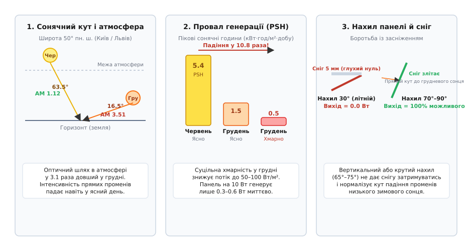
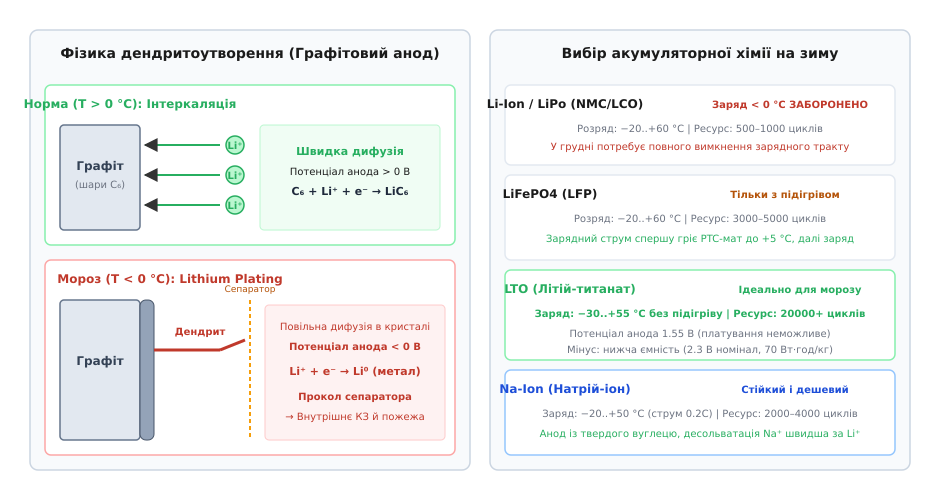
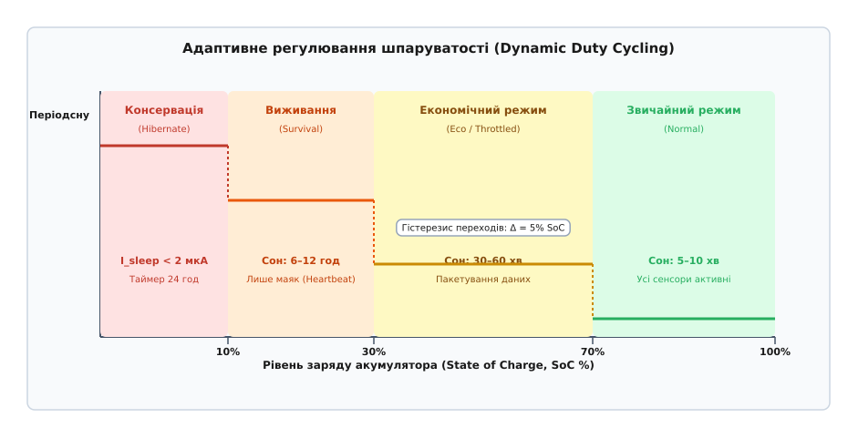
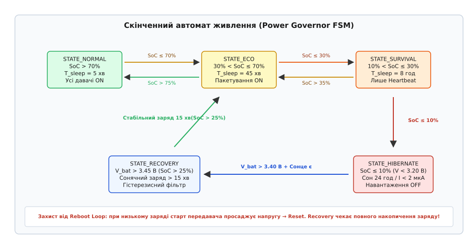

# Сонячний вузол, що переживає грудень

<preknowlist>
- [Розрахунок вузла: панель, банка, N діб без сонця](root:embedded/rozrakhunok-vuzla) — базовий розрахунок площі панелі й ємності акумулятора за середньорічними показниками.
- [Цикл і середній струм](root:embedded/duty-cycle-current) — розрахунок середнього струму споживання за шпаруватістю сну й активності.
- [Зарядка Li-ion: CC/CV](root:hw-power/li-ion-charger) — фази заряду постійним струмом та постійною напругою.
- [Режими сну](root:hw-arch/sleep-modes) — стани сну мікроконтролера та джерела пробудження.
</preknowlist>

Пристрій, що бездоганно передавав телеметрію щоп'ять хвилин усе літо й осінь, у другій половині грудня раптово замовкає на кілька тижнів або виходить із ладу назавжди. Інженер перевіряє розрахунки: сонячна панель на 10 Вт, літій-іонний акумулятор 18650 на 2600 мА·год, середній струм споживання всього 3 мА. За спрощеними літніми формулами сонячна батарея мала б генерувати в рази більше енергії, ніж потрібно для компенсації розряду. Проте реальний грудень руйнує оптимістичні оцінки потрійним ударом: інсоляція падає у 8–10 разів, перший снігопад на похилому склі зводить генерацію до нуля, а спроба зарядити замерзлу літієву комірку при температурі −10 °C пророщує голки металевих дендритів крізь полімерний сепаратор, безповоротно руйнуючи структуру анода.

Стійкість сонячного вузла взимку досягається не збільшенням габаритів панелі чи нарощуванням ємності батареї «із запасом», а зміною самої парадигми енергетичного керування. Робота в умовах глибокого сезонного дефіциту вимагає поєднання правильної просторової геометрії фотоелементів, розуміння низькотемпературної електрохімії накопичувачів, адаптивного динамічного регулювання шпаруватості *(Dynamic Power Throttling)* та жорсткого скінченного автомата з гістерезисом, який виключає потрапляння вузла в циклічну петлю перезавантажень *(reboot death spiral)*.

## Зимовий дефіцит інсоляції: чому літні розрахунки руйнуються в грудні

Головна помилка при проєктуванні сонячного живлення — використання середньорічних показників інсоляції або орієнтація на літній режим експлуатації. Сонячний потік, що досягає земної поверхні, змінюється впродовж року нелінійно через взаємодію астрономічної геометрії та оптичних властивостей атмосфери.

У день зимового сонцестояння (21–22 грудня) для помірних широт (близько 50° пн. ш., що відповідає більшості країн Центральної та Східної Європи) схилення сонця становить `δ = −23.45°`. Максимальний кут піднесення сонця над горизонтом опівдні сягає лише:

```
h_noon = 90° − φ + δ = 90° − 50° + (−23.45°) = 16.55°
```

У день літнього сонцестояння (21–22 червня) той самий опівденний кут становить `63.45°`. Низьке стояння сонця над горизонтом призводить до двох фундаментальних наслідків: різкого зменшення густини потоку випромінювання на горизонтальну площину за законом косинуса та колосального подовження шляху сонячних променів крізь товщу земної атмосфери.


*Геометрія зимового провалу інсоляції: подовження атмосферного оптичного шляху AM, скорочення пікових сонячних годин PSH у 10 разів та порівняння кутів нахилу панелі для самоочищення від снігу.*

Оптичний шлях світла в атмосфері кількісно описується параметром атмосферної маси *(Air Mass, AM)*. Якщо в зеніті промінь проходить товщу `AM = 1.0`, а стандартні тестові умови фотопанелей STC *(Standard Test Conditions)* калібруються за спектром `AM = 1.5` (кут піднесення 48.2°), то в грудні на широті 50° промінь проходить шар:

```
AM_winter ≈ 1 ÷ sin(16.55°) ≈ 3.51
```

Потрійне подовження оптичного шляху спричиняє потужне розсіювання Релея *(Rayleigh scattering)* на молекулах повітря та розсіювання Мі на аерозолях і водяній парі. Короткохвильова синьо-зелена частина спектра, до якої кремнієві фотоелементи мають найвищу чутливість, розсіюється майже повністю, а сумарна інтенсивність прямого випромінювання в ясний день падає з 1000 Вт/м² до 550–650 Вт/м².

Ще сильніше ситуацію ускладнює хмарність. У листопаді, грудні та січні в помірній зоні переважають фронтальні шаруваті хмари *(Stratus)* та тумани, які блокують прямий сонячний потік. Освітленість у такі дні складається виключно з дифузного розсіяного випромінювання, густина якого падає до 40–100 Вт/м² проти літніх 900–1000 Вт/м².

Кількісно цей ефект виражається в показнику пікових сонячних годин *(Peak Sun Hours, PSH)* — еквівалентній кількості годин на добу, протягом яких опромінення становить стандартні 1000 Вт/м² (1 PSH = 1 кВт·год/м²). Якщо в червні в помірній смузі середній показник становить 5.2–5.6 PSH на добу, то в грудні він просідає до 0.5–0.9 PSH на добу. Детальний математичний зв'язок між оптичною масою атмосфери, сніговим альбедо та добовою генерацією виведено в [розрахунку зимового енергобалансу](root:embedded/soniachnyi-vuzol-shcho-perezhyvaie-hruden/math-winter-energy-balance.md).

Другий критичний фактор — засніження та обмерзання поверхні фотоелектричного модуля. Сніговий покрив товщиною всього 5–10 мм має коефіцієнт пропускання світла менше 1–2%, що рівносильно повному відключенню генератора. Якщо панель змонтована під кутом 30°–35° (оптимальним для літа чи середньорічного збору), випавший сніг утворює стабільну шапку, яка може триматися тижнями через відсутність тепла для танення.

Інженерне вирішення проблеми засніження та низького стояння сонця полягає у виборі крутого кута нахилу панелі:
1. **Зимовий нахил 65°–75°**: кут падіння променів грудневого полуденного сонця (16.5°) стає близьким до нормалі (90° до площини панелі), максимізуючи захоплення енергії.
2. **Вертикальний монтаж (90°)**: повністю виключає накопичення снігу, оскільки будь-які опади зісковзують під власною вагою. Панель додатково збирає розсіяне світло, відбите від снігового покриву на землі, чиє альбедо *(albedo, лат. albus — білий)* становить 0.60–0.85.

> 🔧 **Навіщо це.** Якщо автономний пристрій встановлюється без можливості ручного обслуговування взимку, монтуйте фотопанель під кутом не менше 70° або строго вертикально на південній стороні опори. Вертикальна панель площею 0.1 м² під розсіяним світлом і відблисками від снігу згенерує в грудні більше енергії, ніж засипана снігом горизонтальна панель площею 1 м².

## Заборона заряджання літію на морозі: фізика дендритів та вибір стійких хімій

Навіть якщо правильно встановлена сонячна панель генерує необхідний струм у морозний сонячний день, подавати цей струм безпосередньо на стандартний літій-іонний акумулятор суворо заборонено. Це обмеження пов'язане не з тимчасовою втратою ємності, а з незворотними електрохімічними процесами руйнування внутрішньої структури елемента.

У звичайних умовах (при температурі від +15 °C до +25 °C) під час заряджання іони літію `Li⁺` рухаються від катода крізь рідкий електроліт, проходять крізь твердоелектролітний інтерфейсний шар SEI *(Solid Electrolyte Interphase)* і вбудовуються (інтеркалюють, від *лат. intercalatio — вставка*) між кристалічними шарами графітового анода, формуючи сполуку `LiC₆`.


*Мікроструктура графітового анода: нормальна інтеркаляція літію при T > 0 °C проти літієвого платування, росту голчастих дендритів і проколу сепаратора при T < 0 °C, а також порівняння характеристик зимових хімій акумуляторів.*

При падінні температури нижче 0 °C кінетика процесу різко змінюється під дією трьох взаємопов'язаних явищ:
1. **Зниження іонної провідності електроліту**: в'язкість органічних розчинників зростає, швидкість перенесення іонів літію сповільнюється у 3–5 разів.
2. **Зростання опору шару SEI**: енергетичний бар'єр десольватації іонів літію на поверхні анода збільшується експоненційно за законом Арреніуса.
3. **Падіння коефіцієнта твердотільної дифузії в графіті**: іони літію не встигають проникати вглиб вуглецевої решітки.

У результаті на поверхні анода виникає висока концентраційна поляризація. Потенціал анода просідає нижче 0 В відносно пари `Li/Li⁺`. Замість термодинамічно вигідної інтеркаляції запускається паралельна паразитна реакція відновлення металевого літію:

```
Li⁺ + e⁻ → Li⁰ (металевий осад)
```

Цей ефект називається літієвим платуванням *(lithium plating)*. Металевий літій осаджується на поверхні графіту не суцільною рівною плівкою, а у вигляді мікроскопічних деревоподібних голчастих кристалів — дендритів *(від грец. dendron — дерево)*.

Небезпека дендритів полягає в їхній механічній міцності та агресивному рості. Під час кількох циклів заряджання на морозі голки дендритів видовжуються, проростають крізь пори полімерного сепаратора завтовшки 15–25 мкм і досягають протилежного позитивного електрода (катода). Це викликає внутрішнє мікрокоротке замикання. На початковому етапі мікро-КЗ призводить до прискореного саморозряду акумулятора, проте при подальшому нагріванні або спробі заряду великим струмом у точці контакту виділяється тепло, що запускає екзотермічну реакцію розкладу електроліту та неконтрольований тепловий розгін *(thermal runaway)* із займанням.

На відміну від заряду, **розряджати** літій-іонний акумулятор при негативних температурах (до −20 °C) фізично безпечно. Під час розряду іони літію деінтеркалюють із графіту й рухаються до катода; металевий осад не утворюється. Єдиним наслідком розряду на холоді є тимчасове падіння віддаваної ємності на 20–40% через зростання внутрішнього опору `R_int`, проте після відігріву ємність повністю відновлюється.

### Вибір акумуляторної хімії для зимових умов

Для забезпечення надійної багаторічної експлуатації вузла без ризику руйнування акумулятора застосовують один із чотирьох інженерних підходів:

| Хімія акумулятора | Робочий діапазон заряду | Робочий діапазон розряду | Ресурс (циклів) | Номінальна напруга | Особливості застосування взимку |
|---|---|---|---|---|---|
| **Li-Ion (NMC / LCO)** | 0 °C .. +45 °C | −20 °C .. +60 °C | 500–1000 | 3.7 В | Заряд при `T < 0 °C` заборонено апаратно; потрібне відключення зарядного тракту ключем |
| **LiFePO4 (LFP)** | 0 °C .. +45 °C (без підігріву)<br>−25 °C .. +45 °C (із підігрівом) | −20 °C .. +60 °C | 3000–5000 | 3.2 В | Використовується термоізольований бокс із гнучким PTC-нагрівачем, що живиться від сонця |
| **LTO (Літій-титанат)** | **−30 °C .. +55 °C** | **−40 °C .. +60 °C** | **20000–30000** | **2.3–2.4 В** | Абсолютна стійкість до дендритів; прямий заряд на морозі без підігріву |
| **Na-Ion (Натрій-іон)** | **−20 °C .. +50 °C** | **−40 °C .. +60 °C** | 2000–4000 | 3.0–3.1 В | Анод із твердого вуглецю; швидка десольватація Na⁺; доступна вартість |

#### 1. LiFePO4 з інтелектуальним попереднім підігрівом
Акумулятори на основі літій-залізо-фосфату *(LiFePO4)* мають високу термодинамічну стабільність і тривалий термін служби (до 10–15 років), проте їхній графітовий анод так само схильний до літієвого платування при `T < 0 °C`.

Для зимової роботи блок акумуляторів розміщують у теплоізольованому пінополіуретановому кожусі та оснащують силіконовим нагрівальним матом із позитивним температурним коефіцієнтом *(PTC)*. Логіка керування зарядом розділяється на дві фази:
- Якщо температура акумулятора `T_bat < +3 °C`, енергія від сонячної панелі спрямовується через польовий транзистор виключно на нагрівальний мат.
- Коли датчик NTC фіксує прогрів акумуляторного блоку до `T_bat ≥ +5 °C`, контролер вимикає підігрів і комутує сонячний струм на вхід зарядного пристрою CC/CV.

#### 2. Літій-титанатні елементи (LTO, Li₄Ti₅O₁₂)
У літій-титанатних акумуляторах графітовий анод замінено шпінельною структурою титанату літію `Li₄Ti₅O₁₂`. Робочий потенціал інтеркаляції титанату літію становить **+1.55 В відносно Li/Li⁺**.

Оскільки потенціал анода знаходиться на 1.55 В вище потенціалу осадження металевого літію (0 В), зміщення потенціалу навіть при заряджанні максимальним струмом 2C..5C при температурі −30 °C ніколи не досягає нульової позначки. Літієве платування та ріст дендритів у LTO неможливі на фундаментальному фізичному рівні.

Крім того, шпінель `Li₄Ti₅O₁₂` є матеріалом із нульовою деформацією кристалічної ґратки *(zero-strain material)*: зміна об'єму при інтеркаляції літію становить менше 0.2% (проти 10–12% у графіту). Це забезпечує рекордний ресурс понад 20 000–30 000 повних циклів розряду. Єдиний компроміс LTO — менша гравіметрична густина енергії (60–80 Вт·год/кг проти 200–250 Вт·год/кг у Li-Ion) та нижча робоча напруга (номінал 2.3–2.4 В, діапазон 1.8–2.8 В), що вимагає перерахунку порогів контролера живлення.

#### 3. Натрій-іонні акумулятори (Na-Ion)
Нове покоління накопичувачів, де носієм заряду виступають іони натрію `Na⁺`. Як анодний матеріал у Na-Ion використовується твердий вуглець *(hard carbon)* із невпорядкованою структурою та збільшеними міжплощинними відстанями (понад 0.37 нм проти 0.335 нм у графіту).

Іони натрію мають меншу енергію сольватації в органічних електролітах, завдяки чому швидкість переносу заряду на межі розділу залишається високою при сильних морозах. Натрій-іонні комірки допускають безпечний заряд струмами до 0.2C..0.5C при температурі −20 °C без утворення металевого натрію, зберігаючи до 85% паспортної ємності при −20 °C.

## Адаптивне регулювання шпаруватості за рівнем заряду батареї (Dynamic Duty Cycling)

Фіксований графік роботи — головна причина загибелі автономних датчиків узимку. Якщо мікроконтролер запрограмований щоп'ять хвилин прокидатися, опитувати сенсори й надсилати радіопакет через LoRaWAN або NB-IoT, середній струм споживання становить близько 1.5–3.0 мА. Улітку сонячна панель генерує 200–400 мА·год енергії щодня, легко покриваючи добове споживання 36–72 мА·год. Проте під час грудневого затемнення тривалістю 10–14 діб генерація падає до 0–5 мА·год на добу. Акумулятор ємністю 2600 мА·год повністю вичерпується за 30–35 діб і відсікається платою захисту BMS.

Щоб пристрій гарантовано пережив тривалу зиму, системний демон живлення повинен динамічно змінювати профіль енергоспоживання, регулюючи інтервал між сеансами зв'язку залежно від поточного рівня заряду батареї SoC *(State of Charge)* та тренду напруги.


*Залежність періоду сну та споживаної потужності від залишкового заряду акумулятора SoC: перехід через 4 градаційні зони з гістерезисом 5% для запобігання брязкоту станів.*

Шпаруватість роботи системи `D` *(duty cycle)* визначається відношенням активного часу `t_active` до загального періоду циклу `T_cycle = t_active + t_sleep`:

```
D = t_active ÷ (t_active + t_sleep)
```

Середній струм споживання вузла `I_avg` складається з двох компонентів:

```
I_avg = I_active · D + I_sleep · (1 − D)
```

Типовий сеанс зв'язку сучасного бездротового мікроконтролера (наприклад, nRF52840, STM32WL або ESP32-C6) займає `t_active = 800 мс` при середньому струмі `I_active = 45 мА` (опитування датчиків, калібрування, синтез частоти й передача радіопакета). Струм глибокого сну становить `I_sleep = 12 мкА`.

Розглянемо, як змінюється добове споживання вузла при адаптивній зміні шпаруватості:

```
1. Режим Normal (T_sleep = 5 хв = 300 с):
   D = 0.8 с ÷ 300.8 с ≈ 0.00266
   I_avg = 45 мА · 0.00266 + 0.012 мА · 0.99734 ≈ 0.1317 мА
   Добова витрата: 0.1317 мА · 24 год = 3.16 мА·год/добу

2. Режим Eco (T_sleep = 60 хв = 3600 с):
   D = 0.8 с ÷ 3600.8 с ≈ 0.000222
   I_avg = 45 мА · 0.000222 + 0.012 мА · 0.99978 ≈ 0.0220 мА
   Добова витрата: 0.0220 мА · 24 год = 0.528 мА·год/добу (зниження у 6 разів!)

3. Режим Survival (T_sleep = 12 год = 43200 с):
   D = 0.8 с ÷ 43200.8 с ≈ 0.0000185
   I_avg = 45 мА · 0.0000185 + 0.012 мА · 0.99998 ≈ 0.0128 мА
   Добова витрата: 0.0128 мА · 24 год = 0.307 мА·год/добу (зниження у 10.3 раза!)
```

### Градація енергетичних рівнів

Адаптивний менеджер живлення реалізує чотири функціональні рівні поведінки:

1. **Рівень 1: Normal Mode (`SoC > 70%`)**
   - Інтервал відправки: 5–10 хвилин.
   - Периферія: усі встановлені давачі активні (включно з високострумовими газовими сенсорами, вимірювачами якості повітря чи модулями GNSS).
   - Радіотракт: передача повної телеметричної структури даних із максимальною деталізацією.

2. **Рівень 2: Eco / Throttled Mode (`30% < SoC ≤ 70%`)**
   - Інтервал відправки: 30–60 хвилин.
   - Периферія: відключення енергоємних сенсорів (GNSS, підігрів газових сенсорів, зовнішні інтерфейси); опитування лише базових величин (температура, тиск, напруга батареї).
   - Агрегація даних *(batching)*: вимірювання проводяться кожні 15 хвилин і зберігаються в оперативну пам'ять, а раз на годину надсилаються єдиним стиснутим пакетом, скорочуючи кількість енерговитратних увімкнень радіотракту.

3. **Рівень 3: Survival Mode (`10% < SoC ≤ 30%`)**
   - Інтервал відправки: 6–12 годин.
   - Периферія: усі зовнішні сенсори повністю відключені від шин живлення за допомогою силових ключів *(Load Switches)*.
   - Радіотракт: відправка виключно короткого маяка стану *(heartbeat frame)* довжиною 4 байти (поточна напруга, температура кристала, код статусу помилок).

4. **Рівень 4: Hibernate Mode (`SoC ≤ 10%`)**
   - Повна консервація системи. Струм споживання знижується до `< 2 мкА`.

> 🔧 **Навіщо це.** Ступінчасте збільшення часу сну при падінні заряду дозволяє зберегти працездатність вузла протягом 90–120 діб повної темряви на залишкових 20% ємності батареї. Навіть під час найглибшої зимової кризи вузол залишається живим і регулярно звітує серверу про свій стан.

## Скінченний автомат глибокої консервації та відновлення після блекауту

Найнебезпечніший момент у житті сонячного IoT-вузла — критичне вичерпання заряду акумулятора. Неправильно спроєктована логіка відключення призводить до потрапляння пристрою в катастрофічний циклічний процес, відомий як **петля смерті після перезавантаження** *(reboot death spiral)* або пастка хімічної релаксації.

### Анатомія пастки хімічної релаксації

Розглянемо послідовність процесів, яка вбиває акумулятор:
1. Акумулятор розряджається до критичної напруги відсічки супервізора живлення або мікросхеми захисту BMS: `V_bat = 2.80 В`.
2. Вбудований детектор просідання живлення *(Brownout Detector, BOD)* або лінійний стабілізатор LDO вимикає живлення мікроконтролера.
3. Щойно навантаження відключається, струм розряду падає з активних 50–100 мА до нуля.
4. На внутрішньому активному опорі комірки `R_int` зникає спад напруги `ΔV = I · R_int` (який на морозі може досягати 100–250 мВ). Крім того, завдяки процесу дифузійної релаксації іонів усередині електродів напруга розімкненого кола *(Open Circuit Voltage, OCV)* на клемах розвантаженої банки самостійно піднімається до 3.05–3.15 В.
5. Супервізор живлення бачить напругу 3.15 В, яка перевищує поріг скидання Reset (2.90 В), і знову запускає мікроконтролер.
6. Мікроконтролер ініціалізує тактовий генератор, стартує ядро й подає живлення на радіотракт.
7. Радіомодуль у момент увімкнення підсилювача потужності TX споживає імпульс струму 120–250 мА.
8. Через високий зимовий внутрішній опір комірки напруга на шині миттєво просідає: `V_bus = 3.05 В − (0.20 А · 1.2 Ом) = 2.81 В`, що нижче порогу BOD (2.90 В).
9. Супервізор генерує апаратний Reset, навантаження вимикається, напруга знову підстрибує до 3.05 В — і цикл повторюється кожні кілька секунд.

У такому режимі пристрій перезавантажується десятки тисяч разів на добу. Кожен старт викачує з виснаженої комірки останні мікрокулони, переводячи її в зону глибокого перерозряду (`V_cell < 2.0 В`), після якого розчиняється мідний колектор анода, а пристрій остаточно вмирає.


*Скінченний автомат адаптивного демона живлення (Power Governor FSM): жорсткі пороги переходів, гістерезисний фільтр сонячного заряду та захист від циклічної релаксаційної петлі перезавантажень.*

### Розірвання петлі: жорсткий гістерезис та таймер накопичення

Щоб гарантовано виключити циклічні перезавантаження, в архітектуру системи закладають два обов'язкових правила:

1. **Апаратне знеструмлення через керований силовий ключ *(Power Gating)***: усе системне навантаження (радіотракт, сенсори, допоміжні перетворювачі) підключається до акумулятора через P-канальний MOSFET або спеціалізований ключ навантаження *(Load Switch, наприклад TPS22918 чи SiP32431)* із власним струмом спокою менше 10 нА.
2. **Дворівневий гістерезис зі стабілізаційним вікном *(Soak Timer)***:
   - **Поріг входу в консервацію (Hibernate)**: фіксується при `SoC ≤ 5%` або напрузі комірки під навантаженням `V_bat ≤ 2.85 В` (для LiFePO4). Силові ключі вимикають усю периферію. Мікроконтролер записує сигнатуру стану в незалежну RTC-пам'ять і переходить у режим глибокого сну *(Deep Sleep / Shutdown)* із пробудженням від надмалопотужного таймера раз на 12–24 години або від переривання аналогового компаратора сонячної панелі.
   - **Поріг виходу з консервації (Blackout Recovery)**: система не має права відновлювати активну роботу одразу після перевищення порогу відсічки (наприклад, при 2.95 В). Вихід із консервації дозволяється **виключно за виконання двох одночасних умов**:
     а) Напруга батареї перевищила відновлювальний рівень `V_recovery ≥ 3.40 В` (для LiFePO4), що відповідає накопиченню щонайменше 25–30% ємності;
     б) Сонячний контролер фіксує стабільний процес заряджання (`I_charge > 20 мА`) безперервно протягом як мінімум 15 хвилин *(Soak Time)*.

Такий підхід гарантує, що система увімкне радіопередавач лише тоді, коли в акумуляторі накопичено достатній запас енергії, здатний витримати піковий імпульсний струм без просідання напруги до порогу скидання.

## Повний програмний менеджер адаптивного живлення на C та C++

Нижче наведено повну виробничу реалізацію модуля енергетичного губернатора *(Power Governor)*. Модуль здійснює моніторинг напруги й температури, оцінює рівень заряду з фільтрацією шумів, керує станами скінченного автомата з урахуванням гістерезису, блокує зарядний тракт при негативних температурах та обчислює точний інтервал до наступного пробудження таймера RTC.

:::tabs
:::code soniachnyi-vuzol-shcho-perezhyvaie-hruden-d/c/power_governor.h
:::code soniachnyi-vuzol-shcho-perezhyvaie-hruden-d/cpp/PowerGovernor.hpp
:::

Реалізація функцій обробки на мові C демонструє безпосереднє оновлення станів скінченного автомата з контролем пам'яті:

:::tabs
:::code soniachnyi-vuzol-shcho-perezhyvaie-hruden-d/c/power_governor.c
:::code soniachnyi-vuzol-shcho-perezhyvaie-hruden-d/cpp/PowerGovernorUsage.cpp
:::

## Практичний інженерний чеклист підготовки вузла до зими

Перед розгортанням сонячного вузла в польових умовах перевірте виконання семи критичних пунктів зимової стійкості:

1. **Геометрія та механіка панелі**: модуль встановлено під кутом 70°–90° південної орієнтації; відсутні карнизи, гілки чи конструкції, здатні скидати на скло снігові шапки або утворювати тінь.
2. **Апаратне блокування низькотемпературного заряду**: мікросхема заряду підтримує моніторинг терморезистора NTC за стандартом JEITA *(Japan Electronics and Information Technology Industries Association)* або контролер мікроконтролера має фізичну можливість вимкнути заряд через вхід `ENABLE`/`SHDN`.
3. **Хімія накопичувача**: для неопалюваних боксів застосовано літій-титанат (LTO), натрій-іон (Na-Ion) або LiFePO4 з інтелектуальним підігрівом від надлишкової сонячної генерації.
4. **Аудит струмів витоку плати у глибокому сні**: сумарне споживання плати з відключеними сенсорами не перевищує 15–20 мкА (перевірено наявність витоків через підтягувальні резистори I2C, зворотний струм діодів Шотткі та струм спокою LDO-стабілізаторів).
5. **Розрив силових кіл *(Power Gating)***: зовнішні сенсори та модулі зв'язку повністю відтинаються від шини живлення апаратними ключами навантаження з низьким витоком.
6. **Дворівневий гістерезис автомата станів**: поріг виходу з консервації встановлено не нижче 25% заряду акумулятора із захисним таймером очікування стабільного сонця не менше 15 хвилин.
7. **Збереження стану в незалежній пам'яті**: поточний рівень заряду, лічильники помилок та стан скінченного автомата перед кожним переходом у глибокий сон дублюються в енергонезалежні регістри RTC Backup RAM або FRAM.
