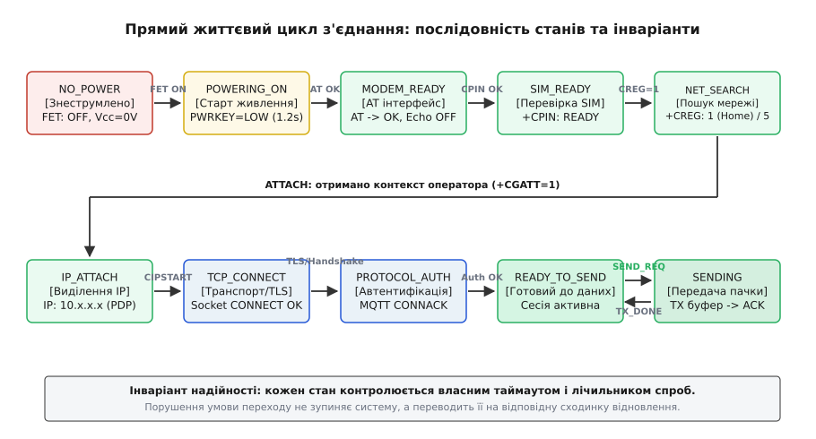
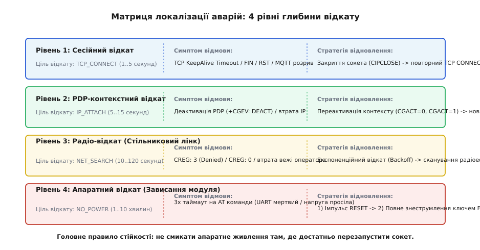
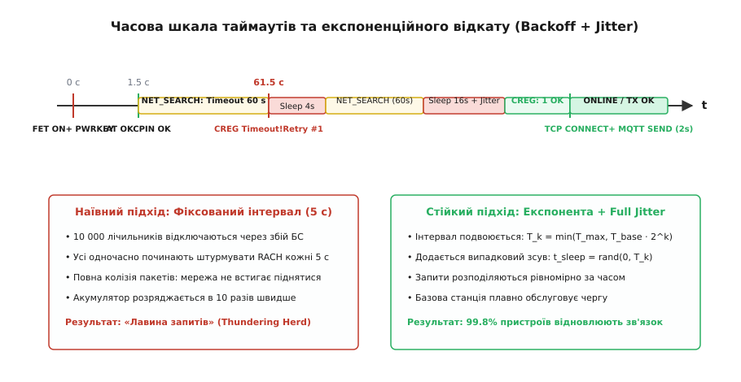

# Стан з'єднання як автомат — від «немає живлення» до «передаю», і кожен перехід назад

<preknowlist>
- [Модем на платі](root:embedded/modem-na-plati) — апаратна інтеграція стільникового модуля: живлення, піни PWRKEY та RESET, інтерфейс UART.
- [Модем і AT-команди](root:com-transport/modem-i-at-komandy) — синтаксис командного інтерфейсу Hayes, URC-повідомлення та синхронні відповіді.
- [Скінченний автомат у мікроконтролері](root:sf-apps/state-machine-embedded) — моделювання станів і таблиць переходів у вбудованих системах.
- [Сокети TCP та UDP](root:sf-os/sockets-tcp-udp) — життєвий цикл сокета, буферизація та стани з'єднання.
- [Сторожовий таймер](root:sf-devices/watchdog) — апаратний нагляд за зависанням системи та методи скидання.
- [Повтори та експоненційний відкат](root:sf-distributed/retries-backoff) — базова концепція захисту сервісу від перевантаження.
</preknowlist>

Прилад періодичного моніторингу виходить на зв'язок раз на добу, передає двісті байтів телеметрії та повертається в глибокий сон. У лабораторії на стабільному стенді такий пристрій бездоганно працює через простий лінійний алгоритм: увімкнули живлення модема, почекали секунду, відправили команду ініціалізації, зареєструвалися в мережі, відкрили TCP-сокет і віддали буфер. Але щойно такий вузол встановлюють у залізобетонному колодязі або на віддаленій щоглі, лінійна послідовність функцій гарантовано зависає під час першої ж негоди: базова станція відхиляє спробу реєстрації через перевантаження, модем перестає відповідати на UART через просідання напруги під час передавального імпульсу, а TCP-сокет мовчки застрягає в напіввідкритому стані без надсилання повідомлення про помилку.

Якщо мікроконтролер очікує відповіді блокуючими викликами з фіксованими затримками, він витрачає дорогоцінний заряд батареї на очікування в порожнечу або викликає спрацьовування апаратного сторожового таймера *(watchdog)*. Перезавантаження мікроконтролера починає той самий наївний цикл спочатку, перетворюючи пристрій на генератор безперервного аварійного трафіку, який зрештою блокується стільниковим оператором.

Єдиний спосіб побудувати надійний вузол зв'язку — спроєктувати повний та стійкий скінченний автомат життєвого циклу з'єднання *(Connection Lifecycle Finite State Machine)*. Цей автомат повинен не лише вести пристрій уперед через усі сходинки фізичної та логічної готовності радіотракту, але й мати математично вивірені зворотні переходи для кожного можливого збою — від локального розриву сокета до фатального зависання модема на апаратному рівні.

## Пастка лінійного коду: чому «послідовність функцій» ламається на першому кілометрі

Наївний підхід до керування модемом базується на синхронній процедурній парадигмі. Розробник створює функцію `connect_and_send()`, яка виконує кроки один за одним:

```
[Подати живлення] → [Опитати AT] → [Перевірити SIM] → [Знайти мережу] → [Отримати IP] → [Відкрити сокет] → [Передати]
```

Кожен крок у такій схемі реалізується через блокуючу відправку команди та очікування рядка `OK` у циклі `while`. Така архітектура містить чотири фатальні вади, які роблять пристрій непридатним для промислової експлуатації:

1. **Неконтрольоване блокування процесора та розряд батареї.** Реєстрація в мережі LTE або NB-IoT у зоні слабкого сигналу може тривати від 10 до 120 секунд. Якщо пристрій блокує виконання основного циклу на цей час, він не може опитувати критичні датчики, обслуговувати аварійні переривання або скидати сторожовий таймер. У результаті сторожовий таймер перезавантажує мікроконтролер на 15-й секунді пошуку мережі, процес починається заново, і прилад ніколи не виходить на зв'язок.
2. **Асинхронні повідомлення оператора (URC).** Стільниковий модуль — це незалежна складна обчислювальна система. Модем надсилає в UART не лише синхронні відповіді на команди мікроконтролера, але й спонтанні повідомлення про події *(Unsolicited Result Codes)*: втрату SIM-карти `+CPIN: NOT INSERTED`, зміну статусу мережі `+CREG: 3` (Registration Denied), деактивацію PDP-контексту `+CGEV: DEACT`, або раптове закриття з'єднання сервером `CLOSED`. Лінійний парсер, який очікує суто рядок `OK` на команду `AT+CIPSEND`, зависне або некоректно інтерпретує URC-повідомлення як помилку синтаксису.
3. **Апаратне скидання через імпульсне навантаження.** Під час передачі радіопакета вихідний підсилювач стільникового модема споживає імпульсний струм амплітудою до 2 А (для 2G) або до 0.5–1 А (для LTE-M). Якщо внутрішній опір джерела живлення зависокий, напруга на шині живлення модема на кілька мікросекунд просідає нижче критичного порогу (типово 3.3 В або 3.1 В). Модем миттєво перезавантажується, скидаючи всі налаштування та реєстрацію. Мікроконтролер, який не веде обліку апаратного стану модуля, продовжує надсилати дані у відкритий, як він вважає, TCP-сокет, отримуючи у відповідь повідомлення про помилку `ERROR` або стартовий рядок завантажувача `RDY`.
4. **Стан напіввідкритого сокета *(Half-Open TCP Connection)*.** Якщо зв'язок між базовою станцією та сервером обірвався під час передачі, клієнтський стек TCP не отримує пакетів `FIN` або `RST`. Сокет залишається відкритим з точки зору модема, але жоден байт не доходить до адресата. Лінійний код відправляє буфер, отримує локальний `SEND OK` від буфера модема і вважає задачу виконаною, хоча дані безповоротно втрачені на рівні шлюзу оператора.

Щоб позбутися цих вразливостей, система зв'язку будується як суворий асинхронний автомат, у якому кожен крок має чіткий інваріант успіху, обмежений таймаут і регламентовану реакцію на відмову.

## Ієрархія та простір станів: від знеструмленого кремнію до передачі корисного навантаження

Стан з'єднання не є бінарним прапорцем «підключено / відключено». Фізичний та логічний тракт зв'язку проходить послідовні фази, кожна з яких опирається на успішне завершення попередньої.


*Прямий маршрут автомата від знеструмленого стану до передачі даних. Кожен перехід уперед вимагає виконання суворого інваріанта, а будь-яка затримка лімітована індивідуальним таймаутом.*

Розглянемо повну ієрархію станів, їхні інваріанти та умови переходу:

### 1. `STATE_NO_POWER` (Знеструмлено)
- **Фізичний стан:** Силовий P-канальний MOSFET або вихід регулятора LDO, що живить модем, закритий. Напруга на виводах модуля дорівнює 0 В. Лінії UART переведені мікроконтролером у високоімпедансний стан (High-Z) або підтягнуті до нуля, щоб запобігти паразитному живленню модема через захисні ESD-діоди мікросхеми.
- **Інваріант виходу:** Пристрій перебуває в цьому стані під час глибокого сну між сеансами зв'язку або після фатальної апаратної аварії.
- **Умова переходу вперед:** Спрацьовування таймера розкладу або зовнішня подія `EV_CONNECT_REQ`. Мікроконтролер відкриває силове живлення і переходить у `STATE_POWERING_ON`.

### 2. `STATE_POWERING_ON` (Запуск живлення та імпульс PWRKEY)
- **Фізичний стан:** На шину `VBAT` модема подано робочу напругу (3.8–4.2 В). Конденсатори обв'язки заряджаються. Мікроконтролер вичікує стабілізацію напруги (типово 100–300 мс), після чого притискає вивід `PWRKEY` до землі на регламентований час (зазвичай 1.0–1.5 с для модулів SIMCom або Quectel).
- **Інваріант переходу:** Вивід `PWRKEY` відпущено (переведено у відкритий колектор із підтяжкою догори), напруга на виводі статусу `STATUS` модема піднялася до рівня логічної одиниці (1.8 В або 3.3 В).
- **Таймаут:** 5.0 с. Якщо пін `STATUS` не піднявся — ескалація апаратної помилки.

### 3. `STATE_MODEM_READY` (Синхронізація AT-інтерфейсу)
- **Фізичний стан:** Модем завантажив власне мікропрограмне забезпечення і готовий приймати команди по інтерфейсу UART.
- **Дія автомата:** Відправка базової послідовності ініціалізації:
  1. `AT` — автопідлаштування швидкості бодрейту *(Autobauding)* до отримання відповіді `OK`.
  2. `ATE0` — вимкнення луни команд, щоб не засмічувати приймальний буфер UART.
  3. `AT+CMEE=2` — увімкнення розширених текстових кодів помилок для детальної діагностики.
  4. `AT&K3` або `AT+IFC=2,2` — увімкнення апаратного контролю потоку RTS/CTS.
- **Таймаут:** 3.0 с (максимум 5 спроб команди `AT` з інтервалом 500 мс).

### 4. `STATE_SIM_READY` (Ініціалізація абонентської картки)
- **Фізичний стан:** Модем зчитує контактну групу SIM-карти або ініціалізує профіль eSIM.
- **Дія автомата:** Відправка команди `AT+CPIN?`.
- **Інваріант переходу:** Отримання відповіді `+CPIN: READY`.
- **Особливі випадки:** Якщо відповідь `+CPIN: SIM PIN`, автомат вводить PIN-код (якщо дозволено конфігурацією). Якщо отримана відповідь `+CPIN: NOT INSERTED` або `+CPIN: SIM FAILURE` — перехід на аварійну зупинку (фізичний збій або окислення контактів тримача).
- **Таймаут:** 10.0 с (зчитування телефонної книги та профілів SIM після старту може тривати кілька секунд).

### 5. `STATE_NET_SEARCH` (Пошук базової станції та реєстрація)
- **Фізичний стан:** Модем сканує частотні діапазони, вибирає найсильнішу базову станцію та виконує процедуру взаємної автентифікації.
- **Дія автомата:** Опитування стану реєстрації командами `AT+CREG?` (для 2G/3G) або `AT+CEREG?` (для LTE Cat-M / NB-IoT).
- **Інваріант переходу:** Отримання статусу реєстрації `1` (зареєстровано в домашній мережі) або `5` (зареєстровано в роумінгу).
- **Таймаут:** 60.0–120.0 с. Перевищення таймауту свідчить про відсутність покриття або екранування антени.

### 6. `STATE_IP_ATTACH` (Активація контексту передачі даних PDP)
- **Фізичний стан:** Встановлення пакетного з'єднання з вузлом обслуговування пакетами даних *(SGSN/SGW)* та отримання IP-адреси від шлюзу оператора *(GGSN/PGN)*.
- **Дія автомата:**
  1. `AT+CGDCONT=1,"IP","iot.provider.apn"` — встановлення точки доступу (APN).
  2. `AT+CGACT=1,1` або `AT+CGATT=1` — активація контексту.
- **Інваріант переходу:** Отримання дійсної IP-адреси (перевіряється командою `AT+CGPADDR=1`).
- **Таймаут:** 30.0 с.

### 7. `STATE_TCP_CONNECT` (Встановлення транспортного сокета / TLS)
- **Фізичний стан:** Виконання 3-етапного рукостискання TCP `SYN -> SYN-ACK -> ACK`, а у випадку захищеного з'єднання — узгодження ключів та шифрів TLS Handshake.
- **Дія автомата:** Відправка команди відкриття з'єднання (наприклад, `AT+CIPSTART="TCP","cloud.example.com",8883` або відповідної SSL-команди).
- **Інваріант переходу:** Отримання відповіді `CONNECT OK` або сповіщення `+CIPOPEN: 0,0`.
- **Таймаут:** 15.0–30.0 с.

### 8. `STATE_PROTOCOL_AUTH` (Автентифікація на рівні протоколу)
- **Логічний стан:** Транспортний канал відкрито. Необхідно підтвердити права пристрою на рівні протоколу додатків (наприклад, відправка пакету `MQTT CONNECT` з іменем користувача та паролем або проходження сесії HTTP Basic/Bearer).
- **Інваріант переходу:** Отримання підтвердження `MQTT CONNACK` з кодом повернення `0` (Connection Accepted).
- **Таймаут:** 10.0 с.

### 9. `STATE_READY_TO_SEND` (Сесія активна, очікування навантаження)
- **Логічний стан:** Повний тракт встановлено. Автомат перебуває в стані очікування черги корисних даних.
- **Дія автомата:** Періодична відправка пінг-пакетів `MQTT PINGREQ` (Keep-Alive) для запобігання закриттю NAT-таблиць на стороні оператора стільникового зв'язку (типовий таймаут трансляції адрес у мобільних мережах становить від 30 до 120 секунд).

### 10. `STATE_SENDING` (Передача пакета та очікування підтвердження)
- **Логічний стан:** Відправка підготовленого буфера телеметрії.
- **Дія автомата:** Відправка даних у модем (`AT+CIPSEND=len`), передача тіла пакета, очікування апаратного `SEND OK` від модема та прикладного `PUBACK` (у випадку MQTT QoS 1).
- **Інваріант переходу:** Успішне отримання підтвердження доставки повертає автомат у стан `STATE_READY_TO_SEND` або ініціює процедуру планового завершення сесії `STATE_DISCONNECTING`.
- **Таймаут:** 10.0–20.0 с.

### 11. `STATE_PSM_SLEEP` (Енергозберігаючий сон без розриву реєстрації)
- **Логічний стан:** У сучасних мережах LTE-M та NB-IoT повне знеструмлення модема часто є надлишковим. Якщо модуль підтримує режим збереження енергії PSM *(Power Saving Mode)* за стандартом 3GPP Rel.12, автомат налаштовує таймери періодичного оновлення `T3412_ext` та активного вікна `T3324` командою `AT+CPSMS=1`.
- **Інваріант переходу:** Модем вимикає радіотракт і засинає зі споживанням менше 3 мкА, але зберігає IP-адресу та безпековий контекст на базовій станції. При пробудженні автомат не проходить весь шлях від `NO_POWER` до `IP_ATTACH`, а миттєво повертається до відкриття сокета за лічені сотні мілісекунд.

## Диспетчеризація подій: такти, таймери й асинхронні URC-повідомлення

Для забезпечення надійності автомат не повинен використовувати блокуючі виклики `delay()` або `sleep()`. Ядро автомата реалізується як квантована функція диспетчеризації `conn_fsm_tick()`, яка викликається в головному суперциклі системи або з періодичністю 10–50 мс.

Автомат оперує трьома незалежними джерелами подій:
1. **Хід монотонного системного часу:** Визначає момент вичерпання таймаутів станів і керує паузами між повторними спробами.
2. **Асинхронний потік рядків від модема:** Приймальний кільцевий буфер UART розбирається неблокуючим парсером рядків. Щойно виявлено символ кінця рядка `\r\n`, сформований рядок класифікується як:
   - Синхронна відповідь на попередньо надіслану команду: `OK`, `ERROR`, `+CME ERROR: <код>`;
   - Асинхронне сповіщення мережі (URC): `+CREG: <stat>`, `+CGEV: DEACT`, `CLOSED`, `RDY`.
3. **Команди користувацького рівня:** Запит на передачу телеметрії `EV_SEND_DATA_REQ`, запит на планове відключення `EV_DISCONNECT_REQ`.

> 🔧 **Навіщо це.** Відокремлення парсера рядків від стану автомата захищає систему від зависання при надходженні непередбачуваних URC. Якщо під час передачі даних сервер несподівано розірве з'єднання, модем виведе в UART рядок `CLOSED`. Парсер миттєво генерує внутрішню подію `EV_SOCKET_CLOSED`, і автомат безпечно перейде у стан відновлення сокета, не чекаючи вичерпання 30-секундного таймауту відправки.

### Апаратний контроль потоку (RTS/CTS) та буферизація UART

При активному обміні даними через UART виникає ризик переповнення буфера мікроконтролера під час прийому великих TCP-пакетів або буфера модема під час швидкої передачі. 

Використання програмного контролю потоку (символи XON/XOFF) неприпустиме, оскільки двійкові дані телеметрії (наприклад, стиснений Protobuf або зашифрований TLS-трафік) можуть містити байти `0x11` (XON) або `0x13` (XOFF), що спричинить раптове зависання передачі. 

Тому на схемі обов'язково розводять апаратні лінії `UART RTS` *(Request to Send)* та `UART CTS` *(Clear to Send)*. Мікроконтролер опускає свій пін RTS, повідомляючи модему про готовність приймати дані, лише коли у внутрішньому кільцевому буфері є вільне місце, і піднімає його, коли буфер заповнений на 80%.

## Зворотні переходи та 4-рівнева драбина аварійного відновлення

Найпоширеніша помилка при проєктуванні вбудованих пристроїв — перезапуск усього циклу з повним знеструмленням модема при будь-якій помилці. Повна перереєстрація модема на базовій станції коштує від 30 до 90 секунд активної роботи передавача та споживає колосальну кількість енергії.

Стійкий автомат використовує принцип **локалізації збоїв**: глибина відкату повинна точно відповідати масштабу виниклої проблеми.


*Сходинки аварійного відновлення з'єднання. Принцип локалізації гарантує, що легкі мережеві збої усуваються за секунди без дорогого повного перезапуску радіотракту.*

Розглянемо чотири рівні аварійного відновлення:

### Рівень 1: Сесійний та сокетний відкат (Socket Reset)
- **Симптоми:** Сервер надіслав `TCP RST` або `TCP FIN`, прийшов URC `CLOSED`, минув таймаут відповіді на `MQTT PINGREQ`, або сталася помилка рукостискання TLS.
- **Стан радіотракту:** Модем повністю працездатний, зареєстрований у мережі, IP-адреса збережена.
- **Дія автомата:** Відправка команди примусового закриття локального сокета `AT+CIPCLOSE`.
- **Цільовий стан відкату:** `STATE_TCP_CONNECT`.
- **Час відновлення:** 1–3 секунди. Радіоефір не перевантажується новою процедурою автентифікації на вишці.

### Рівень 2: Відкат контексту передачі даних (PDP Context Deactivation)
- **Симптоми:** Отримано URC `+CGEV: DEACT` (оператор примусово скинув тунель через неактивність), або спроба відкриття сокета повертає помилку `PDP DEACTIVATED`.
- **Стан радіотракту:** Радіолінк до вишки активний (`CREG=1`), але локальна IP-адреса втрачена.
- **Дія автомата:** Закриття всіх відкритих сокетів, явна деактивація старого контексту `AT+CGACT=0,1` та його повторна активація `AT+CGACT=1,1`.
- **Цільовий стан відкату:** `STATE_IP_ATTACH`.
- **Час відновлення:** 3–10 секунд.

### Рівень 3: Радіо-відкат (Radio Link Re-acquisition)
- **Симптоми:** Отримано URC `+CREG: 3` (Registration Denied), `+CREG: 0` (Not searching), рівень сигналу впав до нуля (`CSQ: 99,99`), або минув таймаут пошуку мережі.
- **Стан радіотракту:** Пристрій втратив контакт із базовою станцією (наприклад, через рух транспорту або інтерференцію).
- **Дія автомата:** Очищення мережевих контекстів. Автомат переходить у режим паузи з експоненційним відкатом *(Exponential Backoff)*, щоб дати радіоефіру стабілізуватися і не розряджати батарею марними запитами.
- **Цільовий стан відкату:** `STATE_NET_SEARCH`.
- **Час відновлення:** 15–120 секунд.

### Рівень 4: Апаратне перезавантаження та знеструмлення (Hardware Power Cycle)
- **Симптоми:** Модем не відповідає на 3 послідовні команди `AT` (таймаут UART), виникло апаратне блокування шини `UART RX/TX`, напруга внутрішніх стабілізаторів модема просіла, або модуль видає фатальні внутрішні помилки `+CME ERROR: 100`.
- **Дія автомата:** Двоетапна апаратна ескалація:
  1. *М'яке апаратне скидання:* Подача низького логічного рівня на пін `RESET` модема на 200–500 мс.
  2. *Повне знеструмлення (Power Cut):* Якщо після `RESET` модем не відповідає протягом 5 секунд, мікроконтролер повністю вимикає силовий ключ живлення `VBAT_EN`, чекає 3–5 секунд для повного розряду ємностей фільтрації, після чого подає живлення знову.
- **Цільовий стан відкату:** `STATE_NO_POWER` з наступним переходом у `STATE_POWERING_ON`.
- **Час відновлення:** 30–60 секунд.

## Діагностична таблиця числових помилок CME ERROR

Коли модем відхиляє команду, він повертає розширений числовий код `+CME ERROR: <код>`. Автомат повинен аналізувати цей код і обирати правильний рівень ескалації замість сліпого перезавантаження:

| Код CME ERROR | Опис помилки | Фізична причина | Рівень ескалації |
|---|---|---|---|
| `10` | SIM not inserted | Відсутній контакт із карткою, окислення | Зупинка автомата, перехід у сон, індикація аварії |
| `13` | SIM failure | Збій логіки SIM, помилка живлення 1.8V | Рівень 4 (перезапуск живлення модема) |
| `14` | SIM busy | SIM зчитує адресну книгу | Пауза 1 с, повтор `AT+CPIN?` без зміни стану |
| `30` | No network service | Відсутній радіосигнал оператора | Рівень 3 (експоненційний відкат `NET_SEARCH`) |
| `33` | Operation not allowed | Спроба відкрити сокет без активного PDP | Рівень 2 (деактивація та переактивація PDP) |
| `100` | Fatal baseband crash | Внутрішнє зависання процесора модема | Рівень 4 (апаратне знеструмлення FET) |

## Експоненційний відкат, лічильники спроб і захист від лавини підключень

Помилка підключення до мережі рідко буває миттєвою. Якщо в мікрорайоні зникло живлення базової станції, сотні або тисячі лічильників одночасно отримають відмову в з'єднанні. Якщо всі вони почнуть щосекунди повторювати спроби реєстрації, вони влаштують атаку «відмова в обслуговуванні» *(DoS)* на сусідню вишку оператора.


*Порівняння детерміністичного опитування та експоненційного відкату з джиттером. Рандомізація інтервалів запобігає колапсу каналу випадкового доступу (RACH) базової станції.*

Для запобігання цьому явищу автомат використовує алгоритм **усіченого двійкового експоненційного відкату з повним джиттером** *(Truncated Binary Exponential Backoff with Full Jitter)*. Детальний математичний вивід та аналіз імовірності колізій наведено в окремому документі [Математика експоненційного відкату та джиттеру](root:embedded/stan-ziednannia-iak-avtomat-vid-nemaie-zhyvlennia/math-backoff-jitter.md).

Розрахунок інтервалу паузи `T_sleep` перед наступною спробою `k` здійснюється за формулою:

```
T_max_interval = min(T_ceiling, T_base · 2^k) [обчислення стелі експоненти]
T_sleep = random(0, T_max_interval)            [додавання повного джиттеру]
```

Типові параметри для вбудованих систем:
- Базовий інтервал `T_base = 2 с`;
- Максимальна межа `T_ceiling = 300 с` (5 хвилин);
- Максимальна кількість спроб на поточному рівні `MAX_RETRIES = 5`.

Якщо лічильник спроб `k` перевищує `MAX_RETRIES`, автомат не продовжує штурмувати поточний рівень, а ескалює проблему на наступний, глибший рівень відновлення (наприклад, переходить від повтору сокета до повторної реєстрації в мережі, або від пошуку мережі — до глибокого сну на 1 годину для збереження заряду батареї).

## Чорна скринька відмов: кільцевий буфер переходів і діагностика розривів

Коли пристрій працює в полі за сотні кілометрів від розробника, діагностика відмов через пряме підключення налагоджувача стає неможливою. Автомат повинен вести автономний журнал станів — «чорну скриньку» з'єднання.

Кожен перехід між станами фіксується в кільцевому буфері структурою фіксованого розміру (16 байтів):

:::tabs
:::code stan-ziednannia-iak-avtomat-vid-nemaie-zhyvlennia-d/c/chorna-skrynka-vidmov.c
:::code stan-ziednannia-iak-avtomat-vid-nemaie-zhyvlennia-d/cpp/chorna-skrynka-vidmov.cpp
:::

Цей буфер зберігається в енергонезалежній пам'яті (EEPROM, NOR Flash або збереженій при знеструмленні пам'яті RTC Backup SRAM). При наступному успішному встановленні з'єднання діагностичний кадр передається на сервер телеметрії, що дозволяє дистанційно будувати графіки надійності зв'язку, бачити зони радіозатінення та виявляти деградацію акумуляторів.

## Повна неблокуюча реалізація автомата на C та C++

Нижче наведено робочу, архітектурно вивірену реалізацію автомата зв'язку. Вона демонструє неблокуюче квантування часу, розділення на обробники станів, облік таймаутів та ескалацію помилок.

:::tabs
:::code stan-ziednannia-iak-avtomat-vid-nemaie-zhyvlennia-d/c/povna-neblokuiucha.c
:::code stan-ziednannia-iak-avtomat-vid-nemaie-zhyvlennia-d/cpp/povna-neblokuiucha.cpp
:::

Реалізація автомата на практиці перетворює складну, схильну до збоїв поведінку радіомодуля на детерміністичну систему. Кожна відмова локалізується на власному рівні, відновлення відбувається за мінімальний час, а пристрій гарантовано зберігає працездатність та енергію в найсуворіших умовах експлуатації.
