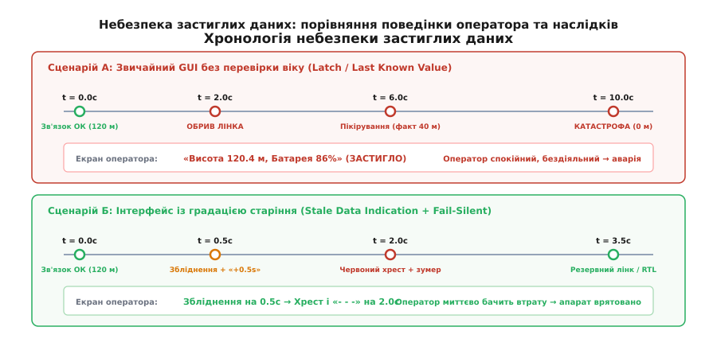
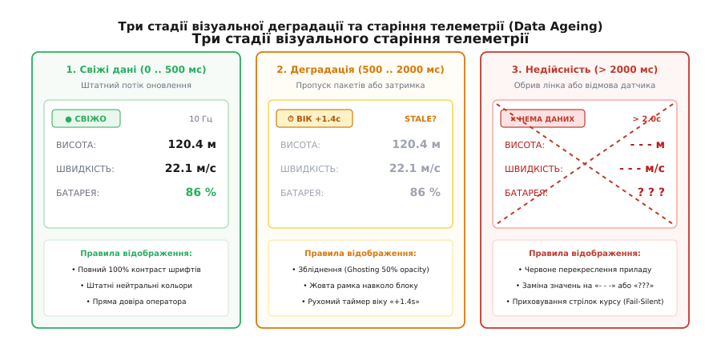
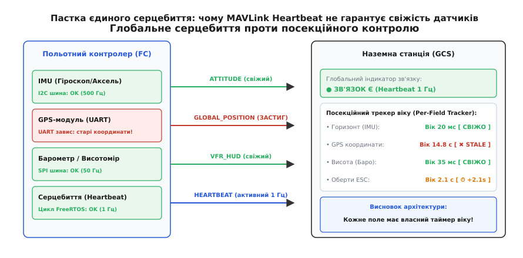

# Старі дані: як показати, що на екрані вже неправда — детально

<preknowlist>
- [Людина в контурі](root:embedded/liudyna-v-konturi) — затримка між подією та реакцією оператора та межі стійкості керування.
- [Пороги часу відгуку інтерфейсу](root:sf-apps/ui-response-time-limits) — 0.1 с, 1 с та 10 с: як психіка сприймає час затримки.
- [Якість лінка як показник](root:embedded/iakist-linka-iak-pokaznyk) — втрати пакетів, шумова підлога та фізичний вік радіопакетів.
- [Телеметрія](root:sys-dron/telemetry-stream) — періодичні потоки телеметричних повідомлень стану та навігації.
</preknowlist>

Бортовий зв'язок розвідувального або вантажного безпілотника раптово обривається через рельєф місцевості або придушення каналу на висоті 120 метрів при швидкості 22 м/с. На моніторі наземної станції оператор бачить зелену шкалу заряду акумулятора 86%, швидкість 22 м/с, горизонт у нулі та стабільну висоту 120 метрів. Оператор продовжує спокійно спостерігати за екраном, вважаючи, що борт летить за заданою траєкторією в автоматичному режимі. Тим часом через відмову сервоприводу елерона апарат за 4 секунди увійшов у круту спіраль і врізався в лісосмугу на дистанції двох кілометрів від станції. На екрані станції все ще світиться «висота 120 м, батарея 86%», і лише через 15 секунд нарешті спливає системне повідомлення про таймаут радіолінка. Людина 15 секунд дивилася на ілюзію штатного польоту, якої в реальному світі більше не існувало.

Ця катастрофа — не помилка пілотування й не наслідок відмови електроніки в повітрі. Це прямий наслідок архітектурного дефекту графічного інтерфейсу: відображення застиглих, застарілих даних (англ. *Frozen / Stale Data Hazard*) так, ніби вони залишаються свіжими та дійсними. Коли комп'ютер малює на екрані числа з повною яскравістю та чіткими контурами, людський мозок підсвідомо сприймає їх як актуальний факт фізичного світу. Якщо дані перестали оновлюватися, інтерфейс зобов'язаний негайно й наочно показати, що на екрані більше не правда.

## Анатомія застигання: пастка «останнього відомого значення»

У більшості прикладних фреймворків для створення інтерфейсів користувача (Qt Quick / QML, React, Electron, WebGL чи апаратні OSD-генератори на кшталт MAX7456) за замовчуванням реалізовано патерн «защіпки» або останнього відомого значення (англ. *Last Known Value / Latch*). 

Суть патерну полягає в тому, що віджет приладу підписується на властивість у моделі даних:

```
UI_Widget.Altitude = Model.Vehicle.Altitude;
```

Коли по радіоканалу або через UART надходить новий телеметричний пакет MAVLink, парсер оновлює змінну `Altitude`, і графічний рушій перемальовує цифри на екрані. Якщо ж радіозв'язок раптово обривається, сокет перестає отримувати байти, або UART-приймач фіксує тишу, функція оновлення просто не викликається. Змінна `Altitude` зберігає в пам'яті своє останнє значення. Графічний цикл відмальовує кадри з частотою 60 Гц, незмінно виводячи на екран ті самі 120 метрів.


*Порівняння реакції пілота: відсутність індикації старіння призводить до аварії через пасивність оператора, тоді як плавна градація вчасно запускає захисні дії.*

Тут виникає критична різниця між двома станами системи:
1. **Активний виміряний нуль**: апарат стоїть на землі з вимкненими двигунами, висота дорівнює `0.0 м`, швидкість `0.0 м/с`, вертикальна швидкість `0.0 м/с`. Дані свіжі, система справна, людина бачить дійсний спокій.
2. **Застиглий стан (Frozen State)**: значення на екрані не змінюються не тому, що фізичний процес перебуває в спокої, а тому, що вимірювальний або комунікаційний тракт помер.

Для оператора на екрані обидві ситуації виглядають абсолютно однаково. Людина не здатна відрізнити «дрон летить за ідеально прямою лінією з постійною висотою 120 метрів» від «радіомодем завис на 120 метрах».

### Дворівнева природа застигання: транспорт проти джерела

Застигання телеметрії виникає на двох принципово різних рівнях системи:

1. **Застигання на рівні транспорту (Transport Loss)**:
   Обрив радіоканалу, фізичне пошкодження кабелю Ethernet, забитий буфер сокета операційної системи або відключення живлення приймача. У цьому випадку наземна станція не отримує жодних байтів від усього апарата.
2. **Застигання на рівні внутрішнього джерела (Source Freezing / Silent Subsystem Failure)**:
   Польотний контролер залишається повністю працездатним і справно транслює пакети MAVLink на наземну станцію з частотою 10 Гц. Проте окремий периферійний модуль — наприклад, супутниковий приймач GNSS або барометричний висотомір — завис на внутрішній шині I2C чи UART. Драйвер автопілота не отримує свіжих вибірок від чипа датчика і продовжує пакувати в щосекундні пакети телеметрії старі координати або останнє зафіксоване значення тиску.

Якщо станція відстежує лише глобальний зв'язок із бортом (наприклад, по факту надходження повідомлень `HEARTBEAT`), вона вважає, що зв'язок бездоганний: індикатор світиться зеленим кольором, пакети йдуть. Але координати навігації та висота на екрані вже є мертвою ілюзією.

## Градація старіння даних: три стадії від достовірності до небуття

Найпростіший спосіб боротьби із застиганням — бінарний прапорець «Зв'язок є / Зв'язку немає» з жорстким таймаутом (наприклад, 2 секунди). Проте бінарний підхід створює небезпечну сліпу зону. Протягом перших двох секунд оператор упевнений у достовірності цифр, а на позначці 2.01 с екран раптово гасне.

Людська психіка потребує плавного, безперервного відображення **деградації достовірності** (англ. *Data Degradation / Data Ageing*). Інтерфейс повинен сигналізувати про сумніви ще до того, як дані буде визнано остаточно втраченими.

Для цього застосовується тристадійна модель візуалізації віку телеметрії.


*Три стадії відображення телеметричних віджетів: від повного контрасту свіжих даних через напівпрозоре збліднення з таймером віку до червоного перекреслення та очищення екрана при перевищенні таймауту.*

### Стадія 1: Свіжі дані (0 .. 500 мс) — Повний контраст (Fresh / Active)

У нормальному режимі польоту пакети телеметрії надходять із періодичністю від 10 до 50 Гц (інтервал між кадрами 20–100 мс). 

- **Візуальний вигляд**: 100% непрозорість (альфа-канал `alpha = 1.0`), максимальна контрастність шрифтів, штатна колірна гама (наприклад, яскраво-білий або темно-сірий текст на контрастному тлі, зелені маркери справності).
- **Психологічний стан**: оператор беззастережно довіряє цифрам і здійснює пряме пілотування або моніторинг автоматичного польоту.

### Стадія 2: Деградація та попередня втрата (500 .. 2000 мс) — Збліднення, жовта рамка та таймер віку (Warning / Ghosting)

Якщо з моменту отримання останнього свіжого оновлення минуло понад 500 мс, потік телеметрії порушено (втрачено 5–20 пакетів поспіль). Фізичний стан апарата міг змінитися: за 1.5 секунди на швидкості 20 м/с машина долає 30 метрів дистанції та може змінити кут крену на десятки градусів.

- **Збліднення (Ghosting / Alpha-Decay)**: Непрозорість цифрових значень та стрілок приладу примусово знижується до `40–50%` (`alpha = 0.5`). Текст стає блідо-сірим, напівпрозорим. Це візуально відображає втрату фокусу та «розмиття» правди в часі.
- **Жовта рамка попередження (Warning Outline)**: Навколо віджета або групи застарілих параметрів спалахує бурштиновий контур.
- **Динамічний таймер віку (Age Badge)**: Безпосередньо поруч зі значенням або в кутку приладу з'являється числовий бейдж, що показує час простою в десятих долях секунди: `⏱ +0.8s`, `⏱ +1.4s`.

> 🔧 **Навіщо це.** Рухомий цифровий лічильник віку миттєво активує периферійний зір оператора. Людина може не помітити легкого збліднення кольору на яскравому сонці, але око автоматично реагує на зміну символів таймера, що біжать щосекунди. Оператор миттєво розуміє: зв'язок деградує, необхідно припинити динамічні маневри та приготуватися до перехоплення керування або активації аварійного режиму.

### Стадія 3: Застарілість і недійсність (> 2000 мс) — Перекреслення, знаки запитання та очищення (Stale Fault / Fail-Silent)

Якщо телеметрія не оновлюється понад дві секунди, дані вважаються остаточно недійсними та небезпечними для використання.

- **Червоне перекреслення (Red X-Overlay / Cross-Out)**: Прилад або числовий блок перекреслюється жирними діагональними червоними лініями.
- **Заміна на знаки недійсності**: Цифрові значення примусово видаляються й замінюються символами відсутності вимірювань: замість `120.4 m` виводиться `- - -  m` або `? ? ?`.
- **Очищення другорядних директивних елементів (Decluttering)**: З авіагоризонту та навігаційної карти негайно стираються розрахункові маркери: директорні планки польоту (*Flight Director*), вектор тенденції швидкості (*Speed Trend Vector*), прогнозована траєкторія та стрілки відхилення від курсу. Якщо система не знає поточної позиції, вона не має права малювати прогнозоване майбутнє.

Принцип примусового перекреслення приладів прийшов у цифрові дисплеї з класичної авіації, де електромеханічні заслінки століттями рятували пілотів від польотів за знеструмленими покажчиками. Детальний аналіз еволюції цього захисту наведено у вставці [Історія прапорців відмови](root:embedded/stari-dani/hist-aviatsiini-praportsi.md).

## Методи детектування застигання на борті та станції

Щоб надійно розпізнавати старіння кожного окремого показника, система не може покладатися на одне глобальне опитування мережевого сокета. Потрібен ансамбль протокольних та програмних механізмів детекції.


*Пастка єдиного серцебиття: справний радіолінк та активний MAVLink Heartbeat не гарантують свіжості окремих навігаційних датчиків на борті.*

### 1. Циклічний лічильник послідовності (Rolling Sequence Counter)

У будь-якому протоколі передачі телеметрії (MAVLink, CRSF, власний бінарний протокол) кожен кадр обов'язково містить беззнакове 8-бітне поле номера пакета:

```
uint8_t sequence_number;  /* Значення від 0 до 255 із циклічним переповненням */
```

Передавач інкрементує це число на кожен новий згенерований кадр: `0 → 1 → 2 ... 254 → 255 → 0`.

Приймач аналізує зміну цього лічильника:
- Якщо прийшов пакет із тим самим значенням `seq`, який уже був оброблений (наприклад, через застрягання в проміжному буфері ретранслятора або повторну відправку Wi-Fi/UDP пакета), пакет ігнорується, а таймер віку даних **не скидається**;
- Якщо `seq` успішно збільшився, приймач фіксує отримання нового кванту інформації та перезапускає таймер свіжості в нуль.

### 2. Монотонний локальний годинник проти дрейфу міток часу

Часта помилка розробників-початківців — спроба вимірювати вік даних шляхом віднімання астрономічного часу пакета (*Wall-Clock / Unix Timestamp*) від системного часу комп'ютера станції:

```
/* ⛔ ПОМИЛКОВА РЕАЛІЗАЦІЯ: нестійка до дрейфу та налаштувань годинника */
int64_t age_ms = get_utc_time_ms() - packet.timestamp_utc_ms;
```

Цей підхід гарантовано ламається з трьох причин:
1. **Відсутність мікросекундної синхронізації**: Якщо бортовий комп'ютер і наземний планшет не синхронізовані по протоколу PTP (IEEE 1588) або GPS-PPS, їхній годинник може різнитися на сотні мілісекунд або десятки секунд;
2. **Стрибки часу ОС**: Якщо на наземній станції служба NTP раптово скоригує системний годинник на 2 секунди назад, різниця `age_ms` миттєво стане від'ємною (`-2000 мс`), і система вважатиме мертві дані «даними з майбутнього», заблокувавши детекцію аварії;
3. **Температурний дрейф кварцу**: Кварцовий резонатор без термокомпенсації (типовий для дешевих мікроконтролерів) має похибку до 20–50 ppm, що дає дрейф до декількох секунд на добу.

Єдиним надійним методом вимірювання віку телеметрії є **вимірювання відносного монотонного часу на боці споживача**:

```
/* ✓ ПРАВИЛЬНА РЕАЛІЗАЦІЯ: монотонний таймер споживача */
uint32_t now_monotonic_ms = get_monotonic_time_ms();
uint32_t packet_age_ms    = now_monotonic_ms - field.last_rx_monotonic_ms;
```

Монотонний годинник (наприклад, `clock_gettime(CLOCK_MONOTONIC)` у Linux або `std::chrono::steady_clock` у C++, апаратний таймер SysTick на мікроконтролері) ніколи не стрибає назад, не залежить від часових поясів і монотонно інкрементується з кожним тактом процесора.

Для виявлення зависання датчика на борті (коли зв'язок є, а датчик помер) аналізується зростання **бортового монотонного часу** (`time_boot_ms`):

```
if (incoming_msg.time_boot_ms == field.last_onboard_time_boot_ms) {
    /* Борт надсилає той самий кадр: датчик завис у польотного контролера! */
    field.is_sensor_frozen = true;
} else {
    field.last_onboard_time_boot_ms = incoming_msg.time_boot_ms;
    field.last_rx_monotonic_ms      = now_monotonic_ms;
}
```

### 3. Посекційний контроль життєвості (Per-Field Liveness Tracking)

Глобальний статус зв'язку (*Global Link Heartbeat*) відображає лише працездатність каналу зв'язку. Для надійного відображення кожен незалежний блок телеметрії (навігація GPS, орієнтація IMU, висота за барометром, стан акумулятора, температура силової установки, оберти двигунів) повинен мати **власний дескриптор відстеження віку**.

Кожен дескриптор налаштовується на власний часовий профіль:
- **Кути орієнтації (Roll/Pitch/Yaw)**: потік 50 Гц → поріг деградації `150 мс`, поріг недійсності `500 мс`;
- **Координати GNSS**: потік 5 Гц → поріг деградації `600 мс`, поріг недійсності `2000 мс`;
- **Заряд акумулятора (Battery Status)**: потік 1 Гц → поріг деградації `2500 мс`, поріг недійсності `6000 мс`.

Якщо обірвався зв'язок по CAN-шині з регулятором обертів двигуна (ESC), на екрані зблідне й перекреслиться червоним хрестом **лише віджет обертів та споживання струму**, тоді як штучний горизонт та карта продовжать працювати з повною контрастністю.

## Протокольна специфіка телеметрії: MAVLink, CRSF та DroneCAN

Кожен стандартний протокол безпілотних систем має власні особливості пакування міток часу та лічильників доставки.

### Протокол MAVLink 2.0

У протоколі MAVLink 2.0 кожен заголовок містить 8-бітне поле `seq` та системні ідентифікатори `sysid`/`compid`. Більшість регулярних періодичних повідомлень містять внутрішню мітку часу від моменту старту прошивки:

1. **`ATTITUDE` (ID #30)**: містить поле `uint32_t time_boot_ms` (час у мілісекундах від старту автопілота) та кути `roll`, `pitch`, `yaw`. Якщо `time_boot_ms` перестає зростати, це означає зупинку розрахунку фільтра орієнтації (EKF) на борті;
2. **`GLOBAL_POSITION_INT` (ID #33)**: містить `time_boot_ms`, координати `lat`, `lon` (в градусах `1e7`), висоту `alt` (в міліметрах) та вектори швидкості `vx, vy, vz`. Якщо GPS втрачає 3D-фіксацію, польотний контролер скидає прапорці або фіксує значення;
3. **`SYS_STATUS` (ID #1)**: містить бітову маску стану сенсорів `onboard_control_sensors_health`. Якщо барометр або компас виходить із ладу, відповідний біт переходить у `0`. Проте станція не повинна чекати оновлення `SYS_STATUS` (який надсилається лише 1 раз на секунду) — локальний таймер віку віджета спрацює набагато швидше.

### Протокол TBS Crossfire / ExpressLRS (CRSF)

Протокол CRSF оптимізовано під низьку затримку радіоканалу, тому його кадри телеметрії не містять міток часу `time_boot_ms` для економії байтів у вузькій смузі радіоефіру:
- Кадр **`GPS` (Type 0x02)**: містить широту, довготу, швидкість, курс, висоту та кількість супутників;
- Кадр **`Battery Sensor` (Type 0x08)**: містить напругу, струм, спожиту ємність та відсоток батареї;
- Кадр **`Attitude` (Type 0x1E)**: містить кути тангажу, крену та рискання у форматі `int16_t` (в сотих долях градуса).

Оскільки в кадрі немає бортового часу, наземна станція або апаратура керування спирається **виключно на власний монотонний таймер часу прийому кожного кадру**. Щойно кадр `0x1E` не надходить понад 200 мс, прилад авіагоризонту на пульті оператора входить у стадію деградації.

### Шина DroneCAN / Cyphal

У розподілених авіаційних системах на базі шини CAN кожен модуль (компас, далекомір, регулятор двигуна) публікує власні повідомлення незалежно:
- Кожен вузол періодично (з частотою 1 Гц) транслює повідомлення `uavcan.protocol.NodeStatus`, яке містить код стану (`HEALTH_OK`, `HEALTH_WARNING`, `HEALTH_ERROR`, `HEALTH_CRITICAL`) та лічильник часу роботи вузла `uptime_sec`;
- Кожне функціональне повідомлення (наприклад, `uavcan.equipment.ahrs.RawIMU`) містить апаратний лічильник `Transfer-ID` (від 0 до 31), який дозволяє контролеру шини детектувати втрату поодиноких фреймів CAN-шини.

## Пастки обробки та візуалізації телеметрії

Практична реалізація системи відстеження віку телеметрії стикається з низкою неочевидних інженерних граблів.

### 1. Небезпека екстраполяції траєкторії (Dead Reckoning Trap)

Коли телеметрія переривається на 0.5–1.0 секунди, у розробників виникає спокуса «домалювати» рух апарата: якщо остання зафіксована швидкість була 20 м/с на північ, графічний рушій продовжує плавно зміщувати іконку дрона по карті.

Це смертельно небезпечно. Помилка екстраполяції без свіжих вимірювань прискорень зростає квадратично в часі:

```
s_error = 0.5 · a_unknown · t²
```

Якщо в момент обриву зв'язку апарат почав різкий розворот із боковим прискоренням `10 м/с²` (1g), екстраполятор буде вважати, що дрон летить прямо. За 2 секунди розрахункова помилка координат складе:

```
s_error
= 0.5 · 10 м/с² · (2.0 с)²    [підстановка формули квадратичного дрейфу]
= 0.5 · 10 · 4
= 20 метрів                   [реальний дрон уже в деревах, а на карті він у чистому полі]
```

**Правило безпеки**: екстраполяція траєкторії допустима виключно на коротких інтервалах до `200–300 мс` для згладжування тремтіння анімації (джитеру). Якщо затримка перевищує 300 мс, будь-яка екстраполяція припиняється, а віджет маркується як деградований.

### 2. Затримка згладжувальних фільтрів (Filter Lag)

Якщо до сирих значень висоти чи швидкості застосовано фільтр ковзного середнього (*Moving Average*) або низькочастотний фільтр першого порядку (IIR), фільтр має власну фазову затримку. 

Коли сигнал раптово застигає, фільтр ще сотні мілісекунд видає плавно змінювані значення зі свого внутрішнього стану. Таймер віку даних повинен скидатися **за фактом надходження сирого пакету на вхід фільтра**, а не за фактом зчитування виходу.

### 3. Брязкання станів та асиметричний гістерезис відновлення

В умовах сильних завад ефіру зв'язок не зникає миттєво: він «тріщить» (наприклад, 8 пакетів втрачено, 1 прийнято, знову 8 втрачено).

Якщо система буде перемикати інтерфейс туди й назад при кожному поодинокому пакеті, екран почне нестерпно блимати (ефект брязкання, *Flapping*): свіжий → зблідлий → свіжий → зблідлий 5 разів на секунду. Це перевантажує зір оператора та викликає дезорієнтацію.

Для захисту застосовується **асиметричний часовий гістерезис**:
- **Перехід у стан деградації (Погіршення)**: відбувається **миттєво**, щойно таймер перевищив 500 мс;
- **Повернення в стан повної свіжості (Відновлення)**: вимагає прийому серії з щонайменше **3–5 валідних пакетів поспіль** без пропусків.

### 4. Арифметика переповнення таймера (Wrap-around Safety)

На 32-розрядних мікроконтролерах системний лічильник мілісекунд (`uint32_t`) переповнюється кожні `49.7 діб` безперервної роботи:

```
2³² - 1 = 4294967295 мс ≈ 49.71 днів
```

При відніманні беззнакових чисел у стандарті C/C++ мова гарантує коректне взяття різниці за модулем `2³²`:

```
uint32_t last_time = 0xFFFFFFF0;  /* 16 мс до переповнення */
uint32_t now_time  = 0x00000020;  /* 32 мс після переповнення */
uint32_t diff = now_time - last_time; /* Результат: 48 мс — абсолютно точно! */
```

Тому умову перевірки таймауту завжди записують через **віднімання**: `(now_ms - last_rx_ms) > timeout_ms`. Порівняння через додавання `now_ms > (last_rx_ms + timeout_ms)` є критичним багом, оскільки сума `last_rx_ms + timeout_ms` переповнюється раніше за `now_ms` і викликає миттєве хибне спрацьовування аварійного захисту.

### 5. Багатопотокова синхронізація в наземних станціях

У сучасних наземних станціях (QGroundControl, Mission Planner або власних застосунках) прийом телеметрії з порту UART чи UDP-сокета виконується у фоновому потоці введення-виведення (*IO Thread*), тоді як інтерфейс малюється в головному графічному потоці (*UI Render Thread*) з частотою 60 кадрів/с.

Якщо графічний потік почне зчитувати структуру телеметрії в момент, коли мережевий потік записав лише половину полів (наприклад, широту оновив, а довготу ще ні), оператор побачить «роздерті» дані (*Data Tearing*). 

Для запобігання гонкам даних використовується або подвійна буферизація з атомарним покажчиком кадру (*Double Buffering*), або легковажний блокувальник послідовності (*Seqlock*), де читач перевіряє незмінність лічильника запису до та після зчитування.

## Інженерний принцип: краще відсутність даних, ніж хибні дані

В інженерній психології та ергономіці систем високої надійності (авіація, атомна енергетика, медичне обладнання) діє непохитне правило: **Краще повна відсутність інформації на дисплеї, ніж правдоподібна брехня (англ. *Better No Data Than Bad Data*)**.

### Психологічний феномен автоматизаційної упередженості

В умовах стресу, перешкод, високої швидкості польоту або дефіциту часу людина перебуває в стані високого когнітивного навантаження. Мозок автоматично переходить на рівень швидкого евристичного мислення (так звана «Система 1» за Даніелем Канеманом).

У цьому стані проявляється ефект **автоматизаційної упередженості** (англ. *Automation Bias*): людина схильна беззастережно довіряти числовим індикаторам на моніторі та ігнорувати непрямі ознаки небезпеки. Якщо на екрані написано «Висота 100 м», пілот не буде витрачати ресурси уваги на те, щоб зіставляти це з шумом вітру, орієнтирами на камері чи зміною звуку двигунів. Він вірить дисплею до останньої секунди.

Якщо ж екран стає напівпрозорим, цифри зникають і з'являється червоний хрест `---`, мозок миттєво отримує сигнал небезпеки: «Даних немає! Покладатися на прилад заборонено!». Це примусово вириває людину з пасивності та змушує перейти на аварійні чеклисти: набір безпечної висоти всліпу, перемикання на резервну ручну частоту або команду повернення додому.

### Концепція Fail-Silent UI

Архітектура безпечного інтерфейсу базується на концепції **мовчазної відмови за непевності** (англ. *Fail-Silent UI*):
1. Якщо програмний модуль сумнівається у валідності числа (не зійшлася контрольна сума, порушено інтервал доставки, значення виходить за фізично можливі межі прискорення) — значення **не відображається**;
2. Графічний інтерфейс не малює «середньоарифметичне» чи «останнє збережене» значення без явної візуальної вказівки на його ненадійність;
3. Усі розрахункові похідні величини (стрілки вертикальної швидкості, індикатори тренду, директорні кільця) негайно приховуються, щойно зникає первинний датчик.

## Повний програмний модуль відстеження та візуалізації віку телеметрії на C та C++

Нижче наведено повну, завершену реалізацію модуля `TelemetryAgeTracker`. Модуль спроєктовано для використання як на вбудованих дисплейних мікроконтролерах (STM32, ESP32), так і у складі наземних станцій керування (GCS на Linux/Windows).

Модуль реалізує:
- Точний вік даних у мілісекундах із захистом від переповнення лічильника часу (Wrap-around safe);
- Асиметричний гістерезис відновлення (потрібно 3 послідовні свіжі кадри для зняття тривоги);
- Поточний стан: `Fresh`, `Degraded`, `Stale`;
- Коефіцієнт прозорості `alpha_opacity` (від 0.0 до 1.0) для шейдерів рендерингу;
- Колір рамки та прапорець необхідності перекреслення віджета червоним хрестом;
- Готовий форматований рядок віку (`+1.4s`) для відображення в кутку віджета.

:::tabs
:::code stari-dani-d/c/telemetry_age_tracker.h
:::code stari-dani-d/cpp/telemetry_age_tracker.hpp
:::

Нижче наведено реалізацію логіки обчислення віку та візуальних станів на мові C:

:::tabs
:::code stari-dani-d/c/telemetry_age_tracker.c
:::code stari-dani-d/cpp/telemetry_renderer_example.cpp
:::

Застосування такого підходу гарантує, що жоден піксель інтерфейсу не введе людину в оману. Якщо зв'язок обірвано, система не чекає фатального кінця, а миттєво робить застигання очевидним фактом, захищаючи оператора від катастрофічної бездіяльності.
