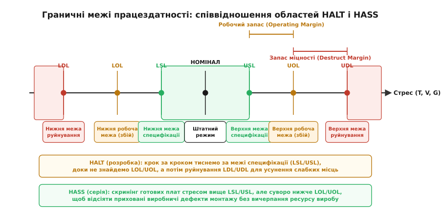
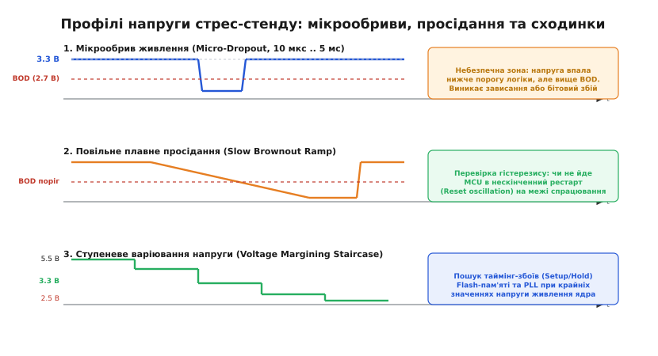
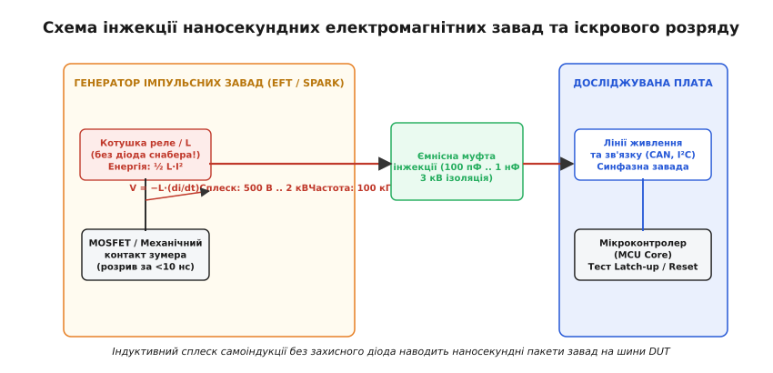
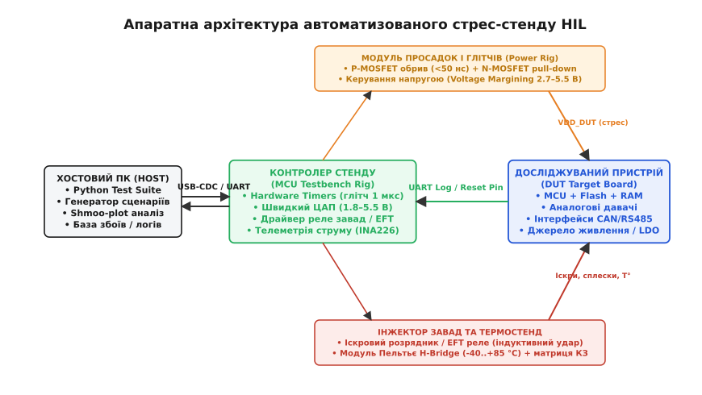

# Стенд знущання

<preknowlist>
- [Чому працює на столі й не працює в полі](root:embedded/chomu-pratsiuie-na-stoli-i-ne-pratsiuie-v-poli) — як реальні умови (температура, живлення, вібрація) розкривають приховані дефекти схеми.
- [Тестування відмовостійкості: fault injection](root:embedded/fault-injection-testing) — програмне й контактне уприскування несправностей для перевірки рятувального коду.
- [Закон Арреніуса і ресурс компонентів](root:hw-components/arrhenius-lifetime) — прискорення деградації кристалів і електролітів від підвищеної температури й напруги.
- [Блокування за низькою напругою (UVLO)](root:hw-power/uvlo) — як супервізори та пороги BOD реагують на падіння шини живлення.
- [Супервізор напруги: коли внутрішнього BOD мало](root:hw-power/voltage-supervisor-ic) — апаратний контроль глічів живлення та надійний reset.
- [Джерело, шлях, жертва: чотири шляхи завади](root:hw-pcb/electromagnetic-compatibility) — електромагнітні перешкоди, наведення на сигнальні траси та синфазні струми.
- [Сторож, який справді ловить зависання](root:embedded/storozh-iakyi-spravdi-lovyt-zavysannia) — апаратний watchdog та вихід з дедлоків.
</preknowlist>

Плата, яка успішно пройшла компіляцію, прогнала юніт-тести й бездоганно відпрацювала сорок вісім годин на лабораторному столі розробника за кімнатної температури +22 °C від прецизійного лінійного блока живлення, створює оманливе відчуття повної готовності. У чистому середовищі розробки немає раптових падінь напруги від пуску потужного колекторного двигуна, немає високовольтних наносекундних сплесків від розмикання сусіднього реле без діода, немає температурних перепадів від −40 °C до +85 °C, що зміщують частоту тактового кварцового резонатора та змінюють опір відкритих каналів польових транзисторів. Лабораторний стіл випробовує пристрій в ідеальних умовах, у яких він майже ніколи не працюватиме в реальній експлуатації.

Коли неперевірений виріб потрапляє в реальний світ, приховані дефекти схемотехніки й таймінгів прошивки вилазять миттєво: мікроконтролер ловить дедлок на межі спрацьовування детектора просідання напруги, Flash-пам'ять пошкоджує калібрувальний сектор через незавершений запис під час мікрообриву живлення, а синфазний струм від іскри реле пробиває вхідний захисний діод і зависає ядро через защіпання паразитного тиристора в структурі кристала. Якщо чекати, доки ці збої проявляться у клієнта або на полігоні, пошук першопричини перетворюється на нескінченний кошмар із невідтворюваними симптомами, десятками спалених плат і втратою репутації.

Єдиний інженерний спосіб гарантувати виживання пристрою — побудувати лабораторний «стенд знущання» (англ. *torture testbench / stress bench*). Це спеціалізований апаратний стенд із програмним керуванням, мета якого протилежна звичайним перевіркам: не підтвердити відповідність паспорту, а навмисно довести пристрій до збою та руйнування під контрольованим і повторюваним комбінованим стресом.

## Філософія випробувань на межі витривалості: HALT проти HASS

Класичний підхід до тестування обладнання базується на перевірці специфікації: якщо в паспорті мікроконтролера вказано діапазон живлення від 3.0 до 3.6 В і діапазон температур від −20 до +70 °C, звичайний кваліфікаційний тест вмикає пристрій при 3.0 В і −20 °C, переконується, що діод блимає, і ставить галочку «придатний». Такий тест не дає жодної відповіді на головні питання надійності: на якій саме напрузі пристрій насправді зависне? Чи витримає він 2.85 В під час пуску стартера? Що зламається першим при нагріванні — стабілізатор живлення, тактовий генератор чи інтерфейс Flash-пам'яті?

Для виявлення слабких місць конструкції використовують методологію **HALT** (англ. *Highly Accelerated Life Test* — прискорені випробування життєвого циклу). HALT — це дослідницький процес, який проводять на етапі прототипування. Його фундаментальний принцип: ступенево збільшувати кожен стрес-фактор далеко за межі номінального паспорта виробу доти, доки не буде знайдено точну фізичну точку відмови.


*Співвідношення меж надійності на осі стресу. Зона специфікації (LSL..USL) задає гарантований паспортний діапазон. Робочі межі (LOL..UOL) визначають поріг оборотного збою, а межі руйнування (LDL..UDL) — незворотну апаратну поломку. HALT шукає межі для розширення робочого запасу, а HASS перевіряє серійні плати між USL та UOL для відсіювання браку.*

На осі будь-якого стрес-фактора (напруга, температура, амплітуда вібрації) виділяють чотири критичні граничні межі:

1. **Межі специфікації** (англ. *Specification Limits*, LSL та USL) — нижня та верхня межі, заявлені в документації на виріб (наприклад, 3.0–3.6 В, −20..+70 °C). Усередині цього вікна виробник гарантує стовідсоткову точність і працездатність.
2. **Робочі межі** (англ. *Operating Limits*, LOL та UOL — *Lower/Upper Operating Limit*) — точки, за якими пристрій перестає виконувати свої функції (пропускає пакети зв'язку, перезавантажується, дає збій обчислень), проте **відновлює штатну роботу**, щойно стрес повертається в робочий діапазон.
3. **Межі руйнування** (англ. *Destruct Limits*, LDL та UDL — *Lower/Upper Destruct Limit*) — точки, за якими в електронних компонентах або друкованій платі настають незворотні фізичні зміни: тепловий або електричний пробій напівпровідника, розплавлення припою, розрив металізації отвору. Після перетину цієї межі пристрій залишається мертвим навіть після зняття навантаження.

Різниця між робочою межею та межею специфікації називається **робочим запасом** (англ. *Operating Margin*). Чим ширший цей запас, тим менша ймовірність того, що технологічний розкид параметрів компонентів у серійній партії виведе окрему плату з ладу під час допустимих коливань у полі.

Якщо HALT знаходить слабкі місця конструкції на етапі R&D, то **HASS** (англ. *Highly Accelerated Stress Screen* — прискорений скринінг напруженнями) застосовують під час серійного виробництва. HASS піддає кожну виготовлену або вибіркову плату короткочасному стресу, амплітуда якого вища за межі специфікації (USL/LSL), але суворо нижча за робочі межі (UOL/LOL). Мета HASS — спровокувати миттєву відмову так званої «дитячої смертності» (англ. *infant mortality*: мікротріщини в паяних з'єднаннях BGA, неякісні перехідні отвори, дефектні кристали мікросхем) ще на заводі, не витрачаючи залишковий ресурс надійних компонентів.

## Фізичні стрес-фактори та механіка виникнення відмов

Стенд знущання генерує чотири основні класи фізичних і електричних впливів. Кожен із них атакує специфічні вразливості напівпровідникової структури кристалів, пасивних компонентів і топології друкованої плати.

### 1. Термічний стрес і термошок

Зміна температури впливає на електроніку через два незалежні фізичні механізми: зміну електричних параметрів напівпровідників та механічну втому матеріалів.

Зі зростанням температури експоненційно зростають струми витоку p-n переходів, збільшується опір відкритого каналу польових транзисторів `R_DS(on)` (приблизно на +0.4% на кожен градус Цельсія) та знижується рухливість носіїв заряду. Це призводить до збільшення затримок поширення сигналів у логічних вентилях і деградації таймінгів паралельних шин (порушення вимог Setup і Hold time). За низьких температур падає коефіцієнт підсилення біполярних транзисторів, зміщуються пороги відкривання затворів і падає ємність електролітичних конденсаторів.

Механічна руйнація виникає через різницю коефіцієнтів теплового лінійного розширення (англ. *Coefficient of Thermal Expansion*, CTE). Склотекстоліт FR4 має CTE близько 14–17 ppm/K у площині XY та до 50–70 ppm/K по осі Z. Мідні доріжки мають CTE 16.5 ppm/K, кремнієвий кристал мікросхеми — 2.6 ppm/K, а безсвинцевий припій SAC305 — близько 22 ppm/K.

```
Матеріал          CTE (ppm/K)     Поведінка при циклі −40..+85 °C
------------------------------------------------------------------
Кремній (Si)         2.6          Майже не розширюється
Мідь (Cu)           16.5          Помірне розширення
Текстоліт FR4       14.0–17.0     Значне розширення в XY
Припій SAC305       22.0          Пластична деформація спаю
FR4 (вісь Z)        50.0–70.0     Розрив гільзи перехідного отвору
```

При швидкій зміні температури зі швидкістю понад 20–60 °C на хвилину (термошок) градієнт температур між корпусом мікросхеми та друкованою платою створює колосальні зсувні напруження в паяних кульках BGA-чипів та безвивідних корпусах QFN. Після кількох сотень таких циклів у припої виникають мікротріщини, опір контакту починає хаотично стрибати від вібрації, а згодом лінія зв'язку повністю обривається.

### 2. Варіації напруги, просідання та мікрообриви

Шина живлення ніколи не буває ідеально стабільною. На стенді застосовують три типи знущань над живленням:

1. **Ступеневе марджинування (Voltage Margining)**: плавне або покрокове зміщення напруги живлення від 5.5 В до 2.5 В із кроком 50 мВ. Цей режим виявляє приховані таймінг-збої вбудованої Flash-пам'яті та PLL. Зі зниженням напруги живлення транзистори перемикаються повільніше, і якщо розробник прошивки не налаштував належну кількість циклів очікування Flash (Flash Latency / Wait States) для поточної частоти тактування ядра, ядро починає зчитувати зіпсовані опкоди інструкцій (HardFault / Invalid Opcode).
2. **Мікрообриви живлення (Micro-Dropouts / Glitching)**: штучне розривання ланцюга живлення на мікросекундні інтервали (від 10 мкс до 10 мс) із примусовим притягуванням шини до нуля.
3. **Повільне плавне просідання (Slow Brownout Ramp)**: спад напруги зі швидкістю 1–10 мВ/с через поріг спрацьовування внутрішнього детектора Brownout Reset (BOD).


*Три критичні профілі стресу живлення. (1) Мікрообрив провалює напругу в «сіру зону» між логічним рівнем і порогом скидання BOD, провокуючи зависання ядра. (2) Повільне просідання тестує гістерезис супервізора живлення, щоб уникнути паразитної генерації рестартів. (3) Ступеневе марджинування шукає таймінгові збої шин.*

Найнебезпечніша зона виникає тоді, коли напруга живлення падає нижче мінімальної напруги надійної роботи логіки мікроконтролера (наприклад, 2.4 В), але ще не досягла апаратного порогу скидання Brownout Reset (наприклад, 2.1 В). У цьому проміжку тригери втрачають стабільність, лічильник команд PC (Program Counter) завантажує сміття з шини, і процесор починає виконувати випадкові ділянки пам'яті. Якщо в цей момент активний контролер DMA або виконується підпрограма стирання Flash-пам'яті, пристрій може самостійно затерти власні калібрувальні константи або заблокувати регістри конфігурації Flash.

### 3. Вібраційні навантаження

Вібраційні стенди збуджують механічні резонанси конструкції. Головні точки руйнації під час вібрації:
- **Багатошарові керамічні конденсатори (MLCC)**: крихкий титанат барію тріскається під час вигину плати. Тріщина призводить не просто до втрати ємності, а до низькоомного короткого замикання між внутрішніми електродами, що спричиняє вигорання шини живлення або локальну пожежу.
- **Масивні компоненти**: дроселі імпульсних перетворювачів та алюмінієві електролітичні конденсатори, закріплені лише на власних виводах, відламують контактні площадки від текстоліту через дію сил інерції.
- **Фреттинг-корозія роз'ємів**: мікропереміщення контактів в інтерфейсних роз'ємах стирають золоте або олов'яне покриття, оголюючи мідний сплав, який миттєво окислюється, спричиняючи стрибки контактного опору від кількох міліом до десятків кілоом.

### 4. Електромагнітні завади, наносекундні сплески та іскровий розряд

Електричні швидкі перехідні процеси (англ. *Electrical Fast Transient / Burst*, EFT за стандартом IEC 61000-4-4) моделюють комутацію індуктивних навантажень: реле, контакторів, електродвигунів.

Коли струм крізь індуктивність L розривається за час dt → 0, на контактах виникає сплеск проти-ЕРС самоіндукції:

```
V = −L · (di / dt)
```

При розмиканні ланцюга реле зі швидкістю спаду струму di/dt ≈ 10 А/мкс та індуктивністю котушки L = 100 мГн амплітуда імпульсу теоретично може сягати кількох кіловольт. Повітряний проміжок між контактами пробивається серією дугових мікроіскор із фронтом наростання близько 5 наносекунд і частотою повторення 5–100 кГц.


*Генератор індуктивних сплесків та іскор. Котушка реле комутується без захисного діода, генеруючи наносекундні кіловольтні викиди самоіндукції, які через ємнісну муфту зв'язку наводять синфазні струми на шини досліджуваного пристрою.*

Ці наносекундні пакети завад проникають у пристрій через ємнісні та індуктивні зв'язки джгутів проводів, трансформуючись у синфазні струми на платі. Протікаючи крізь полігон землі, такий струм викликає локальний стрибок потенціалу (англ. *Ground Bounce*), зміщуючи напругу на сигнальних виводах вище напруги живлення V_DD + 0.5 В або нижче нуля GND − 0.5 В. Це відкриває захисні діоди виводів мікроконтролера та може увімкнути паразитну чотиришарову p-n-p-n структуру (тиристорний ефект, *CMOS Latch-up*), що спричиняє коротке замикання між шинами живлення кристала та його фізичне вигорання за лічені мілісекунди.

## Архітектура автоматизованого стенду стрес-тестування (HIL Testbench)

Ручне випробування плати за допомогою лабораторного блока й фена не дає головного — **повторюваності та простору параметрів**. Якщо пристрій завис один раз на годину, інженер не знає, яка саме комбінація напруги, температури й завади призвела до збою. Стенд знущання будується як повноцінний автоматизований комплекс класу Hardware-in-the-Loop (HIL).


*Функціональна схема HIL-стенду. Хостовий ПК через протокол USB-CDC передає сценарії на Rig MCU, який синхронно керує швидкодіючим джерелом живлення, транзисторним глітчером, інжектором завад та модулем Пельтьє, одночасно збираючи телеметрію струму й логи з досліджуваного пристрою (DUT).*

Стенд складається з таких обов'язкових функціональних модулів:

### 1. Блок керованого живлення та надшвидкого глітчингу (Power Injection Rig)

Звичайний лабораторний блок живлення непридатний для генерації мікропровалів, оскільки на його виході встановлені згладжувальні конденсатори великої ємності, які не дозволяють напрузі спадати швидше, ніж за десятки мілісекунд.

Спеціалізований блок живлення стенду містить:
- **Швидкодіючий ЦАП (DAC)** з буферним операційним підсилювачем високого струму (до 3–5 А), який забезпечує швидкість наростання вихідної напруги ≥ 10 В/мкс у діапазоні від 1.0 до 6.0 В для ступеневого марджинування.
- **Послідовний P-MOSFET ключ** із низьким опором R_DS(on) < 15 мОм та часом перемикання < 30 нс, керований інтегральним драйвером затвора. Він миттєво відсікає зовнішнє джерело живлення.
- **Активний паралельний шунт (Fast Pull-down N-MOSFET)**, який відкривається синхронно з розмиканням послідовного ключа й примусово розряджає вхідні блокувальні конденсатори плати DUT до нуля за час менше 1–2 мікросекунд. Це дозволяє формувати чіткі прямокутні провали напруги будь-якої заданої тривалості (від 1 мкс до сотень мілісекунд).

### 2. Інжектор індуктивних сплесків та іскрового розряду

Для генерації пакетів наносекундних завад використовується реле з нормально замкненими контактами, увімкнене за схемою електромеханічного зумера, котушка якого живиться від джерела 12–24 В без демпфуючого діода.

Під час розмикання контактів виникає неперервна серія іскор із крутими фронтами, які через коаксіальну ємнісну муфту (англ. *Capacitive Coupling Clamp* ємністю 100–500 пФ на напругу ізоляції 3 кВ) або безпосередній контактний зонд впорскуються в шини живлення та інтерфейсні кабелі (RS-485, CAN, Ethernet) досліджуваної плати.

### 3. Матриця комутації відмов (Fault Injection Switch Matrix)

Блок на базі малосигнальних твердотільних або герконових реле, який дозволяє програмно імітувати:
- Обрив будь-якого сигнального проводу датчика або шини зв'язку.
- Замикання сигнальної лінії на шину GND або лінію живлення V_DD.
- Міжлінійне замикання (Cross-short) двох сусідніх ліній шини (наприклад, SDA та SCL в I²C або CAN_H та CAN_L).

### 4. Термокамера з модулем Пельтьє

Для локального термоциклювання кристала мікроконтролера використовується термоелектричний елемент Пельтьє, встановлений безпосередньо на корпус досліджуваного чипа через шар теплопровідної пасти.

Керування полярністю струму через елемент Пельтьє виконується за допомогою силового H-моста з ШІМ-модуляцією під керуванням ПІД-регулятора за сигналами термопари типу K або давача PT100. Це дозволяє локально змінювати температуру мікросхеми від −30 °C до +110 °C зі швидкістю до 2–3 °C на секунду без необхідності прогрівати велику кліматичну камеру.

### 5. Контур діагностики та реєстрації збоїв

Контролер стенду безперервно відстежує стан плати DUT за кількома незалежними каналами:
- **Високошвидкісний вимір струму**: шунт із підсилювачем струму (INA226 або INA238) опитується через I²C/SPI з частотою до 10 кГц. Стрибок струму фіксує виникнення тиристорного защіпання (*Latch-up*), а спад струму до нуля — спрацьовування запобіжника або тепловий пробій стабілізатора.
- **Моніторинг UART-консолі**: тестова прошивка DUT щосекунди надсилає структурований кадр телеметрії з інкрементним лічильником пакетів (*Heartbeat*) та статусом внутрішніх підсистем.
- **Апаратні лінії скидання**: моніторинг стану ліній `RESET` та `FAULT` плати за допомогою таймерних входів захоплення (Input Capture) контролера стенду для фіксації точного часу та причини перезавантаження.

## Метрики надійності, аналіз відмов та захист прошивки

Під час автоматизованого стрес-тесту кожен цикл впливу класифікується за критеріями функціонування відповідно до міжнародних стандартів електромагнітної сумісності (наприклад, ISO 16750-2 та IEC 61000-4-x):

```
Клас стійкості   Поведінка пристрою під час дії стресу
-----------------------------------------------------------------------------------------
Критерій A       Повна працездатність: параметри залишаються в межах допуску, жоден пакет
                 не втрачено, перезавантаження відсутні.
Критерій B       Тимчасова деградація: можлива втрата окремих пакетів зв'язку, проте пристрій
                 самостійно повертається до штатної роботи після зняття стресу без рестарту.
Критерій C       Тимчасова втрата функцій: пристрій зависає або скидається сторожовим таймером;
                 для відновлення потрібне автоматичне перезавантаження або дія оператора.
Критерій D       Незворотне пошкодження: апаратний вихід компонентів із ладу, вигорання доріжок.
```

Мета правильного проектування вбудованої системи полягає в тому, щоб у всьому робочому діапазоні забезпечувати **Критерій A**, при екстремальних наносекундних перешкодах та мікропровалах живлення опускатися не нижче **Критерію B**, а при виході напруги за робочі межі гарантувати контрольований перехід у безпечний стан (**Критерій C**) без переходу в **Критерій D**.

Для того щоб прошивка виживала під час таких випробувань, у ній реалізують обов'язковий комплекс захисних механізмів:
1. **Транзакційний запис у енергонезалежну пам'ять (Atomic Journaling)**: перед записом нової конфігурації у Flash/EEPROM створюється запис у журналі з контрольною сумою CRC32. Якщо живлення зникне посеред запису сектора, при наступному старті завантажувач виявить незавершену транзакцію й автоматично відкотить стан до останньої валідної копії.
2. **Перевірка цілісності оперативної пам'яті (RAM Parity / CRC Scrubbing)**: періодичне сканування статичних структур даних у RAM для виявлення спотворень окремих бітів під дією електромагнітних наводок.
3. **Автоматичне скидання завислих шин I²C**: якщо під час мікропровалу живлення зовнішній давач завис і притягнув лінію даних SDA до нуля, мікроконтролер детектує таймаут, перемикає вивід SCL у режим GPIO й генерує дев'ять тактових імпульсів для примусового звільнення шини.

## Програмно-апаратний контролер стенду: C/C++ та Python

Створимо повну програмно-апаратну реалізацію контролера стрес-стенду. Прошивка мікроконтролера керує формуванням мікропровалів живлення, задає напругу через ЦАП, вмикає інжектор завад і збирає струмову телеметрію. Хостовий скрипт на Python керує сценарієм тестування, здійснює сітковий пошук (Grid Sweep) меж витривалості та будує двовимірну карту стійкості (Shmoo Plot).

### 1. Прошивка контролера стенду (Firmware)

Прошивка приймає двійкові або текстові команди через USB-CDC/UART, налаштовує апаратний таймер для формування мікросекундного імпульсу розмикання ключа P-MOSFET та замикання ключа N-MOSFET примусового розряду, задає вихідний рівень ЦАП і зчитує статус плати.

:::tabs
=== C
:::code stend-znushchannia-d/c/main.c
=== C++
:::code stend-znushchannia-d/cpp/main.cpp
:::

### 2. Хостовий автоматизатор випробувань на Python

Скрипт верхнього рівня запускає автоматичний двовимірний прогін по сітці (напруга живлення V_DD проти тривалості мікропровалу T_dropout), опитує UART-консоль досліджуваного пристрою та будує матрицю стабільності (Shmoo Plot).

:::code stend-znushchannia-d/py/main.py

Запуск цього скрипту під час тестування реальної плати формує наочну текстову карту витривалості:

```
========================================================================
ПОЧАТОК СТРЕС-ТЕСТУ: АВТОМАТИЗОВАНИЙ SHMOO-PLOT
Діапазон напруг: 3600..2400 мВ | Провали: [10, 50, 100, 500, 1000, 5000, 10000, 50000] мкс
========================================================================
VDD (мВ) |    10µs    50µs   100µs   500µs  1000µs  5000µs 10000µs 50000µs
------------------------------------------------------------------------
   3600 |       .       .       .       .       .       C       C       C
   3400 |       .       .       .       .       .       C       C       C
   3200 |       .       .       .       .       .       C       C       C
   3000 |       .       .       .       .       C       C       C       C
   2800 |       .       .       .       C       C       C       C       C
   2600 |       .       .       F       F       C       C       C       C
   2400 |       F       F       F       F       C       C       C       C
------------------------------------------------------------------------
Легенда: [.] = Pass (Клас A)  [C] = Reset/BOD (Клас C)  [F] = Hang (Відмова)
========================================================================
```

Аналізуючи отриману матрицю, інженер миттєво бачить критичну зону: при напрузі живлення 2600 мВ та тривалості просідання 100–500 мкс мікроконтролер не скидається апаратним супервізором (символ `C`), а зависає (символ `F`). Це чіткий маркер дефекту схемотехніки: поріг спрацьовування внутрішнього детектора BOD налаштований занадто низько, і вхідні конденсатори недостатньо швидко розряджаються, утримуючи ядро в зоні метастабільності. Виправлення порогу BOD у конфігураційних бітах мікроконтролера або додавання зовнішнього супервізора на 2.7 В повністю усуває символи `F`, перетворюючи всі збої на контрольований і безпечний апаратний перезапуск.

Стенд знущання переводить надійність вбудованого пристрою з категорії суб'єктивних сподівань у категорію вимірюваних числових меж. Тільки тоді, коли пристрій витримує сотні тисяч штучних глітчів живлення, ударів самоіндукції реле й екстремальних термоциклів, зберігши цілісність даних і алгоритмів, його можна без страху відправляти в серійне виробництво та реальну експлуатацію в полі.
