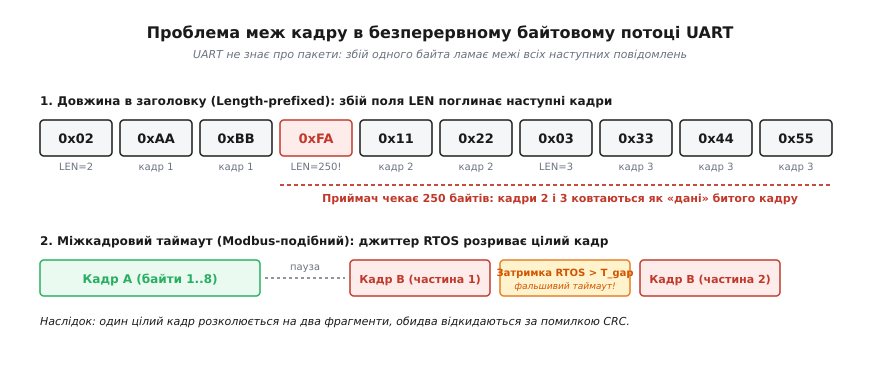
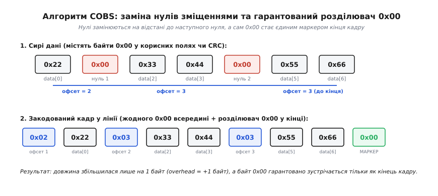
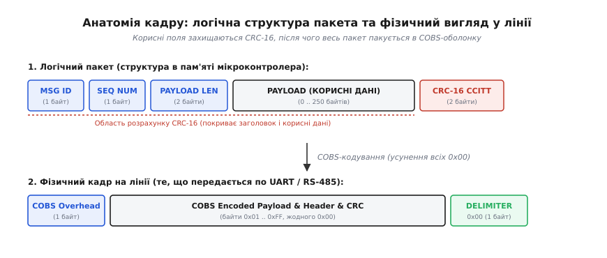
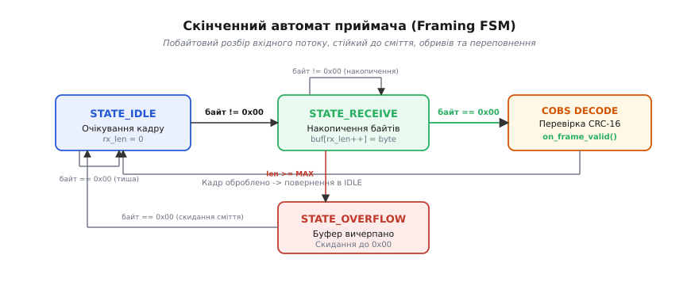

# Свій кадр між двома платами

<preknowlist>
- [Потік байтів проти повідомлення](root:com-protocol/stream-parser) — чому послідовний інтерфейс не зберігає меж записів і як виникає зміщення.
- [Контрольна сума і CRC](root:com-modulation/crc) — поліноміальний контроль цілісності, виявлення спалахів бітових помилок та обчислення залишку.
- [RS-485 і RS-422](root:com-medium/rs-485-multidrop-bus) — диференційна пара, напівдуплексний режим і керування напрямком драйвера.
- [Надійність даних у передачі](root:embedded/data-reliability) — рівні захисту від завад, виявлення спотворень і стратегії відновлення зв'язку.
</preknowlist>

Коли два мікроконтролери з'єднують послідовною лінією через UART або [диференційний трансивер RS-485](root:com-medium/rs-485-multidrop-bus), апаратний периферійний модуль першого контролера починає штампувати байти у провідник, а модуль другого слухняно вичитує їх у свій вхідний буфер FIFO. Припустимо, перша плата — це автопілот безпілотника, який щодесять мілісекунд передає вектор кутових швидкостей, висоту та код стану в контролер моторів. Усе працює рівно доти, доки електрик не під'єднає кабель на гарячу або поки в момент запуску потужного двигуна по спільній землі не проскочить електричний імпульс, що перекрутить поодинокий біт у стані лінії. Приймальний UART проковтує байт зі значенням `0x47`, але в нього немає жодного вбудованого механізму, щоб повідомити процесору, чим є цей байт: початком нового кадру телеметрії, молодшим байтом кута тангажу, кодом команди «зупинити гвинти» чи залишком контрольної суми від попереднього повідомлення.

Фізичний інтерфейс UART (англ. *Universal Asynchronous Receiver-Transmitter* — «універсальний асинхронний приймач-передавач») передає виключно нескінченний, однорідний потік незалежних байтів. Він не має сигналу «кінець пакета», не має апаратної розмітки блоків і не зберігає логічних меж між викликами функції відправлення. Якщо приймач увімкнувся посеред передачі або пропустив хоча б один байт через затримку обробки переривання, уся подальша інтерпретація даних зміщується: змінні застосунку зчитують чужі байти, контрольна сума перевіряє не ті поля, і зв'язок розсипається на незрозуміле сміття. Щоб перетворити хаотичний потік байтів на надійну доставку дискретних повідомлень, розробник зобов'язаний спроєктувати власний протокол канального рівня (англ. *Data Link Layer*) — створити однозначну розмітку меж (обрамлення, або фреймінг, від англ. *framing*), захистити заголовок і корисні дані контрольною сумою та реалізувати надійний скінченний автомат приймача.

### Анатомія хаосу: чому наївні методи обрамлення підводять

Найперше бажання, яке виникає під час проєктування власного бінарного протоколу, — зробити щось гранично просте: додати на початок пакета лічильник довжини або розділяти пакети паузами в часі. Обидва ці підходи виглядають привабливо на столі під час налагодження, але перетворюються на генератор прихованих дефектів у реальних умовах із завадами та навантаженням.

Розгляньмо перший наївний підхід: **префікс довжини** (англ. *length-prefixed framing*). Відправник передає один байт довжини `LEN`, за яким слідує рівно `LEN` байтів корисного навантаження. Приймач зчитує перший байт, налаштовує лічильник і чекає рівно вказану кількість байтів.

Схема миттєво ламається під час першого ж збою в каналі зв'язку. Уявімо, що передається короткий пакет із двох байтів (`LEN = 2`), але через імпульсну перешкоду біти байта довжини спотворюються, і приймач зчитує число `250`. Приймач сумлінно чекає наступні 250 байтів, вважаючи їх корисним тілом першого пакета. За цей час відправник встигає надіслати наступні двадцять цілком коректних повідомлень. Приймач безслідно «проковтує» всі ці повідомлення всередину одного велетенського зіпсованого пакета, наприкінці виявляє невідповідність контрольної суми, викидає все накопичене сміття і... зчитує наступний випадковий байт чергового повідомлення як нову довжину. Виникає катастрофічна втрата синхронізації (англ. *framing loss*), яка може тривати секундами. Без зовнішнього унікального орієнтира приймач принципово не здатен самостійно визначити, де закінчився зіпсований пакет і де починається новий.

```
Потік на лінії:  [LEN=0xFA] [байт1] [байт2] [LEN=0x02] [байт1] [байт2] [LEN=0x03] [байт1] ...
                 └──────────────────── приймач чекає 250 байтів ─────────────────────...
                                       (усі наступні кадри поглинаються як сміття)
```

Другий наївний підхід — **міжсимвольний таймаут** (англ. *silent interval framing*), що лежить в основі промислового протоколу Modbus RTU (правило інтервалу `t3.5` символів тиші між кадрами). Ідея полягає в тому, що всі байти одного пакета передаються безперервно, а завершенням пакета вважається пауза на лінії, довша за певний проміжок часу.

У чистих однозадачних мікроконтролерах без операційної системи це працює прийнятно, але в сучасних вбудованих системах під керуванням операційних систем реального часу (FreeRTOS, Zephyr) або під час зв'язку мікроконтролера з одноплатним комп'ютером (Linux) таймаути стають джерелом постійних збоїв. Якщо високорівневий потік в ОС витісняється планувальником посеред передачі пакета або обробник переривання DMA затримується через блокування критичної секції, на передавальній лінії виникає мікропауза. Приймач сприймає цю випадкову затримку як справжній кінець пакета, намагається його розібрати, отримує помилку неповної довжини та відкидає дані. Навпаки, якщо два окремих пакети приходять із мінімальним інтервалом через буферизацію в ядрі операційної системи, приймач склеює їх в один і також бракує за довжиною.


*Дві класичні проблеми наївного кадрування. Угорі — пошкодження поля довжини перетворює наступні коректні кадри на тіло хибного пакета. Унизу — джиттер планувальника операційної системи породжує фальшивий таймаут посеред передачі, розриваючи цілісний кадр на два невалідні уламки.*

Звідси випливає фундаментальний інженерний висновок: надійне обрамлення не може спиратися лише на внутрішні поля довжини чи на випадкові часові затримки. Воно вимагає наявності **унікального байта-маркера** (розділювача, англ. *frame delimiter*), поява якого в потоці однозначно свідчить про межу кадру.

### Байт-стаффінг, біт-стаффінг і проблема роздуття розміру

Якщо ми оберемо певний байт як унікальний розділювач меж — наприклад, `0x00` або класичний маркер `0x7E` зі стандарту HDLC (англ. *High-Level Data Link Control*), — постає очевидна проблема: що робити, якщо цей самий байт зустрінеться всередині корисного бінарного навантаження (наприклад, у числі з плаваючою комою `float` або у значенні лічильника)? Якщо передати його без змін, приймач сприйме його як достроковий кінець кадру.

Щоб запобігти цьому, застосовують техніку підстановки символів — **байт-стаффінг** (англ. *byte stuffing*, від *stuff* — «набивати, заповнювати») або його бітовий аналог **біт-стаффінг** (англ. *bit stuffing*).

У класичному протоколі SLIP (англ. *Serial Line Internet Protocol*, RFC 1055) кінець кадру позначається байтом `END = 0xC0`. Якщо байт `0xC0` трапляється всередині даних, передавач замінює його на послідовність із двох байтів: байт екранування `ESC = 0xDB` та спеціальний код `ESC_END = 0xDC`. Якщо ж у самих даних трапляється сам байт екранування `0xDB`, він замінюється на пару `ESC` + `ESC_ESC = 0xDD`.

```
Оригінальні дані:       0x12  0xC0        0x34  0xDB        0x56
На лінії (SLIP):        0x12  0xDB  0xDC  0x34  0xDB  0xDD  0x56  0xC0
                              └────────┘        └────────┘        └── END
```

Байт-стаффінг повністю вирішує проблему однозначності меж: байт `0xC0` ніколи не з'явиться всередині тіла кадру. Але він має критичний недолік для вбудованих систем: **недетерміноване роздуття розміру кадру** (англ. *worst-case overhead*). Якщо передається масив або бінарний зліпок пам'яті, де майже всі байти дорівнюють `0xC0` або `0xDB`, кожен такий байт перетворюється на два. Довжина кадру на лінії може подвоїтися (зрости на +100%).

У мікроконтролерах із суворими обмеженнями оперативної пам'яті це створює три неприємні наслідки:
1. Буфери передачі та прийому необхідно виділяти з подвійним запасом (якщо корисне навантаження до 256 байтів, буфер у пам'яті має вміщати щонайменше 514 байтів).
2. Час передачі кадру по шині стає непередбачуваним: один кадр передається за 1 мілісекунду, а наступний такого самого розміру — за 2 мілісекунди, що руйнує детермінізм жорсткого реального часу.
3. Пропускна здатність каналу на специфічних даних різко падає.

Біт-стаффінг у протоколах HDLC та CAN працює на рівні окремих бітів: після кожних п'яти поспіль одиничних бітів передавач примусово вставляє нульовий біт, що робить комбінацію `01111110` (`0x7E`) унікальним прапорцем. Для спеціалізованого апаратного контролера це природна операція, але на звичайному мікроконтролері загального призначення програмний побітовий аналіз вхідного потоку UART занадто дорогий: розпакування кожного байта потребує десятків тактових циклів процесора, унеможливлюючи просте використання апаратного прямого доступу до пам'яті (DMA).

| Метод обрамлення | Розділювач меж | Найгірше роздуття (Worst-case overhead) | Навантаження на CPU | Підтримка DMA / In-place |
| :--- | :--- | :--- | :--- | :--- |
| **Довжина (Length-prefix)** | Відсутній (лічильник) | **0%** (0 байтів) | Мінімальне | Добре, але не відновлюється після збою |
| **Таймаут (Modbus RTU)** | Пауза `t3.5` | **0%** (затримка часу) | Середнє (потрібен таймер) | Погано (вразливе до джиттеру RTOS) |
| **SLIP (Byte Stuffing)** | Байт `0xC0` | **+100%** (подвоєння) | Низьке | Потрібен додатковий буфер розпакування |
| **HDLC (Bit Stuffing)** | Біт-маска `0x7E` | **+20%** (1 біт на 5 одиниць) | Дуже високе (побітовий зсув) | Несумісне зі стандартним байтовим DMA |
| **COBS (Consistent Overhead)** | Байт `0x00` | **+0.39%** (макс. 1 байт на 254 Б) | Низьке (побайтове) | Ідеальне: розпакування на місці (in-place) |

Саме для усунення недоліків байт- і біт-стаффінгу в 1997 році Стюарт Чешир (Stuart Cheshire) і Мері Бейкер (Mary Baker) запропонували алгоритм COBS.

### Алгоритм COBS: гарантований нуль і постійні накладні витрати

Алгоритм COBS (англ. *Consistent Overhead Byte Stuffing* — «байт-стаффінг із фіксованими накладними витратами») вирішує задачу елегантно: він повністю прибирає байт `0x00` із тіла пакета будь-якого змісту, замінюючи його на покажчики зміщення до наступного нуля. Завдяки цьому байт `0x00` стає абсолютно унікальним і гарантованим маркером межі кадру, а максимальне роздуття довжини суворо обмежене: **рівно 1 байт на кожні 254 байти корисних даних**.

Для будь-якого типового пакета вбудованих систем розміром до 254 байтів алгоритм COBS додає **рівно один додатковий байт** заголовка.

#### Принцип роботи кодера COBS

Уявімо масив вихідних бінарних даних. Кодер розбиває масив на блоки, розділені нулями. На початок закодованого пакета додається один байт заголовка — **байт зміщення** (англ. *offset byte* або *code byte*), який вказує відстань (у байтах) до першого нульового байта у вихідних даних. Сам знайдений нульовий байт у вихідний потік не записується — замість нього записується наступний байт зміщення, який вказує відстань до другого нуля, і так далі до кінця пакета.

Правила кодування формулюються так:
1. Байт зміщення `k` може приймати значення від `0x01` до `0xFF` (від 1 до 255).
2. Значення `k` означає: «наступні `k - 1` байтів є ненульовими корисними даними, а на позиції `k` розташовувався нуль, замість якого тепер записано наступний код зміщення».
3. Якщо відстань до наступного нуля менша за 254 байти, нуль поглинається кодом зміщення.
4. Якщо в даних немає нуля протягом 254 байтів, код зміщення приймає максимальне значення `0xFF` (255). Це сигналізує: «наступні 254 байти ненульові, але після них нуль у вихідні дані відновлювати НЕ треба (блоковий перенос)».
5. Після кодування всього пакета в кінець дописується байт-розділювач `0x00`.


*Принцип усунення нулів у COBS. Початковий масив із сімох байтів містить два нулі. Кодер додає початковий офсет 0x02, переносить дані, замінює нулі на офсети 0x03 і 0x03, а в кінці додає розділювач 0x00. У закодованому тілі немає жодного байта 0x00.*

Розгляньмо кілька показових прикладів трансформації:

**Приклад 1. Дані без нулів:**
- Сирі дані: `[0x11, 0x22, 0x33]` (3 байти)
- Закодований кадр: `[0x04, 0x11, 0x22, 0x33, 0x00]`
- *Пояснення:* Офсет `0x04` означає: наступні 3 байти ненульові, а за ними кінець блоку. Завершує кадр маркер `0x00`.

**Приклад 2. Дані з нулями всередині:**
- Сирі дані: `[0x22, 0x00, 0x33, 0x44, 0x00, 0x55]` (6 байтів)
- Закодований кадр: `[0x02, 0x22, 0x03, 0x33, 0x44, 0x02, 0x55, 0x00]`
- *Пояснення:* `0x02` каже «1 байт даних (`0x22`), потім був нуль». На місці нуля стоїть `0x03` («2 байти даних (`0x33`, `0x44`), потім нуль»). На місці другого нуля стоїть `0x02` («1 байт даних (`0x55`), кінець даних»).

**Приклад 3. Послідовні нулі:**
- Сирі дані: `[0x00, 0x00]` (2 байти)
- Закодований кадр: `[0x01, 0x01, 0x01, 0x00]`
- *Пояснення:* Офсет `0x01` означає «0 байтів даних перед нулем». Три одиниці поспіль кодують два нулі й фінал.

**Приклад 4. Блок із 254 ненульових байтів:**
- Сирі дані: 254 байти `[0xAA, 0xAA, ... 0xAA]`
- Закодований кадр: `[0xFF, 0xAA, ... 254 рази ... 0x01, 0x00]`
- *Пояснення:* Офсет `0xFF` (255) вказує на 254 байти даних без подальшої вставки нуля, а наступний офсет `0x01` закриває залишок.

**Приклад 5. Блок із 255 ненульових байтів (переповнення 254-байтового вікна):**
- Сирі дані: 255 байтів `[0xAA, 0xAA, ... 0xAA, 0xBB]`
- Закодований кадр: `[0xFF, 0xAA ... 254 рази ..., 0x02, 0xBB, 0x00]`
- *Пояснення:* Перший блок довжиною 254 байти кодується офсетом `0xFF`, після чого кодер відкриває новий блок із зміщенням `0x02`, що покриває залишковий байт `0xBB` до кінця повідомлення.

Розрахунок максимального розміру вихідного буфера для COBS є суворо детермінованим:

```
Розмір COBS = N + ⌈N / 254⌉ + 1
```

де `N` — довжина сирих даних, `⌈N / 254⌉` — максимальна кількість додаткових байтів зміщення (для `N <= 254` це рівно 1), а `+ 1` — кінцевий байт-розділювач `0x00`. Для кадру з 64 байтів корисного навантаження закодований розмір у лінії завжди становитиме рівно 66 байтів — ні байтом більше, ні байтом менше, незалежно від того, які значення містяться в повідомленні.

> 🔧 **Навіщо це.** Детермінізм розміру COBS кардинально спрощує роботу з DMA в мікроконтролерах STM32 або ESP32. Якщо максимальний розмір вашого корисного пакета становить 128 байтів, ви виділяєте рівно `128 + 1 + 1 = 130` байтів статичного буфера під передавач. Передавач може "виплюнути" цей буфер через DMA однією транзакцією, не турбуючись про те, що розмір кадру раптом виросте вдвічі, як це сталося б у SLIP.

### Анатомія надійного бінарного кадру

Сам по собі алгоритм COBS забезпечує лише кадрування (виявлення початку й кінця пакета). Щойно байти кадру виділено з потоку, їх потрібно передати логічному парсеру вищого рівня. Щоб протокол був по-справжньому надійним і придатним для керування апаратурою, логічний пакет повинен містити чітку структуру полів.


*Структура кадру: логічний пакет містить заголовок, корисні дані та контрольну суму CRC-16. Потім уся ця структура кодується алгоритмом COBS і доповнюється розділювачем 0x00.*

Спроєктуємо еталонний двійковий формат кадру:

1. **Тип повідомлення (`msg_id`, 1 байт, `uint8_t`):** визначає семантику пакета (наприклад, `0x01` — телеметрія сенсорів, `0x02` — уставка швидкості двигунів, `0x03` — запит калібрування, `0x80` — підтвердження ACK, `0xFF` — аварійна зупинка).
2. **Номер послідовності (`seq_num`, 1 байт, `uint8_t`):** монотонно зростаючий лічильник (`0 .. 255`). Дозволяє приймачеві виявляти пропущені кадри, обчислювати відсоток втрат у каналі та відфільтровувати дублікати.
3. **Довжина корисних даних (`payload_len`, 2 байти, `uint16_t` у форматі Little-Endian):** точна кількість байтів у полі `payload`. Навіть якщо COBS визначив межу кадру, це поле забезпечує додатковий рівень валідації відповідності розміру структури.
4. **Корисне навантаження (`payload`, 0 .. `MAX_PAYLOAD` байтів):** двійкові дані (структура `struct`, спакована через `__attribute__((packed))`).
5. **Контрольна сума (`crc16`, 2 байти, `uint16_t` у форматі Little-Endian):** поліноміальний код [CRC-16-CCITT](root:com-modulation/crc) (поліном `0x1021`, початкове значення `0xFFFF`), розрахований за всіма попередніми полями (`msg_id` + `seq_num` + `payload_len` + `payload`).

Чому для пакетів до 256 байтів обирають саме CRC-16-CCITT, а не простий XOR або CRC-32?
Простий байтовий XOR (LRC) або сума за модулем 256 не виявляють транспозицію байтів (перестановку місцями) і мають критично високу ймовірність пропуску парних бітових інверсій (`1 / 256 ≈ 0.39%`). Натомість поліноміальний код CRC-16-CCITT гарантує відстань Геммінга (англ. *Hamming Distance*) `d = 4` для блоків даних довжиною до 4095 байтів. Це означає, що **будь-які 3 незалежні бітові спотворення** у будь-яких місцях кадру, а також **будь-який одиночний спалах помилок довжиною до 16 бітів підряд** будуть виявлені зі 100% математичною гарантією. Перехід на важчий 32-розрядний CRC-32 (поліном `0x04C11DB7`) виправданий лише тоді, коли розмір корисного навантаження перевищує кілька кілобайтів (наприклад, під час оновлення прошивки по повітрю або передачі фрагментів файлів).

Чому розрахунок CRC-16 виконується **до** кодування COBS, а не після?
Якщо порахувати CRC за логічним пакетом, контрольна сума стає невіддільною частиною даних. Кодер COBS усуває нулі з усього пакета, включно з байтами CRC. Приймач спочатку відновлює оригінальні байти через декодер COBS, а потім перевіряє CRC. Якщо на лінії стався збій бітів, можливі два сценарії:
- Збій спотворив структуру зміщень COBS (наприклад, зміщення вказує за межі буфера або в нуль) — декодер COBS повертає помилку розпакування одразу.
- Збій не зламав структуру зміщень, але змінив значення корисних байтів — декодер успішно відпрацьовує, але фінальна перевірка CRC-16 гарантовано бракує пошкоджений пакет.

Такий подвійний бар'єр зводить ймовірність пропуску непоміченої помилки практично до нуля.

### Скінченний автомат приймача (Framing FSM)

Приймання байтового потоку в мікроконтролері не повинно блокувати процесор. Приймач реалізують як побайтовий **скінченний автомат** (англ. *Finite State Machine*, FSM), який викликається на кожен новий отриманий байт (із переривання UART або під час вичитування кільцевого буфера).

Автомат оперує трьома станами:
1. `STATE_IDLE` (Очікування початку кадру): початковий стан. Будь-які байти `0x00`, що надходять у цьому стані, вважаються порожнім простоєм лінії або міжкадровим інтервалом і просто ігноруються. Щойно надходить будь-який ненульовий байт (`byte != 0x00`), він зберігається в перший елемент приймального буфера, і автомат переходить у стан `STATE_RECEIVE`.
2. `STATE_RECEIVE` (Накопичення байтів кадру): кожен наступний ненульовий байт записується в буфер із нарощуванням лічильника довжини `rx_len`. Якщо розмір перевищує максимально допустимий розмір буфера `MAX_FRAME_SIZE`, це означає, що через заваду маркер кінця було втрачено. Автомат фіксує переповнення і переходить у стан `STATE_OVERFLOW`. Якщо ж надходить байт-розділювач `0x00`, це сигналізує про завершення кадру: накопичений буфер негайно передається на декодування COBS та валідацію CRC, після чого автомат скидає лічильник і повертається в `STATE_IDLE`.
3. `STATE_OVERFLOW` (Скидання сміття після переповнення): стан аварійного захисту. Усі вхідні байти відкидаються доти, доки на лінії не з'явиться байт `0x00`. Поява нуля гарантує, що пошкоджений гігантський кадр завершився, і наступний байт буде початком нового чистого кадру. Автомат повертається в `STATE_IDLE`.


*Граф станів приймального автомата. Будь-яке сміття або переповнення буфера скидається першим же зустрінутим байтом 0x00, повертаючи автомат у вихідний синхронізований стан.*

Головна перевага цього автомата — **абсолютна стійкість до зависання на смітті**. Якщо в лінію сиплеться випадковий шум, лінія від'єднується або виникає брязкіт контактів, автомат ніколи не застрягне в очікуванні: він або відкине пошкоджений блок за помилкою переповнення, або розпізнає черговий `0x00`, спробує декодувати сміття, отримає невідповідність CRC, викине помилковий пакет і миттєво почне збирати наступний.

### Повна робоча реалізація: від байта до валідного повідомлення

Перейдемо до повної інженерної реалізації на мовах C та C++. Реалізація містить швидкий табличний розрахунок CRC-16-CCITT, функції кодування/декодування COBS із підтримкою розпакування на місці (in-place decoding) та неблокуючий кадровий автомат.

#### 1. Структура заголовка та розрахунок CRC-16

:::tabs
:::code svii-kadr-mizh-dvoma-platamy-d/c/1-struktura-zaholovka-ta.c
:::code svii-kadr-mizh-dvoma-platamy-d/cpp/1-struktura-zaholovka-ta.cpp
:::

#### 2. Реалізація кодера та декодера COBS

Зверніть увагу на функцію декодування: вона спроєктована так, що може виконувати розпакування **прямо в тому самому буфері** (`in_place`), оскільки розпакований масив завжди строго менший або рівний за довжиною закодованому.

:::tabs
:::code svii-kadr-mizh-dvoma-platamy-d/c/2-realizatsiia-kodera-ta.c
:::code svii-kadr-mizh-dvoma-platamy-d/cpp/2-realizatsiia-kodera-ta.cpp
:::

#### 3. Модуль кадрового автомата (FSM Receiver)

Приймальний автомат тримає статичний буфер, побайтово поглинає вхідний потік і викликає обробник події `frame_callback` виключно тоді, коли кадр повністю зібрано, розпаковано, перевірено за довжиною та підтверджено правильною контрольною сумою CRC-16.

:::tabs
:::code svii-kadr-mizh-dvoma-platamy-d/c/3-modul-kadrovoho-avtomata.c
:::code svii-kadr-mizh-dvoma-platamy-d/cpp/3-modul-kadrovoho-avtomata.cpp
:::

#### 4. Наскрізний приклад: складання, кодування та розбір пакета

Поєднаймо всі компоненти в єдиний робочий сценарій. Відправник пакує структуру телеметрії з показниками напруги, струму та температури, обчислює CRC, кодує пакет у COBS і надсилає його в лінію, де перед корисним пакетом штучно додано кілька байтів випадкового електричного бруду. Приймач безпомилково фільтрує сміття, розпізнає кадр і витягує значення сенсорів.

:::tabs
:::code svii-kadr-mizh-dvoma-platamy-d/c/4-naskriznyi-pryklad.c
:::code svii-kadr-mizh-dvoma-platamy-d/cpp/4-naskriznyi-pryklad.cpp
:::

### Інженерні підводні камені та оптимізація в залізі

Практична інтеграція кадрового протоколу на реальних друкованих платах вимагає врахування чотирьох класичних апаратних нюансів.

Перший нюанс стосується **керування напівдуплексним трансивером RS-485** (пін `DE/RE`). Поширена помилка початківців у мікроконтролерах STM32 — вимикати передавач (скидати пін `DE` в нуль) одразу після того, як функція `HAL_UART_Transmit()` повернула керування або коли спрацювало переривання порожнечі буфера `TXE` (англ. *Transmit Data Register Empty*). Прапорець `TXE` свідчить лише про те, що останній байт перемістився з регістра даних у внутрішній зсувний регістр передавача, але він **ще фізично модулюється на лінії**. Передчасне вимкнення трансивера миттєво обрізає стоп-біт або половину останнього байта кадру (а в нашій схемі це або байт CRC, або кінцевий `0x00`), і приймач фіксує помилку кадрування `Framing Error`. Вимикати драйвер `DE` дозволено виключно за апаратним прапорцем завершення передачі **`TC` (Transmission Complete)**, який гарантує, що останній стоп-біт повністю вийшов у кабель.

Другий нюанс — **використання детектора простою лінії (`UART IDLE Line Interrupt`) разом із DMA**. У швидкісних каналах (1–3 Мбіт/с) викликати переривання CPU на кожен отриманий байт неефективно: обробка сотень тисяч переривань на секунду забирає до 30% процесорного часу мікроконтролера. Замість цього налаштовують прямий доступ до пам'яті (DMA) у циклічному режимі (`Circular Buffer`), а розбір запускають або за накопиченням блоку, або за апаратною подією простою лінії `IDLE`. Проте COBS-парсер із захистом за нулем лишається необхідним навіть за наявності DMA: DMA не розрізняє логічних пакетів і не рятує від зсуву вказівника при гарячому підключенні, тоді як поєднання «DMA для вичитування сирого буфера + побайтовий FSM для пошуку `0x00` та COBS-декодування» дає ідеальну комбінацію швидкості та надійності.

Третій нюанс — **захисне зміщення лінії зв'язку (Fail-Safe Biasing)**. Якщо на шині RS-485 усі передавачі вимкнені (лінія перебуває у високому імпедансі `Z`), різниця напруг між провідниками `A` і `B` стає близькою до нуля. За відсутності зовнішніх підтяжок приймач через теплові шуми може сприймати цей стан як постійний логічний нуль, безперервно генеруючи байти `0x00` у вхідний буфер мікроконтролера. Хоча наш FSM-автомат у стані `STATE_IDLE` безпечно ігнорує зайві нулі й не переповнює пам'ять, постійний потік нулів навантажує процесор даремними перериваннями. Встановлення підтягувальних резисторів (резистор `Pull-Up` до лінії `A` та `Pull-Down` до лінії `B`) гарантує різницю потенціалів більше +200 мВ у пасивному стані шини, забезпечуючи тишу на вході приймача та стабільну роботу кадрового протоколу.

Четвертий нюанс — **захист від зловмисних або пошкоджених пакетів (Fuzzing і Malformed Packets)**. Якщо відправник через програмний збій надсилає пакет, де значення `payload_len` у заголовку вказано як 100 байтів, а реальних корисних даних передано лише 4 байти, наївний парсер може вичитати неініціалізовану пам'ять або вийти за межі буфера. У нашому FSM-автоматі реалізовано потрійний захист: по-перше, розмір буфера жорстко обмежений `PROTOCOL_MAX_ENCODED`; по-друге, розрахунок CRC-16 виконується за фактично розпакованою довжиною `decoded_len - 2`, унеможливлюючи валідацію обрізаного кадру; по-третє, перед передачею у прикладний рівень виконується обов'язкова звірка `hdr->payload_len == actual_payload_len`. Якщо будь-яка з цих умов порушена, пакет відкидається на рівні ядра протоколу, не допускаючи збою високорівневої логіки пристрою.
