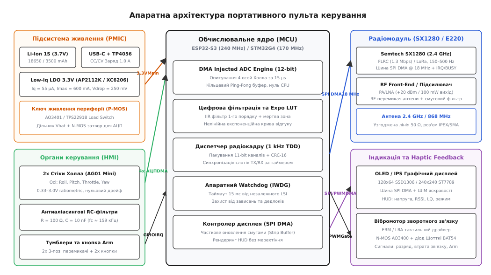
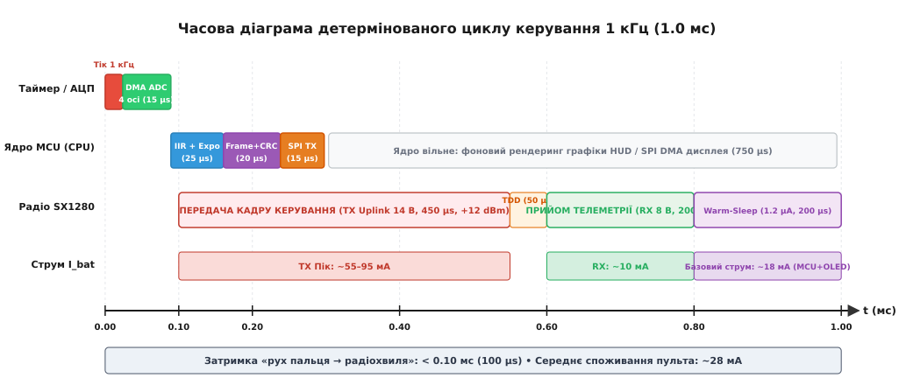
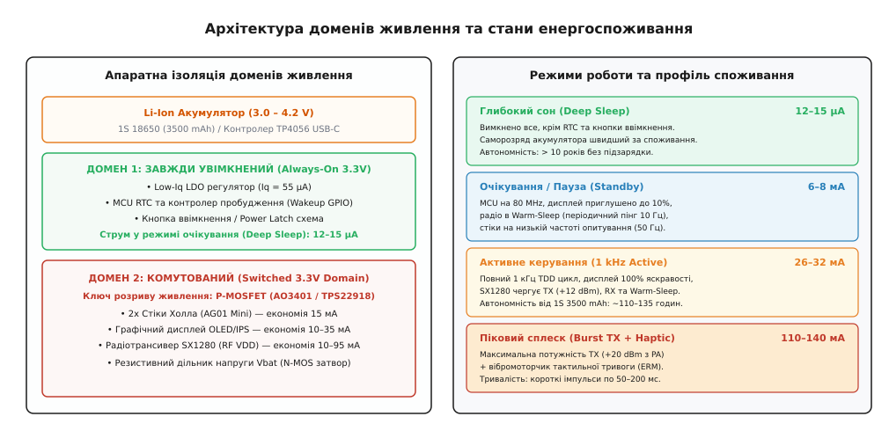

# Своя консоль до свого апарата: мінімальний пульт

<preknowlist>
- [Джойстик через станцію проти власного пульта](root:embedded/dzhoistyk-cherez-stantsiiu-proty-vlasnoho-pulta) — чому контур ручного керування вимагає апаратного детермінізму замість операційної системи ПК.
- [Перемикачі й розкладка пульта](root:embedded/peremykachi-i-rozkladka-pulta) — логіка безпечних комбінацій тумблерів, запобігання випадковому старту двигунів і захист від вібрацій.
- [DMA + АЦП](root:embedded/dma-adc) — апаратне потокове оцифрування аналогових сигналів у кільцевий буфер без залучення ядра мікроконтролера.
- [DMA для шин SPI та I2S](root:embedded/dma-spi-i2s) — безперервне перекачування кадрових буферів дисплея та пакетів радіотрансивера без очікування ядра.
- [Аудит струму в режимах сну](root:embedded/sleep-current-audit) — розрив живлення витокових кіл, ізоляція доменів та збереження енергії акумулятора.
- [Сторожовий таймер, який справді ловить зависання](root:embedded/storozh-iakyi-spravdi-lovyt-zavysannia) — апаратне відновлення системи за незалежним тактуванням у разі збоїв пам'яті чи зависання шин.
</preknowlist>

Оператор випробовує малогабаритний розвідувальний дрон або оглядовий гусеничний ровер у польових умовах при температурі повітря +35 °C і сильному сонячному засвіченні. Спроба керувати платформою за допомогою комерційного комерційного пульта масою 850 грамів створює незручності: громіздкий корпус не поміщається в кишеню розвантажувального жилета, меню на 50 сторінок перевантажене неактуальними для прикладного апарата функціями мікшування планерів, а монохромний екран не відображає специфічну телеметрію — наприклад, стан корисного навантаження, температуру силових ключів та якість зв'язку у відсотках. Водночас використання планшета або ноутбука з USB-джойстиком додає від 50 до 180 мілісекунд непередбачуваної затримки в операційній системі, ризик обриву кабелю та засліплення екрана сонцем. 

Вихід із цієї дилеми — проектування та створення власної мінімалістичної апаратної консолі (англ. *custom handheld remote console*). Це компактний пристрій масою менше 180 грамів на базі 32-бітного мікроконтролера (ESP32-S3 або STM32G4), оснащений прецизійними безконтактними стіками на датчиках Холла, швидким трансивером 2.4 ГГц або 868 МГц, контрастним графічним дисплеєм і тактильним вібромоторчиком тривог. Такий пульт стартує за 120 мілісекунд, опитує положення пальців із детермінованою частотою 1000 Гц через прямий доступ до пам'яті (DMA), упаковує команди в компактні бінарні кадри з контрольною сумою CRC-16 і відправляє їх у радіоефір із наскрізною апаратною затримкою менше однієї мілісекунди.


*Апаратна архітектура портативного пульта керування: підсистема живлення, ядро мікроконтролера, датчики Холла, радіомодуль та HMI*

---

## Апаратна архітектура: вибір компонентів і схемотехніка

Портативний пульт керування є автономним вбудованим приладом жорсткого реального часу, де кожен міліампер споживання акумулятора та кожен мікросекундний інтервал обробки перебувають під строгим контролем. Розглянемо ключові функціональні вузли апаратної частини.

### 1. Обчислювальне ядро (MCU): ESP32-S3 проти STM32G4

Головний мікроконтролер пульта повинен одночасно виконувати три незалежні завдання: оцифровувати 4 аналогові осі стіків без тремтіння фази вибірок, керувати високошвидкісним обміном з радіотрансивером по шині SPI на швидкостях до 18 МГц і відмальовувати графічний інтерфейс користувача на дисплеї.

Для цієї задачі найкраще підходять два сімейства мікроконтролерів:

1. **ESP32-S3 (Espressif Systems)**:
   - Двоядерний 32-бітний процесор Xtensa LX7 із тактовою частотою до 240 МГц та апаратною підтримкою векторних інструкцій і операцій із рухомою комою (FPU).
   - Вбудована оперативна пам'ять SRAM об'ємом 512 КБ (з можливістю підключення 8 МБ PSRAM через Octal SPI).
   - Апаратний USB-JTAG/CDC контролер (дозволяє прошивати, налагоджувати та перетворювати пульт на USB-HID геймпад для симуляторів без зовнішніх перехідників).
   - Виділені контролери GDMA для швидкісного перекачування даних між пам'яттю та SPI/АЦП.
   - Архітектурна перевага: одне ядро (Core 0) повністю виділяється під детермінований радіоконтур 1 кГц, а друге ядро (Core 1) займається обслуговуванням меню, рендерингом графіки та обробкою кнопок.

2. **STM32G431 / STM32G474 (STMicroelectronics)**:
   - Одноядерний процесор ARM Cortex-M4F із частотою 170 МГц.
   - Прецизійні 12-бітні SAR АЦП зі швидкістю оцифрування до 4 MSPS (мільйонів вибірок на секунду) та апаратною передискретизацією (англ. *hardware oversampling*) до 16 біт.
   - Вбудовані апаратні математичні співпроцесори CORDIC (тригонометрія для обчислення векторів за 4 такти) та FMAC (апаратний IIR/FIR фільтр).
   - Мінімальне енергоспоживання в активному режимі (близько 12–16 мА при 170 МГц).

Розподіл апаратних ресурсів мікроконтролера проектується таким чином, щоб уникнути конфліктів за шини. Радіомодуль займає окрему шину SPI1 (Master DMA), графічний дисплей підключається до шини SPI2 (або апаратного I2C), 4 осі стіків заводяться на виводи першого модуля АЦП (ADC1, що не конфліктує з радіочастиною), а тумблери та кнопки підключаються до ліній GPIO з апаратними перериваннями за фронтом (EXTI).

### 2. Органи введення: стіки на датчиках Холла проти потенціометрів

Класичні дешеві джойстики використовують контактні резистивні потенціометри (англ. *potentiometers*). У них рухомий металевий повзунок ковзає по графітовій доріжці. В умовах польової експлуатації графітовий шар стирається через вібрації, всередину потрапляє пил і волога, що спричиняє «шурхіт» контакту, стрибки напруги, плавання центральної точки та появу неприпустимої мертвої зони (англ. *deadband*).

У прецизійному пульті застосовуються стіки на датчиках Холла (англ. *Hall effect gimbals*, наприклад RadioMaster AG01 Mini або кастомні механізми на базі лінійних сенсорів Allegro A1304 / Melexis MLX90393).

```
        N
    [ Магніт ]
        S
        │    B-поле (вектор індукції)
        ▼
  ┌───────────┐
  │ Датчик    │  ───► Ратіометрична вихідна напруга V_out = V_dd/2 ± k·B
  │  Холла    │       (0.33 В .. 1.65 В .. 2.97 В)
  └───────────┘
```

Фізичний принцип полягає у вимірюванні напруженості магнітного поля, створюваного парою мініатюрних неодимових магнітів, закріплених на рухомих осях підвісу. Сенсор Холла не має механічного контакту з магнітом, забезпечуючи:
- Необмежений ресурс роботи (понад 10 мільйонів циклів без зміни характеристик).
- Повну герметичність чутливого елемента від пилу, піску та води.
- Ідеальну повторюваність повернення в нейтральне положення (точність краще 0.05%).
- Ратіометричний аналоговий вихід: напруга лінійно пропорційна куту нахилу важеля і змінюється в діапазоні від 10% до 90% напруги живлення `V_dd` (тобто від 0.33 В до 2.97 В при живленні 3.3 В, з центром рівно на 1.65 В).

Схемотехнічна обв'язка кожного датчика Холла включає блокувальний керамічний конденсатор ємністю 0.1 мкФ безпосередньо біля роз'єму стіка та антиаліасинговий RC-фільтр першого порядку (`R = 100\ \Omega`, `C = 10\ \text{nF}`) на вході мікроконтролера. Частота зрізу цього фільтра становить:

```
f_c = 1 / (2 · π · R · C)
f_c = 1 / (2 · 3.14159 · 100 · 10⁻⁸) ≈ 159.15 кГц
```

Цей фільтр ефективно зрізає високочастотні радіонаводки, які антена передавача може індукувати в проводах стіків, але не створює фазової затримки на частотах руху людських пальців (0–10 Гц), де групова затримка RC-ланцюжка становить лише 1 мікросекунду (`τ = R · C = 1\ \mu\text{s}`).

### 3. Радіотрансивер: Semtech SX1280 проти Ebyte E220

Радіомодуль визначає дальність, швидкість оновлення та стійкість каналу до завад:

| Параметр | Semtech SX1280 (2.4 ГГц) | Ebyte E220 / SX1262 (868/915 МГц) |
|---|---|---|
| Діапазон частот | 2400–2500 МГц (ISM) | 850–930 МГц (SRD) |
| Типи модуляцій | FLRC (1.3 Mbps), LoRa, GFSK | LoRa, FSK |
| Частота пакетів керування | 150 – 500 Гц (період 2–6.6 мс) | 25 – 100 Гц (період 10–40 мс) |
| Проникна здатність перешкод | Середня (поглинається листям, стінами) | Висока (огинає рельєф, проходить крізь стіни) |
| Інтерфейс з MCU | SPI DMA (до 18 МГц) + IRQ + BUSY | SPI DMA / UART (AT-команди) |
| Струм передачі при +12.5 dBm | ~45 мА | ~40 мА |
| Струм у режимі Warm-Sleep | 1.2 мкА (збереження регістрів) | 1.5 мкА |

Для маневрених дронів і роботів, де критична мінімальна затримка реакції (< 5 мс), пріоритетним вибором є **SX1280 у режимі FLRC (Fast Long Range Communication)**. Модуляція FLRC забезпечує когерентне демодулювання зі швидкістю передачі даних 1.3 Мбіт/с і тривалістю кадру в ефірі лише 400–500 мікросекунд. Для важких апаратів далекої дії в умовах відсутності прямої видимості застосовується **E220 на частоті 868 МГц у режимі LoRa (смуга 500 кГц, фактор розширення SF5/SF6)**.

### 4. Графічний дисплей: вибір матриці та інтерфейсу

Для мінімального пульта використовуються два типи екранів:
- **Монохромний OLED 0.96" або 1.3" (128x64 точки, контролер SSD1306 / SH1106)**: надзвичайно мале споживання струму (від 4 до 15 мА залежно від кількості засвічених пікселів), миттєвий відгук на морозі (до -30 °C на відміну від рідких кристалів), високий контраст на сонці.
- **Кольоровий IPS TFT 1.54" або 2.0" (240x240 / 320x240 точок, контролер ST7789V)**: висока інформативність, можливість відображення графічних шкал, кольорових статусів тривог та карти навігації.

Підключення дисплея виконується виключно через апаратну шину SPI. Шина I2C зі стандартною частотою 400 кГц занадто повільна: передача одного кадру OLED 128x64 (1024 байти) по I2C займає понад 23 мілісекунди, що повністю блокує процесор або перевантажує шину. По шині SPI на частоті 20 МГц той самий кадр передається через DMA всього за **0.41 мілісекунди**, вивільняючи 99.6% часу циклу.

### 5. Підсистема живлення та захисту акумулятора

Пульт живиться від одного літій-іонного або літій-полімерного елемента 1S (Li-Ion 18650 ємністю 3500 мАг або плоского пакета Li-Po 2000 мАг) із діапазоном робочої напруги від 4.20 В (повний заряд) до 3.00 В (поріг відсічки).

Схема живлення складається з трьох критичних вузлів:
1. **Контролер заряду від USB-C**: лінійний контролер TP4056 або імпульсний BQ24075 зі струмом заряду 1.0 А і термозахистом (вхід NTC для контролю температури батареї).
2. **Лінійний стабілізатор із низьким падінням напруги (Low-Dropout LDO)**: мікросхема AP2112K-3.3, XC6206 або ME6211. Стабілізатор AP2112K забезпечує струм до 600 мА при падінні напруги (англ. *dropout voltage*) всього 250 мВ. Це гарантує стабільні 3.30 В на цифровій та аналоговій шинах навіть тоді, коли акумулятор розряджається до 3.55 В.
3. **Комутатор доменів живлення (Power Switch)**: польовий P-канальний MOSFET транзистор AO3401 (або мікросхема перемикача навантаження TPS22918). Цей ключ повністю знеструмлює датчики Холла, радіомодуль та дисплей під час переходу пульта в режим очікування або глибокого сну, знижуючи струм витоку всієї плати до мікроамперного рівня.
4. **Вимірювання напруги батареї без витоків**: високоомний резистивний дільник (`R1 = 100\ \text{k}\Omega`, `R2 = 100\ \text{k}\Omega`), нижнє плече якого комутується N-канальним польовим транзистором 2N7002 / BSS138. Транзистор відкривається мікроконтролером лише на 50 мікросекунд безпосередньо в момент вимірювання АЦП. Це усуває постійний паразитний струм розряду батареї через дільник (`I = 4.2\ \text{V} / 200\ \text{k}\Omega = 21\ \mu\text{A}`).

> 🔧 **Навіщо це.** Якщо підключити дільник напруги батареї безпосередньо до землі без запірного MOSFET-ключа, один лише дільник розрядить забутий на полиці вимкнений пульт на 180 мАг за рік, довівши літієву батарею до стану глибокого перерозряду (< 2.0 В) та незворотної деградації структури катода.

---

## Програмна архітектура: детермінований конвеєр 1 кГц

Програмна архітектура пульта будується за принципом **жорсткого кадрового детермінізму**. Головний цикл не використовує блокуючих функцій очікування (`delay()`, `busy-wait`), а всі ресурсомісткі операції введення-виведення передані апаратним контролерам прямого доступу до пам'яті (DMA).


*Часова діаграма 1 кГц TDD циклу: фази опитування стіків, фільтрації, передачі кадру та прийому телеметрії*

### 1. Апаратне оцифрування стіків через DMA ADC

Опитування чотирьох аналогових каналів (Roll, Pitch, Throttle, Yaw) запускається апаратним таймером (TIM1 у STM32 або GPTimer у ESP32) рівно кожну 1.0 мілісекунду (1000 Гц).

Процес оцифрування виглядає так:
1. Таймер генерує тригер події (англ. *Timer Trigger Out, TRGO*).
2. Модуль АЦП автоматично запускає інжектовану або регулярну групу перетворень по чотирьох каналах поспіль. Час оцифрування одного каналу при частоті тактування АЦП 14 МГц і вибірці 12.5 тактів становить близько 1.8 мкс, а всі 4 канали скануються за **7.2–15 мікросекунд**.
3. DMA-контролер записує отримані 12-бітні значення (`uint16_t` у діапазоні `0..4095`) у кільцевий буфер подвійної пам'яті (англ. *Ping-Pong Buffer*).
4. Після завершення передачі DMA викликає коротке переривання (тривалістю < 1.5 мкс), де виставляється семафор готовності свіжих відліків.

### 2. Цифрова обробка, калібрування та нелінійна крива відгуку (Expo)

Отримані сирі відліки АЦП проходять через три послідовні програмні блоки обробки:

```
 [Сирі відліки АЦП]
        │
        ▼
 ┌──────────────────────┐
 │ IIR Фільтр 1-го пор. │  ──► y[k] = α·x[k] + (1-α)·y[k-1] (зріз RF шумів)
 └──────────────────────┘
        │
        ▼
 ┌──────────────────────┐
 │ Калібрування меж     │  ──► Нормалізація [min, center, max] + Deadband
 └──────────────────────┘
        │
        ▼
 ┌──────────────────────┐
 │ Нелінійна крива Expo │  ──► f(x) = (1 - e)·x + e·x³ (прецизійний центр)
 └──────────────────────┘
        │
        ▼
 [11-бітне нормалізоване значення: 0 .. 2047]
```

#### Крок А: Цифровий IIR-фільтр першого порядку

Для придушення високочастотного аналогового шуму без створення відчутної фазової затримки використовується експоненційний фільтр ковзного середнього (англ. *Single-Pole IIR Filter*):

```
y[k] = α · x[k] + (1 - α) · y[k - 1]
```

При коефіцієнті `α = 0.5` на частоті опитування 1000 Гц еквівалентна постійна часу фільтра становить `τ = Δt / α = 1.0\ \text{ms} / 0.5 = 2.0\ \text{ms}`, що повністю фільструє випадкові викиди АЦП і не відчувається оператором (затримка реакції < 1 мс). Для максимальної швидкодії на мікроконтролерах без FPU обчислення виконуються в цілочисельній арифметиці з фіксованою комою (англ. *fixed-point arithmetic*).

#### Крок Б: Калібрування та усунення мертвої зони

Кожен механічний підвіс має індивідуальні допуски магнітної системи. У захищену енергонезалежну пам'ять (Flash/EEPROM) записуються калібрувальні константи: `adc_min`, `adc_center` та `adc_max`.

Нормалізація виконується окремо для лівого/нижнього та правого/верхнього плеча, щоб гарантувати точний нуль у центрі:

```
Для відхилення вліво (x < center):
val_norm = -1.0 · (center - x) / (center - min)

Для відхилення вправо (x > center):
val_norm = +1.0 · (x - center) / (max - center)
```

Якщо абсолютне значення `|val_norm|` менше порогу мертвої зони (англ. *deadband*, зазвичай 0.5–1.0%), воно примусово прирівнюється до 0.0, виключаючи самовільний дрейф апарата при відпущених стіках.

#### Крок В: Експоненційна характеристика (Expo Curve)

Лінійний відгук стіка незручний для точного пілотування: у центрі потрібна висока чутливість для мікрокорекцій курсу, а на краях — повний хід для різких маневрів. Для цього застосовується кубічна експоненційна функція:

```
f(x) = (1 - e) · x + e · x³
```

Де `x ∈ [-1.0 .. +1.0]` — лінійне положення стіка, а `e ∈ [0.0 .. 1.0]` — коефіцієнт експоненти (типово 0.35–0.45).

### 3. Бінарний протокол радіокадру: пакування та контроль цілісності

Протокол зв'язку між пультом і апаратом проектується з мінімальними накладними витратами. Замість важких текстових протоколів (JSON, NMEA) або надлишкових структур загального призначення застосовується щільно упакований бінарний кадр фіксованої довжини.

Чотири аналогові канали оцифровуються з 11-бітною роздільною здатністю (діапазон `0..2047`, що забезпечує 2048 градацій на вісь — це вдвічі точніше за класичний стандарт S.BUS на 1024 градації). 

Шість 11-бітних каналів упаковуються в байти за такою схемою бітового пакування:

```
Байт 0:  [ Ch0.b0 .. Ch0.b7 ]
Байт 1:  [ Ch0.b8 .. Ch0.b10 | Ch1.b0 .. Ch1.b4 ]
Байт 2:  [ Ch1.b5 .. Ch1.b10 | Ch2.b0 .. Ch2.b1 ]
Байт 3:  [ Ch2.b2 .. Ch2.b9 ]
Байт 4:  [ Ch2.b10 | Ch3.b0 .. Ch3.b6 ]
Байт 5:  [ Ch3.b7 .. Ch3.b10 | Ch4.b0 .. Ch4.b3 ]
... і так далі (44 біти на 4 канали = 5.5 байтів).
```

#### Структура кадру прямого зв'язку (Uplink Command Frame — 14 байтів):

```
┌──────┬────────┬─────────────────────────┬──────────────┬──────────┬───────────┐
│ SYNC │ SEQ_ID │ 4 Аналогові осі (11-bit)│ Стан тумблер.│ Команди  │  CRC-16   │
│ 0x5A │ 0..255 │ Roll, Pitch, Thr, Yaw   │ 8 біт (Switches)│ Flags │  CCITT    │
│ 1 B  │  1 B   │        6 Байтів         │     1 B      │   1 B    │    2 B    │
└──────┴────────┴─────────────────────────┴──────────────┴──────────┴───────────┘
```

Контрольна сума обчислюється поліномом CRC-16-CCITT (`x¹⁶ + x¹² + x⁵ + 1`, стартове значення `0xFFFF`). Це гарантує виявлення будь-яких одиничних, подвійних та пачкових бітових помилок тривалістю до 16 біт у радіоефірі.

Повна специфікація бінарного протоколу, формати дескрипторів та розбір телеметричних пакетів наведені у [відкритому проекті прошивки мінімального пульта](root:embedded/svoia-konsol-do-svoho-aparata/proj-minimal-console.md).

### 4. Організація TDD-ефіру: передача та прийом телеметрії

Пульт і бортовий приймач працюють у режимі часового розділення каналу (англ. *Time Division Duplexing, TDD*):

```
 Період циклу T = 1.0 мс (1000 Гц)
├────────────────────────────────────────────────────────────────────────┤
│ TX Uplink (450 µs) │ TDD (50 µs) │ RX Telemetry (200 µs) │ Warm-Sleep  │
│ Пульт передає      │ Перемикання │ Пульт приймає         │ Енергозбер. │
│ 14 байтів команд   │ PA / LNA    │ 8 байтів телеметрії   │ 300 µs      │
└────────────────────────────────────────────────────────────────────────┘
```

1. **Фаза TX (0.00 – 0.45 мс)**: Пульт передає 14-байтний пакет команд на швидкості 1.3 Мбіт/с у режимі FLRC.
2. **Фаза перемикання (0.45 – 0.50 мс)**: Трансивер SX1280 переходить із режиму TX у режим RX (апаратний час перемикання синтезатора частоти PLL становить менше 60 мкс).
3. **Фаза RX (0.50 – 0.70 мс)**: Приймач на пульті ловить короткий 8-байтний кадр бортової телеметрії (напруга ходового акумулятора дрона, струм, рівень RSSI/LQ та статус навігаційного режиму).
4. **Фаза Warm-Sleep (0.70 – 1.00 мс)**: Трансивер переходить у режим сну зі збереженням пам'яті (Warm-Sleep, струм 1.2 мкА) до наступного тіку таймера.

---

## Керування енергоспоживанням та розрахунок автономності

Автономність пульта визначається правильним розподілом навантаження між апаратними доменами живлення.


*Архітектура доменів живлення та стани енергоспоживання пульта: від глибокого сну до пікової передачі*

### 1. Ізоляція доменів живлення (Power Gating)

Плата розділена на два незалежні домени живлення:
1. **Always-On Domain (3.3V_ALWAYS)**: Живить лише блок годинника реального часу (RTC) мікроконтролера та схему детектування натискання кнопки живлення (Power Latch). Споживання струму в цьому режимі становить **12–15 мікроампер**.
2. **Switched Domain (3.3V_PERIPH)**: Підключений через P-канальний ключ AO3401. Живить чотири датчики Холла (15 мА сумарно), контролер дисплея (10–35 мА) та радіомодуль SX1280 (10–95 мА). Коли пульт вимикається або переходить у режим бездіяльності, цей ключ розмикається, повністю ліквідуючи струми витоку периферії.

### 2. Динамічне регулювання яскравості дисплея

Підсвітка IPS-дисплея (або контрастність OLED) регулюється апаратним ШІМ-сигналом із частотою 20 кГц (висока частота виключає чутний писк дроселів та мерехтіння на відеокамерах).

У прошивці реалізовано дворівневий таймер активності:
- Якщо положення стіків не змінювалося протягом 15 секунд, яскравість плавно знижується до 20% (економія струму близько 18 мА).
- Якщо бездіяльність триває понад 60 секунд, екран повністю гасне. Перший же дотик до будь-якого стіка миттєво повертає 100% яскравість за 1 кадр без пропуску циклу керування.

### 3. Розрахунок середнього струму споживання та часу автономної роботи

Розрахуємо середній струм споживання `I_{avg}` пульта в активному режимі 1 кГц при роботі від Li-Ion акумулятора 18650 ємністю 3500 мАг.

Складові струму за 1.0 мс цикл керування:

```
1. Радіотрансивер SX1280:
   - Фаза TX (0.45 мс при +12.5 dBm): I_tx = 45 мА
   - Фаза RX (0.20 мс):               I_rx = 10 мА
   - Фаза Warm-Sleep (0.35 мс):        I_sleep = 0.0012 мА
   
   I_rf_avg = (0.45 · 45 + 0.20 · 10 + 0.35 · 0.0012) / 1.0
   I_rf_avg = (20.25 + 2.00 + 0.00042) / 1.0 = 22.25 мА

2. Обчислювальне ядро MCU (ESP32-S3 на 160 МГц):
   I_mcu = 28.0 мА (при роботі FreeRTOS з Dynamic Frequency Scaling)

3. Датчики Холла (4 осі × 3.5 мА):
   I_gimbals = 14.0 мА

4. OLED дисплей 128x64 (середня яскравість 50% пікселів):
   I_disp = 8.0 мА

5. Власне споживання LDO та пасивних кіл:
   I_quiescent = 0.1 мА
```

Сумарний середній струм споживання в активному режимі:

```
I_total = I_rf_avg + I_mcu + I_gimbals + I_disp + I_quiescent
I_total = 22.25 + 28.0 + 14.0 + 8.0 + 0.1 = 72.35 мА
```

Час безперервної роботи від акумулятора 3500 мАг (із врахуванням коефіцієнта корисної дії LDO та запасу надійності 85% розряду):

```
T_hours = (3500 мАг · 0.85) / 72.35 мА
T_hours = 2975 / 72.35 ≈ 41.1 години
```

При використанні енергоефективного мікроконтролера **STM32G431** (де `I_mcu` становить лише 14 мА), сумарний струм знижується до **58.35 мА**, що забезпечує понад **50 годин безперервної роботи** на одному заряді акумулятора.

---

## Відмовостійкість, калібрування та тактильний зворотний зв'язок

Безпека польоту та запобігання неконтрольованому пуску двигунів покладаються на багаторівневу систему перевірок і апаратний контроль цілісності.

### 1. Апаратний сторожовий таймер (Hardware Watchdog)

Пульт використовує незалежний сторожовий таймер (IWDG у STM32 або RTC WDT в ESP32), який тактується від внутрішнього низькочастотного RC-генератора LSI (32–40 кГц), фізично ізольованого від основного кварцового резонатора процесора.

Таймаут сторожового таймера встановлюється на **15 мілісекунд** (що еквівалентно 15 пропущеним циклам керування). Якщо через збій стека, конфлікт пам'яті або апаратне зависання шини SPI головна задача керування не скидає таймер протягом 15 мс, мікроконтролер миттєво перезавантажується за 8 мілісекунд, відновлюючи передачу пакетів керування.

### 2. Перевірка безпеки при ввімкненні (Pre-Flight Safety Checks)

Щоб оператор випадково не увімкнув дрон із висунутим вперед стіком газу або активованим тумблером моторів, прошивка виконує обов'язковий самоконтроль при старті (Power-On Self-Test, POST):

1. **Перевірка нульового газу (Throttle Check)**: Якщо положення стіка газу перевищує 5% від мінімального значення, радіопередача блокується, на екрані блимає напис `THROTTLE HIGH!`, а вібромоторчик генерує тривожну вібрацію. Передача активується лише після фізичного опускання стіка газу в нуль.
2. **Перевірка положення тумблерів (Switch Warning)**: Тумблер активації моторів (Arm Switch) повинен перебувати виключно в положенні `DISARM`.
3. **Діагностика цілісності датчиків Холла**: Прошивка зчитує напругу всіх осей. Якщо значення АЦП дорівнює `0` або `4095` (0 В або 3.3 В), це означає фізичний обрив або коротке замикання сигнального дроту датчика Холла. Пульт блокує роботу та виводить сигнал фатальної апаратної помилки `HARDWARE FAULT: GIMBAL ADC`.

### 3. Метрика якості зв'язку (Link Quality, LQ) та тактильний Haptic Feedback

На відміну від простого рівня сигналу RSSI (який може показувати високі значення навіть за наявності сильної завади), надійність каналу оцінюється метрикою якості зв'язку **Link Quality (LQ)**.

LQ вираховується як відсоток успішно прийнятих телеметричних пакетів у ковзному вікні з останніх 100 слотів:

```
LQ = (N_received_valid / 100) · 100%
```

Тактильний зворотний зв'язок (Haptic Feedback) реалізується за допомогою мініатюрного ексцентрикового вібромоторчика (ERM) або лінійного резонансного актуатора (LRA), керованого польовим транзистором AO3400:

| Подія | Тактильний патерн вібрації | Індикація на дисплеї |
|---|---|---|
| Успішне підключення / Arm | 1 короткий імпульс (80 мс) | Зелений індикатор / `ARMED` |
| Перемикання польотного режиму | 2 короткі клацання (по 40 мс) | Назва режиму (`ALT_HOLD / POS_HOLD`) |
| Попередження: батарея дрона < 20% | 3 довгі імпульси (по 250 мс) | Блимання значення напруги `LOW BATT` |
| Критичне падіння зв'язку (LQ < 50%) | Безперервна пульсація (100 мс вкл / 100 мс викл) | `LINK WARN: LQ < 50%` |
| Повна втрата зв'язку (Failsafe) | Суцільна вібрація 1.5 секунди | Червоний банер `FAILSAFE: LINK LOST` |

---

## Практична реалізація: прошивка пульта на C та C++

Нижче наведено робочий програмний модуль обробки аналогових стіків, цифрової фільтрації та формування бінарного радіокадру.

:::tabs
:::code svoia-konsol-do-svoho-aparata-d/c/console_controller.c
:::code svoia-konsol-do-svoho-aparata-d/cpp/console_controller.hpp
:::

---

## Висновки інженерного проектування

Створення власної апаратної консолі замість використання універсальних ПК-джойстиків або масивних заводських пультів дає три вирішальні інженерні переваги:

1. **Гарантований апаратний детермінізм**: використання апаратного таймера та DMA АЦП виключає плаваючий джитер операційних систем загального призначення. Час реакції від руху пальця до появи радіосигналу в ефірі становить менше 100 мікросекунд.
2. **Енергоефективність та ергономіка**: апаратна ізоляція периферійних доменів живлення через P-MOSFET та чергування фаз TX/Warm-Sleep забезпечує понад 40–50 годин безперервної автономної роботи від єдиного акумулятора 18650 при масі пульта всього 180 грамів.
3. **Безпека та відмовостійкість**: апаратний сторожовий таймер із таймаутом 15 мс, перевірка нульового газу при старті, контроль цілісності датчиків Холла та тактильний Haptic Feedback захищають апарат від несанкціонованого пуску та своєчасно інформують пілота про критичні події в радіоканалі.
