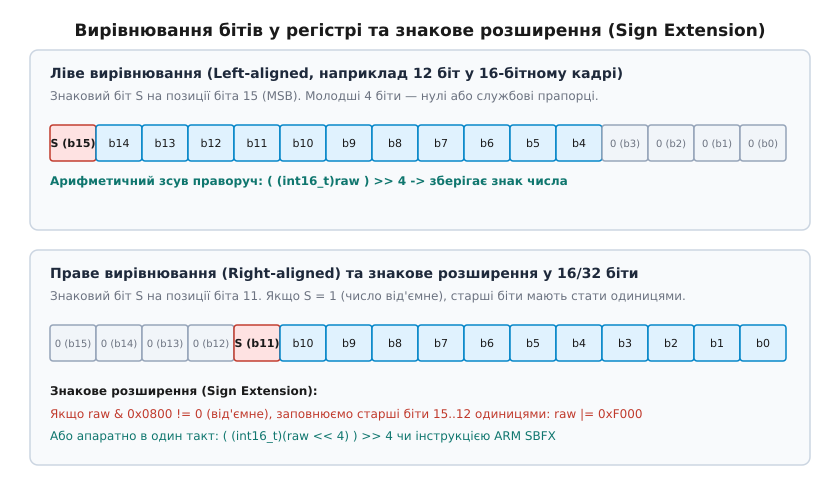
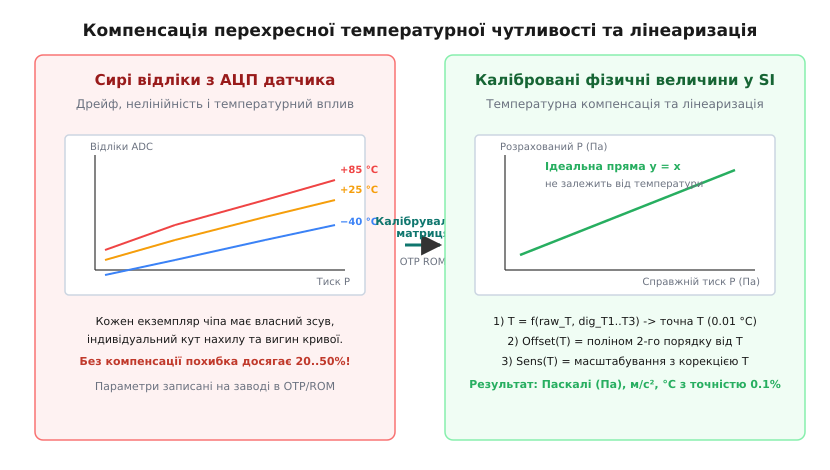
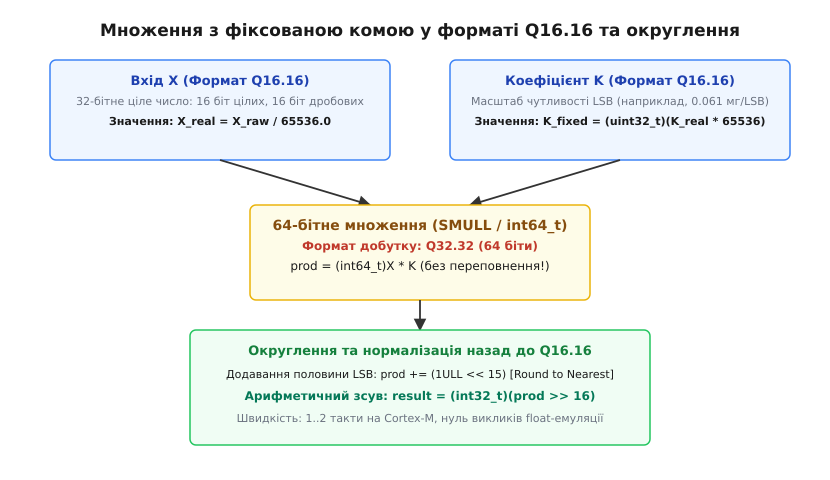

# Сирі відліки у фізичну величину

<preknowlist>
- [Пакетне зчитування регістрів](root:com-devices/burst-read) — зчитування послідовності сирих байтів через I2C або SPI в єдиний буфер
- [Вирівнювання даних: апаратні вимоги](root:hw-arch/alignment-hardware) — порядок байтів (Endianness) та небезпека непарних вказівників
- [Драйвер чипа: від регістрової карти до значення у SI](root:embedded/draiver-chypa) — місце шару обробки даних у структурі драйвера
- [Характеристики давача](root:hw-sensing/sensor-characteristics) — роздільна здатність, чутливість, нелінійність та температурний дрейф
- [Перехресна чутливість](root:hw-sensing/cross-sensitivity-compensation) — вплив паразитної температури на вимірювання фізичних величин
</preknowlist>

Мікроконтролер зчитує по шині SPI шість послідовних байтів із вихідних регістрів 12-бітного трьохосьового акселерометра: `0xF0, 0x0F, 0x00, 0x08, 0x40, 0x01`. Якщо напряму привести цей буфер до трьох змінних `int16_t` і помножити кожну на паспортну чутливість 0.061 мг/LSB, система замість очікуваного вектора гравітації спокою величиною в 1 g (9.81 м/с²) отримає хаотичні вектори з амплітудою в десятки g. Помилка виникає через те, що сирі двійкові відліки з АЦП датчика не є готовими числами: вони мають специфічний порядок байтів, нестандартну розрядність, вирівнювання всередині машинного слова та нелінійну температурну залежність, закладену у фізиці напівпровідникового кристала.

Перетворення сирого бітового потоку на фізичну величину міжнародної системи одиниць SI (метри на секунду в квадраті, Паскалі, градуси Цельсія чи Кельвіни, Вольти, радіани на секунду) вимагає суворого послідовного конвеєра обробки. Будь-яка помилка на цьому шляху — пропущене знакове розширення, неправильне округлення або проміжне арифметичне переповнення — руйнує роботу систем зворотного зв'язку, автопілотів і цифрових фільтрів.

## 1. Сирий потік байтів: порядок, пакування та знакове розширення

Цифрові сенсори передають результати вимірювань через інтерфейси I2C, SPI або UART у вигляді послідовності 8-бітних байтів. Перша перешкода полягає у відмінності порядку байтів (Endianness) між шиною датчика та пам'яттю керуючого процесора. Більшість мікросхем формують багатобайтові регістри у форматі Big-Endian (старший байт передається першим) або у фіксованому порядку адрес Little-Endian (молодший байт за меншою адресою регістрової карти).

Наївна спроба розіменувати буфер через вказівник на знаковий тип на архітектурах ARM Cortex-M0 або Cortex-M3 призводить або до апаратної помилки HardFault через непарне вирівнювання адреси (Unaligned Access), або до зчитування старшого байта замість молодшого. Причина полягає в порушенні суворого вирівнювання (Strict Alignment): 16-бітне або 32-бітне слово в пам'яті процесора повинно мати адресу, кратну 2 або 4. Буфер прийому DMA або стековий масив `uint8_t buf[6]` може починатися з непарної адреси, що на процесорах без апаратної підтримки непарного доступу негайно викликає виняткову ситуацію ядра.

Єдиним переносним і безпечним способом є явне побітове складання числа з окремих байтів:

```
raw_16 = (uint16_t)buf_lsb | ((uint16_t)buf_msb << 8)    [для датчиків з порядком LSB-first]
raw_16 = ((uint16_t)buf_msb << 8) | (uint16_t)buf_lsb    [для датчиків з порядком MSB-first]
```

Компілятор GCC або Clang з увімкненою оптимізацією `-O2` автоматично розпізнає цей патерн і замінює два побайтові читання та зсув на одну апаратну інструкцію `LDRH` або інструкцію реверсу байтів `REV16` (Byte Reverse Halfword), виконуючи перетворення за 1 процесорний такт без ризику непарного доступу.

### Ліве та праве вирівнювання даних

Вбудовані АЦП інтегральних сенсорів часто мають роздільну здатність 10, 12 або 14 бітів. Оскільки результат повинен передаватися через стандартні 16-бітні регістри, виробники застосовують два принципово різні формати розташування бітів:

1. **Ліве вирівнювання (Left-aligned):** 12 значущих бітів розміщуються у старших розрядах регістра (біти 15..4), а молодші розряди (біти 3..0) заповнюються нулями або містять службові прапорці готовності даних (DRDY). Цей формат зручний тим, що розробник може зчитати лише один старший байт регістра і отримати швидку 8-бітну оцінку величини без необхідності виконувати побітові зсуви. Наприклад, у трьохосьовому акселерометрі LIS3DH за замовчуванням увімкнено саме ліве вирівнювання, що дозволяє опитувати лише регістри `OUT_X_H`, `OUT_Y_H`, `OUT_Z_H` при роботі в режимі низького споживання.
2. **Праве вирівнювання (Right-aligned):** 12 значущих бітів займають молодші розряди (біти 11..0), а старші 4 розряди (біти 15..12) залишаються нульовими. Цей формат типовий для автономних АЦП (наприклад, ADS1115 або MCP3208), де результат є чистим двійковим кодом без додаткових бітів статусу в молодших розрядах.


*Вирівнювання бітів у 16-бітному кадрі та механізм знакового розширення 12-бітних даних*

### Пастка знакового розширення (Sign Extension)

Майже всі фізичні датчики, що вимірюють двоспрямовані величини (акселерометри, гіроскопи, магнітометри, термометри навколишнього середовища), видають дані у форматі додаткового коду (Two's Complement).

У 12-бітному додатковому коді знаковий біт (MSB) розташований на позиції біта 11 (вага 2048):
- Додатні числа займають діапазон `0x000`..`0x7FF` (від 0 до +2047).
- Від'ємні числа займають діапазон `0x800`..`0xFFF` (від -2048 до -1).

Якщо 12-бітне число з правим вирівнюванням має від'ємне значення (наприклад, -1, що у 12 бітах кодується як `0x0FFF`), і його безпосередньо записати у 16-бітну знакову змінну `int16_t`, старші 4 біти залишаться нулями: `0x0FFF`. Для 16-бітного типу це число дорівнює +4095. Від'ємне значення миттєво перетворилося на величезне додатне число.

Щоб відновити коректне від'ємне число у 16- або 32-бітному слові, необхідно виконати знакове розширення: скопіювати 11-й біт у всі старші розряди (15..12 або 31..12).

Існує три основні способи виконання знакового розширення:

1. **Арифметичний подвійний зсув:** Спочатку зсуваємо число вліво до упору в старший розряд машинного слова, а потім виконуємо арифметичний зсув праворуч. Компілятор гарантує, що арифметичний зсув знакового типу розмножує знаковий біт. Для 12-бітного числа у 16-бітному слові зсув вліво на 4 біти переміщує біт 11 на позицію біта 15. Наступний арифметичний зсув вправо на 4 біти заповнює біти 15..12 копіями старшого знакового біта.
2. **Перевірка знакового біта та накладання бітової маски:** Якщо біт 11 встановлений у 1 (`raw & 0x0800 != 0`), до числа застосовується побітове «АБО» з маскою `0xF000` (для 16 бітів) або `0xFFFFF000` (для 32 бітів).
3. **Апаратна інструкція процесора:** Архітектура ARM Cortex-M3/M4/M7 має спеціальну інструкцію `SBFX` (Signed Bit Field Extract), яка виконує витягування бітового поля довільної ширини та його знакове розширення за один такт.

:::tabs
@tab C
:::code syri-vidliky-u-fizychnu-velychynu-d/c/rawframe.c
@tab C++
:::code syri-vidliky-u-fizychnu-velychynu-d/cpp/raw_frame.hpp
:::

## 2. Вага молодшого розряду (LSB Sensitivity) та переведення в одиниці SI

Після того як сирий двійковий відлік зібрано та коректно розширено за знаком, ми отримуємо цілочисельну величину `X_raw`. Наступний крок — переведення її у фізичну розмірність.

У технічній документації виробники описують передавальну функцію сенсора одним із двох взаємообернених параметрів:
1. **Чутливість (Sensitivity, `S`):** показує, скільки одиниць молодшого розряду генерує сенсор на одиницю фізичної величини (наприклад, 16384 LSB/g або 256 LSB/Па).
2. **Вага молодшого розряду (LSB weight / Resolution, `W`):** ціна однієї одиниці молодшого розряду у фізичних одиницях (наприклад, 0.061 мг/LSB або 0.0078125 °C/LSB).

Зв'язок між ними визначається формулою:

```
W = 1 / S                                     [вага LSB як обернена величина до чутливості]
```

Для ідеального лінійного перетворювача фізична величина `Y_si` розраховується за формулою:

```
Y_si = (X_raw - X_zero) * W                   [лінійна передавальна характеристика сенсора]
```

де `X_zero` — зміщення нульового рівня (Offset).

### Типові масштабні коефіцієнти промислових сенсорів

1. **Цифрові термометри (MCP9808, TMP117, DS18B20):**
   - Датчик TMP117 має вагу молодшого розряду `W = 0.0078125 °C/LSB`. Це число є точним ступенем двійки: `W = 1/128 °C = 2^(-7) °C`.
   - Датчик MCP9808 у 12-бітному режимі має `W = 0.0625 °C/LSB = 1/16 °C = 2^(-4) °C`.
   - Вибір ступенів двійки виробниками не випадковий: для мікроконтролера множення на 2^(-n) еквівалентне зсуву праворуч на `n` бітів без необхідності залучати блок множення.
2. **Трьохосьові акселерометри (LIS3DH, LSM6DSO, BMI270):**
   - У діапазоні ±2 g чутливість становить 0.061 мг/LSB (0.000061 g/LSB).
   - Для переведення в одиниці SI (метри на секунду в квадраті) значення множиться на стандартне прискорення вільного падіння `g0 = 9.80665 м/с²`:
     ```
     W_si = 0.000061 * 9.80665 = 0.00059820565 м/с^2 / LSB
     ```
3. **Гіроскопи (MPU6050, I3G4250D):**
   - У діапазоні ±250 °/s чутливість становить 8.75 mdps/LSB (0.00875 °/s/LSB).
   - Для переведення в радіани на секунду (стандарт SI):
     ```
     W_rad = 0.00875 * (pi / 180) = 0.0001527163 рад/с / LSB
     ```
4. **Магнітометри (LIS3MDL, QMC5883L):**
   - У діапазоні ±4 Гаус чутливість становить 6842 LSB/Гаус, що відповідає `W = 1/6842 Гаус/LSB ≈ 0.146 мкТл/LSB` (оскільки 1 Гаус = 100 мкТл).

Коректний вибір одиниць у прошивці має принципове значення. Зберігання прискорення в міліграмах чи сирих відліках всередині системи керування дроном призводить до накопичення магічних коефіцієнтів у формулах ПІД-регуляторів. Якщо ж на виході драйвера дані відразу переводяться у стандартні одиниці SI, алгоритми верхнього рівня стають повністю незалежними від конкретної моделі датчика.

## 3. Заводські калібрувальні матриці: компенсація нелінійності та перехресної чутливості

Просте множення на константний масштабний коефіцієнт працює лише для сенсорів з ідеальною інтегральною схемою первинної обробки. У барометрах, магнітометрах, газових аналізаторах та високоточних IMU механічні напруження кремнієвого кристала та температурна залежність п'єзорезисторів призводять до значної нелінійності та температурного дрейфу.

Показовим прикладом є п'єзорезистивний цифровий датчик атмосферного тиску Bosch Sensortec BMP280. Тонка кремнієва мембрана деформується під дією тиску навколишнього середовища, змінюючи опір тензомоста. Проте вигин мембрани та опір моста залежать не лише від тиску, але й від температури кристала та внутрішніх напружень після пайки мікросхеми на плату.


*Залежність сирих відліків тиску від температури кристала та її компенсація заводським поліномом*

Без термокомпенсації похибка вимірювання тиску при зміні температури від -20 °C до +65 °C може досягати 20..50 гПа (що відповідає помилці розрахунку висоти у кількасот метрів).

Для усунення цієї похибки виробник записує у внутрішню енергонезалежну пам'ять (OTP ROM) датчика індивідуальну калібрувальну матрицю з 12 коефіцієнтів (`dig_T1..T3`, `dig_P1..P9`).

Математична модель компенсації розгортається у двовимірний поліном другого і третього порядку:
1. **Етап 1: Визначення точної температури кристала.** Сирий 20-бітний відлік температури `T_raw` перетворюється на тонке значення температури `t_fine` за допомогою полінома 2-го порядку:
   ```
   var1 = (T_raw / 16384 - dig_T1 / 1024) * dig_T2
   var2 = ((T_raw / 131072 - dig_T1 / 8192)^2) * dig_T3
   t_fine = var1 + var2
   ```
2. **Етап 2: Розрахунок зсуву нуля та чутливості тиску від температури.** Отримане значення `t_fine` використовується для обчислення динамічного зміщення `Offset(t_fine)` та динамічного масштабу `Sensitivity(t_fine)`:
   ```
   Offset = dig_P4 * 2^35 + dig_P5 * t_fine * 2^17 + dig_P6 * t_fine^2
   Sensitivity = dig_P1 * 2^33 + dig_P2 * t_fine * 2^12 + dig_P3 * t_fine^2
   ```
3. **Етап 3: Нелінійна лінеаризація тиску.** Сирий відлік `P_raw` нормується через розраховані значення `Offset` і `Sensitivity`, після чого коригується поліномом нелінійності з коефіцієнтами `dig_P7`, `dig_P8`, `dig_P9`.

Повний виробничий лістинг цього алгоритму наведено у вставці [компенсаційного рушія барометра BMP280](root:embedded/syri-vidliky-u-fizychnu-velychynu/proj-bmp280-compensation.md).

## 4. Арифметика з фіксованою комою (Fixed-Point) проти Floating-Point

Традиційний підхід до реалізації подібних формул полягає у використанні чисел з плаваючою комою одинарної (`float`) або подвійної (`double`) точності. Проте на мікроконтролерах без апаратного співпроцесора FPU (Floating Point Unit) — таких як ARM Cortex-M0, Cortex-M0+, Cortex-M1, Cortex-M3 або базових ядрах RISC-V RV32I — плаваюча кома реалізується програмною емуляцією через бібліотечні виклики (`__aeabi_fadd`, `__aeabi_fmul`, `__aeabi_fdiv`).

Це породжує три критичні інженерні проблеми:
1. **Катастрофічне падіння швидкодії:** Одне апаратне цілочисельне множення на Cortex-M3 виконується за 1 такт. Програмне множення `float` вимагає 60–150 тактів, а програмне ділення — 120–350 тактів.
2. **Роздування пам'яті Flash:** Перший же вираз із типом `float` підтягує в прошивку важкі підпрограми емуляції розрядністю IEEE 754, додаючи від 2.5 до 6 КБ скомпільованого бінарного коду. Для молодших чипів із 16–32 КБ Flash це неприпустима витрата ресурсу.
3. **Недетермінованість часу виконання (Джиттер):** Час виконання програмних функцій емуляції залежить від нормалізації операндів і наявності денормалізованих чисел. Це вносить фазовий джиттер у високочастотні контури керування (наприклад, у FOC-драйверах двигунів чи фільтрах оцінки орієнтації дрона).

### Формати з фіксованою комою (Q-формати)

Арифметика з фіксованою комою (Fixed-Point Math) замінює дійсні числа цілими, призначаючи фіксовану кількість двійкових розрядів під дробову частину.

Формат позначається як `Q_m.n`, де `m` — кількість цілих бітів, `n` — кількість дробових бітів.
У 32-бітному знаковому слові найпопулярнішим є формат `Q_15.16` (або просто `Q16`):
- 1 біт знака;
- 15 бітів цілої частини (діапазон цілих значень від -32768 до +32767);
- 16 бітів дробової частини (вага молодшого розряду `LSB = 2^(-16) = 1/65536 ≈ 0.000015258789`).

```
x_real = X_fixed / 65536.0                    [переведення з Q16.16 у дійсне число]
X_fixed = (int32_t)(x_real * 65536.0 + 0.5)   [переведення дійсного числа у формат Q16.16]
```


*Схема 64-бітного множення у форматі Q16.16 з додаванням половини LSB для симетричного округлення*

### Правила арифметичних операцій у Q-форматах

1. **Додавання та віднімання:** Виконуються як звичайні цілочисельні операції, якщо операнди мають однаковий формат `Q_n`.
2. **Множення:** Множення числа у форматі `Q_n1` на число у форматі `Q_n2` дає результат у форматі `Q_(n1+n2)`. Для повернення до формату `Q_n1` проміжний 64-бітний результат необхідно зсунути праворуч на `n2` розрядів.
3. **Ділення:** Щоб не втратити точність, ділене спочатку зсувається вліво на кількість дробових бітів дільника з приведенням до 64 біт.

:::tabs
@tab C
:::code syri-vidliky-u-fizychnu-velychynu-d/c/fixedq16.c
@tab C++
:::code syri-vidliky-u-fizychnu-velychynu-d/cpp/fixed.hpp
:::

Детальне математичне обґрунтування шуму квантування, похибки усічення та вибору оптимальної розрядності викладено у вставці [математичних засад масштабування у фіксованій комі](root:embedded/syri-vidliky-u-fizychnu-velychynu/math-fixed-point-scaling.md).

## 5. Цифрова IIR-фільтрація без плаваючої коми

У багатьох вбудованих застосунках сирі або масштабовані відліки сенсорів містять високочастотний акустичний та механічний шум. Класичний експоненційний фільтр низьких частот (Exponential Moving Average, EMA / IIR-фільтр першого порядку) описується рівнянням:

```
y[n] = alpha * x[n] + (1 - alpha) * y[n - 1]
```

де `alpha` — коефіцієнт згладжування в діапазоні (0, 1].

Якщо вибрати коефіцієнт `alpha` як зворотний ступінь двійки `alpha = 1 / 2^k` (наприклад, для `k = 3` маємо `alpha = 1/8 = 0.125`), рівняння перетворюється на форму, що вимагає лише одного віднімання, одного арифметичного зсуву та одного додавання:

```
y[n] = y[n - 1] + ((x[n] - y[n - 1]) >> k)
```

Проте пряме цілочисельне ділення через зсув викликає так звану проблему мертвої зони (Limit Cycles / Truncation Stalling): коли різниця `x[n] - y[n-1]` стає меншою за `2^k`, зсув праворуч обнуляє її, і фільтр «застряє», не досягаючи справжнього середнього значення сигналу.

Правильне вирішення полягає у зберіганні внутрішнього стану фільтра у форматі з розширеною фіксованою комою (наприклад, накопичувач `acc` у форматі `Q16.16`), куди вхідний сигнал додається зі зсувом вліво:

:::tabs
@tab C
:::code syri-vidliky-u-fizychnu-velychynu-d/c/iir_fixed.c
@tab C++
:::code syri-vidliky-u-fizychnu-velychynu-d/cpp/iir.hpp
:::

## 6. Захист від переповнення та збереження точності в 32/64-бітних обчисленнях

Головна небезпека цілочисельної арифметики — проміжне переповнення (Intermediate Overflow). Розглянемо типовий розрахунок переведення сирого відліку АЦП напруги (12 біт, 0..4095) у мілівольти при опорній напрузі 3300 мВ:

Вираз `raw_adc * 3300` при максимальному вході дорівнює 4095 * 3300 = 13 513 500. Якщо змінні оголошені як 16-бітні `uint16_t`, максимальне число дорівнює 65535. Добуток переповнюється, обрізається по модулю 2^16, даючи значення `0x323C` (12860), а кінцевий результат виходить 3 мВ замість правильних 3300 мВ.

Навіть у 32-бітній арифметиці множення двох чисел у форматі `Q_16.16` (значення порядків 10^4 * 65536 ≈ 6.5 * 10^8) вимагає розрядності:

```
6.5 * 10^8 * 6.5 * 10^8 = 4.2 * 10^17 > 2^31 - 1 (2.14 * 10^9)
```

### Застосування 64-бітних типів та апаратна генерація інструкцій

Сучасні 32-бітні ядра ARM Cortex-M мають апаратні інструкції множення з 64-бітним результатом:
- `SMULL` (Signed Multiply Long): перемножує два 32-бітних знакових числа і записує 64-бітний результат у пару регістрів `RdLo`, `RdHi` за 1 такт (на Cortex-M3/M4/M7) або за 3–4 такти (на Cortex-M0).
- `SMLAL` (Signed Multiply Accumulate Long): перемножує два 32-бітних числа і додає результат до 64-бітного значення в регістрах.

Коли компілятор бачить явне розширення до `int64_t`, він не викликає софтверну бібліотеку, а генерує рівно одну апаратну інструкцію `SMULL`, за якою слідує зсув регістрової пари. Це дає абсолютну точність без будь-яких накладних витрат.

### Арифметика з насиченням (Saturation Arithmetic)

Якщо фізичне вимірювання виходить за межі діапазону сенсора (наприклад, ударне перевантаження акселерометра), стандартна цілочисельна арифметика викликає загортання знаку (Wrap-around): число +32767 при додаванні 1 перетворюється на -32768. Для системи стабілізації дрона це означає миттєву зміну команди «максимальний газ вгору» на «максимальний газ вниз», що призводить до катастрофи.

Арифметика з насиченням обмежує результат граничними значеннями `INT_MAX` або `INT_MIN`. Ядра Cortex-M3/M4/M7 мають вбудовані апаратні інструкції насичення `SSAT` (Signed Saturate) та `USAT` (Unsigned Saturate), які обмежують розрядність довільної бітової ширини за один такт.

:::tabs
@tab C
:::code syri-vidliky-u-fizychnu-velychynu-d/c/sensor_si.c
@tab C++
:::code syri-vidliky-u-fizychnu-velychynu-d/cpp/sensor_si.hpp
:::

### Порівняльний аналіз підходів обробки даних

| Метод обробки | Такти процесора (Cortex-M0) | Розмір коду (Flash) | Точність | Ризик переповнення |
| :--- | :--- | :--- | :--- | :--- |
| **`float` (програмний)** | 150–400 тактів | +3–5 КБ | 24 біти мантиси | Мінімальний (динамічний порядок) |
| **Цілочисельний 16-біт** | 1–2 такти | < 50 байтів | Низька (втрата залишку) | **Критичний (переповнення)** |
| **Fixed-Point Q16 (32/64 біт)** | **3–6 тактів** | **< 100 байтів** | **Висока (0.000015)** | **Нульовий (при 64-біт множенні)** |

## Підсумок архітектури обробки сирих даних

Перетворення сирих відліків у фізичні величини будується за суворим трирівневим конвеєром:
1. **Низькорівневий драйвер:** зчитує сирі байти, контролює порядок прямування (Endianness), виконує бітові зсуви вирівнювання та відновлює знаковий біт (Sign Extension).
2. **Калібрувальний рушій:** застосовує індивідуальні параметри з енергонезалежної пам'яті сенсора, компенсує перехресний вплив температури та лінеаризує передавальну характеристику.
3. **Математичний рівень:** проводить розрахунки у форматі з фіксованою комою з використанням 64-бітних проміжних акумуляторів і симетричного округлення, забезпечуючи максимальну точність та найвищу швидкодію на мікроконтролерах будь-якого класу.
