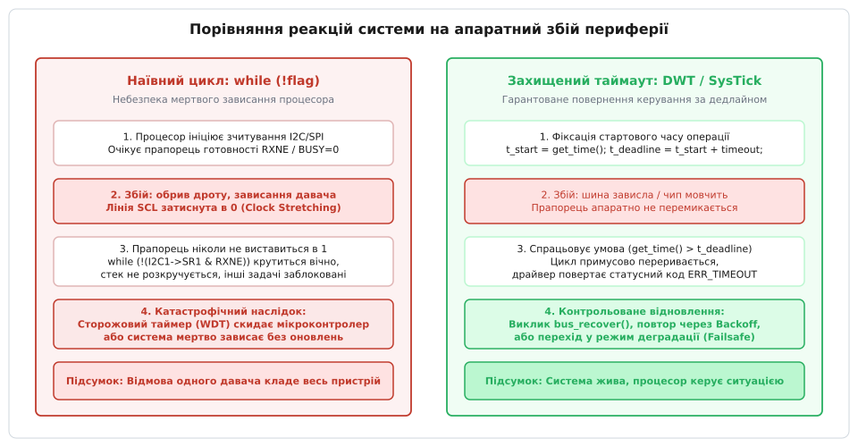
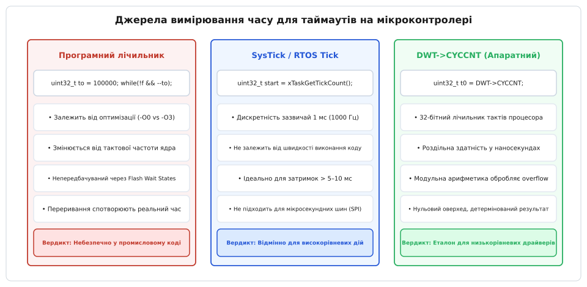
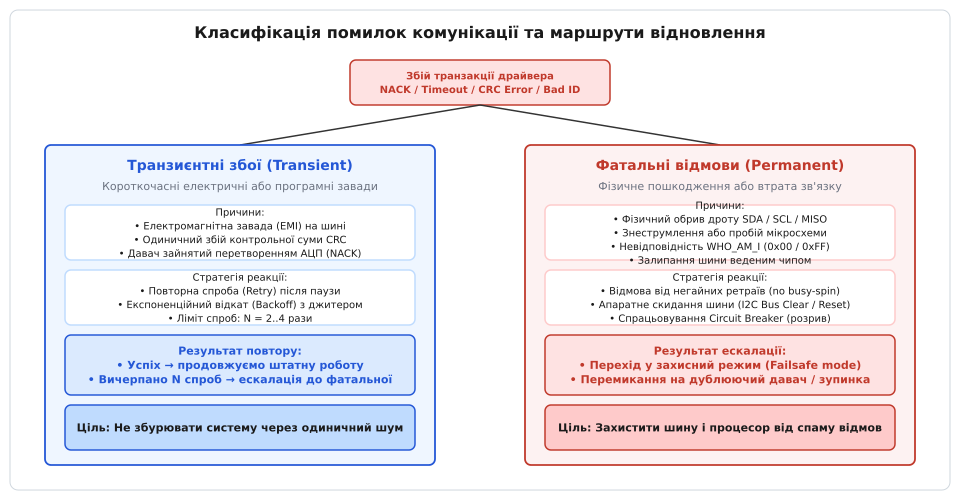
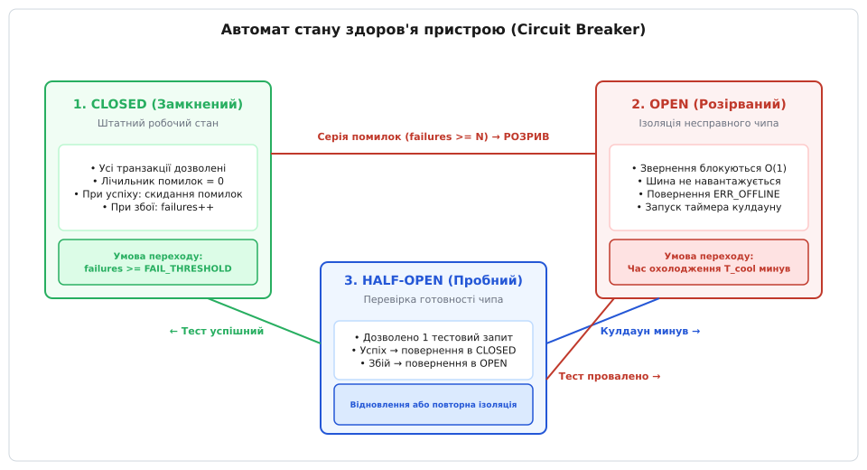

# Таймаут, повтор і відмова пристрою

<preknowlist>
- [Як чипи розмовляють: навіщо шини](root:embedded/why-buses) — фізика ліній зв'язку I2C/SPI, таймінги, стан готовності та арбітраж.
- [Драйвер чипа: від регістрової карти до значення у SI](root:embedded/draiver-chypa) — рівнева архітектура драйвера, абстракція транспорту та статусний код повернення.
- [Послідовність ініціалізації: порядок, затримки, перевірка](root:embedded/poslidovnist-initsializatsii) — часові інтервали POR, перехідні процеси живлення та перевірка ідентифікатора.
- [Блокуючий і неблокуючий ввід-вивід](root:sf-tasks/blocking-vs-nonblocking-io) — блокування потоків на очікуванні подій, небезпека затримки та асинхронні переходи.
- [Жодна помилка не мовчить](root:sf-apps/error-handling) — таксономія кодів повернення, обробка збоїв і захисне програмування.
</preknowlist>

Коли бортовий контролер промислового газового пальника або автопілот безпілотного літака опитує цифровий датчик тиску через шину I2C, розробник-початківець зазвичай пише прямий виклик зчитування регістра у головному циклі програми. За стабільного лабораторного живлення на столі такий код виконується за 150 мікросекунд і щоразу повертає очікувані байти. Проте варто вібрації від двигуна на частку мілісекунди порушити контакт у роз'ємі лінії тактування SCL або імпульсній заваді від запалювання викликати короткочасне просідання напруги на платі датчика, як процесор намертво застрягає в циклі `while (!(I2C1->SR1 & I2C_SR1_RXNE))`. Переривання таймерів можуть продовжувати цокати, але головний потік керування зупиняється назавжди: клапан подачі газу залишається відкритим, сервоприводи елеронів завмирають у крайньому положенні, а сторожовий таймер або перезавантажує мікроконтролер посеред польоту, або взагалі не спрацьовує, якщо його скидання необачно винесли в обробник апаратного таймерного переривання.

Ця аварія розкриває фундаментальну асиметрію вбудованих систем: внутрішні регістри периферії мікроконтролера гарантовано відповідають за фіксовану кількість тактів процесорного ядра, тоді як зовнішній пристрій на друкованій платі або кабельному шлейфі є принципово ненадійним фізичним середовищем. Зовнішній чип може раптово знеструмитися, зависнути у власному внутрішньому циклі очікування аналого-цифрового перетворення, затиснути лінію зв'язку в нуль через апаратне розтягування такту *(англ. Clock Stretching)* або зазнати збою від електромагнітної наводки. Програма, яка безумовно очікує відповіді від зовнішнього заліза без обмеження часу, перетворює будь-який локальний електричний шум на фатальну відмову всього приладу.

> 🔧 **Навіщо це.** Стійкий драйвер розглядає шину зв'язку не як надійну локальну пам'ять, а як ворожий розподілений канал з імовірнісними збоями. Впровадження детермінованих апаратних таймаутів, розрізнення тимчасових завад і фатальних поломок, експоненційний відкат повторів та автоматична ізоляція мертвого чипа через патерн Circuit Breaker гарантують, що збій окремого датчика ніколи не викличе колапс процесора, а система контрольовано перейде в безпечний режим деградації.

---

## Анатомія мертвого зависання: Пастка вічного опитування прапорців

Типовий низькорівневий драйвер, згенерований графічним конфігуратором або списаний з навчального посібника, переповнений конструкціями прямого очікування готовності апаратного периферійного модуля мікроконтролера.

:::tabs
:::code taimaut-povtor-i-vidmova-prystroiu-d/c/anatomiia-mertvoho.c
:::code taimaut-povtor-i-vidmova-prystroiu-d/cpp/anatomiia-mertvoho.cpp
:::

У нормальних умовах передача одного байта на шині I2C із частотою 400 кГц триває 9 тактових імпульсів:

```
t_byte  =  9 ÷ 400000 Гц  =  22.5 мкс
```

Здається, що цикл виконається за кілька сотень тактів процесора на частоті 168 МГц і миттєво завершиться. Проте прапорець `BTF` *(Byte Transfer Finished)* або `TXE` *(Transmit Data Register Empty)* формується не процесором, а внутрішньою логікою шинного контролера МК на основі аналізу електричних сигналів на зовнішніх ніжках мікроконтролера.


*Порівняння наслідків нескінченного опитування прапорця та детермінованого таймауту під час фізичного відриву лінії або зависання зовнішнього чипа.*

### Фізичні причини блокування апаратних прапорців

Існує п'ять фізичних сценаріїв, за яких апаратний прапорець шини ніколи не перейде в активний стан:

1. **Зависання лінії веденим чипом через Clock Stretching:** Стандарт I2C дозволяє повільному веденому пристрою примусово притягнути лінію SCL до землі (рівень логічного нуля), якщо він не встигає обробити попередній байт або виконує внутрішнє аналогове перетворення. Якщо ведений мікроконтролер чи датчик зазнав програмного збою, випав у HardFault або знеструмився посеред розтягування, лінія SCL залишається замкненою на нуль назавжди. Контролер I2C ведучого зупиняє генерацію тактових імпульсів і чекає відпускання лінії, а прапорець `BTF` не виставляється ніколи.
2. **Обрив підтягувального резистора (Pull-up) або живлення шини:** Якщо лінія відкритого стоку втрачає резистивну підтяжку до напруги живлення V_DD, вхідні буфери фіксують постійний низький рівень. Шинний автомат фіксує стан `BUSY` *(шина зайнята чужою транзакцією)* і блокує старт будь-якої передачі.
3. **Паразитне живлення через захисні діоди (Phantom Powering):** Якщо зовнішній модуль втратив штатне живлення V_DD через обрив доріжки чи перегорання LDO, струм з сигнальних ліній SCL/SDA та CS/MOSI починає протікати через вбудовані кремнієві ESD-діоди на внутрішню шину живлення знеструмленого чипа. Напруга на ньому встановлюється на рівні 1.8–2.2 В, чого недостатньо для стабільної роботи логіки, але достатньо для хаотичного відкриття вихідних транзисторів, які коротять шину на землю.
4. **Електромагнітне розсинхронізування бітового лічильника:** Імпульсна завада від комутації реле або силового ключа інвертора створює хибний сплеск на тактовій лінії. Внутрішній 3-бітний лічильник веденого чипа перескакує на 1 такт уперед. Ведений вважає, що зараз передається 8-й біт даних, тоді як ведучий уже генерує 9-й такт підтвердження (ACK). Ведений очікує наступного клока, ведучий чекає завершення транзакції — система потрапляє у стан взаємного очікування *(Deadlock)*.
5. **Втрата сигналу вибору кристала SPI (Chip Select):** Якщо провід CS відірвався або перебуває у плаваючому стані high-Z, ведений SPI-чип відключає свій вихід MISO. Ведучий передає байти в порожнечу, отримуючи у відповідь `0xFF` або `0x00`, проте якщо протокол вимагає очікування службового байта готовності (наприклад, `0xAA` від Flash-пам'яті чи статусного біта `BUSY=0`), цикл `while (spi_read() != READY)` стає нескінченним.

Перше залізне правило надійної прошивки: **Жоден цикл очікування апаратного регістра, стану лінії чи прапорця завершення передачі не має права існувати без жорсткого та детермінованого обмеження за часом (Deadline Timeout).**

---

## Реалізація та розрахунок таймаутів: Апаратні таймери проти лічильників

Найпоширеніша помилка при спробі захистити цикл від зависання — використання простого програмного декременту інкрементного лічильника:

:::tabs
```c
/* Ілюзія захисту: програмний лічильник ітерацій */
uint32_t timeout_counter = 100000;
while (!(I2C1->SR1 & I2C_SR1_RXNE)) {
    if (--timeout_counter == 0) {
        return DRIVER_ERR_BUS_TIMEOUT;
    }
}
```
```cpp
#include <cstdint>

// Ілюзія захисту у C++: програмний декремент лічильника ітерацій
uint32_t timeout_counter = 100'000;
while ((I2C1->SR1 & (1UL << 6)) == 0) {
    if (--timeout_counter == 0) {
        return DriverStatus::BusTimeout;
    }
}
```
:::

Цей код створює фальшиве відчуття надійності, але є міною сповільненої дії для реального виробу.

### Чому програмні лічильники ітерацій неприпустимі

Тривалість виконання однієї ітерації такого циклу залежить від безлічі неконтрольованих факторів середовища виконання:

1. **Рівень оптимізації компілятора (`-O0`, `-O2`, `-Os`, `-O3`):** За прапорця `-O0` кожна ітерація транслюється у вичитку змінної зі стека в регістр ядра, декремент, запис назад у стек і умовний перехід (близько 12–16 тактів CPU). За прапорця `-O3` лічильник розміщується виключно в регістрі ядра `r3`, а компілятор розгортає цикл, скорочуючи час ітерації до 2 тактів. Один і той самий ліміт у `100000` ітерацій дасть затримку 9.5 мс у Debug-збірці та лише 1.1 мс у Release-збірці. Якщо за 1.1 мс чип просто не встиг відповісти за штатною діаграмою, Release-версія впаде з помилкою таймауту там, де Debug-версія працювала ідеально.
2. **Зміна частоти тактування ядра (Clock Scaling):** Якщо для енергозбереження частоту ядра мікроконтролера динамічно знижують зі 168 МГц до 16 МГц, час програмного таймауту автоматично розтягується в 10.5 раза.
3. **Стани очікування Flash-пам'яті (Flash Wait States / Latency):** Виконання коду з Flash-пам'яті на високих частотах вимагає від 3 до 7 тактів очікування шини пам'яті. Робота кешу інструкцій (ART Accelerator або I-Cache) робить час виконання циклу залежним від того, чи потрапило тіло циклу на границю кеш-лінії.
4. **Витіснення перериваннями (Interrupt Preemption):** Якщо під час опитування виникають часті високопріоритетні переривання від АЦП або радіотракту, процесор витрачає час на їхню обробку. Реальний фізичний час спливає, але лічильник ітерацій не зменшується, оскільки опитувальний потік витіснений. В результаті таймаут не спрацьовує тоді, коли шина реально зависла.


*Аналіз точності та надійності трьох підходів до формування таймаутів: програмні цикли, системний таймер SysTick та апаратний лічильник циклів DWT.*

### Детерміновані джерела часу: DWT->CYCCNT, SysTick та апаратні таймери

Для забезпечення надійного часового обмеження драйвер повинен спиратися на апаратні джерела відліку фізичного часу, незалежні від коду та компілятора.

#### 1. Апаратний лічильник циклів DWT->CYCCNT (ARM Cortex-M3/M4/M7/M33)

Модуль DWT *(англ. Data Watchpoint and Trace)* містить 32-бітний регістр `CYCCNT`, який інкрементується на кожному такті системного ядра процесора. Це ідеальний інструмент для мікросекундних та субмілісекундних затримок, оскільки читання регістра займає рівно 1 такт CPU без звернення до шин периферії.

Роздільна здатність одного такту на частоті ядра `f_CPU = 168 МГц`:

```
t_tick  =  1 ÷ 168000000 Гц  ≈  5.952 нс
```

Переповнення 32-бітного регістра `2^32 = 4294967296` тактів настає через:

```
t_overflow  =  4294967296 ÷ 168000000 Гц  ≈  25.56 секунди
```

Завдяки правилам беззнакової арифметики за модулем `2^32` різниця `(uint32_t)(now - start)` завжди дає точну кількість пройдених тактів навіть тоді, коли лічильник перейшов через нуль *(Rollover)*:

```
now = 0x00000010,  start = 0xFFFFFFF0
Δt  =  (uint32_t)(0x00000010 - 0xFFFFFFF0)  =  0x00000020 (32 такти)
```

:::tabs
:::code taimaut-povtor-i-vidmova-prystroiu-d/c/1-aparatnyi-lichylnyk.c
:::code taimaut-povtor-i-vidmova-prystroiu-d/cpp/1-aparatnyi-lichylnyk.cpp
:::

#### 2. Системний таймер SysTick та RTOS Tick Counter

Для мілісекундних таймаутів (перетворення АЦП, стирання Flash-пам'яті, очікування стабілізації кварцового резонатора) використовують лічильник мілісекунд системного таймера `SysTick` або лічильник тіків операційної системи реального часу (FreeRTOS `xTaskGetTickCount()`).

:::tabs
:::code taimaut-povtor-i-vidmova-prystroiu-d/c/2-systemnyi-taimer-systick.c
:::code taimaut-povtor-i-vidmova-prystroiu-d/cpp/2-systemnyi-taimer-systick.cpp
:::

### Розрахунок бюджету таймауту (Timeout Budgeting)

Таймаут не можна обирати навмання. Занадто малий таймаут викличе помилкові спрацьовування під час штатних затримок веденого чипа (наприклад, при підвищенні температури), а занадто великий — заморозить процесор і призведе до зриву дедлайнів керування виконавчими механізмами.

Інженерна формула розрахунку таймауту транзакції:

```
t_timeout  =  t_tx_nominal + t_slave_process_max + t_stretch_max + t_safety_margin
```

Розрахуємо таймаут для пакетного зчитування 6 байтів вектора прискорення (X, Y, Z) з IMU-акселерометра шиною I2C Fast Mode (400 кГц):

```
Крок 1: Обсяг транзакції на фізичному рівні
N_bits  =  (1 байт адреси + 1 байт регістра + 1 байт рестарту + 6 байтів даних) · 9 бітів
        =  9 байтів · 9 бітів  =  81 біт

Крок 2: Номінальний час передачі бітів
t_tx_nominal  =  81 ÷ 400000 Гц  =  202.5 мкс

Крок 3: Максимальний час внутрішнього АЦП-перетворення датчика
t_slave_process_max  =  50.0 мкс

Крок 4: Максимально допустиме розтягування такту датчиком за даташитом
t_stretch_max  =  100.0 мкс

Крок 5: Інженерний запас (Safety Margin 100% на переривання ядра та дрейф RC-генератора датчика)
t_safety_margin  =  t_tx_nominal + t_slave_process_max  =  252.5 мкс

Крок 6: Підсумковий бюджет
t_timeout  =  202.5 + 50.0 + 100.0 + 252.5  =  605.0 мкс  ≈  0.8–1.0 мс
```

Встановлення таймауту в 1.0 мс гарантує безпомилкову передачу за будь-яких теплових режимів датчика та забезпечує детерміноване повернення керування максимум за 1 мілісекунду у випадку обриву шлейфу.

---

## Класифікація помилок комунікації: Транзиєнтні, фатальні та шинні відмови

Не кожна помилка вимагає перезавантаження системи, і не на кожну помилку слід відповідати повторною спробою. Сліпий ретрай фатальної помилки блокує шину і спалює процесорний час, тоді як миттєва капітуляція перед одиничною завадою знижує надійність виробу до нуля.


*Дерево класифікації помилок комунікації у вбудованому драйвері: розподіл на транзиєнтні, фатальні та шинні збої з відповідними маршрутами відновлення.*

### Таксономія помилок драйвера

Помилки поділяються на три принципові класи:

| Клас помилки | Фізична природа збою | Типові симптоми в регістрах | Дія драйвера |
|---|---|---|---|
| **Транзиєнтна (Transient / Soft)** | Короткочасна завада, імпульсний шум, зайнятість чипа | NACK на фазі адреси/даних, незбіг контрольної суми CRC, таймаут через чергу | Затримка (Backoff) та повторна спроба (Retry ≤ 3 рази) |
| **Фатальна (Permanent / Hard)** | Обрив дроту, знеструмлення, вихід чипа з ладу, хибна конфігурація | Стійкий NACK, незбіг `WHO_AM_I` (`0x00`/`0xFF`), неприпустимі параметри виклику | Негайне скасування ретраїв, звіт про відмову, перехід у Failsafe |
| **Шинна відмова (Bus-Level Lockup)** | Зависання кінцевого автомата чипа, затиснута лінія SDA | Прапорець `BUSY=1`, лінія SDA=0 при SCL=1, неможливість сформувати START | Апаратний скид шини: 9 тактів SCL (Bus Clear), реініціалізація периферії МК |

### Матриця рішень для статусних кодів

:::tabs
:::code taimaut-povtor-i-vidmova-prystroiu-d/c/matrytsia-rishen-dlia.c
:::code taimaut-povtor-i-vidmova-prystroiu-d/cpp/matrytsia-rishen-dlia.cpp
:::

---

## Апаратне скидання шини I2C: Протокол 9 імпульсів SCL (Bus Clear)

Найпідступніший стан на шині I2C виникає, коли ведучий мікроконтролер перезавантажується або скидає транзакцію за таймаутом у момент, коли ведений чип передавав логічний нуль. Ведений утримує лінію SDA притягнутою до землі, очікуючи чергового спадного фронту на SCL для передачі наступного біта. Оскільки лінія SDA притиснута до нуля, ведучий не здатний згенерувати обов'язкову умову `START` (перепад SDA з 1 в 0 при SCL=1) і фіксує стан шини як постійно зайнятий (`BUSY`).

Програмне перезавантаження периферійного модуля I2C у мікроконтролері (`I2C_CR1_SWRST`) не допомагає, оскільки проблема знаходиться зовні — у внутрішньому скінченному автоматі веденого чипа.

Для розблокування шини реалізують стандартну процедуру апаратного очищення шини *(англ. I2C Bus Clear Sequence)*:

1. Вимикають периферійний модуль I2C мікроконтролера.
2. Переналаштовують виводи SCL та SDA як звичайні виходи загального призначення GPIO в режимі відкритого стоку *(Open-Drain)* із зовнішніми підтяжками.
3. Генерують до 9 послідовних тактових імпульсів на лінії SCL (перемиканням GPIO з частотою ~50–100 кГц).
4. На кожному такті перевіряють стан входу лінії SDA: щойно ведений чип дорахує 8 бітів і відпустить лінію (SDA підніметься до логічної 1 під дією резистора), тактування можна припинити.
5. Формують умову `STOP`: примусово переводять SDA в 0 при низькому SCL, піднімають SCL до 1, а потім відпускають SDA в 1.
6. Повертають ніжки мікроконтролера в режим альтернативної функції I2C та реініціалізують апаратний блок.

:::tabs
:::code taimaut-povtor-i-vidmova-prystroiu-d/c/aparatne-skydannia-shyny.c
:::code taimaut-povtor-i-vidmova-prystroiu-d/cpp/aparatne-skydannia-shyny.cpp
:::

---

## Стратегії повторних спроб: Фіксовані паузи, експоненційний відкат та джитер

Якщо драйвер виявив транзиєнтну помилку (наприклад, NACK через зайнятість внутрішнього АЦП датчика), негайний повтор транзакції у тому ж мікросекундному вікні зазвичай знову призведе до помилки.

Чому миттєвий повтор без затримки шкідливий:
1. **Перехідні процеси:** Якщо збій стався через просідання живлення або внутрішнє перезавантаження датчика, його аналоговій частині потрібен час на заряд ємностей підкладки (100–500 мкс).
2. **Забивання шини:** Безперервне спамування запитами не дозволяє іншим периферійним пристроям на спільній шині I2C/SPI отримати доступ до інтерфейсу.
3. **Енергоспоживання:** Швидкісний ретрай тримає ядро мікроконтролера на 100% завантаженні у гарячому циклі опитування.

### Експоненційний відкат (Exponential Backoff)

Алгоритм експоненційного відкату збільшує тривалість паузи між кожною наступною невдалою спробою вдвічі:

```
t_backoff(k)  =  min(t_base · 2^(k - 1),  t_max)
```

де `k` — номер поточної спроби (1, 2, 3...), `t_base` — базова затримка (наприклад, 1 мс), `t_max` — стеля паузи (наприклад, 16 мс).

Послідовність пауз:

```
Спроба 1:  t_backoff(1)  =  1 · 2⁰   =   1 мс
Спроба 2:  t_backoff(2)  =  1 · 2¹   =   2 мс
Спроба 3:  t_backoff(3)  =  1 · 2²   =   4 мс
Спроба 4:  t_backoff(4)  =  1 · 2³   =   8 мс
Спроба 5:  t_backoff(5)  =  1 · 2⁴   =  16 мс (t_max)
```

Такий підхід дає зовнішньому чипу експоненційно більший час на самовідновлення без зависання шини на довгий фіксований час на першій же спробі.

### Джитер та проблема синхронізації збоїв (Thundering Herd)

На мультидроп-шинах (RS-485, CAN, Modbus або багатомайстрові системи I2C) виникає ефект «громового стада» *(Thundering Herd)*: коли через спільний стрибок живлення всі вузли одночасно фіксують збій і починають повторні спроби через однаковий детермінований інтервал `t_backoff`. Їхні пакети знову стикаються в колізії, шина знову падає, і всі вузли знову синхронно чекають наступного ступеня відкату.

Для запобігання цьому явищу до експоненційного інтервалу додають псевдовипадковий шум — **джитер (Jitter)**.

Алгоритм повного джитеру *(Full Jitter)* обирає випадковий інтервал у межах від 0 до стелі поточного ступеня:

```
t_sleep  =  random(0, t_backoff(k))
```

Для вбудованих систем без апаратного генератора випадкових чисел (RNG) використовують швидкий лінійний конгруентний генератор (LCG), ініціалізований значенням таймера `SysTick` або `DWT->CYCCNT`:

:::tabs
:::code taimaut-povtor-i-vidmova-prystroiu-d/c/dzhyter-ta-problema.c
:::code taimaut-povtor-i-vidmova-prystroiu-d/cpp/dzhyter-ta-problema.cpp
:::

---

## Автомат здоров'я пристрою: Патерн Circuit Breaker та деградація (Failsafe)

Якщо датчик остаточно відірвався від шини або згорів, ретраї з таймаутами при кожному виклику стають отрутою для прошивки. Припустимо, цикл оновлення телеметрії викликається з частотою 100 Гц (кожні 10 мс). Якщо кожне опитування мертвого датчика робить 3 спроби з таймаутом по 1 мс та паузами, процесор витрачатиме понад 5–8 мс на кожній ітерації на марні очікування. Залишкового часу не вистачить на виконання інших задач (математики фільтра Калмана чи розрахунку ПІД-регулятора), і вся система втратить керування.

Для захисту процесора від спаму невдалих викликів застосовують адаптований для вбудованих систем патерн **Запобіжник (Circuit Breaker)**.


*Кінцевий автомат моніторингу працездатності периферійного пристрою: стани CLOSED (штатна робота), OPEN (ізоляція та миттєвий Fast-Fail) і HALF-OPEN (пробна перевірка).*

### Стан автомату здоров'я пристрою

Автомат має три дискретні стани:

1. **CLOSED (Замкнений — Штатний робочий стан):**
   - Усі запити до датчика виконуються безпосередньо через шину.
   - Лічильник послідовних помилок `consecutive_failures` інкрементується при кожному збої.
   - У разі успішної транзакції лічильник миттєво обнуляється: `consecutive_failures = 0`.
   - Якщо `consecutive_failures >= FAILURE_THRESHOLD` (наприклад, 5 поспіль невдалих транзакцій), автомат «розмикає контур» і переходить у стан `OPEN`.

2. **OPEN (Розірваний — Ізоляція несправності):**
   - Будь-який наступний виклик драйвера **не торкається шини** взагалі. Функція негайно повертає код помилки `ERR_DEVICE_OFFLINE` за 1–2 такти процесора *(Fast-Fail)*.
   - Запускається таймер кулдауну *(Cooldown Timer)* на час `T_cooldown` (наприклад, 5 секунд).
   - Шина та процесор повністю розвантажуються, інші здорові пристрої на шині отримують безперешкодний доступ.
   - Коли `T_cooldown` спливає, автомат переходить у стан `HALF-OPEN`.

3. **HALF-OPEN (Напіврозірваний — Пробний стан):**
   - Автомат дозволяє виконати рівно одну тестову транзакцію (наприклад, зчитування регістра ідентифікатора `WHO_AM_I`).
   - Якщо пробна транзакція завершилася успішно — датчик відновив працездатність! Автомат скидає лічильники та повертається у стан `CLOSED`.
   - Якщо пробна транзакція знову зазнала краху — чип досі мертвий. Автомат повертається у стан `OPEN` і подвоює час кулдауну (експоненційний кулдаун).

### Повна реалізація Circuit Breaker для вбудованого драйвера

:::tabs
:::code taimaut-povtor-i-vidmova-prystroiu-d/c/povna-realizatsiia-circuit.c
:::code taimaut-povtor-i-vidmova-prystroiu-d/cpp/povna-realizatsiia-circuit.cpp
:::

---

## Пастки DMA, RTOS-м'ютексів та взаємодія зі сторожовим таймером

При побудові промислових драйверів таймаути виходять далеко за межі простих опитувань бітів регістра. У складних прошивках взаємодія з периферією включає прямий доступ до пам'яті (DMA), розділення шини між задачами RTOS та координацію зі сторожовим таймером (Watchdog).

### 1. Таймаути транзакцій прямого доступу до пам'яті (DMA)

При використанні DMA процесор не бере участі в передачі байтів: налаштовується дескриптор потоку, вмикається канал DMA, і задача переходить у стан очікування семафора або прапорця завершення передачі `Transfer Complete (TC)`.

Якщо шина зависла або ведений чип обірвав передачу посеред пакета, лічильник кількості даних DMA (`NDTR`) зупиняється на ненульовому значенні, переривання `TC` не генерується ніколи, і потік RTOS залишається заблокованим назавжди.

Для захисту DMA-передач використовують зовнішній дедлайн:
- Потік очікує семафор завершення DMA з жорстким таймаутом `xSemaphoreTake(dma_sem, timeout_ticks)`.
- Якщо таймаут сплив раніше, ніж прийшло переривання `TC`, драйвер зобов'язаний виконати примусове аварійне відключення DMA:
  1. Вимкнути потік DMA (`DMA_Stream->CR &= ~DMA_SxCR_EN`).
  2. Зачекати скидання біта `EN` в нуль за мікросекундним таймаутом DWT (DMA потребує кількох тактів на зупинку внутрішнього конвеєра).
  3. Очистити всі апаратні прапорці помилок (`TEIF`, `FEIF`, `DMEIF`).
  4. Скинути периферійний блок (SPI/I2C) та повідомити верхній рівень про збій.

:::tabs
:::code taimaut-povtor-i-vidmova-prystroiu-d/c/1-taimauty-tranzaktsii.c
:::code taimaut-povtor-i-vidmova-prystroiu-d/cpp/1-taimauty-tranzaktsii.cpp
:::

### 2. Запобігання інверсії пріоритетів та блокуванню шини в RTOS

На спільній шині I2C, до якої підключені кілька датчиків (наприклад, низькопріоритетний датчик вологості та критичний IMU системи стабілізації), доступ до фізичного драйвера захищається м'ютексом.

Якщо низькопріоритетна задача захоплює м'ютекс шини і застрягає в нескінченному опитуванні завислого датчика, високопріоритетна задача польотного контролера не зможе отримати доступ до IMU навіть через механізм успадкування пріоритетів *(Priority Inheritance)*.

Правило синхронізації RTOS:
- Захоплення м'ютексу шини **завжди** виконується з таймаутом: `xSemaphoreTake(bus_mutex, pdMS_TO_TICKS(10))`.
- Усі операції всередині критичної секції шини повинні мати сумарний таймаут, менший за максимальний квант затримки високопріоритетної задачі.

### 3. Дисципліна скидання сторожового таймера (Watchdog)

Сторожовий таймер *(Independent Watchdog — IWDG)* призначений для виявлення повної втрати працездатності програмного забезпечення.

Найгрубіша помилка архітектури — скидати сторожовий таймер (`IWDG->KR = 0xAAAA` або `HAL_IWDG_Refresh()`) всередині циклу очікування шини або всередині функції повторних спроб:

:::tabs
```c
/* ГРУБА ПОМИЛКА: Скидання WDT всередині циклу маскує зависання */
while (!(I2C1->SR1 & I2C_SR1_RXNE)) {
    IWDG->KR = 0xAAAA; /* WDT скидається, процесор висить вічно! */
}
```
```cpp
// Груба помилка у C++: скидання сторожового таймера всередині очікування периферії
while ((I2C1->SR1 & (1UL << 6)) == 0) {
    IWDG->KR = 0xAAAA; // Маскування зависання шини від сторонніх супервізорів
}
```
:::

Такий код унеможливлює апаратне виявлення збою мікроконтролера: периферія зависла, головна програма не виконується, але сторожовий таймер продовжує отримувати підтвердження «життя». 

Скидання апаратного сторожового таймера має право виконувати **виключно головний планувальник завдань** або супервізор системи наприкінці повного циклу верифікації здоров'я всіх підсистем. У багаторівневій архітектурі кожна задача веде власний лічильник виконаних циклів *(Task Heartbeat Counter)*. Якщо задача опитування датчиків застрягла або перевищила допустимий ліміт помилок Circuit Breaker, вона перестає оновлювати свій локальний лічильник. Головний супервізор під час перевірки фіксує зупинку лічильника задачі, блокує апаратне скидання IWDG і дозволяє таймеру безпечно перезавантажити мікроконтролер для повернення в контрольований початковий стан.

---

## Інтегрований виконавець транзакцій: Повний контур стійкості

Об'єднаємо всі рівні захисту — Circuit Breaker, апаратні таймаути, класифікацію помилок, процедуру відновлення шини та експоненційний ретрай — у єдину архітектурну функцію виконання транзакції драйвера:

:::tabs
:::code taimaut-povtor-i-vidmova-prystroiu-d/c/intehrovanyi-vykonavets.c
:::code taimaut-povtor-i-vidmova-prystroiu-d/cpp/intehrovanyi-vykonavets.cpp
:::

---

## Градуальна деградація та перехід у безпечний режим (Failsafe)

Коли Circuit Breaker фіксує відмову пристрою і переходить у стан `OPEN`, верхній рівень системи (прикладний контролер) повинен виконати детермінований перехід у режим деградації або аварійного захисту *(англ. Failsafe)*.

### Стратегії системної деградації

1. **Датчикова надлишковість (Sensor Redundancy):**
   - Якщо на борту встановлено два однакових акселерометри (Primary IMU та Secondary IMU), відмова першого викликає негайне автоматичне перемикання фільтра орієнтації на джерело даних з другого датчика.
2. **Зниження точності математичної моделі (Degraded Fusion):**
   - У разі відмови барометричного датчика висоти польотний контролер відключає барометричну корекцію у фільтрі Калмана і продовжує оцінку висоти за вертикальним інтегруванням акселерометра та даними супутникової навігації GNSS, збільшуючи діагональні елементи коваріаційної матриці шуму вимірювань `R`.
3. **Безпечна аварійна зупинка (Failsafe Action):**
   - Якщо відмовив критичний датчик, без якого керування фізично неможливе (наприклад, датчик струму інвертора електромобіля або датчик температури акумуляторної батареї):
     1. Виконавчі ШІМ-виходи комутаторів силових ключів негайно блокуються апаратним сигналом `Break / Fault`.
     2. Вмикається аварійна звукова та світлова сигналізація.
     3. Записується діагностичний код відмови в захищену область енергонезалежної пам'яті (Flash/EEPROM Blackbox).
     4. Система переходить у режим очікування технічного обслуговування або виконує керовану аварійну зупинку.

---

## Архітектурний чеклист відмовостійкого драйвера

Кожен професійний вбудований драйвер повинен відповідати семи інженерним правилам надійності:

1. **Жодного нескінченного циклу:** Кожен оператор `while` чи `do-while`, що перевіряє регістр або лінію GPIO, має бути апаратно обмежений дедлайном через DWT або SysTick.
2. **Незалежність від компілятора:** Час таймаутів розраховується у фізичних одиницях (мікросекунди, мілісекунди), а не в кількості ітерацій.
3. **Обов'язкова класифікація помилок:** Перед ухваленням рішення про ретрай драйвер класифікує помилку на транзиєнтну чи фатальну (ніколи не повторювати виклики з невірними вхідними параметрами або помилкою `WHO_AM_I`).
4. **Експоненційний відкат із джитером:** Повторні спроби виконуються з прогресивними паузами для розвантаження шини та запобігання колізіям.
5. **Ізоляція відмов через Circuit Breaker:** Після 3–5 послідовних збоїв драйвер припиняє звернення до мертвого чипа, повертаючи помилку за O(1) та звільняючи шину для інших вузлів.
6. **Апаратна підтримка очищення шини (Bus Recovery):** За наявності зависань I2C драйвер повинен мати функцію генерації 9 імпульсів SCL у режимі GPIO bit-bang для примусового скидання веденого автомата.
7. **Прозорість діагностики:** Кожен збій таймауту і кожне спрацьовування запобіжника збільшують відкриті діагностичні лічильники, доступні системі моніторингу та чорній скриньці.
