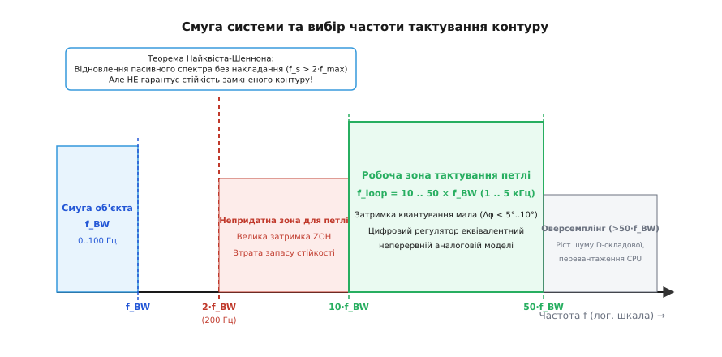
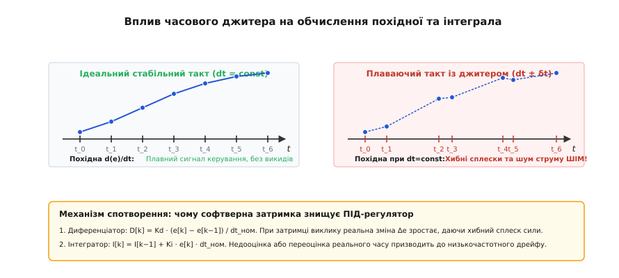
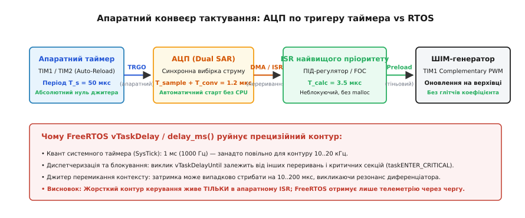
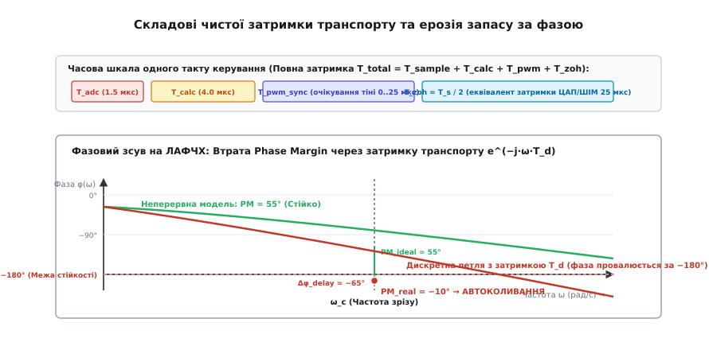

# Такт петлі: dt, джитер, затримка

<preknowlist>
- [Дискретний ПІД](root:com-signal/discrete-pid) — різницеві рівняння, реалізація накопичувача інтеграла та диференціювання помилки на дискретному кроці.
- [Запас стійкості](root:embedded/loop-stability) — амплітудний і фазовий запаси (Gain/Phase Margin), частота зрізу та критерій стійкості замкненого контуру.
- [Lead/lag-компенсатор](root:embedded/lead-lag-compensator) — формування фазового портрета петлі та ціна випередження по фазі на високих частотах.
- [Налаштування ПІД](root:embedded/pid-tuning-cascade) — каскадні контури керування струмом, швидкістю та положенням електромеханічного приводу.
- [Переривання](root:hw-arch/interrupts) — пріоритети, час входження в обробник (latency) та захист критичних секцій.
- [Таймери мікроконтролера](root:hw-arch/timer-peripheral-overview) — лічильники, події оновлення (Update Event), вихідні тригери TRGO та канали порівняння.
- [АЦП: вибірка та зберігання](root:hw-analog/adc-sample-hold) — фаза захоплення напруги ємністю УВХ, час перетворення та джерела шумів.
</preknowlist>

У математичній моделі каскадний регулятор безколекторного сервоприводу демонструє бездоганну якість: час перехідного процесу 20 мілісекунд, повна відсутність статичної помилки й солідний запас за фазою у 55 градусів. Та щойно той самий алгоритм переносять у прошивку мікроконтролера й запускають усередині періодичної задачі операційної системи реального часу через виклик `vTaskDelay(1)` із номінальним тактом 1 мілісекунда, поведінка механізму кардинально руйнується. Двигун починає видавати виразний високочастотний писк, споживає вдвічі більший струм на холостому ходу, а під час фонового запису логів у флеш-пам'ять або обробки мережевого пакету — коли затримка задачі випадково підскакує на 300 мікросекунд — контур зривається в некеровані автоколивання, вибиваючи апаратний захист силового моста за перевантаженням.

Ця розбіжність між теоретичною моделлю та фізичним залізом виникає не через помилки в коефіцієнтах пропорційної чи інтегральної ланок. Вона народжується в фундаментальній природі **дискретизації часу**. Неперервний світ аналогової фізики оперує миттєвими похідними та плавними інтегралами, де сигнал поширюється безшовно. Цифровий мікроконтролер натомість бачить реальність як серію миттєвих знімків (відліків), розділених часовим інтервалом `dt`.

Будь-яка неточність у виборі цього інтервалу, випадкове тремтіння моменту виклику обчислень (**джитер**) або апаратне запізнення між моментом вимірювання датчика та оновленням шпаруватості ШІМ (**затримка транспорту**) діють на систему подібно до невидимого фазового зсуву. Цей зсув нещадно «з'їдає» запас стійкості замкненого контуру, перетворюючи відкалібрований зворотний зв'язок на джерело руйнівного самозбудження. Щоб створити надійний цифровий регулятор, інженер зобов'язаний розуміти механіку вибору такту, ціну кожної мікросекунди затримки та правила побудови конвеєрів жорсткого реального часу.

---

## 1. Дискретизація неперервного світу: вибір такту dt і межі Найквіста

Коли розробник переходить від аналогового схемотехнічного регулятора на операційних підсилювачах до коду для мікроконтролера, перше рішення, яке він має ухвалити, — як часто виконувати цикл опитування давачів та перерахунку керуючого сигналу.

Перша інтуїтивна відповідь зазвичай апелює до фундаментальної теореми відліків Найквіста-Шеннона-Котельникова: частота дискретизації `f_s` повинна бути щонайменше вдвічі вищою за максимальну частоту корисного спектра сигналу `f_max`:

```
f_s > 2 · f_max
```

Якщо механічна система (наприклад, маніпулятор або квадрокоптер) має власну смугу динамічного відгуку `f_BW = 20 Гц`, здається спокусливим обрати частоту петлі керування 50 або 100 Гц. Проте на практиці спроба керувати 20-герцовим об'єктом на частоті 50 Гц майже завжди завершується катастрофічною втратою стійкості.

### Чому теореми Найквіста замало для замкненого контуру

Теорема Найквіста-Шеннона розв'язує задачу **пасивного відновлення інформації**: вона гарантує, що неперервний сигнал можна математично відтворити за його дискретними відліками без втрати спектральних складових (якщо частота вища за подвійну граничну). Проте контур автоматичного регулювання принципово відрізняється від пасивного приймача аудіосигналу: це **активна динамічна система із замкненим зворотним зв'язком**.

У контурі керування вирішальне значення має не стільки точність спектральної картини, скільки **фазовий зсув** на частоті одиничного зрізу петлі (кросовера) `ω_c`. Цифровий обчислювач видає нове значення керування не неперервно, а східцями, утримуючи попереднє значення незмінним протягом усього періоду квантування `Ts = dt`. Цей апаратний процес називається екстраполятором нульового порядку (Zero-Order Hold, ZOH).

Математичний аналіз ZOH показує, що східчасте утримання сигналу вносить у замкнений контур чисте фазове запізнення, еквівалентне затримці на половину такту дискретизації:

```
Δφ_zoh(ω) = −ω · (Ts / 2) = −180° · (f / f_s)
```

Якщо обрати частоту тактування петлі лише втричі вищою за частоту зрізу (`f_s = 3 · f_c`), екстраполятор ZOH негайно додасть фазове відставання:

```
Δφ_zoh = −180° · (f_c / (3 · f_c)) = −60°
```

Втрата шістдесяти градусів фази миттєво знищує весь типовий проєктний [запас стійкості](root:embedded/loop-stability) (який зазвичай закладається на рівні 45°–60°). Регулятор, розрахований для неперервного середовища, у дискретному виконанні потрапляє в точку фазового балансу −180° і перетворюється на автогенератор.


*Співвідношення частоти тактування контуру керування та смуги пропускання об'єкта. Межа Найквіста (2·f_BW) достатня для пасивного аналізу сигналу, але абсолютно непридатна для замкнених петель. Для збереження запасу за фазою та стійкості робоча частота петлі повинна перевищувати смугу системи у 10–50 разів.*

### Правило інженерного вибору: f_loop = 10..50 × f_BW

Щоб цифровий регулятор поводився адекватно неперервній аналоговій моделі, фазове відставання квантування на частоті зрізу `ω_c` не повинно перевищувати 2°–6°. Звідси випливає фундаментальне правило емпіричного вибору частоти тактування контуру:

```
f_loop = (10 .. 50) · f_BW
```

1. **Контури позиціювання та механічного руху (зовнішнє кільце):**
   Смуга механічної динаміки маніпуляторів, поворотних платформ і верстатів зазвичай становить 1–10 Гц. Для них оптимальний такт петлі положення становить `f_pos = 50 .. 200 Гц` (`dt = 5 .. 20 мс`).
2. **Контури швидкості (середнє кільце):**
   Електромеханічна стала часу ротора визначає смугу швидкості близько 20–100 Гц. Частота тактування петлі швидкості обирається на рівні `f_vel = 500 .. 2000 Гц` (`dt = 0.5 .. 2 мс`).
3. **Контури струму та моменту (внутрішнє кільце FOC):**
   Електромагнітна стала часу обмоток статора (відношення індуктивності до активного опору `L/R`) дозволяє струму наростати за лічені мікросекунди, даючи смугу 500–2000 Гц. Такт контуру струму синхронізується безпосередньо з частотою силового ШІМ інвертора: `f_curr = 10 .. 40 кГц` (`dt = 25 .. 100 мкс`).

> 🔧 **Пастка надлишкового оверсемплінгу.** Може здатися, що чим вища частота дискретизації, тим краще. Проте збільшення частоти понад `50 · f_BW` приносить нові загрози. По-перше, різко падає корисна різниця вимірювань між сусідніми тактами `e[k] − e[k−1]`, наближаючись до ціни молодшого розряду (LSB) АЦП або енкодера, що призводить до квантувального шуму та похибок чисельного диференціювання. По-друге, в обчисленнях з фіксованою комою накопичуються помилки округлення інтегратора. По-третє, процесор марнує обчислювальні ресурси ядра, які могли б бути використані для фільтрації чи задач навігації.

### Ефект аліасингу та апаратні антиаліасингові фільтри

Дискретизація аналогового сигналу АЦП працює як ідеальний частотний змішувач. Якщо на аналоговому вході мікроконтролера присутній високочастотний шум із частотою `f_noise`, вищою за половину частоти дискретизації `f_s / 2` (наприклад, перемикальні завади силового перетворювача на частоті 100 кГц при опитуванні АЦП на 10 кГц), ця завада дзеркально переноситься в низькочастотну область:

```
f_aliased = |f_noise − n · f_s|
```

У результаті високочастотний бруд від інвертора або вібрації механіки перетворюється на низькочастотну псевдопомилку на частоті 5–10 Гц. Регулятор не здатний відрізнити справжній рух об'єкта від аліасингового фантома: він починає люто «компенсувати» неіснуюче відхилення, розгойдуючи силовий привід.

Жодні цифрові програмні фільтри всередині мікроконтролера не здатні усунути аліасинг після того, як вибірка відбулася, оскільки спектри вже нероздільно наклалися. Єдиний фізичний захист — **аналоговий низькочастотний RC-фільтр (Anti-Aliasing Filter)** перед входом АЦП. Частота зрізу цього фільтра повинна обиратися так, щоб забезпечити затухання щонайменше 40–60 дБ на частоті Найквіста `f_s / 2`, не вносячи надмірного фазового запізнення в робочу смугу контуру `f_BW`.

Детальний аналіз того, як фазове відставання дискретизації ледь не призвело до закриття перших ракетних програм у середині минулого століття, розкрито в [історичному нарисі про еволюцію систем із квантуванням часу](root:embedded/takt-petli/hist-sampled-data-control.md).

---

## 2. Анатомія часового джитера: як плаваючий крок руйнує диференціатор та інтегратор

Усі класичні різницеві рівняння [дискретного ПІД-регулятора](root:com-signal/discrete-pid) спираються на непохитне математичне припущення: інтервал часу між будь-якими двома послідовними кроками є абсолютно строгою константою `dt = Ts = const`.

У реальній прошивці під керуванням операційної системи або в головному циклі `super-loop` з опитуванням таймера `millis()` реальний момент запуску `k`-го такту ніколи не буває ідеальним. Виконання чергового кроку затримується через обробку переривань від USB/UART, роботу планувальника задач RTOS, виконання критичних секцій з вимкненими перериваннями чи очікування доступу до шини DMA.

Випадкова варіація часового інтервалу між викликами регулятора називається **джитером періоду** (Timing Jitter, `δt`). Якщо номінальний період становить `Ts = 1000 мкс`, реальний інтервал `Δt[k]` від такту до такту може неконтрольовано плавати:

```
Δt[k] = Ts + δt[k]   [наприклад: 920 мкс, 1140 мкс, 890 мкс, 1050 мкс]
```


*Порівняння стабільного такту та такту з джитером. За нерівномірного інтервалу Δt номінальний розрахунок похідної e[k]−e[k−1] ділить на фіксований dt, генеруючи потужні спайки в каналі диференціатора. У каналі інтегратора виникає накопичувальний стохастичний дрейф.*

### Катастрофа в диференційній ланці (D-складова)

Найбільш вразливою до джитера частиною регулятора є [диференційна складова](root:embedded/lead-lag-compensator). У класичному алгоритмі обчислення похідної виконується за формулою першої різниці:

```
D[k] = Kd · (e[k] − e[k−1]) / dt_ном
```

Припустімо, що об'єкт керування рухається з абсолютно постійною швидкістю, тобто справжня швидкість зміни помилки є константою `v = de/dt = 10.0 В/с`. За номінального кроку `dt_ном = 1 мс` приріст сигналу за один крок в ідеалі становить:

```
Δe_ideal = v · dt_ном = 10.0 · 0.001 = 0.010 В
D_ideal = Kd · 0.010 / 0.001 = 10.0 · Kd
```

Тепер припустимо, що внаслідок джитера планувальника RTOS попередній такт запізнився на 200 мкс, а поточний такт викликався на 200 мкс раніше. Реальний інтервал між вибірками склав лише `Δt_real = 600 мкс = 0.0006 с`. Фізичний приріст сигналу датчика за цей короткий час зменшився:

```
Δe_real = 10.0 · 0.0006 = 0.006 В
```

Але програмний код нічого не знає про джитер і продовжує ділити цей зменшений приріст на константний номінальний знаменник `dt_ном = 0.001 с`:

```
D_calc = Kd · 0.006 / 0.001 = 6.0 · Kd   [Похибка розрахунку похідної становить −40%!]
```

На наступному кроці, коли інтервал розтягнеться до `1400 мкс`, приріст складе `Δe = 0.014 В`, і обчислена похідна стрибне до `14.0 · Kd` (+40%).

У результаті рівномірний плавний рух механізму перетворюється на хаотичний потік помилкових стрибків керуючого сигналу. Диференціатор починає «бити по гальмах і газу» з частотою джитера. Цей високочастотний шум струму збуджує механічні пружні резонанси валів і редукторів, викликаючи гучний вереск приводу, перегрів силових транзисторів і руйнування підшипників.

Строге [математичне виведення дисперсії шуму диференціатора під дією стохастичного джитера](root:embedded/takt-petli/math-jitter-phase-loss.md) доводить, що амплітуда паразитного шуму росте пропорційно квадрату швидкості зміни сигналу та зворотно пропорційно квадрату номінального кроку дискретизації.

### Дрейф та похибка інтегральної ланки (I-складова)

Інтегральна складова накопичує суму помилок у часі:

```
I[k] = I[k−1] + Ki · e[k] · dt_ном
```

Коли реальний крок `Δt[k]` відрізняється від `dt_ном`, накопичувач інтегратора додає або занадто малу, або занадто велику площу під кривою помилки. Якщо джитер є некорельованим білим шумом із нульовим математичним сподіванням, похибки інтегрування частково компенсуються. Проте в реальних операційних системах джитер майже завжди асиметричний (система частіше запізнюється через блокування, ніж випереджає графік).

Асиметричний джитер породжує **систематичний дрейф інтегратора**: накопичена сума повільно сповзає від істинного значення. Контур втрачає точність позиціювання в статиці, а перехідні процеси отримують непередбачуване низькочастотне розгойдування.

### Чому програмне вимірювання dt таймером («на льоту») не рятує

Широко розповсюдженою спробою обійти проблему джитера в аматорських бібліотеках є динамічне вимірювання часу між викликами за допомогою системного лічильника:

:::tabs
```c
uint32_t now = get_microseconds();
float dt = (float)(now - last_time) * 1e-6f;
last_time = now;

float p_term = kp * error;
i_term += ki * error * dt;
float d_term = kd * (error - prev_error) / dt;
```
```cpp
const auto now = std::chrono::steady_clock::now();
const float dt = std::chrono::duration<float>(now - last_time).count();
last_time = now;

const float p_term = kp * error;
i_term += ki * error * dt;
const float d_term = kd * (error - prev_error) / dt;
```
:::

Цей підхід справді усуває статичну похибку масштабування коефіцієнтів, проте він **не розв'язує головної проблеми — фазової деградації**.
1. **Нерівномірний дискретний оператор:** Передатні функції цифрових фільтрів і Z-перетворення втрачають лінійність та інваріантність до зсуву в часі (LTI-властивість), якщо крок `dt` змінюється від такту до такту. Контур перетворюється на нестаціонарну систему зі змінними параметрами, яку неможливо надійно розрахувати класичними методами частотного аналізу.
2. **Фазовий шум:** Момент прикладання сили до двигуна продовжує випадково зміщуватися на осі часу. Фазовий портрет петлі розмивається, знижуючи ефективний запас стійкості.
3. **Обчислювальний оверхед:** Операція ділення на змінну з плаваючою комою `/ dt` на мікроконтролерах без апаратного дільника або при високих частотах петлі створює додаткове навантаження на процесор.

Єдиним надійним інженерним рішенням є **повне фізичне усунення джитера на апаратному рівні**.

---

## 3. Апаратне тактування: таймери та тригери АЦП проти м'яких затримок RTOS

Чому програмні механізми операційних систем непридатні для прецизійного тактування швидких контурів керування?

Розглянемо типовий виклик періодичної задачі у FreeRTOS:

:::tabs
:::code takt-petli-d/c/3-aparatne-taktuvannia.c
:::code takt-petli-d/cpp/3-aparatne-taktuvannia.cpp
:::

Цей код має три нездоланні вади, які роблять його непридатним для контурів з смугою понад 10–20 Гц:
1. **Дискретність системного кванту (SysTick):** Системний таймер RTOS зазвичай налаштований на частоту 1000 Гц (квант 1 мс). Організувати контур струму або швидкості на частоті 10–20 кГц засобами стандартного планувальника задач неможливо в принципі.
2. **Затримка диспетчера (Scheduling Latency):** Навіть якщо задача розблокувалася в момент настання тіка, вона не почне виконуватися негайно. Процесор повинен зберегти контекст попередньої задачі, запустити диспетчер і відновити регістри нової задачі (10–50 мікросекунд).
3. **Маскування переривань критичними секціями:** Якщо будь-який інший драйвер у системі (драйвер flash-пам'яті, стек TCP/IP, Bluetooth) виконує виклик `taskENTER_CRITICAL()` або тимчасово блокує переривання через `__disable_irq()`, таймер RTOS заморожується. Задача керування отримує непередбачувану затримку від 50 до 500 мікросекунд.

### Архітектура апаратного конвеєра: Zero-Jitter Pipeline

Щоб досягти абсолютного детермінізму з джитером, меншим за одиниці наносекунд (який визначається лише стабільністю кварцового резонатора мікроконтролера), тракт керування повністю відчужується від операційної системи й реалізується на зв'язці апаратних периферійних блоків.


*Конвеєр апаратного тактування з нульовим джитером. Таймер TIM1 формує апаратний тригер TRGO на верхівці рахунку, запускаючи конверсію АЦП без участі ядра. Переривання завершення АЦП виконує швидкий неблокуючий розрахунок ПІД і оновлює тіньовий регістр ШІМ.*

Конвеєр будується з чотирьох незалежних апаратних ланок:

#### 1. Апаратний таймер тактування (Master Timer)
Вдосконалений таймер мікроконтролера (наприклад, `TIM1` або `TIM8` у сімействі STM32) налаштовується на роботу в режимі симетричного рахунку вгору-вниз (Center-Aligned PWM). Таймер генерує внутрішній апаратний сигнал події оновлення **TRGO (Trigger Output)** точно в момент досягнення вершини або дна лічильника. Сигнал TRGO передається через внутрішню шину комутації периферії (Trigger Crosspoint) безпосередньо в блок АЦП без жодної участі процесорного ядра.

#### 2. АЦП з апаратним запуском (Timer-Triggered Dual ADC)
Модуль АЦП переводиться в режим очікування зовнішнього апаратного тригера від `TIM1_TRGO`. Щойно імпульс TRGO надходить на вхід запуску:
- Вбудовані пристрої вибірки-зберігання (УВХ) обох АЦП одночасно фіксують напругу на фазних шунтах;
- Відбувається автоматичне 12-бітне перетворення за час `T_conv = 1.0 .. 1.5 мкс`;
- Джитер моменту вибірки дорівнює нулю (апертурний джитер УВХ становить одиниці пікосекунд).

#### 3. Обробник переривання найвищого пріоритету (Zero-Latency ISR)
Після завершення перетворення АЦП генерує апаратне переривання `ADC_IRQHandler` (або завершення перенесення через DMA). Цьому перериванню в контролері переривань NVIC призначається **найвищий можливий пріоритет (Priority 0)**.
- Пріоритет виставляється вищим за максимальний системний рівень FreeRTOS (`configMAX_SYSCALL_INTERRUPT_PRIORITY`);
- Жодна критична секція RTOS чи фоновий драйвер не можуть заблокувати або затримати виклик цього переривання;
- Час входження в ISR на ядрі ARM Cortex-M4/M7 є строго детермінованим і становить рівно 12 тактів процесора.

#### 4. Синхронне оновлення тіньових регістрів ШІМ (Preload Registers)
Усередині короткого ISR процесор обчислює різницеве рівняння ПІД (час обчислення 1–3 мкс) і записує результат у регістр порівняння таймера `TIM1->CCR1`. Завдяки ввімкненому біту буферизації `OC1PE (Output Compare Preload Enable)` нове значення шпаруватості не потрапляє на силові ключі негайно, а завантажується в тіньовий регістр і активується точно в момент початку наступного періоду ШІМ, унеможливлюючи появу коротких паразитно-імпульсних глітчів.

Уся робота RTOS, фоновий обмін даними по шинах CAN/Ethernet та логування на SD-карту виносяться у фонові низькопріоритетні потоки, які отримують дані з контуру керування через атомарні неблокуючі черги.

---

## 4. Чиста затримка транспорту: де народжується фазовий зсув

Навіть якщо апаратний конвеєр повністю усунув джитер, між фізичним моментом, коли датчик зафіксував стан системи, і моментом, коли силовий каскад видав оновлену напругу в обмотки двигуна, неминуче спливає скінченний час. Цей проміжок називається **чистою затримкою транспорту** (Transport Delay або Dead Time).

Розкладемо повний ланцюг затримок одного такту цифрового регулятора:

```
T_total = T_sample + T_conv + T_calc + T_pwm_sync + T_zoh
```

1. **Час вибірки УВХ АЦП (`T_sample`):** Час, необхідний для заряджання внутрішньої ємності пристрою вибірки-зберігання через вихідний опір датчика (типово 0.2–0.5 мкс).
2. **Час аналого-цифрового перетворення (`T_conv`):** Робота апаратного автомата SAR-АЦП для формування 12-бітного коду (типово 0.8–1.5 мкс).
3. **Час розрахунку регулятора (`T_calc`):** Час виконання математичних інструкцій алгоритму ПІД, фільтрів низьких частот та захисних обмежень у процесорі (типово 1.5–4.0 мкс).
4. **Час синхронізації з таймером ШІМ (`T_pwm_sync`):** Очікування моменту оновлення лічильника таймера для безпечного перенесення значення з буферного регістра `Preload` у робочий `Shadow`. Якщо розрахунок завершився всередині періоду рахунку, значення чекає вершини або дна періоду (0.5 .. 1.0 `Ts`).
5. **Еквівалентна затримка екстраполятора нульового порядку (`T_zoh`):** Фізичний ефект утримання шпаруватості ШІМ на постійному рівні протягом усього наступного періоду квантування, що еквівалентно чистій затримці `Ts / 2` (для такту 20 кГц це 25 мкс).


*Складові чистої затримки транспорту та графік ЛАФЧХ. Кожна мікросекунда затримки T_total нахиляє криву фази вниз за лінійним законом Δφ = −ω·T_total, провалюючи запас за фазою в нестійку зону нижче −180°.*

### Фазова ціна затримки на частоті зрізу

У частотній області чиста затримка транспорту тривалістю `T_d` описується передатною функцією:

```
W_delay(s) = e^(−s · T_d)
```

Амплітудна характеристика ланки затримки дорівнює одиниці на всіх частотах (підсилення не змінюється), але **фазове запізнення наростає прямо пропорційно частоті**:

```
Δφ_delay(ω) = −ω · T_d   [радіан]
Δφ_delay(f) = −360° · f · T_d   [градусів]
```

Це найнебезпечніший тип запізнення в теорії автоматичного керування: на низьких частотах затримка майже непомітна, але в районі частоти зрізу контуру `ω_c` вона починає стрімко згинати фазову криву вниз.

Якщо вихідна неперервна система мала запас за фазою `PM = 50°` на частоті зрізу `f_c = 500 Гц`, то кожні 100 мікросекунд сумарної затримки транспорту забирають:

```
Δφ = 360° · 500 Гц · 100·10^(−6) с = 18.0° фази!
```

Запас за фазою стискається з комфортних 50° до критичних 32°, що спричиняє появу відчутного перерегулювання (до 30–40%) і тривалого затухаючого дзвону після кожного ступінчастого впливу. Якщо ж затримка зросте до 280 мкс, запас за фазою перетвориться на нуль, і привід увійде в режим автогенерації незгасаючих коливань.

### Інженерні прийоми мінімізації затримки транспорту

1. **Синхронізація вибірки з верхівкою ШІМ (Center-Aligned Sampling):**
   У трифазних інверторах струм вимірюється в момент, коли нижні силові транзистори відкриті (середина імпульсу ШІМ). Запуск АЦП прив'язується точно до центру симетрії, де комутаційні завади транзисторів мінімальні.
2. **Апаратна подвійна буферизація (Double Update Mode):**
   Сучасні таймери керування двигунами дозволяють оновлювати регістри порівняння двічі за період ШІМ (і на вершині, і на дні рахунку лічильника). Це вдвічі скорочує затримку `T_pwm_sync` та еквівалентний час ZOH до `Ts / 4`.
3. **Пайплайнінг обчислень (Pipelined Execution):**
   Розрахунок алгоритму починається негайно в ISR переривання АЦП, не чекаючи завершення перетворення інших другорядних каналів (температури чи напруги живлення), які зчитуються у фоновому режимі через канали низького пріоритету.

---

## 5. Детермінований каркас регулятора жорсткого реального часу на C та C++

Щоб поєднати високу швидкість обчислень, нульовий джитер і надійну взаємодію з іншими підсистемами пристрою, контур керування організовується за суворими правилами системного програмування жорсткого реального часу (Hard Real-Time):
- **Жодного динамічного виділення пам'яті (`malloc`/`new`):** Усі структури даних, буфери та стани регулятора виділяються статично на етапі компіляції.
- **Обмежений бюджет виконання ISR:** Час перебування процесора в обробнику переривання не повинен перевищувати 15–20% від періоду тактування `Ts` (наприклад, не більше 5–8 мкс для петлі 20 кГц), залишаючи решту процесорного часу фоновим задачам.
- **Відсутність блокуючих викликів:** В ISR категорично заборонено використовувати очікування прапорців, м'ютекси, семафори, затримки або виклики функцій форматування рядків типу `printf`.
- **Захист від інтегрального насичення (Anti-Windup Clamping):** Інтеграл накопичується лише тоді, коли вихідний сигнал не вперся в апаратне обмеження ШІМ (0–100%), або якщо знак помилки діє в напрямку виведення системи з насичення.

Нижче наведено закінчений еталонний модуль детермінованого контуру керування струмом на мовах C99 та сучасному ідіоматичному C++20.

:::tabs
:::code takt-petli-d/c/5-determinovanyi-karkas.c
:::code takt-petli-d/cpp/5-determinovanyi-karkas.cpp
:::

Повний інженерний проєкт розгортання апаратного конвеєра на платі мікроконтролера з налаштуванням тактового дерева та регістрів таймера зібрано в [практичному проєкті детермінованого контуру керування](root:embedded/takt-petli/proj-deterministic-loop.md).

---

## Підсумок: правила детермінованого контуру керування

1. **Частота петлі обирається за запасом фази, а не за теоремою Найквіста:** Робоча частота тактування регулятора `f_loop` повинна перевищувати смугу пропускання об'єкта `f_BW` у 10–50 разів, щоб мінімізувати фазове відставання квантування ZOH.
2. **Аналоговий антиаліасинг обов'язковий:** Жоден алгоритм у коді не в змозі відфільтрувати високочастотні завади, які вже дзеркально наклалися на корисний спектр під час вибірки АЦП.
3. **Джитер знищує диференціатор:** Випадкові затримки виклику діють як потужний генератор шуму в D-складовій регулятора. Динамічне вимірювання `dt` не усуває фазового спотворення.
4. **Жорсткий контур живе тільки в апаратному перериванні:** Внутрішні швидкі контури струму та швидкості повинні тактуватися апаратним тригером таймера TRGO з найвищим пріоритетом переривання, ізольованим від диспетчера операційної системи.
5. **Кожна мікросекунда затримки транспорту з'їдає запас стійкості:** Повна затримка між вибіркою датчика та оновленням силового ШІМ лінійно завалює фазову характеристику `Δφ = −ω · T_d`. Мінімізація затримки транспорту є найефективнішим способом підвищити швидкодію та якість регулювання системи.
