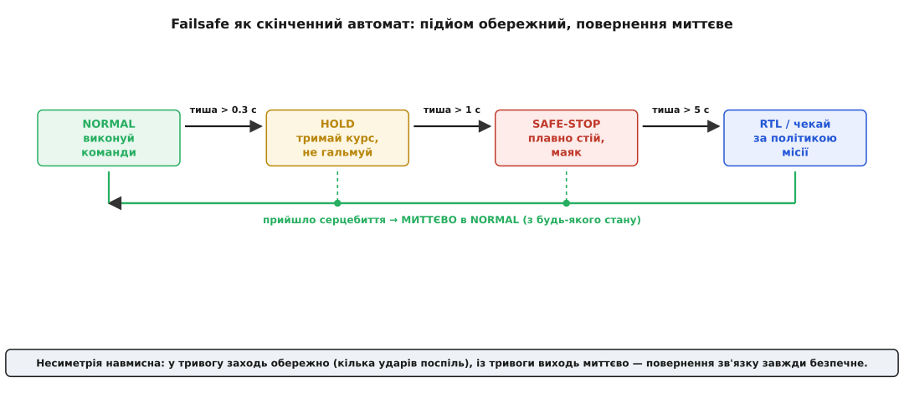
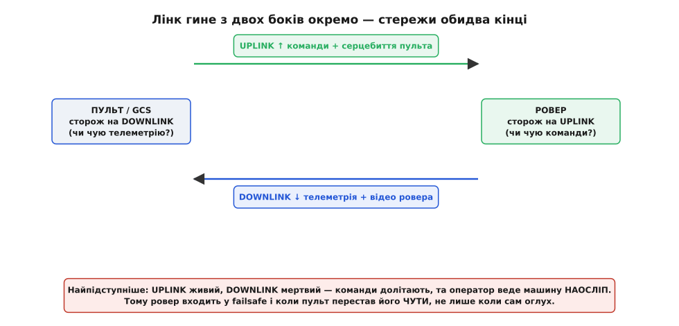

# ⚙️ Failsafe-автомат ровера: код, готовий у прошивку

Ми вже знаємо каркас: у головному циклі крутиться маленька функція, яка за тривалістю тиші вирішує, що робити приводу — слухати оператора, тримати курс, плавно стати чи вертатися. Того скелета досить, щоб зрозуміти **ідею** східчастого failsafe. Але між «зрозуміти ідею» і «покласти в реальну прошивку ровера» лежить купа рішень, кожне з яких легко зробити так, що автомат або **сіпається** між станами на межі тиші, або **гальмує юзом** і губить керованість, або мовчки бреше оператору, що все гаразд, коли пульт давно його не чує. Цей крок — про повний автомат, який можна взяти й прошити: з несиметричними переходами, двобічним сторожем, справжнім гальмуванням рампою, маяком, журналом події та гаком під політику місії.

Домовмося одразу, чого тут **не** буде, щоб не переказувати вже пройдене. Як ровер розуміє, що серцебиття прийшло, і як він міряє тишу за окремим годинником кожного джерела — це робота **детектора присутності**, який ми вже написали для наземної станції; тут ми беремо від нього готове число «скільки триває тиша» й будуємо на ньому машину **дій**. Детектор відповідає на питання «чи чую я?»; наш автомат — на питання «і що тепер робити колесам?». Це два різні шари, і плутати їх — перша ж помилка архітектури.

> 🔗 **Звідки береться «тиша».** Детектор присутності веде для кожного джерела серцебиття окремий годинник останнього удару й повертає, скільки те джерело мовчить, приборкуючи джитер прибуття згладженою оцінкою періоду. Ми беремо від нього готову тривалість тиші в мілісекундах — байти пакета, поле `custom_mode`, розбір HEARTBEAT тут не повторюємо. Той самий код, що гасив мітку на GCS, на борту живить наш автомат.
> [Сторож присутності за HEARTBEAT](root:embedded/mavlink-from-ground/proj-heartbeat-watchdog.md)

> 🔧 **Навіщо це.** Цей автомат — не навчальна вправа, а рівно те, що в бойовій прошивці стоїть між «зв'язок зник» і «машина зробила щось безпечне чи дурне». У ArduPilot Rover він схований за трьома параметрами — `FS_GCS_ENABLE`, `FS_GCS_TIMEOUT`, `FS_ACTION`, — і різниця між «ровер тихо став і чекає» та «ровер наосліп поїхав додому через клумбу» — це саме те, як написаний і як налаштований такий кінцевий автомат. Розібравшись із власним, ти читаєш поведінку чужого як відкриту книгу.

## Чому саме автомат, а не купа `if`-ів

Спокуса написати failsafe розсипом умов велика: «якщо тиша більша за секунду — гальмуй; якщо ще й маяк не горить — увімкни; якщо минуло п'ять секунд — виклич RTL». Рядок тут, рядок там, розкидані по головному циклу. Так пишуть, і так воно ламається — бо втрачається **єдиний власник правди про поточний стан**. За розсипаних умов ніхто не тримає в одному місці факт «ми зараз у SAFE-STOP», і легко потрапити в дірку: маяк уже блимає, а швидкість чомусь іще не скинута, бо та гілка `if` спрацювала, а сусідня — ні. Кінцевий автомат (англ. *finite state machine*, FSM) лікує це коренево: у кожну мить система рівно **в одному** зі скінченного набору станів, і весь код failsafe зводиться до двох чесних питань — «у якому я стані?» і «що дозволяє перехід у сусідній?».

> 🔗 **Що таке кінцевий автомат.** Скінченна множина станів, у кожну мить система рівно в одному; переходи між ними — за визначеними подіями чи умовами. Модель, у якій «пам'ять» системи — це сам поточний стан, а не розсип прапорців. Ми беремо її як готову абстракцію й наповнюємо конкретикою failsafe.
> [Скінченні автомати](root:hw-digital/finite-state-machines)

Наш failsafe має чотири стани, і назви беремо прямо з мови ArduPilot, щоб код читався як реальна прошивка:

```c
typedef enum {
    FS_NORMAL,     // ефір живий: виконуй команди оператора
    FS_HOLD,       // коротка тиша: тримай останній курс, не смикай
    FS_SAFE_STOP,  // довша тиша: плавно в нуль + маяк
    FS_RTL         // зовсім довга: за політикою місії (return-to-launch / чекай)
} fs_state_t;
```

Тепер найважливіше рішення всієї теми, задля якого й варто було затівати автомат: **переходи несиметричні**. Угору по сходинках тривоги машина йде **обережно** — не з першого ж пропущеного удару, а вичекавши кілька поспіль; униз, назад у `NORMAL`, — **миттєво**, за першим же серцебиттям. Ця несиметрія не примха, вона прямо випливає з фізики каналу й фізики машини.


*Чотири стани й несиметричні переходи. Угору (у тривогу) — обережно: кожен наступний стан вимагає, щоб тиша перевалила за свій поріг, тобто кілька пропущених серцебить поспіль. Униз (у NORMAL) — миттєво: перше ж прийняте серцебиття скидає тишу в нуль, і машина з будь-якого стану повертається до звичайного телекерування. Обережний вхід глушить хибні тривоги від поодиноких згублених пакетів; миттєвий вихід безпечний, бо повернення зв'язку не буває «занадто рано».*

Чому вхід обережний? Бо один-два пропущені серцебиття — це **норма** радіоканалу, а не аварія: ефір губить поодинокі пакети, ми це вже приймали як даність. Якби автомат стрибав у `SAFE-STOP` з першого ж пропуску, ровер гальмував би посеред нормальної їзди щоразу, коли в ефір хтось чхнув. Тому в тривогу заходимо, лише впевнившись, що тиша **справжня** — витримала кілька ударів поспіль.

Чому вихід миттєвий? Бо повернення зв'язку **не буває передчасним**. Якщо прийшло серцебиття — джерело живе, крапка; чекати від воскреслого ще й «доказів стабільності», перш ніж віддати кермо операторові, немає сенсу й навіть шкідливо: оператор бачить машину, хоче нею керувати, а вона з незрозумілої причини ще пів секунди його не слухає. Тому щойно тиша обнулилась — ми **вже** в `NORMAL`.

Це і є та сама асиметрія «смерті й життя», що й у детекторі присутності, тільки тепер вона керує не яскравістю мітки, а **колесами**: смерть лінка — це відсутність протягом часу (її треба виждати), життя — присутність у моменті (її досить помітити раз).

## Обережний підйом: лічильник пропущених ударів, а не таймер із голови

Найлобовіший спосіб зробити «обережний вхід» — порівнювати тишу з порогами в мілісекундах, як у скелеті. Він працює, але ховає пастку, про яку ми вже говорили щодо детектора: поріг у голих мілісекундах **не масштабується** з частотою серцебиття. Тому чесніше рахувати підйом у **пропущених ударах**, а не в абсолютному часі — тоді один параметр `beats_to_climb` однаково правильний і для серцебиття на 10 Гц, і для економного на 2 Гц.

Заведімо контекст автомата — усе, що він пам'ятає між тактами:

:::code proj-failsafe-fsm/c/oberezhnyi-pidiom.c

Тепер функція, що з тривалості тиші й періоду серцебиття рахує **цільовий** стан — той, у якому автомат мусить опинитися за такої тиші. Ключове тут — ділення: скільки цілих періодів серцебиття вміщує тиша, стільки ударів ми пропустили.

:::code proj-failsafe-fsm/c/oberezhnyi-pidiom-2.c

Придивись, чому це краще за пороги в мілісекундах. Якщо серцебиття йде на 10 Гц (`hb_period_ms = 100`), то `BEATS_TO_HOLD = 3` дає поріг 300 мс — рівно те число, що ми виписали в скелеті вручну. А якщо на вузькому радіолінку серцебиття свідомо сповільнили до 2 Гц (`hb_period_ms = 500`), той самий `BEATS_TO_HOLD = 3` **сам** дає поріг 1500 мс — бо на повільнішому пульсі три пропущені удари тривають довше, і це правильно. Жорстко вбита «трьохсотка» на такому лінку зчиняла б `HOLD` після кожного першого ж пропуску. Тримаючи поріг у пропущених ударах, ми прив'язуємо тривогу до **ритму джерела**, а не до абсолютного часу.

**Скільки триває підйом за різних частот серцебиття**
```
Серцебиття 10 Гц (період 100 мс):
  HOLD  за 3 удари  = 3 · 100  =  300 мс
  STOP  за 10       = 10 · 100 = 1000 мс = 1.0 с
  RTL   за 50       = 50 · 100 = 5000 мс = 5.0 с   ← збігається з FS_GCS_TIMEOUT ArduPilot

Серцебиття 2 Гц (період 500 мс):
  HOLD  за 3 удари  = 3 · 500  = 1500 мс = 1.5 с
  STOP  за 10       = 10 · 500 = 5000 мс = 5.0 с
  RTL   за 50       = 50 · 500 = 25000 мс = 25 с
```

Зверни увагу на нижній рядок першого блоку: 50 пропущених ударів на 10 Гц — це рівно 5 секунд, стандартний `FS_GCS_TIMEOUT` ровера ArduPilot. Це не збіг — так практика й склалася: кілька секунд тиші — розумний поріг для «пульт справді зник», а не «на мить провалився».

## Миттєвий спуск: чому тут не можна ставити гістерезис

Тепер найтонше місце, де інтуїція з детектора присутності може завести не туди. У детекторі ми **навмисно** ставили гістерезис (гр. *hystéresis* — відставання): поріг «оголосити мертвим» був іншим, ніж поріг «оголосити живим», щоб мітка не блимала на межі. Природний рефлекс — зробити так само й тут: мовляв, хай автомат виходить із `SAFE-STOP` не одразу, а витримавши кілька ударів, щоб не смикатися. **Це була б помилка.** Гістерезис на поверненні тут не потрібен і навіть шкідливий, і варто зрозуміти чому, бо це не самоочевидно.

У детекторі гістерезис лікував **сіпання мітки**: коли серцебиття ледь дотягує на самій межі порогу, прибуваючи то на 3.9, то на 4.1 секунди, детектор без гістерезису блимав би «втрачено / відновлено / втрачено». Але наш автомат влаштований так, що це сіпання **вже неможливе** — і ось чому. Ми не порівнюємо тишу з однією межею, повз яку вона гуляє. Ми беремо **цільовий** стан із `fs_target_state`, і коли приходить серцебиття, тиша не «трохи менша за поріг» — вона стає **нулем**. Немає джитерного тремтіння навколо порогу: є або тиша (росте, автомат обережно повзе вгору), або удар (тиша миттєво в нуль, автомат у `NORMAL`). Проміжного стану «майже прийшло» не існує.

Додати сюди гістерезис на повернення означало б: серцебиття вже прийшло, оператор уже на зв'язку — а машина ще кілька ударів **навмисне його не слухає**, тримаючи `SAFE-STOP`. Кому від цього краще? Нікому. Оператор бачить живу телеметрію, смикає стік — ровер не їде. Це не «стабільність», це **штучна глухота**. Правило просте: **гістерезис ставлять там, де швидке перемикання туди-сюди шкідливе саме собою**; повернення керування оператору не шкідливе ніколи, тож і стримувати його нема потреби.

Отже, спуск робимо голим фактом: **прийшло серцебиття → тиша нуль → цільовий стан `NORMAL` → переходимо негайно**. Уся асиметрія «повільно вгору, миттєво вниз» виходить сама з того, що вгору веде повільно зростаюча тиша, а вниз — стрибок тиші в нуль.

## Два сторожі: ровер може оглухнути, а може й осліпнути

Досі ми мовчки припускали, що failsafe стереже **один** бік — «чи чую я команди?». Але лінк гине з двох кінців окремо, і другий випадок підступніший за перший. Розкладімо.

**Uplink** (висхідний канал, англ. *up* — вгору) несе команди й серцебиття пульта **на** ровер. Сторож uplink живе **на ровері** й питає: «чи долітають до мене команди?». Якщо ні — це класика, з якої ми починали: ровер оглух, слухати нікого, вступає наш автомат.

**Downlink** (низхідний, англ. *down* — вниз) несе телеметрію й відео **з** ровера на пульт. І ось тонкість: downlink може впасти, коли uplink **живий**. Команди з пульта долітають до ровера чудово — а от картинка й телеметрія назад не доходять. Ровер слухається, але оператор веде його **наосліп**: не бачить ні дороги, ні швидкості, ні того, куди взагалі їде. Формально зв'язок «є» — команди ж ідуть, — а по суті керувати машиною так само небезпечно, як і зовсім без зв'язку.


*Два канали, два сторожі, і найпідступніший — правий випадок. Uplink несе команди й серцебиття пульта на ровер; сторож uplink на ровері питає «чи чую команди?». Downlink несе телеметрію й відео на пульт; сторож downlink на пульті питає «чи чую відповідь ровера?». Найнебезпечніше: uplink живий, downlink мертвий — ровер слухняно виконує команди, але оператор веде його наосліп. Тому ровер входить у failsafe і коли пульт перестав його ЧУТИ, не лише коли сам оглух.*

Як ровер узагалі дізнається, що **пульт** його не чує? Сам він цього безпосередньо не бачить — downlink іде від нього, а не до нього. Тому пульт бере це на себе: він теж веде власний сторож downlink («чи приходить телеметрія від ровера?»), і коли вона зникає, пульт **перестає слати серцебиття** сам. Тоді на ровері замовкає uplink — і наш звичний сторож uplink спрацьовує вже за це. Тобто пульт перетворює свою «сліпоту» на «тишу», яку ровер уміє ловити. Це елегантно: не треба вигадувати окремий канал «пульт скаржиться, що осліп» — досить, щоб осліплий пульт **замовк**, і двобічна проблема зводиться до однобічної, яку автомат уже вміє розв'язувати.

Але є випадок, коли й цього замало: **асиметричний лінк**, де uplink і downlink фізично різні (типово так і є — команди по вузькому живучому RC-каналу, відео по товстому цифровому). Тоді downlink може впасти, а uplink — жити далі, і серцебиття пульта **долітає** до ровера, хоч оператор давно осліп. Пульт замовк би, якби здогадався, — але якщо його прошивка цього не робить, ровер лишається слухняним поводирем для сліпого. Тому надійна прошивка ровера тримає **обидва** сторожі й ловить ще й цей випадок сама: якщо ровер **давно не отримував підтвердження**, що його телеметрію чують (наприклад, пульт періодично шле квитанцію «бачу тебе»), — ровер теж підіймає тривогу, бо вести машину, якої оператор не бачить, небезпечно незалежно від того, чи йдуть команди.

Зведімо обидва сторожі в один вирок. Автомат бере тишу **гіршого** з двох каналів — того, що мовчить довше:

:::code proj-failsafe-fsm/c/dva-storozhi-rover-mozhe.c

Логіка проста й безжальна: **досить, щоб замовк хоч один** канал — і машина в тривозі. Оглухла (немає команд) чи осліпла (немає підтвердження, що її бачать) — обидва випадки однаково небезпечні для машини, якою керує людина здалеку, тож обидва ведуть у той самий східчастий failsafe.

## Плавний стоп: рампа проти юзу

`SAFE-STOP` каже «зупинись», але **як** зупинитися — окреме інженерне питання, і наївне «мотори в нуль» тут неправильне. Різкий обрив тяги на ходу означає, що ведучі колеса миттєво перестають штовхати, машина за інерцією котиться, а якщо це ще й гальмування — колеса зриваються в **юз** (проковзування замість кочення). Юз — це втрата керованості: машина в заносі не слухається керма, важкий ровер може розвернути чи перекинути. Тому швидкість скидаємо **рампою** (плавним схилом) — за кілька десятих секунди, а не миттю.

Рампа — це просто обмеження, наскільки швидкість може змінитися **за один такт** циклу. Якщо ціль — нуль, а зараз їдемо швидко, ми не стрибаємо в нуль, а віднімаємо від поточної швидкості фіксований крок щотакту, аж поки дійдемо до нуля. Крок задає **темп гальмування** (прискорення сповільнення).

:::code proj-failsafe-fsm/c/plavnyi-stop-rampa-proty.c

Порахуймо, скільки триває така зупинка. Хай ровер їхав 2 м/с і `BRAKE_DECEL = 2.0` м/с за секунду.

**Час і шлях плавної зупинки з 2 м/с**
```
темп гальмування a = 2.0 м/с²
початкова швидкість v = 2.0 м/с

час до нуля:  t = v / a = 2.0 / 2.0 = 1.0 с
шлях за цей час (рівносповільнено): s = v² / (2a) = 4.0 / 4.0 = 1.0 м
```

Ровер стане за секунду, проїхавши метр плавним, керованим гальмуванням — без заносу, без ривка. Порівняй з миттєвим «мотори в нуль»: там шлях коротший, але ціною зриву в юз, коли важка машина по інерції йде боком і некерована. Метр рівного гальмування майже завжди краще за різкий занос.

> 🔧 **Навіщо це.** Темп `BRAKE_DECEL` — не константа з голови, а рішення під **зчеплення й масу** конкретної машини. Легкий ровер на гумі по асфальту стерпить різке гальмування; важкий на слизькому ґрунті зірветься в юз навіть за помірного. Правило: гальмуй настільки різко, наскільки колеса ще **котяться, а не ковзають**. Занадто плавно — машина довго повзе, перш ніж стати (небезпечно, якщо попереду перешкода); занадто різко — занос. Золота середина залежить від покриття, і в серйозних роверах її навіть підлаштовують на льоту за проковзуванням коліс.

## Маяк і журнал: машина стала — тепер про це треба сказати

Ровер зупинився посеред дороги — і став **нерухомою перешкодою**, про яку варто попередити тих, хто поряд. Тому `SAFE-STOP` вмикає **маяк** (світловий чи звуковий сигнал), а `NORMAL` його гасить. Це проста, але важлива дія: німо застигла машина небезпечніша за ту, що блимає «я тут, я стою».

Друге, що конче потрібне при спрацюванні failsafe, — **журнал події** з міткою часу й координатами. Без нього після повернення ровера ти не дізнаєшся, **де саме** й **коли** він втратив зв'язок — а це перше, що питають, коли машина «раптом стала посеред поля». Запис має лягати в незалежну від живлення пам'ять, щоб пережити навіть повне вимкнення.

:::code proj-failsafe-fsm/c/maiak-i-zhurnal-mashyna.c

Формат координат `1e-7` градуса — не примха, а прямий формат позиції в MAVLink і ArduPilot: широта й довгота там цілими числами в десятимільйонних частках градуса (щоб не тягати дробові типи в протоколі). Беручи той самий формат, ми пишемо в журнал рівно те, що вже маємо від GPS, без зайвих перетворень.

> 🔧 **Навіщо це.** Журнал failsafe — це «чорна скринька» ровера. Коли машина повертається (сама чи її приносять), перше питання завжди: що сталося? Мітка часу відповідає «коли», координати — «де», `reason` — «оглух чи осліп». Без цих трьох полів кожна втрата зв'язку лишається загадкою, а з ними ти будуєш карту мертвих зон і бачиш, де саме на маршруті лінк слабкий. У серйозних апаратах цей запис іде і в бортовий лог, і окремим повідомленням на пульт — щоб оператор дізнався причину, навіть коли відео вже впало.

## Гак під політику місії: Hold, RTL чи повернення власним слідом

Стан `FS_RTL` — найцікавіший, бо тут failsafe перестає бути пасивним «стій і чекай» і може стати **активним**. Але що саме робити — не властивість автомата, а **політика місії**: одна й та сама машина в різних задачах має поводитися по-різному. Тому автомат не зашиває дію намертво, а викликає **гак** (англ. *hook* — точка розширення), за яким ховається обрана політика. У ArduPilot Rover цей вибір і є параметр `FS_ACTION`.

Розберімо три головні політики, бо в них закладена справжня інженерна думка про ризик.

**Hold — просто стій і чекай (`FS_ACTION = 2`).** Найбезпечніша, і для ровера майже завжди правильна. Машина вже зупинилася в `SAFE-STOP`; `Hold` означає — так і стій, доки оператор не повернеться чи не прийде хтось. Для наземної машини це чесний вихід: вона нікуди не падає, стояти може скільки завгодно, а будь-яка активна дія наосліп ризикованіша за бездіяльність. Розвідник у чужому дворі хай краще стоїть, ніж кудись їде.

**RTL — повертайся до точки старту прямою (`FS_ACTION = 1`).** Return-to-launch: ровер сам їде до збереженої точки зльоту (де його ввімкнули чи де останній раз був зв'язок). Проблема очевидна: **пряма** траса «додому» може вести через усе, що між роботом і домом, — паркан, канаву, людей. Для коптера RTL природний (він летить поверх перешкод), для ровера — небезпечний, бо машина повзе по землі й наосліп протаранить усе на прямій. Тому чистий RTL на ровері вмикають лише там, де відомо, що дорога назад **вільна** (відкрите поле, порожній двір).

**SmartRTL — повертайся власним записаним слідом (`FS_ACTION = 3`).** Ось де найрозумніша ідея. Замість перти навпростець, ровер вертається **тим самим шляхом, яким приїхав** — бо цей шлях він щойно проїхав, отже, той прохідний. Для цього прошивка весь час веде «хлібні крихти» (англ. *breadcrumbs*): у буфер лягають точки пройденого шляху. Щоб буфер не розпух, точки прорідж`ують — прямі ділянки лишають двома кінцями, а петлі (коли ровер повернувся сам до себе) взагалі викидають, бо їх не треба переповзати. При failsafe машина розмотує цей слід назад — і гарантовано йде прохідним коридором, а не невідомістю.

:::code proj-failsafe-fsm/c/hak-pid-polityku-misii.c

Зверни увагу на **ланцюг відкату** в `SMART_RTL`: спершу пробуємо слід, не вийшло — пряма RTL, не вийшло й це — просто стоїмо. Це не перестраховка, а точне віддзеркалення реальності: слід SmartRTL може бути недоступний (буфер переповнився й «SmartRTL deactivated» — таке буває на довгих маршрутах, бо пам'ять під точки скінченна) або порожній (ровер щойно ввімкнули й нікуди не їхав). У такому разі валитися нікуди — треба чесно взяти наступну за безпекою дію, а найбезпечніша завжди одна: **стояти**. Саме так і влаштовані `FS_ACTION = 3` і `4` у ArduPilot — «SmartRTL, а якщо не вийде — RTL» і «SmartRTL, а якщо не вийде — Hold».

> 🔗 **Дрон робить те саме, але дорожче.** У повітряного апарата така сама машина failsafe, але її «безпечний стан» не статичний: коптер не може «просто стояти» — він або активно висить, або сідає, або летить RTL поверх перешкод. Через це в дрона failsafe складніший і критичніший: кожна секунда тиші й кожне рішення можуть коштувати апарата. Наземний варіант, який ми пишемо, — полегшена рідня: та сама логіка станів, але з дешевим і надійним «стій» замість дорогого «утримайся в повітрі».
> [Автономна система: машина failsafe](root:embedded/autonomous-system/proj-failsafe-state-machine.md)

## Усе разом: один такт автомата

Тепер зберімо частини в єдину функцію `fs_update`, яку головний цикл прошивки кличе щотакту. Вона робить рівно чотири речі по порядку: бере тишу гіршого каналу, рахує цільовий стан, за потреби виконує **побічні дії переходу** (маяк, журнал, старт політики) і застосовує до приводу поведінку **поточного** стану.

:::code proj-failsafe-fsm/c/use-razom-odyn-takt.c

Розділення на «дії переходу» й «поведінку стану» — не косметика, а суть чистого автомата. **Дії переходу** (журнал, перемикання маяка, старт RTL) мусять статися **рівно раз** — у мить зміни стану; якби вони жили в `switch` поточного стану, ми б писали в журнал і перезапускали RTL **щотакту**, поки сидимо в `FS_RTL`, — сотні разів на секунду. **Поведінка стану** (рампа, hold, слухати оператора), навпаки, має виконуватися **щотакту**, поки ми в цьому стані. Плутати ці дві категорії — типова хвороба саморобних автоматів: або одноразова дія повторюється щоцикл, або тактова дія виконується лише раз і машина застигає.

І зверни, як природно тут вийшла несиметрія. Угору автомат повзе через те, що `silent` повільно росте й `fs_target_state` віддає дедалі вищий стан. Униз — миттєво: прийшло серцебиття, детектор обнулив `silent`, `fs_target_state` повернув `FS_NORMAL`, і на тому ж такті ми там. Жодного окремого коду «повертайся швидко» ми не писали — асиметрія народилася сама з того, що тиша росте поступово, а обнуляється стрибком.

## Складність і пастки: де це ламається насправді

Код невеликий, але кожна з його неочевидностей — реальна відмова, яку ловлять на стенді, а не вигадана. Пройдімося.

**Пастка 1: частота серцебиття не узгоджена з порогом детекції.** Це найтихіша й найпідступніша. Пороги `BEATS_TO_HOLD/STOP/RTL` рахуються з **періоду серцебиття**, і якщо прошивка думає, що серцебиття йде на 10 Гц, а насправді пульт шле його на 1 Гц, усі пороги розтягуються вдесятеро: `SAFE-STOP`, що мав спрацювати за секунду, спрацює за десять — і ровер десять секунд наосліп котитиметься після втрати зв'язку. Дзеркальна біда — думати, що серцебиття рідше, ніж є: тоді `HOLD` зчинятиметься на кожному нормальному пропуску. **Лік:** брати період не з віри, а з **виміряної** детектором оцінки (він уточнює її щоударом) — і тоді пороги самі підлаштовуються під справжній ритм. Ніколи не хардкодь період серцебиття окремо від того, що реально приходить.

**Пастка 2: гістерезис на поверненні.** Ми вже розібрали її докладно, але вона варта повтору серед пасток, бо спокуса «зробити як у детекторі» велика. У детекторі присутності гістерезис доречний (він гасить блимання мітки на джитерній межі); у нашому автоматі — шкідливий, бо повернення керування оператору не буває передчасним, а сіпання тут неможливе за побудовою (тиша або росте, або стрибає в нуль — навколо порогу вона не гуляє). Додаси гістерезис на спуск — отримаєш машину, що кілька ударів **навмисне глуха** до вже присутнього оператора. **Лік:** спуск завжди миттєвий, за першим же серцебиттям.

**Пастка 3: переповнення лічильника тиші (uint32).** Тиша приходить як різниця `now_ms - last_hb_ms`, і обидва — 32-бітні мілісекундні лічильники від старту. Такий лічильник **переповнюється** приблизно кожні 49.7 доби (`2³² мс ≈ 49.7 діб`) і стрибає з ~4.29 млрд у нуль. Якби десь у ланцюгу хтось написав наївне порівняння `now > last_hb + threshold`, у мить переповнення воно збрехало б — і failsafe спрацював би на рівному місці, «оголосивши» тишу там, де її нема (або навпаки — проґавивши справжню). Рятує те, що ми всюди тримаємо час у формі **беззнакового віднімання** `now - then`: арифметика за модулем 2³² сама «загортається» й дає правильну різницю навіть через переповнення.

**Різниця часу в мить переповнення 32-бітного лічильника**
```
last_hb_ms = 4 294 967 000   (за ~296 мс до переповнення)
now_ms     =           200   (лічильник уже загорнувся)

наївно:  now < last_hb  →  «час пішов назад?!» — хибний висновок,
         тиша порахувалась би величезною → хибний failsafe
модуль:  (200 − 4 294 967 000) mod 2³²
       =  200 + (2³² − 4 294 967 000)
       =  200 + 296  =  496 мс   ← правильна тиша
```

Тобто тиша всього 496 мс, і автомат це бачить вірно, попри те що «числа» пішли назад. Це те саме правило, що рятувало детектор присутності від масової хибної «смерті» раз на 50 діб; тут воно рятує ровер від хибного гальмування. І та сама вимога: час має бути **монотонним** (`millis()` від старту), а не годинником реального часу, який можна перевести — інакше корекція часу дасть безглузду різницю й фальшивий failsafe.

**Пастка 4: побічні дії переходу в тактовому коді.** Якщо покласти `fs_log_transition` чи `fs_enter_policy` у `switch` поточного стану, вони виконуватимуться **щотакту**, поки автомат сидить у `FS_RTL`: журнал забʼється тисячами однакових записів за секунду, а `mission_rtl_start` перезапускатиметься без кінця, ніколи не даючи маршрутові початися. **Лік** — той, що в коді: одноразові дії строго під `if (next != fs->state)`, тактові — у `switch (fs->state)`.

**Пастка 5: гальмування різким нулем.** Спокуса написати `drive_set_speed(0)` у `SAFE-STOP` замість рампи. На кроковій швидкості зійде, на повній — зрив у юз, занос, у важкої машини перекидання. **Лік** — рампа `ramp_to_stop` із темпом під зчеплення й масу; гальмуй настільки різко, наскільки колеса ще котяться, а не ковзають.

**Пастка 6 (поза брифом, але поряд): активна дія небезпечніша за бездіяльність.** Найтонша інженерна пастка — не в коді, а в налаштуванні. Спокуса поставити `FS_ACTION = RTL` «щоб робот сам повертався» на машині, чия дорога назад невідома, обертається тим, що ровер при втраті зв'язку наосліп протаранить усе на прямій до дому. **Правило:** failsafe мусить робити машину **безпечнішою за бездіяльність**, а не навпаки. Сумніваєшся, чи не нашкодить активна дія, — не роби її: для ровера чесний і майже завжди правильний вихід — просто стояти (`Hold`). Активний RTL вмикай лише там, де дорога назад справді вільна, а ще краще — SmartRTL, що йде вже перевіреним власним слідом.

Прив'яжімо все до реального ArduPilot Rover, щоб цей автомат не лишався абстракцією. `FS_GCS_ENABLE` — це наш вимикач: `0` глушить сторож GCS зовсім, `1` вмикає його з дією `FS_ACTION`, `2` дозволяє далі виконувати місію в режимі Auto, ігноруючи тривогу. `FS_GCS_TIMEOUT` (типово **5 секунд** без серцебиття) — це наш поріг входу в активну дію, той самий `BEATS_TO_RTL × період`. А `FS_ACTION` — це наш `fs_enter_policy`: `0` = нічого, `1` = RTL, `2` = Hold, `3` = SmartRTL-або-RTL, `4` = SmartRTL-або-Hold. Окремо живе радіоканальний failsafe за `FS_THR_VALUE` — коли падає рівень самого RC-каналу газу; це той самий підхід, лише сторож стереже не серцебиття по MAVLink, а рівень радіоканалу. Тобто три-чотири рядки налаштувань у ArduPilot — це рівно той кінцевий автомат, який ми щойно написали руками; знаючи його зсередини, ти читаєш чужу конфігурацію як власний код і бачиш наперед, що ровер зробить, коли ефір змовкне.

Зрештою, уся ця складність рівно така, якою її робить природа задачі. Failsafe не можна написати розсипом умов (бо губиться власник стану), ні входити в нього з першого пропуску (бо канал губить поодинокі пакети), ні виходити повільно (бо оператор уже на зв'язку), ні гальмувати різко (бо юз), ні стерегти один бік (бо машина може й осліпнути, не лише оглухнути), ні активно рушати наосліп (бо стояти безпечніше). Кожен шматок коду відповідає одній із цих істин — не більше й не менше. Автомат, що враховує всі, можна взяти й покласти в прошивку ровера: він не сіпнеться на поодинокому пропуску, не поїде наосліп і не збреше про живий зв'язок, коли той давно мертвий, — а це рівно те, заради чого східчастий failsafe узагалі існує.
