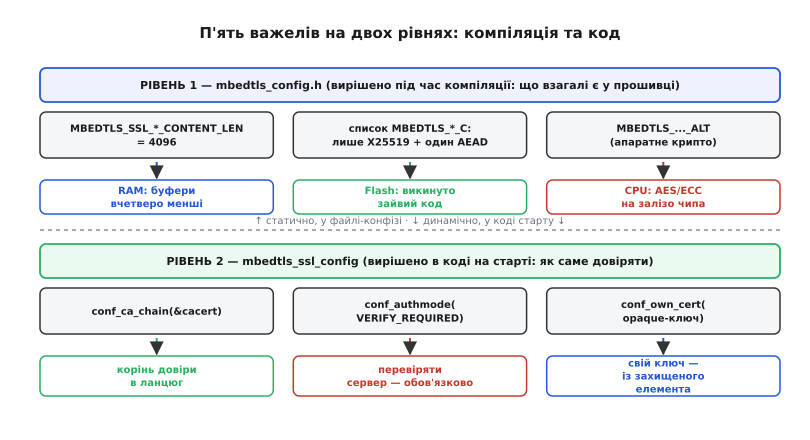
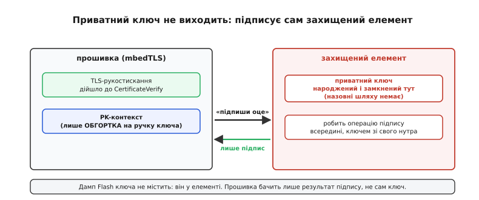

# ⚙️ Підганяємо mbedTLS під тісний чип: від голого конфігу до робочого клієнта

Ми вже розібрали, **що** робить mbedTLS і **чому** їй тісно: чотири тиски — RAM, Flash, CPU, сховище ключів — і чотири важелі, що ці тиски послаблюють. Ми навіть бачили дві критичні лінії коду: `mbedtls_ssl_conf_ca_chain` і `mbedtls_ssl_conf_authmode(VERIFY_REQUIRED)`. Але між «розумію важелі» і «в мене на столі лежить прошивка, що влазить у чип і не має дірки» — ще ціла інженерна дистанція. Цей практикум її й проходить: беремо порожній проєкт, доводимо його до робочого TLS-клієнта на мікроконтролері й на кожному кроці смикаємо потрібний важіль руками, дивлячись, що саме він віддає й де підстерігає пастка.

Задача поставлена вузько й реалістично, як воно й буває на пристрої. Є чип із мережею — скажімо, щось на ARM Cortex-M4 із кількасот кілобайтами RAM, — і треба, щоб він раз на хвилину прокидався й слав на **конкретний** сервер у хмарі один короткий пакет телеметрії по TLS. Сервер один і той самий, наш власний, ми знаємо наперед, який CA видав його сертифікат. Пакет маленький — джейсон на кількадесят байтів. І бюджет пам'яті гострий: TLS-з'єднання не сміє з'їсти більш ніж десяток-другий кілобайтів, бо решта RAM зайнята застосунком. Усе, що ми робитимемо далі, підпорядковане цій одній меті — **влізти й не збрехати**: помістити захищену розмову в тісний бюджет, не втративши жодної з трьох гарантій.

Ідея підганяння в одному реченні така: **вимкнути все, чого цей конкретний сценарій не потребує, і ввімкнути рівно те, що він потребує** — а тоді ще й правильно з'єднати. І ключова тонкість, яку варто вкарбувати перше, ніж писати бодай рядок: важелі живуть на **двох різних рівнях**, і сплутати їх — типова причина того, чому «я ж усе налаштував, а воно не економить» або «я ж усе ввімкнув, а воно не лінкується».

## Два рівні, на яких крутяться важелі

Частина важелів вирішується під час **компіляції** — у конфігураційному файлі бібліотеки. Це рівень «що взагалі є у прошивці»: скільки місця бібліотека зарезервує під буфери запису, які шифри й криві вона вміє **в принципі**, чи підставляти замість програмного крипто апаратне. Ці рішення фіксуються у файлі `mbedtls_config.h` (у ESP-IDF його роль грає `esp_config.h` плюс пункти `menuconfig`), і після компіляції їх уже не змінити — вони запечені в бінарник. Викинув шифр звідси — його коду в прошивці немає **фізично**, і Flash звільнено назавжди.

Інша частина важелів вирішується в **коді**, під час старту застосунку — через структуру `mbedtls_ssl_config`, яку ви заповнюєте викликами `mbedtls_ssl_conf_*`. Це рівень «як саме довіряти в цьому з'єднанні»: який кореневий сертифікат покласти в ланцюг довіри, чи вимагати перевірку сервера, який власний сертифікат показати, який зі **скомпільованих** шифрів реально запропонувати. Ці рішення динамічні — їх можна зробити різними для різних з'єднань в одній прошивці.

Різниця не косметична, і плутанина тут дорога. Не можна в коді «ввімкнути» шифр, якого нема у збірці, — `mbedtls_ssl_conf_ciphersuites` вибирає **лише з того, що скомпільовано**; якщо потрібний AEAD вимкнено в `config.h`, жодний виклик у коді його не оживить. І навпаки: викинути шифр **тільки** в коді, лишивши його у збірці, — це не звільнить ані байта Flash, бо код усе одно лежить у прошивці, просто не використовується. Flash економлять **на рівні компіляції**; вибирають, чим саме говорити в цьому з'єднанні, — **на рівні коду**. Обидва рівні потрібні, і кожен важіль лягає на **свій**.


*П'ять важелів на двох рівнях. Угорі — статичний рівень компіляції (`mbedtls_config.h`): розмір буфера запису під RAM, список скомпільованих шифрів і кривих під Flash, підстановка апаратного крипто під CPU. Унизу — динамічний рівень коду (`ssl_config`): корінь довіри в ланцюг, обов'язкова перевірка сервера, власний ключ із захищеного елемента. Плутати рівні — типова причина «налаштував, а не економить» (крутив код там, де треба компіляцію) чи «увімкнув, а не лінкується» (просив у коді те, чого нема у збірці).*

Пройдімо тепер обидва рівні по черзі, важіль за важелем, з реальним кодом. Спершу — рівень компіляції: скроїмо саму збірку.

## Рівень компіляції: кроїмо збірку під бюджет

### Важіль RAM: максимальна довжина вмісту запису

Найбільша окрема економія пам'яті, як ми рахували, — зменшити буфери запису. За стандартом TLS-запис несе до 2¹⁴ = 16384 байтів корисного вмісту, і бібліотека за замовчуванням резервує вхідний та вихідний буфери саме під цю стелю — разом близько 32 КБ лише на два буфери. Наш пакет — кількадесят байтів; тримати під нього 16-кілобайтовий буфер безглуздо.

У `mbedtls_config.h` за розмір буферів відповідає макрос `MBEDTLS_SSL_MAX_CONTENT_LEN`. Задавши його меншим, ми відразу підрізаємо **обидва** буфери:

```c
// mbedtls_config.h — рівень компіляції.
// стеля вмісту запису: не 16 КБ, а 4 КБ. Вхідний і вихідний буфери
// падають з ~16 до ~4 КБ кожен → мінус ~24 КБ RAM на з'єднання.
#define MBEDTLS_SSL_MAX_CONTENT_LEN   4096
```

Одне число — і найбільший з'їдач пам'яті стиснувся вчетверо. Але тут-таки є тонкість, яку варто знати, бо вона рятує RAM ще краще. Починаючи з mbedTLS 2.13, вхідний і вихідний буфери можна задати **нарізно** — макросами `MBEDTLS_SSL_IN_CONTENT_LEN` і `MBEDTLS_SSL_OUT_CONTENT_LEN`; кожен, якщо його не визначити, успадковує значення від `MBEDTLS_SSL_MAX_CONTENT_LEN`. Навіщо різнити? Бо два боки з'єднання **несиметричні за розміром**. Пристрій **шле** крихітний джейсон — вихідний буфер може бути зовсім малим. А **приймає** він відповідь сервера й, головне, **його сертифікат** під час рукостискання — а ланцюг сертифікатів легко тягне на 3–5 КБ, і вхідний буфер мусить цей ланцюг вмістити цілком, бо перевірити «половину» сертифіката не можна.

```c
// точніше під несиметричний трафік: приймаємо сертифікат сервера (кілька КБ),
// а шлемо крихітний джейсон. Тому вхідний більший за вихідний.
#define MBEDTLS_SSL_IN_CONTENT_LEN    4096   // вмістити ланцюг сертифікатів сервера
#define MBEDTLS_SSL_OUT_CONTENT_LEN   1024   // нашого пакета телеметрії досить
```

Ось де ховається **перша типова пастка**, і вона не теоретична — на ній зависають реальні прошивки. Якщо `OUT_CONTENT_LEN` поставити **менше**, ніж найбільше повідомлення, яке ваш застосунок шле, це повідомлення просто **не влізе** в запис і не піде — а якщо його **вхідне** повідомлення від сервера більше за `IN_CONTENT_LEN`, рукостискання чи прийом даних обірветься помилкою, яку легко не зв'язати з причиною. Симптом підступний: маленькі пакети ходять, а на якомусь більшому (довший HTTP-заголовок, товщий MQTT-пакет, той-таки ланцюг сертифікатів від іншого сервера) з'єднання раптом «ламається без причини». Тому стелю кроять **не наосліп до найменшого**, а рівно під **найбільше** повідомлення обох напрямків вашого прикладного протоколу — з невеликим запасом. Ужали 4 КБ там, де сервер шле ланцюг на 5 КБ, — дістали загадковий збій, що з'являється лише з певними серверами.

> 🔧 **Навіщо це.** Це той рідкісний важіль, де можна одним числом виграти чверть усього бюджету RAM — і одним же числом тихо покалічити застосунок. Правило просте й залізне: спершу дізнайтеся, який **найбільший** пакет ходить у кожен бік (сертифікат сервера рахується!), а тоді ставте стелю трохи вище за нього, а не «якнайменше, щоб економніше». Пам'ять, зекономлена нижче за розмір вашого найбільшого повідомлення, — це не економія, а міна вповільненої дії.

Практичний нюанс, який ми вже згадували в темі й тут лише підтвердимо ділом: у mbedTLS історично реалізований старший механізм узгодження стелі — розширення `max_fragment_length` (значення 512/1024/2048/4096), а не новіший `record_size_limit`. Тому в конфігурації бібліотеки цей самий важіль і зветься «максимальною довжиною вмісту запису», і крутите ви саме ці дискретні значення. На боці коду відповідне узгодження вмикається окремим викликом (`mbedtls_ssl_conf_max_frag_len`), але суть та сама — і потолок, і буфери йдуть у ногу.

### Важіль Flash: лишити рівно потрібне крипто

Тепер Flash. Кожен алгоритм, який бібліотека **вміє**, — це код у прошивці. Повна збірка тягне десяток кривих, кілька AEAD-шифрів, старі режими, зайві геші — усе це мертвий вантаж, коли з'єднання завжди йде **одним** набором. Наш сервер підтримує TLS 1.3 і сучасний AEAD; припустимо, чип має апаратний AES — тоді нам досить **одного** шифру (AES-GCM) і **однієї** кривої (X25519). Решту викидаємо на рівні компіляції, вимикаючи відповідні макроси `MBEDTLS_..._C`:

:::code proj-mbedtls-tuning/c/vazhil-flash-lyshyty-rivno.c

Виграш тут двоякий, і другий бік важливіший за перший. Очевидний бік — **звільнений Flash**: різниця між повною й підрізаною збіркою легко сягає десятків кілобайтів. Менш очевидний, але цінніший — **менше коду, у якому може ховатися вада**. Кожна реалізація, якої у збірці немає, — це нуль потенційних помилок у ній, нуль уразливостей, які колись знайдуть саме в тому шматку. Обрізати TLS до одного набору — це не лише про місце, а й про **зменшення поверхні атаки**: чого немає, те не зламати.

Тут же ховається **друга пастка**, дзеркальна до першої: викинути **забагато**. Якщо сервер під час рукостискання запропонує криву чи підпис, яких у вашій збірці **немає**, з'єднання просто не встановиться — і в кращому разі ви побачите помилку про «немає спільного набору», а в гіршому — HelloRetryRequest, зайвий оберт і повільне з'єднання (пригадаймо: списки кривих клієнта й сервера мають перетинатися **першою** позицією). Тому кроїмо не «навмання до мінімуму», а рівно під те, що **цей конкретний сервер реально вживає**: подивіться його сертифікат (яким підписом і якою кривою) й лишіть саме їх. Викинули X25519, а сервер лише на ній, — і клієнт мовчки не з'єднається ні з ким.

### Важіль CPU: підставити апаратне крипто

Третій компіляційний важіль — перекинути важку арифметику з програмної реалізації на **апаратний** блок чипа. Механізм тут елегантний і його варто розуміти, а не вмикати наосліп. mbedTLS передбачає **підстановні** реалізації: якщо визначити макрос на кшталт `MBEDTLS_AES_ALT`, бібліотека під час компіляції **замінює** свої програмні функції (`mbedtls_aes_init` та інші) на функції з окремого заголовка порту, які звертаються вже до заліза. Для ESP32, наприклад, це робиться пунктами `menuconfig`, які під капотом і вмикають ці `..._ALT`:

```c
// ESP-IDF: у menuconfig (Component Config → mbedTLS → Hardware Acceleration)
// вмикаємо апаратні блоки. Під капотом це вмикає MBEDTLS_AES_ALT тощо —
// і mbedtls_aes_init стає esp_aes_init, що йде на крипто-акселератор чипа.
CONFIG_MBEDTLS_HARDWARE_AES=y     // AES — на апаратний блок
CONFIG_MBEDTLS_HARDWARE_SHA=y     // SHA — на апаратний блок
CONFIG_MBEDTLS_HARDWARE_MPI=y     // велика арифметика (RSA/ECC) — на блок MPI
CONFIG_MBEDTLS_HARDWARE_ECC=y     // операції на кривій — на апаратний ECC (де є)
```

Ефект прямий: рукостискання, що на голому ядрі тривало сотні мілісекунд, з апаратним AES і апаратною великою арифметикою падає до десятків. Для пристрою, що прокидається на частку секунди, це різниця між «розігрів каналу з'їв половину часу неспання» і «розігрів майже непомітний» — а отже, і різниця в заряді батареї.

Тут доречно згадати наскрізну розвилку, яку ми вивели в темі, бо саме на компіляції вона й вирішується. **Є апаратний AES → лишаємо AES-GCM** (як вище). **Немає апаратного AES → лишаємо натомість ChaCha20-Poly1305**, бо вона на голому цілочисловому ядрі помітно швидша за програмний AES-GCM. На чипі без крипто-акселератора той самий блок `config.h` виглядав би інакше: замість `MBEDTLS_GCM_C`+`MBEDTLS_AES_C` стояли б `MBEDTLS_CHACHAPOLY_C`+`MBEDTLS_CHACHA20_C`, а `..._ALT` не було б зовсім. Важіль CPU і важіль Flash тут переплетені: вибір шифру одночасно і що покласти у Flash, і що дасть найкращий CPU.

Компіляційний рівень готовий: буфери підрізані, крипто скроєне під сервер, залізо ввімкнене. Тепер — рівень коду, де ми зберемо з цієї збірки робочий захищений клієнт.

## Рівень коду: збираємо клієнта, що справді тримає

Тепер найголовніше — той рівень, де народжується або **гине** безпека. Порядок дій у mbedTLS завжди один і той самий каркас: ініціалізувати структури → завантажити кореневий сертифікат → заповнити конфіг (перевірка, ланцюг, шифри) → зв'язати конфіг із сесією (`mbedtls_ssl_setup`) → з'єднатися й провести рукостискання. Пройдімо цей каркас цілком, реальним кодом, коментуючи **кожне** рішення, бо диявол саме в дрібницях.

### Крок 1: кореневий сертифікат у ланцюг довіри

Почнімо з того, на чому все тримається, — кореня довіри. Сертифікат нашого CA зашитий у прошивку як масив байтів (у форматі PEM — текстовому, «----BEGIN CERTIFICATE----…»). Його треба **розібрати** в структуру `mbedtls_x509_crt` і потім віддати конфігу як ланцюг довіри:

:::code proj-mbedtls-tuning/c/krok-1-korenevyi.c

Зверніть увагу на два коментарі-пастки, бо обидва трапляються постійно. Перший — про **довжину PEM**: `mbedtls_x509_crt_parse` розрізняє PEM і DER саме за наявністю текстових меж, і щоб її помітити, функції треба передати довжину **разом із завершальним нулем**. Забули додати одиницю до `strlen` — і бібліотека не впізнає PEM, спробує розібрати його як двійковий DER, спіткнеться й лишить ланцюг **порожнім**. Другий — про **перевірку `ret`**: якщо не перевірити код повернення й піти далі з порожнім `cacert`, ви зберете «захищений» клієнт, у якого перевіряти сервер **нічим**, — а поводитиметься він майже нормально, доки хтось не підставить самозванця.

### Крок 2: конфіг — обов'язкова перевірка й ланцюг довіри

Тепер серце практикуму. Заповнюємо `mbedtls_ssl_config`: спершу розумні типові значення для клієнта, тоді — **обов'язкова** перевірка сервера, тоді — той самий ланцюг довіри. Порядок цих двох рядків і є вся різниця між замком, що тримає, і замком, що лише зачиняється.

:::code proj-mbedtls-tuning/c/krok-2-konfih-oboviazkova.c

Розгляньмо рядки 3 і 4 пильно, бо це — **та сама** розвилка, що й у темі, лише тепер із повним контекстом навколо. `MBEDTLS_SSL_VERIFY_REQUIRED` каже: без чинного, звіреного до нашого кореня сертифіката сервера — **ніякої** розмови. Це той режим, який мусить стояти в **будь-якій** продакшн-прошивці. Поруч живе `MBEDTLS_SSL_VERIFY_NONE` — режим «шифруй, але нікого не перевіряй», який існує в бібліотеці **виключно** для миті налагодження, коли сертифікатів ще нема. І ось де вся біда:

```c
// ЗГУБНО — так у продакшні НЕ можна. Але саме це рядок, який ставлять «на
// п'ять хвилин, щоб побачити хоч якийсь трафік», і забувають прибрати:
//
//     mbedtls_ssl_conf_authmode(&conf, MBEDTLS_SSL_VERIFY_NONE);
//
// наслідок: канал ЗАШИФРОВАНИЙ (зовні «працює по HTTPS», індикатор зелений),
// але сервер НІХТО не перевіряє. Пристрій радо проведе рукостискання з будь-
// яким самозванцем, що перехопив з'єднання, — і повертається загроза «вдати
// з себе сервер» у повний зріст. Зовні збій НЕВИДИМИЙ: усе «працює».
```

Це найтиповіша й найдорожча вада вбудованого TLS, і підступність її саме в **невидимості**. `VERIFY_NONE` не спричиняє помилки, не гасить індикатора, не ламає трафіку — з'єднання виглядає бездоганно справним. Пристрій шле дані «по HTTPS», сервер їх приймає, усе зелене — і рівно нуль захисту від підміни. Прошивка з забутим `VERIFY_NONE` проходить усі тести «чи ходить трафік» і провалює єдиний, що має значення: «чи говорить пристрій **із тим самим** сервером».

Ще одна пастка живе в **порі́зні** цих двох рядків. Поставили `VERIFY_REQUIRED` (рядок 3), але **забули** покласти ланцюг (рядок 4)? mbedTLS не мовчить — вона вимагає CA-ланцюг за будь-якого режиму, суворішого за `NONE`, і рукостискання впаде з виразною помилкою про потрібний CA-ланцюг. Це, як не парадоксально, **добра** пастка: вона гучна, її видно одразу, вона змушує вас додати корінь. Небезпечний не цей випадок, а зворотний — коли перевірку **приглушили** до `NONE` й тому порожній ланцюг уже нікого не турбує. Тобто гучний провал «немає CA-ланцюга» — це система, що **захищає** вас; тиша ж означає, що перевірку кудись поділи.

> 🔧 **Навіщо це.** Якщо з усього практикуму винести один рефлекс, то ось цей: перше, що перевіряєш у **будь-якій** вбудованій прошивці з TLS — своїй чи чужій — не який шифр і не яка крива, а дві речі поспіль. Чи завантажено кореневий сертифікат (рядок `conf_ca_chain` із **непорожнім** `cacert`)? І чи `authmode` стоїть на `VERIFY_REQUIRED`, а **не** на `NONE`? Математику шифру за вас написали правильно — діра майже ніколи не там. Вона майже завжди тут, у двох рядках конфігу: порожній ланцюг довіри або приглушена перевірка. Замок мусить не лише зачинятися, а й тримати — а тримає його саме ця перевірка, не шифр.

### Крок 3: зв'язати конфіг із сесією та з'єднатися

Конфіг заповнений — лишається прив'язати його до конкретної сесії викликом `mbedtls_ssl_setup`, задати очікуване ім'я сервера (щоб перевірити не лише підпис ланцюга, а й що сертифікат виданий **саме на цей** хост) і крутнути рукостискання:

:::code proj-mbedtls-tuning/c/krok-3-zviazaty-konfih-iz.c

Тут виринає **третя** пастка автентичності, тонша за `VERIFY_NONE` і тому підступніша: **забути `mbedtls_ssl_set_hostname`**. Перевірка ланцюга доводить, що сертифікат **чинний** і виданий довіреним CA, — але **не** що він виданий саме **вашому** серверу. Без заданого імені хоста чинний сертифікат **будь-якого** сервера від того самого CA (або й будь-який чинний сертифікат, залежно від налаштувань) пройде звірку — і самозванець, що має власний законний сертифікат на **свій** домен, вас обдурить. `set_hostname` замикає цю щілину: mbedTLS звіряє ім'я в сертифікаті з очікуваним і рве з'єднання, якщо вони різні. Пропустити цей рядок — усе одно що перевірити в паспорті голограму, але не глянути на фото.

Після `handshake`, що повернув нуль, і чистого `get_verify_result` канал справді захищений і співрозмовник справді той. З цієї миті `mbedtls_ssl_write`/`mbedtls_ssl_read` шифрують і звіряють кожен байт автоматично — і слати телеметрію вже так само просто, як писати в сокет.

## Крок 4: приватний ключ, якого ніхто не побачить

Досі наш пристрій лише **перевіряв** сервер. Але бувають з'єднання, де й **сервер** хоче знати, що на тому кінці **саме цей** пристрій, а не клон, — так званий взаємний TLS (mutual TLS). Тоді пристрій **сам себе засвідчує**: показує **власний** сертифікат і доводить володіння **власним приватним ключем**, підписуючи ним частину рукостискання (той самий CertificateVerify, лише тепер із боку клієнта). І цей ключ — найчутливіший секрет із усіх, бо хто його вкраде, той **вдасть ваш пристрій**: сервер повірить клонові, що показав украдений ключ.

Найгірше рішення — покласти цей ключ у звичайну Flash поруч із прошивкою. Його вичитають через порт налагодження, виколупають дампом пам'яті, витягнуть із мікросхеми. Правильне рішення — не тримати приватний ключ у загальній пам'яті **взагалі**, а віддати його **захищеному елементу**: окремій крихітній мікросхемі (чи блокові в чипі), де ключ **народжується всередині** й **фізично не має шляху** назовні. Механіку цього ми розбирали в темі про [апаратний корінь довіри](root:embedded/tpm-trustzone) — тут покажемо, як саме вона під'єднується до mbedTLS.

Місток між захищеним елементом і TLS — це **непрозорий (opaque) ключ** через інтерфейс PSA Crypto. Замість того щоб дати бібліотеці **сам** ключ, ви даєте їй лише **ручку** (handle) на ключ, що живе в елементі, обгорнуту в звичний PK-контекст функцією `mbedtls_pk_setup_opaque`. Далі TLS користується цим контекстом так само, як звичайним, — але коли доходить до підпису, бібліотека **не бачить** ключа: вона просить PSA зробити операцію, PSA переадресовує її елементу, і назад приходить **лише підпис**.

:::code proj-mbedtls-tuning/c/krok-4-pryvatnyi-kliuch.c

Суть — у коментарях біля двох зірочок. `mbedtls_pk_setup_opaque` не **копіює** ключ у пам'ять застосунку; він робить `own_key` лише **посередником**, що вміє звернутися до елемента. `mbedtls_ssl_conf_own_cert` віддає цю пару конфігу, і коли настане мить підпису, ланцюг такий: mbedTLS → PSA → захищений елемент **підписує** транскрипт своїм внутрішнім ключем → назад іде **готовий підпис**. Приватний ключ **увесь час** лишається замкненим у кремнії. Розібрали пристрій, вичитали всю Flash — ключа там **немає**; є лише публічний сертифікат, який і так не таємниця.


*Прошивка ніколи не тримає приватний ключ. PK-контекст — лише обгортка на ручку. Дійшовши до CertificateVerify, mbedTLS не бере ключ, а просить захищений елемент: «підпиши оце»; назад приходить самий підпис. Ключ народжений і замкнений в елементі, шляху назовні не має — дамп Flash його не містить. Це той самий корінь довіри, лише повернутий на автентичність пристрою.*

Тут теж є пастка, і вона про **порядок ініціалізації**: `psa_crypto_init()` мусить відпрацювати **до** будь-якої операції з opaque-ключем, а `MBEDTLS_USE_PSA_CRYPTO` — бути ввімкненим у `config.h` (це знову рівень компіляції!). Забули ініціалізувати PSA — і `mbedtls_pk_setup_opaque` або наступний підпис провалиться з незрозумілою помилкою. І ще: звільнення PK-контексту (`mbedtls_pk_free(&own_key)`) звільняє **лише обгортку**, а не ключ в елементі — ключ живе собі далі, і це правильно, бо він і не мав ніколи покидати кремній.

## Складність і пастки: що справді болить

Складімо докупи те, що коштує сил і де найлегше впасти, — бо саме карта пасток відрізняє того, хто «зібрав приклад із документації», від того, хто здатний довести прошивку до продакшну.

**Найдорожча складність — не написати, а вивірити бюджет.** Код клієнта короткий; важке — попасти в тісний бюджет RAM, не покалічивши застосунок. Тут дві протилежні небезпеки затискають вас із боків. Ужмеш буфери **замало** — і найбільше повідомлення (сертифікат сервера на прийомі, товстий пакет на передачі) не влізе, даючи збій, що з'являється лише інколи й тому ловиться найгірше. Лишиш буфери **завеликими** — і TLS-з'єднання з'їсть пам'ять, потрібну застосунку. Влучити можна лише **знаючи числа**: який найбільший пакет ходить у кожен бік. Тому перший практичний крок реального проєкту — не писати конфіг, а **зміряти** ці розміри (розмір ланцюга сертифікатів сервера, найбільший прикладний пакет), і аж тоді ставити `IN_CONTENT_LEN` / `OUT_CONTENT_LEN` трохи вище за них.

**Друга складність — узгодити два рівні.** Ми весь час верталися до цього, бо це джерело найзагадковіших збоїв. Викинули шифр чи криву у `config.h`, а сервер їх вимагає — з'єднання не встановиться, і причина не там, де шукають (у коді конфігу все ж «правильно»). Або навпаки: намагаєтесь у коді ввімкнути набір, якого немає у збірці, — марно. Залізне правило: **Flash кроять компіляцією, з'єднання набудовують кодом**, і те, що просиш у коді, мусить існувати у збірці. Перед тим як різати `config.h`, глянь на **реальний** сертифікат сервера — якою кривою й яким підписом він зроблений, — і лиши саме їх.

**А тепер — головні пастки автентичності, зібрані в один список**, бо кожна вже траплялась вище, і разом вони — та сама карта, що рятує реальні пристрої:

- **Порожній ланцюг довіри.** `mbedtls_x509_crt_parse` тихо провалився (найчастіше — бо довжину PEM передали **без** завершального нуля), `ret` не перевірили, і `cacert` порожній. Перевіряти сервер нічим. Лік: **завжди** перевіряти код повернення `parse` і давати PEM довжину **разом із нулем**.
- **Забутий `VERIFY_NONE`.** Поставлений «на час налагодження» й не прибраний. Канал шифрований, але сервер не звіряється — захисту від самозванця нуль, і зовні збій **невидимий**. Лік: у продакшні `authmode` — **тільки** `VERIFY_REQUIRED`; `VERIFY_NONE` у дереві коду має вмикати гучне попередження збірки.
- **Пропущений `set_hostname`.** Ланцюг звірено, а ім'я хоста — ні; чинний сертифікат **іншого** сервера пройде. Лік: **завжди** задавати `mbedtls_ssl_set_hostname` очікуваним доменом.
- **Замалий буфер під прикладний пакет.** `OUT_CONTENT_LEN` менший за найбільше повідомлення застосунку (чи `IN_CONTENT_LEN` — за ланцюг сертифікатів сервера). Симптом: маленьке ходить, велике «ламається без причини». Лік: кроїти стелю під **виміряний** максимум, не наосліп.
- **PSA не ініціалізовано перед opaque-ключем.** `psa_crypto_init()` не викликано, або `MBEDTLS_USE_PSA_CRYPTO` вимкнено у `config.h`. Підпис власним ключем провалюється незрозуміло. Лік: ініціалізувати PSA на старті, до першого TLS.

Спільне в усіх п'яти — вони **не** в криптографії. Жодна не про слабкий шифр чи погану криву; усі — про **збирання**: недоперевірений код повернення, приглушену перевірку, пропущений рядок, невлучений розмір, переплутаний порядок ініціалізації. Це й є головний урок практикуму. Математику TLS написали за вас, і написали правильно; ваша відповідальність — вивірене складання готових деталей. mbedTLS дає рівно ті ручки, щоб TLS уліз у тісний чип; сила — крутити їх свідомо, знаючи, який важіль на якому рівні живе, що він віддає й якою пасткою обертається, коли крутнути наосліп.

І остання думка, що замикає весь практикум у одне. Уся ця праця — підрізані буфери, скроєне крипто, ввімкнене залізо, обов'язкова перевірка, ключ у захищеному елементі — служить рівно тому, з чого тема й починалася: щоб пристрій, який вийшов на чужу дорогу, розмовляв **таємно, цілісно й із тим самим**, за кого себе видає співрозмовник. Кожен важіль ми крутили не заради ощадності як такої, а щоб ця розмова **влізла** в тісний чип, **не втративши** жодної з трьох гарантій. Замок мусить не лише зачинятися, а й тримати — і тепер ви вмієте зібрати саме такий.
