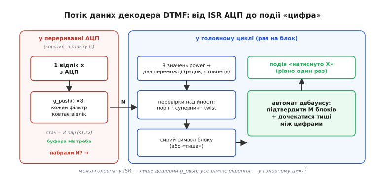
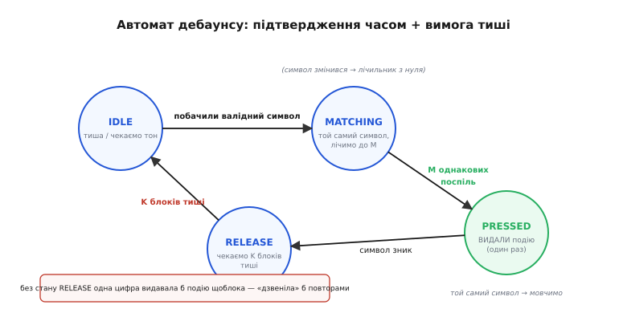
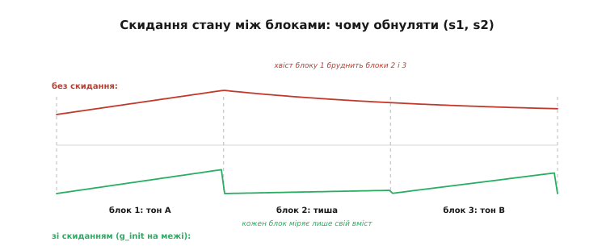

# ⚙️ Декодер DTMF на C: від відліку АЦП до події «цифра»

**Задача.** У кроці про виявлення тонів ми склали кістяк: вісім фільтрів [Ґерцеля](root:embedded/why-frequency-domain/proj-goertzel.md), вибір двох найсильніших бінів, перевірки надійності, таблиця символів. Кістяк показує *логіку*. Але між нею й кодом, який можна вставити у справжню прошивку й лишити працювати місяцями, лежить ще пів дороги — і саме на ній ламаються детектори. Хто **подає** відліки у фільтри й коли? Що робити, якщо вхід **тихий** і ділити на енергію блоку небезпечно? Чому одна-єдина натиснута цифра видає не одну подію, а двадцять поспіль? Який має бути **розмір акумулятора**, щоб сума квадратів не переповнилася? Що відбувається, коли стани фільтрів **не обнулили** перед новим блоком?

Цей крок доводить декодер до кінця. Ми зберемо **банк** із восьми потокових фільтрів, навчимося годувати їх по одному відліку прямо з [переривання АЦП](root:hw-arch/isr), винесемо все важке рішення в головний цикл, побудуємо **скінченний автомат дебаунсу**, що видає рівно одну подію на натиск, — і пройдемося пастками інтеграції, кожну з механізмом. Мета — не ще раз пояснити Ґерцеля (його виведення й пастки самого фільтра — за посиланням вище), а показати, **як з восьми таких фільтрів зробити вузол прошивки**, якому можна довіряти.

> 🔧 **Навіщо це.** Різниця між «працює на столі» й «працює в полі» для тонового декодера — це майже завжди не сам фільтр, а *обв'язка*: подача відліків, пороги під реальну гучність, дебаунс і поведінка на краях (тиша, перевантаження). Промислові DTMF-чипи десятиліттями втілювали рівно цю обв'язку; зібравши її руками раз, ви розумієте, що ховається за рядком «детектор тонів» у будь-якій специфікації.

## Ідея: дешево щотакту, дорого раз на блок

Перш ніж писати, варто вирішити **архітектуру** — хто що рахує й коли. Тут є природний поділ, і він диктує всю решту.

Рекурсія Ґерцеля **онлайнова**: вона ковтає відліки по одному, тримаючи лише два числа стану. Це означає, що банк фільтрів може жити прямо в [перериванні АЦП](root:hw-arch/isr) — на кожен новий відлік ми робимо вісім дешевих кроків рекурсії (вісім множень-додавань) і одне додавання до енергії блоку. Жодного буфера на `N` відліків, жодної затримки на «спершу набрати, потім рахувати»: рахунок **розмазується** по часу набору й закінчується рівно тоді, коли набрався `N`-й відлік.

А все **важке** — вибір двох переможців, перевірки надійності, дебаунс — робиться лише **раз на блок**, коли `power` уже готові. Це рідка, нечаста робота: при `fs = 8000` Гц і `N = 205` блок завершується кожні `205 / 8000 ≈ 25.6` мілісекунди, тобто близько сорока разів на секунду. Сорок разів на секунду ми приймаємо рішення — а вісім тисяч разів на секунду лише підкидаємо по відліку у фільтри.


*Дешево щотакту, дорого раз на блок. У перериванні АЦП (червоне) кожен відлік проходить крізь вісім фільтрів — це коротка, передбачувана робота без буфера. На межі блоку (синє) головний цикл бере вісім готових `power`, вибирає двох переможців, проганяє перевірки надійності й виносить сирий символ — а зверху над усім стоїть автомат дебаунсу (зелене), що перетворює серію блоків на рівно одну подію «натиснуто цифру».*

Цей поділ — не естетика, а вимога реального часу. Переривання АЦП **жорстке**: воно мусить завершитися до приходу наступного відліку, інакше відлік загубиться. Вісім кроків рекурсії — це гарантовано короткий, сталий за часом шматок, що чудово живе в ISR. А вибір переможців із циклами, ділення для відносного порога, логіка автомата — робота змінної тривалості, якій в ISR не місце; її природне місце — головний цикл, що неспішно розгрібає блоки в міру їхньої готовності. Той самий принцип «у перериванні — лише найнеобхідніше, важке — потім», що й у [відкладеній обробці](root:hw-arch/isr/proj-deferred-work.md) будь-якої швидкої периферії.

## Банк фільтрів: вісім резонаторів в одній структурі

Почнімо з даних. Один фільтр Ґерцеля — це структура з кроку про сам алгоритм: стала `coeff` (задає частоту) і два стани `s1, s2`. Для декодера зручно тримати **вісім** таких в одному масиві плюс лічильник набраних відліків і акумулятор енергії блоку, спільний для всіх восьми (енергію блоку рахуємо раз, не вісім разів).

:::code proj-dtmf-decoder/c/bank-filtriv-visim.c

Ініціалізація рахує по одній сталій на фільтр — рівно за формулою з кроку про Ґерцеля, тільки тепер у циклі по восьми частотах. Бін `k` для кожної частоти округлюється до найближчого цілого; при `N = 205` усі вісім лягають близько до центрів своїх бінів, тож [витік](root:com-signal/windowing-leakage) малий (чому саме `205` — розібрано в самому кроці про виявлення тонів).

:::code proj-dtmf-decoder/c/bank-filtriv-visim-2.c

Зверни увагу: `cosf` ми викликаємо **вісім разів за все життя** програми, на старті. У гарячому шляху (на кожен відлік) жодних тригонометричних функцій немає — лише множення й додавання. Це і є та дешевизна, заради якої беруть Ґерцеля.

## Подача відліків: банк живе в перериванні

Тепер — серце потокової частини. Функція приймає **один** відлік і проганяє його крізь усі вісім фільтрів одним коротким циклом, попутно додаючи його квадрат до енергії блоку. Коли набралося `N_BLOCK` відліків, вона сигналить «блок готовий» і **сама не рахує** `power` — це зробить головний цикл, коли дійдуть руки.

:::code proj-dtmf-decoder/c/podacha-vidlikiv-bank.c

Вісім ітерацій по три арифметичні дії плюс одне множення на енергію — це передбачувано короткий шматок, що спокійно вкладається в період відліку навіть на скромному МК. Тому `dtmf_feed_sample()` можна кликати **прямо з переривання** готовності АЦП:

:::code proj-dtmf-decoder/c/podacha-vidlikiv-bank-2.c

Тут є два місця, які легко зіпсувати, тож зупинимося.

**Зняти зміщення нуля.** АЦП мікроконтролера однополярний: тиша — це не нуль на виході, а **середина шкали** (для 12 біт — близько `2048`). Якщо годувати у фільтр сире значення з постійною складовою `2048`, ця складова — потужний сигнал на частоті 0 Гц — почне розгойдувати всі фільтри й завищувати `power`, особливо найнижчий бін. Тому з кожного відліку **віднімаємо середину шкали** ще до фільтра. Точне центрування (відняти виміряне середнє, а не номінал) — ще краще, але `−2048` рятує від найгрубішої помилки одразу.

**Прапорець, а не робота.** ISR лише ставить `block_ready = 1`; ні вибору переможців, ні ділень, ні логіки автомата тут немає. Чому — та сама причина, що й завжди: важка робота змінної тривалості в перериванні заблокувала б усі інші переривання на невідомий час. Прапорець `volatile` — бо його пише ISR, а читає головний код, і без `volatile` компілятор може [закешувати значення](root:sf-lang/volatile) в регістрі, і головний цикл «не побачить» зміни. Сам `bank` теж `volatile` з тієї ж причини — його чіпають обидва контексти.

> 🔧 **Навіщо це.** Поділ «ISR ставить прапорець → main розгрібає» — це не лише про DTMF. Так влаштована майже будь-яка обробка потоку з АЦП: переривання тримає темп і ловить кожен відлік, а важка математика над набраним блоком іде поза перериванням. Якщо ловите загадкові втрати відліків чи «підвисання» зв'язку під час детекції — перша підозра завжди в тому, що в ISR залізла довга робота.

## Рішення блоку: два переможці й чотири перевірки

Коли `block_ready` піднявся, головний цикл рахує `power` для всіх восьми бінів і виносить **сирий** вердикт: яка цифра в цьому блоці (або «тиша/шум»). Це той самий код, що в кроці про виявлення тонів, але доведений до повноти — з усіма чотирма перевірками надійності й, головне, з **обережним поводженням на тихому вході**, про яке кістяк змовчав.

Спершу — квадрат магнітуди кожного біна з двох станів фільтра (формула й те, чому без `sqrt`, — у кроці про Ґерцеля):

```c
static float g_power(const goertzel_t *g)
{
    return g->s1 * g->s1 + g->s2 * g->s2 - g->coeff * g->s1 * g->s2;
}
```

Тепер сам вердикт. Він повертає символ DTMF або `0`, якщо чистого тону нема. Розгляньмо його по частинах, тоді зберемо.

:::code proj-dtmf-decoder/c/rishennia-bloku-dva.c

Розберімо чотири перевірки — кожна закриває свій спосіб обдуритися.

**Нульова перевірка — тихий блок.** Її в кістяку не було, і це найпідступніша діра. Відносний поріг ділить силу піків на енергію блоку. Але якщо вхід **тиша**, енергія блоку — це крихітне число (самий шум АЦП), і будь-який випадковий сплеск у будь-якому біні дасть величезне *відношення* до цієї майже-нульової енергії. Детектор почне «бачити» цифри в абсолютній тиші. Тому **перш** ніж рахувати будь-які відношення, відсікаємо блоки, де загальна енергія нижча за поріг шуму `ENERGY_FLOOR`: нема сигналу — нема й розмови. Це класична пастка «ділення на майже нуль», і ловити її треба на вході, а не молитися, що чисельник теж виявиться малим.

**Відносний поріг.** `power` росте і з гучністю, і з довжиною блоку, тож **абсолютний** поріг, підібраний за столом, збреше за першої ж зміни рівня. Беремо відносний: два піки разом мусять забирати помітну частку (тут — `10%`) усієї енергії блоку. Гучніший абонент підніме і піки, і енергію — відношення лишиться стабільним. Так детектор сам підлаштовується під рівень.

**Другий суперник у групі.** Чистий натиск дає в кожній групі **один** виразний пік. Якщо поряд із переможцем стирчить майже такий самий другий бін — це не DTMF, а накладені голоси, музика чи дві кнопки разом. Вимагаємо, щоб переможець був принаймні вдвічі сильніший за другого в своїй групі; інакше пара ненадійна — відкидаємо.

**Twist — перекіс між групами.** У справжньому DTMF низький і високий тони мають близьку силу. Великий розрив (його звуть *twist*, англ. — «перекіс») виказує спотворення тракту або підробку. Тут важлива звірка з реальністю: за рекомендацією ITU-T Q.24 приймач має терпіти приблизно від `−4` до `+8` децибел перекосу (висока група може бути на кілька децибел гучніша — так зване *пряме* спотворення, бо канал зазвичай давить високі частоти, і їх наперед піднімають). Це **усталений** галузевий допуск (ITU-T Q.24; його ж по-своєму уточнює Bellcore — пряме спотворення до ~8 дБ, зворотне до ~4 дБ). Ми працюємо з *power* (квадратом), а не з амплітудою, тож межа в децибелах переводиться в межу відношення потужностей: `4`-кратне відношення power — це `10·log₁₀(4) ≈ 6` дБ, груба, але робоча апроксимація симетричного вікна для першого детектора. Хочете точно відтворити асиметрію Q.24 — задайте дві різні межі для `lo>hi` і `hi>lo`.

> 🔧 **Навіщо це.** Усі чотири (з нульовою — п'ять) перевірки — це різниця між іграшкою на тихому столі й детектором, що тримається в каналі з шумом, луною й перепадами гучності. І найболючіші тут не пропуски, а **хибні спрацювання**: пропущену цифру користувач натисне ще раз, а от «привид» цифри в керуванні може запустити дію, якої ніхто не хотів. Тому в керуванні пороги ставлять **суворо** й радше пропустять сумнівне, ніж пропустять зайве.

## Дебаунс: один натиск — одна подія

Тепер найважливіше, чого кістяк лише торкнувся. `dtmf_classify()` виносить вердикт **за кожен блок** — сорок разів на секунду. Натиснута цифра звучить не один блок, а багато: навіть короткий тон у `40` мілісекунд — це вже `40 / 25.6 ≈ 1.6` блока, а звичайний натиск пальцем триває сотні мілісекунд, тобто **десятки** блоків поспіль із тим самим символом. Якби ми видавали подію на кожен блок, де `classify` повернув цифру, одне натискання «5» перетворилося б на `5555555555…` — цифра **дзвеніла б** повторами, точнісінько як [механічна кнопка без антидребезга](root:hw-digital/contact-debounce) видає серію імпульсів на один натиск.

Лік той самий, що для кнопки, але хитріший: треба не просто згладити дрижання, а перетворити **тривалий тон** на **одну** подію — і не дати наступному натиску тієї самої цифри загубитися. Це робота для **скінченного автомата** (англ. *finite-state machine*, FSM) з чотирьох станів.


*Чотири стани перетворюють серію блоків на одну подію. IDLE чекає тону. Побачивши валідний символ, переходимо в MATCHING і **лічимо однакові блоки**; назбиралося M поспіль — символ підтверджено, переходимо в PRESSED і **видаємо подію рівно раз**. Поки символ тримається, мовчимо. Зник символ — ідемо в RELEASE й **чекаємо K блоків тиші**, і лише потім вертаємось у IDLE, готові до наступної цифри. Саме стан RELEASE не дає одній цифрі задзвеніти повторами.*

Розберімо, **навіщо кожен** стан, бо без цього автомат виглядає магією.

- **IDLE** — спокій. Тиша або шум. Чекаємо першого валідного символу.
- **MATCHING** — підтвердження. Побачили цифру, але не віримо одному блоку (він міг збігтися випадково). Лічимо, скільки **поспіль** блоків дали той самий символ. Збилася лічба (символ змінився чи зник) — лічильник у нуль. Назбиралося `M` однакових поспіль — символ справжній.
- **PRESSED** — цифра визнана. Тут і **тільки тут** ми один раз видаємо подію «натиснуто X». Поки той самий тон тримається (а він триматиметься десятки блоків), ми **мовчимо** — подію вже видали.
- **RELEASE** — очікування тиші. Тон зник — але ми **не** вертаємось одразу в IDLE. Спершу вимагаємо `K` блоків **тиші** поспіль. Це гарантує, що між двома цифрами був реальний проміжок, і захищає від тремтіння на спаді тону.

Останній стан — ключ до всього. Без `RELEASE`, тільки-но тон на мить просів (а він просідає на краях, на паузах дихання, на тремтінні рівня), автомат вирішив би «цифра скінчилася» й одразу прийняв ту саму цифру за нову. Вимога суцільної тиші між цифрами — це і є механізм, що тримає **одну подію на натиск**.

Числа `M` і `K` — прямо з реальних вимог DTMF, і їх варто звірити з нормою. Один блок ≈ `25.6` мс. Стандарт ITU-T Q.24 вимагає мінімальної тривалості тону близько `40` мс для надійного впізнання (нижня межа самої здатності розпізнати — близько `23` мс) і паузи між цифрами теж близько `40` мс. Звідси: `M = 2` блоки підтвердження ≈ `51` мс — трохи понад мінімум тону, надійно; `K = 2` блоки тиші ≈ `51` мс — понад мінімальну паузу. Це **усталені** значення з телефонної норми, не вигадані; під свій канал їх підкручують, але стартувати варто звідси.

:::code proj-dtmf-decoder/c/debauns-odyn-natysk-odna.c

Уся хитрість дебаунсу — в одному рядку: `return f->cand` стоїть **рівно в одному місці**, на переході `MATCHING → PRESSED`. Скільки б блоків цифра не звучала далі, другої події не буде, бо в `PRESSED` ми мовчимо. А повернутися до видачі тієї самої цифри можна лише через `RELEASE` з витриманою тишею — тобто після справжнього відпускання. Дві прості умови — `M` підтверджень і `K` тиші — і потік із сорока вердиктів на секунду перетворюється на чистий ряд подій «натиснуто».

> 🔧 **Навіщо це.** Цей самий чотиристановий автомат — універсальний шаблон «підтвердження + відпускання» далеко за межами DTMF: розпізнавання жесту-утримання кнопки, виявлення сталого стану давача, антидребезг будь-якої події, що приходить пачками. Запам'ятайте форму — «накопичити підтвердження → видати раз → дочекатися чистого скидання» — і ви впізнаєте її в десятках задач керування.

## Усе разом: один крок головного циклу

Лишилося зшити частини. Головний цикл чекає на прапорець `block_ready`, під захистом від переривання забирає готовий блок, проганяє його крізь `classify` і `fsm_step`, а тоді **скидає банк** під наступний блок. Ось повний верхній рівень:

:::code proj-dtmf-decoder/c/use-razom-odyn-krok.c

А виклик у програмі — одна перевірка в циклі:

```c
for (;;) {
    char digit = dtmf_decoder_poll();
    if (digit)
        on_dtmf_digit(digit);     // подія: натиснуто цифру (рівно раз)
    // ... решта роботи прошивки ...
}
```

Два місця тут — критичні, і обидва легко пропустити.

**Знімок під забороною переривань.** Поки головний цикл копіює стани банку, ISR може **втрутитися** й змінити їх (новий відлік прийшов рівно в цю мить). Прочитаєш половину старих станів, половину нових — і `power` вийде сміттям. Тому копіювання й скидання банку загорнуто між `__disable_irq()` / `__enable_irq()`: це коротка [критична секція](root:sf-lang/volatile), на час якої ISR не лізе в банк. Сама обробка (`classify`, `fsm_step`) працює вже над **знімком**, тож переривання знову вільні — критична секція не розтягується на важку математику.

**Скидання банку.** `dtmf_init()` після зняття знімка — не косметика, а необхідність, і це третя класична пастка інтеграції, до якої ми переходимо.

## Складність і пастки

Підсумуймо ціну й зберемо граблі, на які наступають при вставці декодера в прошивку.

**Складність.** На кожен відлік — `8 × 3` арифметичні дії рекурсії плюс одне множення енергії: стала, дешева робота, що ідеально лягає в ISR. На кожен блок — вісім обчислень `power` і кілька проходів по восьми числах: теж копійки, та ще й рідко (сорок разів на секунду). Разом за блок — близько `8 × N` множень проти `N · log₂N` у повному [ШПФ](root:com-signal/fft): для восьми тонів Ґерцель виграє, бо `8 < log₂205 ≈ 7.7`… ось тут і видно межу — при восьми тонах виграш уже **на межі**, а при двадцятьох ШПФ обжене. Пам'яті ж банк їсть мізер: вісім структур по три `float` плюс лічильник і акумулятор — десятки байтів проти масиву на сотні комплексних чисел у ШПФ.

**Пастка: розмір акумулятора.** Енергія блоку — це сума `N` доданків `x²`. У `float` (як тут) переповнення практично не загрожує — показник степеня дає величезний запас. Але тільки-но переходите на **цілу** арифметику без FPU (а на дешевих МК це звичне рішення), акумулятор стає бомбою. Якщо відліки 16-бітні, то `x²` — до `2³⁰`, а сума `205` таких — до `~2³⁸`: у 32-бітний `int` **не влізе** й мовчки переповниться, давши від'ємну чи дрібну «енергію» — і відносний поріг збожеволіє. Лік: акумулятор енергії — **64-бітний** (`int64_t`), або 32-бітний, але з масштабуванням відліків наперед. Те саме стосується самих станів Ґерцеля в цілій арифметиці: рекурсія **підсилює** частоти біля свого біна, тож `s1` набігає за `N` кроків і може переповнитися — тут потрібен запас розрядності (32-бітний стан під 16-бітні відліки) або масштабування входу. Ця пастка станів — спільна для будь-якого Ґерцеля; докладно вона розібрана в [самому кроці про алгоритм](root:embedded/why-frequency-domain/proj-goertzel.md) разом із виведенням, а загальні правила цілих чисел — у [реалізації fixed-point](root:hw-arch/fixed-point).

**Пастка: скидання станів між блоками.** Якщо забути обнулити `s1, s2` (і `energy`, і `n`) перед новим блоком, **хвіст** попереднього блоку протече в наступний. Рекурсія Ґерцеля має пам'ять: стани, накопичені тоном першого блоку, не зникають самі — на старті другого блоку вони ще «дзвенять» і домішуються до його `power`. Результат — блок тиші покаже залишкову цифру, а зміна тону «розмажеться» на два блоки. Саме тому у `dtmf_decoder_poll()` стоїть `dtmf_init()` одразу після зняття знімка: кожен блок мусить починати **з чистого нуля**, міряючи лише свій власний вміст.


*Чому обнуляти стани на межі блоку. Угорі (червоне): без скидання енергія тону з першого блоку «дзвенить» у станах фільтра й тягнеться хвостом у блоки тиші та наступного тону — `power` бреше. Унизу (зелене): зі скиданням на кожній межі кожен блок починає з нуля й міряє рівно свій вміст. Це найтихіша з пасток — код «майже працює», лише іноді бачить привид попередньої цифри.*

**Пастка: поведінка на тихому вході.** Її ми вже закрили нульовою перевіркою `ENERGY_FLOOR`, але повторимо механізм, бо це улюблені граблі. Відносний поріг **ділить** на енергію блоку; на тиші енергія — самий шум АЦП, число близьке до нуля, і будь-який випадковий сплеск дає велике відношення → «привид» цифри в порожнечі. Захист — відсікати тихі блоки **до** будь-яких відношень. Симптом, якщо забули: декодер «клацає» випадковими цифрами, коли ніхто нічого не передає.

**Пастка: поведінка на гучному вході (обрізання).** Зворотний край. Якщо сигнал **перевищує** шкалу АЦП, відліки **обрізаються** по максимуму — і синусоїда стає трапецією. А обрізана синусоїда — це вже не чистий тон: у її спектрі з'являються **гармоніки**, яких у DTMF бути не повинно. Гармоніка `697` Гц може впасти близько до іншого біна, підняти зайвий пік і завалити перевірку «другого суперника» або twist — натиск перестане впізнаватися саме тоді, коли абонент говорить **голосно**. Лік — не в коді декодера, а раніше: тримати [підсилення тракту](root:embedded/signal-acquisition) так, щоб найгучніший очікуваний тон не діставав країв шкали (з запасом), а ще краще — стежити за обрізанням і сигналити про нього. Декодер бачить лише наслідок; причину лікують на вході.

**Пастка: гонитва за банк між ISR і main.** Уже закрита знімком під `__disable_irq()`, але назвемо її прямо: будь-яке читання багатослівного стану (вісім фільтрів + енергія + лічильник), що його паралельно пише переривання, **мусить** бути атомарним — інакше дістанете суміш старих і нових полів. Або коротка критична секція (як тут), або [подвійна буферизація](root:sf-tasks/double-buffering): ISR наповнює один банк, main читає інший, на межі блоку міняють їх ролями. Для одного блоку на `25.6` мс критична секція на копіювання десятків байтів — цілком прийнятна; для важчих випадків беруть подвійний буфер.

Зібравши все це — банк потокових фільтрів у перериванні, повний набір перевірок із захистом тихого входу, чотиристановий дебаунс і дисципліну скидання та атомарного знімку — ви маєте декодер, який не соромно лишити в полі. Він робить рівно те, що обіцяв крок про виявлення тонів: чує цифру крізь шум і перепади гучності й видає на неї **одну** чисту подію. А поза самим DTMF ви забираєте з цього кроку три речі, що окуповуються всюди: поділ «дешево в ISR, дорого раз на блок», набір перевірок «відносний поріг + суперник + twist + захист країв», і автомат «підтвердити → видати раз → дочекатися скидання». Ці три ідеї — каркас будь-якого надійного детектора подій у прошивці, від тонового пульта до сторожа стану давача.
