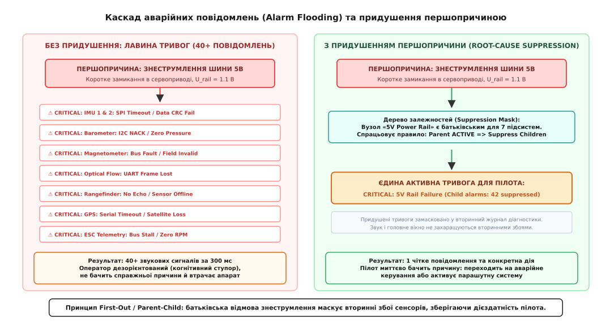
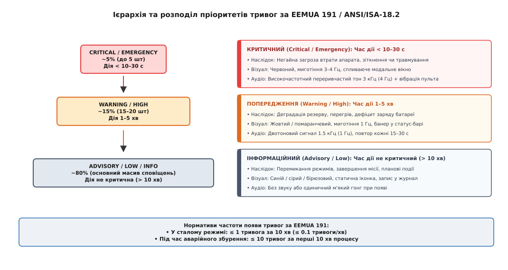
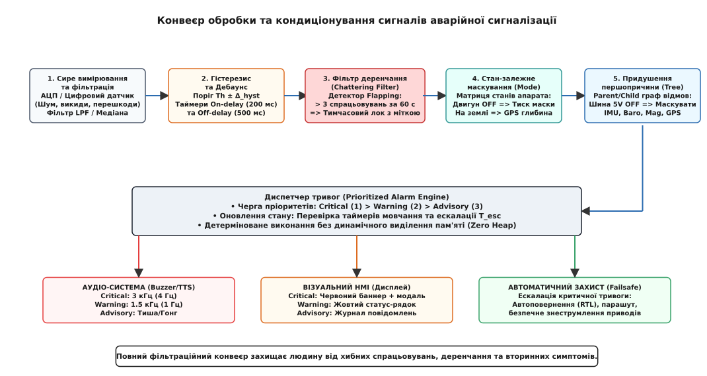
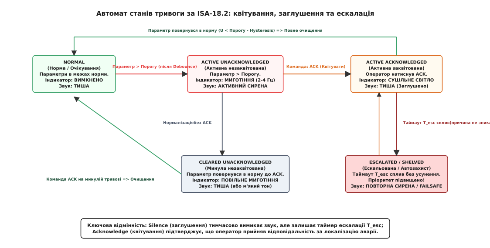

# Тривога, яку помічають: пріоритет, звук, потік тривог

<preknowlist>
- [Людина в контурі: чому затримка руйнує керування](root:embedded/liudyna-v-konturi) — бюджет зорово-моторної реакції оператора, когнітивне навантаження та наслідки сенсорного перевантаження.
- [Автомат режимів: переходи, охоронці, заборонені стрибки](root:embedded/avtomat-rezhymiv) — автомати станів, події та детерміновані переходи у прошивках систем керування.
- [Аварійна зупинка: kill-switch, безпечний стан і те, що соフト не скасує](root:embedded/avariina-zupynka) — переведення апарата в гарантовано безпечний стан при фатальних апаратних відмовах.
</preknowlist>

Коли важкий гексакоптер виконує автономний огляд промислової зони на висоті 80 метрів, механічне заклинювання сервопривода скидання вантажу викликає коротке замикання у вторинній лінії живлення. Імпульсний перетворювач переходить у режим струмового обмеження, і стабілізована шина 5 В просідає з 5.05 В до 1.15 В за 18 мікросекунд. Протягом наступних 300 мілісекунд у бортовій системі одночасно спрацьовують сорок дві діагностичні перевірки: відмовляють обидва інерційні модулі на шині SPI, барометр перестає відповідати за протоколом I2C, магнітометр шле нульові вектори, втрачається зв'язок із далекоміром, оптичним потоком та приймачем супутникової навігації, а буфер послідовного порту телеметрії миттєво переповнюється пакетами помилок.

Наземна станція керування зустрічає цю подію шквалом візуальних та звукових сповіщень. Екран планшета одночасно забарвлюється десятками червоних рамок, звуковий п'єзодинамік переходить у режим безперервного пронизливого пищання на частоті 3.5 кГц, а список текстових повідомлень прокручується зі швидкістю п'ятнадцять рядків на секунду. Оператор бачить нагромадження написів «GPS Lost», «IMU CRC Error», «I2C Bus Stall», «Mag Field Invalid» і «Nav Timeout». Перебуваючи у стані раптового гострого стресу, пілот намагається прочитати текст на екрані, втрачає просторову орієнтацію через звуковий тиск сирени та помилково припускає збій навігаційного фільтра. Замість активації аварійного парашута оператор витрачає дорогоцінні три секунди на спробу перемикання в ручний режим стабілізації, якого фізично не існує через знеструмлені гіроскопи, і некерований апарат на повній швидкості врізається в бетонну опору.

Ця катастрофа сталася не через електричну несправність перетворювача живлення: резервні системи безпеки могли безаварійно посадити апарат за наявності адекватного інтерфейсу. Першопричиною падіння став **колапс аварійної сигналізації** (Alarm Flooding) — ситуація, коли людино-машинний інтерфейс вилив на людину неструктуровану лавину первинних, вторинних і похідних симптомів, повністю паралізувавши її здатність до прийняття рішень.

## Анатомія когнітивного колапсу: чому лавина тривог паралізує оператора

Людський мозок у нормальному стані здатний утримувати у фокусі уваги від 4 до 7 незалежних інформаційних блоків (закон Міллера). Проте в умовах раптової кризи, коли виникає реальна загроза втрати дорогого апарата, викид адреналіну кардинально змінює роботу центральної нервової системи. 

Фізіологічний механізм стресу активує симпатичну нервову систему, що призводить до трьох незворотних змін сприйняття:

1. **Ефект тунельного зору:** поле зору людини звужується до центральної плями розміром 15–20 градусів. Периферійні графічні елементи дисплея, банери стану та бічні панелі телеметрії повністю ігноруються зоровою корою. Пілот фокусується на одному випадковому рядку тексту (наприклад, верхньому сповіщенні в черзі) і перестає помічати загальну картину.
2. **Акустичне засліплення (Auditory Gating):** коли рівень звукового тиску аварійного зумера перевищує фоновий шум на 20–30 дБ і звучить безперервно, мозок намагається захистити слуховий апарат, блокуючи обробку мовних та тональних сигналів. Неперервний вереск сирени не спонукає до дії, а викликає паніку, підвищує тремор м'язів кисті та заважає логічному мисленню.
3. **Падіння когнітивної пропускної здатності:** у стресі людина здатна осмислити та обробити лише **одну дію за 2–4 секунди**. Якщо за перші 5 секунд аварії система генерує 40 повідомлень, 90% із них гарантовано не будуть навіть прочитані.


*Каскад вторинних тривог: коротке замикання шини живлення породжує десятки хибних симптомів на датчиках. Без кореляції оператор втрачає контроль; алгоритм придушення згортає лавину в одне першопричинне повідомлення.*

Коли система сигналізації побудована за принципом «будь-який збій сенсора відразу шле тривогу на екран», оператор стикається з типовими поведінковими девіаціями:
- **Синдром глухого пілота:** оператор машинально тисне кнопку глушіння звуку (`Silence` або вимикач аудіо), не читаючи тексту, щоб позбутися акустичного болю;
- **Помилкова діагностика:** людина реагує на найяскравіший або останній симптом, а не на першопричину;
- **Когнітивний ступор (Freeze Response):** людина перестає виконувати будь-які керуючі дії, спостерігаючи за падінням апарата.

## Класифікація та ієрархія тривог за стандартами EEMUA 191 та ANSI/ISA-18.2

Щоб перетворити хаотичний потік сповіщень на дієвий інструмент порятунку апарата, міжнародна інженерна спільнота розробила стандарти **EEMUA 191** (Engineering Equipment and Materials Users Association) та **ANSI/ISA-18.2** (перенесений у глобальний стандарт **IEC 62682**).

Першим і найважливішим кроком проектування є суворе термінологічне розмежування сутностей системи оповіщення.

```
СУТНОСТІ СИСТЕМИ ОПОВІЩЕННЯ:
┌─────────────────┐
│     ПОДІЯ       │  Факт зміни стану без відхилення від норми. Дія оператора НЕ потрібна.
│    (Event)      │  Приклад: «Автопілот перейшов у режим Mission», «Точка маршруту 4 досягнута».
└────────┬────────┘
         │
┌────────▼────────┐
│   СПОСТЕРЕЖЕННЯ │  Відхилення параметра без прямої загрози апарату. Інформаційний запис.
│ (Advisory/Diag) │  Приклад: «Рівень сигналу Wi-Fi телеметрії знизився до -75 dBm».
└────────┬────────┘
         │
┌────────▼────────┐
│  ПОПЕРЕДЖЕННЯ   │  Розвиток негативної тенденції. Дія оператора потрібна у визначений час.
│ (Alert/Warning) │  Приклад: «Залишок заряду батареї 25%, час до вичерпання резерву 4 хвилини».
└────────┬────────┘
         │
┌────────▼────────┐
│     ТРИВОГА     │  Критична загроза апарату чи людям. Вимагає НЕГАЙНОЇ обов'язкової дії.
│     (Alarm)     │  Приклад: «Відмова мотора 2, перевантаження ESC, падіння тяги».
└─────────────────┘
```

> ⚠️ **Золоте правило сигналізації (EEMUA 191):** якщо повідомлення не вимагає від оператора конкретної, усвідомленої дії для відвернення небезпеки — воно **не має права бути тривогою**. Повідомлення про нормальні переходи режимів, планові логи та діагностичні записи мають статус подій (Events) і не повинні переривати увагу людини аудіосигналами чи спливаючими вікнами.

Історичні витоки цієї концепції та детальний розбір катастроф на АЕС Три-Майл-Айленд і заводі Texaco у Мілфорд-Хейвен розкрито у вставці [історія систем сигналізації та уроки великих аварій](root:embedded/tryvoha-iaku-pomichaiut/hist-alarm-flooding.md).

### Шкала пріоритетів та правила їх розподілу

Стандарт ANSI/ISA-18.2 розділяє тривоги на три основні рівні за двома критеріями: **тяжкість наслідків** у разі бездіяльності та **допустимий час на реакцію** оператора (Time to Respond).

```
МАТРИЦЯ ПРІОРИТИЗАЦІЇ ТРИВОГ:
┌──────────────────────────────┬───────────────────┬───────────────────┬───────────────────┐
│ Тяжкість наслідків / Час дії │ Негайно (< 30 с)  │ Скоро (1–5 хв)    │ Запас (> 10 хв)   │
├──────────────────────────────┼───────────────────┼───────────────────┼───────────────────┤
│ Фатальна (Втрата апарата)    │ CRITICAL (Червоний│ WARNING (Жовтий)  │ WARNING (Жовтий)  │
│ Значна (Зрив місії, перегрів)│ WARNING (Жовтий)  │ WARNING (Жовтий)  │ ADVISORY (Синій)  │
│ Незначна (Втрата точності)   │ ADVISORY (Синій)  │ ADVISORY (Синій)  │ EVENT (Журнал)    │
└──────────────────────────────┴───────────────────┴───────────────────┴───────────────────┘
```


*Піраміда розподілу тривог за EEMUA 191: критичні сповіщення займають лише вершину піраміди, забезпечуючи гарантовану реакцію людини в межах відведеного часового бюджету.*

1. **Критичний пріоритет (Critical / Emergency / Рівень 1):**
   - *Критерій:* бездіяльність протягом 10–30 секунд гарантовано призводить до втрати апарата, зіткнення із землею чи травмування персоналу;
   - *Візуальне кодування:* яскраво-червоний колір (`#E53E3E`), високочастотне миготіння з частотою 3–4 Гц, модальне спливаюче вікно або банер по центру екрана;
   - *Акустичне кодування:* агресивний високочастотний переривчастий тон 2.5–3.5 кГц (імпульси 4–5 Гц) або безперервний висхідний тональний сигнал гучністю не менше 75–85 дБ + вібрація стіків пульта;
   - *Частка в системі:* **не більше 5%** від загальної кількості сконфігурованих тривог.

2. **Високий пріоритет / Попередження (Warning / High / Рівень 2):**
   - *Критерій:* розвиток несправності, що вимагає коригувальних дій протягом 1–5 хвилин (наприклад, критичний залишок батареї, перегрів регулятора обертів, сильний зустрічний вітер);
   - *Візуальне кодування:* жовтий або помаранчевий колір (`#DD6B20`), помірне миготіння 1 Гц, виділений блок у верхньому рядку стану;
   - *Акустичне кодування:* двотоновий переривчастий сигнал частотою 1–1.5 кГц із повтором кожні 15–30 секунд до моменту квітування;
   - *Частка в системі:* **близько 15%**.

3. **Низький пріоритет / Сповіщення (Advisory / Low / Рівень 3):**
   - *Критерій:* відхилення параметрів, що не загрожує безпеці польоту безпосередньо, але вимагає уваги оператора за наявності вільного часу (> 10 хвилин);
   - *Візуальне кодування:* синій, бірюзовий або світло-сірий індикатор (`#4A5568`), статичне відображення без миготіння, запис у діагностичний список;
   - *Акустичне кодування:* повна відсутність звуку або одиночний м'який гонг низької тональності при появі;
   - *Частка в системі:* **близько 80%**.

### Нормативи частоти появи тривог

Згідно з EEMUA 191, добре спроектована система аварійної сигналізації повинна вкладатися у жорсткі кількісні ліміти:
- **У стаціонарному режимі:** у середньому **не більше 1 тривоги за 10 хвилин** (0.1 тривоги на хвилину);
- **Під час аварійного перехідного процесу:** **не більше 10 тривог за перші 10 хвилин** інциденту;
- **Деренчання (Alarm Chattering):** нуль тривог, що переходять зі стану в стан частіше 3 разів за хвилину.

## Алгоритми кондиціонування та придушення вторинних тривог

Щоб задовольнити нормативи EEMUA 191 у складній вбудованій системі з десятками датчиків, вимірюваний сигнал перед формуванням тривоги повинен пройти через багатоступеневий конвеєр кондиціонування (Alarm Conditioning Pipeline).


*Конвеєр фільтрації аварійних сигналів: сирі дані послідовно проходять дебаунс, гістерезис, детектор деренчання, режимне маскування та дерево першопричин перед передачею в диспетчер.*

Розгляньмо ключові ланки цього конвеєра:

### 1. Пороговий гістерезис та захист від шуму вимірювань

Якщо параметр коливається поблизу критичного порогу через шуми АЦП або вібрацію рами, простий компаратор генеруватиме десятки спрацьовувань на секунду.

Для запобігання цьому явищу поріг спрацьовування `Th_high` та поріг зняття тривоги `Th_clear` розносяться на величину гістерезису (грец. *hysterēsis* — відставання) `Δ_hyst`:

```
ПРАВИЛО ГІСТЕРЕЗИСУ ДЛЯ ВЕРХНЬОЇ ТРИВОГИ:
Активізація:   Значення > Th_high
Зняття:        Значення < (Th_high - Δ_hyst)

ПРАВИЛО ГІСТЕРЕЗИСУ ДЛЯ НИЖНЬОЇ ТРИВОГИ:
Активізація:   Значення < Th_low
Зняття:        Значення > (Th_low + Δ_hyst)
```

Типове значення `Δ_hyst` становить від 2% до 5% від діапазону вимірювання або 3–5 стандартних відхилень шуму сенсора `σ_noise`.

### 2. Часова витримка та дебаунс (On-delay / Off-delay Timers)

Короткочасний викид напруги чи тиску не повинен миттєво активувати тривогу. Для кожного сповіщення задаються два часові параметри:
- `T_on_delay` (час затримки включення): параметр повинен безперервно перебувати за межами норми протягом цього часу (наприклад, 200–500 мс), перш ніж тривога перейде в активний стан;
- `T_off_delay` (час затримки вимкнення): після повернення параметра в норму тривога утримується активною ще певний час (наприклад, 1000 мс), щоб запобігти миготінню інтерфейсу.

### 3. Фільтрація деренчання та флапінгу (Chattering / Flapping Alarms)

Якщо тривога через складні фізичні процеси все ж переходить між активним та пасивним станом частіше 3 разів за 60 секунд, рушій сигналізації класифікує її як «деренчливу» (Chattering/Flapping).

У цей момент тривога автоматично переводиться у зафіксований стан (Latched State):
1. Вона блокується у стані `ACTIVE`;
2. Вимикається генерація нових звукових імпульсів;
3. В інтерфейсі виставляється прапорець діагностичної несправності каналу вимірювання (Sensor Fault / Chattering).

### 4. Стан-залежне маскування (State-Based / Mode-Dependent Suppression)

Багато тривог мають фізичний сенс лише у визначених режимах роботи системи. 

```
МАТРИЦЯ СТАН-ЗАЛЕЖНОГО МАСКУВАННЯ:
┌──────────────────────────┬──────────────────────┬──────────────────────────────┐
│ Тривога                  │ Стан апарата         │ Дія маскування               │
├──────────────────────────┼──────────────────────┼──────────────────────────────┤
│ Низький тиск масла       │ Двигун ВИМКНЕНО      │ ПРИДУШИТИ (Нормальний стан)  │
│ Нульова повітряна швидкість│ Апарат НА ЗЕМЛІ    │ ПРИДУШИТИ (Немає обдуву)     │
│ Відхилення від курсу     │ РУЧНИЙ РЕЖИМ (Manual)│ ПРИДУШИТИ (Керує людина)     │
│ Втрата сигналу GNSS      │ ПОЛІТ У ПРИМІЩЕННІ   │ ПРИДУШИТИ (Оптичний потік)   │
└──────────────────────────┴──────────────────────┴──────────────────────────────┘
```

Якщо апарат стоїть на землі з вимкненими моторами, тривоги «Низькі оберти двигуна» або «Відсутність тяги» повинні автоматично маскуватися у прошивці й не доходити до диспетчера тривог.

### 5. Придушення за графом першопричин (Root-Cause Alarm Suppression / Parent-Child Logic)

Це найпотужніший механізм боротьби з лавиною тривог. Усі вузли апаратної частини організуються в ієрархічне дерево залежностей:

```
ДЕРЕВО ЗАЛЕЖНОСТЕЙ ВІДМОВ:
                  ┌────────────────────────┐
                  │ 5V Power Rail Failure  │  (Батьківський вузол / Parent)
                  └───────────┬────────────┘
         ┌────────────────────┼────────────────────┐
         │                    │                    │
┌────────▼────────┐  ┌────────▼────────┐  ┌────────▼────────┐
│  IMU 1 Failure  │  │  Baro I2C Hang  │  │ GPS UART Loss   │  (Дочірні / Children)
└─────────────────┘  └─────────────────┘  └─────────────────┘
```

Коли спрацьовує батьківська тривога `5V Power Rail Failure`:
1. Вона виставляється на екран як єдина першопричинна критична тривога;
2. Усі дочірні тривоги сенсорів, що живляться від цієї шини, автоматично помічаються як `SUPPRESSED_BY_PARENT`;
3. Вони не видають звукових сигналів, не відкривають спливаючих вікон і не засмічують головний екран, але тихо записуються у внутрішній чорний ящик для післяпольотного аналізу.

## Життєвий цикл тривоги, квітування та ескалація

Стандарт ANSI/ISA-18.2 регламентує чіткий автомат станів (Finite State Machine), через який проходить кожне аварійне сповіщення.


*Повний граф переходів життєвого циклу тривоги за ISA-18.2: квітування переводить тривогу у стан фіксованого свічення, а таймер ескалації T_esc запобігає «забуванню» небезпеки.*

### Стани автомата життєвого циклу:

1. `NORMAL` (Норма): параметр у межах допуску. Індикація відсутня, звук вимкнено.
2. `UNACKNOWLEDGED_ACTIVE` (Незаквітована активна): параметр вийшов за межі норми після завершення дебаунсу. Індикатор **миготить** із частотою пріоритету, звуковий сигнал **активний**.
3. `ACKNOWLEDGED_ACTIVE` (Заквітована активна): оператор натиснув кнопку підтвердження `ACK`. Індикатор переходить у режим **суцільного світіння** (без миготіння), звуковий сигнал **вимикається**.
4. `UNACKNOWLEDGED_CLEARED` (Незаквітована відновлена): параметр повернувся в норму до того, як оператор встиг натиснути `ACK` (короткочасний аварійний сплеск). Індикатор продовжує повільно блимати іншим кольором або висить у списку «Минулі тривоги», щоб оператор знав, що інцидент мав місце. Переходить у `NORMAL` лише після явного натискання `ACK`.
5. `SHELVED / SUPPRESSED` (Відкладена / Придушена): тривога тимчасово заблокована інженерною процедурою або батьківським вузлом.

### Заглушення (Silence) проти Квітування (Acknowledge)

В інтерфейсі оператора мають бути дві принципово різні команди керування звуком і станом:

- **Silence (Заглушити звук):** тимчасово вимикає аудіосигнал поточної тривоги, але **не змінює стан автомата**. Візуальний індикатор продовжує агресивно блимати. Команда потрібна, щоб зняти акустичний стрес під час радіопереговорів чи виконання термінової маніпуляції стіками.
- **Acknowledge / ACK (Квітувати):** офіційне підтвердження системи, що оператор побачив повідомлення, зрозумів його характер і взяв на себе відповідальність за керування ситуацією. Переводить тривогу зі стану `UNACK` у стан `ACK`.

### Тайм-аут мовчання та ескалація (Silence Timeout & Escalation)

Найнебезпечніша помилка проектування HMI — дозволити оператору заквітувати тривогу і назавжди забути про неї, доки апарат не впаде.

Для запобігання цьому використовується механізм **ескалації** (лат. *scala* — сходи):
1. Коли тривога переходить у стан `ACK` або звук заглушено командою `Silence`, запускається таймер витримки `T_esc` (зазвичай від 30 до 120 секунд залежно від пріоритету).
2. Якщо протягом часу `T_esc` фізична першопричина не усунута і параметр залишається в аварійній зоні, рушій виконує одну з трьох дій:
   - **Повторна активація аудіо (Re-Alarm):** звукова сигналізація вмикається знову, вимагаючи повторної оцінки стану;
   - **Підвищення пріоритету (Priority Escalation):** тривога рівня `WARNING` автоматично ескалує до рівня `CRITICAL`;
   - **Автоматичний захист (Autonomous Failsafe):** якщо критична тривога залишається заквітованою, але невиправленою понад критичний ліміт часу (наприклад, перегрів батареї > 75 °C понад 45 секунд), автопілот перехоплює керування та ініціює аварійну посадку або повернення на базу (RTL — Return to Launch).

## Програмна архітектура та реалізація Alarm Manager на C та C++

Вбудовані системи реального часу вимагають від модуля управління тривогами суворого детермінізму:
- **Zero Dynamic Allocation:** повна відсутність викликів `malloc()`, `free()` або `new` у циклі обробки;
- **Часова складність `O(1)` або `O(N)`:** фіксований час виконання за один такт обчислювального циклу, де `N` — фіксована константа максимальної кількості тривог;
- **Компактне бітове представлення:** маски залежностей та бітові прапорці для мінімізації споживання RAM мікроконтролера.

Нижче наведено повнофункціональну архітектуру диспетчера тривог із підтримкою пріоритетів, гістерезису, дебаунсу, дерева придушення першопричин та таймерів ескалації.

:::tabs
:::code tryvoha-iaku-pomichaiut-d/c/main.c
:::code tryvoha-iaku-pomichaiut-d/cpp/main.cpp
:::

## Аудіо-візуальне кодування: частоти, контраст та польова ергономіка

Навіть ідеально розрахована логіка придушення втрачає сенс, якщо фізичне втілення сигналу не досягає свідомості людини у польових умовах. Пульт керування безпілотником або польовий термінал експлуатуються на яскравому сонці, під шумом вітру, пропелерів і в умовах роботи в тактильних рукавицях.

### Акустична ергономіка та частотні смуги

Людське вухо має нерівномірну амплітудно-частотну характеристику (криві Флетчера-Менсона). Вушний канал дорослої людини має власний резонанс у смузі **2.5–3.5 кГц**. Звуковий тиск у цій ділянці сприймається суб'єктивно на 10–15 дБ гучніше, ніж на низьких частотах (400–800 Гц) при однаковій підведеній електричній потужності п'єзовипромінювача.

Водночас шум безколекторних моторів, редукторів та вітру сконцентрований у діапазоні до 1.5 кГц. Тому для аварійного аудіокодування застосовують чітку стратифікацію:

```
АКУСТИЧНЕ КОДУВАННЯ ЗА ПРІОРИТЕТАМИ:
┌───────────┬──────────────┬────────────────────────┬─────────────────────────────────────┐
│ Пріоритет │ Частота тону │ Патерн переривання     │ Суб'єктивне сприйняття              │
├───────────┼──────────────┼────────────────────────┼─────────────────────────────────────┤
│ CRITICAL  │ 3000–3500 Гц │ Пульсація 4–5 Гц (100мс│ Гостра небезпека, миттєве привернення│
│           │              │ звук / 100мс пауза)    │ уваги навіть крізь шум моторів      │
├───────────┼──────────────┼────────────────────────┼─────────────────────────────────────┤
│ WARNING   │ 1200–1500 Гц │ Двотоновий сигнал 1 Гц │ Вимога звернути увагу на параметри  │
│           │              │ (300мс / 700мс пауза)  │ без виклику панічної реакції        │
├───────────┼──────────────┼────────────────────────┼─────────────────────────────────────┤
│ ADVISORY  │ 600–800 Гц   │ Одиночний м'який гонг  │ Ненав'язливе фонове сповіщення      │
│           │              │ (без повторів)         │                                     │
└───────────┴──────────────┴────────────────────────┴─────────────────────────────────────┘
```

### Візуальне кодування: контраст, миготіння та дальтонізм

Згідно зі стандартом ISO 9241-307 та вимогами WCAG 2.1 AAA:
1. **Контрастність під прямим сонцем:** відношення яскравості тексту до фону для критичних повідомлень має становити не менше **7:1**. Чистий червоний колір на чорному тлі сонячного дня стає темно-бурим і нечитабельним. Необхідно використовувати контрастну підкладку (наприклад, червоний текст у білій рамці з чорною обводкою).
2. **Частоти візуального миготіння:**
   - Critical: **3.0–3.5 Гц** (периферійний зір миттєво фіксує рух/миготіння);
   - Warning: **1.0 Гц**;
   - Заборонена зона: частоти від 10 до 25 Гц суворо заборонені через ризик провокування фотосенситивної епілепсії та швидкої втоми очей.
3. **Резервне геометричне кодування (Accessibility for Color Blindness):** приблизно 8% чоловіків мають різні форми порушення колірного сприйняття (дейтеранопія, протанопія). Покладатися виключно на колір неприпустимо. Кожен рівень зобов'язаний мати унікальну геометричну форму:

```
ГЕОМЕТРИЧНЕ КОДУВАННЯ ПРІОРИТЕТІВ:
┌───────────┬──────────────┬────────────────────────┐
│ Пріоритет │ Колір        │ Геометрична піктограма │
├───────────┼──────────────┼────────────────────────┤
│ CRITICAL  │ Червоний     │ 🛑 Восьмикутник (Stop) │
│ WARNING   │ Жовтий       │ ⚠️ Трикутник вершиною  │
│ ADVISORY  │ Синій/Сірий  │ ℹ️ Коло або квадрат    │
└───────────┴──────────────┴────────────────────────┘
```

## Інженерні пастки проектування аварійних систем

> 🔧 **Навіщо це.** Створення надійної системи сигналізації — це не про кількість датчиків у коді, а про збереження керованості машини в момент системної відмови. Помилки проектування HMI коштують знищених апаратів та зірваних польотних завдань.

При проектуванні архітектури сигналізації слід уникати чотирьох класичних антипатернів:

1. **Антипатерн «Тривога як лог» (Alarm as Logging):** виведення у вікно тривог інформації про підключення клієнта, завершення калібрування чи запис файлу. Будь-який запис, що не вимагає негайної дії оператора, повинен вирушати виключно у вкладку журналу (Event Log).
2. **Антипатерн «Безмовне квітування» (Silent Dismiss):** квітування тривоги оператором повністю видаляє її з екрана, хоча фізичний параметр залишається аварійним. Результат — пілот забуває про критичний перегрів і спалює мотор через дві хвилини. Заквітована тривога повинна залишатися на екрані у вигляді суцільного кольорового індикатора без миготіння.
3. **Антипатерн «Циклічні залежності придушення»:** якщо вузол А придушує вузол Б, а вузол Б придушує вузол А, виникає стан невизначеності (Race Condition), коли під час одночасної відмови жодна тривога не виводиться оператору. Матриця залежностей має бути суворо спрямованим ациклічним графом (DAG).
4. **Антипатерн «Жорсткі пороги без гістерезису»:** спрацьовування тривоги батареї на рівні 21.0 В без гістерезису та часової затримки. При кожній перегазовці мотори просаджують напругу на 200 мс, генеруючи нескінченний потік хибних сирен.

Продумана система аварійного оповіщення діє як інтелектуальний щит між складним залізом та психікою пілота: вона відсікає вторинний шум, фіксує першопричину поломки та дає чітку, однозначну команду, рятуючи апарат у критичні секунди польоту.
