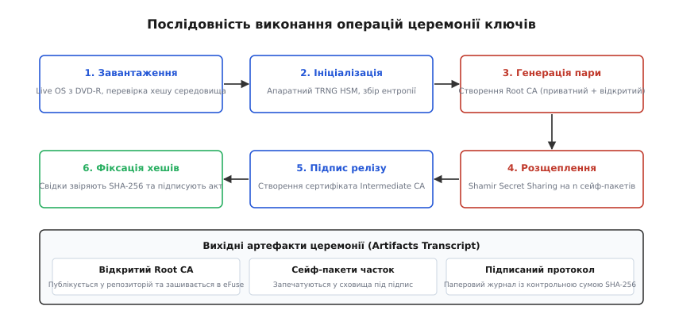

# ⚙️ Сценарій церемонії ключів: генерація, розщеплення Шаміра та протокол верифікації

Церемонія створення кореневих ключів вимагає детермінованого, повторюваного та математично верифікованого інструментарію, який працює в повністю ізольованій офлайн-системі без зовнішніх бібліотечних залежностей. Якщо алгоритм розділення секрету містить похибки в арифметиці скінченних полів, використовує нестійке джерело ентропії або залишає копії закритого ключа у незатертому динамічному ОЗП, безпека всього подальшого виробництва анулюється.

У цьому проєкті наведено повну реалізацію схеми розділення секрету Шаміра `(k, n)` над полем Галуа `GF(256)` мовами C та ідіоматичною C++20, детальний розбір механізмів захисту від атак через побічні канали пам'яті, систему формування та підписання протоколу церемонії (транскрипту) з обчисленням криптографічних хешів SHA-256, а також автономний сценарій для незалежної верифікації часток свідками.

*Послідовність дій під час церемонії: від завантаження ізольованої системи до запечатування згенерованих часток секрету в сейф-пакети та підписання аудиторського протоколу.*

## Архітектура розщеплення секрету в полі GF(256)

Арифметика над скінченним полем `GF(2⁸) = GF(256)` базується на операціях над поліномами за модулем незвідного многочлена `x⁸ + x⁴ + x³ + x + 1` (шістнадцяткове значення `0x11B`). Кожен байт вхідного закритого ключа розглядається як незалежний елемент поля.

Головна перевага побайтового розщеплення над `GF(256)` полягає в тому, що довжина кожної частки залишається рівно такою ж, як і довжина вихідного секрету (32 байти для криптографічного ключа Ed25519 або AES-256), додається лише один байт координати `x`. Для представлення часток не потрібні громіздкі бібліотеки довгої арифметики (англ. *bignum libraries*), що критично для автономних систем без динамічного лінкування.

### Механіка алгоритму

1. **Ініціалізація генератора поля:** Обчислюються таблиці експонент (`gf_exp`) та дискретних логарифмів (`gf_log`) за базовим генератором `g = 0x03`. Це дозволяє замінити дороге ділення многочленів на додавання логарифмів за модулем 255.
2. **Побудова полінома:** Для кожного байта секрету `S` генеруються `k − 1` випадкових байтів коефіцієнтів `a₁, a₂, …, aₖ₋₁`. Поліном має вигляд `P(x) = S ⊕ a₁·x ⊕ a₂·x² ⊕ … ⊕ aₖ₋₁·xᵏ⁻¹`.
3. **Обчислення точок:** Для кожного з `n` учасників обчислюється значення `yᵢ = P(xᵢ)` при `xᵢ ∈ {1, 2, …, n}`.
4. **Відновлення через інтерполяцію Лагранжа:** Коли надано будь-які `k` часток `(xⱼ, yⱼ)`, обчислюються базисні коефіцієнти Лагранжа `ℓⱼ(0) = ∏ [m≠j] xₘ / (xⱼ ⊕ xₘ)`. Секрет відновлюється як лінійна комбінація `S = ⨁ [j=1..k] yⱼ · ℓⱼ(0)`.

:::tabs
:::code proj-ceremony-script/c/main.c
:::code proj-ceremony-script/cpp/main.cpp
:::

## Протокол верифікації та обчислення контрольних відбитків

Під час проведення церемонії свідки повинні мати можливість незалежно верифікувати коректність часток, контрольні суми файлів та відповідність відкритих ключів без передачі секретної інформації через незахищені канали.

Сценарій перевірки (транскрипт) передбачає таку послідовність дій для свідків:
1. Отримання відкритого сертифіката Root CA та обчислення його контрольного SHA-256 хешу на екрані.
2. Перевірка контрольної суми кожного запечатаного сейф-пакета, в якому міститься окрема частка.
3. Фіксація серійного номера кожного пакета у друкованому реєстрі.

Нижче наведено верифікаційний сценарій мовою Python, призначений для запуску свідками на незалежних комп'ютерах під час очного аудиту.

:::code proj-ceremony-script/py/main.py

## Інженерний аналіз підводних каменів та загрози безпеці

При створенні та експлуатації систем розділення секретів інженери часто припускаються неочевидних помилок, які повністю нівелюють теоретичну стійкість схеми:

### 1. Оптимізація та «мертвий код» при очищенні пам'яті
Якщо після завершення процедури відновлення секрету викликати стандартний `memset(secret, 0, len)`, сучасні компілятори із прапорцями оптимізації `-O2` або `-O3` виявляють, що буфер `secret` більше не читається в поточній області видимості, і **повністю видаляють інструкцію затирання** як надлишкову (англ. *dead store elimination*). У результаті сирі байти закритого ключа залишаються у вільному ОЗП до перезавантаження машини.
Щоб запобігти цьому, у C слід використовувати системні виклики `explicit_bzero()` чи `memset_s()`, або звертатися через покажчик `volatile uint8_t *`. У C++ найкращою практикою є загортання конфіденційних масивів у RAII-обгортки з гарантованим деструктором `std::ranges::fill(data, 0)`.

### 2. Захист від пошкоджених та підроблених часток
Класична схема Шаміра не має вбудованої перевірки автентичності часток. Якщо один із крипто-офіцерів під час відновлення надасть пошкоджену або навмисно спотворену частку `y'ⱼ ≠ yⱼ`, поліном Лагранжа все одно обчислиться, але видасть неправильне сміттєве значення `S'`, причому без додаткових засобів неможливо визначити, хто саме з учасників надав хибну частку.
Для захисту від цієї вразливості в транскрипт церемонії обов'язково заносяться окремі SHA-256 хеші кожної згенерованої частки або застосовується схема верифікованого розділення секрету Фельдмана (англ. *Feldman's Verifiable Secret Sharing*), де разом із частками публікуються гомоморфні відкриті зобов'язання `g^{aᵢ}`.

### 3. Запобігання витоку через кеш-лінії процесора
У наведеній вище табличній реалізації множення через `gf_log` індекси звернення до масиву залежать від секретних коефіцієнтів. На процесорах зі спільною кеш-пам'яттю L1/L2 це потенційно створює ризик атак за часом доступу до кеш-ліній (англ. *cache-timing attack*). Для середовищ найвищого рівня критичності (FIPS 140-3 Level 4) множення в полі `GF(256)` замінюють на побітове множення у стовпчик без використання таблиць із постійним часом виконання для будь-яких вхідних операндів.

### 4. Фіксація сторінок пам'яті в ОЗП (mlock) та заборона скидання дампів
У середовищах POSIX під час роботи з конфіденційними частками обов'язково викликається системний виклик `mlock(secret, len)` (або `mlockall(MCL_CURRENT | MCL_FUTURE)`). Цей виклик гарантує ядру операційної системи, що сторінки віртуальної пам'яті, де тимчасово розміщено закритий ключ чи коефіцієнти полінома, ніколи не будуть вивантажені на диск у розділ підкачування (swap). Додатково процес блокує створення дампів аварійного завершення через виклик `setrlimit(RLIMIT_CORE, &rlim)` зі значенням ліміту `0`, що унеможливлює запис вмісту ОЗП у файл `core` у разі виникнення винятку або помилки сегментації (`SIGSEGV`).

