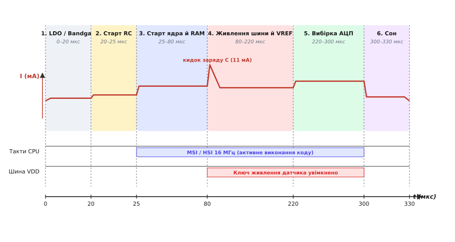
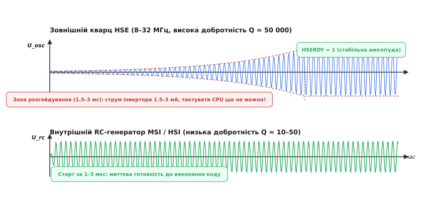
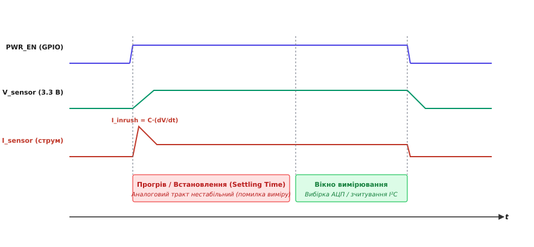
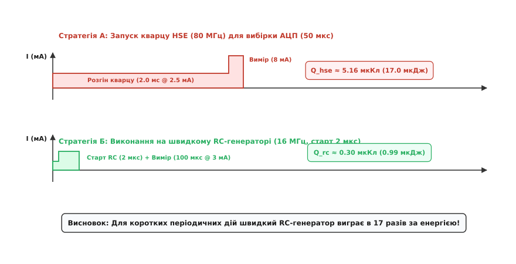

# Ціна пробудження: старт кварцу, ініціалізація, перше вимірювання

<preknowlist>
- [Режими сну мікроконтролера](root:hw-arch/sleep-modes) — відмінності між Sleep, Stop і Standby, знеструмлення доменів ядра та збереження пам'яті.
- [Шпаруватість і середній струм](root:embedded/duty-cycle-current) — розрахунок середнього споживання періодичних систем через співвідношення активного часу до паузи.
- [Гейтинг тактування та живлення](root:hw-components/power-gating) — фізичні принципи вимкнення невикористовуваних вузлів кристала.
- [Генератор Пірса](root:embedded/pierce-oscillator-design) — еквівалентна схема кварцового резонатора та критерії самозбудження автогенератора.
- [Аудит струму спокою плати](root:embedded/sleep-current-audit) — пошук та локалізація витоків струму під час сну.
</preknowlist>

Автономний логер температури на базі 32-бітного мікроконтролера прокидається раз на тридцять секунд, робить вибірку з аналогового сенсора й повертається в глибокий сон. За паспортом мікроконтролер у стані спокою споживає `2.5` мкА, а в активному режимі на частоті 80 МГц — `12` мА. Якщо розрахувати енергію суто за часом математичного перетворення (100 мікросекунд на вибірку й фільтрацію), батарейки CR2032 ємністю 225 мА·год мало б вистачити на сім років безперервної роботи.

Однак підключення прецизійного вимірювача струму показує неприємну реальність: батарейка виснажується за дев'ять місяців. Осцилограма струмового шунта викриває причину: замість очікуваного прямокутного мікросекундного імпульсу мікроконтролер під час кожного пробудження споживає від 3 до 5 мА протягом цілих `3.8` мілісекунди. Виявляється, що понад `97 %` усієї витраченої енергії йде не на корисне вимірювання, а на **фазу розгортання заліза**: вихід із глибокого сну внутрішнього регулятора напруги, розгойдування зовнішнього кварцового резонатора, прогрів джерела опорної напруги та перехідні процеси на комутованій шині датчика.

Це паразитна плата за зміну енергетичного стану — **ціна пробудження** (англ. *Wakeup Energy Cost*). Для періодичних сенсорних вузлів саме вона стає головним бар'єром автономності. Щоб притиснути її до мінімуму, необхідно розібрати фізику кожного перехідного процесу на мікросекундному рівні.

## Анатомія фази пробудження: ланцюг затримок та сплесків струму

Пробудження мікроконтролера з глибокого сну (Stop, Standby або DeepSleep) помилково уявляють як миттєвий стрибок з нульового стану до виконання коду. Насправді це суворо впорядкована апаратна послідовність, у якій кожен наступний блок не може стартувати доти, доки попередній не досягне стабільного фізичного режиму.

```
Подія EXTI / RTC
       │
       ▼
┌───────────────────────────────────────────────────────────┐
│ 1. Пробудження регулятора ядра (LPR ──► MR)  (5–30 мкс)   │
└──────────────────────────────┬────────────────────────────┘
                               │ Напруга V_core стабільна
                               ▼
┌───────────────────────────────────────────────────────────┐
│ 2. Старт внутрішнього RC-генератора (MSI/HSI) (1–5 мкс)   │
└──────────────────────────────┬────────────────────────────┘
                               │ Тактування ядра запущено
                               ▼
┌───────────────────────────────────────────────────────────┐
│ 3. Вихід Flash з Power-Down / Старт ядра       (3–10 мкс) │
└──────────────────────────────┬────────────────────────────┘
                               │ Виконання першої інструкції
                               ▼
┌───────────────────────────────────────────────────────────┐
│ 4. Старт коду: вибір швидкого тракту vs розгін HSE        │
└──────────────────────────────┘
```

Початковий поштовх задає зовнішня подія: спрацьовування компаратора, фронт на виводі пробудження (EXTI) або сигнал апаратного таймера реального часу (RTC Alarm). У цей момент кристал перебуває в знеструмленому або напівпровідниковому стані: тактові генератори зупинені, а цифрова логіка ядра живиться від мікропотужного стабілізатора низького споживання (Low-Power Regulator, LPR) зі струмом власного спокою менш як `300` нА.

### Фізика внутрішніх регуляторів живлення ядра

Сучасні енергоефективні мікроконтролери містять два незалежні внутрішні стабілізатори живлення цифрового домену ядра:

1. **Регулятор низького споживання (LPR):** лінійний стабілізатор з мікропотужним джерелом струму зміщення, розрахований на віддачу лише кількох десятків мікроампер. Його завдання — утримувати напругу в зоні збереження конфігурації регістрів та Retention RAM під час сну при мінімальному власному струмі спокою (100–300 нА).
2. **Основний регулятор ядра (Main Regulator, MR / internal SMPS):** потужний LDO або інтегрований імпульсний Step-Down (Buck) перетворювач, здатний віддавати від 10 до 100 мА динамічного струму при роботі ядра на максимальній тактовій частоті. Власний струм спокою такого регулятора становить від 15 до 40 мкА.

Коли контролер живлення (Power Controller, PWR) отримує сигнал пробудження, він не може миттєво передати керування процесору. Першим прокидається внутрішнє джерело опорної напруги на базі забороненої зони кремнію (Bandgap Reference). Воно генерує стабільну термокомпенсовану напругу близько 1.224 В за рахунок балансування струмів двох паразитних біполярних транзисторів кристала — струму, пропорційного абсолютній температурі (PTAT), та струму, комплементарного до абсолютної температури (CTAT).

Стабілізація джерела Bandgap займає від `5` до `15` мкс. Лише після виходу опорної напруги на номінал вмикається основний регулятор MR. Регулятор починає заряджати внутрішні шини живлення ядра `V_core` (1.0–1.2 В) та інтегровані фільтрувальні ємності кристала (зазвичай 100–500 пФ на кристалі плюс зовнішній керамічний конденсатор ємністю 1–4.7 мкФ на виводі VCAP/VDD).

Цей перехідний процес триває від `5` до `30` мкс (час `t_WUMR` у даташитах). Протягом цього часу напруга ядра `V_core` наростає зі швидкістю наростання, обмеженою внутрішнім захистом від перевантаження. Якщо спробувати запустити цифрову логіку до завершення цього етапу, просідання внутрішньої шини через динамічний струм перемикання вентилів викличе спрацьовування детектора просідання напруги (Brown-out Reset, BOR) і призведе до циклічного зависання чіпа.

### Старт внутрішнього швидкого RC-генератора

Процесорному ядру потрібні тактові імпульси, але жоден механічний резонатор не здатен запуститися за мікросекунди. Тому апаратний автомат контролера тактування (RCC) завжди запускає внутрішній релаксаційний RC-генератор (наприклад, Multi-Speed Internal RC у STM32 або Fast RC в ESP32).

Релаксаційний генератор складається з інтегрованого масиву резисторів, конденсаторів та компаратора. Він не має механічної інерції: коливання виникають у момент подачі живлення на компаратор і досягають стабільної частоти (від 1 до 16–48 МГц) за `1`–`5` мкс.

### Вихід пам'яті Flash з режиму Power-Down

У стані глибокого сну внутрішні зарядові помпи (Charge Pumps), які генерують підвищену напругу для зчитування комірок пам'яті Flash, повністю знеструмлюються для усунення витоків струму.

Час готовності масиву Flash (`t_WULP` або `t_Flash_wake`) становить від `3` до `10` мкс. Щойно шина Flash готова віддавати байти, процесорне ядро знімається з внутрішнього апаратного блокування й починає вибірку інструкцій за вектором скидання (Reset_Handler) або вектором виходу зі сну (Wakeup Handler).


*Хронограма мікросекундних фаз розгортання вузлів мікроконтролера з глибокого сну. Послідовно запускаються стабілізатор ядра, внутрішній RC-генератор, виконання коду, комутація живлення датчика зі сплеском зарядного струму та стабілізація АЦП перед зворотним засинанням.*

Увесь цей початковий ланцюг забирає близько `20`–`45` мкс при середньому струмі `1.5`–`3.5` мА. Це фіксована апаратна ціна, яку неможливо обійти програмно. Але те, що відбувається далі, повністю залежить від архітектури прошивки.

## Фізика розгойдування кварцу: висока добротність проти швидкого старту

Найпоширеніша помилка розробника-початківця — автоматичний запуск зовнішнього високочастотного кварцового резонатора (High-Speed External, HSE, 8–32 МГц) та фазового автопідстроювання частоти (PLL) у перших рядках коду після кожного пробудження. Логіка здається переконливою: «що швидше ядро виконає код на максимальній частоті 80–160 МГц, то швидше пристрій повернеться у сон».

Ця логіка повністю розбивається об механічну природу п'єзоелектричного кристала.

Кварцовий резонатор — це не електричне коло, а високодобротний електромеханічний коливальний контур. Його добротність `Q` сягає величин 10 000–100 000, тоді як добротність інтегрованого RC-генератора становить лише 10–50. Висока добротність забезпечує феноменальну температурну стабільність частоти (десятки ppm), але вона ж є фізичною причиною надзвичайно повільного наростання коливань.

В автогенераторі Пірса зворотний зв'язок побудований на базі логічного інвертора, зміщеного в лінійний підсилювальний режим резистором зворотного зв'язку `R_f` (1–10 МОм). Коли генератор вмикається, напруга на виводах резонатора дорівнює нулю. Коливання починаються виключно з мікроскопічного теплового шуму Джонсона — Найквіста в еквівалентному послідовному опорі кристала `R_m`, амплітуда якого становить лічені нановольти:

```
V_noise = √(4 · k_B · T · R_m · Δf) ≈ 10 ... 30 нВ
```

Інвертор мікроконтролера забезпечує від'ємний динамічний опір `-R_neg`, який компенсує опір втрат кристала `R_m`. Амплітуда коливань напруги `V(t)` наростає за експоненційним законом:

```
V(t) = V_noise · exp(α · t)
```

Де коефіцієнт зростання `α` визначається відношенням надлишкового від'ємного опору до динамічної індуктивності резонатора `L_m`:

```
α = (|R_neg| - R_m) / (2 · L_m)
```

Щоб амплітуда коливань зросла від `20` нВ до рівня логічного спрацьовування компаратора `1.0` В, сигналу необхідно збільшитися у `50 000 000` разів. Для високочастотного кварцу 16 МГц цей процес займає від `1.5` до `4.0` мілісекунд (а для годинникового резонатора LSE 32.768 кГц — від `300` до `1000` мілісекунд).


*Динаміка наростання амплітуди коливань на контактах резонатора. Кварц HSE витрачає мілісекунди на подолання механічної інерції під час експоненційного розгону від теплового шуму, тоді як релаксаційний RC-генератор досягає стабільної амплітуди за кілька мікросекунд.*

### Струмовий штраф під час лінійного розгойдування

Найважливіший енергетичний нюанс полягає в тому, що протягом усіх цих 2–4 мілісекунд інвертор генератора Пірса працює у лінійному підсилювальному режимі класу A, де через обидва транзистори комплементарної пари тече наскрізний струм зміщення величиною `1.5`–`3.0` мА.

Якщо ядро в цей час очікує стабілізації прапорця готовності (наприклад, `while (!(RCC->CR & RCC_CR_HSERDY))`), мікроконтролер просто спалює заряд:

```
Q_waste = I_osc · t_start ≈ 2.5 мА · 2.0 мс = 5.0 мкКл
```

Якщо ж коротку задачу (опитування АЦП, зчитування шини I²C та запис у буфер) виконати безпосередньо на швидкодіючому внутрішньому RC-генераторі (MSI або HSI на частоті 16 МГц), уся операція завершується за `100`–`150` мікросекунд із сумарною витратою заряду лише `0.3`–`0.5` мкКл.

> 🔧 **Навіщо це.** Запуск кварцу HSE для задач тривалістю менш як 3 мілісекунди збільшує споживання енергії у 10–17 разів. Якщо вашій системі не потрібна надточна часова база для радіотракту (Bluetooth, LoRa, Wi-Fi) або строгих синхронних протоколів (USB, CAN), тримайте HSE вимкненим, а періодичні вимірювання виконуйте на внутрішньому RC-генераторі.

Повний математичний вивід формули часу розгону кварцу та розрахунок граничної точки енергетичної вигоди наведено в окремому матеріалі [🧮 Математика розгону кварцу та межа вигоди RC-генератора](root:embedded/tsina-probudzhennia/math-crystal-startup-energy.md).

## Аналоговий тракт: прогрів джерел опорної напруги, АЦП та комутація датчиків

Припустимо, процесорне ядро прокинулося за 25 мікросекунд і працює на швидкому RC-генераторі. Чи можна негайно запустити АЦП і отримати коректний результат? Ні, оскільки аналогова периферія підпорядковується власним законам стабілізації.

### Внутрішні джерела опорної напруги (VREFINT / VREFBUF)

АЦП вимірює не абсолютну напругу, а співвідношення вхідного аналогового сигналу `V_in` до опорного потенціалу `V_REF`:

```
Code = (V_in / V_REF) · (2ⁿ - 1)
```

У глибокому сні внутрішній буфер опорної напруги `VREFBUF` знеструмлений. Після його ввімкнення минає час стабілізації (Turn-on / Settling Time, `t_START_VREF`), який зазвичай становить від `15` до `50` мкс.

На виводі `V_REF+` мікроконтролера обов'язково встановлюється зовнішній керамічний конденсатор ємністю `0.1`–`1.0` мкФ. Цей конденсатор відіграє роль локального резервуара заряду: коли комутатор АЦП підключає вхідну вибірково-зберігальну ємність `C_sample` (зазвичай 4–8 пФ) до опорної шини під час такту оцифрування, конденсатор `C_VREF` компенсує миттєвий динамічний кидок струму, запобігаючи падінню опорного рівня.

Однак під час пробудження буфер опорної напруги мусить зарядити цей конденсатор від нуля до номінальних 2.048 В чи 2.500 В через свій обмежений вихідний струм (зазвичай не більше 1–2 мА). Якщо розпочати перетворення АЦП до того, як конденсатор зарядиться, опорна напруга під час вибірки буде нижчою за номінал. Як наслідок, отриманий цифровий код виявиться істотно завищеним і нестабільним від заміру до заміру.

### Прогрів аналогового ядра АЦП

Сучасні послідовно-наближувальні АЦП (SAR ADC) містять внутрішні компаратори, схеми вибірки-зберігання на масивах конденсаторів (Capacitive DAC) та власний аналоговий регулятор живлення (ADC Voltage Regulator).

1. **Час виходу внутрішнього стабілізатора АЦП на режим** (`t_ADCVREG_STAB`) вимагає від `2` до `20` мкс після встановлення біта `ADC_CR_ADVREGEN`.
2. **Уникнення повторного автокалібрування**: повне калібрування зміщення компаратора АЦП (ADC Calibration) займає від 100 до 300 тактів аналогової частоти (до 20–50 мкс). Виконувати калібрування під час кожного пробудження — неприпустиме марнотратство енергії. Калібрування необхідно провести один раз під час першого холодного увімкнення пристрою, а отримані калібрувальні коефіцієнти зберегти в енергонезалежній або збереженій пам'яті (Retention RAM) і просто записувати у відповідні регістри компенсації зміщення.

### Комутовані шини живлення датчиків (Power Switched Rails)

Щоб зовнішні датчики (акселерометри, термопари, цифрові барометри) не споживали струм спокою під час сну, їхні шини живлення комутують за допомогою ключів навантаження (Load Switches) на базі P-канальних польових транзисторів або спеціалізованих мікросхем.


*Перехідні процеси на комутованій шині живлення датчика. Відкриття ключа навантаження спричиняє сплеск пускового струму заряджання блокувальних конденсаторів, після чого потрібен час стабілізації аналогового тракту перед проведенням вимірювання.*

Комутація шини живлення супроводжується двома фізичними ефектами:

1. **Пусковий струм заряджання ємностей** (Inrush Current). На платі біля кожного датчика стоять блокувальні конденсатори `C_decoupling` ємністю 0.1–10 мкФ. Миттєве відкриття ключа створює короткочасний сплеск струму:
   ```
   I_inrush = C_load · (dV / dt)
   ```
   Якщо фронт наростання напруги занадто крутий (швидке перемикання MOSFET без керування швидкістю наростання затвора), імпульсний струм сягає `500` мА — `2` А. Це призводить до просідання напруги на загальній шині батареї та може викликати аварійний перезапуск мікроконтролера. Тому для комутації використовують спеціалізовані інтегральні ключі з обмеженням швидкості наростання (Slew-rate Controlled Load Switches) або RC-ланцюг у колі затвора транзистора.
2. **Час встановлення аналогового тракту датчика** (Settling Time). Після подачі напруги внутрішній ASIC або аналоговий підсилювач датчика виходить на стабільний режим роботи. Для простих резистивних мостів чи аналогових термодатчиків цей час становить `50`–`200` мкс; для цифрових датчиків тиску або MEMS-акселерометрів — від `1` до `15` мілісекунд.

Якщо зняти покази раніше завершення цього інтервалу, вимірювання зафіксує не фізичну величину, а перехідний процес заряду внутрішніх фільтрів.

## Оптимізація коду: retention RAM, вибірковий старт периферії та скорочення Wake time

Навіть якщо апаратні затримки зведені до фізичного мінімуму, неефективна архітектура програмного коду здатна роздути час пробудження у десятки разів.

### Пастка стандартного C-Runtime старту

Під час холодного старту компілятор генерує стандартний пролог C-середовища (`Reset_Handler`): копіювання початкових значень глобальних змінних із Flash в ОЗП (секція `.data`), занулення пам'яті (секція `.bss`) та виклик статичних конструкторів C++.

Якщо мікроконтролер прокидається з глибокого сну зі збереженням вмісту пам'яті (Retention RAM або SRAM2, яка залишається під напругою від LPR-регулятора), оперативна пам'ять уже містить валідний стан програми. Повторне копіювання `.data` і занулення `.bss` не лише зайве, а й шкідливе: воно стирає накопичені лічильники, калібрувальні дані та черги подій.

Для оптимізації застосовують **швидкий обробник пробудження** (Fast Wakeup Stub):
1. У векторі скидання перевіряється прапорець причини скидання/пробудження (Power Control Status Register, `PWR_SR_WUF` або `RCC_CSR_LPWRRSTF`).
2. Якщо вихід відбувся з глибокого сну — стандартна ініціалізація пам'яті оминається, і керування миттєво передається цільовій функції швидкого вимірювання.
3. Якщо це був холодний старт (перше підключення батареї) — виконується повне розгортання середовища.

### Виконання коду безпосередньо з Retention SRAM

Виконання інструкцій з Flash-пам'яті вимагає постійної активності зарядових помп та споживає близько 100–150 мкА/МГц. Якщо розмістити функцію швидкого опитування сенсора та таблицю векторів безпосередньо у збереженій оперативній пам'яті SRAM2 за допомогою секції `__attribute__((section(".ramfunc")))`, процесор під час пробудження може зчитувати інструкції по шині I-Code без звернення до Flash.

Це дозволяє взагалі не будити масив Flash з режиму низького споживання, додатково заощаджуючи 5–10 мкс часу старту та до 30% динамічного струму ядра.

### Вибірковий гейтинг тактів та збереження контексту

Усі периферійні блоки, які не беруть участі у конкретному вимірюванні (UART, SPI, криптографічні прискорювачі, зайві таймери), повинні залишатися знеструмленими або тактово ізольованими (Clock Gated).

```
                  ┌─────────────────────────────────────┐
                  │          Пробудження ядра           │
                  └──────────────────┬──────────────────┘
                                     │
                                     ▼
                  ┌─────────────────────────────────────┐
                  │ Перевірка лічильника в Retention RAM│
                  └──────────────────┬──────────────────┘
                                     │
                     ┌───────────────┴───────────────┐
                     │                               │
            Лічильник < 100                 Лічильник == 100
                     │                               │
                     ▼                               ▼
       ┌───────────────────────────┐   ┌───────────────────────────┐
       │   Тільки вимір АЦП (MSI)  │   │ Повний старт радіо (HSE)  │
       │   • Старт АЦП             │   │ • Розгін кварцу HSE/PLL   │
       │   • 16 вибірок            │   │ • Передача пачки 100 вим. │
       │   • Запис у кільцевий буф.│   │ • Очищення Retention буф. │
       │   • Засинання (250 мкс)   │   │ • Засинання (15 мс)       │
       └───────────────────────────┘   └───────────────────────────┘
```

Замість того, щоб після кожного вимірювання запускати радіомодуль для передачі одного числа (що вимагає старту HSE, калібрування синтезатора частоти та відправки пакета тривалістю 10–30 мс), виміряні значення накопичують у кільцевому буфері всередині Retention RAM.

Мікроконтролер робить 100 швидких циклів «сон → вимір на RC → сон» тривалістю по 250 мкс, і лише на сотий цикл один раз запускає повноцінний радіотракт для пакетної передачі збереженого масиву. Це скорочує інтегральне енергоспоживання вузла у 8–12 разів.

## Практичний вимір енергії пробудження та порівняльний баланс

Для порівняння двох підходів розглянемо реальний інженерний сценарій: зняття 16 вибірок з аналогового датчика на мікроконтролері Cortex-M4 (живлення `V_DD = 3.3 В`).

### Стратегія А: Наївний запуск із використанням кварцу HSE (80 МГц)

- Старт регулятора та RC-генератора: 25 мкс при струмі 2.0 мА, заряд `Q_1 = 0.050 мкКл`;
- Розгойдування кварцового резонатора HSE (16 МГц) та фіксація PLL (80 МГц): 2000 мкс при струмі 2.5 мА, заряд `Q_2 = 5.000 мкКл`;
- Прогрів опорної напруги та вибірка АЦП на частоті 80 МГц: 50 мкс при струмі 8.0 мА, заряд `Q_3 = 0.400 мкКл`;
- Запис результатів і вхід у сон: 20 мкс при струмі 3.0 мА, заряд `Q_4 = 0.060 мкКл`.

Сумарний заряд:

```
Q_HSE = 0.050 + 5.000 + 0.400 + 0.060 = 5.510 мкКл
E_HSE = 5.510 мкКл · 3.3 В ≈ 18.18 мкДж
```

### Стратегія Б: Оптимізоване пробудження на швидкому RC-генераторі (16 МГц)

- Старт регулятора та внутрішнього RC (MSI): 25 мкс при струмі 1.8 мА, заряд `Q_1 = 0.045 мкКл`;
- Розгін HSE: 0 мкс (кварц вимкнено), заряд `Q_2 = 0.000 мкКл`;
- Прогрів VREFBUF, комутація ключа навантаження та вибірка АЦП на 16 МГц: 120 мкс при струмі 3.2 мА, заряд `Q_3 = 0.384 мкКл`;
- Збереження в Retention RAM і засинання: 15 мкс при струмі 2.0 мА, заряд `Q_4 = 0.030 мкКл`.

Сумарний заряд:

```
Q_RC = 0.045 + 0.000 + 0.384 + 0.030 = 0.459 мкКл
E_RC = 0.459 мкКл · 3.3 В ≈ 1.51 мкДж
```


*Інтегральна площа спожитого заряду під час виконання короткої задачі вимірювання. Швидкий RC-генератор завершує весь цикл ще до того, як кварц HSE встигає завершити фазу лінійного розгойдування, забезпечуючи 12-кратну економію енергії.*

Оптимізація скоротила витрату енергії на кожне вимірювання у 12 разів. Для системи, що прокидається двічі на хвилину, це означає зростання терміну служби батареї з 8 місяців до 7.5 років.

Детальну історію розвитку апаратних механізмів виходу зі сну в мікроконтролерах викладено у статті [📜 Еволюція запуску мікроконтролерів: від лічильників затримки до миттєвих RC-генераторів](root:embedded/tsina-probudzhennia/hist-crystal-startup.md).

## Практична реалізація: драйвер швидкого виходу зі сну

Нижче наведено практичний приклад реалізації конвеєра швидкого виходу зі сну з використанням прямого регістрового доступу, збереження стану в Retention RAM та контролю таймінгів аналогового тракту.

У вкладці C реалізовано низькорівневий процедурний драйвер з прямим маніпулюванням регістрами BSRR для виключення накладних витрат. У вкладці C++ надано повністю ідіоматичний еквівалент на базі сучасних стандартів: безпечний доступ до пам'яті через `std::span`, строга типізація регістрових масок, константні часові інтервали `constexpr` та RAII-обгортка гарантованого знеструмлення датчика.

:::tabs
:::code tsina-probudzhennia-d/c/main.c
:::code tsina-probudzhennia-d/cpp/main.cpp
:::

Повний проект вимірювального стенду та прошивку для зняття струмових профілів наведено в інструкції [⚙️ Практикум: мікросекундний профільовник пробудження та вимірювання енергії](root:embedded/tsina-probudzhennia/proj-wake-benchmark.md).

## Нитка

Ціна пробудження показує, що тривалість життя батарейного пристрою визначається не лише струмом уві сні, а й **енергетичною вартістю переходу між станами**. Кожне пробудження розгортає послідовність фізичних процесів: вихід на режим внутрішніх стабілізаторів напруги, розгін генераторів, заряджання ємностей та стабілізацію аналогових підсилювачів.

Головні правила мінімізації ціни пробудження зводяться до трьох інженерних рішень:
1. **Короткі періодичні задачі виконувати виключно на швидких внутрішніх RC-генераторах** (MSI/HSI), уникаючи багатомілісекундного розгону високодобротних кварцових резонаторів;
2. **Використовувати збережену пам'ять (Retention RAM)** для уникнення повторного холодного старту C-середовища та збереження калібрувальних коефіцієнтів периферії;
3. **Комутувати живлення аналогових датчиків через ключі з контролем швидкості наростання**, точно витримуючи мінімально необхідний час стабілізації аналогового тракту перед проведенням вимірювання.

Опанувавши точний контроль енергетичної фази старту, ми переходимо до наступного критичного аспекту автономності — вивчення того, [як оптимізувати роботу радіомодулів та протоколів зв'язку](root:embedded/radio-iak-holovnyi-spozhyvach), де ціна передачі одного байта вимагає синхронізації вікон прийому й передачі з точністю до мікросекунд.
