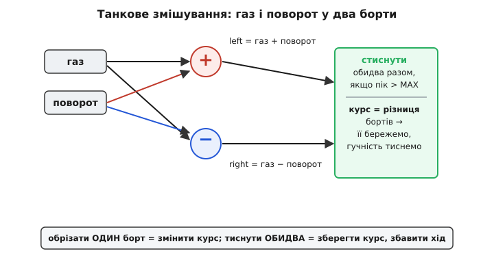
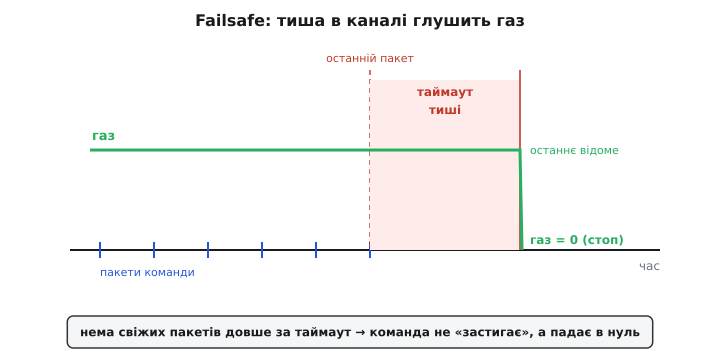

# ⚙️ Драйвер шасі: від радіоканалу до двох бортів, і що робити, коли лінк замовк

У самій темі ми лишили оголене серце шасі — функцію `chassis_drive`, що бере готові «газ» і «поворот» і кладе їх на два борти. Це було свідоме спрощення: там показувалась **механіка змішування**, а не бойовий код. Тепер зберемо навколо того серця повний драйвер — такий, який справді ганяє ровер із пульта й не вбиває його при першій же завадці. Різниця між «серцем» і «повним драйвером» — це рівно та обв'язка, яку в статті ми відклали: **звідки беруться числа газу й повороту** (сирий кадр з радіоприймача), **як їх очистити** (дедзона, межі), і — головне, заради чого весь цей код узагалі має право керувати мотором, — **що станеться, коли пульт замовкне**.

Останнє питання тут не косметичне, а вирішальне для безпеки. Ровер — це кілограми заліза на колесах із моментом, якого вистачить збити людину з ніг. Якщо оператор упустив пульт, вимкнув передавач, вийшов за дальність чи просто радіо потонуло в перешкодах — машина **не сміє** й далі виконувати останню команду. А наївний код робить саме це: остання команда лишається в змінній, мотори крутяться, і ровер по інерції їде «в останній відомий бік», поки не вгатиться в щось. Тому весь цей проєкт крутиться навколо одного залізного правила: **нема свіжого зв'язку — газ у нуль**.

Розкладімо задачу на шари й пройдімо кожен із робочим C для ESP32. Наприкінці все зійдеться в один цикл, який можна брати й класти в прошивку.

> 🔧 **Навіщо це.** Failsafe — це не «ще одна фіча», а та риса, що відрізняє іграшку від машини, якій можна довірити рух поруч із людьми. Промислова й аматорська практика тут одностайна: при втраті сигналу газ зводиться до нуля (у польотних контролерах — `failsafe_throttle`, типове значення відповідає «газ вимкнено»; після короткого утримання апарат роззброюється). Це усталена, документована норма (ArduPilot, Betaflight, INAV), не наша вигадка. Ровер підкоряється тій самій логіці: перше, що робить порядний драйвер шасі при тиші в каналі, — **гальмує сам**.

## Шар 0: що приходить із радіоканалу

Перш ніж щось змішувати, треба чесно уявити, **що саме** віддає радіоприймач. Класичний хобі-приймач видає кожен канал як **ширину імпульсу**: раз на ~20 мс він смикає ніжку в «1» на час від приблизно 1000 до 2000 мікросекунд, і саме цей час кодує положення стіка. 1500 мкс — середина (стік відпущено), 1000 — один край, 2000 — другий. Сучасніші приймачі (SBUS, CRSF та інші) шлють ті самі канали цифровою пачкою, але **семантика та сама**: число в діапазоні, де є центр і два краї.

Це дає нам першу незручну правду: сирий канал — це **не** «−1000…+1000», у яких думає наш змішувач. Це «1000…2000 мкс» із центром 1500. Отже, найперший крок драйвера — перевести сирий канал у нашу знакову величину: відняти центр і відмасштабувати. Газ на одному стіку, поворот на іншому.

І тут одразу лізе перша дрібна пастка, яку новачок пропускає, а потім годинами ловить «ровер сам поволі повзе»: **стік ніколи не стоїть рівно в центрі**. Механіка потенціометра, допуски, температура — і відпущений стік дає не рівно 1500, а 1493 чи 1508. Помножиш цей залишок на масштаб — і ровер при відпущеному газі ледь-ледь, але їде. Ліки — **дедзона** (англ. *dead zone*, «мертва зона»): вузьке віконце навколо центру, у якому ми **навмисно** віддаємо строгий нуль, ігноруючи дрож.

:::code proj-tank-mixer/c/shar-0-shcho-prykhodyt-iz.c

Зверни увагу на крок 2 — його майже завжди забувають, і дарма. Якщо просто відрізати дедзону порогом, але масштабувати від повного центру, то тієї миті, коли стік виходить за віконце, вихід **стрибком** підскакує на «ширина_дедзони × масштаб». Ровер сіпається на старті. Віднявши саму ширину дедзони перед масштабуванням, ми зшиваємо шкалу гладко: рівно на краю віконця вихід — нуль, і далі росте плавно. Дрібниця на три рядки, а відчувається на кермі як різниця між «поповзло» і «смикнуло».

## Шар 1: змішування — те саме серце, тепер у контексті

Тепер, маючи чисті газ і поворот у наших одиницях, повторюємо танкове змішування — але вже не як окрему демонстрацію, а як внутрішній крок повного драйвера. Нагадаю причинно-наслідково, **чому** воно саме таке: у ровера немає керма, курс задається **різницею** швидкостей двох бортів. Отже, «їхати» — це спільна складова обох бортів (газ), а «повертати» — різниця між ними (поворот). Складаєш їх: до одного борту поворот додаєш, від іншого віднімаєш.


*Танкове змішування у два борти. Газ іде в обидва однаково (спільна складова — рух уперед), поворот додається лівому й віднімається від правого (різниця — зміна курсу). Коли сума вилазить за межу ШІМ, ми тиснемо **обидва** борти пропорційно: курс — це їхнє співвідношення, тож збереження співвідношення береже курс, а падає лише загальна гучність. Обрізати один борт — значить крутнути ровер не туди.*

Далі — той самий пропорційний затиск при переповненні, який ми розібрали в темі, тож тут лише нагадаю його суть однією фразою й піду глибше туди, куди стаття не заходила. Суть: якщо `газ + поворот` перевищив `DRIVE_MAX`, не можна обрізати той борт, що зашкалив, — бо це **змінить різницю**, тобто курс. Треба стиснути **обидва** борти на однаковий коефіцієнт: гучність упаде, курс лишиться. Як саме різниця бортів перетворюється на радіус дуги й кутову швидкість — це вже [кінематика диференціального приводу](root:embedded/differential-drive-kinematics); тут нам досить того, що курс живе в **співвідношенні**, і його не можна псувати обрізанням.

## Шар 2: slew-rate — чому не можна кидати газ ривком

Ось де починається матеріал, якого в статті не було по-справжньому, лише згадкою. Уяви: ровер стоїть, оператор кидає стік газу з нуля на повний. Наївний драйвер тієї ж миті виставить бортам повний ШІМ. Що відбувається в залізі? Мотор стоїть, його обертів нема, а отже, нема й **проти-ЕРС** — тієї напруги, яку обертовий мотор наводить назустріч живленню й яка обмежує струм. Стоячий мотор при повному ШІМ — це майже [заклинений мотор](root:hw-motion/motor-current-stall-heat): струм злітає до значення, обмеженого лише опором обмотки, — кидок у рази більший за робочий.

Наслідки цього кидка — ланцюжок бід. По-перше, [H-міст](root:hw-motion/h-bridge) і батарея мусять віддати цей піковий струм; просідає напруга живлення. По-друге, коли живлення просіло, може перезавантажитися сам мікроконтролер — класична смерть дешевих зборок, де мотор і плата висять на одному хисткому регуляторі. По-третє, механічний ривок б'є по редуктору й колесах. І все це — заради того, чого оператор навіть не хотів: людина рідко бажає «за 10 мс від нуля до повного», вона просто різко штовхнула стік.

Ліки — **обмеження швидкості зміни** команди, *slew rate limiting*: не пускати вихід стрибати, а вести його до цілі маленькими кроками за кожен цикл. Мотор устигає розкрутитися, наростити проти-ЕРС, і струм тримається в межах. Це той самий прийом, який ми вже клали в серце `chassis_drive` функцією `slew`, — тепер розберімо його число.

**Умова: цикл драйвера — кожні 10 мс. Хочемо, щоб розгін від нуля до повного ходу (0 → 1000) займав приблизно 0.5 с. Який крок slew за цикл?**

```c
// Скільки циклів на розгін:
//   0.5 с / 0.010 с = 50 циклів
//
// Крок за цикл:
//   1000 / 50 = 20 одиниць за цикл
//
// Отже SLEW_PER_TICK = 20 дасть плавний розгін за півсекунди.
// Хочеш різкіший ровер — більший крок; хочеш м'якший старт — менший.
```

Ось чому це один рядок конфігурації, а не константа з голови: `SLEW_PER_TICK` — це прямий важіль «характеру» машини. Малий — ровер поважний, як навантажений візок; великий — смикається, як спортивний. Але фізична стеля тут не «як приємніше кермувати», а «який кидок струму витримує твоє живлення»: розгін мусить бути настільки плавним, щоб піковий струм не валив плату. Тому число підбирають знизу — від безпеки живлення, — а вже потім, якщо є запас, роблять різкішим під смак.

> 🔧 **Навіщо це.** Slew-rate — це не «щоб гарно їхало», а захист трьох речей одразу: мотор від струмового удару як при заклинюванні, живлення від просідання, що перезавантажує мозок, і механіку від ривка. Найдешевша ціна (пара змінних стану й дві порівнялки) за зникнення цілого класу «плата раптом перезавантажується, коли різко даю газ». Якщо колись побачиш ровер, що ребутиться саме в мить різкого старту, — перше, що перевіряють, це чи є тут slew-обмеження.

## Шар 3: струмовий foldback — коли колесо вперлося

Другий захист, теж лише згаданий у статті, — реакція на **зчеплення й затори**. Slew береже нас від ривка на розгоні, але є інша біда: ровер уперся колесом у камінь, застряг у канаві, буксує в багні. Стік газу тисне, драйвер слухняно тримає повний ШІМ, колесо не крутиться — і ми знову в режимі заклиненого мотора, тільки тепер надовго. Струм тримається на стелі, обмотка гріється, [аж до диму](root:hw-motion/motor-current-stall-heat).

Тут нас рятує те, що ми **вимірюємо струм** бортів (шунтом чи давачем на кожному H-мості). Логіка проста й називається **foldback** (англ., «згортання назад»): коли сумарний струм переліз через безпечний поріг, ми не рубаємо мотор різко в нуль, а **плавно тиснемо** команду тим сильніше, чим ближче струм до аварійної межі. Дійшов до верхньої межі — команда придушена в нуль. Це м'якше, ніж просте вимикання: ровер не смикається «увімк-вимк» на межі, а плавно збавляє натиск, тримаючи струм у безпечній зоні.

Чому саме foldback, а не звичайний поріг «вимкнув при перевищенні»? Бо жорсткий поріг на межі зчиняє автоколивання: струм переліз — вимкнули — струм упав — увімкнули — переліз… мотор деренчить, а середній струм усе одно високий. Плавне згортання дає натомість стійку рівновагу: команда сама сідає рівно настільки, щоб струм завмер біля межі. Це та сама ідея м'якого приборкання, що й у [гістерезисі сторожа присутності](root:embedded/mavlink-from-ground/proj-heartbeat-watchdog.md) — не рубати різко там, де можна плавно втримати.

## Шар 4: failsafe — головне, заради чого все

І тепер — серцевина проєкту, те, що в статті було відкладене явно: **що робити, коли зв'язок обірвався**. Усі попередні шари беззмістовні, якщо ровер продовжує їхати з упущеним пультом.

Спершу відчуй, у чому підступність. Обрив зв'язку — це **не подія**, це **відсутність** події. Радіоприймач не шле нам ввічливого «я втратив передавач»; він просто **перестає приносити свіжі значення**. Старі значення при цьому нікуди не діваються: змінна `throttle` тримає останню команду, і якщо драйвер щоцикл кладе на борти те, що в змінній, — він вічно виконує останній наказ мертвого пульта. Ровер на повному газу від'їхав за дальність — і поїхав так само на повному газу назавжди. Це і є та катастрофа, яку failsafe мусить не допустити.

Отже, детектувати треба не «прийшов сигнал розриву», а «**давно не приходило свіжого**». Механізм рівно той самий, що ми докладно вивели для серцебиття MAVLink: **годинник останнього живого сигналу** плюс **поріг тиші**. Тут його роль грає радіоканал: приймач, поки бачить передавач, регулярно (раз на ~20 мс) оновлює канали — і ми на кожне таке свіже оновлення штампуємо час. Якщо від останнього штампу минуло більше за поріг — лінк вважаємо мертвим, і газ **зводимо в нуль сам**.


*Логіка failsafe в часі. Поки з приймача йдуть свіжі пакети, газ тримається на останній команді оператора. Обірвався потік — годинник тиші пішов; поки тиша коротша за таймаут, ми ще терпимо (поодинокі втрати пакетів — норма радіо). Але щойно тиша переросла таймаут, драйвер **сам** зводить газ у нуль, не чекаючи жодної команди «стоп»: команда мертвого пульта не «застигає», а падає в безпечний стан.*

Скільки чекати? Та сама логіка, що з пропущеними ударами серцебиття: поодинокий втрачений кадр радіо — **норма**, канал шумний і губить пакети, миттєво панікувати не можна. Але кілька десятків мілісекунд тиші поспіль — це вже реальний обрив. Радіоприймач оновлює канали кожні ~20 мс, тож розумний поріг — кілька таких періодів. Візьмемо **100 мс**: п'ять пропущених оновлень поспіль — впевнено обрив, а не поодинока завадка. Тримати цей поріг у явній константі, а не в голові, — те саме правило, що й скрізь: різні приймачі мають різний період, і поріг легко підкрутити під конкретне залізо.

Ось детектор і його дія одним шматком:

:::code proj-tank-mixer/c/shar-4-failsafe-holovne.c

Дрібниця, що коштує дорого, якщо її проґавити: `link_alive` рахує вік як `now_ms - last_rc_ms` — **віднімання беззнакових**, а не порівняння `now_ms > last_rc_ms + timeout`. Причина та сама, що ми розбирали в сторожі присутності: 32-бітний `millis()` переповнюється приблизно раз на 49.7 доби, і в мить переповнення наївне порівняння збрехало б, оголосивши лінк мертвим на рівному місці. Беззнакова різниця «загортається» за модулем 2³² сама й дає правильний вік навіть через переповнення. Ровер рідко працює 50 діб поспіль без перезапуску, але писати таймаути через `now - then` — залізна звичка, яка нічого не коштує й одного дня рятує.

## Складаємо все: повний драйвер

Тепер усі шари сходяться в один цикл. Порядок кроків не випадковий, це причинно-наслідковий конвеєр: **failsafe над усім** (нема лінка — далі можна не рахувати, ціль нульова), потім чистий вхід → змішування → затиск → foldback → slew → залізо.

:::code proj-tank-mixer/c/skladaiemo-vse-povnyi.c

І цикл, що зводить приймач і драйвер докупи. Приймач працює своїм темпом (кадр раз на ~20 мс), драйвер крутиться щільніше (кожні 10 мс) — і на кожен свіжий кадр ми штампуємо час, а `chassis_update` окремо ганяємо по своєму такту. Розділення тактів навмисне: драйвер має тикати **частіше** за прихід кадрів, щоб і slew був гладкий, і failsafe спрацьовував без зайвого запізнення.

:::code proj-tank-mixer/c/skladaiemo-vse-povnyi-2.c

Придивися до однієї деталі в кроці 1: ми штампуємо `rc_mark_fresh` **лише** тоді, коли `rc_poll` реально повернув кадр. Якщо приймач замовк — `rc_poll` не поверне нічого, цикл `while` не виконається жодного разу, `last_rc_ms` не оновиться, його вік поповзе вгору — і за 100 мс `link_alive` поверне `false`, а `chassis_update` сам зведе газ у нуль. Уся failsafe-логіка тримається на цьому: **годинник оживає тільки від справжнього свіжого кадру**. Оживи його деінде — і зламаєш захист.

## Складність і пастки: де це ламається насправді

Драйвер вийшов компактний, але кожен його шар прикриває конкретну відмову, яку легко влаштувати недоглядом. Пройдімося по головних, зокрема по тих трьох, що названі в задачі.

**Пастка 1: shoot-through — і чому його тут немає.** Найнебезпечніша річ у керуванні мотором через H-міст — **наскрізний струм** (англ. *shoot-through*, він же *cross-conduction*, перехресна провідність): якщо у **одному плечі** мосту водночас відкриті верхній і нижній ключі, вони утворюють пряме коротке між живленням і землею. Струм у цю мить обмежений лише опором самих транзисторів — це майже справжнє КЗ, що вбиває ключі за мікросекунди. Виникає воно на **перемиканні напряму**: старий ключ ще не встиг закритися (транзистор гаситься не миттєво), а протилежний уже почав відкриватися — і на короткий час обидва проводять. Лікують це **мертвим часом** (англ. *dead-time*): навмисною паузою між «вимкнув один ключ» і «увімкнув протилежний», типово 100–300 нс для кремнієвих MOSFET-ів, щоб перший устиг закритися дочиста. Це усталений факт силової електроніки, не тонкість реалізації.

Чому ж у нашому коді про це ні слова? Бо ми **навмисно** сховали цю відповідальність за `hbridge_set`. У переважній більшості роверних зборок H-міст — це готова мікросхема-драйвер (типу DRV8871, TB6612, VNH-серії тощо), і вставку мертвого часу вона робить **сама, усередині**, апаратно. Наш `hbridge_set` лише каже їй «напрям такий, шпаруватість така», а межу перемикання плечей стереже кремній драйвера. Пастка тут ось у чому: якщо ти будуєш H-міст **із голих MOSFET-ів на дискретних затворних драйверах** — dead-time стає **твоїм** обов'язком, і забути про нього означає спалити плече на першому ж розвороті. Тому, беручи ШІМ-міст, першим ділом з'ясуй: мертвий час забезпечує мікросхема — чи це лягає на тебе? [Будова й керування H-мостом](root:hw-motion/h-bridge) — там ця межа розписана; наш драйвер шасі свідомо стоїть **над** нею й покладається на те, що плечі стережуться нижче.

**Пастка 2: ривок струму на старті (і його ліки — slew).** Ми розібрали це в шарі 2, тут лише зведу пастку в одне речення: **прямий стрибок газу з нуля на повний — це струмовий удар як при заклинюванні**, бо стоячий мотор не має проти-ЕРС, і струм обмежений самим лише опором обмотки. Симптом у полі впізнаваний: плата **перезавантажується саме в мить різкого старту** (просіла напруга живлення), або спрацьовує захист по струму, або з часом гріється й деградує мотор. Ліки — slew-rate: вести команду до цілі кроками, дати моторові розкрутитися й наростити проти-ЕРС. Дзеркальна помилка — зробити slew **надто** повільним «про всяк випадок»: тоді ровер ліниво відгукується на кермо й запізнюється в маневрі. Крок підбирають знизу — від того, який кидок витримує живлення, — і не повільніше, ніж треба.

**Пастка 3: зміна курсу при обрізанні одного борту.** Це та тонкість, яку ми винесли в крок 3 і яку інтуїція підказує **неправильно**. Хочеться: «борт зашкалив за межу — обріжу його до межі, решту лишу». І це псує керування: курс живе не в абсолютних швидкостях бортів, а в їхній **різниці**; обрізавши лише один борт, ти міняєш різницю — і ровер повертає не туди, куди задав оператор. Наочно: даєш повний газ (обидва борти 1000) і трохи повороту (+200 лівому). Лівий стає 1200 — за межею. Обріжеш лівий до 1000 — і обидва борти рівні: поворот **зник**, ровер поїхав прямо, хоча ти просив завертати. Правильно — стиснути **обидва** борти в співвідношенні (1200 і 800 → множимо на 1000/1200 → 1000 і 667): різниця збережена пропорційно, курс той самий, упала лише загальна швидкість. Оператор відчує «швидкість трохи просіла на повороті», а не «ровер не слухає кермо».

Тепер — граблі поза трьома названими, на які наступають не рідше.

**Failsafe, прив'язаний до значення каналу, а не до факту свіжості.** Спокуслива, але хибна ідея: «вважатиму лінк мертвим, коли газ упаде нижче 950 мкс» (мовляв, приймач у failsafe віддає низький газ). Це працює лише з приймачами, налаштованими на «низький газ у failsafe», і **тихо ламається** з тими, що в failsafe **просто перестають слати кадри** («no-signal» режим, який у сучасних приймачів поширений). У другому випадку канал застигає на **останньому** значенні — може бути й повний газ, — і твоя перевірка «газ < 950» ніколи не спрацює. Правильно завжди — стежити за **свіжістю кадру** (годинник `last_rc_ms`), а не за його вмістом: цей детектор ловить обидва типи failsafe, бо обидва зрештою означають «свіжі кадри перестали приходити». Наш `link_alive` саме такий.

**«Тихий» failsafe без явного гальмування.** Навіть якщо ти виявив обрив, лишається спокуса просто «не оновлювати команду» — мовляв, ровер сам зупиниться. Не зупиниться: остання команда живе в змінній, мотори тримають газ. Failsafe мусить **активно** виставити ціль у нуль (як робить крок 0), а не пасивно «нічого не робити». Різниця між «перестав слухати новий газ» і «свідомо звів газ у нуль» — це різниця між роваром, що втік, і роваром, що став.

**Failsafe, який рубає газ миттєво в нуль.** Протилежна крайність: виявив обрив — і тієї ж миті `hbridge_set(…, 0)` в лоб. Для повільного ровера це стерпно, але це знову той самий струмовий і механічний удар, тільки навпаки (різке гальмування двигуном). У нашому коді це вирішується красиво **само собою**: failsafe лише ставить **ціль** у нуль (крок 0), а до заліза команда все одно йде через **slew** (крок 5). Тож газ не падає обривом, а м'яко сходить у нуль за ті самі півсекунди розгінного темпу — і безпечно, і без ривка. Один і той самий slew-механізм працює і на розгін, і на аварійне гальмування; це приємний побічний наслідок того, що failsafe діє через ціль, а не повз конвеєр.

**Дедзона на вимкненому моторі, але не на живленні.** Дрібніша, але злить: якщо забути дедзону, відпущений стік дає ненульову команду, і `slew` слухняно розганяє ровер «сам собою» до тихого повзання. Дедзона мусить стояти **до** змішування (у `rc_to_signed`), щоб нуль стіка перетворювався на строгий нуль команди ще до того, як потрапить у конвеєр. Ставити її пізніше — латати симптом.

**Один давач струму на обидва борти чи по одному.** Наш `i_total` — сумарний струм. Це просто, але грубо: якщо буксує **один** борт, його струм тоне в сумі з нормальним другим, і foldback спрацює пізніше, ніж варто. Точніше — міряти струм **кожного** борту окремо й глушити foldback-ом лише той, що зашкалив (тоді, до речі, знову працює логіка «тисни пропорційно, не рубай різницю», щоб і в аварії не крутнути курс). Сумарний давач беруть, коли він один і дешевший; роздільний — коли важлива рання й точна реакція на застрягання одного боку.

Зрештою, весь цей драйвер — це той самий крихітний змішувач із теми, обгорнутий шарами, кожен з яких відповідає рівно одній фізичній загрозі: дедзона — дрожі стіка, змішування зі стисненням — збереженню курсу, slew — струмовому удару на розгоні, foldback — застряганню, а failsafe — найголовнішій загрозі, мертвому пульту. Прибери failsafe — і всі інші шари стають технічно охайним способом дати ровару втекти на повному газу. Тому в порядку кроків він стоїть **над усіма**: перше рішення кожного циклу — «а чи я взагалі маю право зараз кермувати?» — і лише якщо лінк живий, решта конвеєра має сенс.
