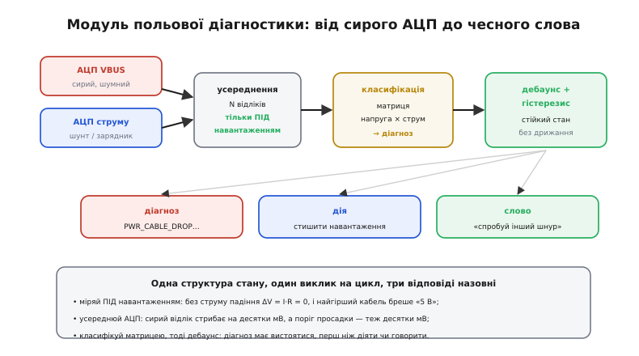
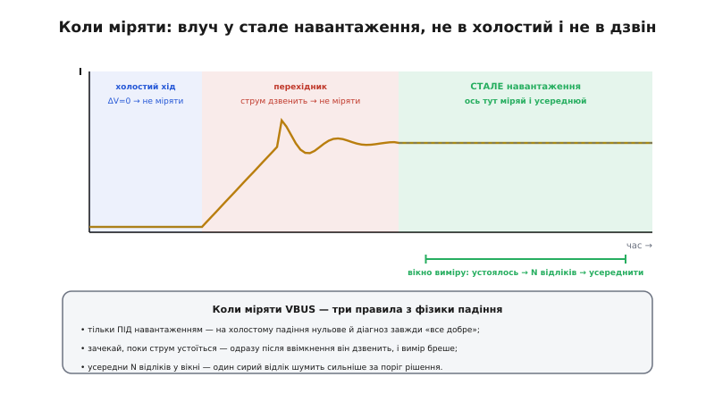

# ⚙️ Польовий діагност живлення: один модуль прошивки

У детальному кроці ми зібрали всю фізику докупи, але код лишили розкиданим: окремо функція `diagnose_power`, що читає матрицю напруга×струм, окремо `power_supervise` з гістерезисом brownout. Кожен шматок ми бачили самотужки й розуміли, **навіщо** він. Та в реальній прошивці ці шматки не живуть окремими острівцями — вони мусять працювати разом, на тих самих даних, у тому самому циклі, і ділити спільну біду: **сирий АЦП бреше**. Виміряли раз — отримали число, що стрибає на десятки мілівольтів від такту до такту; поставили поріг просадки — а він теж у десятках мілівольтів; і ось уже діагност миготить «кабель–усе добре–кабель» на рівному вході.

Тому зберемо все в **один модуль**: одна структура стану, один виклик на цикл, три чесні відповіді назовні — діагноз, дія, слово користувачу. Це той самий хід, що ми робили з [детектором відмови давача](root:embedded/sensor-fault-detection): один раз написати правильно — з усередненням, дебаунсом і гістерезисом — і далі користуватися, не думаючи щоразу, коли міряти й чому число дрижить. Різниця в тім, що тут «правильно» означає ще й **чесно**: пристрій, який сам поставив собі діагноз, може або тихо стишитися замість падати, або сказати людині «спробуй інший шнур» — замість німого блимання, від якого народжується злий відгук.

## Задача

Сформулюймо точно, що модуль має вміти. Кожна зайва функція тут — зайвий шанс на тонкий баг, тож окреслимо рівно потрібне.

- **Прочитати свій вхід чесно.** Виміряти VBUS (*bus voltage* — напруга шини живлення) на боці **пристрою**, під реальним навантаженням, і оцінити струм заряду. Не напис на блоці, не холостий хід — саме те, що **дійшло** й що ми **тягнемо**.
- **Поставити діагноз за матрицею.** Звести дві цифри — просіла напруга чи ні, є струм чи нема — у чотири клітинки з детального кроку: усе гаразд / падіння в кабелі / невдалі переговори / м'який блок. Плюс п'ятий випадок: живлення практично нема (шукай контакт).
- **Не сіпатися від шуму й перехідників.** Сирий АЦП стрибає, струм на старті дзвенить, батарея по ходу заряду бере то більше, то менше. Діагноз має **вистоятися**, перш ніж ми на нього зреагуємо чи про нього скажемо.
- **Стишитися, а не впасти.** Коли VBUS просідає до порогу brownout, прибрати некритичне навантаження й тягти далі на слабкому вході — з гістерезисом, щоб не дрижати на самій межі («раз із трьох»).
- **Сказати людині правду.** Перетворити діагноз на коротке чесне повідомлення — але лише коли він стабільний, щоб не блимати текстом так само, як блимала б погана логіка станом.
- **Жити на голому залізі.** Жодного `malloc`, фіксований розмір, передбачуваний час, придатність до виклику з циклу нагляду за живленням чи навіть із [переривання](root:hw-arch/isr) таймера.

> 🔧 **Навіщо це.** Межі задачі тут — половина успіху. Спокуса дописати в діагност «трохи оцінки ємності батареї», «трохи керування зарядом», «а давай ще й PD-переговори звідси смикати» закінчується модулем, який сам стає джерелом помилок і який страшно чіпати. Діагност має робити **одне**: чесно сказати, що зараз коїться з живленням. Керування зарядом — окрема ланка; [переговори PD](root:embedded/pd-sink-design) — окремий шар. Вузький модуль легко перевірити, легко довірити й легко перенести на наступний виріб.

## Ідея

Складімо все в одну картину — як сирі відліки протікають крізь модуль і перетворюються на три відповіді.

*Два сирі входи зліва — АЦП VBUS і оцінка струму (з шунта чи від зарядника). Спершу **усереднення** N відліків, і то лише **під навантаженням**: без струму падіння ΔV = I·R нульове, і найгірший кабель показав би «5 В». Далі **класифікація** матрицею напруга×струм дає сирий діагноз. Тоді **дебаунс і гістерезис** роблять із нього стійкий стан, що не дрижить. Назовні — три відповіді: діагноз (для лога), дія (стишити навантаження) і слово (повідомлення користувачу).*

Ключова думка — **розділення двох питань, які легко переплутати**: «яка цифра зараз» і «що це означає стабільно». Перше питання — вимірювальне: тут живуть усереднення й правило «коли міряти». Друге — логічне: тут живуть матриця, дебаунс і гістерезис. Плутати їх — класична помилка. Якщо класифікувати кожен сирий відлік, діагност істеритиме на шумі; якщо ж намагатися «згладити» саму матрицю, вона втратить різкість. Тому вимір лишається чистим і усередненим, а терпіння живе **окремо**, після класифікації.

Друга думка, без якої модуль бреше, — **коли саме міряти**. Не будь-коли, а у вікні, де струм устоявся.

*Струм у часі проходить три зони. **Холостий хід** — струму майже нема, падіння нульове, діагноз завжди був би «все добре» (міряти безглуздо). **Перехідник** — одразу після ввімкнення навантаження струм дзвенить, і будь-який вимір у цю мить бреше. І лише **стале навантаження** — зона правди: тут струм устоявся, падіння ΔV = I·R вийшло на своє значення, і саме тут треба зробити N відліків та усереднити. Влучити у вікно — половина коректного діагнозу.*

І третя, найтонша думка — **гістерезис проти дрижання**. Ми вже бачили її двічі: у [тригері Шмітта](root:hw-analog/schmitt-trigger) на напрузі й у детекторі відмови на «кількості поганих поспіль». Тут вона працює на двох рівнях одразу. По-перше, сам brownout має два пороги: падаємо в економний режим на одному рівні, вертаємось у повний — на іншому, вищому, із запасом. По-друге, зміна діагнозу теж дебаунситься: новий діагноз мусить протриматися кілька циклів, перш ніж ми його приймемо. Обидва механізми б'ють по тому самому ворогу — по «раз із трьох», коли система стоїть упритул до порога, а вхід сам по собі гуляє.

## Робочий код: інтерфейс і стан

Почнімо з того, що видно зовні, — із заголовка. Тут уся домовленість: які діагнози бувають, що ми тримаємо в стані, які пороги налаштовуємо. Це той інтерфейс, через який старший код (цикл нагляду за живленням, застосунок) спілкується з модулем, не знаючи його нутрощів.

:::tabs
:::code proj-field-diagnostics/c/power_diag.h
:::code proj-field-diagnostics/py/power_diag.py
:::

Зверніть увагу на три рішення просто в структурах. По-перше, **конфіг і стан розділені**: незмінні пороги (`pwr_cfg_t`) лягають у `const` — у ПЗП мікроконтролера, — і той самий конфіг обслуговує хоч кілька портів. По-друге, у стані **два діагнози**: `diag` (прийнятий, стабільний — його бачить світ) і `pending` (кандидат, що ще дебаунситься). Саме ця пара й реалізує «діагноз має вистоятися»: сирий результат класифікації спершу стає кандидатом, і лише протримавшись `debounce_cycles` поспіль — прийнятим. По-третє, **нуль = безпечний старт**: `diag = PWR_OK`, `low_power = false`, `valid = false`. Чому старт із `PWR_OK`, а не з тривоги? Бо доки ми не виміряли під навантаженням, підстав кричати «кабель!» немає; перший же справжній вимір чесно проведе стан через дебаунс.

## Робочий код: вимір під навантаженням

Найтонше в усьому модулі — **вимір**, бо саме тут сирі дані найбрехливіші. Розберімо два helper'и: читання усередненого VBUS і оцінку струму. Це та частина, якої в детальному кроці не було зовсім — там ми брали `vbus_mv` як готове число, ніби воно береться з повітря.

:::tabs
:::code proj-field-diagnostics/c/power_diag.c
:::code proj-field-diagnostics/py/power_diag-2.py
:::

Тут ховається перша реальна пастка, про яку варто сказати прямо. АЦП мікроконтролера рідко дає рівне число: навіть на ідеально сталому вході сусідні відліки стрибають на молодший розряд-другий через тепловий шум, наводки, дрижання опорної напруги. На 12-бітному АЦП з опорою 3.3 В один молодший розряд — це вже ~0.8 мВ **на вході АЦП**, а після дільника напруги VBUS (скажімо, 1:6, щоб 20 В влізли в 3.3 В) цей розряд перетворюється на ~5 мВ реального VBUS. Кілька розрядів шуму — і сирий вимір гуляє на десятки мілівольтів, тобто **порівнянно з відстанню між нашими порогами**. Усереднення N відліків давить цей випадковий шум у √N разів: 16 відліків — учетверо тихіше, 64 — увосьмеро. Ось звідки `adc_avg_log2` у конфігу: степінь двійки, бо тоді ділення — це дешевий зсув, а не справжня операція ділення.

> 🔧 **Навіщо це.** Пропустити усереднення — найчастіша причина «діагност бреше». Без нього сирий VBUS раз за разом випадково падає під поріг просадки — і модуль оголошує «кабель» на ідеальному живленні, кожен третій-четвертий цикл. Ви витратите день, шукаючи баг у логіці, хоча логіка бездоганна: винен шум АЦП, який ви подали в поріг «як є». Правило залізне: **між сирим АЦП і будь-яким порогом рішення завжди стоїть усереднення**.

Оцінку струму винесено в окремий гачок навмисно — бо джерел два, і вони різні за точністю. Найчесніший — власний **шунт** (*shunt* — низькоомний резистор у лінії, ~5 мОм) із підсилювачем: спад напруги на ньому прямо пропорційний струму, і ми міряємо реальний струм заряду, який тече в пристрій. Дешевший — **запитати зарядну мікросхему**: багато контролерів заряду мають внутрішній АЦП і регістр із поточним струмом, який можна прочитати по I²C. Другий шлях економить деталь, але дає струм із затримкою й округленням мікросхеми; для діагностики цього зазвичай досить — нам треба грубо «є струм чи нема», а не мікроампери. Модулю байдуже, звідки число: `hw_charge_current_ma` ховає вибір.

## Робочий код: класифікація й дебаунс

Тепер серце — крок нагляду. Він міряє (лише під навантаженням), класифікує матрицею й дебаунсить результат. Це та сама `diagnose_power` з детального кроку, але тепер обгорнута всім, чого їй бракувало, щоб працювати в полі.

:::tabs
:::code proj-field-diagnostics/c/robochyi-kod.c
:::code proj-field-diagnostics/py/power_diag-3.py
:::

Розберімо тонкі місця, бо саме в них ховаються баги, які потім ловлять тижнями.

**Brownout і класифікація живуть по-різному.** Гістерезис brownout (крок 2) рахується **кожен** цикл, навіть на холостому ходу, — бо стишення реагує на **абсолютну** напругу, а вона може просісти й без нашого струму (сусіднє навантаження на тій самій шині, кволий блок). А класифікація (крок 3) працює **лише під навантаженням**, бо весь її сенс — розрізнити «падіння в кабелі» від «переговорів», а без струму падіння нульове й розрізняти нема чого. Це два різні питання на тих самих даних, і плутати їхні умови — помилка: якби ми класифікували на холостому, отримали б вічний `PWR_OK` навіть із геть поганим кабелем (бо без струму він і справді «тримає 5 В»), і діагност був би сліпий рівно там, де потрібен.

**Порядок у матриці не випадковий.** `PWR_NO_POWER` перевіряємо першим: якщо напруги майже нема, решта питань (просіла? є струм?) безглузді — це не «поганий кабель», а «нема контакту». Далі дві булеві змінні `sag` і `low_i` розкладають решту на чотири клітинки рівно як у таблиці детального кроку. Зверніть увагу на четверту, рідкісну: `sag && low_i` — і напруга сіла, **і** струму нема — це не кабель (кабель просаджує саме **під** струмом) і не переговори (там напруга якраз тримається), а **м'який блок**, що не тягне напруги під жодним пристойним навантаженням. Лінійне дерево з базового кроку цей випадок пропускало; матриця — ні.

**Дебаунс скидається на холостому.** У кроці 3, коли струму нема, ми обнуляємо `pending_run`. Це важливо: якби ми лишили лічильник, то після паузи в навантаженні старий кандидат «дорахувався» б до прийняття вже на несвіжих даних. Скидання каже: серія підтверджень має бути **безперервною й під навантаженням**, а будь-яка пауза починає рахунок наново. Це та сама дисципліна «поспіль», що й у лічильниках `bad_run`/`good_run` детектора відмови.

> 🔧 **Навіщо це.** Дебаунс діагнозу — не педантизм, а різниця між застосунком, що спокійно каже «заряджаю повільно: схоже, кабель», і застосунком, чий текст блимає «кабель–усе добре–кабель» щосекунди. Користувач, який бачить блимання, вирішує, що пристрій зламаний, — навіть якщо діагноз по суті правильний. Стабільне слово вимагає стабільного діагнозу; стабільний діагноз дає дебаунс. Ті самі кілька рядків, що рятують нерви користувача, рятують і вашу репутацію.

## Робочий код: чесне слово користувачу

Остання ланка — перетворити стабільний діагноз на коротке чесне повідомлення. Це не косметика, а **інженерна функція**: пристрій, який мовчки блимає, породжує злий відгук; пристрій, який пояснив, спонукає людину пошукати інший шнур.

:::tabs
:::code proj-field-diagnostics/c/robochyi-kod-chesne-slovo.c
:::code proj-field-diagnostics/py/power_diag-4.py
:::

Формулювання тут навмисно **скеровані на дію**, а не на діагноз заради діагнозу. «Схоже на кабель — спробуйте товщий або коротший» одразу підказує людині наступний крок; «падіння напруги на провіднику через опір міді» було б технічно точніше, але марно для користувача. Зверніть увагу й на подвійне повідомлення для `PWR_OK`: коли ми стишились (`low_power`), напруга технічно «в нормі відносно матриці» (струм є, під поріг просадки ще не впали при малому апетиті), але вхід слабкий — і чесно про це сказати. Це той випадок, де діагноз і режим стишення дають різні грані правди, і UI показує обидві.

## Як цим користуватися

Окреме гарне в модулі — як мало коду на боці виклику. Опишіть конфіг раз, крутіть `pwr_diag_step` у циклі нагляду, читайте три відповіді.

:::tabs
:::code proj-field-diagnostics/c/iak-tsym-korystuvatysia.c
:::code proj-field-diagnostics/py/iak-tsym-korystuvatysia.py
:::

Цей приклад показує **межу** модуля наживо. Сам діагност лише **описує** стан — рішення «стишити» ухвалює виклик через `reduce_load`, а що саме прибирати (підсвітку? радіо? знизити тактову?) — це вже задача системи, не діагноста. Так само `ui_show_power_status` — чужа ланка: модуль дає готовий рядок, а куди його показати (спливне, рядок стану, світлодіод-моргалка) вирішує застосунок. Порівняння повідомлень **за вказівником** (`msg != shown`) працює тому, що всі рядки статичні й незмінні: однаковий діагноз завжди повертає той самий вказівник, тож UI оновлюється рівно тоді, коли слово справді змінилось.

## Складність і пастки

Алгоритмічно модуль тривіальний: `O(N)` на вимір через усереднення (N — кілька десятків відліків), `O(1)` пам'яті, жодних буферів історії. Уся справжня складність — **не** в обчисленнях, а у виборі чисел і в кількох гострих кутах, де «майже правильно» означає «зрідка зрадить». Пройдімо їх.

**Коли міряти — найважливіша пастка, і вона мовчазна.** Модуль сам стежить за `i_load_min_ma`, тобто не класифікує на холостому. Але є тонший бік — **перехідник**. Одразу після того, як увімкнулося навантаження чи стрибнув струм заряду, VBUS і струм кілька мілісекунд **дзвенять**: вхідні конденсатори перезаряджаються, стабілізатор блока доганяє. Вимір у цю мить бреше — можна впіймати провал напруги, якого «стало» немає, і хибно оголосити `PWR_CABLE_DROP`. Захист: викликати `pwr_diag_step` із **сталого** циклу нагляду (раз на 100 мс), а не одразу після кожної зміни навантаження, і покладатися на дебаунс, який відсіє поодинокий брехливий цикл. Якщо навантаження стрибає часто, варто ще й пропускати перший цикл після зміни — але для більшості виробів рівномірного циклу нагляду досить.

**Скільки відліків усереднювати — компроміс із часом.** Кожне подвоєння N давить шум у √2, але й подовжує вимір. `adc_avg_log2 = 5` (32 відліки) на типовому АЦП зі швидкістю ~1 мкс/відлік — це ~32 мкс, дрібниця. Але на повільному АЦП або якщо між відліками стоїть перемикання каналу мультиплексора, 32 відліки можуть з'їсти помітний час. Правило: беріть **найменше** N, за якого усереднений VBUS перестає стрибати через поріг на сталому вході. На практиці 16–64 відліки покривають майже все; менше 8 зазвичай замало проти шуму 12-бітного АЦП, більше 256 — марна трата часу, бо там уже вилазить не випадковий шум, а систематична похибка дільника, яку усередненням не прибереш.

> 🔧 **Навіщо це.** Поширена помилка новачка — плутати два різні джерела похибки. Усереднення давить лише **випадковий** шум (тепловий, наводки) — те, що стрибає туди-сюди навколо правди. Воно **безсиле** проти систематичної похибки: якщо ваш дільник має резистори з 5% допуском, усереднення хоч мільйона відліків дасть стабільно **неправильне** число. Випадкове лікують усередненням; систематичне — калібруванням (виміряти відомі 5.00 В точним приладом і зберегти поправку). Не чекайте від усереднення того, чого воно не вміє.

**Пороги — не з повітря, а з фізики.** `vbus_sag_mv` ставлять **між** очікуваною напругою й порогом brownout: досить низько, щоб дрібна нормальна просадка на доброму кабелі не рахувалась «падінням», але вище brownout, щоб діагноз «кабель» устиг з'явитися **перед** тим, як пристрій почне стишуватись. Порядок такий: `vbus_dead < brownout_trip < brownout_clear < vbus_sag < vbus_nominal`. Якщо переплутати й поставити `vbus_sag` нижче за `brownout_clear`, вийде безглуздя: пристрій уже стишився, а діагност ще каже «все добре». Пороги — це драбина, і щаблі не можна міняти місцями.

**Гістерезис brownout — ліки саме від «раз із трьох».** Якби поріг падіння й повернення збігалися, система на межі перемикалася б туди-сюди від найменшого гуляння VBUS — того самого гуляння, що ми розбирали в детальному кроці (струм заряду сам міняється, опір контакту стрибає). Розведені пороги (впав на 4.0, повернувся лише на 4.3) дають «мертву зону» 300 мВ, у якій дрібне коливання нічого не ламає. Ширину зони беруть **більшою** за типову амплітуду гуляння VBUS: якщо вхід гуляє на ±0.15 В, зона в 0.3 В якраз накриває розкид. Замалá зона — і дрижання пролізе крізь неї; завелика — і пристрій сидітиме в стишенні довше, ніж треба, після того як напруга вже піднялась.

**`i_expect_ma / 2` як поріг «мало струму» — чому половина.** Класифікація вважає струм «малим», якщо він нижчий за **половину** очікуваного. Чому не, скажімо, 90%? Бо струм заряду законно гуляє: батарея по ходу заряду бере то більше, то менше, наприкінці заряду струм природно спадає. Якби поріг стояв близько до очікуваного, діагност оголошував би «переговори не вдались» щоразу, коли заряд просто доходить до кінця. Половина — грубий, але надійний рубіж: «є суттєвий струм» проти «струму практично нема». Якщо ваш зарядний профіль має чіткіші фази, поріг можна прив'язати до фази заряду — але для діагностики груба половина зазвичай безпечніша за розумну точність.

**Переповнення й типи.** Акумулятор `acc` в усередненні — `uint32_t`: навіть 256 відліків по 20000 мВ дають 5.12 млн, що вільно влазить у 32 біти, тож переповнення тут немає. А от якби хтось поставив `adc_avg_log2` завеликим (скажімо, 20 — мільйон відліків), вимір повис би на секунди — тому в реальному коді варто обмежити `adc_avg_log2` розумною стелею (≤ 8) прямо в `init` або документацією. Дрібниця, але саме такі «а що як хтось передасть безглузде значення» відрізняють модуль, який переживе чужі руки, від того, що впаде на першому кривому конфігу.

**Виклик із переривання.** `pwr_diag_step` без `malloc` і без блокувань, тож його **можна** кликати з таймерного [ISR](root:hw-arch/isr). Дві осторóги. Перша: усереднення робить N синхронних читань АЦП — якщо кожне читання чекає на завершення перетворення, це блокує ISR на весь час виміру; у гарячому перериванні краще запускати АЦП у режимі DMA й читати готовий усереднений результат, а не крутити цикл опитування в ISR. Друга: якщо стан діагноста читає й головний цикл (`pwr_low_power` у логіці навантаження), а пише ISR, читайте прапорці атомарно — `bool` і `enum` вміщаються в слово, тож саме читання атомарне на 32-бітному ядрі, але якщо треба зчитати **разом** діагноз і цифри, беріть їх під коротку заборону переривань, щоб не впіймати півоновлення.

**`reduce_load`/`restore_load` мусять бути ідемпотентні.** Модуль кличе їх щоцикл, поки тримається режим (не лише на переході). Це навмисно — простіше й надійніше, ніж ловити фронт, — але тоді самі функції зобов'язані терпіти повторний виклик: `reduce_load`, викликана вдесяте поспіль, не має гасити те, що вже погашено, чи псувати стан. Якщо ж прибирання навантаження дороге, ловіть перехід самі (порівнюйте з попереднім `low_power`) — але тоді не забудьте про самий **перший** виклик, де попереднього стану ще немає.

Зведімо. Код модуля — кілька десятків рядків нудної, передбачуваної логіки, і це його чеснота: нудний код не має де ховати баги. Уся справжня робота — у трьох речах, які легко проґавити. **Коли міряти**: лише під навантаженням, у сталому вікні, не в дзвоні перехідника. **Як міряти**: усереднювати сирий АЦП, бо один відлік шумить сильніше за поріг рішення, і пам'ятати, що усереднення давить лише випадкове, не систематичне. **Як не дрижати**: гістерезис на brownout і дебаунс на діагнозі, обидва проти того самого «раз із трьох». Зробіть ці три речі свідомо — і дістанете один перевірений модуль, що чесно каже, [чому пристрій заряджається погано](root:embedded/pd-sink-design), стишується замість падати на слабкому вході й говорить із людиною людською мовою. А це рівно той рубіж, що відділяє виріб, на який шлють гарантійні скарги через чужі дешеві кабелі, від виробу, який ті самі кабелі прощає й чесно про них попереджає.
