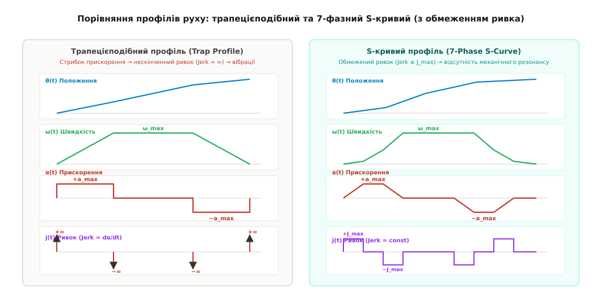
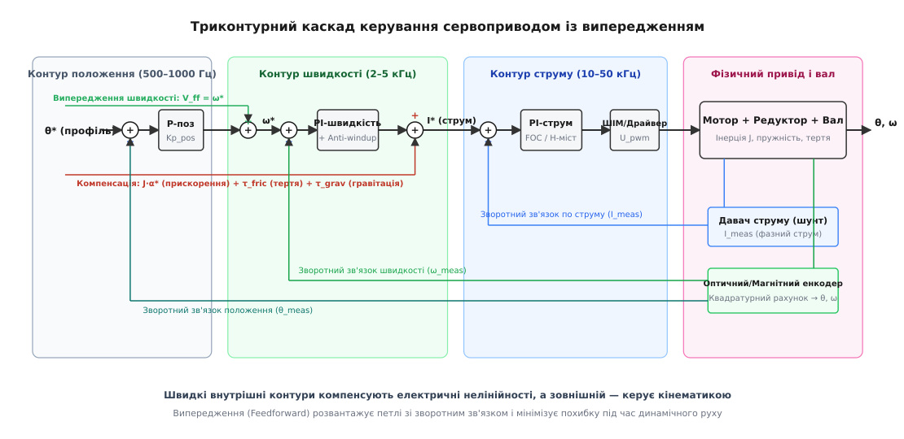
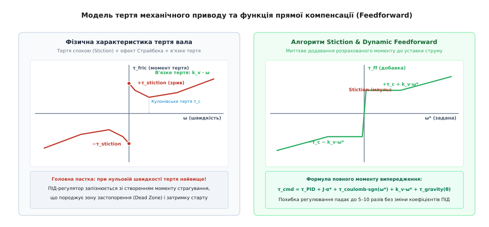
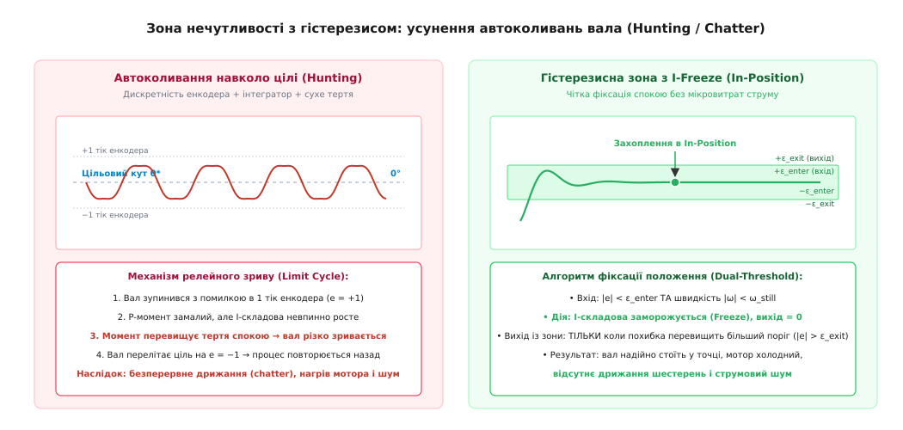

# Вал приходить у заданий кут

<preknowlist>
- [Дискретний ПІД](root:com-signal/discrete-pid) — пропорційно-інтегрально-диференціальний закон керування у дискретному часі.
- [Анти-windup](root:math-analysis/anti-windup) — обмеження інтегрального насичення при виході регулятора на фізичну межу.
- [Профілі руху](root:com-signal/motion-profiles) — планування траєкторії переміщення у часі з обмеженням швидкості й прискорення.
- [Вимірювання струму мотора](root:hw-motion/motor-current-sense) — шунти, фазні давачі та зв'язок струму з крутним моментом.
- [Оптичний енкодер](root:hw-sensing/optical-incremental-encoder) — формування квадратурних імпульсів для визначення кута вала.
- [Тертя](root:ph-mechanics/friction) — сухе тертя Кулона, тертя спокою (stiction) та в'язкий опір середовища.
</preknowlist>

Коли на замкнений контур керування мотором подають пряму команду змінити положення — наприклад, миттєвий стрибок уставки кута вала від `0°` до `90°`, — первинна похибка положення в перший же такт мікроконтролера стрибає до `90°`. Пропорційна та інтегральна складові регулятора миттєво насичують вихідний сигнал, вимагаючи від силового драйвера максимальних 100% шпаруватості ШІМ. Струм в обмотках злітає до межі заклинювання (*stall current*), ротор зривається з місця з максимальним можливим прискоренням, а шестерні редуктора отримують потужний ударний крутний момент. На підльоті до цільового кута накопичена кінетична енергія маховика чи навантаження не дозволяє мотору зупинитися миттєво: вал пролітає задану точку (*overshoot*), регулятор панічно реверсує струм, і система входить у тривалі затухаючі або навіть незгасаючі автоколивання, розбиваючи механіку й перегріваючи обмотки.

Прецизійне сервопозиціонування вала вимагає докорінно іншого підходу: цільовий кут ніколи не подається на регулятор сходинкою. Замість цього рух розгортається у часі за допомогою генератора профілю руху (*Motion Profile Generator*), який видає плавну послідовність проміжних координат, швидкостей та прискорень, а саму структуру регулювання розбивають на три вкладені каскадні контури — струм (момент), швидкість та положення — із додаванням прямого випереджального керування (*Feedforward*) та нелінійної зони нечутливості біля цілі.

## Профілювання руху: трапеція та обмеження ривка

Завдання генератора траєкторії — перетворити дискретну команду оператора «перейти в координату `θ_target`» на неперервні функції часу для бажаного положення `θ*(t)`, бажаної швидкості `ω*(t)` та бажаного прискорення `α*(t)`. Регулятор положення більше не бореться з велетенською раптовою похибкою: він відстежує рухому опорну точку, яка переміщується з фізично досяжною для приводу динамікою.

Найпростішим і найпоширенішим є трапецієподібний профіль швидкості (*Trapezoidal Velocity Profile*). Рух ділиться на три послідовні фази:
1. Фаза розгону: постійне максимальне прискорення `α(t) = +a_max`, швидкість зростає лінійно від `0` до `ω_max`.
2. Фаза рівномірного руху: прискорення дорівнює нулю `α(t) = 0`, швидкість залишається сталою `ω(t) = ω_max`.
3. Фаза гальмування: постійне сповільнення `α(t) = −a_max`, швидкість лінійно падає до нуля точно в момент досягнення `θ_target`.

Розрахунок тривалості фаз починається з визначення критичної дистанції `Δθ_crit`, необхідної для повного розгону до `ω_max` та наступного гальмування до повної зупинки:

```
Δθ_accel = ω_max² / (2 · a_max)        [дистанція розгону за формулою рівноприскореного руху]
Δθ_decel = ω_max² / (2 · a_max)        [дистанція гальмування за симетричного сповільнення]
Δθ_crit = Δθ_accel + Δθ_decel          [сумарний шлях без фази постійної швидкості]
= ω_max² / a_max                       [спрощення: додавання двох однакових часток]
```

Якщо загальне необхідне переміщення `|Δθ| = |θ_target − θ_start|` перевищує `Δθ_crit`, профіль є повноцінною трапецією. Час розгону `t_acc`, час руху зі сталою швидкістю `t_flat` та загальний час руху `t_total` обчислюються аналітично:

```
t_acc = ω_max / a_max                  [час розгону до максимальної швидкості]
Δθ_flat = |Δθ| − Δθ_crit               [шлях, пройдений на сталій максимальній швидкості]
t_flat = Δθ_flat / ω_max               [тривалість фази руху з постійною швидкістю]
t_total = 2 · t_acc + t_flat           [загальний час виконання траєкторії]
```

Якщо ж переміщення коротке (`|Δθ| < Δθ_crit`), привід просто не встигає набрати `ω_max` і має почати гальмування одразу після завершення розгону. Профіль вироджується в трикутник (*Triangular Profile*), а фактична пікова швидкість `ω_peak` виявляється меншою за ліміт:

```
ω_peak = √( |Δθ| · a_max )             [пікова швидкість у точці зміни знаку прискорення]
t_acc = ω_peak / a_max                 [тривалість фази розгону в трикутному профілі]
t_total = 2 · t_acc                    [загальний час трикутного профілю]
```

Хоча трапецієподібний профіль обчислювально простий, він має фундаментальний фізичний дефект: на границях між фазами прискорення змінюється стрибком від `0` до `+a_max`, потім до `0`, а згодом до `−a_max`. Похідна прискорення за часом — ривок (*Jerk* `j(t) = dα/dt`) — у ці моменти прямує до нескінченності.

Стрибок прискорення означає миттєвий стрибок крутного моменту мотора `Δτ = J · Δα`, де `J` — момент інерції ротора й навантаження. Цей ударний момент збуджує власні пружні коливання валів, зубчастих ременів та редукторів. Привід починає дзвеніти на резонансних частотах механічної конструкції, що руйнує точність позиціонування та скорочує ресурс підшипників і зубців.


*Зліва — трапецієподібний профіль швидкості зі східчастим прискоренням та нескінченним ривком у вузлових точках. Справа — 7-фазний S-кривий профіль із обмеженим ривком, де прискорення наростає лінійно, забезпечуючи плавний безударний рух механіки.*

Для усунення ударних навантажень застосовують S-кривий профіль руху (*S-Curve Motion Profile / Jerk-limited Profile*). У ньому обмежено не лише максимальну швидкість `ω_max` та прискорення `a_max`, а й максимальну швидкість наростання самого прискорення — граничний ривок `J_max`. Траєкторія складається з семи окремих фаз:
1. Наростання прискорення: `j(t) = +J_max`, `α(t)` лінійно зростає від `0` до `a_max`, швидкість плавно вигинається вгору за параболою `ω(t) = 0.5 · J_max · t²`.
2. Рух із постійним прискоренням: `j(t) = 0`, `α(t) = +a_max`, швидкість зростає лінійно `ω(t) = ω_1 + a_max · t`.
3. Спадання прискорення: `j(t) = −J_max`, `α(t)` лінійно падає від `a_max` до `0`, швидкість плавно підходить до `ω_max`.
4. Рівномірний рух: `j(t) = 0`, `α(t) = 0`, `ω(t) = ω_max`, переміщення наростає лінійно.
5. Наростання сповільнення: `j(t) = −J_max`, `α(t)` лінійно падає від `0` до `−a_max`.
6. Рух із постійним сповільненням: `j(t) = 0`, `α(t) = −a_max`, швидкість падає лінійно.
7. Спадання сповільнення: `j(t) = +J_max`, `α(t)` лінійно повертається до `0` точно в момент, коли швидкість падає до нуля, а положення досягає `θ_target`.

Якщо переміщення коротке, профіль симетрично вироджується: спочатку зникає фаза постійної швидкості 4 (отримуємо 6-фазний профіль), а якщо дистанція ще менша — прискорення не встигає досягти `a_max`, і профіль стає 4-фазним із плавними параболічними переходами.

Завдяки S-подібному згладжуванню кривої швидкості мотор нарощує крутний момент плавно, обираючи люфти редуктора без металевого удару та не збуджуючи резонансних коливань пружних муфт.

## Архітектура каскадного регулювання

Керувати положенням вала за допомогою єдиного ПІД-регулятора, який би на основі похибки `θ_error = θ* − θ` безпосередньо формував шпаруватість ШІМ напруги мотора, неможливо з двох причин: різної часової динаміки процесів та відсутності контролю проміжних фізичних величин.

Електромагнітні процеси в обмотках мотора (наростання струму `I`) мають сталу часу порядку часток мілісекунди:

```
τ_e = L / R                            [електрична стала часу індуктивності та опору обмотки]
```

Механічні процеси розгону ротора (зміна швидкості `ω`) мають сталу часу в десятки чи сотні мілісекунд:

```
τ_m = J / k_v                          [механічна стала часу інерції ротора та в'язкого тертя]
```

Зміна ж кута `θ` є інтегралом швидкості `θ(t) = ∫ ω(t) dt`, тобто розгортається на ще більшому часовому інтервалі. Якщо один регулятор намагається керувати всім разом, він або буде занадто повільним (якщо налаштований під повільну механіку), або стане нестійким і схильним до перерегулювання через фазове запізнення струму.

Вирішенням є триконтурна каскадна архітектура (*Cascade Control*), де кожен контур вирішує своє ізольоване завдання на власній частоті дискретизації:


*Ієрархія трьох вкладених петель керування: зовнішній контур положення генерує завдання швидкості, середній контур швидкості формує вимогу моменту (струму), а внутрішній надшвидкий контур струму керує шпаруватістю ШІМ силового моста.*

### 1. Внутрішній контур струму (моменту)
Контур струму виконується з найвищою частотою (типово 10–50 кГц, синхронно з частотою ШІМ або перериванням АЦП вимірювання струму фаз).
- **Вхід:** заданий цільовий струм `I*` (пропорційний бажаному крутному моменту `τ* = k_t · I*`, де `k_t` — коефіцієнт моменту мотора).
- **Зворотний зв'язок:** струм `I_meas`, виміряний за допомогою струмовимірювальних шунтів або давачів Холла.
- **Регулятор:** ПІ-регулятор струму. Пропорційна складова компенсує індуктивний опір обмоток, а інтегральна — ліквідує статичну похибку та автоматично нейтралізує проти-ЕРС мотора (*Back-EMF* `E = k_e · ω`).
- **Вихід:** напруга на обмотках, перетворена у коефіцієнт шпаруватості ШІМ силових ключів.

Завдяки надшвидкому контуру струму для всіх зовнішніх контурів мотор перетворюється на ідеальне джерело крутного моменту, позбавлене нелінійностей електричної індуктивності та проти-ЕРС.

### 2. Проміжний контур швидкості
Контур швидкості працює з проміжною частотою (зазвичай 2–5 кГц).
- **Вхід:** уставка швидкості `ω*`.
- **Зворотний зв'язок:** швидкість `ω_meas`, отримана диференціюванням показів енкодера або за допомогою спостерігача стану.
- **Регулятор:** ПІ-регулятор швидкості з обов'язковим обмеженням виходу (*clamping*) та алгоритмом запобігання інтегральному насиченню (*anti-windup*).
- **Вихід:** завдання струму `I_cmd` для внутрішнього контуру.

Інтегральна складова контуру швидкості забезпечує подолання постійних збурень — наприклад, моменту навантаження чи в'язкого тертя редуктора, — гарантуючи точну відповідність реальної швидкості заданій.

### 3. Зовнішній контур положення
Контур положення працює з частотою оновлення траєкторії (500 Гц – 1 кГц).
- **Вхід:** поточна координата з профілю руху `θ*`.
- **Зворотний зв'язок:** кут вала `θ_meas` із квадратурного енкодера.
- **Регулятор:** П-регулятор (пропорційний) або ПД-регулятор.
- **Вихід:** задана швидкість `ω_cmd = K_p_pos · (θ* − θ_meas)`.

У контурі положення класичного каскаду інтегральну складову зазвичай **не використовують** або обмежують мікроскопічним значенням. Інтегратор у контурі положення вносить фазовий зсув на `−90°`, що провокує перерегулювання та розгойдування вала на зупинці. Усю статичну похибку від сил навантаження усуває інтегратор проміжного контуру швидкості.

> 🔧 **Навіщо це.**
> Каскадна структура робить захист механіки абсолютно надійним: обмеживши вихід регулятора положення величиною `ω_max`, ви гарантуєте, що привід за жодних обставин не перевищить граничну швидкість. Обмеживши вихід регулятора швидкості величиною `I_max`, ви апаратно унеможливлюєте перевищення допустимого струму мотора та зрізання зубців редуктора ударним моментом.

### Пряме випереджальне керування (Feedforward)

Навіть ідеально налаштований каскадний ПІД-регулятор діє лише за фактом появи похибки: щоб контур швидкості сформував струм на розгін, спочатку має з'явитися відставання реального положення `θ` від заданого `θ*`. Це створює динамічне запізнення траєкторії (*tracking error*).

Оскільки генератор профілю заздалегідь знає, з якою швидкістю `ω*(t)` та яким прискоренням `α*(t)` має рухатися вал, ми можемо розрахувати необхідні керуючі впливи аналітично та додати їх напряму до виходів відповідних контурів:

```
ω_target = K_p_pos · (θ* − θ_meas) + V_ff · ω*        [додавання швидкісного випередження V_ff]
I_target = I_PI_vel + A_ff · α*                       [додавання прискорювального випередження A_ff]
```

- Коефіцієнт швидкісного випередження `V_ff = 1.0` додає опорну швидкість безпосередньо на вхід контуру швидкості. Регулятору положення залишається компенсувати лише мікроскопічні зовнішні збурення, завдяки чому динамічна похибка відставання зменшується у 10–50 разів.
- Коефіцієнт прискорювального випередження `A_ff = J / k_t` миттєво формує у контурі струму імпульс моменту `τ = J · α*`, необхідний для подолання сили інерції. Мотор починає прискорюватися одночасно зі зміною профілю, не чекаючи появи похибки швидкості.

### Фільтрація виміряної швидкості від енкодера

Чисельне диференціювання показів енкодера `ω_raw = (θ[k] − θ[k−1]) / Δt` на високих частотах дискретизації породжує сильний шум квантування: зміна на один тік за короткий час `Δt = 0.5 мс` виглядає як стрибок швидкості на десятки радіан за секунду. Подача такого зашумленого сигналу в контур швидкості викликає високочастотне шипіння ключів H-моста та нагрів мотора.

Для згладжування виміряної швидкості застосовують цифровий фільтр низьких частот першого порядку (IIR-фільтр):

```
ω_filt[k] = (1 − β) · ω_filt[k−1] + β · ω_raw[k]       [експоненційне згладжування швидкості]
```

де `β = Δt / (τ_f + Δt)` — коефіцієнт згладжування, а `τ_f` — стала часу фільтра (типово 1–3 мс). Такий фільтр ефективно гасить шум квантування, зберігаючи фазовий запас стійкості контуру швидкості.

## Нелінійності механіки: компенсація тертя та гравітації

Реальний механічний привід далекий від ідеальної лінійної моделі. Головними нелінійностями, які викликають похибки позиціонування та затримки реакції, є сухе тертя в підшипниках і редукторі, а також гравітаційний момент навантаженого вала.


*Зліва — фізична крива тертя Страйбека з вираженим піком тертя спокою біля нуля. Справа — розрахункова функція компенсації тертя Feedforward, яка миттєво додає необхідний момент страгування до контуру струму.*

### 1. Тертя спокою (Stiction) та кулонівське тертя
Тертя у вузлах обертання підпорядковується комбінованій моделі Страйбека (*Stribeck friction model*):
- Кулонівське тертя (*Coulomb friction* `τ_c`): постійний опір рухові, напрямок якого завжди протилежний знаку швидкості `−τ_c · sgn(ω)`.
- В'язке тертя (*Viscous friction* `k_v · ω`): опір мастила, пропорційний швидкості обертання.
- Тертя спокою (*Stiction / Static friction* `τ_s`): максимальний опір у момент рушання з мертвої точки, причому `τ_s > τ_c`.

Коли привід починає рух із нульової швидкості, він натрапляє на бар'єр `τ_s`. Поки інтегратор регулятора повільно накопичує необхідне зусилля, вал стоїть на місці (затримка старту). Коли момент нарешті перетинає поріг `τ_s`, опір різко падає до меншого значення `τ_c`, і вал зривається вперед із небажаним ривком (*stick-slip phenomenon*).

Для компенсації цього явища застосовують пряме додавання моменту тертя (*Friction Feedforward*):

```
τ_fric_ff = sgn(ω*) · τ_c + k_v · ω*                  [компенсація кулонівського та в'язкого тертя]
```

Під час реверсу або старту з нульової швидкості (`|ω_meas| < ε_zero` при `|ω*| > 0`) до виходу контуру струму короткочасно додається імпульс зриву `τ_stiction_boost = sgn(ω*) · τ_s`. Це миттєво переводить механіку з режиму спокою в режим кочення, повністю ліквідуючи затримку страгування.

### 2. Компенсація сили тяжіння (Gravity Compensation)
Якщо вал мотора з'єднаний із важелем маніпулятора, антеною чи камерою підвісу, на нього діє статичний гравітаційний момент, величина якого залежить від поточного кута нахилу:

```
τ_grav(θ) = m · g · L_cm · cos(θ)                     [гравітаційний момент відхиленого важеля]
```

де `m` — маса навантаження, `g = 9.81 м/с²`, `L_cm` — відстань від осі обертання до центру мас.

Без прямої компенсації інтегратор контуру швидкості змушений постійно підтримувати ненульове значення для утримання вантажу проти сили тяжіння. При швидкому русі вгору-вниз інтегратор не встигає перебудовуватися, що призводить до просідання важеля при русі вниз та недольоту при русі вгору.

Додавання аналітично розрахованого моменту `I_grav_ff = τ_grav(θ) / k_t` безпосередньо у контур струму повністю знімає гравітаційне навантаження з ПІД-регуляторів: для алгоритму керування система поводиться так, ніби вона перебуває в стані невагомості.

## Зона нечутливості та усунення автоколивань

Коли вал нарешті приходить у цільову координату і профіль руху завершується (`ω* = 0`, `θ* = const`), виникає ще одна важка нелінійність — паразитна мікровисокочастотна автогенерація навколо цілі (*Hunting / Chatter*).


*Зліва — класичний limit cycle через квантування енкодера та інтегральне насичення тертя спокою. Справа — двопорогова гістерезисна зона нечутливості із заморожуванням інтегратора (I-Freeze), що забезпечує абсолютний спокій у точці цілі.*

### Фізичний механізм виникнення Hunting
1. **Квантування енкодера:** Оптичний чи магнітний енкодер має дискретний крок вимірювання (наприклад, 4000 тіків на оберт = `0.09°` на тік). Неперервне положення вала не може бути виміряне між двома сусідніми лініями енкодера.
2. **Застрягання на терті спокою:** Нехай вал зупинився з помилкою рівно в 1 тік енкодера (`e = +1`). Пропорційне зусилля `K_p · 1` створює замалий момент, який не може подолати силу тертя спокою `τ_s`. Вал залишається нерухомим.
3. **Накопичення інтеграла:** Оскільки похибка `e ≠ 0`, інтегральна складова контуру починає невпинно зростати.
4. **Зрив і переліт:** У момент, коли накопичений інтегральний момент перевершує `τ_s`, ротор зривається з місця. Але оскільки після рушання тертя різко падає від `τ_s` до меншого значення `τ_c`, надлишковий момент перекидає вал через нуль на протилежний бік — у координату `e = −1` тік.
5. **Повторення циклу:** Процес повторюється у зворотному напрямку.

У результаті сервопривід входить у стійкий автоколивальний граничний цикл (*Limit Cycle*): мотор безперервно дрижить із амплітудою в `±1–2` тіки енкодера на частотах 50–300 Гц. Це викликає постійний акустичний писк, розбиває редуктор і веде до марного споживання струму та нагріву обмоток у стані спокою.

### Двопорогова зона нечутливості з гістерезисом та I-Freeze
Просте вимкнення регулятора за умови `|e| < ε` (проста мертва зона) не працює: шум енкодера на межі зони породжує ще гірші хаотичні клацання ключів драйвера.

Надійним інженерним рішенням є введення гістерезисного кінцевого автомата фіксації положення (*In-Position State Machine*) з подвійним порогом та заморожуванням інтегратора:

1. **Вхід у режим фіксації (`In-Position = true`):**
   Відбувається лише за одночасного виконання двох умов протягом заданого часу заспокоєння `t_settle`:
   - Модуль похибки положення менший за внутрішній поріг входу: `|θ_target − θ_meas| ≤ ε_enter` (наприклад, `1.5` тіка енкодера).
   - Фактична швидкість вала менша за поріг спокою: `|ω_meas| ≤ ω_still`.
2. **Дії в режимі фіксації:**
   - Інтегратор контуру швидкості **заморожується** (*Integral Freeze*): `I_term = I_term_hold` (накопичення зупиняється).
   - Вихідна вимога швидкості від контуру положення обнуляється або перемикається на режим активного демпфування: `ω_cmd = −K_damp · ω_meas`.
   - Завдання прискорення та випередження обнуляються.
3. **Вихід із режиму фіксації (`In-Position = false`):**
   Привід повертається до повноцінного регулювання **виключно** тоді, коли зовнішнє збурення або нова команда зміщує вал за межі значно ширшого порогу виходу:
   - `|θ_target − θ_meas| > ε_exit`, де `ε_exit ≈ (2.0 … 3.0) · ε_enter`.

Завдяки ширині гістерезису `Δε = ε_exit − ε_enter` мікрошум датчика в `±1` тік не здатний перевести систему в активний режим, а заморожений інтегратор утримує саме той статичний струм, який потрібен для протидії зовнішньому навантаженню, не провокуючи зривів на терті спокою.

## Повна реалізація серворегулятора положення на C та C++

Нижче наведено повну виробничу реалізацію серворегулятора, яка об'єднує генератор профілю траєкторії, фільтрацію швидкості, триконтурний каскад, компенсацію тертя і гравітації та гістерезисну зону нечутливості.

:::tabs
:::code val-prykhodyt-u-zadanyi-kut-d/c/servo_controller.c
:::code val-prykhodyt-u-zadanyi-kut-d/cpp/servo_controller.hpp
:::

## Інженерна методика налаштування каскаду

Налаштування сервоприводу виконують виключно за принципом «знизу вгору» (*Bottom-Up Tuning*), рухаючись від найшвидшого внутрішнього контуру до зовнішнього:

1. **Ізольоване налаштування контуру струму:**
   Механічно блокують ротор мотора (положення `θ = const`, швидкість `ω = 0`). Подають сходинку цільового струму `0 → 1.0 А`. Підбирають пропорційний коефіцієнт `K_p_curr = L · ω_bw_curr` та інтегральний `K_i_curr = R · ω_bw_curr`, де `L` і `R` — індуктивність та опір фази мотора, а `ω_bw_curr` — бажана смуга пропускання (1–2 кГц). Перехідний процес має встановитися за кілька періодів ШІМ без коливань.
2. **Налаштування контуру швидкості:**
   Розблоковують вал і відключають контур положення. Подають знакозмінну трапецію швидкості `±5 рад/с`. Піднімають `K_p_vel`, поки швидкість не почне точно повторювати уставку; при появі високочастотного писку `K_p_vel` зменшують на 25%. Додають інтегратор `K_i_vel` для усунення статичного відставання під час руху на сталій швидкості.
3. **Калібрування Feedforward:**
   Обертають вал із фіксованою повільною швидкістю в прямому та зворотному напрямках: струм у стаціонарному режимі дає точну величину кулонівського тертя `τ_c`. За нахилом зростання струму на максимальній швидкості знаходять коефіцієнт в'язкого тертя `k_v`. Потім подають рух із максимальним прискоренням та підбирають `J`, поки похибка під час розгону не знизиться майже до нуля.
4. **Налаштування контуру положення:**
   Вмикають контур положення та подають повні траєкторії переміщення на робочі кути (`0° → 90° → 180°`). Збільшують `K_p_pos`, досягаючи мінімального відставання вала від профілю без перерегулювання на зупинці.
5. **Встановлення зони нечутливості:**
   Фіксують розмах шуму енкодера в стані спокою. Встановлюють поріг входу `ε_enter` на рівні 1.5–2 дискрет датчика, а поріг виходу `ε_exit` — на рівні 3–4 дискрет. Перевіряють зникнення акустичного дрижання мотора біля точки призначення.

Спроектований у такий спосіб позиційний привід поєднує максимальну фізичну швидкодію під час руху, нульове перерегулювання на підльоті та абсолютну тишу й стабільність у точці цільового кута.
