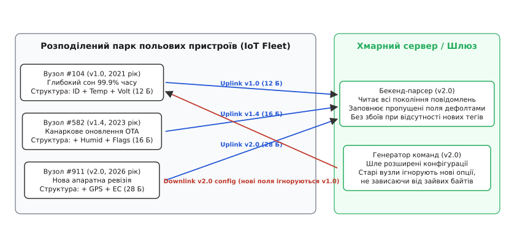
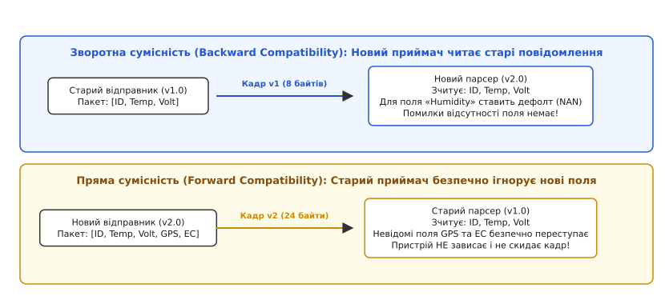
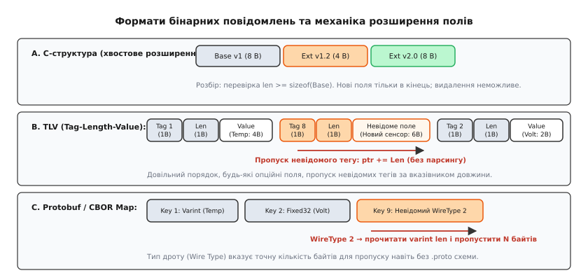
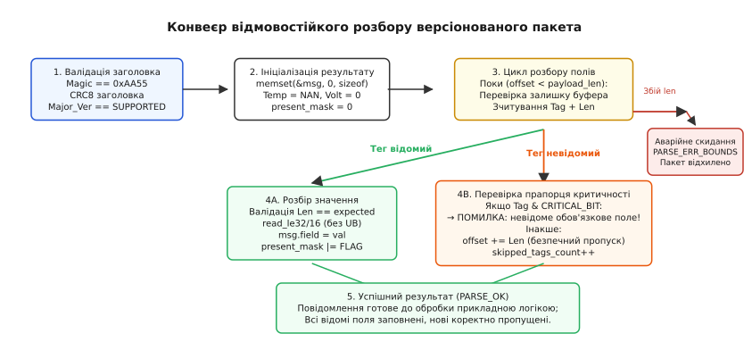

# Версія повідомлення й сумісність в обидва боки

<preknowlist>
- [Порядок байтів і вирівнювання](root:sf-apps/memory-alignment) — порядок байтів у багатобайтових числах, вирівнювання структур та небезпека прямого приведення покажчиків у пам'яті мікроконтролера.
- [Кадрування потоку: COBS, довжина, CRC](root:com-transport/cobs-framing) — виділення меж пакетів, контроль цілісності кадру через CRC та захист від спотворень.
- [Protocol Buffers і схемні формати](root:com-protocol/protocol-buffers-i-skhemni-formaty) — кодування тегів, типи дроту (wire types), змінні за довжиною цілі числа (varint) та еволюція повідомлень.
- [RPC у вбудованих системах](root:embedded/rpc-embedded) — маршалінг бінарних аргументів, диспетчеризація викликів та вимоги до ідемпотентності команд.
</preknowlist>

Десять тисяч автономних станцій моніторингу вологості ґрунту встановлені на полях площею понад п'ятсот квадратних кілометрів. Кожен вузол живиться від літій-тіонілхлоридної батареї, 99.9% часу перебуває в глибокому сні, а раз на дві години прокидається на 120 мілісекунд, щоб виміряти параметри та надіслати в мережу LoRaWAN бінарний пакет початкової прошивки v1.0 довжиною рівно 12 байтів: чотири байти ідентифікатора станції (`uint32_t node_id`), два байти температури ґрунту (`int16_t temp_cdeg`), два байти відносної вологості (`uint16_t humidity_raw`) та чотири байти напруги батареї зі статусом (`uint16_t vbat_mv`, `uint16_t flags`). Через два роки експлуатації агрономи замовляють нову партію з п'ятисот станцій ревізії v2.0, оснащених додатковим кондуктометричним давачем мінералізації ґрунту (`uint16_t ec_us_cm`) та сонячною мікропанеллю з вимірюванням струму заряду (`uint16_t solar_ma`). Розробник вставляє нові поля в середину структури C перед напругою батареї, збільшує корисне навантаження кадру до 16 байтів, перекомпільовує прошивку для нової партії і водночас оновлює бінарний парсер на хмарному сервері.

Наступного ранку вся агротехнічна система зазнає колапсу. Оновлений хмарний парсер очікує 16-байтні пакети із новим розташуванням полів. Коли надходять повідомлення від дев'яти з половиною тисяч станцій версії v1.0, сервер або відкидає їх із помилкою невідповідності розміру буфера («очікувалося 16 байтів, отримано 12»), або зчитує напругу батареї зі зміщення 8 байтів, помилково інтерпретуючи її як мінералізацію ґрунту. Значення напруги 3600 мВ перетворюється на аномальну солоність 3600 мкСм/см, через що автоматизовані зрошувальні вузли починають аварійне промивання ґрунтів прісною водою, затоплюючи посіви. Водночас спроба розіслати з сервера команду калібрування в новому форматі v2.0 спричиняє масове зависання старих польових станцій: їхній код робить пряме копіювання `memcpy` прийнятих 16 байтів у свій локальний 12-байтний буфер, перетираючи стек і спричиняючи скидання сторожового таймера (Watchdog Reset) у нескінченному циклі.

Ця аварія демонструє головне правило розподілених систем інтернету речей (*Internet of Things*, IoT): **програмне забезпечення серверів і пристроїв оновлюється постійно, але двійковий формат повідомлень зобов'язаний зберігати повну працездатність на стику різних версій протягом усього десятирічного терміну служби обладнання**. Надійна архітектура бінарного протоколу закладає механіку еволюції схеми (англ. *schema evolution*, від лат. *evolutio* — «розгортання») ще до передачі першого байта в радіоефір.


*Гетерогенний парк польових пристроїв. Вузли різних років випуску з прошивками v1.0, v1.4 та v2.0 одночасно виходять на зв'язок із сервером. Бекенд-парсер зобов'язаний коректно інтерпретувати телеметрію кожного покоління, а польові вузли — безпечно ігнорувати невідомі поля в низхідних конфігураційних командах.*

---

## Чому вбудований парк завжди гетерогенний

У класичній веброзробці чи хмарних мікросервісах бекенд і клієнтські застосунки нерідко оновлюють одночасно, або ж використовують надлишкові текстові формати на зразок JSON, де додавання нового ключа до словника автоматично ігнорується старим парсером. У вбудованих системах та промисловому IoT такий підхід розбивається об фізичні та апаратні обмеження.

Справжній парк польових приладів ніколи не буває гомогенним (однорідним, від грец. *homogenes* — «однорідний»). На практиці він завжди **гетерогенний** (від грец. *heterogenes* — «різнорідний»), і для цього є чотири фундаментальні причини:

1. **Асинхронний життєвий цикл та глибокий сон**: Батарейні лічильники води, газу, тепла чи польові давачі проводять увімкненими лічені частки секунди на добу. Їх неможливо «викликати» на примусове синхронне оновлення за командою з сервера. Оновлення прошивки повітрям (англ. *Over-the-Air*, OTA) для десяти тисяч пристроїв вузькосмуговим радіоканалом (LoRaWAN 250–5000 біт/с або NB-IoT) триває місяцями, і протягом усього цього періоду на одній базовій станції співіснують десятки ревізій коду.
2. **Енергетичний бюджет і ліміти радіоефіру**: Бездротові стандарти неліцензованого діапазону (наприклад, EU 868 МГц) мають законодавчі обмеження шпаруватості передавача (англ. *duty cycle* — 1% або 0.1% часу в ефірі). Передача важких текстових схем із назвами полів («{"temperature": 23.5}») замість компактного 2-байтного двійкового числа збільшує тривалість передачі в 10–20 разів. Це не лише виснажує батарею за лічені тижні замість десяти років, а й створює радіозавади для сусідніх приладів.
3. **Канаркові розгортання та ризик перетворення на «цеглину»**: Відповідальні інженерні системи ніколи не оновлюють на 100% парку одночасно. Спершу нову прошивку v2.0 отримує 1% приладів (канаркова група). Якщо протягом двох тижнів не виявлено прихованих дефектів, оновлюють 10%, потім 50%. На будь-якому етапі розгортання сервер змушений обслуговувати суміш повідомлень v1.0, v1.1, v1.4 та v2.0.
4. **Різні апаратні ревізії обладнання**: Корпус і друкована плата першої ревізії фізично не мають мікросхеми кондуктометра чи GPS-модуля. Пристрої версії v1.0 ніколи не будуть оновлені до функціоналу v2.0, але вони продовжуватимуть передавати критичні показники температури та тиску ще 5–8 років.

Звідси випливає непорушна вимога: протокол взаємодії повинен проєктуватися з урахуванням того, що **відправник і приймач перебувають на різних щаблях еволюції схеми даних**.

---

## Два вектори сумісності: зворотна та пряма

Взаємодія двох вузлів різного віку розпадається на два чітких напрямки. Кожен із них вимагає власної стратегії обробки байтів.


*Два вектори сумісності. Зворотна сумісність забезпечує роботу нового парсера зі старими повідомленнями через підстановку значень за замовчуванням. Пряма сумісність захищає старий парсер від аварійного скидання при отриманні розширеного кадру шляхом безпечного пропуску незнайомих полів.*

### Зворотна сумісність (Backward Compatibility)
Зворотна сумісність (від лат. *compatibilis* — «узгоджений») означає здатність **нового приймача коректно розбирати й обробляти повідомлення, згенеровані старим відправником**.

* **Сценарій**: Новий хмарний сервер v2.0 приймає телеметричний кадр від старого датчика v1.0.
* **Механізм на рівні байтів**: У вхідному повідомленні відсутні нові поля (наприклад, мінералізація ґрунту `ec_us_cm` та струм сонячної панелі `solar_ma`). Парсер не генерує виняток і не відкидає пакет як неповний. Замість цього він заповнює поля результату **безпечними значеннями за замовчуванням** (англ. *default fallback values*): для чисел із плаваючою комою записується спеціальне значення `NAN` (Not-a-Number), для цілих чисел — нейтральне значення або встановлюється явний бітовий прапорець відсутності вимірювання (`has_ec = false`).

### Пряма, або перспективна сумісність (Forward Compatibility)
Пряма сумісність означає здатність **старого приймача коректно сприймати повідомлення нового формату, видобувати з нього відому частину інформації та безпечно ігнорувати незнайомі розширення, не зазнаючи збою**.

* **Сценарій**: Старий польовий контролер v1.0 або шлюз приймає конфігураційний пакет або широкомовне повідомлення від нового сервера v2.0, де містяться розширені налаштування нових сенсорів.
* **Механізм на рівні байтів**: Старий парсер зчитує всі знайомі йому змінні за фіксованими правилами, а всі додаткові байти, незнайомі теги чи розширені хвости кадру **безпечно переступає у вхідному буфері**, не намагаючись їх інтерпретувати і не переповнюючи пам'ять.

> 🔧 **Навіщо це.** Порушення прямої сумісності — найпідступніша помилка в розробці вбудованих протоколів. Якщо новий сервер почне розсилати в спільну польову шину RS-485 чи мережу CAN оновлені кадри керування, а старі виконавчі модулі перезавантажуватимуться від кожного зайвого байта, оновлення одного єдиного пристрою виведе з ладу всю промислову лінію чи бортову мережу дрона.

### Чотири правила еволюції бінарних схем
Щоб одночасно забезпечити обидва вектори сумісності, інженер зобов'язаний дотримуватися чотирьох правил:

1. **Ніколи не змінювати тип, розрядність або порядок байтів уже випущеного поля**: Якщо поле температури було оголошене як `int16_t` у сотих частках градуса (Little-Endian), його не можна замінити на `float` чи `int32_t` на тій самій позиції. Для нового типу створюється окреме нове поле.
2. **Ніколи не змінювати зміщення (offset) існуючих полів у позиційних структурах**: Всі нові змінні додаються виключно в зону розширення, яка не перетинається зі старими зміщеннями.
3. **Ніколи не перевикористовувати старі ідентифікатори та теги**: Якщо поле або команду було вилучено з експлуатації, його числовий тег (ID) резервується назавжди і більше ніколи не призначається іншій сутності.
4. **Усі нові поля зобов'язані бути опційними**: Нове поле не має бути критично необхідним для базової життєдіяльності старого приймача. Якщо повідомлення не може бути оброблене без нового поля, це зміна базового мажорного протоколу, яка вимагає іншого типу повідомлення або версії заголовка.

---

## Архітектура бінарних схем: чотири інженерні моделі

Для кодування повідомлень у мікроконтролерах застосовують чотири основні архітектурні підходи. Кожен із них пропонує власний компроміс між накладними витратами каналу зв'язку, швидкістю розбору на процесорі та гнучкістю розширення схеми.


*Порівняння підходів до бінарної еволюції. (A) C-структура з хвостовим доповненням: мінімальні накладні витрати, але жорсткий порядок полів. (B) TLV-потік: довільний порядок і безпечний пропуск невідомих тегів за полем довжини. (C) Protobuf/CBOR: типізовані коди дроту для пропуску невідомих блоків навіть без схеми опису.*

### 1. Позиційні структури C із хвостовим нарощуванням (Tail Extension)
Найпростіший та найбільш ресурсоощадний підхід, популярний у системах жорсткого реального часу та низькошвидкісних каналах (наприклад, у базовому протоколі телеметрії дронів MAVLink v1/v2).

* **Структура**: Дані передаються як послідовність полів фіксованої довжини. Базові поля v1.0 займають перші `N` байтів кадру. При випуску версії v1.2 нові поля дописуються строго в кінець структури, збільшуючи загальну довжину до `N + K` байтів.
* **Механіка розбору**: Приймач перевіряє не сувору рівність довжини кадру (`len == sizeof(msg_v1)`), а умову достатності (`len >= sizeof(msg_v1)`).
* **Обробка розширення**:
  * Новий сервер приймає старий пакет довжиною `N`: він копіює перші `N` байтів у розширену структуру v2, а хвостові `K` байтів заповнює нулями (`memset`) або дефолтними значеннями.
  * Старий пристрій приймає новий пакет довжиною `N + K`: він вичитує перші `N` відомих йому байтів, а додаткові `K` байтів у хвості просто ігнорує.
* **Переваги**: Нульові накладні витрати на передачу назв чи тегів полів. Максимальна швидкість копіювання на мікроконтролері.
* **Недоліки**: Жорсткі обмеження: неможливо видалити поле з середини; неможливо мати декілька незалежних опційних полів без передачі всіх проміжних; помилка вирівнювання компілятора руйнує зміщення.

### 2. TLV-формати (Type-Length-Value / Tag-Length-Value)
Класичний стандарт побудови мережевих та промислових протоколів розширення (від радіопротоколів Bluetooth LE Advertisement до банківських карток EMV).

Повідомлення формується як послідовний потік трійок (кортежів):
```
[Тег поля: 1 байт] [Довжина значення L: 1 байт] [Саме значення: L байтів]
```

Розберімо поведінку парсера при зустрічі з невідомим тегом:
1. Парсер зчитує 1 байт тегу (`Tag = 0x2A`).
2. Тег відсутній у локальній таблиці відомих сенсорів.
3. Парсер зчитує 1 байт довжини (`Length = 6`).
4. Замість аварійної зупинки парсер виконує операцію зміщення покажчика буфера: `cursor += Length`.
5. Парсер переходить до наступного тегу потоку.

```
Потік байтів:
[Tag=0x01][Len=0x04][0x00 0x01 0x86 0xA0] -> Тег 1 (Node ID = 100000)
[Tag=0x88][Len=0x02][0x12 0x34]           -> Тег 136 (Невідомий сенсор, 2 байти) -> ПРОПУСК: cursor += 2
[Tag=0x02][Len=0x02][0x09 0x24]           -> Тег 2 (Температура = 23.40 °C)
```

* **Переваги**: Абсолютна гнучкість: довільний порядок слідування полів; відсутні поля займають 0 байтів; невідомі поля переступаються за один крок додавання вказівника за `O(1)`.
* **Накладні витрати**: 2 службові байти (Tag + Length) на кожне корисне значення.

### 3. Protocol Buffers (Protobuf / Nanopb) на рівні байтів
Protocol Buffers використовує концепцію числових тегів і так званих **типів дроту** (англ. *wire types*). На відміну від чистого TLV, заголовок кожного поля пакується в компактне число змінної довжини (varint), де молодші 3 біти кодують тип представлення даних у потоці, а старші біти — номер поля:

```
Key = (Field_Number << 3) | Wire_Type
```

Основні типи дроту Protobuf:
* `Wire Type 0` (Varint): ціле число змінної довжини (int32, int64, bool, enum). Читається байт за байтом, доки старший біт (MSB) дорівнює 1.
* `Wire Type 1` (64-bit): фіксовані 8 байтів (double, fixed64, sfixed64).
* `Wire Type 2` (Length-delimited): рядок, сирі байти, вкладене повідомлення чи запакований масив. Слідом за тегом іде varint довжини `L`, після чого рівно `L` байтів даних.
* `Wire Type 5` (32-bit): фіксовані 4 байти (float, fixed32, sfixed32).

Розгляньмо, що відбувається на рівні байтів, коли в повідомленні з'являється невідоме поле. Нехай версія v2.0 передає пакет із трьома полями:
1. Поле №1 (Node ID = 100000, Varint): тег `(1 << 3) | 0 = 0x08`, значення `0xA0 0x8D 0x06` (3 байти varint).
2. Поле №7 (Новий акселерометр, 32-bit float, Wire Type 5): тег `(7 << 3) | 5 = 0x3D`, значення `0x00 0x00 0x20 0x41` (4 байти float = 10.0).
3. Поле №2 (Температура = 24 °C, Varint): тег `(2 << 3) | 0 = 0x10`, значення `0x18` (1 байт = 24).

```
Потік байтів Protobuf:
[0x08] [0xA0 0x8D 0x06]       -> Поле 1 (Wire 0): Node ID = 100000
[0x3D] [0x00 0x00 0x20 0x41] -> Поле 7 (Wire 5): НЕВІДОМИЙ ТЕГ -> Wire Type 5 означає фіксовані 4 байти -> ПРОПУСК 4 БАЙТІВ!
[0x10] [0x18]                 -> Поле 2 (Wire 0): Температура = 24
```

Чому це дає абсолютну пряму сумісність? Коли парсер Protobuf на мікроконтролері (наприклад, легковагова бібліотека `Nanopb`) зустрічає незнайомий `Field_Number = 7`, йому **не потрібен файл опису схеми `.proto`**, щоб зрозуміти розмір невідомого блоку. За 3 бітами `Wire_Type = 5` декодер однозначно визначає алгоритм пропуску: для типу 5 він пропускає рівно 4 байти, для типу 1 — 8 байтів, для типу 0 — вичитує varint до байта з нульовим MSB, а для типу 2 — зчитує varint довжини `L` і переступає `L` байтів.

### 4. CBOR (Concise Binary Object Representation, RFC 8949)
CBOR проєктувався як компактний двійковий еквівалент моделі даних JSON для застосування в протоколах CoAP (Constrained Application Protocol) та бездротових сенсорних мережах. Кожен елемент CBOR починається з байта початкового заголовка, де старші 3 біти визначають **мажорний тип** (Major Type), а молодші 5 бітів несуть коротке значення або довжину наступного аргументу:

* `Major 0` (Unsigned Integer): додатне ціле число.
* `Major 1` (Negative Integer): від'ємне ціле число.
* `Major 2` (Byte String): послідовність сирих байтів із префіксом довжини.
* `Major 3` (Text String): рядок UTF-8 із префіксом довжини.
* `Major 4` (Array): масив елементів довільного типу.
* `Major 5` (Map): словник пар «ключ-значення».
* `Major 7` (Floats and Simple Values): числа з плаваючою комою (16, 32, 64 біти) та спеціальні значення (`null`, `true`, `false`).

Для забезпечення еволюції схеми в CBOR принциповим є вибір між масивом і мапою:

* **Позиційний масив (CBOR Array)**: запис `[104, 2350, 3600]` у двійковому вигляді займає найменше байтів, але вимагає жорсткої фіксації індексів. Додавання нового параметра на позицію 2 зсуває всі наступні показники, руйнуючи логіку старих приймачів.
* **Словник із цілочисельними ключами (CBOR Map)**: запис `{1: 104, 2: 2350, 3: 3600}` замінює текстові рядки-ключі на компактні малі цілі числа (всього 1 байт на ключ для індексів 0..23). Парсер обробляє пари `(key, value)` в довільному порядку. Якщо парсер зустрічає невідомий ключ `8`, універсальний декодер CBOR зчитує мажорний тип відповідного значення, вираховує його довжину за заголовком і пропускає елемент без жодних помилок.

---

## Версіонування в заголовку кадру та прапорці критичності

Коли в протоколі накопичується значна кількість змін, виникає потреба розділити модифікації на сумісні та несумісні. Для цього заголовок пакета оснащують полем версії та бітовими прапорцями сумісності.

### Мажорна та мінорна версії (Major vs Minor Versioning)
Заголовок бінарного пакета зазвичай містить один байт керування версією або два 4-бітних напівбайти (nibbles):

```
+-------------------+-------------------+
| Major Version (4) | Minor Version (4) |
+-------------------+-------------------+
```

* **Мінорна версія (Minor)**: Збільшується при додаванні нових опційних полів, розширенні конфігурацій чи введенні нових вимірювань. **Формат кадрування та правила розбору лишаються незмінними**. Старий пристрій зобов'язаний прийняти кадр із більшою мінорною версією і розібрати відомі йому поля.
* **Мажорна версія (Major)**: Збільшується лише тоді, коли змінилися фундаментальні правила каналу: алгоритм шифрування, метод кадрування, формат контрольної суми або семантика базових полів. **Кадри з невідомою мажорною версією повинні негайно відкидатися**, оскільки старий парсер фізично не здатен гарантувати цілісність таких даних.

### Прапорець критичного розширення (Critical Extension Flag)
Що робити, якщо сервер надсилає команду керування, де нове поле є критично важливим для безпеки (наприклад, увімкнення нового режиму обмеження струму двигуна `current_limit_ma`), і виконання команди без врахування цього параметра загрожує пожежею?

Для вирішення цієї дилеми старший біт тегу (або спеціальний біт у полі довжини) призначають **прапорцем критичності** (`FLAG_CRITICAL = 0x80`):

```
Тег без прапорця (0x05): Опційне розширення -> Не знаєш? Безпечно пропусти.
Тег із прапорцем  (0x85): Критичне розширення -> Не знаєш? ВІДХИЛИ ВСЕ ПОВІДОМЛЕННЯ!
```

Якщо старий контролер v1.0 зустрічає невідомий тег `0x05`, він пропускає його й успішно виконує решту команди. Але якщо він бачить невідомий тег `0x85` зі зведеним старшим бітом, парсер повертає помилку `ERR_UNKNOWN_CRITICAL_EXTENSION`. Контролер відхиляє небезпечну команду та надсилає серверу відповідь про непідтримуваний критичний параметр, запобігаючи аварії виконавчого механізму.

---

## Стратегії деградації та безпечної обробки невідомих полів

Розробка надійного версіонованого парсера для мікроконтролерів вимагає дотримання суворих правил безпеки пам'яті:

### 1. Захист від цілочисельного переповнення під час пропуску
Поширена вразливість у саморобних TLV-парсерах виникає при наївному складанні зміщення та довжини тегу:

:::tabs
```c
// Небезпечно: ризик переповнення цілого числа при len > (SIZE_MAX - cursor)
if (cursor + len <= buffer_size) {
    cursor += len;
}
```
```cpp
// Небезпечно: переповнення при прямому складанні індексів
if (cursor + len <= buffer.size()) {
    cursor += len;
}
```
:::

Якщо спотворений радіозавадою кадр містить `len = 0xFFFFFFFF`, операція `cursor + len` призведе до переповнення беззнакового типу і фальшивого проходження перевірки меж. Правильна валідація завжди виконується через віднімання від залишкового розміру буфера:

:::tabs
```c
// Безпечно: контроль залишкового розміру буфера через віднімання
if (len <= (buffer_size - cursor)) {
    cursor += len;
} else {
    return PARSE_ERR_TAG_LENGTH_OVERFLOW;
}
```
```cpp
// Безпечно: перевірка залишкового розміру вікна std::span
if (len <= (buffer.size() - cursor)) {
    cursor += len;
} else {
    return std::unexpected(ParseError::TagLengthOverflow);
}
```
:::

### 2. Заборона динамічної пам'яті (Zero-Heap Guarantee)
Парсер вбудованого пристрою не повинен викликати `malloc()` чи `new` для створення списків невідомих полів під час обробки пакета. Динамічне виділення пам'яті в циклі розбору радіопакетів швидко призводить до фрагментації оперативної пам'яті мікроконтролера та зависання пристрою. Усі структури результату повинні мати фіксований розмір на етапі компіляції або виділятися на стеку.

### 3. Прозоре ретранслювання (Transparent Proxying)
Часто вузол мережі працює як ретранслятор або шлюз (наприклад, концентратор збирає пакети від датчиків і передає їх через стільниковий модем у хмару).
Якщо шлюз версії v1.2 повністю розбирає вхідне повідомлення у власну C-структуру v1.2, а потім пакує її заново для відправки на сервер v2.0, усі нові поля v2.0, передані кінцевим сенсором, будуть **безповоротно втрачені**.
Правильний шлюз виконує маршрутизацію сирого бінарного буфера (Zero-Copy Forwarding) або упаковує транзитний кадр як непрозорий масив байтів (`raw_payload`), не руйнуючи невідомі йому розширення.

### 4. Небезпека прямого приведення вказівників (Unaligned Access & Strict Aliasing)
Найпопулярніша помилка під час розбору бінарних полів на C/C++ — пряме розіменування вказівника:
```
// АВАРІЙНО НЕБЕЗПЕЧНО!
uint32_t val = *(const uint32_t*)&buf[cursor];
```
Цей рядок містить одразу дві приховані загрози:
1. **Апаратний збій невирівняного доступу (Unaligned Fault)**: На архітектурах ARM Cortex-M0, Cortex-M0+ та багатьох DSP пряме зчитування 32-бітного слова за адресою, не кратною 4 (наприклад, `&buf[3]`), не підтримується апаратно і негайно генерує апаратний виняток процесора `UsageFault / HardFault`, що скидає мікроконтролер.
2. **Порушення суворого аліасингу (Strict Aliasing Rule)**: За стандартами C99 та C++20 компілятор оптимізує код, вважаючи, що покажчики різних типів (`uint8_t*` та `uint32_t*`) не вказують на одну й ту саму область пам'яті. Компілятор із прапорцями `-O2` чи `-O3` має право викинути або переставити такі зчитування, породжуючи недетерміновану поведінку (UB — *Undefined Behavior*).

Єдиний надійний і переносний спосіб декодування чисел довільної розрядності — побайтове збирання через порозрядні зсуви (`buf[0] | (buf[1] << 8) | ...`). Сучасні компілятори GCC та Clang автоматично розпізнають цю ідіому і транслюють її в одну ефективну інструкцію `LDR/REV` на процесорах, де такий доступ дозволено, або в коректну послідовність побайтового читання там, де це необхідно.

### 5. Життєвий цикл полів і резервування тегів (Tombstoning)
Коли потреба в певному сенсорі чи параметрі відпадає, поле не можна просто стерти з коду, звільнивши його числовий номер. Процес виведення поля з експлуатації проходить три дискретні фази:

1. **Активне (Active)**: Поле заповнюється передавачем і читається приймачем.
2. **Застаріле (Deprecated)**: Приймач продовжує читати поле, якщо воно надійшло від старого пристрою, але нові передавачі перестають його надсилати. У документації та коді з'являється попередження `[[deprecated]]`.
3. **Зарезервоване/Поховане (Tombstone / Reserved)**: Поле більше не використовується жодним новим кодом, але його числовий тег (ID) **назавжди блокується від повторного використання**. У схемах Protobuf для цього існує ключове слово `reserved 4, 7 to 9;`, а в заголовках C додається константа `TAG_RESERVED_OLD_PRESSURE = 0x03`. Якщо через три роки новий інженер призначить звільнений тег `0x03` новому оптичному давачу, старі сервери інтерпретуватимуть люкси як старий тиск, спричиняючи приховане спотворення історичних даних.

---

## Конвеєр відмовостійкого розбору версіонованого пакета

Перед тим як перейти до реалізації в коді, зведемо всі перевірки та переходи станів парсера в єдину послідовну діаграму.


*Конвеєр станів безпечного парсера. Від перевірки контрольної суми та версії заголовка — до безпечного циклу розбору тегів із захистом від переповнення та обробкою критичних прапорців.*

---

## Повний відмовостійкий версіонований парсер на C та C++

Нижче наведено повну виробничу реалізацію відмовостійкого TLV-парсера для вбудованих систем. 

Протокол реалізує:
1. Валідацію заголовка (Magic `0xAA55`, версія протоколу, довжина корисного навантаження, CRC8 заголовка).
2. Захист від некоректних зміщень та переповнень буфера без використання купи (Zero Dynamic Allocation).
3. Порозрядне декодування чисел у форматі Little-Endian без розіменування неініціалізованих або невирівняних покажчиків (захист від Hard Fault на ARM Cortex-M0/M3).
4. Підтримку опційних полів із заповненням бітової маски наявності (`present_mask`) та дефолтних значень.
5. Безпечний пропуск невідомих опційних тегів із фіксацією лічильника пропущених полів.
6. Аварійне відхилення пакета при виявленні невідомого тегу з прапорцем критичності (`TAG_CRITICAL_FLAG = 0x80`).

:::tabs
:::code versiia-povidomlennia-i-sumisnist-v-obydva-boky-d/c/main.c
:::code versiia-povidomlennia-i-sumisnist-v-obydva-boky-d/cpp/main.cpp
:::

---

## Підсумковий синтез: як будувати протоколи на десятиліття

Стійкість розподіленої системи до змін забезпечується не ускладненням коду, а дисципліною організації двійкових даних. Інженерний досвід експлуатації мільйонних парків пристроїв зводиться до чотирьох архітектурних рішень:

1. **Заголовок захищає транспорт, тіло захищає схему**: Заголовок пакета завжди має сталий розмір і містить мажорну версію та контрольну суму заголовка. Тіло пакета пакується як самоописний потік тегів (TLV, Protobuf чи CBOR Map), що дозволяє довільне розширення без зсуву зміщень.
2. **Опційність за замовчуванням**: Усі нові параметри проєктуються як опційні. Приймач завжди має детерміновану поведінку на випадок відсутності будь-якого поля (заповнення `std::optional`, `NAN` чи дефолтним значенням).
3. **Явна семантика критичності**: Невідоме поле безпечно ігнорується, якщо воно несе другорядну телеметрію, або спричиняє відмову команди, якщо воно позначене бітом критичності (`TAG_CRITICAL_FLAG`).
4. **Сувора ізоляція буферів**: Жоден розбір мережевого пакета не повинен виконуватися через пряме приведення покажчика до структури C (`(struct msg*)buf`). Зчитування байтів виконується через явні зсуви з контролем залишку пам'яті.
