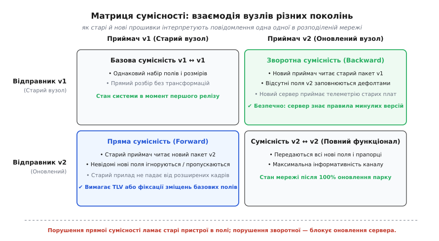
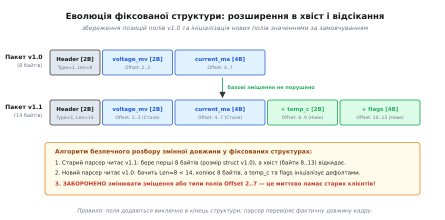
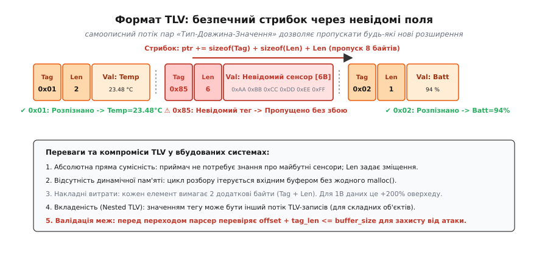
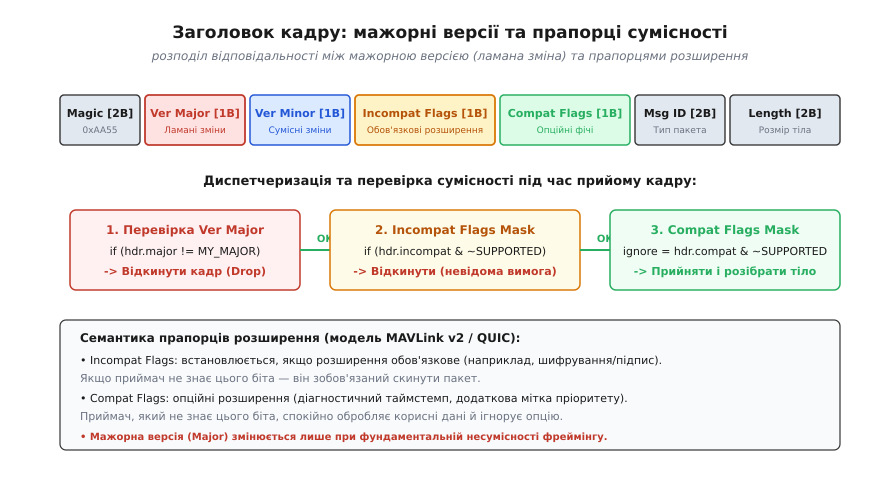

# Версія протоколу: сумісність вперед і назад, зміна полів

<preknowlist>
- [Порядок байтів, вирівнювання, пакування](root:com-protocol/wire-format-packing) — порядок байтів у багатобайтових числах, пакування структур та вирівнювання на МК.
- [Кадрування: маркер, стафінг, COBS, SLIP](root:com-transport/cobs-framing) — виділення меж пакетів у безперервному потоці байтів.
- [Контрольна сума і CRC](root:com-modulation/crc) — виявлення спотворення байтів у каналі зв'язку.
</preknowlist>

Уявімо типову ситуацію з життя промислової IoT-мережі: п'ять тисяч автономних лічильників газу встановлені у підвалах будинків і раз на добу виходять на зв'язок по радіоканалу LoRaWAN або NB-IoT, передаючи двійкову структуру з показниками лічильника та напругою батареї. Через рік після розгортання виробник випускає оновлення: до структури даних додають нове поле — тиск газу в трубі (`uint16_t pressure_kpa`). Розробник вставляє нове поле всередину структури C між лічильником і батареєю, компілює прошивку і завантажує її на перші двісті приладів нової партії. У ту саму мить бекенд-сервер оновлюють під новий формат. 

Наступної ночі стається катастрофа: оновлений сервер очікує, що за зміщенням 8 байтів тепер лежить тиск, а старі лічильники надсилають туди напругу батареї. Сервер фіксує аномальний «тиск 3.6 кПа» і генерує аварійні сповіщення для аварійних служб міста. Водночас стара партія лічильників надсилає кадри довжиною 12 байтів, тоді як новий парсер вимагає рівно 14 байтів і скидає всі старі пакети як пошкоджені. За одну ніч тисячі пристроїв втрачають зв'язок із білінговою системою, а оновити їх одночасно повітрям неможливо: частина пристроїв перебуває в глибокому сні, частина має слабкий сигнал, а автономні батареї не розраховані на безперервне радіооновлення всього парку.

Цей сценарій ілюструє головний закон розподілених вбудованих систем: **код прошивок і серверів змінюється постійно, але байти, одного разу відправлені в ефір, зобов'язані читатися без збоїв протягом років**. Спроєктувати надійний бінарний протокол означає закласти правила його еволюції ще до написання першого рядка коду.

## Проблема еволюції протоколів у розподілених IoT-системах

У класичному веброзробленні або мікросервісній архітектурі бекенд і клієнти оновлюються синхронізовано або використовують гнучкі самоописні текстові формати, як-от JSON чи XML. Якщо вебсервер додає нове поле до JSON-відповіді, старий клієнтський браузер просто ігнорує незнайомий ключ об'єкта.

У світі мікроконтролерів (МК) та інтернету речей (*Internet of Things*, IoT) діють принципово інші обмеження:
1. **Асинхронність життєвого циклу**: Оновлення парку пристроїв повітрям (OTA — *Over-the-Air*) у масштабних мережах триває тижні або місяці. Навіть у стаціонарних промислових системах прилади різних апаратних ревізій працюють пліч-о-пліч роками. Сервер зобов'язаний одночасно розуміти повідомлення від вузла з прошивкою десятирічної давнини та від щойно випущеної плати.
2. **Дефіцит пам'яті та обчислювальних ресурсів**: Мікроконтролери з 16–64 КБ оперативної пам'яті (RAM) не можуть дозволити собі важкі текстові формати або динамічне виділення пам'яті (`malloc`/`free`) під час розбору пакетів через ризик фрагментації купи та вичерпання пам'яті.
3. **Обмеження пропускної здатності каналу**: Радіоканали телеметрії (LoRa, Sigfox, Zigbee, супутникові модеми Iridium) та польові промислові шини (RS-485, CAN) мають суворі обмеження на розмір одного корисного кадру — від 10–50 байтів. Кожен службовий байт накладних витрат (*overhead*) скорочує час життя батареї та зменшує корисну пропускну здатність.
4. **Ціна аварійного скидання зв'язку (Bricking)**: Якщо через невідоме поле або змінене зміщення мікроконтролер зависне в обробнику помилки або перейде в нескінченний цикл аварійного перезавантаження, пристрій на віддаленій щоглі або в підземній свердловині перетвориться на «цеглину» (*brick*), відновити яку можна лише фізичним виїздом інженера.

Щоб система залишалася життєздатною під час будь-яких доопрацювань, інженерія зв'язку вимагає чіткого дотримання двох симетричних принципів сумісності.

## Принципи сумісності: зворотна та пряма

У взаємодії двох програмних вузлів, які спілкуються бінарними повідомленнями, виникає чотири комбінації поколінь відправника та приймача:


*Чотири квадранти взаємодії пристроїв старого та нового поколінь. Зворотна сумісність гарантує, що оновлений сервер розуміє старі пристрої в полі. Пряма сумісність гарантує, що старі пристрої не ламаються від нових повідомлень.*

Розберімо кожну сторону цієї взаємодії на рівні механізмів обробки байтів.

### Зворотна сумісність (Backward Compatibility)
Зворотна сумісність (від лат. *compatibilis* — «узгоджений, сумісний») означає здатність **нової версії програми коректно обробляти дані, сформовані старою версією**.
- **Сценарій**: Новий сервер (v2) приймає телеметричний пакет від старого лічильника (v1).
- **Механізм реалізації**: Новий парсер перевіряє розмір або версію кадру. Якщо у вхідному пакеті v1 відсутні нові поля (наприклад, поле тиску газу, додане у v2), парсер не відкидає пакет, а **підставляє безпечні значення за замовчуванням** (*default fallback values*) або встановлює прапорець «дані відсутні».

### Пряма, або перспективна сумісність (Forward Compatibility)
Пряма сумісність означає здатність **старої версії програми коректно сприймати або безпечно ігнорувати дані, сформовані новою версією**, не зазнаючи збою.
- **Сценарій**: Старий дисплейний модуль або шлюз (v1) приймає пакет від нового датчика (v2), який містить невідомі додаткові вимірювання.
- **Механізм реалізації**: Старий парсер зчитує всі відомі йому поля за фіксованими правилами, а всі додаткові байти в хвості кадру або невідомі блокові мітки **безпечно переступає і відкидає**.

> 🔧 **Навіщо це.** Порушення прямої сумісності — найнебезпечніша помилка в розробці вбудованих протоколів. Якщо новий вузол почне передавати кадри в спільну шину CAN або RS-485, а старі вузли почнуть перезавантажуватися від незнайомих байтів, одна нова плата здатна паралізувати роботу всього промислового верстата чи літального апарата.

### Золоті правила еволюції бінарних схем
Для збереження обох векторів сумісності розробник зобов'язаний дотримуватися чотирьох фундаментальних заборон:
1. **Ніколи не змінювати тип, розрядність або порядок байтів існуючого поля**: Якщо напруга передавалася як `uint16_t` у мілівольтах, не можна змінювати її на `float` або `uint32_t` в тій самій позиції.
2. **Ніколи не змінювати зміщення (offset) існуючого поля**: Всі нові елементи мають розміщуватися поза зоною розбору старих полів.
3. **Ніколи не перевикористовувати старі ідентифікатори**: Якщо поле або повідомлення було видалено (виведено з експлуатації), його номер чи тег блокується назавжди і ніколи не призначається новій сутності.
4. **Усі нові поля зобов'язані бути опційними**: Нове поле не повинно бути обов'язковим для базового функціонування пристрою.

### Апаратні пастки: бітові поля та вирівнювання пам'яті
На практиці інженери-початківці часто припускаються двох критичних помилок під час реалізації бінарних протоколів:

**1. Використання бітових полів C (`bitfields`)**:
Конструкція на зразок `struct { uint8_t flag_a : 1; uint8_t flag_b : 3; };` не має стандартизованого порядку укладання бітів у байт. Стандарт мови C (ISO/IEC 9899) прямо визначає порядок бітів у бітових полях як залежний від реалізації компілятора (*implementation-defined behavior*). GCC для ARM укладає біти від молодшого до старшого (LSB-first), тоді як інший тулчейн або архітектура може укласти їх від старшого (MSB-first). Передавати бітові поля по дроту суворо заборонено: для прапорців слід використовувати явні цілочисельні маски (`1U << 0`, `1U << 1`).

**2. Невирівняний доступ до пам'яті (*Unaligned Access*)**:
На процесорах архітектури x86/x64 читання 32-бітного числа з непарної адреси виконується прозоро апаратно. На мікроконтролерах ARM Cortex-M0 або деяких DSP читання `uint32_t` за адресою, некратною 4, генерує апаратне переривання `HardFault`. Тому заголовок або парсер повинен декодувати числа через побітові зсуви або через виклики `memcpy`, гарантуючи незалежність від фізичного вирівнювання буфера.

## Методи організації полів у бінарному протоколі

Вибір методу серіалізації даних — це баланс між щільністю байтів на дроті, обчислювальною складністю розбору та гнучкістю до розширень. Розгляньмо три основні інженерні підходи.

### 1. Позиційні фіксовані бінарні структури (Tail-Appended Structs)

Найбільш ощадливий за пам'яттю та швидкістю метод, прийнятий у класичних низькорівневих протоколах (наприклад, [MAVLink](root:embedded/versiia-protokolu/hist-mavlink-v1-v2.md)). 

У цьому підході дані розміщуються як суцільний двійковий блок, де кожне поле займає строго фіксовану кількість байтів за фіксованим зміщенням. Правило розширення тут єдине і суворе: **нові поля дозволено додавати виключно в кінець (хвіст) структури**.


*Принцип еволюції позиційної структури. Базові поля (voltage, current) зберігають свої незмінні зміщення. Нові поля додаються в кінець. Старий приймач відкидає надлишок довжини, новий — заповнює відсутній хвіст дефолтами.*

Розгляньмо, як це працює в коді. Заголовок кожного пакета обов'язково несе поле довжини корисного навантаження `payload_len`.

:::tabs
:::code versiia-protokolu-d/c/1-pozytsiini-fiksovani.c
:::code versiia-protokolu-d/cpp/1-pozytsiini-fiksovani.cpp
:::

#### Оптимізація нульових хвостів (Zero-Byte Truncation)
Якщо у розширеній структурі нові поля містять нулі (наприклад, датчик температури не підключений, або прапорці розширення чисті), передавач може не надсилати кінцеві нульові байти в канал. Він обрізає довжину `payload_len` до останнього ненульового байта. 

Приймач перед копіюванням заповнює структуру нулями `memset(&out, 0, sizeof(out))`. Завдяки цьому пропускна здатність радіоканалу не витрачається на передачу нулів, а нові версії повідомлень зберігають компактність старих пакетів.

### 2. Формат TLV (Type-Length-Value)

Коли набір параметрів стає динамічним, або пристрій може містити довільну кількість різних сенсорів, позиційна структура вичерпує свої можливості. Якщо додати 20 рідкісних датчиків у хвіст структури, пакет виросте до сотень байтів, навіть якщо одночасно передаються дані лише з двох сенсорів.

Рішенням є формат TLV (*Type-Length-Value* — «тип, довжина, значення»), або тег-довжина-значення:
- **Tag (Тип)**: 1 або 2 байти, що визначають сутність поля (наприклад, `0x01` = напруга, `0x02` = координата GPS).
- **Length (Довжина)**: 1 або 2 байти, що вказують довжину блоку значення `Value` в байтах.
- **Value (Значення)**: безпосередньо корисні байти даних (число, рядок, масив або вкладений TLV-блок).


*Механізм розбору TLV-потоку. Невідомий тег 0x85 довжиною 6 байтів не ламає парсер: покажчик стрибає на зміщення (2 + 6) байтів і переходить до наступного відомого тегу 0x02.*

Головна перевага TLV — **ідеальна пряма сумісність**:
Якщо старий приймач зустрічає невідомий тег `0x85`, він не намагається вгадати його тип. Він зчитує поле довжини `len = 6` і переміщує покажчик читання вперед:
```
offset += sizeof(Tag) + sizeof(Length) + len;
```
Парсер миттєво опиняється на початку наступного тегу. Невідомий датчик пропущено, а вся інша телеметрія розібрана без найменшого спотворення.

Детальний робочий код потокового TLV-декодера з підтримкою вкладених блоків без динамічного виділення пам'яті винесено в окремий практичний розбір: [реалізація потокового TLV-парсера без динамічної пам'яті](root:embedded/versiia-protokolu/proj-tlv-parser.md).

> 🔧 **Навіщо це.** TLV — стандарт де-факто для протоколів передачі конфігурацій, Bluetooth Low Energy (BLE Advertising Data), смарт-карт (EMV), мережевих протоколів маршрутизації (LLDP, IS-IS) та телеметрії складних систем. Ціною 2 додаткових байтів на кожне поле ви отримуєте необмежену свободу розширення схеми.

### 3. Легковажні бінарні схеми: NanoPB, CBOR, MessagePack

Коли проєкт вимагає складної ієрархічної структури даних (масиви об'єктів, вкладені повідомлення, опційні поля), ручне написання TLV-парсерів стає трудомістким і вразливим до людських помилок вирівнювання та валідації.

У таких задачах застосовують стандартизовані бінарні кодувальники:

#### Protocol Buffers та бібліотека NanoPB
**Protocol Buffers (Protobuf)** від Google використовує формальні файли схем `.proto`. Кожне поле у файлі схеми отримує постійний числовий тег:
```proto
message NodeTelemetry {
    uint32 device_id = 1;
    uint32 voltage_mv = 2;
    // У v2 додаємо поле — беремо новий вільний тег:
    optional float external_temp = 3;
}
```
На рівні двійкових байтів Protobuf упаковує тег і тип у компактний префікс *varint* за формулою:
```
field_header = (field_number << 3) | wire_type
```
Для мікроконтролерів стандартна бібліотека Protobuf C++ непридатна через активне використання купи та RTTI. Проте бібліотека **NanoPB** генерує мінімальний код на чистому C (близько 2–4 КБ Flash), який розбирає Protobuf-повідомлення строго *in-place* у звичайну плоску C-структуру з булевими прапорцями `has_external_temp`.

#### CBOR (RFC 8949) та MessagePack
На відміну від Protobuf, **CBOR** (*Concise Binary Object Representation*) та **MessagePack** є безсхемними форматами: вони є двійковим аналогом JSON. Кожен елемент несе інформацію про свій тип (мапа, масив, ціле число, рядок).
- **Перевага**: повна самоописність — сервер і мікроконтролер можуть обмінюватися новими полями без необхідності спільної компіляції схеми.
- **Недолік**: текстові назви ключів (наприклад, рядок `"voltage"`) або метадані типів роздувають кожен пакет на 30–60% порівняно з чистим Protobuf або фіксованим бінарним кадровим форматом.

### Порівняльний аналіз трафіку та енергоспоживання
Щоб зрозуміти ціну вибору формату в числах, порівняймо передачу чотирьох типових параметрів (ідентифікатор пристрою `uint32`, напруга `uint16`, струм `int32`, статус `uint8`) різними методами:

```
Фіксована структура: 4 + 2 + 4 + 1 = 11 байтів
Формат TLV (1B Tag + 1B Len): (2+4) + (2+2) + (2+4) + (2+1) = 19 байтів (+73% оверхеду)
Protobuf (NanoPB): (1+4) + (1+2) + (1+4) + (1+1) = 15 байтів (+36% оверхеду)
CBOR (з короткими числовими ключами): ~24 байти (+118% оверхеду)
JSON (текстовий): ~74 байти (+572% оверхеду)
```

При частоті опитування 50 Гц на радіомодемі різниця між 11 та 74 байтами означає скорочення часу ефіру в 6.7 раза, що прямо продовжує автономну роботу батарейного пристрою з 6 місяців до майже 3 років.

| Формат | Накладні витрати (Overhead) | Пряма сумісність | Потреба в пам'яті (RAM/Flash) | Де використовується |
|---|---|---|---|---|
| **Фіксована структура** | 0% (мінімальний) | Обмежена (тільки хвіст) | Мінімальна (~0.1 КБ коду) | Датчики, прості кадри UART/CAN, MAVLink v1/v2 |
| **Формат TLV** | Середній (2 байти на поле) | Повна (пропуск тегів) | Низька (~0.5 КБ коду) | Конфігурації, BLE, промислові модулі |
| **NanoPB (Protobuf)** | Низький (1–2 байти на поле) | Повна (схемна) | Середня (2–6 КБ Flash) | Складні IoT-шлюзи, зв'язок MCU з хмарою |
| **CBOR / MessagePack** | Високий (типи + ключі) | Повна (безсхемна) | Середня/Висока (4–12 КБ) | CoAP (RFC 7252), OCF, REST-подібні бінарні API |

## Керування номерами версій у заголовках

Навіть при використанні ідеальних форматів розширення даних настає момент, коли сам транспортний рівень або фундаментальна семантика повідомлень повинні кардинально змінитися:
- Заміна 16-бітної контрольної суми CRC-16 на 32-бітний поліном CRC-32.
- Впровадження обов'язкового криптографічного шифрування або підпису кадрів.
- Зміна структури кадрування (наприклад, перехід із фіксованого маркерного байта на фреймінг COBS).

Такі фундаментальні зміни неможливо виконати в межах правил прямої сумісності. Для них протокол зобов'язаний мати явний механізм контролю версій у заголовку кадру.


*Архітектура службового заголовка. Розділення відповідальності між мажорною версією (Ver Major), мінорною схемою (Ver Minor) та прапорцями обов'язкових (Incompat) і опційних (Compat) розширень.*

### Семантика мажорних і мінорних версій (Major.Minor)
При розміщенні версії в бінарному заголовку виділяють два рівні:
1. **Мажорна версія (`Major Version`)**: Змінюється **виключно тоді, коли формат ламає базовий розбір кадру**. Якщо приймач v1 бачить `Major == 2`, він зобов'язаний негайно припинити розбір і відкинути пакет. Спроба розібрати несумісний заголовок призведе до неправильного обчислення меж корисного навантаження або контрольної суми.
2. **Мінорна версія (`Minor Version`)**: Змінюється при додаванні нових повідомлень, полів у хвіст або нових TLV-тегів. Якщо `Major` збігається, а `Minor` більша за відому приймачу, пакет **приймається в обробку**, а нові поля розбираються за правилами прямої сумісності.

### Модель прапорців сумісності (Compatibility Flags)
Класичного числового поля `Major.Minor` часто буває недостатньо в розподілених системах, де різні пристрої можуть підтримувати різні набори апаратних розширень (наприклад, наявність апаратного крипточипа).

Найбільш досконалим рішенням цієї проблеми є архітектура **прапорців сумісності**, реалізована в сучасних протоколах зв'язку (зокрема в MAVLink 2 та мережевому стеку QUIC):

Заголовок кадру містить два байтові поля:
- **`incompat_flags` (Прапорці несумісності / обов'язкові властивості)**: Кожен біт позначає модифікацію кадру, яку приймач **зобов'язаний** розуміти для коректного декодування (наприклад, біт `0x01` = тіло кадру зашифровано алгоритмом AES-128; біт `0x02` = у хвості пакета додано 13 байтів цифрового підпису).
  
  **Правило приймача**:
:::tabs
```c
if ((header.incompat_flags & ~SUPPORTED_INCOMPAT_MASK) != 0) {
    /* Пакет вимагає невідомої приймачу обов'язкової поведінки -> ВІДХИЛИТИ */
    return DROP_PACKET_UNKNOWN_INCOMPAT;
}
```
```cpp
if ((hdr->incompat_flags & ~SUPPORTED_INCOMPAT_MASK) != 0) {
    // Пакет вимагає невідомої приймачу обов'язкової поведінки -> ВІДХИЛИТИ
    return std::unexpected(ParseError::UnknownIncompatFlag);
}
```
:::

- **`compat_flags` (Прапорці сумісності / опційні властивості)**: Біти позначають додаткову інформацію, яка не спотворює розбір корисних даних (наприклад, біт `0x01` = у заголовку активовано високоточний таймстемп; біт `0x02` = пакет передано з підвищеним пріоритетом).
  
  **Правило приймача**: Приймач просто ігнорує біти в `compat_flags`, яких він не знає, і продовжує стандартний розбір тіла повідомлення.

Реальний історичний приклад того, як цей механізм врятував від зупинки сотні тисяч безпілотних систем під час переходу між версіями, описано в історичному екскурсі: [еволюція протоколу MAVLink від версії v1 до v2](root:embedded/versiia-protokolu/hist-mavlink-v1-v2.md).

### Запобігання закостенінню протоколу: техніка GREASE
У великих розподілених мережах виникає небезпечний феномен — **закостеніння протоколу** (*Protocol Ossification*). Якщо розробники роками не використовують зарезервовані прапорці або нові типи тегів, автори проміжних шлюзів і фаєрволів починають писати «оптимізовані» парсери, які жорстко перевіряють `if (flags != 0) drop();` або відкидають пакети з невідомими тегами, порушуючи специфікацію.

Коли через п'ять років розробники намагаються активувати законне поле розширення, вся мережа раптово падає через помилки в проміжних вузлах. 

Для боротьби з цим стандарти IETF (RFC 8701 для TLS та QUIC) запровадили механізм **GREASE** (*Generate Random Extensions And Sustain Extensibility* — «генерація випадкових розширень для підтримки розширюваності»):
- Передавачі періодично відправляють тестові пакети з випадковими зарезервованими значеннями тегів або опційними прапорцями сумісності.
- Це змушує всі проміжні парсери та сервери постійно відпрацьовувати гілку ігнорування невідомих полів і не дозволяє стороннім розробникам писати код, який припускає, що зарезервовані поля завжди дорівнюють нулю.

## Реалізація версіонованого парсера повідомлень на C та C++

Об'єднаємо всі розглянуті принципи в єдину, надійну архітектуру версіонованого парсера. 

Наш протокол визначає:
1. Стандартний заголовок кадру з магічним числом `0xAA55`, полями `ver_major`, `ver_minor`, `incompat_flags`, `compat_flags`, типом повідомлення `msg_type` та довжиною тіла `payload_len`.
2. Диспетчеризацію повідомлень за `msg_type` із перевіркою версії та безпечним заповненням відсутніх полів дефолтами.

:::tabs
:::code versiia-protokolu-d/c/realizatsiia.c
:::code versiia-protokolu-d/cpp/realizatsiia.cpp
:::

## Стратегії міграції та політика виведення версій з експлуатації (Deprecation Policy)

Технічні механізми сумісності діють лише тоді, коли вони підкріплені організаційною стратегією оновлення системи. Якщо в мережі залишаються версії протоколів десятирічної давності, код серверних парсерів обростає нескінченними каскадами `switch-case` та обробників винятків, перетворюючись на непідтримувану спадщину (*legacy*).

Щоб підтримувати протокол у чистому стані, в інженерній практиці застосовують поетапну політику життєвого циклу версій:

### 1. Етап розгортання подвійного стека (Dual-Stack Deployment)
Перед випуском нових пристроїв із протоколом v2 серверна інфраструктура та шлюзи оновлюються першими. Вони отримують підтримку **одночасного розбору обох версій**:
- Пакет v1 обробляється адаптером сумісності.
- Пакет v2 обробляється новим оптимізованим конвеєром.
- Усі системні метрики починають збирати статистику розподілу версій: `protocol_v1_count` та `protocol_v2_count`.

### 2. Фазове OTA-оновлення пристроїв (Canary & Phased Rollout)
Оновлення прошивок у полі ніколи не запускається на всі 100% пристроїв одночасно:
1. **Канаркова група (*Canary group*)**: 1–5% пристроїв у легкодоступних локаціях оновлюються на v2. Протягом кількох днів інженери аналізують рівень помилок CRC, кількість скинутих кадрів і споживання батареї.
2. **Масове оновлення (*Bulk Rollout*)**: Прилади оновлюються чергами по 15–20% із паузами для моніторингу стабільності радіомережі.

### 3. Період застарівання (Deprecation Window)
Коли 95% парку перейшло на протокол v2, оголошується офіційний період виведення з експлуатації версії v1 (зазвичай від 6 до 24 місяців залежно від індустрії).
- Протокол v1 продовжує обслуговуватися сервером, але телеметрія позначається попередженням `DEPRECATED_PROTOCOL_WARNING`.
- Операторам мережі надсилаються автоматичні звіти про пристрої, які не змогли оновитися (наприклад, через збій flash-пам'яті або відсутність сигналу).

### 4. Остаточне вимкнення (Sunsetting / End-of-Life)
Після завершення періоду застарівання підтримка v1 видаляється з коду сервера. Якщо пристрій зі старою прошивкою спробує надіслати пакет, шлюз повертає помилку `UNSUPPORTED_PROTOCOL_VERSION` або ініціює примусову сесію відновлення прошивки через аварійний завантажувач.

## Чеклист інженера: проєктування версіонованого протоколу

Перед затвердженням специфікації бінарного протоколу зв'язку звіртеся з контрольним списком вимог:

1. **Захист від невідомого**: Чи має перша ж версія парсера алгоритм пропуску невідомих полів (за довжиною або за TLV-тегами)?
2. **Порядок байтів**: Чи зафіксовано порядок байтів (little-endian або big-endian) у специфікації для кожного багатобайтового числа?
3. **Відсутність бітових полів**: Чи всі прапорці та бітові маски реалізовані через цілі числа та явні побітові зсуви замість непереносних `bitfields`?
4. **Вирівнювання та безпека пам'яті**: Чи розраховано протокол на мікроконтролери без апаратного невирівняного доступу?
5. **Контроль сумісності в заголовку**: Чи розділено в заголовку обов'язкові прапорці несумісності (`incompat_flags`) та опційні прапорці розширення (`compat_flags`)?
6. **Заборона перевикористання**: Чи зафіксовано в документації правило про довічне блокування видалених ідентифікаторів і тегів?

## Підсумок: інженерний вибір моделі версіонування

Проєктування протоколу зв'язку — це вибір компромісу між ціною передачі байтів у радіоканалі та ціною майбутньої підтримки коду:
- Для **жорстких телеметричних потоків високої частоти** (50–200 Гц у дронах та робототехніці) безальтернативним вибором залишаються **позиційні фіксовані структури** з додаванням полів у хвіст та урізанням нулів, захищені мажорною версією та прапорцями сумісності в заголовку.
- Для **налаштувань, асинхронних подій і датчиків змінної конфігурації** оптимальним є **формат TLV**, який дозволяє пропускати будь-які нові параметри без необхідності узгодження схеми.
- Для **складних ієрархічних структур** розумно використовувати генератори коду, такі як **NanoPB**, що виключають помилки ручного розрахунку зміщень.

Головне інженерне правило надійного протоколу: **ніколи не передавати сирі образи пам'яті компілятора та завжди закладати механізм пропуску невідомих даних у парсер першої ж версії прошивки**.
