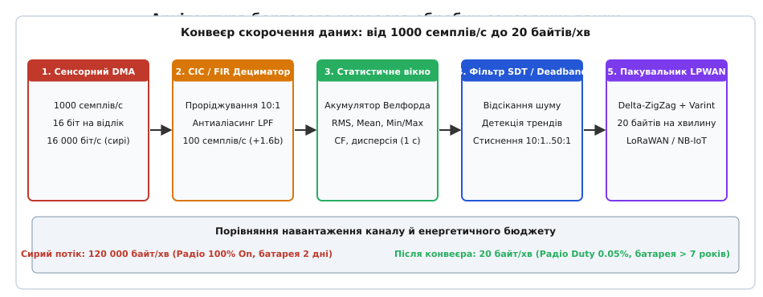
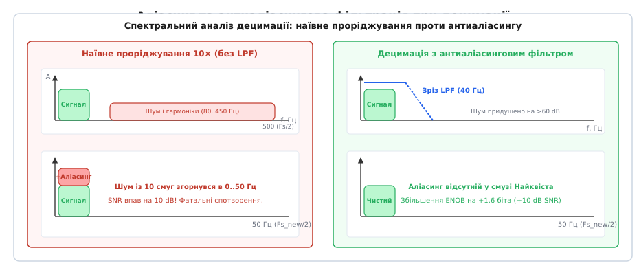
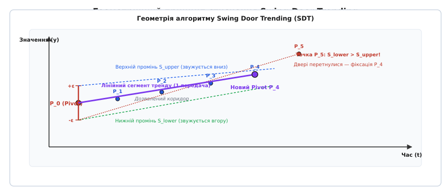

# Від тисячі вибірок на секунду до двадцяти байтів: децимація, стиснення, агрегація на борту

<preknowlist>
- [Зчитування сигналу](root:embedded/signal-acquisition) — АЦП, дискретизація за часом та квантування за рівнем.
- [Найквіст і аліасинг](root:com-signal/nyquist-aliasing) — теорема відліків, спектральні копії та частота Найквіста.
- [LoRa: SF, BW, CR і час у ефірі](root:embedded/lora-sf-bw-cr-i-chas-u-efiri) — параметри модуляції, пропускна здатність та ліміти часу випромінювання.
- [Бюджет споживання](root:embedded/duty-cycle-current) — профіль струму, шпаруватість передавача та автономність батареї.
- [Проєктування антиаліасингового фільтра](root:embedded/antialiasing-filter-design) — придушення високочастотних складових перед зміною частоти дискретизації.
</preknowlist>

Автономний вузол моніторингу вібрації насосного агрегату або трифазного промислового струму зчитує показники датчика з частотою `1000` вибірок на секунду з розрядністю `16` бітів на відлік. Вхідний потік сирих даних безперервно генерує `16 000` бітів за секунду, тобто `2 000` байтів за секунду або `120 000` байтів за хвилину. Якщо спробувати передати цей потік без змін через радіомодем низькоспоживаної мережі великого радіуса дії ([LPWAN](root:embedded/lpwan), англ. *Low-Power Wide-Area Network*, як-от LoRaWAN або NB-IoT), система миттєво зазнає інженерного колапсу: швидкість передачі LoRaWAN на максимальній дальності ([SF12](root:embedded/lora-sf-bw-cr-i-chas-u-efiri)) становить лише `250` бітів на секунду, а регуляторний ліміт заповнення ефіру `1%` дозволяє випромінювати не більше `36` секунд на годину. Сирий потік перевантажує пропускну здатність каналу в сотні разів і спустошує літієву батарею ємністю `2.4` А·год за лічені десятки годин.

Ця криза пропускної здатності виникає через фундаментальну хибу в постановці задачі: передавати в радіоканал кожну окрему точку вибірки АЦП непотрібно. Фізичні процеси, що діагностуються (нагрівання обмоток, механічний знос підшипників, тиск у магістралі, витік флюїду), змінюються значно повільніше за частоту опитування або проявляють свій стан у статистичних моментах вищих порядків, енергії вібраційних смуг і геометричних лінійних трендах. Завдання вбудованої прошивки полягає в реалізації бортового конвеєра компресії: за допомогою цифрової децимації, потокової статистичної агрегації в один прохід, подієвого стиснення лінійних трендів та дельта-упаковки перетворити потік із `60 000` сирих відліків на компактний бінарний вектор розміром усього `20` байтів за хвилину без втрати діагностичної та фізичної цінності вимірювань.


*Архітектура п'ятиетапного конвеєра: від високочастотного потоку АЦП через децимацію, статистичну агрегацію та стиснення трендів до компактного радіопакета.*

---

### Проблема «вузького горла» радіоканалу: енергія передачі проти енергії обчислень

Щоб оцінити масштаб невідповідності між сирим потоком датчика та бездротовим середовищем, зіставимо фізичні показники трафіку та енергоспоживання радіотракту й обчислювального ядра мікроконтролера. 

Датчик вібрації або аналоговий АЦП, що працює через прямий доступ до пам'яті ([DMA](root:embedded/dma-adc)), заповнює кільцевий буфер на `1000` відліків щосекунди:

```
R_raw = 1000 відліків/с · 16 біт = 16 000 біт/с = 2 000 байт/с   [сира швидкість вимірювань]
V_hour = 2 000 байт/с · 3600 с = 7 200 000 байт = 7.2 МБ/год     [обсяг даних за 1 годину]
V_day = 7.2 МБ/год · 24 год = 172.8 МБ/добу                       [добовий обсяг сирого потоку]
```

Для передачі даних на відстань `5–10` км в умовах відсутності зовнішнього живлення застосовують модуляцію LoRa у неліцензованому європейському субгігагерцовому діапазоні `EU868`. У найнесприятливіших радіоумовах (наприклад, підземний колодязь, підвал будівлі чи віддалений промисловий резервуар) мережевий стек обирає режим `DR0` (коефіцієнт розширення спектра `SF12`, ширина смуги `BW = 125` кГц). У цьому режимі максимальний розмір корисного навантаження одного пакета (`Payload`) обмежений `51` байтом.

Розрахуємо тривалість випромінювання одного пакета в ефірі (Time-on-Air, `ToA`) для корисного навантаження `51` байт із преамбулою з `8` символів і швидкістю кодування `CR = 4/5`:

```
T_sym = 2^12 / 125 000 = 4096 / 125 000 = 32.768 мс             [тривалість 1 символу LoRa]
N_sym = 8 + 4.25 + 8 + ceil((8·51 - 4·12 + 28 + 16) / (4·12))·5   [кількість символів у пакеті]
= 12.25 + 8 + ceil(408 / 48)·5 = 20.25 + 9·5 = 65.25 символів
ToA = 65.25 · 32.768 мс ≈ 2138 мс = 2.138 с                     [час випромінювання 1 пакета]
```

Один пакет на `51` байт займає радіоефір понад `2.1` секунди. Європейський регламент ETSI EN 300 220 накладає жорстке обмеження шпаруватості передавача: коефіцієнт заповнення ефіру ([Duty Cycle](root:embedded/duty-cycle-current)) у смузі `868.0–868.6` МГц не може перевищувати `1%`. Це означає, що передавач має право випромінювати щонайбільше `36` секунд упродовж однієї астрономічної години (`3600` секунд).

Поділивши дозволений ліміт часу на тривалість одного пакета, отримуємо граничну пропускну здатність каналу:

```
N_packets_max = 36 с / 2.138 с ≈ 16.8 пакета/год                [максимум пакетів за годину]
Payload_max = 16.8 · 51 байт ≈ 856 байтів/год                   [пропускна здатність каналу]
Payload_day = 856 · 24 ≈ 20.5 кБ/добу                           [добовий ліміт корисних даних]
```

Порівняння очевидне: сенсор генерує `172 800` кБ на добу, тоді як радіоканал здатен легально пропустити лише `20.5` кБ на добу. Сирий потік перевищує фізичну ємність мережі у `8400` разів.

Другий нездоланний бар'єр — енергетичний баланс. Сучасний інтегрований трансивер Semtech SX1262 під час випромінювання на максимальній вихідній потужності `+22 dBm` споживає струм `120` мА від напруги `3.3` В (миттєва потужність `396` мВт). Натомість енергоефективне мікроконтролерне ядро ARM Cortex-M4 (наприклад, STM32L476) на тактовій частоті `80` МГц у режимі активних обчислень споживає лише `4.5` мА (миттєва потужність `14.85` мВт), а в режимі глибокого сну Stop 2 — мізерні `1.2` мкА (`4` мкВт).

Обчислимо енергію, необхідну для передачі одного байта інформації по радіо, порівняно з енергією виконання обчислювальних інструкцій на мікроконтролері:

```
E_tx_byte = (396 мВт · 2.138 с) / 51 байт = 846.6 мДж / 51 ≈ 16.6 мДж/байт  [енергія радіо]
E_mcu_cycle = 14.85 мВт / 80 000 000 Гц ≈ 0.185 нДж/такт                    [енергія 1 такту MCU]
Ratio = 16.6 · 10^-3 Дж / (0.185 · 10^-9 Дж) ≈ 89 700 000 тактів             [еквівалент]
```

Енергія передачі лише одного сирого байта через далекобійний радіоканал еквівалентна виконанню майже `90` мільйонів процесорних операцій. Виконання навіть сотень тисяч інструкцій цифрової фільтрації та статистичного аналізу на борту вимагає в тисячі разів менше енергії з автономного джерела, ніж марна спроба виштовхнути зашумлені відліки в ефір.

---

### Цифрова децимація та каскадні фільтри: швидкість без аліасингу

Перший ступінь стиснення сенсорного потоку — зменшення частоти дискретизації (децимація, англ. *decimation*). Якщо первинний тракт зчитує датчик на частоті `F_s = 1000` Гц для точного відстеження форми швидких імпульсів, але подальший аналіз вимагає оцінки процесів у смузі до `40` Гц, частоту дискретизації необхідно знизити в `M = 10` разів — до `F_s_new = 100` Гц.

Математично децимація з коефіцієнтом `M` полягає у збереженні кожного `M`-го відліку вхідної послідовності:

```
y[m] = x[m · M],  де m = 0, 1, 2, ...
```

Наївний підхід, який часто зустрічається в аматорських розробках, полягає в простому відкиданні `M - 1` проміжних відліків без попередньої фільтрації. Такий метод призводить до катастрофічного руйнування даних через ефект накладання спектрів ([аліасинг](root:com-signal/nyquist-aliasing), англ. *aliasing*).


*Спектральне накладання шуму при наївному проріджуванні та його усунення за допомогою попереднього низькочастотного фільтра.*

Згідно з теоремою Найквіста — Котельникова — Шеннона, дискретний сигнал із частотою `F_s_new = 100` Гц може однозначно представляти лише спектральні компоненти, що лежать нижче нової частоти Найквіста `F_Nyq_new = F_s_new / 2 = 50` Гц. Усі високочастотні складові, гармоніки та шуми, присутні у вихідному сигналі в діапазоні від `50` Гц до `500` Гц, під час наївного проріджування не зникають: вони дзеркально складаються і загортаються (folding) всередину смуги `0..50` Гц. 

При коефіцієнті проріджування `M = 10` у корисний низькочастотний діапазон потрапляє шум з усіх десяти окремих частотних смуг шириною по `50` Гц. Інтегральна потужність теплового та електромагнітного шуму в смузі вимірювання зростає рівно в `10` разів, а відношення сигнал/шум ([SNR](root:embedded/lora-sf-bw-cr-i-chas-u-efiri)) падає на `10` dB:

```
P_noise_aliased = M · P_noise_base = 10 · P_noise_base           [зростання потужності шуму]
ΔSNR = -10 · log10(M) = -10 · log10(10) = -10 dB                 [падіння відношення сигнал/шум]
```

Щоб запобігти згортанню шуму, перед операцією проріджування сигнал зобов'язаний пройти через цифровий антиаліасинговий фільтр низьких частот (LPF), частота зрізу якого не перевищує нову межу Найквіста:

```
f_cutoff ≤ F_s / (2 · M) = 1000 / (2 · 10) = 50 Гц
```

Класичні [КІХ-фільтри](root:embedded/fir-design) (фільтри зі скінченною імпульсною характеристикою, англ. *FIR*) забезпечують ідеальну лінійну фазу, проте для забезпечення придушення `>60` dB у смузі затримання при крутому спаді вимагають порядку `N_taps ≈ 60..100`. Це означає необхідність виконання від `60` до `100` операцій множення з накопиченням (MAC) на кожен вхідний відлік, що створює помітне навантаження на обчислювальне ядро.

Для мікроконтролерів без апаратного FPU або з жорсткими обмеженнями споживання золотим стандартом є каскадні інтеграторно-гребінчасті фільтри (CIC-фільтри Гьогенауера, англ. *Cascaded Integrator-Comb*). CIC-фільтр складається з `N` каскадів чистих цифрових інтеграторів, що працюють на високій вхідній частоті `F_s`, блоку децимації на `M`, та `N` каскадів гребінчастих диференціаторів, що працюють уже на зниженій частоті `F_s / M`.

Головна перевага структури CIC полягає в повній відсутності операцій множення: алгоритм оперує виключно цілочисельними операціями додавання та віднімання. Комплексна передавальна функція `N`-каскадного CIC-фільтра в z-області описується виразом:

```
H(z) = ( (1 - z^(-M)) / (1 - z^(-1)) )^N = ( ∑_{k=0}^{M-1} z^(-k) )^N
```

Амплітудно-частотна характеристика CIC-фільтра формує нулі передачі на всіх кратних частотах `k · (F_s / M)`, що забезпечує потужне придушення гармонік саме в тих зонах спектра, які при децимації проєктуються на нульову частоту.

Під час реалізації CIC-фільтра у фіксованій точці виникає ефект внутрішнього переповнення інтеграторів. Завдяки властивостям арифметики доповнення до двійки за модулем `2^B`, переповнення проміжних інтеграторів не спотворює кінцевий результат на виході гребінчастих каскадів, якщо розрядність внутрішніх регістрів `B_max` задовольняє теорему Гьогенауера:

```
B_max = B_in + ceil(N · log2(M))                                [необхідна розрядність регістрів]
```

Для вхідного `16`-бітного сигналу АЦП, `3`-каскадного фільтра (`N = 3`) і коефіцієнта децимації `M = 10`:

```
B_growth = ceil(3 · log2(10)) = ceil(3 · 3.3219) = ceil(9.965) = 10 бітів
B_max = 16 + 10 = 26 бітів                                      [вміщується в int32_t]
```

Будь-який 32-бітний мікроконтролер обробляє такий фільтр нативно за один машинний такт на каскад без ризику втрати старших бітів.

Фільтрована децимація не просто зберігає спектральну чистоту, а й забезпечує фундаментальний приріст відношення сигнал/шум завдяки ефекту оверсемплінгу (англ. *Oversampling Processing Gain*). Оскільки шум датчика розподілений по всій первинній смузі `0..500` Гц, низькочастотний фільтр відсікає `90%` його інтегральної потужності, тоді як енергія корисного сигналу в смузі `0..40` Гц залишається незмінною.

Виграш за співвідношенням сигнал/шум та ефективною кількістю розрядів ([ENOB](root:embedded/antialiasing-filter-design)) обчислюється за формулами:

```
SNR_gain = 10 · log10(M) = 10 · log10(10) = +10.0 dB             [виграш обробки по потужності]
ENOB_gain = 0.5 · log2(M) = 0.5 · 3.3219 ≈ +1.66 біта           [приріст чесної розрядності]
```

Знизивши частоту дискретизації з `1000` до `100` семплів/с правильним фільтром, ми зменшили обсяг потоку вдесятеро і одночасно перетворили сирий 12-бітний шумний сигнал АЦП на чистий вимір із роздільною здатністю понад `13.6` біта.

---

### Статистична та часова агрегація на борту: стиснення вікна у вектор ознак

Навіть після децимації потік `100` семплів/с створює `200` байтів за секунду (`12 000` байтів за хвилину), що все ще перевищує ліміти LPWAN. Наступний крок — перехід від потоку дискретних відліків у часі до параметричного вектора стану процесу (вилучення ознак, англ. *Feature Extraction*).

У переважній більшості інженерних систем миттєве значення вібрації, струму або тиску саме по собі не має сенсу для оператора. Інформативну цінність становлять інтегральні показники за часове вікно (наприклад, вікно тривалістю `T_w = 1` секунда або `T_w = 60` секунд): середнє значення (постійна складова / зміщення), дисперсія (рівень випадкового шуму або енергія коливань), середньоквадратичне значення (потужність вібрації / діючий струм), екстремуми та форма розподілу.

Зберігати вхідний масив відліків за ціле вікно в оперативній пам'яті мікроконтролера неприпустимо: масив із `1000` відліків формату `float` займає `4 000` байтів RAM на один канал вимірювання. Для 3-осьового акселерометра це вже `12` кБ пам'яті, що вичерпує ресурси типового бюджетного мікроконтролера. 

Обчислення має виконуватися потоково (online), в один прохід, із константною пам'яттю `O(1)` і фіксованим часом виконання на кожен новий семпл.

Класична наївна формула обчислення дисперсії через різницю суми квадратів і квадрата суми страждає від фатальної числової нестабільності у комп'ютерній арифметиці з плаваючою або фіксованою комою:

```
Var_naive = (1 / (N - 1)) · ( ∑ x_i² - (1 / N) · (∑ x_i)² )
```

Коли розмах коливань сигналу малий порівняно з його постійним зміщенням (наприклад, пульсація `0.05` В на фоні постійної напруги `12.0` В), обидва доданки стають величезними числами, що різняться лише в молодших бітах мантиси. Віднімання таких чисел у форматі IEEE 754 `float32` призводить до повної втрати точності (катастрофічне скасування розрядів, англ. *catastrophic cancellation*) і нерідко повертає від'ємне значення дисперсії.

Стандартом бортових обчислень є чисельно стійкий алгоритм Велфорда (B. P. Welford, 1962). Він рекурентно оновлює поточне середнє значення `mean_n` та суму квадратів відхилень `M2_n` безпосередньо при надходженні кожного нового відліку `x_n`:

```
delta_1 = x_n - mean_{n-1}                                       [первинна нев'язка відліку]
mean_n = mean_{n-1} + delta_1 / n                                [оновлене середнє значення]
delta_2 = x_n - mean_n                                           [вторинна нев'язка від нового середнього]
M2_n = M2_{n-1} + delta_1 · delta_2                              [акумуляція квадратичного відхилення]
```

Після накопичення `N` відліків у вікні дисперсія `Var` і середньоквадратичне відхилення `StdDev` (`σ`) обчислюються однією фінальною операцією:

```
Var = M2_N / (N - 1)                                            [незміщена вибіркова дисперсія]
σ = √( Var ) = √( M2_N / (N - 1) )                              [середньоквадратичне відхилення]
```

Для оцінки загальної потужності змінного сигналу разом із постійною складовою розраховують середньоквадратичне значення (RMS, англ. *Root Mean Square*). Завдяки теоремі Кеніга — Гюйгенса, RMS математично пов'язане із середнім та дисперсією:

```
RMS = √( (1 / N) · ∑_{i=1}^N x_i² ) = √( mean² + ((N - 1) / N) · Var )
```

Для виявлення ударних імпульсів, руйнування зубів шестерень у редукторах або кавітації в насосах ключову роль відіграє пік-фактор (Crest Factor, `CF`) — відношення максимальної амплітуди сигналу у вікні до його діючого значення RMS:

```
Peak = max( |min_val|, |max_val| )                              [максимальна абсолютна амплітуда]
Peak-to-Peak = max_val - min_val                                [повний розмах сигналу]
CF = Peak / RMS                                                 [пік-фактор вікна]
```

Діагностичне значення пік-фактора важко переоцінити:
1. Для ідеального синусоїдального сигналу `CF = √2 ≈ 1.414`.
2. Для нормального теплового шуму та справного підшипника `CF ≈ 3.0 .. 3.5`.
3. Коли на доріжці кочення підшипника виникає мікротріщина, тіло кочення під час удару породжує короткий імпульс надвисокої амплітуди. Загальна енергія сигналу (RMS) при цьому зростає лише на `1–2%`, проте пік-фактор стрибкоподібно зростає до `6.0 .. 12.0`.

Бортовий контролер фіксує аварійний стан агрегату, передавши на сервер лише два числа — `RMS` та `CF`, без передачі гігабайтів сирих спектрограм.

Для оцінки асиметрії розподілу та виявлення рідкісних викидів без сортування даних у RAM застосовують логарифмічний трекер квантилів на основі алгоритму `P²` (Piecewise Parabolic Quantile Estimation, Jain & Chlamtac). Алгоритм підтримує лише 5 опорних маркерів у пам'яті (займаючи всього 40 байтів) і динамічно підлаштовує їхнє положення параболічною інтерполяцією при надходженні кожного семплу, повертаючи точну оцінку 95-го чи 99-го процентиля.

---

### Подієва фільтрація (Deadband) та стиснення лінійних трендів Swing Door

Навіть якщо за кожну хвилину формується статистичний вектор розміром `12` байтів, постійна його передача щохвилини для стаціонарних об'єктів залишається марнотратством. Якщо температура резервуара стабільна на рівні `20.0 ± 0.1` °C упродовж трьох діб, сервер не потребує 4320 однакових повідомлень.

Перший рівень подієвого проріджування — фільтр мертвої зони (Deadband Compression). Відлік відправляється у чергу передачі лише тоді, коли його зміна порівняно з останнім переданим значенням `x_last` перевищує абсолютний поріг `Δ_abs` або відносний поріг `ε_rel`:

```
| x_now - x_last | > Δ_abs                                       [умова абсолютної мертвої зони]
| x_now - x_last | / | x_last | > ε_rel                          [умова відносної мертвої зони]
```

Щоб базова станція відрізняла спокійний стаціонарний датчик від мертвого пристрою із розрядженою батареєю, фільтр мертвої зони завжди доповнюється тайм-аутом присутності (Heartbeat timeout): якщо впродовж часу `T_heartbeat` (наприклад, `30` хвилин або `4` години) жодна подія не спрацювала, пристрій примусово передає поточний стан.

Проте звичайна мертва зона погано працює на плавних монотоних змінах: коли рівень рідини повільно і лінійно зростає, deadband генерує ланцюжок сходинкових точок із кроком `Δ`, що призводить до високої похибки апроксимації між сходинками.

Для стиснення неперервних процесів у промислових системах зберігання часових рядів (OSIsoft PI System, SCADA) застосовують алгоритм обертових дверей (Swing Door Trending, SDT).


*Геометрична побудова коридору Swing Door: верхній і нижній кутові промені звужують діапазон допустимих нахилів до моменту перетину, що фіксує кінець лінійного сегмента.*

Алгоритм SDT замінює масив послідовних вимірювань мінімальною кількістю відрізків прямих ліній так, щоб реальний сигнал у кожній точці не відхилявся від прямої більше ніж на задану точність `±ε`.

Геометричний механізм SDT працює наступним чином:
1. Обирається початкова опорна точка (Pivot) `P_0 = (t_0, y_0)`. Навколо неї встановлюється вертикальний коридор допуску від `y_0 - ε` до `y_0 + ε`.
2. У точках `(t_0, y_0 + ε)` та `(t_0, y_0 - ε)` уявно закріплюються петлі двох дверей: верхньої та нижньої. Спочатку верхні двері спрямовані максимально вгору (кут нахилу `S_upper = +∞`), а нижні — максимально вниз (`S_lower = -∞`).
3. При надходженні кожної нової точки `P_n = (t_n, y_n)` обчислюються нахили ліній, що з'єднують петлі дверей із новою точкою:
   ```
   Slope_up = (y_n - (y_0 + ε)) / (t_n - t_0)                     [нахил до верхньої петлі]
   Slope_low = (y_n - (y_0 - ε)) / (t_n - t_0)                    [нахил до нижньої петлі]
   ```
4. Двері можуть лише закриватися (звужувати коридор), але ніколи не відкриваються назад:
   ```
   S_upper[n] = min( S_upper[n-1], Slope_up )                     [звуження верхньої межі]
   S_lower[n] = max( S_lower[n-1], Slope_low )                    [звуження нижньої межі]
   ```
5. Поки `S_lower[n] ≤ S_upper[n]`, кутовий сектор існує: це гарантує, що існує принаймні одна пряма лінія, проведена з точки `P_0`, яка проходить повз усі проміжні точки `P_1 .. P_n` на відстані, що не перевищує `±ε`.
6. Щойно з'являється точка `P_k`, для якої нижні двері піднімаються вище верхніх (`S_lower[k] > S_upper[k]`), промені перетинаються. Це фізично означає, що жодна пряма лінія більше не здатна покрити весь набір точок у межах допуску `±ε`.
7. Контролер фіксує попередню точку `P_{k-1} = (t_{k-1}, y_{k-1})` як кінцеву точку поточного лінійного сегмента і ставить її в чергу на передачу. Точка `P_{k-1}` стає новою опорною точкою `P_0`, кути скидаються, і процес побудови наступного відрізка починається заново.

Коефіцієнт стиснення алгоритму SDT на плавних технологічних сигналах (тиск магістралі, температура печі, рівень палива) сягає від `10:1` до `50:1` при абсолютній гарантії точності відновлення форми сигналу на сервері в межах `±ε`.

---

### Компактне бінарне пакування: дельта-кодування, ZigZag та бітові поля

Останній бар'єр на шляху до ефіру — формат представлення даних. Використання текстових протоколів передачі (JSON, XML, CSV) у низькошвидкісних радіоканалах є неприпустимим: один лише JSON-рядок `{"t":24.5,"rms":1.23}` займає `23` байти, з яких `19` байтів — це службові лапки, дужки та назви ключів.

Для досягнення межі у `20` байтів на пакет застосовують трирівневу бінарну компресію:
1. **Різницеве дельта-кодування (Delta Encoding):** замість абсолютних значень часу й амплітуди передаються різниці між поточним та попереднім станом:
   ```
   Δt_n = t_n - t_{n-1}
   Δy_n = y_n - y_{n-1}
   ```
   Якщо абсолютний тиск становить `101 325` Па (потребує `32` біти), то його хвилинна зміна `ΔP = +12` Па легко вміщується у `8` або `16` бітів.
2. **Зведення знаку ZigZag:** дельта може бути як додатною, так і від'ємною (`-1, +2, -3`). Стандартне представлення від'ємних чисел у доповненні до двійки заповнює всі старші біти одиницями (`-1` = `0xFFFFFFFF`), що руйнує стиснення змінної довжини. Перетворення ZigZag взаємно однозначно відображає знакові цілі числа на беззнакові так, що числа з малим абсолютним значенням отримують мінімальну кількість значущих бітів:
   ```
   zigzag(n) = (n << 1) ^ (n >> 31)                               [для 32-бітного int]
   ```
   Результат: `0 → 0`, `-1 → 1`, `+1 → 2`, `-2 → 3`, `+2 → 4`, `-3 → 5`.
3. **Бітове пакування (Bit Packing):** поля укладаються в буфер із точністю до біта без вирівнювання за межами байтів.

Спроєктуємо структуру універсального 20-байтового бінарного кадру телеметрії, що повністю описує хвилинний стан складного вимірювального вузла:

| Зсув (байти) | Поле | Розмірність | Призначення |
|---|---|---|---|
| `0..3` | `Epoch Timestamp` | uint32 (4 байти) | Абсолютний час фіксації пакета (UTC секунди) |
| `4` | `Status & Flags` | uint8 (1 байт) | Прапорці аварій (Alarm, Battery Low, Tamper, SDT trigger) |
| `5..6` | `Baseline Pivot (y0)` | int16 (2 байти) | Опорне значення сигналу у фіксованій точці |
| `7..8` | `Feature: Mean` | int16 (2 байти) | Середнє значення за 1-хвилинне вікно |
| `9..10` | `Feature: RMS` | uint16 (2 байти) | Діюче значення вібрації / струму за вікно |
| `11..12` | `Feature: Peak-to-Peak` | uint16 (2 байти) | Розмах сигналу (Max - Min) за вікно |
| `13` | `Feature: Crest Factor` | uint8 (1 байт) | Пік-фактор із фіксованою комою (крок 0.1, діапазон 0..25.5) |
| `14..15` | `SDT Delta 1 (Δt1, Δy1)` | uint16 (2 байти) | Перша точка зламу тренду (6 біт час + 10 біт ZigZag дельта) |
| `16..17` | `SDT Delta 2 (Δt2, Δy2)` | uint16 (2 байти) | Друга точка зламу тренду (6 біт час + 10 біт ZigZag дельта) |
| `18..19` | `Checksum CRC-16-CCITT` | uint16 (2 байти) | Контрольна сума цілісності пакета |

Разом: рівно `20` байтів. 

У ці двадцять байтів упаковано:
- повну інформацію про безперервну роботу сенсора на частоті `1000` вибірок/с упродовж 60 секунд (`60 000` фізичних вимірів);
- фільтрацію шумів без аліасингу;
- повну енергетичну та статистичну картину вібрації або струму (Mean, RMS, Peak-to-Peak, Crest Factor);
- форму двох головних лінійних трендів за алгоритмом Swing Door;
- статус прапорців аварійних порогів та контроль цілісності.

Обсяг сирого масиву скорочено зі `120 000` байтів до `20` байтів — чистий коефіцієнт стиснення `6000:1` (`99.983%` скорочення обсягу) без втрати контролю над фізичним об'єктом.

---

### Повний конвеєр бортової компресії сенсорних даних на C та C++

Реалізуємо повний, повністю автономний модуль конвеєра обробки на C та C++. Конвеєр містить каскадний дециматор CIC, статистичний онлайн-акумулятор Велфорда, компресор Swing Door Trending та бінарний пакувальник кадру.

Код спроєктовано за жорсткими правилами системного програмування для вбудованих платформ: відсутність динамічного виділення пам'яті (zero-allocation), гарантований час виконання кожного кроку `O(1)`, чисельна стабільність та мінімальний відбиток у RAM.

:::tabs
:::code vid-tysiachi-vybirok-na-sekundu-do-dvadtsiaty-baitiv-d/c/main.c
:::code vid-tysiachi-vybirok-na-sekundu-do-dvadtsiaty-baitiv-d/cpp/main.cpp
:::

---

### Системний та енергетичний баланс: Return on Investment

Щоб оцінити практичну ефективність розробленої архітектури, зведемо показники обчислювальних витрат та витрат на передачу в єдиний інженерний енергетичний баланс.

Для розрахунку візьмемо промисловий вузол на базі мікроконтролера STM32L433 (ядро Cortex-M4F, частота `80` МГц, напруга живлення `3.3` В) та радіомодуля Semtech SX1262 (`+22` dBm, `SF7`, смуга `125` кГц, час передачі 20 байтів `ToA = 46` мс). Джерело живлення — один елемент літій-тіонілхлориду (Li-SOCl2) типорозміру AA з номінальною ємністю `2400` мА·год (`8.64` Вт·год) та напругою `3.6` В.

Підрахуємо обчислювальні витрати мікроконтролера:
- Обробка одного сирого семплу в CIC-дециматорі вимагає близько `18` машинних тактів.
- Оновлення акумулятора Велфорда та алгоритму SDT на прорідженій частоті `100` Гц вимагає близько `120` тактів (з урахуванням апаратного FPU).
- Сумарні витрати тактових циклів за 1 секунду:
  ```
  Cycles_sec = 1000 · 18 + 100 · 120 = 18 000 + 12 000 = 30 000 тактів/с
  MCU_load = 30 000 / 80 000 000 = 0.000375 (0.0375% завантаження ядра)
  ```
- Процесор витрачає на весь конвеєр лише `0.375` мілісекунди щосекунди, проводячи решту `99.96%` часу в ультранизькоспоживаному режимі сну з вимкненим ядром (Sleep/Stop).

Середня споживана потужність мікроконтролерної підсистеми становить:

```
P_mcu_avg = 3.3 В · ( 4.5 мА · 0.000375 + 0.0012 мА · 0.999625 ) 
= 3.3 В · ( 0.001687 мА + 0.001199 мА ) = 3.3 В · 0.002886 мА ≈ 9.52 мкВт
```

Середня споживана потужність радіопідсистеми при передачі одного 20-байтового пакета раз на 5 хвилин (`300` секунд):

```
P_radio_tx = 3.3 В · 120 мА = 396 мВт                             [потужність при передачі]
E_single_tx = 396 мВт · 0.046 с = 18.216 мДж                      [енергія 1 передачі]
P_radio_avg = 18.216 мДж / 300 с ≈ 60.72 мкВт                    [середня потужність радіо]
```

Загальна середня споживана потужність пристрою:

```
P_total_avg = P_mcu_avg + P_radio_avg + P_sensor_bias
= 9.52 мкВт + 60.72 мкВт + 15.0 мкВт ≈ 85.24 мкВт
I_battery_avg = 85.24 мкВт / 3.6 В ≈ 23.68 мкА                    [середній струм від батареї]
```

Зведемо порівняльний аналіз трьох стратегій роботи пристрою в підсумкову інженерну таблицю:

| Архітектурна стратегія | Обсяг даних за добу | Завантаження ефіру (ToA/добу) | Середній струм споживання | Термін автономної роботи від батареї 2.4 А·год | Відповідність регламенту ETSI |
|---|---|---|---|---|---|
| **1. Пряма передача сирого потоку (1000 Гц)** | 172.8 МБ | 86 400 с (100% On) | ~120.0 мА | **20 годин** | Катастрофічне порушення (10000% ліміту) |
| **2. Наївне опитування 1 раз на хвилину** | 2.88 кБ | 66.2 с / добу | ~185.0 мкА | **1.2 року** | Проходить, але **втрачені всі швидкі вібрації та аномалії** |
| **3. Повний бортовий конвеєр (CIC + Stats + SDT)** | 0.288 кБ (20 байт/5 хв) | 13.2 с / добу | **23.7 мкА** | **11.5 років** | **Ідеально (0.015% ефіру, 100% збереження фізичних ознак)** |

Використання бортової децимації, однопрохідної статистичної агрегації та стиснення трендів є єдиним інженерно обґрунтованим рішенням для автономної сенсорної електроніки. Витративши мізерну частку процесорного часу мікроконтролера на цифрову обробку сигналу безпосередньо біля вимірювального перетворювача, інженер перетворює нежиттєздатний 20-годинний прилад на надійну промислову систему з десятирічним ресурсом автономної роботи.
