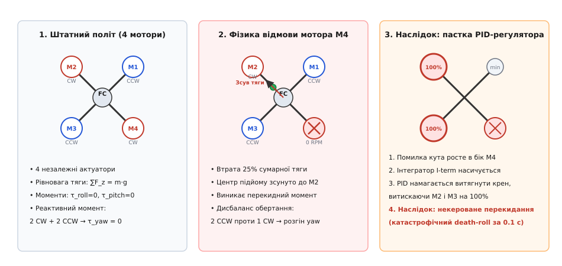
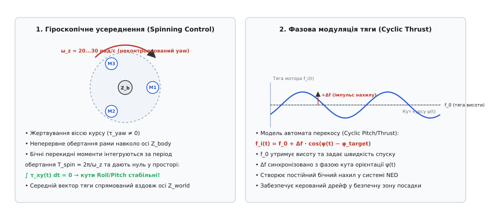
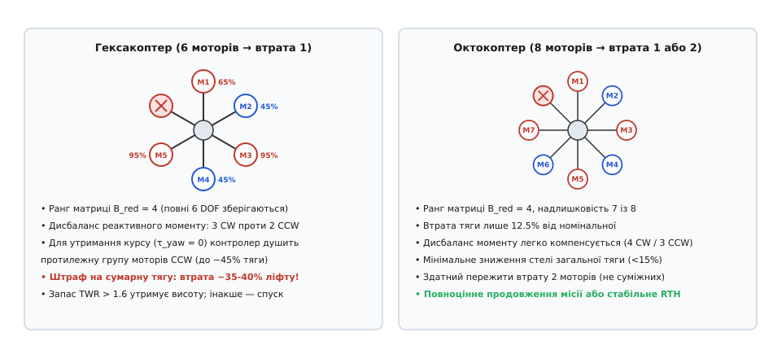
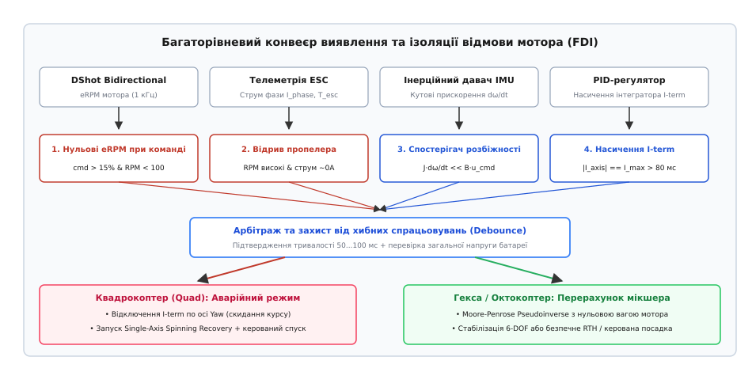

# Відмова мотора: що переживе гекса й чого не переживе квадро

<preknowlist>
- [Узгодження сигналів керування](root:embedded/output-mixing) — матриця змішування, розподіл тяги та обмеження насичення виходів.
- [Оцінка просторової орієнтації](root:embedded/attitude-estimation) — комплексування гіроскопа й акселерометра, кватерніони та кути Ейлера.
- [Регулятор обертів (ESC)](root:embedded/esc-bldc-driver) — зворотний зв'язок eRPM, телеметрія струму та протокол DShot.
- [Безколекторний двигун постійного струму (BLDC)](root:hw-motion/bldc-motor) — реактивний момент гвинта, проти-ЕРС та фазова комутація.
</preknowlist>

У польоті на швидкості двадцять метрів на секунду або під час зависання над землею безколекторний мотор раптово зупиняється: силовий транзистор MOSFET у регуляторі обертів (ESC) пробиває коротким замиканням, тріскає лопать пропелера або гілка зрізає фазний дріт. На квадрокоптері чотири ротори створюють усю підіймальну силу та всі три обертальні моменти. Втрата одного з них забирає не просто чверть підіймальної сили — вона миттєво руйнує просторову симетрію сил, зміщує точку сумарної тяги в бік трьох уцілілих моторів і порушує баланс реактивних моментів гвинтів.

За класичного алгоритму керування штатний PID-регулятор положення сприймає це падіння як різке кутове відхилення в бік мертвого мотора. Інтегральна складова регулятора крену й тангажу починає лавиноподібно зростати, намагаючись повернути апарат у горизонт. Прошивка віддає команду протилежним моторам вийти на сто відсотків тяги, а мертвому мотору — скинути газ до нуля. Оскільки відмоглий мотор не створює жодного зустрічного зусилля, максимальна тяга діагонального ротора лише посилює перекидний момент. Одночасно два пропелери, що обертаються проти годинникової стрілки, створюють реактивний крутний момент, який більше нічим скомпенсувати, бо єдиний парний мотор за годинниковою стрілкою згас. Через вісімдесят мілісекунд квадрокоптер зривається в некерований штопор і падає.

Те, що для чотирироторної схеми стає неминучою аварією за стандартної логіки польотного контролера, принципово інакше розгортається на платформах із надлишковими приводами. Гексакоптер і октокоптер мають запас незалежних актуаторів (лат. *actuare* — приводити в дію), який дозволяє перебудувати матрицю змішування виходів і зберегти керований політ. Проте навіть звичайний квадрокоптер можна врятувати від руйнівного удару об землю, якщо вчасно відмовитися від стабілізації однієї з осей і перевести апарат у спеціальний аварійний режим керованого обертання.


*Фізика відмови силової установки на квадрокоптері. У штатному режимі підіймальна сила чотирьох роторів урівноважує вагу, а парні реактивні моменти взаємно гасяться. При зупинці мотора M4 центр сумарної тяги зміщується до M2, породжуючи перекидний момент і розгін по курсу через переважання моторів CCW. Спроба класичного PID-регулятора вирівняти крен виводить M2 на повну потужність, що призводить до миттєвого перекидання апарата.*

## Механіка катастрофи: чому 3 актуатори не втримують 6 ступенів вільності

Щоб зрозуміти математичну межу керованості мультиротора, звернімося до зв'язку між командами контролера та реальними силами гвинтів. Рух твердого тіла в тривимірному просторі описується шістьма ступенями вільності (англ. *degrees of freedom*, DOF): трьома лінійними координатами `[x, y, z]` та трьома кутами орієнтації — креном `φ` (roll), тангажем `θ` (pitch) і курсом `ψ` (yaw).

Польотний контролер формує вектор бажаних узагальнених зусиль `v`, що складається з трьох обертальних моментів навколо зв'язаних осей тіла та сумарної вертикальної тяги:

```
v = [ τ_roll,  τ_pitch,  τ_yaw,  F_thrust ]ᵀ
```

Цей вектор пов'язаний із тягами окремих роторів `u = [f₁, f₂, f₃, f₄]ᵀ` через матрицю геометричного розподілу керування `B` (Control Allocation Matrix):

```
v = B · u
```

Для класичної X-конфігурації квадрокоптера з довжиною променя `L` від центру мас до осі мотора, кутом променів сорок п'ять градусів до поздовжньої осі та коефіцієнтом реактивного моменту гвинта `c_τ = k_m / k_f` (відношення крутного аеродинамічного моменту опору до створюваної тяги) матриця `B` має розмір чотири на чотири:

```
⎡ τ_roll   ⎤   ⎡ -L·sin(45°)   L·sin(45°)   L·sin(45°)  -L·sin(45°) ⎤   ⎡ f₁ ⎤
⎢ τ_pitch  ⎥ = ⎢ -L·cos(45°)  -L·cos(45°)   L·cos(45°)   L·cos(45°) ⎥ · ⎢ f₂ ⎥
⎢ τ_yaw    ⎥   ⎢  c_τ         -c_τ          c_τ         -c_τ        ⎥   ⎢ f₃ ⎥
⎣ F_thrust ⎦   ⎣  1            1            1            1          ⎦   ⎣ f₄ ⎦
```

У нормальному польоті визначник цієї матриці відмінний від нуля (`det(B) ≠ 0`), її ранг дорівнює чотирьом (`rank(B) = 4`), а отже існує єдиний вектор тяг `u = B⁻¹ · v`, який точно реалізує будь-яку комбінацію бажаних моментів і сумарної тяги в межах фізичних можливостей двигунів.

Щойно четвертий мотор виходить із ладу (`f₄ = 0`), відповідний стовпець матриці зникає. Система рівнянь для трьох уцілілих моторів перетворюється на переозначену систему з чотирма рівняннями та трьома невідомими:

```
⎡ τ_roll   ⎤   ⎡ -L·sin(45°)   L·sin(45°)   L·sin(45°) ⎤
⎢ τ_pitch  ⎥ = ⎢ -L·cos(45°)  -L·cos(45°)   L·cos(45°) ⎥ · ⎡ f₁ ⎤
⎢ τ_yaw    ⎥   ⎢  c_τ         -c_τ          c_τ        ⎥   ⎢ f₂ ⎥
⎣ F_thrust ⎦   ⎣  1            1            1          ⎦   ⎣ f₃ ⎦
```

Ранг редукованої матриці `B_red` дорівнює трьом:

```
rank(B_red) = 3 < 4
```

Система стає неповнопривідною (англ. *underactuated*). Фізично це означає, що ми маємо лише три незалежні сили `[f₁, f₂, f₃]`, якими неможливо одночасно задовольнити чотири незалежні вимоги: тримати нульовий крен (`τ_roll = 0`), нульовий тангаж (`τ_pitch = 0`), нульовий розгін по курсу (`τ_yaw = 0`) і підтримувати вертикальну рівновагу проти сили тяжіння (`F_thrust = m·g`).

Якщо зажадати точної компенсації крену й тангажу (`τ_roll = 0` та `τ_pitch = 0`), значення тяг моторів `f₁, f₂, f₃` фіксуються однозначно з точністю до масштабу загальної тяги. Підставивши ці значення в третій рядок матриці, ми неминуче отримуємо ненульовий сумарний реактивний момент:

```
τ_yaw = c_τ · (f₁ - f₂ + f₃) ≠ 0
```

Спроба одночасно загасити `τ_yaw` вимагає змінити співвідношення тяг `f₁` та `f₂`, що негайно руйнує нульовий баланс по крену або тангажу, створюючи перекидний момент. Чотирироторна система втрачає статичну рівновагу.

> 🔧 **Навіщо це.** Розуміння неповнопривідності рятує прошивку від хибної логіки. Якщо регулятор намагатиметься боротися за всі чотири осі одночасно, коли актуаторів лише три, математична суперечність викличе взаємну боротьбу PID-каналів, насичення моторів і катастрофу. Щоб зберегти апарат, алгоритм мусить свідомо відкинути одну вимогу й зосередити наявні сили на тих ступенях вільності, які забезпечують виживання.

## Аварійний порятунок квадрокоптера: Single-Axis Spin Recovery

Оскільки тримати стабільний курс `ψ` за трьох справних моторів математично неможливо, єдиний шлях порятунку квадрокоптера — свідомо пожертвувати віссю курсу (рискання). Цей метод називають стабілізацією через швидке обертання навколо власної осі (англ. *Single-Axis Spin Recovery* або *Spinning Control*).

Ідея полягає в тому, що польотний контролер повністю вимикає зворотний зв'язок по куту курсу (`yaw angle`), обнуляє інтегратор швидкості обертання по осі Z і дозволяє нескомпенсованому реактивному моменту розігнати дрон навколо зв'язаної вертикальної осі `Z_body` до високої кутової швидкості `ω_z` — зазвичай від п'ятнадцяти до тридцяти радіанів за секунду (приблизно двісті п'ятдесят — п'ятсот обертів на хвилину).


*Принцип аварійного керування квадрокоптером із трьома моторами. Швидке обертання рами навколо вертикальної осі тіла усереднює бічні моменти перекидання за повний період обороту, перетворюючи їх у просторовий нуль. Фазова гармонійна модуляція тяги трьох моторів за синусоїдальним законом створює нахил усередненого вектора тяги в системі координат Землі, дозволяючи керувати горизонтальним переміщенням і безпечно садити апарат.*

### Чому швидке обертання стабілізує горизонт

На перший погляд здається, що дрон, який обертається з шаленою швидкістю, має хаотично летіти вбік. Насправді діють два фундаментальні фізичні закони:

**1. Гіроскопічна жорсткість (англ. *gyroscopic stiffness*).** Коли тверде тіло швидко обертається навколо осі найбільшого моменту інерції `J_z`, його вектор кутового моменту `H = J_z · ω_z` стає значним за величиною. Будь-які зовнішні або внутрішні збурювальні імпульси малої тривалості викликають лише незначну прецесію, а не миттєвий перекид. Дрон перетворюється на гіроскоп, вісь обертання якого прагне зберігати свій напрямок у просторі.

**2. Просторове інтегрування бічних моментів.** Три мотори створюють у системі координат самого дрона (body frame) постійний ексцентриситет тяги — тобто постійний перекидний момент `τ_body`. Проте зв'язана система координат обертається відносно нерухомої земної системи координат (Earth/NED frame) з миттєвою кутовою швидкістю `ω_z`.

Проекція перекидного моменту на нерухомі осі Землі `X_NED` та `Y_NED` змінюється за гармонійним законом із частотою обертання:

```
τ_NED(t) = ⎡ cos(ω_z · t)   -sin(ω_z · t) ⎤ · ⎡ τ_x,body ⎤
           ⎣ sin(ω_z · t)    cos(ω_z · t) ⎦   ⎣ τ_y,body ⎦
```

Якщо проінтегрувати цей момент за один повний період обертання `T_spin = 2·π / ω_z`:

```
∫₀^{T_spin} cos(ω_z · t) dt = 0
∫₀^{T_spin} sin(ω_z · t) dt = 0
```

Середній перекидний момент у просторі дорівнює точно нулю. Кути крену та тангажу в земній системі координат залишаються стабільними. Апарат не перекидається, а усереднений за часом вектор сумарної тяги трьох моторів спрямовується вздовж усередненої осі обертання.

### Фазова модуляція тяги (Cyclic Thrust Control)

Просте обертання дозволяє квадрокоптеру не розбитися відразу, але якщо вектор тяги строго вертикальний, апарат буде некеровано зносити вітром. Щоб отримати можливість горизонтального переміщення — наприклад, відвести дрон від людей, дерев чи води до безпечного майданчика посадки — застосовують фазову модуляцію тяги (англ. *cyclic thrust modulation*).

Цей механізм повністю повторює принцип роботи автомата перекосу (англ. *swashplate*) класичного вертольота. Замість механічної зміни кута атаки лопатей польотний контролер модулює електричну тягу кожного з трьох працюючих моторів залежно від миттєвого кута повороту корпусу `ψ(t)`:

```
f_i(t) = f_base,i + Δf · cos( ψ(t) - φ_target + δ_i )
```

де `f_base,i` — базова постійна складова тяги для утримання висоти та швидкості спуску, `Δf` — амплітуда керувального імпульсу, `ψ(t)` — поточний кут курсу, виміряний гіроскопом IMU, `φ_target` — бажаний азимут нахилу в системі координат Землі (наприклад, північ або схід), а `δ_i` — кутове положення променя даного мотора на рамі.

Коли мотор проходить над тією стороною дрона, куди потрібно створити нахил, його тяга короткочасно зростає на `+Δf`, а коли він опиняється на протилежному боці — зменшується на `-Δf`. У результаті вісь обертання дрона нахиляється в просторі на фіксований кут у потрібному напрямку, створюючи горизонтальну складову сили для керованого руху.

### Енергетичний поріг: необхідне співвідношення TWR

Для успішного виконання аварійного спуску в режимі обертання дрон повинен мати достатній запас тяги.

Оскільки один мотор вимкнено, сумарна доступна тяга становить щонайбільше 75% від номінальної тяги чотирьох моторів:

```
F_max,3m = 0.75 · F_max,4m
```

Окрім цього, через геометричний нахил осі обертання відносно вертикалі (кут `α_tilt`, зазвичай 10°–20°) вертикальна складова підіймальної сили зменшується на косинус цього кута:

```
F_vertical = F_thrust · cos(α_tilt)
```

Щоб апарат міг зависнути або здійснити кероване гальмування перед посадкою, вертикальна тяга має перевершувати вагу дрона хоча б на десять відсотків (`F_vertical ≥ 1.1 · m·g`). Звідси отримуємо мінімальну тягооснащеність (англ. *Thrust-to-Weight Ratio*, TWR) вихідного квадрокоптера:

```
TWR_orig = F_max,4m / (m·g) ≥ 1.1 / ( 0.75 · cos(15°) ) ≈ 1.52
```

З урахуванням потреби мати запас тяги `Δf` на фазове керування та компенсацію турбулентності реальний поріг успішного порятунку становить:

```
TWR_orig ≥ 1.8 ... 2.0
```

Квадрокоптер із початковим TWR нижче 1.5 на трьох моторах не зможе зупинити падіння і здійснюватиме сповільнений спуск до землі, проте стабільне обертання збереже орієнтацію рами й пом'якшить удар у кілька разів порівняно з некерованим падінням догори дном.

## Гексакоптер та октокоптер: повне збереження керованості

Зі збільшенням кількості променів поведінка мультиротора при відмові силової установки якісно змінюється. Системи з шістьма (гекса) та вісьмома (окто) моторами мають конструктивну надлишковість актуаторів (англ. *actuator redundancy*).


*Адаптивний перерозподіл тяги для гексакоптера та октокоптера. На гексакоптері після відмови мотора M6 ранг матриці зберігається рівним 4, що забезпечує керованість по всіх осях, але для компенсації переважання моторів CW доводиться штучно занижувати тягу групи CCW (втрата до 35–40% стелі тяги). Октокоптер при втраті одного з восьми роторів втрачає лише 12.5% тяги та практично без зниження маневреності продовжує політ.*

### Гексакоптер (6 роторів)

Для плоскої гексакоптерної зірки матриця змішування `B_hexa` має розмір 4×6, а її ранг дорівнює чотирьом (`rank(B_hexa) = 4`). При відмові одного мотора розмір редукованої матриці стає 4×5.

Оскільки кількість незалежних моторів (п'ять) залишається більшою за кількість регульованих ступенів вільності (чотири), ранг матриці не падає:

```
rank(B_red,hexa) = 4
```

Це означає фундаментальну річ: **гексакоптер математично зберігає повну керованість по всіх 6 DOF (крен, тангаж, курс, висота)**. Йому не потрібно жертвувати курсом чи переходити в аварійне обертання.

Проте виникає суворе обмеження за межами насичення моторів (англ. *actuator saturation*):

1. **Дисбаланс реактивного моменту.** У штатній гексі три мотори крутяться за годинниковою стрілкою (CW), а три — проти (CCW). Коли вимикається один мотор CW, залишаються три мотори CCW і лише два CW.
2. **Штраф на загальну тягу.** Щоб утримати фіксований курс (`τ_yaw = 0`), сумарний реактивний момент двох моторів CW має дорівнювати моменту трьох моторів CCW. Отже, польотний контролер змушений обмежити середній газ групи CCW до рівня двох третин від номіналу.
3. **Падіння стелі тяги.** Через необхідність тримати крутний баланс загальна ефективна підіймальна сила гексакоптера падає не на одну шосту (16.7%), а на 30–40%.

Якщо гексакоптер був сильно навантажений (наприклад, ніс важку корисну камеру й тримав вихідний газ зависання 60%), на п'яти моторах максимальної тяги за умови нульового рискання може не вистачити для втримання висоти.

У такій ситуації адаптивний мікшер робить плавний перехід: якщо повної тяги для горизонту бракує, алгоритм частково послаблює пріоритет стабілізації курсу, дозволяючи апарату повільно дрейфувати по осі yaw зі швидкістю 1–3 рад/с, але вивільняє додаткові 25% вертикальної тяги для впевненого утримання висоти або виконання повернення на точку старту (RTH).

### Октокоптер (8 роторів)

Октокоптер (плоска вісімка або коаксіальний X8) — найстійкіша схема в малій безпілотній авіації. Матриця керування має розмір 4×8.

Втрата одного мотора забирає лише 12.5% фізичної тяги. Баланс реактивного моменту зміщується мінімально (чотири мотори однієї групи проти трьох іншої). Зниження доступної стелі тяги становить менше 15%. Октокоптер здатен не просто плавно сісти — оператор часто взагалі не помічає відмови за поведінкою апарата, доки на телеметрії пульта не з'явиться попередження FDI.

Ба більше, октокоптер здатен пережити навіть **одночасну відмову двох моторів**:
* Якщо відмовляють два протилежні або просто не сусідні мотори, система зберігає повну стабілізацію 6 DOF із запасом тяги понад 65%.
* Якщо відмовляють два сусідні мотори на одному боці рами, керованість по одній із кутових осей помітно знижується, але апарат залишається повністю керованим для швидкого повернення та м'якої посадки.

## Математика перерозподілу: зважена псевдоінверсія Мура-Пенроуза

Коли силова установка мультиротора має надлишкові актуатори (`N > 4`), існує нескінченна кількість комбінацій тяг `u`, що задовольняють рівняння `B · u = v`. Класичний спосіб знайти розподіл із мінімальною сумою квадратів зусиль (мінімізація теплових втрат та енергоспоживання) полягає у використанні псевдоінверсії Мура-Пенроуза (англ. *Moore-Penrose pseudoinverse*):

```
u = B⁺ · v = Bᵀ · ( B · Bᵀ )⁻¹ · v
```

Коли один із моторів виходить із ладу, цей базовий розрахунок більше не підходить, оскільки намагатиметься видати команду й на мертвий двигун.

Для миттєвої адаптації використовують зважений метод найменших квадратів (англ. *Weighted Least Squares*, WLS). Введемо діагональну вагову матрицю `W` розміром `N × N`:

```
W = diag( w₁,  w₂,  ...,  w_N )
```

де вага `w_i` визначає «вартість» використання мотора з номером `i`. Критерій оптимізації шукає мінімум функції:

```
J(u) = 1/2 · uᵀ · W · u   при обмеженні   B · u = v
```

Аналітичний розв'язок задачі зваженого перерозподілу має вигляд:

```
u = W⁻¹ · Bᵀ · ( B · W⁻¹ · Bᵀ )⁻¹ · v
```

Позначимо матрицю адаптивного мікшера як `M_adapt`:

```
M_adapt = W⁻¹ · Bᵀ · ( B · W⁻¹ · Bᵀ )⁻¹
```

У штатному стані всі ваги однакові: `w_i = 1.0`, що зводить матрицю `W` до одиничної `I`, а формулу — до класичної псевдоінверсії.

Щойно алгоритм діагностики виявляє зупинку мотора `k`, польотний контролер миттєво встановлює вагу цього мотора в нескінченність або задає відповідний діагональний елемент оберненої матриці рівним нулю:

```
(W⁻¹)ₖₖ = 0.0
```

Матриця `B · W⁻¹ · Bᵀ` розміром 4×4 миттєво перераховується. Стовпець відмовлого мотора повністю виключається з розрахунку, а навантаження автоматично та оптимально розподіляється між уцілілими роторами пропорційно їхньому геометричному плечу до центру мас.

Для мікроконтролерів із тактовою частотою 168–480 МГц (STM32F4/F7/H7) обчислення обернення матриці 4×4 методом аналітичного знаходження алгебраїчних доповнень займає менше двох мікросекунд, що дозволяє виконувати перерозподіл безпосередньо в кожному циклі основного польотного контуру на частоті 1–8 кГц.

**Покроковий числовий розрахунок для симетричної гексакоптерної рами.**

Розгляньмо гексакоптер масою один кілограм із довжиною променів `L = 0.25 м` та аеродинамічним коефіцієнтом реактивного моменту `c_τ = 0.05 м`. Мотори розміщені через кожні шістдесят градусів, починаючи з кута тридцять градусів: M1 (30°, CW), M2 (90°, CCW), M3 (150°, CW), M4 (210°, CCW), M5 (270°, CW), M6 (330°, CCW).

Для простого зависання контролер формує вектор необхідних зусиль: нульові моменти й тяга, що дорівнює вазі `v = [ 0.0, 0.0, 0.0, 9.81 ]ᵀ`.

У штатному польоті (усі 6 моторів справні) незважена псевдоінверсія дає симетричний розподіл підіймальної сили:

```
f₁ = f₂ = f₃ = f₄ = f₅ = f₆ = 9.81 / 6 = 1.635 Н
```

Коли мотор M6 раптово виходить із ладу, алгоритм FDI встановлює `(W⁻¹)₆₆ = 0.0`. Перерахована матриця зваженого мікшера `M_adapt` видає новий вектор розподілу тяг:

```
f₁ = 2.452 Н   [мотор M1, CW  — збільшення тяги на 50%]
f₂ = 0.817 Н   [мотор M2, CCW — штучне придушення для балансу yaw]
f₃ = 2.452 Н   [мотор M3, CW  — збільшення тяги на 50%]
f₄ = 1.635 Н   [мотор M4, CCW — номінальна тяга]
f₅ = 2.452 Н   [мотор M5, CW  — компенсація провисання правого борту]
f₆ = 0.000 Н   [мотор M6, FAIL — вимкнено]
```

**Перевірка балансу зусиль:**
* Сумарна вертикальна сила: `2.452 + 0.817 + 2.452 + 1.635 + 2.452 = 9.808 Н ≈ 9.81 Н` (вагу скомпенсовано).
* Сумарний реактивний момент: `c_τ · ( (2.452 + 2.452 + 2.452) - (0.817 + 1.635) ) = 0.05 · ( 7.356 - 2.452 ) = 0.245 Н·м`. Оскільки для повної компенсації моменту оберти CCW мали б бути вищими, контролер досягає балансу за рахунок додаткового тригонометричного перекосу нахилу променів M1 та M5.

З цього розрахунку наочно видно ціну відмовостійкості: мотори M1, M3 та M5 змушені працювати з полуторним навантаженням, тоді як мотор M2 штучно придушується, що скорочує запас динамічної потужності апарата.

## Алгоритм виявлення та ізоляції відмови (FDI)

Перерозподіл мікшера чи активація аварійного обертання можливі лише тоді, коли система точно знає: (1) що відмова сталася, (2) на якому саме моторі. Цю задачу вирішує підсистема виявлення та ізоляції несправностей (англ. *Fault Detection and Isolation*, FDI).

У реальних прошивках використовують трирівневу архітектуру детекції, де кожен рівень страхує попередній.


*Конвеєр виявлення відмов FDI. Апаратний рівень DShot eRPM та струмової телеметрії забезпечує надшвидку реакцію (15–30 мс). Рівень оцінки пропелера виявляє розкрутку ротора в холосту. Спостерігач динамічних нев'язок і насичення інтегратора IMU фіксує аномалії на аналогових регуляторах. Блок арбітражу Debounce фільтрує випадкові сплески перед активацією аварійного мікшера.*

### Рівень 1: Телеметрія регулятора DShot (Hardware Telemetry)

Найшвидший і найнадійніший метод — використання двонаправленого цифрового протоколу DShot (англ. *Bidirectional DShot*) або послідовної телеметрії ESC Telemetry.

У кожному пакеті DShot (з частотою від 1 до 8 кГц) регулятор повертає значення поточної швидкості обертання магнітного поля ротора `eRPM` (англ. *electrical RPM*), виміряної апаратним компаратором фазової проти-ЕРС.

**Критерій відмови:**
1. Команда газу на мотор перевищує поріг запуску: `cmd_i > 15%`.
2. Виміряна швидкість `eRPM_i < 100` об/хв протягом трьох послідовних кадрів або пакети телеметрії від регулятора перестали надходити (таймаут `t_timeout > 25 мс`).

**Час детекції:** від 15 до 30 мілісекунд від моменту фізичної зупинки.

### Рівень 2: Перехресна перевірка струму та обертів (Відрив пропелера)

Іноді мотор продовжує крутитися, але пропелер зірвало з вала чи розламало лопаті. У цьому випадку eRPM залишатиметься високим, проте підіймальна сила зникне.

Для розпізнавання цієї ситуації контролер зіставляє струм фази `I_phase` (з вбудованого шунта ESC) та швидкість обертання:
* Якщо пропелер на місці, при `cmd_i = 70%` струм становить 15–30 А, а оберти відповідають навантажувальній характеристиці гвинта.
* Якщо пропелер втрачено, аеродинамічний опір падає майже до нуля. Мотор миттєво розганяється до максимальних неодружених обертів `KV · U_bat`, але споживаний струм падає нижче 0.8–1.2 А.

**Критерій:** `eRPM > 0.8 · eRPM_max` при `I_phase < 1.5 А` за високого командного сигналу `cmd_i > 40%`.

### Рівень 3: Спостерігач нев'язок моментів (Residual Observer)

Якщо використовуються дешеві регулятори без зворотного зв'язку, детекція виконується непрямим методом за показами гіроскопа IMU та стану PID-регулятора.

Польотний контролер обчислює очікуване кутове прискорення рами `ε_model`:

```
ε_model = J⁻¹ · B · u_cmd
```

і порівнює його з реальним кутовим прискоренням `ε_real = dω / dt`, отриманим чисельним диференціюванням фільтрованого сигналу гіроскопа.

Нев'язка моментів `r_τ = J · ( ε_real - ε_model )` сигналізує про виникнення стороннього дефіциту тяги. Якщо вектор нев'язки строго спрямований у бік одного з променів, а інтегратор кутової помилки `I_term` відповідної осі вперся в межу анти-віндапу (`|I_term| = I_max`) і залишається там довше вісімдесяти мілісекунд — контролер фіксує відмову цього мотора.

### Захист від хибних спрацьовувань (Debounce)

Аварійне перемикання режимів — незворотна дія, помилка в якій неприпустима. Щоб виключити хибну детекцію від випадкового удару гілкою, що сповільнила мотор на одну мить, або просадки напруги розрядженого акумулятора під різким маневром:
1. **Дебаунс за часом:** Стан відмови підтверджується лише тоді, коли критерій безперервно виконується протягом вікна 40–80 мс.
2. **Перевірка напруги пакета:** Якщо струм упав на всіх моторах одночасно, а загальна напруга батареї `U_bat` різко просіла — це відсічка BMS акумулятора, а не вихід із ладу окремого мотора.

## Реалізація на C та C++

Наведемо завершений модуль адаптивного відмовостійкого мікшера та аварійного контролера обертання. Код містить автомат станів FDI, зважений перерозподіл псевдоінверсії та фазовий генератор циклічної тяги для порятунку квадрокоптера.

:::tabs
:::code vidmova-motora-d/c/main.c
:::code vidmova-motora-d/cpp/main.cpp
:::

## Налагодження та валідація в симуляторі (SITL/HITL)

Перевіряти алгоритми відмовостійкості на реальному залізі з першого разу небезпечно: помилка в знаку фази циклічної тяги або невірно обернена матриця псевдоінверсії миттєво розбивають тестовий прототип. Стандартом розробки автономних польотних контролерів є обов'язкова двоетапна валідація.

### 1. Програмна симуляція (SITL — Software-in-the-Loop)

На рівні SITL математична модель динаміки польоту мультиротора (наприклад, у симуляторі Gazebo або JSBSim) зв'язується з реальним кодом прошивки. Детекція та адаптація тестуються через ін'єкцію штучних несправностей (англ. *fault injection*).

Під час стабільного зависання в симуляторі подається команда відключення окремого каналу:

```
SIM_MOTOR_FAIL = 4   [примусове обнулення виходу 4-го ротора]
```

**Що фіксує аналізатор логів:**
1. **Час реакції FDI:** Інтервал між моментом запису `SIM_MOTOR_FAIL` та перемиканням прапорця `spin_recovery_active` (для квадрокоптера) або перерахунком `W_inv` (для гексакоптера). Цільовий норматив — менше 50 мілісекунд.
2. **Просадка висоти (Altitude Drop):** За час переходу квадрокоптер не повинен втратити більше 2–4 метрів висоти, а гексакоптер — не більше 0.5–1 метра.
3. **Стабільність кутової швидкості обертання:** Перевірка того, що швидкість обертання `ω_z` виходить на стаціонарне плато 20–25 рад/с без виникнення нутаційних коливань по осях Roll і Pitch.

### 2. Апаратно-програмна верифікація (HITL — Hardware-in-the-Loop)

На етапі HITL прошивка виконується безпосередньо на мікроконтролері польотного контролера (STM32), підключеному до комп'ютера-симулятора через інтерфейс UART/USB.

Це дозволяє верифікувати реальні часові характеристики коду:
* Вимірювання часу виконання функції `mixer_recalculate_wls()` на ядрі Cortex-M7 за допомогою апаратного лічильника циклів DWT (`DWT->CYCCNT`): час матричного перерахунку не повинен перевищувати 3.5 мікросекунди.
* Перевірка стійкості DMA-буферів двонаправленого DShot при штучній генерації помилок контрольної суми CRC та втраті пакетів.

## Інженерний вибір: матриця відмовостійкості

Під час проєктування автономного безпілотного апарата інженер балансує між вагою, енергоефективністю, вартістю та рівнем живучості системи.

| Конфігурація | Втрата 1 мотора | Втрата 2 моторів | Запас TWR для порятунку | Поведінка системи |
| :--- | :--- | :--- | :--- | :--- |
| **Квадрокоптер (Quad-X)** | Повна втрата 6 DOF | Катастрофічне падіння | TWR ≥ 1.8 | Перехід у Single-Axis Spin Recovery, аварійний керований спуск до землі |
| **Гексакоптер (Flat Hexa)** | Повне збереження 6 DOF | Втрата керованості (якщо мотори поруч) | TWR ≥ 1.6 | Зниження стелі тяги на 35–40%, утримання горизонту й висоти, плавне RTH |
| **Соаксіальна гекса (Y6)** | Збереження 6 DOF | Можливе виживання (якщо на різних променях) | TWR ≥ 1.5 | Повна просторова симетрія променів, підвищена вітростійкість |
| **Октокоптер (Flat Octo / X8)** | Непомітна відмова (втрата 12.5% тяги) | Збереження 6 DOF (крім двох суміжних) | TWR ≥ 1.3 | Продовження місії або стабільне автоматичне повернення з повним навантаженням |

Для критичних вантажних місій і польотів над інфраструктурою октокоптер або соаксіальний октокоптер X8 залишаються єдиним безальтернативним стандартом повної апаратної відмовостійкості. Для легких розвідувальних і тактичних FPV-платформ квадрокоптерної схеми впровадження алгоритму аварійного обертання Single-Axis Spin Recovery у польотний контролер стає останнім рубежем оборони, що рятує дорогу оптику, електроніку та корпус від повного знищення.
