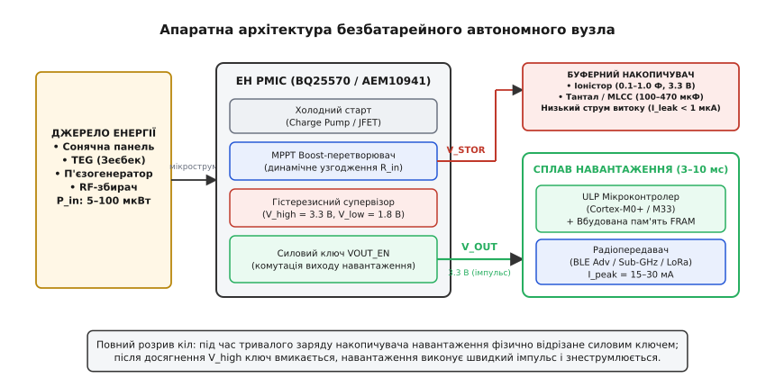
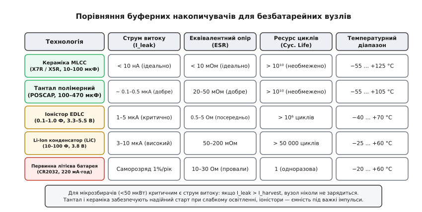
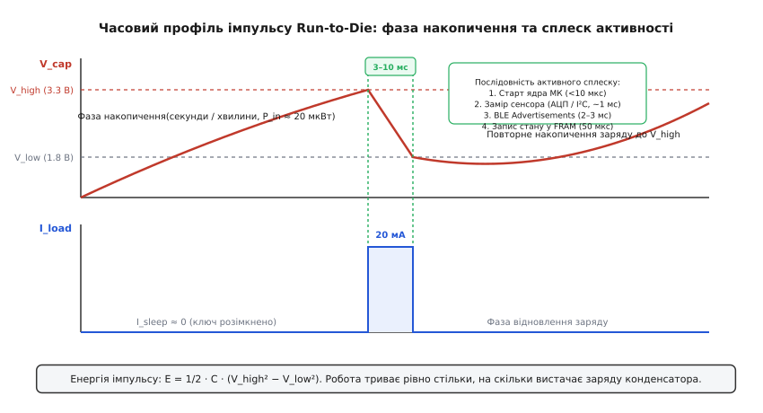

# Вузол без батареї: чи можливо і коли

<preknowlist>
- [Накопичувач збирача й холодний старт](root:hw-power/nakopychuvach-zbyracha-i-kholodnyi-start) — фізика буферних ємностей, струми витоку та подолання кремнієвого бар'єра при холодному старті.
- [Цикл і середній струм](root:embedded/duty-cycle-current) — розрахунок середнього споживання імпульсних навантажень та бюджетування енергетичного сплеску.
- [EEPROM і FRAM](root:embedded/eeprom-fram) — фізика сегнетоелектричної пам'яті: миттєвий енергоощадний запис без зносу та затримок зарядової помпи.
</preknowlist>

Заміна літієвої батарейки в промисловому давачі вібрації на лопатці газової турбіни, всередині армованого бетонного перекриття мосту чи на високовольтній лінії електропередач коштує в сотні разів більше, ніж сам електронний вузол. Хімічні первинні джерела живлення мають жорсткий термін деградації: електроліт висихає, саморозряд зростає з температурою, а при морозах нижче −20 °C внутрішній опір елементів CR2032 чи літій-тіонілхлоридних батарей підскакує настільки, що будь-який сплеск радіопередавача обвалює напругу шини живлення в глибокий brown-out. Крім того, герметичне заливання датчика епоксидним компаундом для захисту від агресивного середовища виключає наявність батарейного відсіку.

Єдиним інженерним виходом для необслуговуваної телеметрії з терміном служби понад 15–20 років є повна відмова від хімічного джерела живлення на користь збору енергії з довкілля (англ. *Energy Harvesting*, EH). Але тут розробник стикається з фундаментальною фізичною суперечністю: доступна потужність мікрозбирачів (сонячних елементів при кімнатному світлі, термоелектрогенераторів на трубах гарячого водопостачання чи п'єзогенераторів на вібруючих верстатах) становить лічені мікровати (5–50 мкВт), тоді як радіопередавач стандарту BLE, EnOcean або LoRaWAN для випромінювання пакета в ефір вимагає миттєвої пікової потужності 30–100 мВт. Різниця між генерованою та споживаною потужністю сягає трьох-чотирьох порядків величини.

Подолати цей розрив можливо лише завдяки **розчепленню процесів у часі**. Безбатарейний вузол не працює безперервно: він проводить 99.99 % свого існування у фазі накопичення мікрострумів у буферній ємності при повністю фізично відключеному навантаженні, після чого здійснює блискавичний сплеск активності тривалістю 3–10 мілісекунд (замір, обчислення, радіопосилка) і знову поринає у знеструмлений стан. Такий принцип отримав назву **імпульсного переривчастого функціонування** (англ. *Intermittent Computing* або концепція *Run-to-Die*).

## 1. Стратегічні переваги та фізичні межі безбатарейних систем

Відмова від гальванічних елементів переводить пристрій із категорії «електроніка з регламентним сервісом» у категорію «встановив і забув на десятиліття». Проте така зміна парадигми накладає безкомпромісні обмеження на поведінку системи.

### Переваги над хімічними джерелами

1. **Необмежений ресурс експлуатації (15–25+ років):** у пристрої відсутні рідкі електроліти, хімічні реакції відновлення металу та процеси наростання внутрішніх дендритів. Твердотільні накопичувачі (керамічні конденсатори MLCC, танталові полімери або спеціалізовані іоністори) витримують мільйони циклів глибокого перезаряду без втрати ємності.
2. **Екстремальний температурний діапазон:** безбатарейний вузол на базі кремнієвих компонентів промислового класу та керамічних конденсаторів зберігає працездатність від −40 °C до +85 °C (а при використанні high-rel серій — до +105 °C і +125 °C). Літієві батареї при таких температурах або замерзають, втрачаючи здатність віддавати струм, або деградують за лічені тижні через експоненційне зростання струмів саморозряду.
3. **Вибухобезпечність (ATEX / Intrinsic Safety):** відсутність концентрованої хімічної енергії літію виключає небезпеку теплового розгону (англ. *thermal runaway*) та вибуху при короткому замиканні або механічному пробитті корпусу, що критично для вугільних шахт, хімічних резервуарів та нафтогазопроводів.
4. **Монолітне герметичне заливання:** відсутність потреби відкривати корпус для заміни батареї дозволяє заливати плату поліуретановим чи епоксидним компаундом за класом захисту IP68/IP69K, забезпечуючи стійкість до занурення у воду, вібрацій та корозійних парів кислот.

### Межі та інженерна ціна відмови від батареї

Безбатарейний вузол не володіє постійною готовністю до дії. Якщо зовнішнє джерело енергії зникає (настає ніч для сонячної панелі або зупиняється нагрів труби для термоелектрогенератора), вузол повністю засинає і не може реагувати на зовнішні події в реальному часі.

* **Недетермінований темп передачі:** інтервал між сеансами зв'язку прямо пропорційний поточному припливу енергії довкілля. За яскравого освітлення маяк може виходити в ефір раз на секунду, а в сутінках — раз на п'ять хвилин.
* **Відсутність енергії на прослуховування ефіру:** прийом радіосигналу вимагає тривалої активності приймача (струми 5–15 мА протягом сотень мілісекунд), що енергетично недосяжно для мікрозбирачів. Тому безбатарейні вузли будуються виключно як односторонні передавачі (англ. *Uplink-only broadcast beacons*).
* **Втрата леткої пам'яті:** оперативна пам'ять SRAM та регістри мікроконтролера скидаються при кожному розряді конденсатора. Усі накопичені стани, лічильники та калібрування мусять зберігатися у надшвидкій енергонезалежній пам'яті.

## 2. Апаратний тракт збору енергії та буферні накопичувачі

Класична схема підключення лінійного стабілізатора тут непридатна. Якщо під'єднати сонячну панель через звичайний діод до конденсатора та мікроконтролера, система ніколи не вийде на робочий режим: слабкий струм збирача просяде на зворотних витоках, а мікроконтролер почне спроби старту на нестабільній напрузі 1.2–1.5 В, впаде у нескінченний цикл скидання brown-out і спалить залишки заряду.


*Повна схема тракту перетворення енергії: первинний збирач, PMIC з ізоляцією навантаження, буферний накопичувач та швидкодіючий споживач на базі ядра Cortex-M та енергонезалежної пам'яті FRAM.*

### Ланки апаратного тракту

1. **Первинний перетворювач довкілля:**
   * *Мікросонячні комірки (Indoor Solar):* на основі аморфного або монокристалічного кремнію. При кімнатному освітленні 200 люкс генерують 10–30 мкВт на квадратний сантиметр при вихідній напрузі 1.5–3.0 В.
   * *Термоелектричні модулі (TEG):* ефект Зеєбека на спаях вісмут-телуриду (`Bi₂Te₃`). При градієнті температур `ΔT = 5...10 °C` модуль видає 20–100 мВ за вихідного струму в одиниці міліамперів.
   * *П'єзоелектричні генератори:* на базі цирконату-титанату свинцю (PZT) або полівініліденфториду (PVDF), що генерують короткі високовольтні імпульси (10–50 В) за механічних коливань промислового обладнання.
2. **Спеціалізований EH PMIC (Power Management IC):** інтегральний контролер (наприклад, Texas Instruments BQ25570, e-peas AEM10941, Analog Devices LTC3108), який виконує три критичні функції:
   * *Холодний пуск (Cold Start):* апаратне підвищення напруги з ультранизьких значень (від 20–330 мВ) за допомогою внутрішньої зарядної помпи або автогенератора Мейснера на збідненому JFET-транзисторі до рівня, достатнього для запуску основної логіки.
   * *Відстеження точки максимальної потужності (MPPT):* динамічне узгодження вхідного імпедансу перетворювача з внутрішнім опором джерела (алгоритм вибірки напруги холостого ходу FOCV на рівні 50 % для TEG та 70–80 % для сонячних панелей).
   * *Гістерезисний комутатор навантаження:* силовий польовий ключ, який фізично розриває коло живлення мікроконтролера, доки напруга на накопичувачі не досягне верхнього порога `V_high` (3.3 В), і миттєво відсікає навантаження, коли вона спадає до `V_low` (1.8–2.4 В).
3. **Буферний накопичувач енергії:** проміжний резервуар, що накопичує енергію протягом секунд або хвилин для подальшої миттєвої віддачі у навантаження.
4. **Обчислювально-комунікаційне ядро:** мікроконтролер ультранизького споживання (Cortex-M0+ або Cortex-M33, наприклад STM32U0, Ambiq Apollo, TI MSP430FR) та малопотужний радіотрансивер.

Детальний схемотехнічний аналіз внутрішніх вузлів, схем вибірки MPPT та топологій перетворювачів наведено в [🔌 аналізі мікросхем керування живленням EH PMIC](root:embedded/vuzol-bez-batarei/comp-harvester-pmic.md).

### Вибір технології накопичувача: битва за струм витоку

При роботі з мікропотужними джерелами головним ворогом розробника є не внутрішній опір, а **струм власного витоку діелектрика** накопичувача (`I_leak`). Якщо струм витоку конденсатора за напруги 3.0 В становить 15 мкА, а сонячна панель генерує лише 10 мкА, напруга на накопичувачі асимптотично зупиниться на рівні близько 2.0 В, супервізор PMIC ніколи не активує вихід `VOUT`, і система ніколи не запрацює.


*Порівняльні характеристики накопичувальних технологій: струми витоку, внутрішній опір ESR та температурна стійкість.*

* **Керамічні конденсатори (MLCC, діелектрик X7R / X5R):** мають мізерний струм витоку (менше 5–10 нА) та внутрішній опір ESR менше 10 мОм. Вони ідеальні для збирачів із вхідною потужністю менше 10 мкВт. Недолік — обмежена питома ємність (номінали 47–100 мкФ у корпусах 1206/1210) та просідання реальної ємності під постійною напругою (англ. *DC bias effect* — падіння до 40–60 % номіналу при напрузі 3.3 В).
* **Полімерні танталові конденсатори (POSCAP, KEMET KO-CAP):** забезпечують ємність 100–470 мкФ за струму витоку близько 0.2–0.8 мкА та низького ESR (20–40 мОм). Це найкращий компроміс для BLE-маяків середнього радіуса дії.
* **Іоністори (EDLC / суперконденсатори):** пропонують гігантську ємність (0.1–1.5 Ф), але страждають від високого струму витоку (1–5 мкА для звичайних серій, хоча спеціалізовані серії типу Seiko CPH / Murata DMT мають струм витоку ~0.5 мкА після тривалої поляризації). Використання іоністорів вимагає первинної потужності збирача щонайменше 50–100 мкВт.

> 🔧 **Навіщо це.** Якщо поставити стандартний іоністор ємністю 1 Ф у вузол з кімнатною сонячною панеллю на 15 мкВт, вузол застрягне у «вічній мерзлоті»: струм витоку іоністора при напрузі 2.5 В перевищить генерацію панелі, і напруга ніколи не підніметься до порога увімкнення `V_high` = 3.3 В. Для слабкого світла беруть два-три танталові конденсатори по 100 мкФ; іоністори ставлять лише під потужні джерела (TEG на гарячій трубі або вуличне сонце).

## 3. Концепція Run-to-Die: анатомія імпульсу

Принцип *Run-to-Die* (букв. «працюй, поки не помреш») відмовляється від складного керування переходами між сном і активністю через таймери RTC мікроконтролера. Замість того, щоб витрачати наноампери на чергування живлення внутрішніх доменів ядра під час сну, живлення з мікроконтролера знімається повністю.


*Осцилограма живильної напруги та струму навантаження: тривале накопичення мікропотужності з наступним миттєвим розрядом на виконання вимірювання та радіопосилки.*

### Фазова розгортка робочого циклу

1. **Фаза накопичення заряду (`t_accum`, тривалість від 0.5 с до хвилин):**
   * Силовий ключ PMIC `VOUT_EN` розімкнений. Навантаження фізично знеструмлене (`I_load = 0`).
   * Вхідний перетворювач збирача перекачує енергію в буферний накопичувач, піднімаючи напругу `V_cap` від нижнього порога `V_low` (наприклад, 2.4 В або 0 В при першому старті) до верхнього порога `V_high` (3.3 В).
   * Струм споживання на шині накопичувача визначається виключно струмом спокою PMIC (`I_Q ≈ 350...480 нА`) та витоком діелектрика.
2. **Фаза порога спрацьовування (`V_cap = V_high`):**
   * Гістерезисний супервізор PMIC фіксує перетин порога 3.3 В.
   * Силовий ключ замикається за час менше 1 мкс, подаючи напругу на шину живлення мікроконтролера `VDD`.
3. **Фаза активного імпульсу (`t_burst`, 3–8 мс):**
   * *Старт мікроконтролера (<150 мкс):* ядро Cortex-M0+ або Cortex-M33 запускається від внутрішнього високочастотного RC-генератора (16–48 МГц). Запуск кварцового резонатора ігнорується, оскільки час його виходу на стабільну амплітуду (1–3 мс) спалив би до 30 % корисної енергії накопичувача.
   * *Зняття показів сенсора (0.5–1.0 мс):* вбудований АЦП робить швидку вибірку температури або напруги. Якщо використовується зовнішній цифровий давач по шині I²C, тактова частота шини примусово виставляється у Fast-Mode Plus (1 МГц).
   * *Формування та передача радіопакета (1.5–3.0 мс):* радіотрансивер вмикає синтезатор частоти, генерує нез'єднуваний кадр BLE Advertising (30 байт) і випромінює його послідовно на каналах 37, 38 і 39. Піковий струм сягає 15–25 мА.
   * *Фіксація стану у FRAM (50–100 мкс):* оновлення монотонного лічильника пакетів та контрольної суми в енергонезалежній сегнетоелектричній пам'яті.
4. **Фаза виснаження заряду:**
   * Під час активного сплеску напруга на накопичувачі падає з 3.3 В до 2.4 В.
   * Щойно робота завершена, мікроконтролер або самостійно входить у глибокий shutdown, або супервізор PMIC розмикає вихідний ключ при падінні напруги до `V_low`.
   * Система миттєво знеструмлюється і повертається у фазу накопичення.

### Математичний розрахунок енергії імпульсу

Кількість корисної енергії `E_avail`, запасеної в конденсаторі ємністю `C`, яку можна вилучити при розряді від `V_high` до `V_low` через внутрішній стабілізатор із середнім ККД `η_reg`:

```
E_avail = 1/2 · C · (V_high² − V_low²) · η_reg
```

Повний математичний вивід формули розрахунку ємності, врахування динамічного просідання на внутрішньому опорі ESR та чисельний розрахунок енергетичного бюджету наведено в [🧮 математичному розрахунку буферної ємності та енергетичного балансу](root:embedded/vuzol-bez-batarei/math-capacitance-sizing.md).

## 4. Фіксація прогресу: чому Flash і EEPROM програють FRAM

У класичних мікроконтролерах стан прошивки (калібрування, лічильники, топологія мережі) зберігається у вбудованій Flash-пам'яті або зовнішній EEPROM. Для безбатарейних систем імпульсного живлення обидві ці технології виявляються катастрофічно непридатними через особливості фізики комірок пам'яті з плаваючим затвором.

```
+-------------------------------------------------------------------------------+
|                       ПОРІВНЯННЯ ТЕХНОЛОГІЙ ПАМ'ЯТІ                           |
+-------------------+---------------------+--------------------+----------------+
| Параметр          | Вбудована Flash     | Послідовна EEPROM  | FRAM (MB85RS)  |
+-------------------+---------------------+--------------------+----------------+
| Час запису байта  | 20–50 мкс (блок ms) | 3–5 мс (t_WR)      | 25–50 нс       |
| Струм при записі  | 5–10 мА (помпа)     | 2–4 мА (помпа)     | < 0.3 мА       |
| Енергія на 1 байт | ~ 50–200 нДж        | ~ 20–50 мкДж       | ~ 0.05 нДж     |
| Ресурс записів    | 10 000 – 100 000    | 1 000 000 (10⁶)    | 10¹⁴ (трильйони)|
| Атомарність       | Тільки сторінками   | Тільки сторінками  | Побайтова      |
+-------------------+---------------------+--------------------+----------------+
```

### Фізичні причини відмови Flash та EEPROM

1. **Енергетична пастка зарядової помпи:** для тунелювання Фаулера-Нордгейма крізь товстий оксид плаваючого затвора потрібна внутрішня напруга 12–18 В. Вбудована зарядова помпа (англ. *charge pump*) вимагає значного пікового струму і довгого часу стабілізації. Якщо живлення зникає посеред циклу запису (коли конденсатор розрядився швидше, ніж очікувалося), комірка залишається у напівстертому стані, що призводить до незворотного спотворення прошивки.
2. **Паралізуюча затримка EEPROM (5 мс):** запис байта в EEPROM вимагає апаратного часу витримки `t_WR = 5 мс`. За цей час мікроконтролер мусить або марно крутити цикл очікування, споживаючи міліампери з конденсатора, або спати. Витратити 5 мс на запис одного 16-бітного лічильника у системі, де весь радіоімпульс триває 3 мс, — це перевитрата понад 60 % усього енергетичного бюджету.
3. **Швидка загибель через знос комірок:** за щохвилинної передачі пакета лічильник оновлюється 525 000 разів на рік. Flash-пам'ять із ресурсом 100 000 циклів вичерпає свій фізичний ліміт за два місяці роботи.

### Перевага сегнетоелектричної пам'яті (FRAM)

Комірка FRAM (англ. *Ferroelectric RAM*) зберігає інформацію не зарядом у пастці, а просторовою поляризацією кристалічної ґратки перовськіту (титанату свинцю-цирконію PZT або оксиду гафнію `HfO₂`).

* **Миттєвий запис на частоті шини:** поляризація домену перемикається за частки пікосекунди. Запис по шині SPI на частоті 20 МГц виконується зі швидкістю інтерфейсу — без жодних пауз `t_WR` чи очікування готовності.
* **Мізерне енергоспоживання:** перемикання диполя вимагає напруги лише 1.5–2.0 В без участі високовольтних помп. Енергія запису на 4–5 порядків менша, ніж у Flash.
* **Ресурс 10¹⁴ циклів:** при щосекундному перезапису комірка FRAM пропрацює понад 3 000 000 років.

У безбатарейних пристроях застосовують або мікроконтролери з вбудованою FRAM як єдиною оперативною та постійною пам'яттю (родина TI MSP430FR59xx / MSP430FR24xx), або підключають крихітні зовнішні SPI/I²C чипи FRAM (наприклад, Fujitsu MB85RS64, Cypress/Infineon FM25L04).

## 5. Практичний проект: автономний безбатарейний термомаяк

Зберемо повнофункціональну архітектуру безбатарейного автономного радіомаяка на мікроконтролері з трансивером 2.4 ГГц.

### Сценарій роботи прошивки

1. **Холодний підйом:** супервізор PMIC замкнув ключ живлення напругою 3.3 В. Мікроконтролер миттєво переходить до точки входу `Reset_Handler`.
2. **Ініціалізація мінімальної периферії:** налаштування швидкого тактового генератора 32 МГц (внутрішній HSI), налаштування портів вводу-виводу.
3. **Зчитування контрольної структури з FRAM:** верифікація цілісності стану за допомогою полінома CRC-16. Якщо контрольна сума зійшлася — інкрементується лічильник послідовності передач `seq_num`. Якщо стан пошкоджено (перший запуск) — виконується скидання структури у заводські значення.
4. **Вимірювання фізичної величини:** запуск вбудованого АЦП для вимірювання температури кристала та напруги залишкового заряду конденсатора.
5. **Формування нез'єднуваного кадру BLE Advertisements:** пакування даних у структуру Manufacturer Specific Data (Company ID, Sequence, Temp, Voltage).
6. **Випромінювання на радіоканалах 37, 38, 39:** пряме завантаження корисного навантаження в буфер FIFO передавача і послідовне перемикання частотних каналів без очікування відповідей чи встановлення з'єднання.
7. **Атомарне оновлення FRAM:** запис оновленого лічильника та нової контрольної суми.
8. **Завершення роботи:** переведення периферії в стан із високим імпедансом і вхід у режим `System OFF / Shutdown` для мінімізації струму розряду накопичувача перед його повним знеструмленням.

:::tabs
:::code vuzol-bez-batarei-d/c/beacon_main.c
:::code vuzol-bez-batarei-d/cpp/beacon_main.cpp
:::

## 6. Інженерні пастки, крайові випадки та методи діагностики

При переході від макета з лабораторним джерелом живлення до реального виробу на збирачі енергії більшість розробників стикаються з трьома критичними підводними каменями.

### Пастка «темної кімнати» (Dark Storage Dilemma)

Якщо безбатарейний пристрій на іоністорі зберігається на складі в темній коробці протягом кількох місяців, іоністор повністю розряджається до нуля (`0.0 В`). Коли датчик дістають і встановлюють під слабке штучне освітлення (100–150 люкс), пристрій може не ожити взагалі.

* **Причина:** глибоко розряджений іоністор володіє ефектом діелектричної релаксації та підвищеним початковим струмом витоку під час первинної поляризації обкладок (до 20–50 мкА протягом перших годин). Якщо струм фотоелемента менший за цей початковий струм витоку, напруга застрягне на рівні 0.2–0.4 В.
* **Рішення:** використання двокаскадного накопичувача. Збирач спершу заряджає крихітний первинний керамічний конденсатор (10–22 мкФ), на якому напруга миттєво долає поріг холодного старту PMIC, після чого внутрішній ключ PMIC підключає великий буферний іоністор через схему обмеження струму (англ. *inrush current limiter*).

### Провал напруги від внутрішнього опору (ESR Sag)

У момент перемикання радіотрансивера з режиму прийому/синтезу в режим випромінювання струм стрибає від 1.5 мА до 25 мА за лічені наносекунди (`di/dt > 25 А/мс`).
* Якщо буферний накопичувач підключений через довгі тонкі доріжки або сам володіє високим ESR (як у випадку багатьох EDLC-іоністорів, де `ESR ≈ 5...30 Ом`), миттєвий спад напруги `ΔV = I_peak · ESR` сягає 0.3–0.6 В.
* Мікроконтролер миттєво потрапляє у скидання Brown-Out Reset ще до того, як перший байт преамбули кадру потрапить в антену.
* **Рішення:** безпосередньо біля виводів живлення трансивера обов'язково встановлюється локальний керамічний розв'язувальний конденсатор ємністю 10–22 мкФ (X7R, розмір 0603/0805) з ESR менше 5 мОм та мінімальною паразитною індуктивністю монтажу.

### Методологія вимірювання профілю струму без батареї

Звичайний цифровий мультиметр у режимі вимірювання мікроамперів вносить власний падіння напруги на шунті (англ. *burden voltage*, до 200–500 мВ), що повністю спотворює точку роботи MPPT і унеможливлює холодний пуск.

Для чесного профілювання енергетичного балансу безбатарейних систем застосовують спеціалізовані цифрові вимірювачі потужності (наприклад, Nordic Power Profiler Kit II у режимі Source Meter, Qoitech Otii Arc або Keysight N6705):
1. **Зняття карти заряду:** прилад подає фіксований мікрострум (10–50 мкА) і фіксує точний час підйому напруги від `V_low` до `V_high`, обчислюючи фактичні втрати на витоки діелектрика.
2. **Інтегрування заряду імпульсу (Кулонометрія):** виділення курсорами активного сплеску тривалістю 3–10 мс для отримання точного інтеграла заряду `Q_burst = ∫ i(t) dt` у мікрокулонах (мкКл).
3. **Верифікація запасу надійності:** перевірка, щоб розрахунковий кінцевий рівень напруги на конденсаторі після завершення передачі перевищував апаратний поріг BOR мікроконтролера щонайменше на 200–300 мВ за найнижчої робочої температури (−40 °C).
