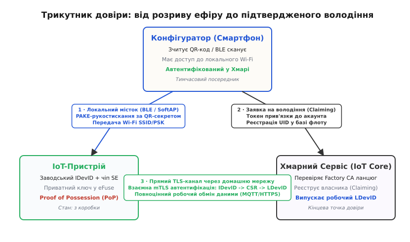
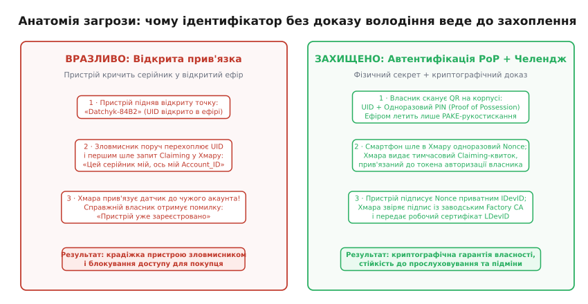
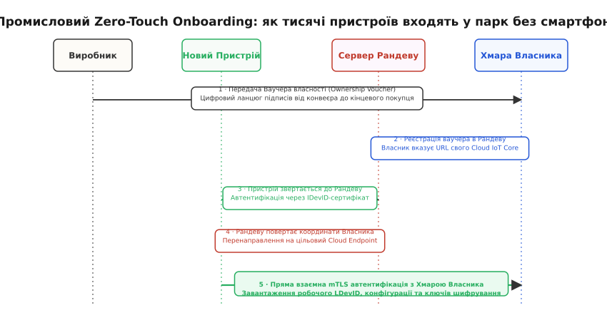
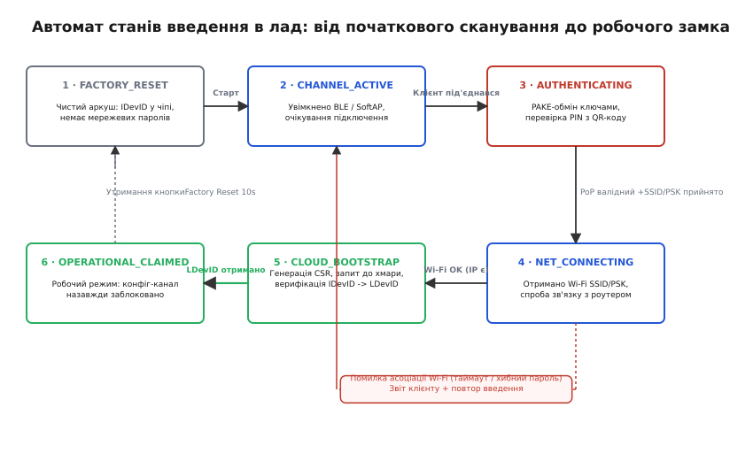

# Введення в лад: як пристрій уперше стає своїм

<preknowlist>
- [Особистість пристрою: серійник, ключ, сертифікат](root:sf-security/osobystist-prystroiu) — як залізо отримує незмінний фабричний ідентифікатор і пару асиметричних ключів у захищеному сховищі.
- [Перше налаштування: SoftAP і BLE-провізіонування](root:embedded/device-provisioning) — як піднімаються тимчасові локальні канали SoftAP та BLE GATT для передачі початкових байтів.
- [Протокол Діффі-Геллмана](root:sf-security/diffie-hellman) — математична основа обміну відкритими ключами над незахищеним середовищем для виведення спільної сесійної таємниці.
- [Де живе приватний ключ](root:sf-security/de-zhyve-pryvatnyi-kliuch) — апаратні модулі безпеки (Secure Element, HSM, eFuse), які не віддають ключ назовні за жодних умов.
- [Wi-Fi та підключення до мережі](root:com-transport/wifi) — робота радіомодуля в режимах станції (STA) та точки доступу (AP).
</preknowlist>

Тисяча щойно зібраних бездротових датчиків з'їжджає з заводського конвеєра в картонних коробках: у флеш-пам'ять залито прошивку, на платі розпаяно контролер і мікросхему захищеного сховища, але жоден із них не знає, де опиниться — у серверній дата-центру в Цюриху, на складі в Полтаві чи у приватній квартирі. На заводі неможливо заздалегідь прописати назву місцевої мережі Wi-Fi, пароль WPA3 чи логін користувача в хмарній платформі, бо їх ще не існує в системі координат пристрою. Якщо при першому ввімкненні плата просто підніме відкритий порт і чекатиме будь-якого підключення для отримання налаштувань, перший-ліпший ноутбук у радіусі ста метрів перехопить керування, заллє свої креденшали або викраде мережевий ключ клієнта.

Зворотна крайність — прошивати паролі вручну через інженерний інтерфейс UART на місці монтажу — миттєво паралізує розгортання: монтажник витрачатиме пів години на розбирання корпусу кожної плати, а відкриті контактні майданчики стануть подарунком для зловмисника з логічним аналізатором. Процедура введення в лад (англ. *onboarding* або *commissioning*) — це завдання безпечного переводу пристрою зі стану «чужий усім» у стан «криптографічно перевірений свій» через відкритий ефір, де залізо не має попереднього інтернет-зв'язку, а користувач або інженер володіє лише смартфоном, маркуванням на корпусі та кількома хвилинами часу.

Безпечне введення в лад спирається на розв'язання фундаментальної суперечності: як передати секретні параметри через абсолютно ненадійний, відкритий для прослуховування радіоканал і одночасно довести хмарі, що конкретна фізична коробка в руках монтажника дійсно належить до його облікового запису. Розкладімо цей шлях від кремнію на конвеєрі до робочого стану в парку пристроїв.

## Проблема «чистого аркуша» та трикутник довіри

Пристрій, щойно витягнутий із пакування, перебуває у стані повного інформаційного вакууму. У нього немає IP-адреси, немає шлюзу за замовчуванням, немає точного поточного часу (годинник реального часу скинуто на нуль або дефолтну епоху), немає довіреного локального маршрутизатора і немає облікового запису власника. Цей стан у промисловій розробці називають розривом середовища (англ. *air gap dilemma*).

Щоб подолати цей розрив, система введення в лад мусить одночасно закрити чотири незалежні вимоги:

1. **Транспорт (Transport):** як фізично передати байти конфігурації в мікроконтролер, якщо його основний мережевий інтерфейс (Wi-Fi, Ethernet або стільниковий зв'язок) ще не має доступу до середовища.
2. **Конфіденційність (Secrecy):** як захистити пароль домашньої мережі або токен доступу до хмари від підслуховування сусідом, якщо ефір за замовчуванням відкритий для радіосканерів.
3. **Автентичність сторін (Mutual Authentication):** як смартфону переконатися, що він налаштовує саме свій розумний замок на дверях, а не підставну плату зловмисника на поверсі нижче; і як пристрою переконатися, що команди надходять від законного власника, а не від чужого скрипта.
4. **Свіжість та неповторність (Freshness & Claiming Integrity):** як гарантувати, що перехоплений пакет минулої успішної конфігурації не буде повторно відтворений в ефір (replay attack) для перехоплення контролю над пристроєм.

У центрі цього процесу завжди взаємодіють три незалежні сторони, що утворюють **трикутник довіри** (англ. *trust triangle*): сам IoT-пристрій, мобільний конфігуратор (смартфон монтажника або шлюз) та хмарний реєстратор парку (Device Registry / IoT Core).


*Трикутник довіри під час введення в лад. Смартфон виступає тимчасовим містком між ізольованим пристроєм та хмарою: локальним каналом передаються параметри зв'язку, через хмару реєструється право власності, після чого пристрій напряму виходить у мережу та отримує власний експлуатаційний сертифікат.*

На першому етапі смартфон і пристрій не довіряють одне одному. Смартфон має інтернет-зв'язок і знає облікові дані користувача у хмарі, але не має прямого дротового контакту з мікроконтролером. Пристрій лежить поруч, має унікальне залізо, але не має зв'язку. Щоб замкнути трикутник, потрібен якір довіри, закладений ще на етапі виробництва.

## Заводський стан та апаратний корінь довіри

Довіра не може виникнути з нічого під час першого включення живлення. Якщо плата не містить у собі жодного унікального фабричного секрету, будь-який пристрій в ефірі може видати себе за неї. Тому процес введення в лад починається задовго до розпакування — на виробничому конвеєрі (англ. *factory provisioning*).

### Ієрархія ідентифікаторів: IDevID проти LDevID

Міжнародний стандарт безпеки пристроїв **IEEE 802.1AR (Secure Device Identity)** чітко розділяє життя пристрою на два рівні ідентифікації:

```
[Фабрика: Factory CA] ── підписує ──> [ IDevID: Початковий сертифікат ] (Незмінний, у SE/eFuse)
                                                   │
                                                   ▼ під час Onboarding
[Хмара власника: Tenant CA] ── підписує ──> [ LDevID: Робочий сертифікат ] (Перевипускається)
```

1. **Початковий ідентифікатор пристрою (IDevID — Initial Device Identifier):**
   Генерується один раз під час фінального тестування на заводі. Складається з асиметричної пари ключів (зазвичай еліптична крива NIST P-256 або Ed25519) та сертифіката X.509. Приватний ключ намертво зашивається в апаратне сховище (Secure Element або одноразово програмовані перемички eFuse) із прапорцем «read-protected» — його неможливо зчитати з пам'яті навіть за допомогою налагоджувача JTAG. Сертифікат IDevID підписаний кореневим центром сертифікації виробника (**Factory CA**). Завдяки цьому будь-яка хмарна система у світі, маючи публічний сертифікат виробника, може математично перевірити: «Цей чип дійсно зійшов із конвеєра нашого заводу, його відкритий ключ автентичний, а залізо не є контрафактною копією».
2. **Локальний експлуатаційний ідентифікатор (LDevID — Locally Significant Device Identifier):**
   Робочий сертифікат, який випускається центром сертифікації кінцевого власника пристрою (**Tenant CA**) під час процедури введення в лад. IDevID використовується виключно як перепустка для отримання LDevID. Якщо пристрій згодом продають іншій компанії або скидають до заводських налаштувань, LDevID стирається, але первинний IDevID залишається незмінним.

### Де живе приватний ключ на кристалі

У дешевих виробах розробники іноді роблять фатальну помилку: записують приватний ключ у звичайну SPI Flash-пам'ять поруч із прошивкою. Зловмиснику достатньо підпаяти прищіпку програматора до мікросхеми Flash, зчитати дамп і клонувати особистість пристрою на сотні підроблених плат.

У зрілій архітектурі генерація приватного ключа відбувається всередині спеціалізованого криптографічного апаратного блоку (Secure Element рівня ATECC608, Microchip ECC204, NXP SE050 або вбудованого апаратного vault ESP32-S3/STM32H5). Процесор шле апаратному співпроцесору команду `GEN_KEYPAIR`, чіп генерує 256-бітну випадкову послідовність на основі фізичного генератора випадкових чисел (TRNG) і блокує її у внутрішній захищеній комірці eFuse. Назовні віддається лише відкритий ключ (Public Key). Коли в процесі введення в лад потрібно підписати цифровий виклик (Challenge), процесор передає байти гешу всередину Secure Element, чіп виконує математику підпису на кремнії й повертає підпис `(R, S)`. Приватний ключ ні за яких обставин не з'являється на системній шині та в оперативній пам'яті MCU.

### Фізичний секрет володіння: Proof of Possession (PoP)

Сам по собі відкритий сертифікат IDevID не захищає від атаки підміни під час розпакування. Якщо серійний номер датчика надрукований на коробці звичайним текстом, сусід у під'їзді може сфотографувати його і спробувати зареєструвати у своєму додатку раніше за справжнього власника.

Щоб зв'язати фізичний факт перебування коробки в руках користувача з криптографією, використовують **доказ володіння (Proof of Possession, PoP)**. Це випадковий ентропійний секрет (PIN-код із 6–12 цифр або 128-бітний рядок), який:
* друкується на наклейці під захисним скретч-шаром або кодується у структурованому QR-коді на внутрішньому боці корпусу;
* прошивається в захищену область пам'яті NVS на заводі у вигляді солі та гешу:

```
PoP_Record = Salt || PBKDF2(PIN, Salt, iterations=10000, len=32)
```

Пристрій ніколи не зберігає чистий PIN у відкритому вигляді. Під час первинного зв'язку смартфон зчитує QR-код камерою і використовує цей PIN для автентифікації сесії. Зловмисник в ефірі, навіть знаючи MAC-адресу та серійний номер плати, не зможе пройти перевірку без фізичного доступу до наклейки.

### Структура службового QR-коду

У сучасних протоколах (зокрема у стандарті розумного дому **Matter** та специфікації **FIDO Device Onboard**) інформація в QR-коді стандартизована у двійковий формат, упакований у Base38-рядок:

| Поле | Розмірність | Призначення |
| :--- | :--- | :--- |
| **Version** | 3 біти | Версія формату кодування корисного навантаження |
| **Vendor ID (VID)** | 16 бітів | Унікальний ідентифікатор виробника обладнання |
| **Product ID (PID)** | 16 бітів | Ідентифікатор лінійки або моделі плати |
| **Custom Flow** | 2 біти | Прапорець стандартного або спеціального конфігуратора |
| **Discovery Capabilities** | 8 бітів | Бітова маска доступних каналів (0x01: BLE, 0x02: SoftAP, 0x04: NFC) |
| **Discriminator** | 12 бітів | Випадкове число для вибору пристрою серед десятків однакових у радіоефірі |
| **Setup Passcode** | 27 бітів | Числовий PIN-код для PAKE-автентифікації (до 99999999) |

Дискримінатор (12 бітів) вирішує критичну інженерну проблему: якщо монтажник вмикає живлення одночасно для тридцяти однакових датчиків на стелі складу, усі вони починають випромінювати однакові рекламні пакети «Sensor-Setup». Смартфон, відсканувавши конкретний QR-код, витягує з нього дискримінатор (наприклад, `0x8A4`) і фільтрує BLE Advertisement пакети, підключаючись виключно до того модуля, чий рекламний кадр містить число `0x8A4`.

## Канали доставки початкових налаштувань

Коли пристрій виходить із заводського стану, він відкриває тимчасовий локальний інтерфейс введення в лад. Вибір фізичного середовища для цього інтерфейсу визначає як рівень безпеки, так і користувацький досвід (UX).

```
┌─────────────────────────────────────────────────────────────────────────────┐
│                   КАНАЛИ ВВЕДЕННЯ В ЕКСПЛУАТАЦІЮ                            │
├──────────────────┬──────────────────┬───────────────────┬───────────────────┤
│    BLE GATT      │   Wi-Fi SoftAP   │     NFC Tag       │    Serial / USB   │
│ (Мобільний UX)   │ (Без додатків)   │ (Zero-Power/Tap)  │ (Пром-шлюзи/Edge) │
└──────────────────┴──────────────────┴───────────────────┴───────────────────┘
```

Розглянемо фізичну та програмну механіку кожного каналу.

### 1. BLE Provisioning (GATT-характеристики)

Bluetooth Low Energy — де-факто стандарт для споживчої та комерційної електроніки. 

* **Механіка роботи:** контролер ініціалізує рекламні пакети (Advertising) з унікальним UUID сервісу конфігурації. Смартфон підключається за схемою GATT-клієнт — GATT-сервер.
* **Структура сервісу:** створюються дві основні характеристики: `PROV_DATA_IN` (Write Without Response / Write Request) для передачі фрагментів конфігурації від смартфона та `PROV_DATA_OUT` (Indicate / Notify) для читання відповідей та статусів від контролера.
* **Переваги:** Смартфон **не втрачає підключення до домашнього Wi-Fi або стільникового інтернету**. Він може одночасно вести діалог із хмарою і заливати параметри в контролер через BLE.
* **Обмеження:** Розмір корисного навантаження одного атрибута GATT за замовчуванням обмежений (Default ATT MTU = 23 байти, корисних 20 байтів). Потрібне обов'язкове узгодження MTU (`Exchange MTU Request` до 256–512 байтів) або фрагментація пакетів на рівні протоколу додатку.

### 2. Wi-Fi SoftAP (Точка доступу з капітивним порталом)

Якщо пристрій не має апаратного радіомодуля Bluetooth (наприклад, старі чіпи або базові модулі), він використовує власний Wi-Fi передавач.

* **Механіка роботи:** мікроконтролер піднімає незашифровану точку доступу (`WIFI_AUTH_OPEN`) з унікальним SSID (наприклад, `Setup-Device-C4A1`).
* **Вбудовані сервіси:** запускається локальний DHCP-сервер (видає адреси з пулу `192.168.4.0/24`) та фіктивний DNS-сервер на UDP-порту 53 (перехоплює всі запити доменних імен і повертає `192.168.4.1`).
* **Переваги:** Не вимагає встановлення окремого мобільного застосунку — конфігурація відкривається у звичайному браузері завдяки системному перехоплювачу Captive Portal Assistant (CNA) в Android, iOS та Windows.
* **Недоліки:** Смартфон вимушений відключитися від домашнього роутера й інтернету на час налаштування. Сучасні смартфони з функцією «Smart Network Switch» помічають відсутність інтернету на точці SoftAP і автоматично скидають з'єднання назад на LTE, розриваючи процес запису конфігурації.

### 3. NFC (Near Field Communication / NDEF Records)

Для мініатюрних датчиків, приладів обліку газу чи води, що роками живляться від однієї літієвої батарейки, підйом Wi-Fi точки чи BLE-ефіру неприйнятний через високе енергоспоживання (струм 80–150 мА швидко виснажує батарею).

* **Механіка роботи:** на платі встановлюється дводротова мікросхема динамічного тегу NFC (наприклад, ST25DV або NTAG I2C), підключена до MCU по шині I2C, із друкованою рамковою антеною на корпусі.
* **Переваги:** Тег є пасивним — він живиться енергією електромагнітного поля, випромінюваного NFC-модулем смартфона під час дотику. Параметри Wi-Fi передаються у стандартному форматі **NDEF (NFC Data Exchange Format)** за 200 мікросекунд.
* **Безпека:** Радіус дії NFC фізично обмежений 2–4 сантиметрами. Зловмисник не може перехопити дані дистанційно через стіну чи з вулиці.

### Порівняльна таблиця каналів передачі налаштувань

| Критерій | BLE GATT | Wi-Fi SoftAP | NFC NDEF | Serial / USB CDC |
| :--- | :--- | :--- | :--- | :--- |
| **Вимоги до смартфона** | Bluetooth 4.2+ | Wi-Fi 2.4/5 ГГц | NFC Reader | USB-OTG / Кабель |
| **Потрібен додаток?** | Так (GATT client) | Ні (Web-браузер) | Ні/Так (NDEF handler) | Тільки термінал |
| **Інтернет під час налаштування** | Працює стабільно | Втрачається | Працює стабільно | Працює стабільно |
| **Енергоспоживання плати** | Середнє (10–20 мА) | Високе (80–200 мА) | Нульове від батареї | Живлення від USB |
| **Дальність перехоплення** | До 30–50 метрів | До 100 метрів | < 4 сантиметрів | Тільки фіз. контакт |
| **Сфера застосування** | Smart Home, побут | Застарілі плати | Лічильники, батарейні вузли | Промислові шлюзи |

## Анатомія пакета налаштувань (Provisioning Payload)

Які саме дані передаються на плату через створений канал? Мінімалістичний пакет містить три смислові блоки:

```
┌─────────────────────────────────────────────────────────────────────────────┐
│                      СТРУКТУРА ПАКЕТА КОНФІГУРАЦІЇ                          │
├──────────────────────────┬──────────────────────────┬───────────────────────┤
│    МЕРЕЖЕВИЙ ПРОФІЛЬ     │    ХМАРНА ТОЧКА ВХОДУ    │   ВАУЧЕР ВЛАСНОСТІ    │
│  SSID, PSK, IP Mode,     │ Broker FQDN, Port,       │ Claiming Ticket,      │
│  Enterprise EAP Cert     │ Root CA Fingerprint      │ Tenant ID, Expiry     │
└──────────────────────────┴──────────────────────────┴───────────────────────┘
```

1. **Мережевий профіль (Network Credentials):**
   * `ssid`: рядок до 32 байтів (назва цільової точки доступу Wi-Fi);
   * `passphrase`: рядок до 64 байтів (пароль WPA2-PSK або WPA3-SAE);
   * `flags`: бітова маска (статичний IP чи DHCP, прихований SSID, тип шифрування).
2. **Параметри хмарного брокера (Cloud Endpoint Config):**
   * `endpoint_url`: повне доменне ім'я сервера (наприклад, `iot.region-1.cloud-fleet.net`);
   * `port`: мережевий порт (зазвичай 8883 для MQTTS або 443 для HTTPS/WebSockets);
   * `root_ca_hash`: SHA-256 відбиток сертифіката сервера хмари (для запобігання підміні шлюзу підставним DNS-сервером).
3. **Квиток прив'язки до облікового запису (Claiming Ticket):**
   * `tenant_id`: унікальний UUID клієнтської організації або облікового запису користувача;
   * `claim_token`: 256-бітний одноразовий криптографічний токен, згенерований сервером спеціально для цієї сесії прив'язки із часом життя 15 хвилин.

## Криптографічний протокол безпечної прив'язки

Передавати описаний вище пакет у відкритому вигляді через BLE чи SoftAP категорично заборонено. Будь-який радіоперехоплювач з адаптером у режимі моніторингу збере паролі від домашніх мереж усіх сусідів.

Але тут виникає класична криптографічна дилема: пристрій і смартфон ніколи раніше не спілкувалися. Між ними немає попередньо встановленого спільного довгострокового секретного ключа. Як зашифрувати канал?

### Чому не підходить відкритий протокол Діффі-Геллмана

Звичайний обмін ключами за схемою [Діффі-Геллмана](root:sf-security/diffie-hellman) (ECDH на еліптичних кривах) дозволяє двом сторонам згенерувати спільний сесійний ключ над відкритим ефіром. Смартфон шле свій відкритий ефемерний ключ `A = g^a mod p`, пристрій відповідає відкритим ефемерним ключем `B = g^b mod p`, і обидва обчислюють спільний секрет `K = g^(ab) mod p`.

Проблема чистого ECDH полягає у **відсутності автентифікації сторін**. Якщо між смартфоном і пристроєм увімкнеться зловмисник (атака Man-in-the-Middle), він проведе два незалежні обміни ECDH: один зі смартфоном, видаючи себе за пристрій, а другий із пристроєм, видаючи себе за смартфон. Зловмисник розшифрує всі пакети, отримає пароль від Wi-Fi і перешифрує їх далі.

### Протоколи PAKE: SPAKE2+ та SRP

Щоб унеможливити MitM-атаку над відкритим радіоканалом, використовують протоколи класу **PAKE (Password-Authenticated Key Exchange)** — обмін ключами, автентифікований спільним коротким паролем. Найвідоміші представники: **SPAKE2+** (використовується у стандарті Matter) та **SRP-6a** (Secure Remote Password).

Головна перевага PAKE над наївними схемами:
1. Короткий PIN-код із наклейки QR (навіть якщо це лише 6 цифр) вплітається безпосередньо у математичні операції над точками еліптичної кривої.
2. Сторони доводять володіння PIN-кодом, не передаючи сам PIN через радіоефір.
3. **Захист від офлайн-перебору за словником (Offline Dictionary Attack):** Зловмисник, записавши весь радіообмін між телефоном і датчиком, не може запустити перебір PIN-кодів на відеокарті. Кожна невдала спроба вгадати PIN вимагає онлайн-участі у протоколі з фізичним пристроєм. Контролер після 3–5 невдалих спроб блокує інтерфейс на експоненційний таймаут, зводячи шанс підбору до нуля.

### Покроковий сценарій рукостискання та реєстрації

Розглянемо повну послідовність рукостискання за стандартом захищеного введення в лад:

```
[ Смартфон (App) ]                     [ Пристрій (Device) ]                   [ Хмарний IoT Core ]
        │                                       │                                       │
        │ ── (1) Сканування QR (UID, PIN, Salt) │                                       │
        │ ── (2) Client Hello (Ephemeral A) ──> │                                       │
        │ <── (3) Device Hello (B, Nonce_D) ─── │                                       │
        │                                       │                                       │
        │ [ Обчислення PAKE спільного K_sess ]  │ [ Обчислення PAKE спільного K_sess ]  │
        │                                       │                                       │
        │ ── (4) Encrypted(SSID, PSK, Token) ─> │                                       │
        │ <── (5) Encrypted(Status: CONNECTING) │                                       │
        │                                       │ ── (6) Підключення до Wi-Fi STA ────> │
        │                                       │ ── (7) mTLS Handshake (IDevID) ─────> │
        │                                       │ <── (8) Server Challenge (Nonce_S) ── │
        │                                       │ ── (9) Sign(Nonce_S, Priv_IDevID) ──> │
        │                                       │        + CSR (Client Public Key)      │
        │                                       │                                       │
        │                                       │                               [ Валідація Factory CA ]
        │                                       │                               [ Перевірка Claim Token]
        │                                       │                               [ Випуск LDevID Cert   ]
        │                                       │                                       │
        │                                       │ <── (10) LDevID Certificate ───────── │
        │                                       │ ── (11) Operational MQTT Connect ───> │
        │ <── (12) BLE Status: PROV_SUCCESS ─── │                                       │
        │ ── (13) BLE Disconnect & Lock ──────> │ [ Конфігураційний канал вимкнено ]   │
```

#### Крок 1. Зчитування QR-коду
Додаток на смартфоні сканує наклейку, отримуючи `UID` пристрою, його відкритий дискримінатор, випадкову сіль `Salt` та числовий пароль `PIN`.

#### Крок 2–3. Обмін PAKE-повідомленнями
Смартфон генерує випадковий ефемерний ключ `a` і надсилає точку `A`. Пристрій генерує свій ефемерний ключ `b`, бере зашитий у безпечну пам'ять геш PIN-коду, модифікує генератор кривої й надсилає відповідь `B` разом з одноразовим числом `Nonce_D`.

#### Крок 4. Сесійне шифрування
Обидві сторони обчислюють спільний 256-бітний ключ `K_sess` через функцію формування ключів HKDF:

```
K_enc || K_mac = HKDF_SHA256(Secret=PAKE_Point, Salt=Nonce_D, Info="OnboardingSessionKey")
```

Дані мережі Wi-Fi та одноразовий токен прив'язки шифруються алгоритмом **AES-128-GCM** або **ChaCha20-Poly1305** з автентифікацією кожного кадру.

#### Крок 5–6. Вихід у мережу
Пристрій розшифровує облікові дані, зберігає їх у тимчасовий кеш NVS, вимикає режим точки доступу та активує модуль Wi-Fi Station. Контролер асоціюється з роутером клієнта, надсилає DHCP-запит і отримує локальну IP-адресу.

#### Крок 7–9. Криптографічний запит до хмари (Claiming Proof)
Пристрій відкриває вихідне з'єднання TLS до хмарного брокера. Під час рукостискання mTLS пристрій пред'являє свій заводський сертифікат **IDevID**. Сервер надсилає пристрою випадковий криптографічний виклик `Nonce_S`. Пристрій за допомогою закритого фабричного ключа в Secure Element формує цифровий підпис `ECDSA_Sign(PrivKey_IDevID, Nonce_S || ClaimToken)`. Одночасно пристрій генерує нову пару ключів для робочого режиму і додає до запиту підписаний запит на сертифікат **CSR (Certificate Signing Request)**.

#### Крок 10. Випуск LDevID
Хмарний сервіс:
1. Перевіряє ланцюжок довіри від IDevID до кореневого `Factory CA` виробника;
2. Перевіряє математичну валідність підпису виклику;
3. Звіряє `ClaimToken` із базою відкритих сесій і підтверджує, що пристрій прив'язується саме до того клієнтського облікового запису, з якого смартфон ініціював процес;
4. Центр сертифікації власника підписує надісланий CSR і відправляє назад постійний робочий сертифікат **LDevID**.

#### Крок 11–13. Фіксація стану та блокування інтерфейсу
Пристрій записує отриманий LDevID у захищену пам'ять, надсилає смартфону фінальне повідомлення про успіх через BLE/SoftAP, після чого **назавжди гасить конфігураційний радіоканал**. З цього моменту пристрій повністю підпорядкований парку.

## Запобігання атакам підміни (Claiming Attacks)

У ненадійно спроєктованих системах введення в лад криється вразливість, відома як **атака випередження прив'язки (Front-Running Claiming Attack)**.


*Анатомія загрози. Зліва: відкритий серійник дозволяє зловмиснику вкрасти реєстрацію пристрою. Справа: взаємна перевірка доказу володіння (PoP) та криптографічний виклик гарантують прив'язку виключно до законного власника.*

Якщо реєстрація у хмарі базується виключно на твердженні клієнта «Я купив пристрій із серійним номером `SN-94821`», виникає фатальна діра. Зловмисник у радіусі дії Bluetooth сканує рекламні пакети, витягує з них UID нових пристроїв, що стоять у черзі на включення, і відправляє у хмару сотні запитів `claim_device(UID)` зі свого хакерського акаунта. Коли справжній покупець принесе коробку додому і спробує ввести її в експлуатацію, хмара відповість: «Пристрій уже зареєстрований іншим користувачем».

Захист від цієї атаки складається з трьох замків:
1. **Зв'язування з PoP:** Реєстрація у хмарі не приймається без цифрового підпису, згенерованого на основі фабричного PIN або приватного ключа пристрою.
2. **Одноразовий токен (Nonce Clamping):** Токен прив'язки видається хмарою смартфону лише після входу в авторизований акаунт і діє лічені хвилини.
3. **Апаратний замок власності:** Після запису LDevID пристрій зберігає публічний ключ Tenant PKI. Повторна спроба ввести пристрій у лад без попереднього підтвердженого скидання поточним власником відхиляється на рівні Secure Element.

## Промисловий Zero-Touch Onboarding (FDO)

Коли мова йде не про один домашній кондиціонер, а про розгортання **50 000 розумних електролічильників** або контролерів сонячних станцій, підходити до кожного датчика зі смартфоном економічно неможливо. Для масштабних інсталяцій використовують стандартизований безконтактний ввід в експлуатацію — **FIDO Device Onboard (FDO)** або **Zero-Touch Provisioning (ZTP)**.


*Промисловий Zero-Touch Onboarding за стандартом FIDO. Власник купує партію заліза й отримує цифровий ланцюжок ваучерів власності. Монтажник лише підключає живлення — усе інше відбувається автоматично через Сервер Рандеву.*

Механіка FDO працює без участі локального радіоканалу чи смартфона:
1. **Ваучер власності (Ownership Voucher):** Разом із партією заліза покупець отримує криптографічний документ — файл ваучера. У ньому записано серійні номери пристроїв та ланцюжок цифрових підписів від виробника, через дистриб'юторів, до кінцевого замовника.
2. **Сервер Рандеву (Rendezvous Server):** Нейтральний хмарний координатор, чия адреса зашита у фабричну прошивку всіх пристроїв. Власник реєструє свій ваучер власності на Сервері Рандеву, вказуючи: «Пристрої з цієї партії мають бути направлені на мою хмару `https://iot.my-enterprise.com`».
3. **Перший старт:** Монтажник на підстанції просто вставляє Ethernet-кабель або SIM-карту і подає живлення. Пристрій автоматично отримує IP через DHCP, іде на Сервер Рандеву, пред'являє свій IDevID і запитує: «Хто мій власник?».
4. **Автоматична переадресація:** Сервер Рандеву звіряє IDevID із зареєстрованим ваучером і повертає пристрою координати кінцевої хмари. Пристрій підключається до системи підприємства, проходить атестацію, отримує робочий LDevID і вступає в експлуатацію за лічені секунди без людського втручання.

## Скінченний автомат процесу введення в лад

Надійність контролера введення в лад залежить від чіткої математичної моделі станів. Будь-яка непередбачена подія — обрив зв'язку під час передачі пароля, неправильний WPA-ключ, таймаут відповіді DNS — мусить повертати систему у строго детермінований стан без зависання периферії.


*Скінченний автомат стану введення в лад. Кожна невдача асоціації повертає контролер у режим очікування виправлених даних із виразним діагностичним кодом для користувача.*

Автомат контролера визначає вісім базових станів:

:::tabs
:::code vvedennia-v-lad-d/c/skinchennyi-avtomat.c
:::code vvedennia-v-lad-d/cpp/skinchennyi-avtomat.cpp
:::

Якщо на етапі `ONBOARD_STATE_NET_CONNECTING` точка доступу не відповідає або пароль виявився невірним, контролер переходить у `ONBOARD_STATE_ERROR_RECOVERY`, формує двійковий пакет діагностики (наприклад, `ERR_WIFI_AUTH_FAILED`), відправляє його через BLE/SoftAP на екран смартфона і повертається у стан очікування нової спроби введення.

## Реалізація контролера введення в лад на C та C++

Нижче наведено повний виробничий модуль диспетчера введення в лад. Модуль керує скінченним автоматом, підтримує захищене збереження креденшалів у сховищі NVS, обробляє таймаути конфігураційного вікна та блокує радіоканал після успішної реєстрації.

:::tabs
:::code vvedennia-v-lad-d/c/realizatsiia-kontrolera.c
:::code vvedennia-v-lad-d/cpp/realizatsiia-kontrolera.cpp
:::

## Крайові випадки та апаратний замок

У лабораторних умовах процедура введення в лад зазвичай виглядає гладкою: смартфон швидко знаходить модуль, Wi-Fi підключається за дві секунди, а хмара миттєво повертає сертифікат. На реальному об'єкті інженер зіштовхується з цілою низкою крайових ситуацій, які зобов'язана передбачати прошивка:

1. **Мережі з авторизацією через веб-сторінку (Captive Portals):**
   Корпоративні гостьові мережі в офісах чи готелях вимагають прийняття умов ліцензії або введення номера кімнати у браузері. Безголовий (headless) датчик без екрана не здатний пройти таку авторизацію. Контролер виявляє ситуацію за відсутністю зв'язку з хмарним брокером при успішному отриманні локальної IP-адреси, негайно передає повідомлення `ERR_CAPTIVE_DETECTED` на смартфон і пропонує користувачеві використати прямий WPA-Personal пароль або альтернативну мережу.
2. **Приховані мережі (Hidden SSID):**
   Якщо маршрутизатор не випромінює своє ім'я в маякових кадрах (Beacon), звичайне фонове сканування Wi-Fi мікроконтролером поверне порожній список. Конфігураційний пакет мусить містити прапорець `is_hidden`, що змушує Wi-Fi драйвер відправляти прямі зондувальні запити (Directed Probe Request) із конкретною назвою мережі.
3. **Фільтрація за MAC-адресами:**
   На захищених підприємствах роутер скидає спроби асоціації, якщо MAC-адреса відсутня в списку дозволених. Контролер введення в лад зобов'язаний виводити власну апаратну MAC-адресу як у рекламних BLE-кадрах, так і на діагностичному екрані смартфона, щоб системний адміністратор міг завчасно внести її в білий список.
4. **Скидання до заводських налаштувань (Secure Factory Reset):**
   Якщо пристрій демонтують і передають іншому власнику, потрібна процедура повного очищення. Безпечне скидання вимагає фізичного підтвердження (наприклад, затискання прихованої кнопки на платі протягом 10–15 секунд при увімкненні живлення). Під час скидання:
   * стираються всі записи NVS із паролями Wi-Fi;
   * видаляється робочий сертифікат LDevID;
   * генерується подія де-реєстрації у хмарі (якщо є залишковий зв'язок);
   * **первинний фабричний сертифікат IDevID та апаратний корінь довіри залишаються недоторканими в eFuse/Secure Element**.

Завдяки цьому пристрій повертається у вихідний стан «з коробки» і готовий пройти процедуру введення в лад заново з новим законним власником.
