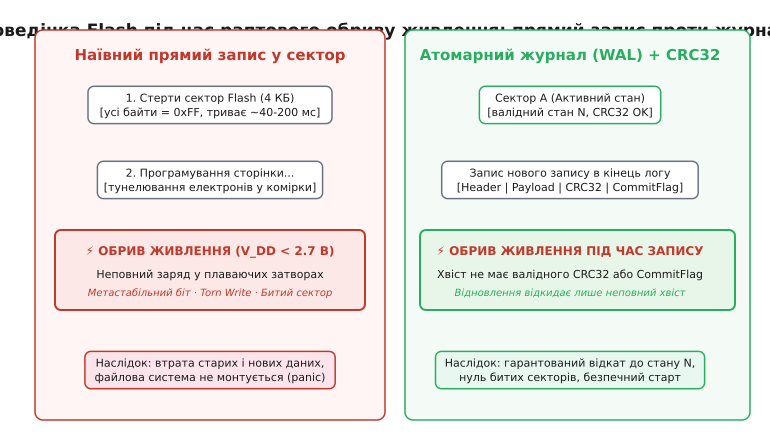
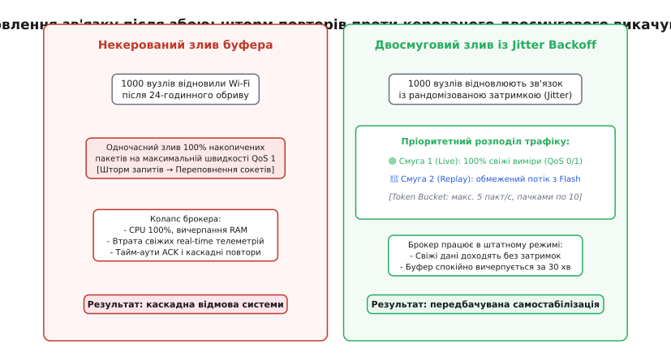
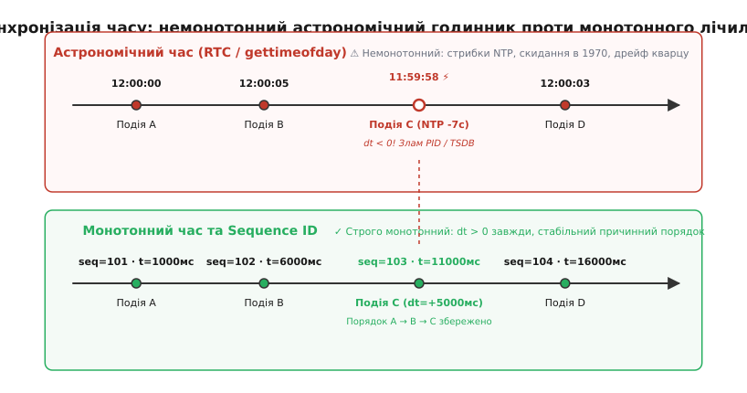
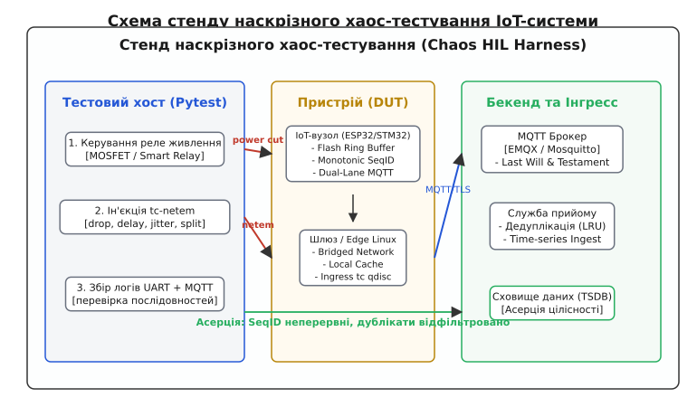

# Випробування: обрив, перезавантаження, розсинхрон годинника (детально)

<preknowlist>
- [Атомарність у Flash](root:sf-data/flash-filesystem) — сторінковий запис, блокове стирання, небезпека неповного запису та журнал транзакцій.
- [MQTT](root:com-protocol/mqtt) — гарантії доставки QoS 0/1/2, повідомлення заповіту (Last Will) та retained-стан.
- [Контрольна сума CRC](root:com-modulation/crc) — поліноміальний розрахунок та детекція пошкоджених кадрів у потоці.
- [Годинник реального часу (RTC)](root:hw-arch/rtc) — апаратний таймер календаря, кварцові генератори та автономне живлення.
- [Синхронізація часу (NTP)](root:com-protocol/ntp-sync) — протокол мережевого часу, ступеневі стрибки та плавне підтягування (slewing).
- [Сторожовий таймер (Watchdog)](root:sf-devices/watchdog) — апаратний перезапуск мікроконтролера при зависанні прошивки.
- [Вузол розумного дому](root:embedded/smart-home-node) — базова тришарова архітектура автономного вузла.
- [Омани розподілених систем](root:sf-distributed/distributed-fallacies) — чому мережа ніколи не є надійною, а затримка нульовою.
</preknowlist>

Лабораторний стіл оманливий: стабільне лабораторне джерело живлення з пульсаціями менше 5 мВ, ідеальний Wi-Fi-роутер за метр від антени й теплична температура +22 °C створюють ілюзію бездоганної роботи прошивки. Справжнє життя вбудованої системи починається в неопалюваному щитку чи на даху будівлі, де комутація потужного контактора викликає просідання живлення нижче порога brownout просто під час стирання сектора Flash, мороз −15 °C зсуває частоту годинникового кварцу на кілька секунд за добу, а базовий роутер зависає на вихідні. Якщо вузол не проходив випробувань із примусовою ін'єкцією збоїв (fault injection), ці фактори неодмінно призведуть до аварії: перетворення пам'яті на сміття, зависання черг або розриву часових рядів на сервері.

Стійкість розподіленої системи не виникає з акуратного коду — вона доводиться системними випробуваннями, де кожен тип польового збою симулюється програмно та апаратно. Розгляньмо чотири критичні класи відмов: раптове знеструмлення під час циклу запису у Flash, добову ізоляцію вузла від мережі з переповненням буфера, аномалії астрономічного годинника та мережевий хаос із втратами пакетів і дрижанням затримки (jitter).

## 1. Раптовий обрив живлення під час запису у Flash

Збереження налаштувань, накопичення офлайн-буфера та стан автоматів вимагають постійної фіксації даних в енергонезалежній пам'яті NOR Flash (внутрішній або зовнішній SPI Flash). Фізика перепрограмування Flash-комірки докорінно відрізняється від статичної оперативної пам'яті (SRAM): комірка може бути переведена зі стану логічної одиниці в нуль шляхом інжекції гарячих носіїв або тунелювання Фаулера-Нордгейма за час від 0.5 до 3 мілісекунд, а зворотне повернення в стан «1» можливе лише стиранням цілого сектора (зазвичай 4 КБ), що триває від 40 до 200 мілісекунд.

Якщо напруга живлення мікроконтролера падає нижче мінімально допустимого робочого рівня (`V_DD_min`, поріг детектора brownout reset `BOR` ≈ 2.7 В або 1.8 В) прямо в середині процесу програмування сторінки, комірки отримують неповний електричний заряд на плаваючому затворі. Це явище має назву **розірваного запису** (torn write).


*Фізичний процес у Flash-пам'яті під час знеструмлення. Ліворуч: наївний запис поверх сектора призводить до метастабільних комірок і збою монтування файлової системи. Праворуч: журнал попереднього запису (WAL) із контрольними сумами CRC32 і прапорцем завершення відкидає неповний хвіст і гарантує збереження попереднього валідного стану.*

Наслідки torn write без спеціалізованого захисту є руйнівними:
1. **Метастабільність читання:** при зчитуванні недозарядженої комірки напруга на виході компаратора Flash плаває біля порога спрацьовування. Один і той самий байт при різній температурі чи напрузі живлення зчитується то як `0`, то як `1`.
2. **Пошкодження суміжних комірок:** струм витоку під час аварійного падіння напруги може спотворити біти у сусідніх рядках тієї самої матриці (disturb effect).
3. **Крадіжка метаданих файлової системи:** якщо обрив стався під час оновлення кореневого дерева файлової системи (FAT або наївного блокового масиву), вся структура розділу стає нечитабельною, викликаючи вічну паніку ядра при старті (`kernel panic / mount fail`).

### Апаратний бар'єр раннього сповіщення (PVD)

Для захисту на фізичному рівні сучасні мікроконтролери (STM32, ESP32, NXP) містять периферійний блок детектора напруги живлення (Power Voltage Detector, PVD / Brownout Detector, BOD). Поріг спрацьовування PVD налаштовується вище аварійного порога скидання ядра BOR:

```
V_DD = 3.3 В  ─── Штатний режим
V_PVD = 2.9 В ─── Переривання PVD_IRQ: аварійна зупинка Flash-транзакцій
V_BOR = 2.4 В ─── Апаратний Reset процесора (Brownout Reset)
```

Коли напруга просідає до 2.9 В, процесор встигає згенерувати немасковане переривання (NMI або PVD_IRQ). Ємність фільтрувальних конденсаторів на платі (`C_dec ≈ 100` мкФ) забезпечує запас енергії на `Δt ≈ 20..50` мікросекунд, протягом яких переривання зобов'язане:
- Миттєво виставити лінію Chip Select (CS) зовнішньої Flash у високий стан (відміна операції);
- Заборонити подальші виклики запису;
- Зафіксувати аварійний прапорець у регістрах RTC Backup Domain, які живляться окремою лінією.

### Атомарний протокол запису кадру

На рівні програмного забезпечення кожен логічний запис у журнал оформлюється у вигляді захищеного блоку з чотирьох компонентів: магічного числа (Magic Header), монотонного порядкового номера (`seq_id`), тіла корисного навантаження, поліноміальної контрольної суми CRC32 та фінального маркера фіксації (`Commit Flag`).

```
┌──────────────┬──────────────┬──────────────┬──────────────┬──────────────┐
│ Magic (4B)   │ SeqID (8B)   │ Payload (NB) │ CRC32 (4B)   │ Commit (4B)  │
└──────────────┴──────────────┴──────────────┴──────────────┴──────────────┘
```

Алгоритм запису складається з двох кроків:
1. Запис заголовка, корисних даних та контрольної суми CRC32;
2. Лише після успішного підтвердження Flash-контролером — запис окремого слова `CommitFlag = 0xA55A5AA5`.

При повторному вмиканні живлення драйвер відновлення сканує сектор від початку до кінця:
- Якщо `CommitFlag` відсутній або CRC32 не сходиться — цей останній хвіст вважається обірваним і просто відкидається (обнуляється або ігнорується);
- Усі попередні записи залишаються непошкодженими, а система відновлює свій стан на момент останньої повністю завершеної транзакції.

:::tabs
:::code vyprobuvannia-d/c/atomarnyi-protokol-zapysu.c
:::code vyprobuvannia-d/cpp/atomarnyi-protokol-zapysu.cpp
:::

## 2. Добова ізоляція від мережі та керування чергою повторів

На відміну від серверних систем, де розрив зв'язку триває секунди або хвилини, IoT-вузол може перебувати в стані повної мережевої ізоляції цілу добу. Причини різноманітні: відключення електроживлення локального Wi-Fi-роутера, заміна вишки оператора зв'язку або планові регламентні роботи на провайдері.

Під час такого тривалого блекауту перед архітектором прошивки постають дві пов'язані інженерні проблеми:
1. **Переповнення пам'яті та стратегія витіснення (Drop Policy):** оперативної пам'яті (SRAM) мікроконтролера вистачає щонайбільше на сотні або тисячі точок. Тривалий збір даних неминуче вимагає скидання черги в кільцевий буфер Flash-пам'яті;
2. **Шторм перепідключення та спустошення черги (Reconnection Storm & Drain Rate):** коли мережа раптово відновлюється, тисячі вузлів не повинні одночасно викачувати накопичений добовий архів на максимальній швидкості.

Детальний математичний аналіз обсягів пам'яті, швидкості генерації вимірів, часу спустошення та ресурсу зносостійкості Flash винесено в [розрахунок розміру буфера та зношення Flash](root:embedded/vyprobuvannia/math-clock-drift-queue.md).

### Ієрархія та динаміка накопичення в буфері

Енергонезалежний буфер черги в пам'яті Flash організується у вигляді циклічного журналу на кілька розділів (Ring Buffer Partition). Коли зв'язок втрачено:
- Виміри з періодом `Δt_sample = 2` с надходять у короткоживучий буфер оперативної пам'яті (SRAM);
- При заповненні пачки (наприклад, 16 вимірів по 40 байтів = 640 байтів) дані одним викликом фіксуються в сторінку Flash, мінімізуючи накладні витрати на заголовки секторів;
- Якщо з'єднання відсутнє понад 24 години і Flash заповнюється на 100%, активується політика витіснення: найстаріший сектор (FIFO) стирається, звільняючи місце для свіжих записів. При цьому в журналі фіксується спеціальний маркер розриву послідовності `GAP_MARKER`, щоб бекенд зафіксував факт втрати частини архіву.

### Двосмугове викачування (Dual-Lane Transmission)

Головна помилка багатьох реалізацій — відправляти дані з черги в той самий єдиний потік MQTT у синхронному блокувальному режимі. Коли накопичено 50 000 вимірів, спроба викачати їх послідовно призводить до того, що **найсвіжіші поточні показники запізнюються на години**, чекаючи, поки пройде старий архів. Якщо вузол керує нагрівачем або повідомляє про відкриття дверей, така затримка є критичною.

Рішення — **двосмуговий конвеєр зв'язку**:
- **Смуга 1 (Live Priority Lane):** свіжа телеметрія відправляється негайно в топік `nodes/<id>/state` з пріоритетом. Вона ніколи не чекає викачування архіву;
- **Смуга 2 (Replay / Historical Lane):** архівні пакети викачуються з Flash фоновим воркером у топік `nodes/<id>/replay` пачками (batches) з жорстким обмеженням швидкості за алгоритмом маркерного кошика (Token Bucket, наприклад, не більше 5–10 повідомлень за секунду).


*Динаміка мережевого трафіку після 24-годинного обриву. Ліворуч: некерований викид накопичених повідомлень викликає перевантаження брокера і параліч системи. Праворуч: розділення на високопріоритетну життєву смугу (Live) та фонову керовану смугу повторів (Replay) забезпечує доставку поточних статусів без затримок.*

### Витік сокетів під час напіввідкритих з'єднань (TCP Half-Open)

Коли фізичний канал обривається (наприклад, знеструмлено комутатор), TCP-стек мікроконтролера не отримує пакетів `FIN` або `RST`. Сокет залишається в стані `ESTABLISHED`. Якщо прикладний шар намагається виконати повторне підключення через `socket()` і `connect()`, не закривши завислий дескриптор, у таблиці сокетів операційної системи (lwIP / FreeRTOS) швидко вичерпуються доступні слоти (зазвичай усього 8–16 дескрипторів).

Програма отримує помилку `EMFILE / ENFILE` (Too many open files), після чого мережевий стек повністю паралізується до повного перезавантаження плати.

Дисципліна випробувань вимагає перевірки наступних інваріантів:
- Кожен невдалий або обірваний сокет повинен примусово закриватися через `close()` з попереднім скиданням `setsockopt(SO_LINGER, {l_onoff=1, l_linger=0})`;
- Апаратний таймер `TCP_KEEPALIVE` повинен надсилати зондувальні пакети не рідше ніж раз на 30 секунд із тайм-аутом визнання обриву каналу не більше 15 секунд.

:::tabs
:::code vyprobuvannia-d/c/vytik-soketiv-pid-chas.c
:::code vyprobuvannia-d/cpp/vytik-soketiv-pid-chas.cpp
:::

## 3. Розсинхронізація годинника RTC: стрибки та монотонність

Годинник реального часу (RTC) — найпідступніший компонент розподіленої системи. Програмісти звикли вважати штамп часу `timestamp` абсолютною, завжди зростаючою величиною. У реальному пристрої астрономічний годинник є **немонотонним, нестабільним та ненадійним**:
1. **Температурний дрейф кварцу:** звичайний кварц 32.768 кГц має параболічну характеристику з відхиленням до −70..−100 ppm при екстремальних температурах. За 24 години повної відсутності мережі годинник відстає чи поспішає на 3–8 секунд (див. [математичний розбір температурного дрейфу](root:embedded/vyprobuvannia/math-clock-drift-queue.md));
2. **Скидання в епоху UNIX (1970-01-01):** якщо резервна літієва батарейка CR2032 сіла або іоністор розрядився під час знеструмлення, при старті RTC показує нуль;
3. **Ступеневий стрибок NTP (Step Jump):** коли мережа відновлюється, клієнт SNTP отримує точний час від сервера й одномоментно переводить системний годинник, наприклад, на 10 секунд назад або на 2 години вперед.


*Вплив часових аномалій. Угорі: астрономічний годинник через корекцію NTP робить стрибок назад, викликаючи від'ємний інтервал `dt < 0`, що руйнує PID-регулятори та ламає індексацію в базах даних. Унизу: монотонний апаратний таймер та порядковий номер `seq_id` зберігають непорушний причинно-наслідковий порядок.*

Катастрофічні наслідки немонотонного часу:
- **Злам математичних алгоритмів керування:** якщо ПІД-регулятор або фільтр Калмана розраховує `dt = now − last_time`, при ступеневій корекції NTP назад виникає `dt ≤ 0`. Ділення на `dt` або інтегрування з від'ємним кроком призводить до миттєвого викиду максимального сигналу на нагрівач або мотор (`NaN` або насичення виходу);
- **Пастка валідації сертифікатів TLS:** якщо RTC скинувся на 1970 рік, спроба встановити захищене з'єднання MQTTS/TLS провалюється: криптографічний стек відхиляє сертифікат брокера як «ще не чинний» (`certificate not yet valid`). Виникає мертве коло (deadlock): щоб дізнатися час, потрібна мережа, а щоб увійти в мережу, потрібен правильний час;
- **Злиття та перезапис точок у базах даних часових рядів (TSDB):** бази даних на кшталт InfluxDB або TimescaleDB використовують `timestamp` як первинний ключ. Якщо дві різні події отримали однаковий або інвертований час, пізніший запис затирає попередній.

> 🔧 **Навіщо це.** Залізне правило архітектури вбудованих систем: **ніколи не використовувати астрономічний час (Wall-Clock / RTC / gettimeofday) для керування внутрішньою логікою, розрахунку інтервалів або впорядкування подій**. Для всіх автоматів, тайм-аутів, регуляторів і зв'язку застосовується виключно **монотонний лічильник часу** (`steady_clock`, `esp_timer_get_time()`, `k_uptime_get()`) та строго зростаючий 64-бітний порядковий номер запису (`seq_id`).

### Розв'язання криптографічного глухого кута TLS

Якщо пристрій прокинувся після глибокого знеструмлення з обнуленим RTC (1 січня 1970 року), спроба з'єднатися з захищеним MQTTS-брокером (порт 8883) заблокується перевіркою терміну дії сертифіката X.509 (`NotBefore > CurrentTime`).

Для виходу з цього глухого кута архітектура прошивки реалізує трирівневий механізм:
1. **Збереження останнього відомого часу (Last Known Time) у Flash:** перед знеструмленням або раз на годину вузол зберігає валідний Unix-штамп у захищеному секторі NVS. При старті з нульовим RTC системний годинник ініціалізується не нулем, а збереженим значенням `T_last_known`. Сертифікат брокера (якщо він виданий на кілька років) проходить валідацію;
2. **Нешифрований первинний NTP:** первинна синхронізація часу здійснюється по UDP порту 123 до підняття TLS-з'єднання;
3. **Плавне підтягування годинника (Clock Slewing):** коли вузол відновлює зв'язок із сервером NTP, замість миттєвого ступеневого переведення часу застосовують метод плавного підтягування (slewing) через функцію ядра `adjtime()`. Таймер RTC штучно прискорюється або сповільнюється на 0.5 мс на кожну секунду (`±500` ppm), доки час плавно не зійдеться з сервером без жодних зворотних стрибків.

## 4. Емуляція мережевого хаосу: втрати, затримки, розриви

Польові канали передачі даних (Wi-Fi 2.4 ГГц з інтерференцією від мікрохвильовок, стільниковий зв'язок LTE з перемиканням між базовими станціями handover, радіомодеми LoRa/Zigbee) регулярно стикаються з пакетами, що губляться, дублюються або приходять із затримкою в сотні мілісекунд.

Для відтворення цих умов у лабораторному стенді використовується Linux-модуль `netem` (Network Emulator) утиліти `tc` (Traffic Control). Він дозволяє накладати на віртуальний або фізичний мережевий міст наступні спотворення:
1. **Випадкові та пачкові втрати (Packet Loss):** дроп від 1% до 30% TCP/UDP-пакетів за моделлю Гілберта-Елліота;
2. **Дрижання затримки (Jitter):** базова затримка 150 мс із нормально розподіленими коливаннями ±50 мс;
3. **Дублювання та перевпорядкування (Duplication & Reordering):** дублювання 2% пакетів, коли один і той самий кадр надходить двічі через повторні спроби на канальному рівні MAC;
4. **Асиметричне розділення мережі (Asymmetric Split):** вузол може відправляти пакети брокеру, але відповіді (MQTT PUBACK) блокуються фільтром, або навпаки.

### Відновлення завислих шин I2C після апаратних збоїв

Нерідко під час ін'єкції збоїв живлення сенсор на шині I2C скидається повільніше за мікроконтролер і зависає в середині циклу читання байта, примусово притискаючи лінію даних `SDA` до землі (логічний нуль). У такому стані мікроконтролер після перезапуску не може ініціалізувати транзакцію, оскільки лінія зайнята (I2C Bus Lockup).

Прошивка зобов'язана реалізовувати апаратний алгоритм розблокування шини (I2C Bus Clear):
- Перемикання виводів `SCL` та `SDA` в режим звичайного GPIO;
- Генерація 9 тактових імпульсів на лінії `SCL`, змушуючи завислий ведений пристрій завершити передачу поточного байта і відпустити лінію `SDA`;
- Формування послідовності `START` та `STOP` для повернення шини у вільний стан;
- Повернення виводів у режим апаратного I2C.

:::tabs
:::code vyprobuvannia-d/c/vidnovlennia-zavyslykh.c
:::code vyprobuvannia-d/cpp/vidnovlennia-zavyslykh.cpp
:::

### Верифікація ідемпотентності на приймальній стороні

Коли протокол MQTT працює в режимі QoS 1 (At least once), за умов втрати підтверджень PUBACK клієнт повторно надсилає те саме повідомлення з прапорцем `DUP`. Якщо на боці сервера прийому (інгресс-воркера) немає механізму дедуплікації, кожна команда чи вимір записуються двічі, спотворюючи аналітику або двічі перемикаючи виконавче реле.

Для перевірки ідемпотентності інгресс-служба повинна вести ковзне вікно останніх отриманих `seq_id` для кожного зареєстрованого вузла.

:::tabs
:::code vyprobuvannia-d/c/veryfikatsiia.c
:::code vyprobuvannia-d/cpp/veryfikatsiia.cpp
:::

## 5. Стенд наскрізного хаос-тестування на Python

Для регулярного регресійного тестування прошивок створюється повністю автоматизований тестовий стенд Hardware-in-the-Loop (HIL) під керуванням фреймворку `pytest`. Стенд з'єднує воєдино всі елементи системи: керування живленням через USB-реле, ін'єкцію мережевого хаосу через `tc-netem`, перехоплення логів UART та підписку на MQTT-брокер.


*Топологія хаос-стенду: тестовий хост синхронно керує реле живлення DUT, застосовує правила спотворення каналу через Linux Traffic Control, перевіряє логи serial-порту та зіставляє послідовність отриманих точок у базі даних.*

Повну програмну реалізацію стенду з фікстурами `pytest`, керуванням реле, конфігурацією Linux `tc` та асерціями неперервності лічильників наведено у [стенді автоматизованого хаос-тестування на Python](root:embedded/vyprobuvannia/proj-fault-injection-harness.md).

### Складові наскрізної верифікації цілісності

Процес автоматизованої асерції базується на чотирьох інваріантах:
1. **Інваріант нульового пошкодження даних:** жоден байт, збережений у Flash або прийнятий сервером, не повинен мати невірного CRC32. Будь-який розірваний кадр відкидається на рівні драйвера сховища або фільтра десеріалізації;
2. **Інваріант монотонності причинності:** послідовність ідентифікаторів `seq_id` у базі даних є монотонно зростаючою. Пропуски в номерах дозволені виключно у випадку зафіксованого переповнення буфера за політикою FIFO (витіснення найстаріших даних при блекауті понад розрахунковий ліміт);
3. **Інваріант відсутності дублікатів:** кількість унікальних фізичних вимірів у базі даних дорівнює кількості згенерованих датчиком точок, незважаючи на повторні відправки QoS 1;
4. **Інваріант самовідновлення реального часу:** час від моменту зняття мережевої ізоляції до отримання першого свіжого повідомлення Live-телеметрії не перевищує 2.0 секунд за будь-якого розміру накопиченого офлайн-архіву.

## 6. Матриця відмовостійкості та інженерний регламент перевірки

Перед випуском будь-якої версії вбудованого програмного забезпечення у польову експлуатацію вся система піддається автоматичному прогону випробувальної матриці надійності:

| Сценарій тесту | Метод ін'єкції збою | Очікувана поведінка системи | Критерій успіху (Pass Criteria) |
|---|---|---|---|
| **Torn Write у Flash** | Розрив `V_CC` кожні 50–200 мс під час запису (100 циклів) | Відновлення журналу LittleFS, відкидання неповного кадру | 0 панік файлової системи, 0 битих секторів, `seq_id` монотонно зростає |
| **Добовий блекаут зв'язку** | `tc netem loss 100%` на 24 години при активних сенсорах | Накопичення точок у Flash, витіснення найстаріших за FIFO | Після відновлення лінка Live-дані доходять за < 2 с, архів зливається без втрат |
| **Шторм перепідключення** | Одночасне відновлення лінка 50 віртуальних вузлів | Експоненційний відкат із рандомізацією (Jitter Backoff) | Навантаження брокера CPU < 30%, 0 розривів TCP через тайм-аут |
| **Ступеневий зсув RTC** | Ін'єкція NTP-відповіді зі зсувом −30 с або скидання в 1970 | Плавне підтягування (Slewing), збереження `seq_id` | Жодного від'ємного `dt` у регуляторах, 0 перезаписаних точок у TSDB |
| **Дрижання та дублікати** | `tc netem delay 150ms 50ms duplicate 3% loss 10%` | Робота черги QoS 1, дедуплікація на сервері прийому | 100% унікальних повідомлень у базі даних, нуль пропущених ID |
| **Зависання шини I2C** | Притискання SDA до GND під час скидання живлення | Виявлення стану Lockup, генерація 9 імпульсів на SCL | Автоматичне розблокування шини, нормальне читання сенсорів |
| **Зависання потоку (Watchdog)** | Програмний нескінченний цикл `while(1)` в одному з тасків | Спрацьовування апаратного Watchdog за 3 секунди | Перезавантаження вузла, публікація причини рестарту в топік діагностики |

Впровадження автоматизованих стрес-випробувань перетворює вбудовану систему з крихкого прототипу на стійкий промисловий продукт, здатний роками автономно функціонувати в умовах нестабільного живлення та непередбачуваних польових мереж.
