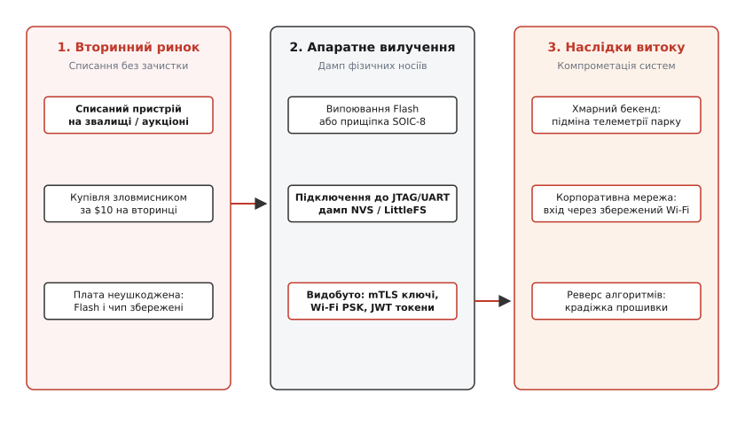
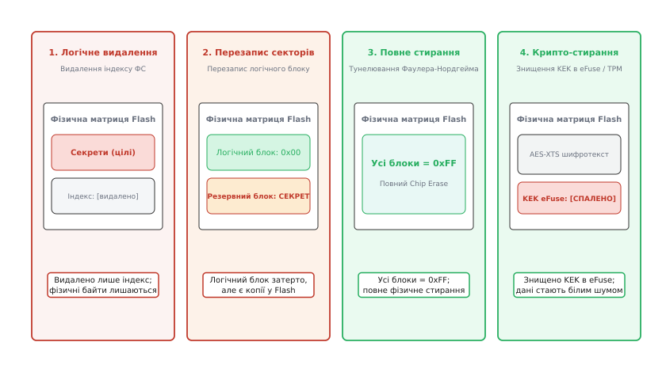
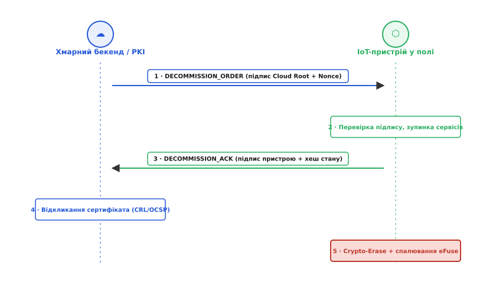
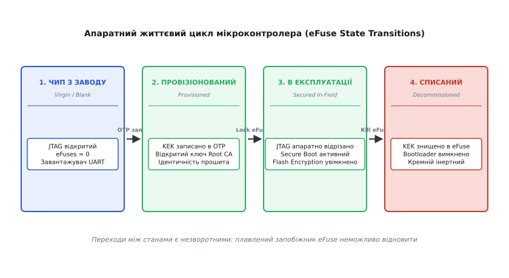

# Вивід із ладу: як пристрій перестає бути своїм (докладно)

<preknowlist>
- [Особистість пристрою](root:sf-security/osobystist-prystroiu) — серійний номер, закритий ключ і сертифікат пристрою як фундамент його автентифікації в хмарі.
- [Де в пристрої лежить ключ](root:embedded/de-v-prystroi-lezhyt-kliuch) — апаратні сховища, безпечні анклави (Secure Element, TPM, eFuse) та флеш-пам'ять.
- [Перше налаштування](root:embedded/device-provisioning) — як пристрій отримує облікові дані та прив'язується до облікового запису користувача чи парку.
- [Ф'юзи та опціональні байти](root:embedded/fiuzy-option-bytes-i-iak-ne-zrobyty-tsehlynku) — одноразово програмовані біти (eFuses / OTP) та блокування налагоджувальних інтерфейсів (JTAG/SWD).
- [TLS на мікроконтролері](root:embedded/tls-embedded) — двостороння автентифікація mTLS та перевірка ланцюга довіри сертифікатів.
</preknowlist>

Списаний промисловий контролер, розумний лічильник електроенергії або медичний шлюз телеметрії завершує службу в коробці з електронним брухтом або виставляється на онлайн-аукціон за десять доларів. Для керівника підприємства цей пристрій знеструмлений і списаний з балансу. Для інженера з реверс-інжинірингу чи зловмисника, озброєного паяльним феном, вимірювальною прищіпкою SOIC-8 та програматором за п'ять доларів, ця друкована плата — діючий цифровий паспорт і ключ від вхідних дверей у хмарну інфраструктуру компанії. Якщо виведення з експлуатації звелося до простого натискання кнопки скидання або вимкнення живлення, енергонезалежна Flash-пам'ять плати зберігає закритий криптографічний ключ mTLS, паролі локальних бездротових мереж, маркери доступу до хмарного брокера та комерційну прошивку з пропрієтарними алгоритмами.

Зловмиснику не потрібно зламувати 256-бітне шифрування чи шукати вразливості в хмарному міжмережевому екрані. Достатньо вичитати вміст пам'яті викинутого чипа, підставити отриманий закритий ключ у скрипт емулятора й під'єднатися до хмарного брокера від імені легітимного вузла парку. Такий підставний вузол може роками відправляти фальсифіковані показники датчиків, споживати обчислювальні ресурси бекенду, перехоплювати широкомовні команди керування або використовувати збережені мережеві параметри для проникнення у внутрішні сегменти корпоративної мережі.

Виведення пристрою з експлуатації (англ. *device decommissioning* або *deprovisioning*) — це не утилізація корпусу, а симетрична криптографічна та схемотехнічна операція, яка завершує життєвий цикл заліза. Вона вимагає синхронного виконання трьох завдань: гарантованого локального затирання всієї енергонезалежної пам'яті (Cryptographic Zeroization), відкликання цифрового сертифіката в центрі сертифікації (PKI Revocation) та апаратного блокування мікроконтролера через пропалювання електронних запобіжників (eFuses).

## Анатомія витоку: як списаний пристрій стає вектором атаки

Коли мікроконтролер працює в полі, він володіє цілим набором конфіденційних артефактів. Усі вони розподілені по різних областях енергонезалежної пам'яті: внутрішній Flash-пам'яті чипа, зовнішніх мікросхемах SPI/QSPI Flash, мікросхемах EEPROM чи енергонезалежних регістрах NVS (Non-Volatile Storage).

```
┌─────────────────────────────────────────────────────────────────────────┐
│              АРТЕФАКТИ БЕЗПЕКИ НА ПЛАТІ IoT-ПРИСТРОЮ                    │
├──────────────────────────┬──────────────────────────────────────────────┤
│ Закритий ключ пристрою   │ Ключ ECC (secp256r1/Ed25519) або RSA-2048;   │
│ (Device Private Key)     │ фундамент автентифікації клієнта в mTLS.     │
├──────────────────────────┼──────────────────────────────────────────────┤
│ Сертифікат пристрою      │ Відкритий сертифікат X.509 із серійним       │
│ (Device Certificate)     │ номером, підписаний проміжним CA компанії.   │
├──────────────────────────┼──────────────────────────────────────────────┤
│ Облікові дані мережі     │ WPA2/WPA3 Pre-Shared Key, логіни/паролі      │
│ (Network Credentials)    │ 802.1X EAP, APN стільникового зв'язку.       │
├──────────────────────────┼──────────────────────────────────────────────┤
│ Токени авторизації       │ JWT маркери, API-ключі сторонніх сервісів,   │
│ (Auth & Session Tokens)  │ токени оновлення (Refresh Tokens).           │
├──────────────────────────┼──────────────────────────────────────────────┤
│ Спільні ключі шифрування │ Симетричні ключі AES-128/256 для шифрування  │
│ (Application Keys)       │ корисного навантаження в чергах MQTT/CoAP.   │
├──────────────────────────┼──────────────────────────────────────────────┤
│ Бінарний образ прошивки  │ Інтелектуальна власність, алгоритми керування│
│ (Firmware Binary)        │ виконавчими механізмами, налагоджувальні логи│
└──────────────────────────┴──────────────────────────────────────────────┘
```

Якщо пристрій потрапляє до рук дослідника чи зловмисника, процес атаки розвивається за класичним сценарієм апаратного реверс-інжинірингу. Зловмисник знімає пластиковий корпус і оглядає маркування компонентів. Якщо на платі встановлено зовнішню 8-вивідну мікросхему пам'яті SPI Flash (наприклад, Winbond W25Q32 або подібну), на неї встановлюють тестову прищіпку SOIC-8 або просто випоюють феном за 30 секунд.


*Ланцюг компрометації під час недбалого списання: фізичний доступ до плати відкриває шлях до вичитування Flash-пам'яті, звідки видобуваються ключі mTLS, Wi-Fi PSK та токени, що дозволяє атакувати хмарний бекенд і корпоративну мережу.*

Під'єднавши виводи CS, CLK, MOSI, MISO до USB-програматора, зловмисник вичитує повний бінарний образ розміром у кілька мегабайтів. За допомогою стандартних утиліт аналізу образів прошивок (таких як `binwalk`) образ розпаковується на окремі розділи: таблицю розділів, завантажувач, розділ конфігурації NVS та файлову систему LittleFS або SPIFFS.

Утиліти парсингу NVS миттєво витягують пари «ключ-значення». Якщо закритий ключ зберігався у відкритому вигляді у Flash, він негайно копіюється на комп'ютер атакуючого. Наслідки витоку виходять далеко за межі однієї плати:

1. **Компрометація хмарного парку:** Отримавши закритий ключ mTLS, атакуючий створює безліч паралельних віртуальних клієнтів. Якщо бекенд не перевіряє унікальність активних TCP-сесій для одного ідентифікатора клієнта (Client ID), підставний вузол може слати спотворені дані, маскувати аварійні події або публікувати фальшиві звіти телеметрії.
2. **Проникнення в локальний периметр:** Корпоративні пристрої часто під'єднуються до закритих технологічних підмереж Wi-Fi або VPN-тунелів. Витягнутий з NVS пароль WPA2 Enterprise або спільний ключ IPsec дозволяє зловмиснику фізично наблизитися до будівлі компанії та під'єднатися до внутрішньої мережі повз зовнішні міжмережеві екрани.
3. **Крадіжка алгоритмів:** Вилучений бінарний код декомпілюється в IDA Pro чи Ghidra, розкриваючи математичні моделі керування, комерційні протоколи обміну та внутрішні URL-адреси бекенду, які розробники вважали прихованими від сторонніх очей.
4. **Вичерпання фінансових квот (Denial of Wallet):** Хмарні сервіси (AWS IoT Core, Azure IoT Hub, Google Cloud Pub/Sub) тарифікують кожне вхідне повідомлення та кожен гігабайт трафіку. Зловмисник може запустити скрипт, який генерує мільйони повідомлень на хвилину під дійсним сертифікатом утилізованого пристрою, створюючи багатотисячні рахунки за хмарну інфраструктуру.

Реальні приклади таких компрометацій — від розумних ламп до списаних маршрутизаторів — детально розібрані в історичному нарисі [Історія витоків із вторинного ринку](root:embedded/vyvid-iz-ladu/hist-smart-device-resale-leaks.md).

> 🔧 **Навіщо це.** Безпека вбудованої системи вимірюється не міцністю її найсильнішого шифру під час роботи, а захищеністю її секретів у найслабшій точці життєвого циклу. Якщо пристрій не здатний гарантовано знищити власні ключі перед утилізацією, уся криптографія каналу зв'язку лише відкладає витік до моменту заміни плати на нову.

## Фізика Flash-пам'яті та ілюзія видалення

Найпоширеніша помилка розробників прошивок полягає в припущенні, що виклик функції видалення файлу (`unlink()`) або очищення простору імен NVS (`nvs_erase_key()`) фізично знищує конфіденційні байти на кристалі кремнію. Це фундаментальна омана, зумовлена фізичними принципами роботи напівпровідникової Flash-пам'яті.

Комірка Flash-пам'яті (як NOR, так і NAND) побудована на польових транзисторах із плаваючим затвором (Floating Gate) або пасткою заряду (Charge Trap). Фізика цих комірок має жорстку асиметрію:

- **Запис (програмування):** може змінювати окремі біти зі стану логічної одиниці `1` у стан логічного нуля `0` (шляхом інжекції гарячих електронів на плаваючий затвор). Змінити окремий біт назад із `0` на `1` фізично неможливо.
- **Стирання:** для повернення бітів зі стану `0` у стан `1` необхідно зняти накопичений заряд з плаваючого затвора за допомогою квантовомеханічного тунелювання Фаулера — Нордгейма (Fowler-Nordheim Tunneling). Цей процес вимагає подачі високої напруги (12–20 В) на підкладку і може виконуватися **виключно над цілим фізичним блоком або сектором** (зазвичай 4 КБ у NOR Flash або 128–256 КБ у NAND Flash).

Через цю асиметрію файлові системи для вбудованих носіїв (LittleFS, SPIFFS, YAFFS) та сховища ключ-значення (NVS) будуються за журнально-структурованою схемою (Log-Structured File System) з механізмами вирівнювання зносу (Wear-Leveling):

```
Логічна дія: видалити ключ "wifi_pass"
1. Драйвер NVS НЕ стирає сектор (це довго і зношує кремній).
2. Драйвер записує новий запис-дескриптор: "wifi_pass -> СТАН: ВИДАЛЕНО".
3. Фізичний сектор Flash містить:
   [Запис 1: wifi_pass = "SecretKey2026" (ЦІЛИЙ)]
   [Запис 2: wifi_pass = DELETED_FLAG]
```

Фізичні байти пароля `"SecretKey2026"` залишаються записаними в кремнієвій структурі комірок Flash. Вони будуть стерті лише тоді, коли заповниться весь сектор розміром 4096 байтів, фоновий збирач сміття (Garbage Collector) виділить новий чистий сектор, скопіює туди тільки дійсні записи, а старий сектор піддасть циклу високовольтного стирання. Якщо пам'ять була заповнена лише на 20%, старий сектор може не стиратися роками. При прямому зчитуванні дампу програматором зловмисник бачить усі історичні версії ключів і конфігурацій.


*Порівняння чотирьох рівнів очищення Flash-пам'яті: логічне видалення та перезапис секторів залишають фізичні сліди в кремнії, тоді як апаратний Chip Erase та криптографічне знищення Master KEK гарантують повну невідновність даних.*

Крім того, на рівні протоколу SPI Flash кожна операція очищення вимагає суворої послідовності команд:

```
1. Відправити команду WREN (Write Enable, код 0x06).
2. Прочитати регістр статусу RDSR (код 0x05) і перевірити біт WEL (Write Enable Latch == 1).
3. Відправити команду стирання:
   - Сектор 4 КБ: SE (код 0x20) + 3-байтна/4-байтна адреса.
   - Блок 64 КБ:  BE (код 0xD8) + 3-байтна/4-байтна адреса.
   - Увесь кристал: CE (код 0xC7 або 0x60).
4. Опитувати регістр статусу RDSR у циклі, очікуючи скидання біта WIP (Write In Progress == 0).
```

Якщо під час виконання цієї послідовності живлення плати раптово зникає (наприклад, оператор висмикнув кабель), стирання сектора переривається. Комірки Flash опиняються в проміжному нестабільному стані заряду (англ. *marginal read state*), де частина бітів читається як `0`, а частина як `1`. У лабораторних умовах аналогове сканування рівнів напруги на виводах дозволяє частково або повністю відновити початкові дані перерваного сектора.

### Пастка оптимізатора компілятора: Dead Store Elimination

Друга катастрофічна пастка виникає вже в оперативній пам'яті (SRAM) під час спроби затерти масив із ключем перед звільненням пам'яті. Типовий код розробника виглядає так:

:::tabs
```c
void process_private_key(void) {
    uint8_t secret_key[32];
    load_key_from_secure_storage(secret_key);
    do_cryptography(secret_key);

    /* Спроба затерти ключ у стеку: компілятор викине цей виклик */
    memset(secret_key, 0, sizeof(secret_key));
}
```
```cpp
void process_private_key() {
    std::array<uint8_t, 32> secret_key{};
    load_key_from_secure_storage(secret_key.data());
    do_cryptography(secret_key.data());

    /* Помилка: оптимізатор викидає fill, оскільки буфер більше не читається */
    std::fill(secret_key.begin(), secret_key.end(), 0);
}
```
:::

Компілятори C та C++ (GCC, Clang) під час оптимізації рівня `-O2` або `-O3` виконують аналіз потоку даних і застосовують оптимізацію **видалення мертвих записів** (англ. *Dead Store Elimination*). Комп'ютер «розуміє», що буфер `secret_key` є локальною змінною на стеку, функція завершує роботу, і після виклику `memset()` чи `std::fill()` ніхто більше не читає значення з цього масиву. Компілятор класифікує виклик як абсолютно марну операцію і **повністю викидає її з фінального асемблерного коду**.

У результаті функція повертає керування, покажчик стека зміщується, але всі 32 байти закритого ключа залишаються лежати у відкритому вигляді в оперативній пам'яті SRAM, звідки вони можуть потрапити в аварійний дамп (Core Dump) або бути вичитані через налагоджувальний інтерфейс.

Щоб запобігти видаленню затирання оптимізатором, необхідно застосовувати спеціалізовані криптографічні примітиви з бар'єрами пам'яті:

:::tabs
```c
/* Безпечне затирання пам'яті в C, захищене від оптимізацій компілятора */
void secure_memzero(void *v, size_t n) {
    volatile uint8_t *p = (volatile uint8_t *)v;
    while (n--) {
        *p++ = 0x00;
    }
    /* Апаратний бар'єр пам'яті для GCC/Clang */
    __asm__ __volatile__("" : : "r"(v) : "memory");
}
```
:::code vyvid-iz-ladu-d/cpp/pastka-optymizatora.cpp
:::

Використання кваліфікатора `volatile` змушує компілятор генерувати інструкцію запису в пам'ять на кожній ітерації циклу, а інлайн-асемблерний бар'єр `__asm__ __volatile__` сигналізує оптимізатору, що стан пам'яті за цією адресою є критичним для зовнішнього оточення, що повністю блокує Dead Store Elimination.

### Чотири рівні зачистки носіїв за стандартом NIST SP 800-88

Національний інститут стандартів і технологій США у стандарті NIST SP 800-88 Rev. 1 визначає чотири класи очищення носіїв даних:

1. **Logical Deletion (Логічне видалення):** скидання покажчиків файлової системи, очищення простору імен NVS. Фізичні дані залишаються неушкодженими. Відновлюється за хвилину будь-яким SPI-програматором.
2. **Clear / Sector Overwrite (Очищення перезаписом):** запис фіксованого патерну (`0x00`, `0xAA`, `0x55` або випадкових чисел) у логічні адреси секторів. Через Wear-Leveling не гарантує затирання резервних і збійних фізичних блоків Flash.
3. **Purge / Chip Erase (Апаратне глибоке очищення):** виконання апаратної команди контролера пам'яті `Chip Erase (0xC7 / 0x60)`. Контролер Flash-пам'яті подає високу напругу одночасно на всі матриці кристала, знімаючи заряд з усіх комірок. Усі байти 100% фізичних блоків повертаються в стан `0xFF`.
4. **Cryptographic Erase (Криптографічне стирання / Crypto-Erase):** якщо вся Flash-пам'ять під час роботи прозоро шифрується апаратним модулем AES-XTS (як в ESP32, STM32MP1, NXP i.MX RT), дані у Flash є білим шумом. Для гарантованого знищення гігабайтів інформації достатньо затерти єдиний 256-бітний Master KEK (Key Encryption Key) в апаратному сховищі eFuse або Secure Element. Без KEK відновлення навіть одного біта даних вимагає зламу шифру AES-XTS, що математично неможливо.

## Розрив довіри з боку хмари: протокол відкликання

Виведення пристрою з ладу не може бути виключно локальною подією на самій платі. Якщо пристрій розбили молотком або затерли його Flash, але в хмарному реєстрі його цифровий сертифікат залишається дійсним, у системі виникає **примарна ідентичність** (англ. *ghost identity*). Якщо зловмисник зумів створити несанкціоновану копію закритого ключа до моменту знищення плати, він зможе користуватися цією ідентичністю безперешкодно.

Справжнє списання — це розподілена двостороння транзакція між пристроєм і хмарним бекендом.

```
ХМАРНИЙ БЕКЕНД / PKI                               IoT-ПРИСТРІЙ У ПОЛІ
       │                                                    │
       │─── 1. DECOMMISSION_ORDER (Nonce, Signature) ──────>│
       │                                                    │ (Верифікація підпису)
       │                                                    │ (Зупинка робочих задач)
       │                                                    │ (Формування звіту аудиту)
       │<── 2. DECOMMISSION_ACK (Signed Receipt, Hash) ─────│
       │                                                    │
(Блокування в реєстрі: DECOMMISSIONED)                      │
(Відкликання сертифіката: CRL / OCSP)                       │
(Примусове закриття сесій TLS)                              │
       │                                                    │
       │                                                    │─── 3. Local Crypto-Erase
       │                                                    │─── 4. Blow eFuses (Lock)
       │                                                    │─── 5. Terminal Halt
```


*Послідовність повідомлень під час взаємного виведення з експлуатації: хмара надсилає підписаний наказ, пристрій повертає криптографічну розписку про стан, після чого сертифікат відкликається в PKI, а плата переходить до самознищення ключів.*

Розгляньмо кожен етап цього протоколу:

### Етап 1: Підписаний наказ на списання (DECOMMISSION_ORDER)

Команда на самознищення секретів є найнебезпечнішою дією в системі. Якщо зловмисник зможе підробити цю команду, він викличе масовий відвал парку (Denial of Service). Тому наказ на списання ніколи не передається як простий MQTT-топік без автентифікації.

Наказ формується на бекенді уповноваженим оператором безпеки та містить:
- Унікальний ідентифікатор пристрою (`device_id`).
- Одноразове випадкове число (`nonce`) для захисту від атак повторного відтворення (Replay Attack).
- Мітку часу (`timestamp`) з обмеженим строком дії (наприклад, 300 секунд).
- Криптографічний підпис ECDSA, згенерований на закритому ключі кореневого органу безпеки парку (Fleet Authority Key).

Отримавши пакет, пристрій перевіряє цифровий підпис за допомогою відкритого ключа Root Authority, жорстко зашитого в захищеній області ROM або Secure Boot. Тільки якщо підпис зійшовся і мітка часу свіжа, пристрій переходить до процедури виведення з ладу.

### Етап 2: Криптографічна розписка (DECOMMISSION_ACK)

Перед тим як прати власні мережеві налаштування, пристрій зобов'язаний надіслати хмарі юридично значущий доказ готовності до списання. Пристрій збирає звіт:
- Хеш SHA-256 поточної конфігурації.
- Фінальні покажчики лічильників зносу пам'яті.
- Підпис цього звіту власним закритим ключем пристрою.

Цей документ (Decommissioning Receipt) зберігається в журналі аудиту бекенду як доказ того, що конкретний пристрій отримав наказ і штатно завершив роботу.

### Етап 3: Відкликання сертифікатів у PKI

Отримавши `DECOMMISSION_ACK`, хмарний сервіс керування парком виконує анулювання сертифіката:

1. **Зміна статусу в реєстрі:** У хмарному реєстрі (AWS IoT Thing Registry, Azure Device Registry) пристрій переводиться зі стану `ACTIVE` у стан `DECOMMISSIONED` або видаляється. Усі правила маршрутизації MQTT для його топіків блокуються.
2. **Публікація в CRL (Certificate Revocation List):** Серійний номер сертифіката пристрою додається до списку відкликаних сертифікатів кореневого або проміжного CA. CRL містить поля `userCertificate` (серійний номер) та `revocationDate`. Проте списки CRL швидко розростаються до десятків мегабайтів, тому сам мікроконтролер не завантажує повний CRL; перевірку списку виконує хмарний TLS-шлюз у момент встановлення з'єднання.
3. **Оновлення відповідей OCSP (Online Certificate Status Protocol):** Сервер OCSP центру сертифікації починає повертати підписану відповідь зі статусом `Revoked` на будь-який запит перевірки цього сертифіката. У сучасних архітектурах застосовується механізм OCSP Stapling, де TLS-сервер додає свіжу підписану OCSP-відповідь безпосередньо до повідомлення `CertificateStatus` під час рукостискання.
4. **Розрив діючих сесій:** Хмарний TLS-термінатор примусово розриває активне TCP-з'єднання з цим клієнтом і блокує відновлення сесій за допомогою квитків TLS Session Tickets.

Навіть якщо зловмисник зніме дамп пам'яті за хвилину після цього, сертифікат пристрою більше не пройде перевірку валідності на стороні TLS-сервера.

## Апаратне блокування та спалювання запобіжників (eFuses)

Після відправки квитанції пристрій залишається один на один зі своїм залізом. Завдання фінального етапу — перевести мікроконтролер у стан, коли відновлення ключів або повторне використання вразливої прошивки стає неможливим фізично.

Для цього використовуються **електронні запобіжники (eFuses)** або **одноразово програмована пам'ять (OTP — One-Time Programmable)**.

```
       НОРМАЛЬНИЙ СТАН (0)                     СПАЛЕНИЙ СТАН (1)
     Провідний мікролінк                   Розплавлений перешийок
      ┌───────────────┐                       ┌─────┐   ┌─────┐
──────┴───────────────┴──────           ──────┴─────┘   └─────┴──────
        Низький опір                            Високий опір
     Логічний сигнал = 0                     Логічний сигнал = 1
```

Електронний запобіжник — це мікроскопічний кремнієвий або полікремнієвий мікроперемикач на кристалі інтегральної схеми. У початковому стані запобіжник має низький електричний опір (стан логічного нуля). Коли контролер eFuse подає на відповідний ланцюг підвищену напругу програмування (наприклад, 2.5–3.3 В) та імпульс струму певної сили, матеріал перемички локально плавиться внаслідок електроміграції, утворюючи фізичний розрив із гігаомним опором (стан логічної одиниці).

Цей процес є **на 100% незворотним**. Повернути спалений запобіжник у вихідний провідний стан неможливо жодними програмними чи хімічними методами.


*Життєвий цикл кремнію за стандартом ARM PSA: незворотні переходи між станами через спалювання eFuses гарантують перетворення списаного пристрою на безпечний інертний модуль.*

За стандартом безпеки ARM Platform Security Architecture (PSA Certified) та реалізаціями в сучасних чипах (ESP32-S3, STM32H5, NXP LPC55S) списання чипа задіює спеціальні групи eFuses:

```
┌─────────────────────────────────────────────────────────────────────────┐
│              ПРИЗНАЧЕННЯ eFUSES ПРИ ВИВЕДЕННІ З ЛАДУ                    │
├──────────────────────────┬──────────────────────────────────────────────┤
│ JTAG_DISABLE             │ Фізично відрізає лінії JTAG/SWD від ядра;    │
│                          │ блокує апаратні налагоджувачі від зняття RAM │
├──────────────────────────┼──────────────────────────────────────────────┤
│ UART_DOWNLOAD_DIS        │ Вимикає режим прошивання через послідовний   │
│                          │ завантажувач у ROM мікроконтролера.          │
├──────────────────────────┼──────────────────────────────────────────────┤
│ KEY_PURGE_BLOCK          │ Записує нулі поверх апаратних ключів KEK     │
│                          │ та блокує біти дозволу читання ключів.       │
├──────────────────────────┼──────────────────────────────────────────────┤
│ PSA_LIFECYCLE_DECOMM     │ Переводить апаратний автомат безпеки кристала│
│                          │ у термінальний стан DECOMMISSIONED/LOCKED.   │
└──────────────────────────┴──────────────────────────────────────────────┘
```

У мікроконтролерах ESP32-S3 контролер eFuse організований у блоки `EFUSE_BLK0` – `EFUSE_BLK10`. Для кожного захищеного блоку ключів існують окремі біти заборони читання (`RD_DIS`) та заборони подальшого запису (`WR_DIS`). Під час виведення з експлуатації запис одиниць у біти `WR_DIS` та блокування налагодження `DIS_PAD_JTAG` назавжди ізолює внутрішній стан процесора.

У сімействі STM32H5 опціональні байти безпеки (Option Bytes) керують захистом рівня OEM (Original Equipment Manufacturer): перехід у стан `PRODUCT_STATE_OPEN` -> `PRODUCT_STATE_PROVISIONED` -> `PRODUCT_STATE_CLOSED` -> `PRODUCT_STATE_LOCKED`. У стані `LOCKED` контролер апаратно блокує будь-яке читання внутрішньої Flash, а спроба відкату (Regression) через зовнішні виводи автоматично ініціює апаратне самозатирання всієї внутрішньої пам'яті кристала (Hardware Mass Erase).

У мікроконтролерах із фізично неклонованими функціями (PUF — Physically Unclonable Function, як в NXP LPC55S) ключі шифрування не зберігаються у Flash взагалі: вони генеруються на льоту зі статичного шуму пускових станів комірок SRAM за допомогою коду активації (Activation Code). Для гарантованого знищення всієї криптографічної пам'яті такого пристрою достатньо затерти код активації в регістрі PUF: без нього кремній ніколи більше не зможе відтворити свій унікальний Master Key, перетворюючи всі зашифровані образи на непоправний шум.

Якщо пристрій підлягає **повторному використанню** (наприклад, заміна власника або повернення на склад), спалювання `UART_DOWNLOAD_DIS` не проводиться, але виконується повний Crypto-Erase сховища ключів. Якщо ж пристрій списується **назавжди** (End-of-Life), спалювання блокувальних eFuses гарантує, що чип більше ніколи не виконає жодної сторонньої програми й не видасть жодного байта з внутрішніх сховищ.

## Повний модуль безпечного виведення з ладу на C та C++

Нижче наведено повну реалізацію модуля безпечного виведення з ладу. Модуль містить:
1. Криптографічно безпечне затирання оперативної пам'яті (`secure_memzero`), стійке до Dead Store Elimination.
2. Багатопрохідне затирання та секторне стирання Flash-розділів конфігурації, сертифікатів та NVS.
3. Процедуру криптографічного стирання Master KEK.
4. Пропалювання апаратних блокувальних eFuses для термінального закриття JTAG та завантажувача.
5. Генерацію підписаного аудиторського хешу операції за алгоритмом SHA-256.

:::tabs
:::code vyvid-iz-ladu-d/c/main.c
:::code vyvid-iz-ladu-d/cpp/povnyi-modul-bezpechnoho.cpp
:::

## Інженерний регламент та підсумковий чекліст

Щоб процедура списання стала надійною інженерною рутиною, у життєвий цикл виробу закладають матрицю дій відповідно до типу завершення експлуатації:

```
┌─────────────────────────────────────────────────────────────────────────┐
│              МАТРИЦЯ РІШЕНЬ ДЛЯ ВИВЕДЕННЯ З ЕКСПЛУАТАЦІЇ                │
├──────────────────────┬──────────────────────┬───────────────────────────┤
│ Сценарій             │ Обсяг зачистки       │ Апаратні eFuses           │
├──────────────────────┼──────────────────────┼───────────────────────────┤
│ Заводське скидання   │ Затирання NVS і      │ eFuses НЕ чіпаються;      │
│ (Factory Reset)      │ конфігурації Wi-Fi;  │ прошивка лишається,       │
│                      │ сертифікат лишається │ чип готовий до ре-провіжну│
├──────────────────────┼──────────────────────┼───────────────────────────┤
│ Передача іншому      │ Повний Crypto-Erase; │ eFuses НЕ чіпаються;      │
│ замовнику (Resale)   │ видалення всіх ключів│ відкликання сертифіката   │
│                      │ та сертифікатів mTLS │ в хмарному PKI            │
├──────────────────────┼──────────────────────┼───────────────────────────┤
│ Остаточна утилізація │ Повний Crypto-Erase  │ eFuses JTAG/Boot СПАЛЮЮТЬ│
│ (End-of-Life Scrap)  │ + Chip Erase матриці │ чип перетворюється на     │
│                      │ Flash-пам'яті        │ інертний брухт            │
└──────────────────────┴──────────────────────┴───────────────────────────┘
```

Головні правила, яких слід дотримуватися під час проектування та обслуговування парку пристроїв:

1. **Жодного відкритого ключа на відкритій шині:** Закриті ключі mTLS та майстер-паролі повинні шифруватися апаратним KEK з першої секунди життя плати на конвеєрі.
2. **Гарантія Crypto-Erase на рівні схемотехніки:** Якщо використовується зовнішня Flash, живлення внутрішнього домену eFuse або батарейного анклаву повинно мати надійне джерело для завершення пропалювання навіть при раптовому вимиканні основного живлення під час списання.
3. **Асиметричне двостороннє підтвердження:** Пристрій ніколи не стирає себе за анонімною локальною командою, якщо він підключений до керованого парку — команда має бути криптографічно підписана хмарою, а хмара повинна отримати аудиторську розписку перед відкликанням сертифіката.
4. **Захист від компіляторів:** Будь-яке затирання конфіденційних буферів у пам'яті SRAM має виконуватися через `volatile`-покажчики або спеціалізовані криптографічні функції з бар'єрами пам'яті.
5. **Фіксація ланцюга збереження (Chain of Custody):** Кожен факт виведення з ладу повинен супроводжуватися записом у незмінному реєстрі бекенду із зазначенням серійного номера, ідентифікатора оператора, отриманої квитанції аудиту та часу видалення сертифіката з PKI відповідно до стандарту NIST SP 800-88.
