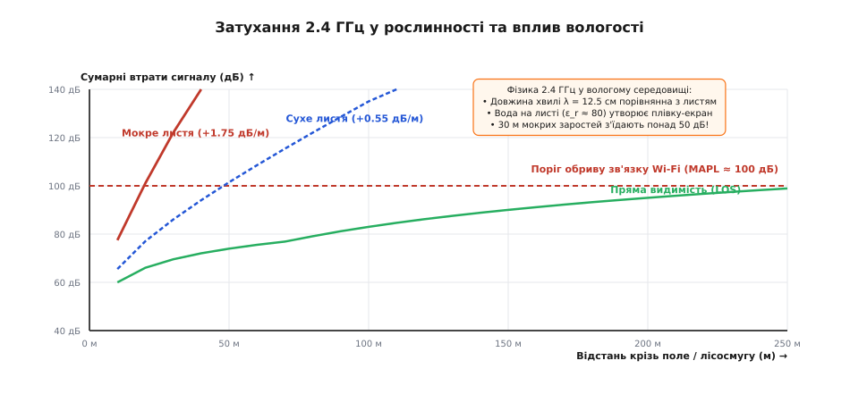
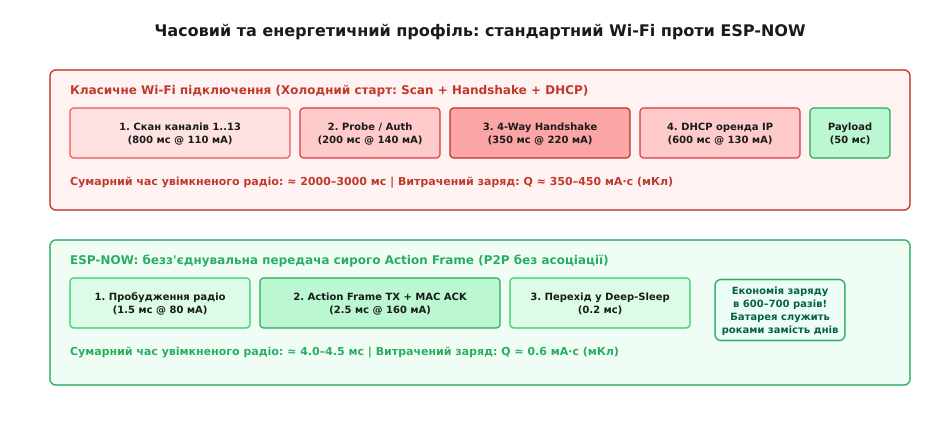
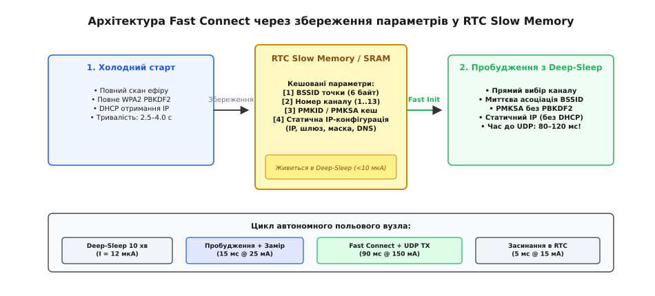
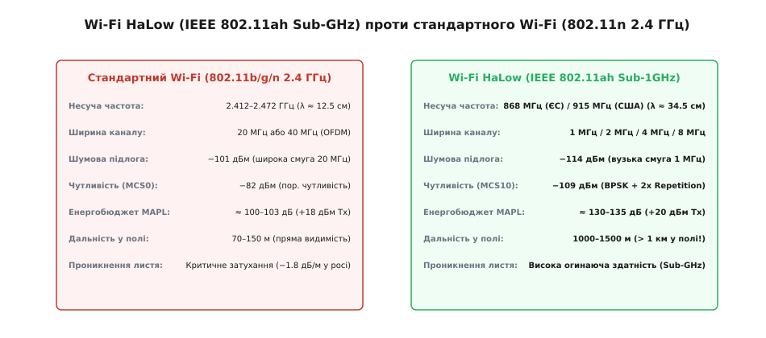
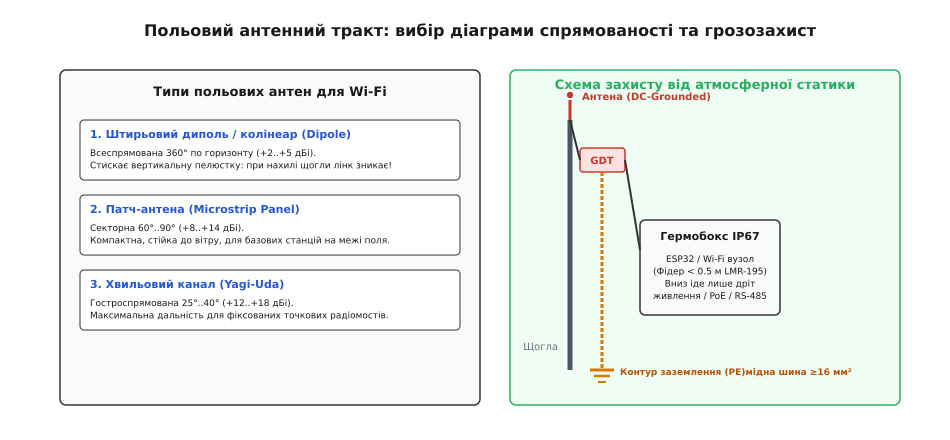

# Wi-Fi у полі

<preknowlist>
- [Дальність у полі](root:embedded/dalnist-u-poli) — енергетичний ланцюг радіолінії, двопроменева модель Two-Ray та закон 1/R⁴.
- [Швидке підключення Wi-Fi: кешування PMK і IP](root:embedded/wifi-fast-connect) — три фази холодного підключення, виведення ключів PBKDF2 та PMKSA-кешування.
- [Стандарти 802.11: від b/g/n до Wi-Fi 7](root:embedded/802-11-versions) — еволюція протоколів, ширина каналів, модуляції OFDM та спектральна ефективність.
- [Багатопроменевість і завмирання](root:com-medium/multipath-fading) — інтерференція копій сигналу та фізика швидких завмирань Релея.
- [ESP-NOW: пакет без мережі](root:com-transport/esp-now) — передача безз'єднувальних Action Frames на канальному рівні.
- [Зони Френеля й перешкода на шляху](root:embedded/zony-frenelia-i-pereshkoda-na-shliakhu) — геометрія просвіту траси та дифракційні втрати.
</preknowlist>

Автономна агрометеостанція на базі мікроконтролера ESP32, встановлена посеред поля кукурудзи, повинна раз на десять хвилин передавати сорок байтів вимірів температури, вологості ґрунту та інсоляції на базовий шлюз ферми. Під час лабораторного тестування на столі модуль показував швидкість 54 Мбіт/с, пінг 2 мілісекунди й стабільно тримав зв'язок крізь три цегляні стіни офісу. Проте в реальному польовому розгортанні на відстані всього 140 метрів від антени роутера пристрій зазнає повного колапсу: замість швидкого скидання даних радіомодуль зависає на дві-чотири секунди у спробах просканувати тринадцять каналів діапазону 2.4 ГГц, вихідний підсилювач потужності споживає імпульсний струм до 240 мА, висаджуючи літій-залізо-фосфатний акумулятор ємністю 2000 мА·год менш ніж за два тижні, а ранкова роса на листі кукурудзи спричиняє раптові обриви сеансу на кілька годин поспіль.

Цей сценарій наочно демонструє, чому перенесення стандартного протокольного стека IEEE 802.11b/g/n із теплого офісу у відкрите природне середовище перетворюється на інженерну пастку. Офісний Wi-Fi проєктувався для високих швидкостей передачі файлів і відео в замкненому просторі зі стабільним живленням від розетки. У польових умовах бездротовий вузол стикається з потрійним бар'єром: електродинамічним згасанням сигналу 2.4 ГГц у біомасі, важким накладним тягарем процедур асоціації та шифрування, що нищать енергобюджет, і нестійкістю антенно-фідерного тракту до погодних факторів. Щоб побудувати надійний польовий лінк, інженер повинен розуміти фізику поширення хвиль у рослинності, відмовитися від зайвих рівнів стека на користь безз'єднувальних кадрів ESP-NOW, застосовувати кешування Fast Connect у пам'яті RTC, знати можливості субгігагерцового стандарту Wi-Fi HaLow та правильно обирати конструкцію антен і захист від атмосферної статики.

## Фізика польового 2.4 ГГц Wi-Fi: затухання в рослинності, поглинання вологою та багатопроменевість

Робота стандартного Wi-Fi у діапазоні 2.4 ГГц (2412–2472 МГц) відповідає довжині хвилі у вільному просторі:

```
λ = c / f = (3 · 10⁸ м/с) / (2.437 · 10⁹ Гц) ≈ 0.123 м = 12.3 см
```

Такий геометричний масштаб хвилі є критичним для природного середовища: розміри листя більшості сільськогосподарських культур (кукурудза, соняшник, соя, озима пшениця) та чагарників лежать саме в діапазоні від 5 до 20 сантиметрів. Коли довжина хвилі сумірна з фізичним розміром перешкод, поширення перестає підпорядковуватися законам геометричної оптики і переходить в область комбінованого дифракційного розсіювання та діелектричного поглинання.

```
                  ┌────────────────────────────────────────────────────────┐
                  │                 ПОЛЬОВИЙ ЕФІР 2.4 ГГц                  │
                  └──────────────────────────┬─────────────────────────────┘
                                             │
               ┌─────────────────────────────┼─────────────────────────────┐
               ▼                             ▼                             ▼
┌─────────────────────────────┐┌─────────────────────────────┐┌─────────────────────────────┐
│   РЕЗОНАНС ВОЛОГИ (λ=12см)  ││   ЗАТУХАННЯ В БІОМАСІ (L_v) ││    MULTIPATH ТА FADING     │
│  Вода на листі: ε_r ≈ 80    ││  Сухе листя: +0.55 дБ/м     ││  Інтерференція з землею    │
│  Поглинання диполями H₂O    ││  Мокре після дощу: +1.75дБ/м││  Провали в нуль до 30 дБ   │
│  Втрати у росі: +15..25 дБ  ││  30 м заростей = −52 дБ лінку││  Частотно-вибірковий спад │
└─────────────────────────────┘└─────────────────────────────┘└─────────────────────────────┘
```

Головним поглиначем енергії на частоті 2.4 ГГц є рідка вода. Молекула води являє собою електричний диполь. Під дією високочастотного змінного електромагнітного поля диполі води змушені здійснювати переорієнтацію з частотою 2.4 мільярда разів на секунду, що через внутрішнє молекулярне тертя призводить до прямого перетворення енергії радіохвилі на тепло. У сухому листі затухання зумовлене переважно внутрішньоклітинною вологою. Для кількісної оцінки втрат у польових лісосмугах та посівах застосовують емпіричну модель Вайссбергера (англ. *Weissberger modified exponential model*):

```
L_veg = 1.33 · f^0.284 · d_f^0.588   [для 14 м < d_f < 400 м]
L_veg = 0.45 · f^0.284 · d_f         [для d_f ≤ 14 м]
```

де `f` — частота випромінювання в Гігагерцах (2.4 ГГц), а `d_f` — товщина шару рослинності в метрах.

Для сухого масиву кукурудзи або молодої лісосмуги на частоті 2.4 ГГц модель Вайссбергера дає додаткове згасання близько `0.5–0.6 дБ` на кожен метр глибини масиву. Якщо базова станція та давач віддалені на 100 метрів, і 40 метрів прямої траси перекрито сухою рослинністю, до втрат вільного простору (близько 80 дБ) додаються:

```
L_veg = 1.33 · (2.4)^0.284 · (40)^0.588 ≈ 1.33 · 1.282 · 8.74 ≈ 14.9 дБ
```

Сумарне згасання досягає `95 дБ`, що для передавача потужністю +18 дБм залишає прийнятий сигнал на рівні `−77 дБм` — це ще дозволяє підтримувати зв'язок на мінімальній швидкості MCS0 (модуляція BPSK, швидкість 6.5–7.2 Мбіт/с).

Проте ситуація кардинально змінюється після випадання дощу або під час ранкової роси. Вода утворює на поверхні кожного листка тонку суцільну плівку. Діелектрична проникність рідкої води становить `ε_r ≈ 80` (порівняно з `ε_r ≈ 1.0` для повітря та `ε_r ≈ 2…4` для сухої деревини), а тангенс кута діелектричних втрат `tan(δ) ≈ 0.15`. Мокре листя перетворюється на систему провідних екранів, які не лише поглинають хвилю, але й інтенсивно розсіюють її у зворотний бік.


*Залежність сумарного згасання радіосигналу 2.4 ГГц від відстані: пряма видимість проти сухого та покритого вологою листя, де поглинання перевищує поріг чутливості вже на 35 метрах.*

Питоме згасання в мокрих заростях підскакує до `1.5–2.0 дБ/м`. У цьому випадку ті самі 40 метрів вологої кукурудзи додають не 15 дБ, а понад `60–70 дБ` втрат. Сумарне загасання радіотраси сягає `140–150 дБ`, що значно перевищує максимальний енергетичний бюджет стандартного Wi-Fi (`MAPL ≈ 100–103 дБ`). Лінк повністю розривається.

Другим критичним фактором є багатопроменеве затухання (Multipath Fading) над поверхнею ґрунту. Відповідно до двопроменевої моделі Two-Ray, прямий промінь інтерферує з променем, що відбивається від землі з інверсією фази на 180 градусів. У полі над землею виникають глибокі інтерференційні мінімуми, де амплітуда сигналу провалюється на `20–30 дБ` на відрізках довжиною в кілька сантиметрів. 

Більше того, коливання рослинності під дією вітру спричиняють швидку динамічну зміну різниці ходу розсіяних променів (швидкі завмирання Релея). Оскільки стандартний канал Wi-Fi має значну ширину — 20 МГц (або 40 МГц у режимі HT40), завмирання мають виражений частотно-селективний характер: інтерференційний нуль потрапляє не на весь діапазон одразу, а вибиває групу з 8–12 окремих піднесучих OFDM. Це призводить до спотворення фази символів, різкого зростання частоти бітових помилок (BER) та пошкодження контрольної суми кадру (FCS CRC32).

Алгоритм адаптації швидкості Wi-Fi (Rate Adaptation) у відповідь на помилки FCS починає автоматично скидати модуляцію з 64-QAM (MCS7, 65 Мбіт/с) до 16-QAM, QPSK і, зрештою, до BPSK (MCS0, 6.5 Мбіт/с). Зниження швидкості збільшує тривалість передачі пакета в ефірі (Airtime) майже в десять разів. У результаті тривалість передачі зростає, ймовірність натрапити на глибоке завмирання під час тривалого кадру збільшується, а енергоспоживання передавача множиться на час передачі, виснажуючи батарею.

## Протокол ESP-NOW: безз'єднувальна передача Action Frames на сотні метрів

Головною причиною непридатності стандартного Wi-Fi для автономних польових давачів є не стільки радіофізика, скільки колосальний накладний тягар процедури встановлення з'єднання.

Коли класична Wi-Fi станція (STA) виходить зі стану сну, вона не може миттєво відправити корисні дані. Вона зобов'язана пройти повний протокольний обряд:

1. **Сканування ефіру (Channel Scan):** станція по черзі слухає кожен із 13 каналів діапазону 2.4 ГГц або розсилає широкомовні Probe Request, очікуючи Probe Response від точки доступу (800–1200 мс при середньому струмі 110 мА).
2. **Автентифікація та асоціація (Open Auth + Assoc):** обмін чотирма службовими керуючими кадрами з точкою доступу (150–250 мс при струмі 130 мА).
3. **Чотиристороннє рукостискання WPA2/WPA3 (4-Way Handshake):** обчислення парного головного ключа PMK через 4096 ітерацій HMAC-SHA1 (PBKDF2), обмін чотирма EAPOL-кадрами для узгодження сесійних ключів PTK/GTK (300–500 мс при роботі процесора на максимальній частоті 240 МГц зі струмом 200–240 мА).
4. **Отримання мережевої адреси (DHCP DORA):** широкомовні запити `DISCOVER`, очікування `OFFER`, відправка `REQUEST` та прийом `ACK` від маршрутизатора (400–800 мс при струмі 130 мА).

```
КЛАСИЧНИЙ WI-FI (ХОЛОДНИЙ СТАРТ: 2.5–3.5 СЕКУНДИ, Q ≈ 400 мКл):
[ Scan 13ch (1000мс) ]──>[ Auth+Assoc (200мс) ]──>[ 4-Way WPA2 (400мс) ]──>[ DHCP (700мс) ]──>[ Payload (50мс) ]

ESP-NOW ACTION FRAME (БЕЗЗ'ЄДНУВАЛЬНИЙ СТАРТ: 4.0 МІЛІСЕКУНДИ, Q ≈ 0.6 мКл):
[ Wake RF (1.5мс) ]──>[ Action Frame TX + MAC ACK (2.5мс) ]──>[ Deep-Sleep ]
```

Сумарний час від моменту подачі живлення на радіотракт до відправки першого байта корисного навантаження становить від 2.5 до 3.5 секунд. Інтегральні витрати електричного заряду на одне прокидання складають:

```
Q = ∫ I(t) dt ≈ 0.150 А · 2.7 с ≈ 0.405 Кл = 405 мА·с
```

Якщо автономний давач прокидається один раз на 5 хвилин (288 разів на добу), лише на підключення до мережі витрачається:

```
Q_доба = 288 · 0.405 А·с ≈ 116.6 А·с ≈ 32.4 мА·год / добу
```

Акумулятор ємністю 2000 мА·год буде повністю висаджений «в нуль» за `2000 / 32.4 ≈ 61` добу, навіть якщо корисні дані передавалися лише 5 мілісекунд.


*Порівняння тривалості активного стану радіомодуля та інтегральних витрат заряду акумулятора між класичним підключенням до точки доступу та передачею сирого кадру ESP-NOW.*

Кардинальним вирішенням цієї проблеми для польових сценаріїв «точка-точка» (P2P) та «зірка» є перехід на протокол **ESP-NOW**, розроблений компанією Espressif на базі стандарту IEEE 802.11.

ESP-NOW повністю викидає рівні асоціації, мережевої маршрутизації (IP/TCP/UDP) та DHCP. Замість цього передача здійснюється на канальному рівні (MAC Layer) за допомогою сирих користувацьких кадрів дій — **Vendor-Specific Action Frames** (код категорії `0x7F`, унікальний ідентифікатор організації OUI `0x18:FE:34`).

Кадр ESP-NOW інкапсулює корисне навантаження розміром до 250 байтів безпосередньо в тіло MAC-фрейму:

```
┌─────────────────┬─────────────────────────────────────────────────────────────────────────────┐
│ 802.11 MAC Hdr  │ Vendor-Specific Action Frame Body                                           │
├────────┬────────┼───────────┬──────────────┬──────────────┬────────────┬─────────────┬────────┤
│ Frame  │ Addr1  │ Category  │ OUI          │ Random       │ Vendor     │ Payload     │ FCS    │
│ Control│ (MAC)  │ (0x7F)    │ (0x18:FE:34) │ Token (4B)   │ Specific   │ (0..250 B)  │ CRC32  │
└────────┴────────┴───────────┴──────────────┴──────────────┴────────────┴─────────────┴────────┘
```

Переваги такої архітектури для польових умов:

1. **Миттєва відправка:** вузол прокидається з глибокого сну, ініціалізує апаратний рівень Wi-Fi на жорстко зафіксованому каналі (наприклад, Channel 6) і відразу відправляє сирий пакет. Час від старту радіотракту до виходу кадру в ефір становить **менше 2.0–3.0 мілісекунд**.
2. **Апаратне підтвердження (MAC-level ACK):** при адресній відправці (Unicast) приймальний вузол формує апаратний ACK-імпульс протягом 10 мікросекунд після перевірки CRC32 кадру. Передавач точно знає, чи дійшов пакет. За відсутності ACK апаратний контролер трансивера виконує до 10 автоматичних повторів на рівні кремнію без участі центрального процесора.
3. **Екстремальна енергоефективність:** загальний час неспання вузла становить 4.0–4.5 мс. Витрачений заряд на одну посилку становить `Q = 0.150 А · 0.004 с = 0.0006 Кл = 0.6 мА·с`. Це в **675 разів менше**, ніж у класичного Wi-Fi! Від того самого акумулятора на 2000 мА·год пристрій пропрацює понад 5 років.
4. **Дальність у прямому полі:** ESP-NOW дозволяє зафіксувати фізичну швидкість передачі PHY на рівні 1 Мбіт/с (модуляція DSSS за стандартом 802.11b) або активувати фірмовий далекобійний режим **Long Range Mode** (`WIFI_PROTOCOL_LR`). У цьому режимі чутливість приймача ESP32 зростає до **−97…−98 дБм** (проти −72 дБм для 54 Мбіт/с). У чистому полі з прямою видимістю за висоти антен 1.5 м дальність зв'язку ESP-NOW досягає **200–500 метрів** без жодного роутера чи проміжного репітера.

## Енергоефективність польового Wi-Fi: Fast Connect через збереження параметрів у RTC

Якщо польовий вузол зобов'язаний передавати дані безпосередньо в IP-мережу (наприклад, шле телеметрію JSON через протокол MQTT або CoAP на віддалений польовий сервер автоматизації), використання безз'єднувального ESP-NOW стає неможливим, оскільки потрібна повна взаємодія зі стандартною точкою доступу.

У цьому випадку інженер повинен налаштувати комбінацію апаратних режимів сну та протоколу швидкого відновлення з'єднання — **Fast Connect**.

### Градація режимів сну Wi-Fi контролера

У мікроконтролерах класу ESP32 радіотракт і обчислювальні ядра підтримують чотири стани енергоспоживання:

1. **Active Mode (Активний режим):** процесор працює на частоті 160/240 МГц, приймач або передавач Wi-Fi постійно увімкнені. Струм споживання становить `100–240 мА`. Застосовується виключно в момент активної обробки та передачі кадру.
2. **Modem-Sleep (Сон модема):** центральний процесор продовжує виконувати код, але високочастотний RF-тракт Wi-Fi вимикається в проміжках між прийомом службових маячків (Beacon Frames) від точки доступу. Середній струм падає до `15–25 мА`.
3. **Light-Sleep (Легкий сон):** тактування цифрових ядер зупиняється, напруга на ядрі знижується, цифрова периферія та радіо вимкнені. Пробудження відбувається автоматично за таймером або за сигналом DTIM від точки доступу. Струм споживання: `0.8–2.0 мА`.
4. **Deep-Sleep (Глибокий сон):** майже вся мікросхема повністю знеструмлюється. Працюють лише низькоспоживаючий RTC-контролер, таймер пробудження та блок пам'яті **RTC Slow Memory** обсягом 8 КБ. Струм споживання становить усього **10–15 мкА**.

```
РЕЖИМИ СНУ ТА ЕНЕРГОСПОЖИВАННЯ:
┌──────────────┬──────────────┬───────────────────┬───────────────────┐
│ Active Mode  │ Modem-Sleep  │    Light-Sleep    │    Deep-Sleep     │
│ 100–240 мА   │  15–25 мА    │    0.8–2.0 мА     │     10–15 мкА     │
│ Радіо + CPU  │ CPU без RF   │ Тактування зупинено│ Живиться лише RTC │
└──────────────┴──────────────┴───────────────────┴───────────────────┘
```

### Налаштування DTIM для польових приймачів

Якщо польовий пристрій повинен постійно залишатися на зв'язку для прийому зовнішніх команд керування (наприклад, кран поливу або польовий клапан), переходити в Deep-Sleep не можна, оскільки пристрій втратить асоціацію з точкою доступу. У такому сценарії використовують режим **Modem-Sleep** у поєднанні з оптимізацією DTIM.

Точка доступу періодично розсилає маяки (Beacon) — зазвичай кожні 100 мс. У маяках міститься бітова карта трафіку (TIM), яка повідомляє станціям, чи є для них накопичені пакети в буфері роутера. Параметр **DTIM Period** (Delivery Traffic Indication Message) визначає, через скільки маяків точка розсилає широкомовний буферизований трафік.

Якщо на роутері встановлено `DTIM = 1`, станція змушена прокидатися кожні 100 мс на 3 мс для прийому маяка. Її середній струм складе:

```
I_avg = (3 мс · 120 мА + 97 мс · 1.5 мА) / 100 мс ≈ (360 + 145.5) / 100 ≈ 5.05 мА
```

Якщо ж на польовій точці доступу збільшити інтервал до `DTIM = 10` (розсилка раз на 1000 мс), станція прокидається лише раз на секунду:

```
I_avg = (3 мс · 120 мА + 997 мс · 1.5 мА) / 1000 мс ≈ (360 + 1495.5) / 1000 ≈ 1.85 мА
```

Це подовжує автономність вузла в прийомі команд майже втричі, ціною збільшення затримки доставки команди до однієї секунди.

### Механізм Fast Connect із кешуванням у RTC Slow Memory

Для автономних давачів-відправників, які можуть спати по кілька хвилин у стані Deep-Sleep (10 мкА), застосовують протокол **Fast Connect** зі збереженням контексту зв'язку в енергонезалежній пам'яті RTC.

Звичайна Flash-пам'ять (NVS) повільна: операції читання й запису через шину SPI вимагають десятків мілісекунд і витрачають значний струм. Пам'ять **RTC Slow Memory / RTC SRAM** розташована прямо на кристалі всередині домену живлення RTC. Змінні, оголошені з атрибутом `RTC_DATA_ATTR`, не втрачають свій вміст під час виходу в Deep-Sleep і доступні ядру миттєво після старту (за 0 мілісекунд).


*Послідовність оптимізованого перепідключення до польової точки доступу: від холодного кешування BSSID, каналу та PMKSA в RTC SRAM до циклічного пробудження й відправки пакетів за 90 мілісекунд.*

Алгоритм Fast Connect працює у два етапи:

**Етап 1: Перше «холодне» підключення (при скиданні живлення Power-On Reset).**
Вузол проходить повну процедуру пошуку, знаходить найкращу точку доступу, узгоджує ключі WPA2 та отримує IP-адресу через DHCP. Після успішного з'єднання прошивка зберігає в спеціальну структуру в RTC-пам'яті чотири критичні параметри:
1. `bssid[6]` — апаратна MAC-адреса конкретної базової антени.
2. `channel` — точний номер радіоканалу (1..13), на якому працює точка.
3. `pmk_cache` — закешований відбиток PMKSA (Pairwise Master Key Security Association), що позбавляє від необхідності повторно рахувати важку функцію PBKDF2 (4096 раундів SHA-1).
4. `static_ip`, `gateway`, `netmask`, `dns` — виділені параметри IP-мережі для переведення клієнта в режим статичної адресації без виклику DHCP-сервера.

**Етап 2: Наступні «гарячі» прокидання з Deep-Sleep.**
1. Контролер прокидається за таймером. Прошивка перевіряє причину скидання `esp_reset_reason() == ESP_RST_DEEPSLEEP` та валідність контрольної суми CRC структури в RTC.
2. Викликається `esp_wifi_set_config()`, куди одразу передаються збережений `channel` та `bssid`. Радіомодуль не витрачає жодної мілісекунди на сканування ефіру, а миттєво вмикає синтезатор частоти на цільовий канал і шле кадр прямої асоціації.
3. Мережевий адаптер ініціалізується статичною IP-адресою через `esp_netif_set_ip_info()`, минаючи чотирипакетний діалог DHCP DORA.
4. Стековий суплікант WPA2 знаходить відповідний PMKID у кеші, скорочуючи фазу рукостискання до двох коротких підтверджень замість повного виведення ключів.
5. Пристрій відкриває UDP-сокет або передає повідомлення MQTT QoS 0.
6. Радіо негайно вимикається, і мікроконтролер повертається в Deep-Sleep.

Загальний час увімкненого стану радіотракту скорочується з **3000 мс до 80–110 мс**, а споживання заряду зменшується в 30 разів.

## Wi-Fi HaLow (IEEE 802.11ah): субгігагерцовий Wi-Fi для дальності понад 1 км

Коли розміри польового об'єкта (велике фермерське господарство, фруктовий сад, кар'єр або система іригації) вимагають радіусу покриття в 1–2 кілометри, а передавати необхідно не десятки байтів (як у LoRaWAN), а повноцінний цифровий потік від 150 кбіт/с до 4–15 Мбіт/с (потокове відео з автономного обприскувача, телеметрія лідарів або масив фотофіксації шкідників), стандартний Wi-Fi 2.4 ГГц стає безсилим.

Для заповнення цієї технологічної ніші 2017 року комітет IEEE ухвалив стандарт **IEEE 802.11ah**, який отримав комерційну назву **Wi-Fi HaLow**.

```
ПОРІВНЯННЯ РАДІОЛІНІЙ 2.4 ГГц ТА SUB-GHz HaLow:
┌───────────────────────────┬───────────────────────────┬───────────────────────────┐
│         Параметр          │  Wi-Fi 802.11n (2.4 ГГц)  │  Wi-Fi HaLow (802.11ah)   │
├───────────────────────────┼───────────────────────────┼───────────────────────────┤
│ Несуча частота            │ 2.412–2.472 ГГц           │ 868 МГц (ЄС) / 915 МГц    │
│ Довжина хвилі (λ)         │ 12.3 см                   │ 34.5 см (глибоке огинання)│
│ Ширина каналу             │ 20 МГц або 40 МГц         │ 1 МГц, 2 МГц, 4 МГц, 8 МГц│
│ Шумова підлога (kTB)      │ −101 дБм (у 20 МГц)       │ −114 дБм (у 1 МГц)        │
│ Поріг чутливості          │ −82 дБм (MCS0)            │ −109 дБм (MCS10)          │
│ Енергетичний бюджет (MAPL)│ 100–103 дБ                │ 130–135 дБ (+30 дБ запас!)│
│ Дальність у відкритому полі│ 70–150 м                  │ 1000–1500 м (> 1.2 км)    │
│ Проникнення крізь листя   │ Слабке (−1.8 дБ/м у росі) │ Високе (довша хвиля)      │
└───────────────────────────┴───────────────────────────┴───────────────────────────┘
```

### Фізичний рівень Sub-1GHz та звуження каналу

Wi-Fi HaLow переносить перевірену архітектуру модуляції Orthogonal Frequency Division Multiplexing (OFDM) зі стандарту 802.11ac у неліцензовані діапазони нижче 1 ГГц: **863–868 МГц** у Європі та **902–928 МГц** у США.

Фізичний рівень 802.11ah є масштабованою у 10 разів за тактовою частотою версією 802.11ac:
- Смуга пропускання каналів зменшена з 20/40/80 МГц до **1 МГц, 2 МГц, 4 МГц, 8 МГц та 16 МГц**.
- Міжсимвольний інтервал піднесучих становить `31.25 кГц` (проти 312.5 кГц у звичайному Wi-Fi), а тривалість OFDM-символу збільшена в 10 разів — до `32 мкс` (з захисним інтервалом Guard Interval `4 мкс` або `8 мкс`).

Збільшений до 8 мікросекунд захисний інтервал забезпечує стійкість до затримки розсіювання багатопроменевих відбиттів (Delay Spread) з різницею ходу променів до:

```
Δd_max = c · T_GI = (3 · 10⁸ м/с) · (8 · 10⁻⁶ с) = 2400 метрів = 2.4 км!
```

Це повністю усуває явище міжсимвольної інтерференції (ISI) на великих польових дистанціях, що для звичайного Wi-Fi з інтервалом 0.8 мкс (різниця ходу не більше 240 м) було головною причиною зриву лінка при відбиттях від віддалених лісосмуг і споруд.


*Порівняння фізичного рівня, ширини каналу, шумової підлоги та граничної польової дальності між класичним 2.4 ГГц Wi-Fi та субгігагерцовим стандартом 802.11ah HaLow.*

### Чутливість і виграш енергетичного бюджету

Головна перевага Wi-Fi HaLow криється у фундаментальній фізиці теплового шуму Джонсона-Найквіста:

```
P_noise = −174 дБм/Гц + 10 · log₁₀(B) + NF
```

Звуження смуги прийому `B` з 20 МГц до 1 МГц автоматично зменшує спектральну потужність шуму на вході приймача на:

```
ΔP = 10 · log₁₀(20 · 10⁶ / 1 · 10⁶) = 10 · log₁₀(20) ≈ 13.01 дБ
```

Шумова підлога для смуги 1 МГц при типовому коефіцієнті шуму вхідного підсилювача `NF = 5 дБ` становить:

```
P_noise_1MHz = −174 + 60 + 5 = −109 дБм   [порівняно з −96 дБм для смуги 20 МГц]
```

Крім того, у стандарті 802.11ah запроваджено надстійкий профіль модуляції **MCS10**: однопотокова модуляція BPSK зі швидкістю кодування 1/2 та додатковим 2-кратним повторенням бітів (Repetition Coding). Для декодування MCS10 достатньо відношення сигнал/шум `SNR = 0 дБ`.

У результаті гранична чутливість приймача Wi-Fi HaLow сягає рекордних для Wi-Fi систем **−109 дБм** (при корисній швидкості передачі 150 кбіт/с).

Розрахуємо максимальний допустимий бюджет втрат (MAPL) для HaLow при стандартній вихідній потужності передавача `P_tx = +20 дБм` (100 мВт):

```
MAPL = P_tx − S_rx = +20 дБм − (−109 дБм) = 129 дБ
```

Якщо на обох боках використовуються прості всеспрямовані антени з підсиленням `+2.5 дБі`, сумарний енергетичний потенціал лінії досягає **134 дБ**. Це на **31 дБ більше**, ніж у стандартного 2.4 ГГц Wi-Fi.

Оскільки довжина хвилі на частоті 868 МГц становить `λ ≈ 34.5 см`, сигнал зазнає значно меншого розсіювання на листі, легко огинає складки польового рельєфу за рахунок дифракції і забезпечує надійний цифровий зв'язок на дистанціях **понад 1.2–1.5 кілометра у відкритому полі** та до 500–800 метрів у суцільних лісових масивах.

## Вибір антен, кабельні втрати та грозозахист у польових умовах

Навіть ідеально оптимізований протокольний стек виявиться недієздатним, якщо польовий антенно-фідерний тракт спроєктовано без урахування просторової геометрії та атмосферних факторів.

### Типи антен для польового розгортання

Вибір антени визначається топологією мережі та мобільністю вузлів:

```
                     ТИПИ ПОЛЬОВИХ АНТЕН ДЛЯ WI-FI:
┌───────────────────────────┬───────────────────────────┬───────────────────────────┐
│  Штирьовий диполь / 5 дБі │  Патч-панель (Patch) 12dBi│ Хвильовий канал (Yagi) 16 │
├───────────────────────────┼───────────────────────────┼───────────────────────────┤
│ Кругова 360° по горизонту │ Сектор 60°–90°            │ Вузький промінь 25°–35°   │
│ Стиснутий вертикальний кут│ Високий захист від вітру  │ Максимальна дальність P2P │
│ Для рухомих польових ботів│ Для бази на краю поля     │ Для фіксованих радіомостів│
└───────────────────────────┴───────────────────────────┴───────────────────────────┘
```

1. **Всеспрямований штирьовий диполь / колінеарна антена (Omni Dipole):**
   - Формує кругову діаграму спрямованості (360° у горизонтальній площині) з підсиленням від `+2.15 дБі` (простий напівхвильовий диполь) до `+6…+9 дБі` (багатоелементна колінеарна вертикальна решітка).
   - *Інженерна пастка:* високе підсилення колінеарної антени досягається виключно за рахунок сильного сплющування вертикальної пелюстки діаграми (кут розкриття по вертикалі у 9 дБі антени становить усього 10–14°). Якщо польова щогла нахилиться під сильним вітром на 7–8°, або робот з антеною підніметься на пагорб, вузька пелюстка випромінювання піде вище приймача в небо, і зв'язок зникне. Для мобільних польових платформ підсилення штиря не повинно перевищувати **+3…+5 дБі**.

2. **Секторна патч-панель (Microstrip Patch / Panel Antenna):**
   - Має спрямовану діаграму з шириною променя `60°–90°` як у горизонтальній, так і у вертикальній площинах та підсилення `+8…+14 дБі`.
   - Ідеальне рішення для базової станції, встановленої на краю поля, ангарі або щоглі ферми: енергія випромінюється лише в бік поля, відсікаючи завади з тильного боку. Патч-антени мають плаский герметичний корпус із низькою вітровою парусністю.

3. **Антена «Хвильовий канал» (Yagi-Uda):**
   - Гостроспрямована антена з підсиленням `+12…+18 дБі` та вузьким променем `25°–40°`.
   - Застосовується виключно для стаціонарних радіомостів типу «точка-точка» (Point-to-Point) між віддаленими вежами та центральним пунктом спостереження. Вимагає точного просторового юстування за оптичним або радіоприцілом.


*Конструкція польового антенно-фідерного вузла: розміщення гермобокса IP67 безпосередньо біля антени, мінімізація довжини фідера та схема захисту вхідного RF-тракту від атмосферної статики за допомогою розрядника GDT і контуру заземлення.*

### Кабельні втрати на 2.4 ГГц: чому фідер повинен бути коротким

Поширена помилка монтажу — встановити антену на верхівку 10-метрової щогли, а сам мікроконтролерний модуль розташувати внизу в легкодоступній шафі, з'єднавши їх тонким коаксіальним кабелем.

Порівняймо питоме згасання популярних коаксіальних кабелів на частоті 2.4 ГГц:
- **RG-58 (стандартний тонкий кабель 5 мм):** питомі втрати становлять **0.95–1.1 дБ на метр**. Десятиметровий відрізок RG-58 «з'їсть» `10 дБ` вихідної потужності передавача та вхідного сигналу! Вихідна потужність +18 дБм (63 мВт) на вході антени перетвориться на +8 дБм (6.3 мВт), а чудова антена на +9 дБі перетвориться на еквівалент згасача −1 дБі.
- **RG-213 / RG-8 (товстий кабель 10 мм):** питомі втрати близько `0.45–0.50 дБ/м` (втрати на 10 м: ~5 дБ).
- **LMR-195 (високоякісний тонкий кабель):** втрати `0.62 дБ/м`.
- **LMR-400 (малопотужний фідерний кабель 10.3 мм):** втрати `0.22 дБ/м` (втрати на 10 м: 2.2 дБ).

**Залізне правило польового радіомонтажу:** коаксіальний фідер повинен мати довжину **не більше 0.3–0.5 метра**. Електронний модуль разом із платою ESP32 та схемою живлення монтують у герметичному пластиковому боксі класу **IP67/IP68** безпосередньо на верхівці щогли біля самої антени, з'єднуючи їх коротким жорстким перехідником (пігтейлом) LMR-195 або напівжорстким кабелем RG-402. Донизу по щоглі спускають виключно дріт постійного струму живлення, виту пару Ethernet з пасивним PoE або польову диференційну лінію RS-485.

### Атмосферна статика, заземлення та грозозахист

Польова щогла, яка височіє над рівниною, піддається безперервному впливу електростатичних явищ:

1. **Трибоелектричний ефект (пилові бурі та сухий вітер):** мікрочастинки пилу, піску та сніжинки, що труться об ізольовану антену на вітрі, наводять на центральній жилі та екрані статичний електричний потенціал до **5 000–15 000 Вольт**.
2. **Грозові перенапруги (передгрозовий потенціал):** задовго до прямого удару блискавки грозова хмара створює між небом і землею напруженість поля в десятки кіловольт на метр. Антена накопичує цей заряд, що призводить до миттєвого теплового пробою чутливих польових транзисторів вхідного малошумного підсилювача (LNA) приймача Wi-Fi мікросхеми.

Для захисту польового вузла реалізують трирівневу систему:

- **Використання антен із замкненим по постійному струму вібратором (DC Grounded):** випромінювальний елемент такої антени конструктивно замкнений на землю через узгоджувальну індуктивність або шлейф. На робочій частоті 2.4 ГГц індуктивність представляє високий імпеданс і не шунтує RF-сигнал, але для постійного струму та низькочастотної статики опір становить менше 0.1 Ом. Накопичений статичний заряд безперервно стікає на заземлений екран.
- **Коаксіальний газорозрядний захисник (Gas Discharge Tube, GDT):** у розрив між антеною та входом приймача встановлюється герметичний коаксіальний грозорозрядник з газонаповненою капсулою (поріг спрацьовування 90–230 В). Корпус розрядника має масивний болт заземлення.
- **Шина заземлення щогли:** розрядник і металева щогла з'єднуються з контуром заземлення (забиті в ґрунт сталеві оцинковані стрижні довжиною 2.5–3 м) товстим мідним багатожильним проводом перерізом **не менше 16–25 мм²** за найкоротшою прямою траєкторією без петель і гострих кутів. Опір контуру заземлення не повинен перевищувати **4–10 Ом**.

## Код: польовий стек зв'язку на ESP32

Нижче наведено робочі реалізації двох головних польових сценаріїв:
1. Енергоефективного передавача телеметрії **ESP-NOW** з фіксацією каналу та миттєвим засинанням.
2. Менеджера **Fast Connect** із збереженням параметрів точки доступу та статичної IP-конфігурації в пам'яті `RTC Slow Memory`.

### Передавач польової телеметрії через ESP-NOW

Програма ініціалізує мінімальний апаратний шар Wi-Fi, встановлює фіксований радіоканал, формує сирий Action Frame, отримує апаратний ACK і миттєво відправляє мікроконтролер у Deep-Sleep:

:::tabs
:::code wi-fi-u-poli-d/c/peredavach-polovoi.c
:::code wi-fi-u-poli-d/cpp/peredavach-polovoi.cpp
:::

### Fast Connect через збереження параметрів у RTC-пам'яті

Наступний приклад реалізує повний життєвий цикл швидкого перепідключення до польового Wi-Fi роутера зі збереженням параметрів BSSID, каналу та статичної IP-конфігурації в пам'яті `RTC Slow Memory`:

:::tabs
:::code wi-fi-u-poli-d/c/fast-connect-cherez.c
:::code wi-fi-u-poli-d/cpp/fast-connect-cherez.cpp
:::

Експлуатація бездротових пристроїв у полі вимагає системного узгодження всіх складових:
- Використовувати **ESP-NOW** для автономних давачів із малим обсягом даних, скорочуючи цикл відправки до 4 мілісекунд;
- Застосовувати **Fast Connect** із збереженням BSSID, каналу та PMKSA в `RTC Slow Memory`, якщо потрібна безпосередня передача в IP-мережу;
- Переходити на субгігагерцовий стандарт **Wi-Fi HaLow (802.11ah)** при необхідності покриття понад 1 кілометр крізь рослинність на швидкостях до кількох мегабіт за секунду;
- Розміщувати радіомодуль безпосередньо біля антени в гермобоксі **IP67**, уникаючи втрат у довгих кабелях, та обов'язково захищати вхідний RF-тракт заземленим газонаповненим розрядником GDT.
