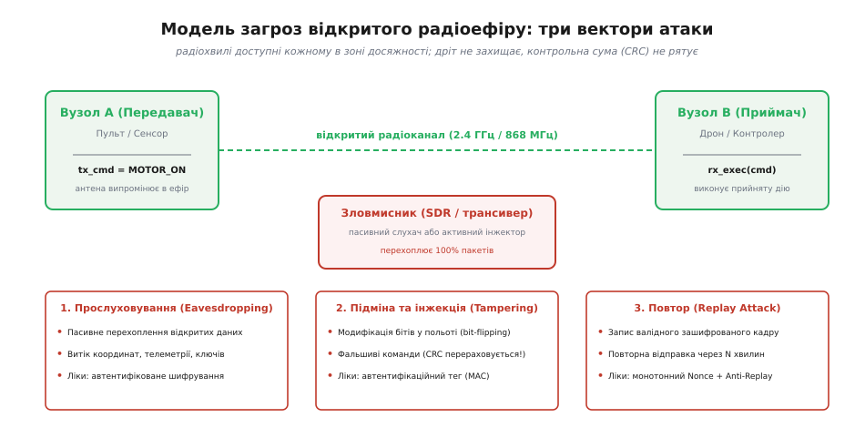
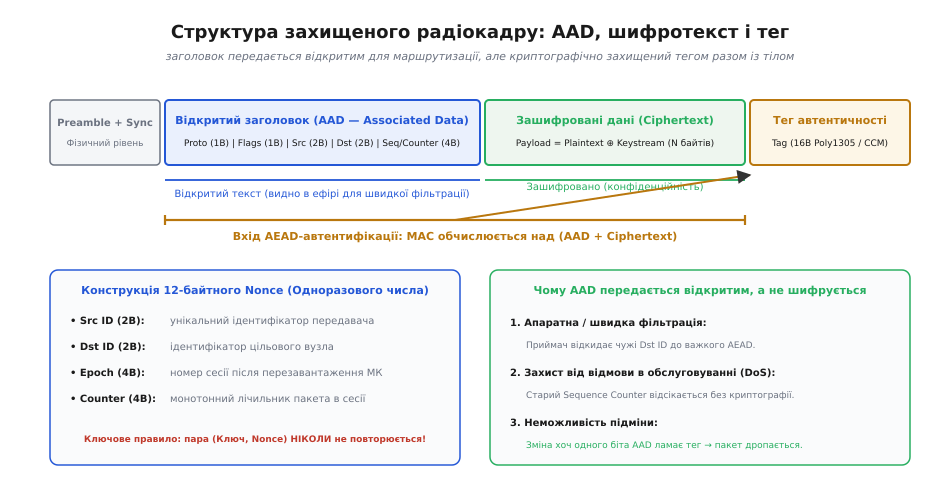
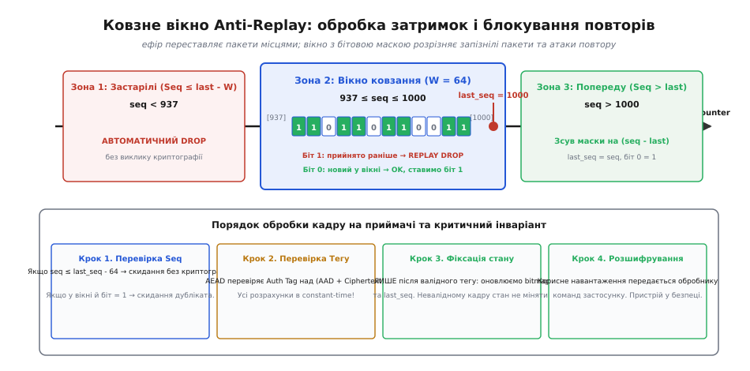
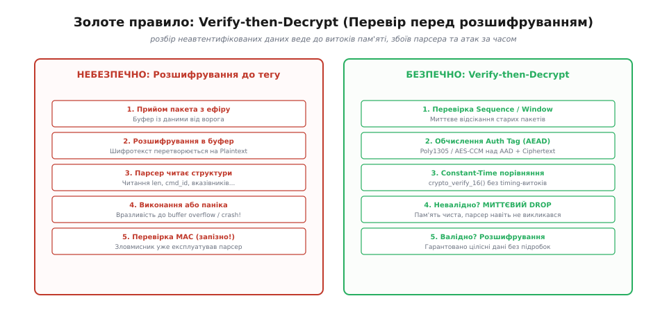

# 🛡️ Захист власного радіоканалу: ключ, лічильник, тег

<preknowlist>
- [Контрольна сума і CRC](root:com-modulation/crc) — чому CRC виявляє лише випадковий шум у каналі, але дає нульовий захист від активного зловмисника.
- [Автентифіковане шифрування (AEAD)](root:sf-security/authenticated-encryption) — спільне забезпечення конфіденційності та цілісності даних.
- [Захист від атак повтору](root:sf-security/replay-protection) — принцип монотонності послідовностей та сесійні лічильники.
- [Криптомінімум пристрою](root:embedded/kryptominimum-prystroiu) — симетричні криптопримітиви, апаратні прискорювачі та захищене сховище ключів.
</preknowlist>

Коли трансивер nRF24L01+, SX1262 чи ESP32 випромінює байтовий пакет у повітря, електромагнітна хвиля поширюється в усі боки одночасно. Будь-який приймач у радіусі ста метрів або кілометра — від сусідньої плати за три долари до програмно-визначеного радіоприймача (SDR) вартістю у двадцять доларів — уловлює кожен біт передачі. На відміну від ізольованої мідної доріжки на друкованій платі чи диференційної пари у заземленому кабелі, радіоефір є принципово спільним, незахищеним і ворожим середовищем. Будь-яке припущення про те, що чужа антена «не почує» сигнал або що відсутність документації на структуру кадру захистить пристрій від зламу, руйнується в перші хвилини роботи з ефірним аналізатором.

Наївна спроба додати до пакета апаратну контрольну суму (CRC16 чи CRC32) захищає виключно від теплового шуму та спотворень сигналу в каналі з завмираннями, але дає нульовий захист від людини: зловмисник змінює байти команди, перераховує поліном CRC за частки мікросекунди і передає підроблений пакет із бездоганною контрольною сумою. Спроба «просто зашифрувати» корисне навантаження стандартним потоковим або блоковим шифром без автентифікації відкриває двері для математично точної підміни бітів у польоті через лінійну піддатливість шифротексту. А запис і повторний випуск у повітря цілком валідного, коректно зашифрованого пакета змушує пристрій вдруге виконати критичну дію — наприклад, скинути висоту чи заглушити мотор.

Надійний захист власного протоколу радіозв'язку спирається на неподільну тріаду: симетричний секретний **ключ** (*Key*), монотонно зростаюче одноразове число-**лічильник** (*Nonce / Sequence Counter*) та криптографічний **тег автентичності** (*Authentication Tag*). Разом вони утворюють замкнений контур автентифікованого шифрування з асоційованими даними (AEAD), який гарантує три фундаментальні властивості: ніхто сторонній не прочитає зміст повідомлення, ніхто не підробить жодного біта в заголовку чи тілі, і жоден раніше перехоплений пакет не буде прийнятий повторно.


*Три вектори атаки на відкритий радіоканал: пасивне прослуховування, активна підміна байтів у польоті та атака повторного відтворення раніше перехоплених команд.*

## Три вектори атак на незахищений радіоефір

Проектування захищеного радіопротоколу завжди починається з формалізації моделі загроз. У відкритому просторі зловмисник володіє повною фізичною доступністю до середовища передачі даних. Це породжує три незалежні вектори впливу на систему.

Перший вектор — **прослуховування** (*Eavesdropping / Sniffing*). Зловмисник встановлює радіомодуль у режим довільного прийому (*promiscuous mode*) або використовує широкосмуговий SDR-приймач. Якщо байти передаються у відкритому вигляді, конфіденційність втрачається миттєво: координати GPS, показники сенсорів тиску, параметри акумулятора, ідентифікатори пристроїв та протокольні команди стають доступними сторонньому спостерігачеві. Пасивне прослуховування неможливо виявити з боку передавача, оскільки приймальна антена не випромінює енергії в ефір.

Другий вектор — **активна підміна та інжекція фальшивих пакетів** (*Packet Injection / Tampering*). Маючи передавач відповідного частотного діапазону, нападник може синтезувати власний радіокадр або накласти потужніший радіосигнал поверх легітимного, змінюючи окремі байти в польоті. Якщо протокол не перевіряє криптографічну цілісність, фальшивий пакет із командою аварійного вимкнення чи переведення в режим прошивки буде виконаний мікроконтролером приймача.

Третій вектор — **атака повторного відтворення** (*Replay Attack*). Це найбільш підступний вектор, проти якого шифрування само по собі є абсолютно безсилим. Уявімо пульт дистанційного керування, який надсилає зашифровану команду `0x41` («ВІДКРИТИ ЗАСЛІНКУ»). Зловмисник записує фрагмент ефіру з цим пакетом. Він не знає ключа шифрування і не може прочитати вміст, але це й не потрібно: за годину нападник просто відтворює записану радіохвилю на тій самій частоті. Приймач розшифровує пакет власним ключем, бачить абсолютно коректні байти `0x41`, правильну контрольну суму — і відкриває заслінку.

> 🔧 **Навіщо це.** Якщо пристрій керує фізичним актуатором (реле нагрівача, сервопривод замка, швидкість двигуна), відсутність захисту від Replay-атак зводить нанівець будь-яке складне шифрування: ворог може знеструмити об'єкт або ввімкнути навантаження в критичний момент, не зламавши жодного криптографічного ключа.

## Чому наївне шифрування зазнає краху: лінійна піддатливість шифротексту

Типова помилка інженера-початківця — спроба захистити радіообмін, просто «пропустивши корисне навантаження через AES» у режимі ECB (*Electronic Codebook*), CBC (*Cipher Block Chaining*) або через потоковий шифр (ChaCha20, AES-CTR), додавши наприкінці звичайний CRC32. Такий підхід створює ілюзію захищеності, але насправді залишає систему повністю вразливою до активних атак через явище **піддатливості шифру** (*malleability*).

Розглянемо потоковий шифр або блоковий шифр у режимі лічильника (CTR). У цих режимах шифрування полягає в генерації псевдовипадкової послідовності байтів — криптографічної гами (*keystream*), яка накладається на відкритий текст операцією побітового виключного АБО (`XOR`):

```
C = P ⊕ K
```
[де `P` — відкритий текст, `K` — криптографічна гама, `C` — шифротекст]

Приймач виконує дзеркальну операцію:

```
P = C ⊕ K
```

Зловмисник перехоплює шифротекст `C`. Він не знає гами `K`, але знає структуру протоколу — наприклад, що четвертий байт пакета містить маску увімкнення моторів `flags = 0x00` (мотори вимкнено), а значення `0x01` означає запуск. Нападник хоче змінити цей байт на `0x01`. Для цього він готує маску модифікації `Δ = 0x01` і накладає її прямо на шифротекст у польоті:

```
C' = C ⊕ Δ
```

Коли приймач отримує модифікований шифротекст `C'` і розшифровує його легітимним ключем, відбувається наступне:

```
P' = C' ⊕ K
   = (C ⊕ Δ) ⊕ K                      [підстановка зміненого шифротексту]
   = ((P ⊕ K) ⊕ Δ) ⊕ K                [підстановка вихідного C = P ⊕ K]
   = (P ⊕ Δ) ⊕ (K ⊕ K)                [комутативність та асоціативність XOR]
   = (P ⊕ Δ) ⊕ 0                      [властивість K ⊕ K = 0]
   = P ⊕ Δ                            [результат: точна зміна відкритого тексту]
```

Мікроконтролер приймача отримує відкритий текст `P'`, у якому байт прапорців змінився рівно на `0x01`. Шифр не видав жодної помилки, оскільки операція `XOR` не містить механізму перевірки цілісності. Якщо після цього пакет перевіряється звичайним CRC, нападник так само лінійно коригує байти CRC (або обчислює новий CRC над відомими полями), і система без вагань запускає двигуни.

У режимі AES-CBC ситуація аналогічна: модифікація байта в попередньому блоці шифротексту `C[i-1]` призводить до точно такого ж передбачуваного побітового перемикання значень у розшифрованому блоці `P[i]`. Без криптографічної перевірки автентичності будь-яка конфіденційність перетворюється на фікцію.

Рішенням є **автентифіковане шифрування** (*Authenticated Encryption*), де шифрування нерозривно поєднане з обчисленням криптографічного коду автентичності повідомлення (MAC — *Message Authentication Code*). Якщо хоча б один біт у шифротексті або заголовку зазнає змін, перевірка тегу повертає апаратну або програмну помилку, і весь пакет знищується ще до передачі на рівень обробки команд.

## Анатомія захищеного радіокадру: AAD, шифротекст і тег

У радіозв'язку не можна шифрувати весь пакет цілком від першого до останнього байта. Приймальний трансивер або маршрутизатор мережі повинен знати, кому адресовано пакет, від кого він надійшов і до якого типу належить, ще до того, як дістане з пам'яті секретний ключ і витратить ресурси процесора на дешифрування. Крім того, фізичний рівень радіовипромінювання вимагає наявності преамбули та синхрослова.

Тому сучасні безпечні радіопротоколи будуються за парадигмою **AEAD** (*Authenticated Encryption with Associated Data* — автентифіковане шифрування з асоційованими даними). Кадр чітко ділиться на три логічні зони:

1. **Відкриті асоційовані дані** (*AAD — Authenticated Associated Data*): заголовок кадру, який передається у відкритому вигляді, але обов'язково підписується криптографічним тегом.
2. **Зашифроване тіло** (*Ciphertext*): корисне навантаження (команди, телеметрія, координати), захищене і від прослуховування, і від підміни.
3. **Автентифікаційний тег** (*Auth Tag / MAC*): 16-байтний (або 8-байтний) контрольний блок, обчислений криптографічним алгоритмом одночасно над AAD та Ciphertext.


*Анатомія захищеного радіокадру: відкритий заголовок AAD забезпечує швидку фільтрацію та маршрутизацію, шифротекст приховує корисне навантаження, а тег гарантує криптографічну цілісність обох частин.*

Розглянемо типовий склад заголовка AAD для вбудованого радіоканалу:

```
┌──────────────┬────────────┬────────────┬────────────┬────────────────────────┐
│ Protocol ID  │ Frame Type │  Src Node  │  Dst Node  │ Sequence Counter (Seq) │
│   (1 байт)   │  (1 байт)  │  (2 байти) │  (2 байти) │       (4 байти)        │
└──────────────┴────────────┴────────────┴────────────┴────────────────────────┘
```

- **Protocol ID** (1 байт): версія протоколу. Дозволяє оновлювати формат пакетів у повітрі без падіння старих пристроїв.
- **Frame Type / Flags** (1 байт): тип кадру (дані, підтвердження ACK, пінг, аварійна зупинка, фрагмент потоку).
- **Src Node ID** (2 байти): мережева адреса відправника.
- **Dst Node ID** (2 байти): мережева адреса цільового пристрою (або `0xFFFF` для broadcast).
- **Sequence Counter** (4 байти): монотонно зростаючий номер кадру, який слугує одноразовим числом (Nonce) та захистом від Replay-атак.

### Чому заголовок обов'язково входить до AAD

Чому заголовок передається відкритим, але криптографічно зв'язується з тегом? 

Уявімо, що адреса отримувача `Dst Node` не була б включена в AAD. Зловмисник перехоплює коректний зашифрований пакет, адресований Вузлу №2 («Ввімкнути обігрів»), змінює в заголовку байт адреси на Вузол №3 («Відкрити шлюз») і ретранслює його. Вузол №3 отримує пакет, бачить свою адресу, розшифровує тіло спільним ключем і виконує небезпечну дію, призначену іншому пристрою.

Коли заголовок передається як **Associated Data**, алгоритм AEAD (наприклад, ChaCha20-Poly1305 або AES-CCM) пропускає байти AAD через блок автентифікації перед шифротекстом. Тег є математичною функцією від обох частин:

```
Tag = MAC(Key, Nonce, AAD || Ciphertext)
```

Якщо нападник змінить хоча б один біт у відкритому полі `Dst Node`, `Src Node` чи `Sequence Counter`, обчислений приймачем тег не зійдеться з переданим у хвості кадру, і пакет буде миттєво відкинуто.

> 🔧 **Навіщо це.** Передача AAD у відкритому вигляді дозволяє радіомодулю чи простому апаратному фільтру мікроконтролера за частку мікросекунди перевірити поле `Dst Node`. Якщо пакет чужий — радіотракт вимикається або буфер скидається без запуску енергозатратного криптопроцесора.

## Монотонний лічильник і Nonce: залізне правило одноразовості

Слово **Nonce** розшифровується як *Number used ONCE* — число, що використовується рівно один раз. У всіх сучасних алгоритмах автентифікованого шифрування (ChaCha20-Poly1305, AES-GCM, AES-CCM) діє абсолютне правило криптографічної безпеки:

> **Пара (Ключ, Nonce) ніколи не повинна повторюватися для двох різних повідомлень.**

Розглянемо дві катастрофи, які неминуче настають, якщо Nonce використано повторно з тим самим симетричним ключем.

### Катастрофа №1: Розкриття відкритого тексту в потокових шифрах

Якщо два різні відкриті тексти `P₁` та `P₂` зашифровані з однаковим Nonce, криптографічний генератор створить для них абсолютно ідентичну гаму `K`. В ефір підуть шифротексти `C₁ = P₁ ⊕ K` та `C₂ = P₂ ⊕ K`.

Зловмисник перехоплює обидва кадри і виконує операцію `XOR` між ними:

```
C₁ ⊕ C₂ = (P₁ ⊕ K) ⊕ (P₂ ⊕ K)
        = P₁ ⊕ P₂ ⊕ (K ⊕ K)           [перестановка членів]
        = P₁ ⊕ P₂                     [повне знищення гами K]
```

З шифротексту повністю зник секретний ключ і криптографічна гама! Нападник отримує чистий `XOR` двох відкритих текстів. Якщо структура одного з них відома (наприклад, типовий кадр телеметрії, де перші 8 байтів — фіксований заголовок або нулі), відкритий текст другого повідомлення відновлюється тривіальним відніманням.

### Катастрофа №2: Повна втрата стійкості автентифікатора (Poly1305 / GHASH)

У ChaCha20-Poly1305 для кожного пакета генерується одноразовий 256-бітний ключ автентифікації `(r, s)`. Ключ `r` є сталим множником у полі чисел за модулем `2¹³⁰ - 5`, а маскуючий доданок `s` обчислюється шляхом шифрування нульового блоку з поточним Nonce: `s = ChaCha20_Block0(Key, Nonce)`.

Тег автентичності обчислюється як поліном над блоками даних:

```
Tag = (A₁·rⁿ + A₂·rⁿ⁻¹ + ... + Aₙ·r) mod (2¹³⁰ - 5) + s mod 2¹²⁸
```

Якщо для двох різних пакетів застосовано однаковий Nonce, значення маски `s` виявиться ідентичним. Зловмисник віднімає один отриманий тег від другого:

```
Tag₁ − Tag₂ = (Poly₁(r) + s) − (Poly₂(r) + s)
            = Poly₁(r) − Poly₂(r)     [маска s повністю скорочується]
```

Оскільки коефіцієнти поліномів `Poly₁` та `Poly₂` складаються з відомих перехоплених байтів AAD та Ciphertext, нападник отримує алгебраїчне поліноміальне рівняння з однією невідомою — секретним числом `r`. Знаходження кореня цього полінома в скінченному полі займає мілісекунди на звичайному ноутбуці.

Після відновлення числа `r` зловмисник обчислює маску `s = Tag₁ − Poly₁(r)` і отримує **повний контроль над створенням валідних тегів Poly1305**. Від цього моменту нападник може генерувати будь-які фальшиві пакети з ідеальними тегами, і приймач буде вважати їх легітимними — навіть якщо сам 256-бітний ключ шифрування ChaCha20 залишився нерозкритим.

### Формування Nonce на мікроконтролері

Для протоколу на базі ChaCha20-Poly1305 стандарт RFC 7539 визначає розмір Nonce у 12 байтів (96 біт). Найбільш надійна та прозора структура Nonce для вбудованих систем виглядає так:

```
┌─────────────────┬─────────────────┬──────────────────┬────────────────────────┐
│   Src Node ID   │   Dst Node ID   │    Epoch / Boot  │ Sequence Counter (Seq) │
│    (2 байти)    │    (2 байти)    │     (4 байти)    │       (4 байти)        │
└─────────────────┴─────────────────┴──────────────────┴────────────────────────┘
```

1. **Src Node ID + Dst Node ID** гарантують, що зустрічні потоки між двома вузлами (A → B та B → A) ніколи не створять однаковий Nonce, навіть якщо їхні лічильники випадково співпадуть.
2. **Epoch / Boot Counter** (4 байти): номер сесії або лічильник перезавантажень МК. Зберігається в енергонезалежній пам'яті (Flash, EEPROM, FRAM або RTC backup RAM). При кожному старті пристрою `Epoch` інкрементується.
3. **Sequence Counter** (4 байти): монотонний лічильник у RAM, що інкрементується на кожному переданому пакеті `seq++`.

Діапазону 32-бітного лічильника (`4 294 967 295` пакетів) при інтенсивності 100 пакетів на секунду вистачає на 1.36 року безперервної передачі.

### Збереження ресурсу Flash-пам'яті при фіксації лічильника

Мікроконтролери після апаратного скиду (Brownout, Watchdog, перемикання живлення) втрачають вміст RAM. Якщо лічильник скинеться в нуль, станеться катастрофічний повтор Nonce. Однак записувати `seq` у Flash-пам'ять на кожному надісланому пакеті не можна: ресурс сторінки Flash становить від 10 000 до 100 000 циклів стирання, і пам'ять вийде з ладу за кілька годин інтенсивного радіообміну.

Для розв'язання цієї дилеми застосовують стратегію **блочного квантування** (*High Watermark Batching*):

1. У Flash-пам'ять записується лише базовий номер блоку з кроком `STEP = 10 000`.
2. При старті прошивка читає `saved_seq` із Flash, додає до нього крок: `current_seq = saved_seq + STEP`, і одразу записує нове граничне значення назад у Flash.
3. Поки пристрій працює, він інкрементує `current_seq` суто в оперативній пам'яті (RAM).
4. Якщо `current_seq` наближається до збереженої у Flash межі, контролер робить черговий запис `saved_seq += STEP`.
5. Якщо трапляється раптове знеструмлення, при наступному старті лічильник просто перестрибне невикористаний залишок поточного блоку (наприклад, кілька сотень значень). Це створює прогалину в номерах, але **гарантує 100% захист від повторного використання Nonce** і знижує навантаження на Flash-пам'ять у 10 000 разів.

## Приймач: ковзне вікно захисту від повторів (Anti-Replay Sliding Window)

На стороні приймача захист від атак повтору здається простим: достатньо пам'ятати останній отриманий номер `last_seq` і приймати лише пакети з умовою `seq > last_seq`.

Але в реальному радіоефірі ця проста логіка руйнує зв'язок. Через завади, перевідбиття та перемикання частот (FHSS) пакети прибувають із різною затримкою, втрачаються або переставляються місцями (*out-of-order delivery*). Якщо пакет №45 обжене затриманий пакет №44, жорстка перевірка `seq > last_seq` назавжди відкине цілком валідний пакет №44.

Для поєднання надійності прийому із захистом від Replay застосовують алгоритм **ковзного вікна на бітовій масці** (*Sliding Window with Bitmask*), аналогічний до стандарту IPsec (RFC 2401 / RFC 4303).


*Принцип роботи ковзного вікна Anti-Replay розміром 64 біти: пакети ліворуч відкидаються як застарілі, у центрі перевіряються за бітовою маскою, а праворуч — зсувають вікно вперед.*

### Стан приймача

Приймач зберігає лише дві змінні для кожного авторизованого передавача:
- `uint32_t last_seq` — найбільший успішно верифікований номер кадру.
- `uint64_t bitmap` — 64-бітна маска історії прийому. Біт `0` відповідає пакету з номером `last_seq`, біт `k` відповідає пакету `last_seq - k`.

Значення біта `1` означає: пакет із цим номером уже був прийнятий та оброблений. Значення `0` — пакет із цим номером у межах вікна ще не надходив.

### Алгоритм класифікації вхідного номера `seq`

Коли з ефіру прибуває пакет із номером `seq`, приймач обчислює різницю відносно `last_seq`:

```
┌─────────────────────────┬──────────────────────────┬────────────────────────┐
│  Зона 1: Застарілі      │  Зона 2: Вікно (W = 64)  │  Зона 3: Нові попереду │
│  seq ≤ last_seq - 64    │  last_seq - 63 ... last  │  seq > last_seq        │
│  ─────────────────────  │  ──────────────────────  │  ───────────────────── │
│  Миттєвий DROP          │  Перевірка біта в масці  │  Зсув маски на diff    │
└─────────────────────────┴──────────────────────────┴────────────────────────┘
```

Розберемо поведінку в кожній зоні:

**Випадок 1. Пакет іде попереду (`seq > last_seq`):**
Пакет є новішим за всі раніше бачені. Обчислюється крок зсуву: `diff = seq - last_seq`.
- Якщо `diff < 64`: бітова маска зсувається ліворуч на `diff` позицій: `bitmap = (bitmap << diff) | 1ULL`.
- Якщо `diff >= 64` (велика прогалина через втрату зв'язку): маска повністю скидається: `bitmap = 1ULL`.
- Номер фіксується: `last_seq = seq`. Пакет передається на перевірку тегу.

**Випадок 2. Пакет потрапляє у вікно (`seq <= last_seq` та `seq > last_seq - 64`):**
Пакет прибув із запізненням, але ще вкладається в глибину буфера історії.
Обчислюється відстань від правого краю: `delta = last_seq - seq`.
- Перевіряється стан біта: `(bitmap & (1ULL << delta))`.
- Якщо біт дорівнює `1`: пакет із цим номером **вже оброблявся раніше**. Це спроба Replay-атаки або дублікат від повтору ARQ. Пакет негайно відкидається.
- Якщо біт дорівнює `0`: пакет запізнився, але прийшов вперше. Він є легітимним. Після успішної криптографічної перевірки його біт буде встановлено в одиницю: `bitmap |= (1ULL << delta)`.

**Випадок 3. Пакет безнадійно застарів (`seq <= last_seq - 64`):**
Пакет прибув із запізненням, що перевищує розмір вікна (64 кадри). Його неможливо надійно відрізнити від старого перехопленого повтору. Пакет безумовно відкидається.

### Критичний інваріант: фіксація стану ВИКЛЮЧНО після перевірки тегу

Головна пастка реалізації Anti-Replay вікна полягає в черговості мутації стану.

> ⚠️ **Критичне правило безпеки:** Перевірка номера `seq` за вікном виконується ДО виклику важкої криптографії (для швидкого відсікання DoS-флуду), але **оновлення змінних `last_seq` та `bitmap` дозволено виконувати ЛИШЕ ПІСЛЯ того, як автентифікаційний тег AEAD успішно пройшов валідацію!**

Уявімо, що розробник оновив `last_seq = seq` одразу після прийому заголовка. Зловмисник відправляє в ефір сміттєвий пакет із номером `seq = 0xFFFFFFFF` та випадковими байтами тіла. Якщо стан мутує до перевірки тегу, `last_seq` стане рівним `4 294 967 295`. Після цього всі наступні справжні пакети легітимного передавача (наприклад, з номерами `100`, `101`, `102`) потраплять у Зону 1 («застарілі») і будуть відкинуті приймачем. Один некоректний пакет ворога повністю виведе радіолінк із ладу.

## Золоте правило: Verify-then-Decrypt та порівняння за сталий час

Після того, як заголовок пакета пройшов первинний фільтр адрес та вікна повторів, настає етап криптографічної перевірки.

Тут діє непорушний закон безпеки транспортного рівня: **Verify-then-Decrypt** (перевір автентичність перед дешифруванням і розбором).


*Порівняння небезпечного розбору неавтентифікованих даних та правильного конвеєра Verify-then-Decrypt.*

### Чому не можна розбирати дані до перевірки тегу

Якщо мікроконтролер розшифровує корисне навантаження прямо в робочий буфер структури або передає байти в парсер протоколу (наприклад, розбір довжини підполів, копіювання рядків чи виконання функцій за таблицею вказівників) ДО перевірки валідності тегу, система наражається на фатальні вразливості:

1. **Переповнення буфера (Buffer Overflow):** Зловмисник формує шифротекст, який після розшифрування містить поле довжини `len = 0xFFFF`. Наївний парсер виконує `memcpy()` у статичний буфер розміром 64 байти. Пам'ять мікроконтролера пошкоджується, стек перезаписується, пристрій зависає або віддає керування шеллкоду нападника ще до того, як черга дійде до звірки тегу в кінці пакета.
2. **Незворотні побічні ефекти:** Якщо парсер одразу перемикає вивід GPIO або встановлює прапорець «Зупинити таймер», відхилення пакета через невалідний тег постфактум не скасує вже виконаної апаратної дії.
3. **Атаки через час обробки помилок (Padding Oracle / Side-Channel):** Різниця в часі між помилкою парсера та помилкою MAC дозволяє нападнику адаптивно підбирати байти відкритого тексту.

У правильній реалізації алгоритм AEAD обчислює очікуваний тег над отриманим кадром і порівнює його з переданим тегом. Якщо перевірка провалилася, функція негайно повертає код помилки `ERR_AUTH_FAILED`, вихідний буфер зануляється, а парсер команд навіть не викликається.

### Атаки за часом та порівняння за сталий час (Constant-Time Verification)

Останній бар'єр, на якому часто ламається безпека вбудованих систем — це спосіб порівняння двох 16-байтних масивів тегів: обчисленого локально та отриманого з ефіру.

Використання стандартної бібліотечної функції порівняння пам'яті (`memcmp` або оператора `==`) є грубою вразливістю:

:::tabs
```c
/* ⛔ ГРУБА ВРАЗЛИВІСТЬ ДО АТАК ЗА ЧАСОМ (C) */
if (memcmp(calculated_tag, received_tag, 16) == 0) {
    /* Тег валідний */
}
```
```cpp
// ⛔ ГРУБА ВРАЗЛИВІСТЬ ДО АТАК ЗА ЧАСОМ (C++)
// operator== для std::array/std::vector зупиняється на першій розбіжності
if (calculated_tag == received_tag) {
    // Тег валідний
}
```
:::

Функція `memcmp` та оператор `==` оптимізовані під максимальну швидкість: вони порівнюють байти по черзі і завершують роботу **на першому ж байті, де виявлено розбіжність**. 

Якщо перший байт тегу не збігається, перевірка завершується за кілька тактів. Якщо зловмисник правильно вгадав перший байт, функція перевіряє другий і виконується довше.

Вимірюючи точний час відправки кадру та надходження відповіді (або зняття сигналу переривання радіомодуля за допомогою логічного аналізатора чи осцилографа), зловмисник побайтово підбирає валідний тег Poly1305 або AES-CCM. Замість перебору 2¹²⁸ комбінацій нападнику потрібно виконати лише `16 × 256 = 4096` спроб, що займає менше хвилини радіообміну!

Для запобігання атакам за часом порівняння криптографічних тегів зобов'язане виконуватися за **сталий час** (*constant-time*), тобто проходити всі 16 байтів незалежно від того, в якій позиції виникла перша розбіжність:

:::tabs
```c
/* ✅ БЕЗПЕЧНО: порівняння за сталий час без розгалужень (C) */
int crypto_verify_16(const uint8_t *a, const uint8_t *b) {
    uint8_t diff = 0;
    for (size_t i = 0; i < 16; ++i) {
        diff |= (a[i] ^ b[i]);
    }
    return (diff == 0);
}
```
:::code zakhyst-vlasnoho-radiokanalu-d/cpp/ataky-za-chasom-ta.cpp
:::

Операція `^` повертає нуль лише при точній рівності байтів, а побітове `|=` накопичує будь-яку ненульову помилку в змінній `diff`. Цикл завжди виконує рівно 16 ітерацій без жодних ранніх виходів `break` чи умовних переходів, позбавляючи нападника джерела витоку інформації про час.

## Повна реалізація безпечного транспортного шару радіозв'язку на C та C++

Об'єднаємо всі розглянуті механізми — структуру кадру AAD, генерацію Nonce, лінійку шифрування, ковзне вікно Anti-Replay та перевірку тегу за сталий час — у закінчену бібліотеку транспортного рівня для мікроконтролерів.

Для криптографічного ядра використаємо сучасний еталонний та швидкий на 32-бітних процесорах алгоритм **ChaCha20-Poly1305** (RFC 8439). На процесорах ARM Cortex-M4 (STM32, nRF52) або Xtensa/RISC-V (ESP32) ChaCha20 виконується за 4–8 тактів на байт, значно випереджаючи програмний AES без апаратного прискорювача.

:::tabs
:::code zakhyst-vlasnoho-radiokanalu-d/c/main.c
:::code zakhyst-vlasnoho-radiokanalu-d/cpp/povna-realizatsiia.cpp
:::

## Інженерні компроміси та підводні камені на практиці

Впровадження криптографічного захисту в радіоканал вимагає врахування апаратних обмежень мікроконтролерів, енергетичного бюджету та особливостей фізичного середовища передачі.

### Бюджет накладних витрат: коли 24 байти мають значення

Запропонований захищений формат додає до кожного пакета 26 байтів оверхеду: 10 байтів заголовка AAD та 16 байтів тегу Auth Tag.

Для високошвидкісних трансиверів 2.4 ГГц (nRF24L01+ на 2 Мбіт/с, ESP-NOW на 1 Мбіт/с) ці 26 байтів передаються менш ніж за 150 мікросекунд і практично не впливають на пропускну здатність каналу.

Але для вузькосмугових каналів дальнього радіусу дії (**LoRa**, Sub-GHz FSK на 868 МГц) з низькою бітовою швидкістю (наприклад, LoRa SF12, BW 125 кГц, швидкість ~250 біт/с) передача додаткових 26 байтів збільшує час перебування передавача в ефірі (*Time on Air*) майже на 800 мілісекунд! Це не лише прискорює розряд акумулятора, а й порушує нормативні обмеження робочого циклу передавача (Duty Cycle 1% у діапазоні 868 МГц).

У таких екстремально стиснутих каналах ідуть на обґрунтований компроміс:
- **Урізання тегу до 64 біт (8 байтів):** Алгоритми AES-CCM-64 або Poly1305 з усіченим тегом дають імовірність успішного випадкового підбору тегу `P = 1 / 2⁶⁴ ≈ 5.4·10⁻²⁰`. Для радіоканалу, який фізично може передати не більше 10 пакетів на секунду, підбір навіть 64-бітного тегу вимагатиме мільярдів років безперервної передачі.
- **Стиснення заголовка:** Якщо мережа складається лише з двох фіксованих точок, поля `Dst ID` та `Src ID` можна скоротити до 1 байта або винести в попередній неявний контекст зв'язку, зменшивши заголовок до 6 байтів.

### Зберігання ключів та апаратна безпека

Захищеність радіопротоколу повністю залежить від збереження симетричного ключа в таємниці. Зберігання ключа у відкритому вигляді у прошивці (*hardcoded key*) створює критичну точку відмови: будь-хто, зчитавши Flash-пам'ять мікроконтролера через налагоджувальний інтерфейс SWD/JTAG або скопіювавши бінарний файл оновлення, отримує повний контроль над усіма пристроями мережі.

Рекомендовані практики захисту ключів на МК:
1. **Блокування інтерфейсів налагодження:** Встановлення захисту від читання Flash (*RDP Level 1/2* на STM32, блокування JTAG через eFuse на ESP32).
2. **Апаратні криптографічні сховища (Secure Elements):** Використання зовнішніх мікросхем сховища ключів (ATECC608A, OPTIGA Trust M), де симетричний ключ фізично запечатаний у захищеному кристалі і ніколи не потрапляє в шину мікроконтролера: МК відправляє кадр у чип і отримує готовий обчислений MAC-тег.
3. **Генерація сесійних ключів:** Використання схеми Діффі-Гелмана на еліптичних кривих (ECDH X25519) при встановленні зв'язку. Пристрої мають унікальні довготривалі ключі, а для кожного сеансу зв'язку генерується тимчасовий сесійний ключ (*ephemeral key*), який стирається з RAM після завершення роботи.

### Стійкість до атак відмови в обслуговуванні (DoS / Flood)

Криптографічний захист унеможливлює підробку команд або читання телеметрії, але не може зупинити зловмисника від постановки радіозавад (*Jamming*) або затоплення каналу мільйонами випадкових сміттєвих пакетів.

Архітектура захищеного радіоканалу з відкритим AAD та ковзним вікном мінімізує обчислювальний вплив DoS-атак:
- Сміттєвий пакет із чужою адресою відсікається за **0.2 мкс** на етапі перевірки `dst_id`.
- Повтор старого пакета відсікається за **0.5 мкс** на етапі бітової маски `replay_mask`.
- Важке криптографічне ядро ChaCha20-Poly1305 запускається лише для тих пакетів, які мають правильні адреси та свіжий номер лічильника. Завдяки цьому мікроконтролер не витрачає обчислювальні ресурси процесора і не зависає при спробах радіофлуду.
