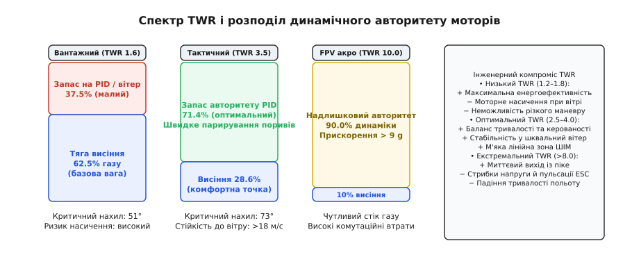
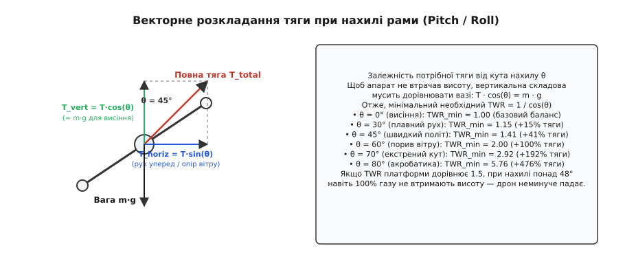
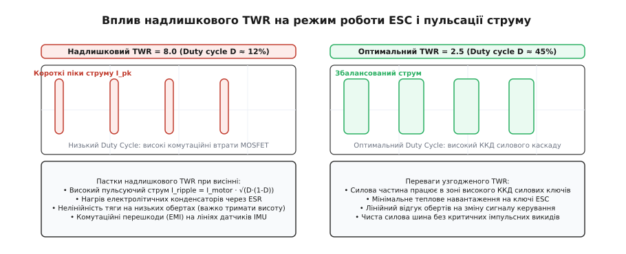

# Запас тяги й що він купує

<preknowlist>
- [Ваговий бюджет апарата: від задачі до злітної маси](root:embedded/vahovyi-biudzhet-aparata) — структура маси планера, корисного навантаження й силової установки.
- [Просадка під навантаженням](root:hw-power/battery-sag) — падіння напруги на внутрішньому опорі батареї під час різких стрибків струму.
- [Статична й динамічна тяга](root:ph-mechanics/statychna-i-dynamichna-tiaha) — залежність підйомної сили гвинта від швидкості набігаючого потоку та обертів.
- [Дератинг компонентів](root:hw-components/derating) — зниження граничних експлуатаційних параметрів силових ключів і моторів від нагріву.
</preknowlist>

Шестироторний дрон для геодезичного сканування злітною масою 4.2 кг бездоганно тримає точку в закритому ангарі, зависаючи на 84% положення стіка газу. Конструктор підібрав мотори й гвинти так, щоб сумарна статична тяга на максимальних обертах становила рівно 5.0 кгс — рівно стільки, скільки потрібно, аби не переобтяжувати раму важкими магнітами та товстими обмотками. Але під час першого польоту в полі на висоті 40 метрів апарат потрапляє в зустрічний вітровий порив швидкістю 12 м/с. Польотний контролер нахиляє раму вперед на 45°, намагаючись утримати позицію проти вітру. У ту саму мить дрон починає неконтрольовано провалюватися вниз зі швидкістю 3.5 м/с і через кілька секунд врізається в схил пагорба. Усі шість моторів до останньої мілісекунди працювали на 100% заповнення сигналу регулятора, але це не врятувало борт від катастрофи.

Причина падіння криється в простій геометрії векторів сил, яку конструктор знехтував заради уявного виграшу в масі. При нахилі апарата на кут `θ = 45°` його повна тяга розкладається на дві взаємно перпендикулярні складові. Горизонтальна складова штовхає дрон проти вітру, а вертикальна утримує його в повітрі проти сили тяжіння. Оскільки вертикальна частина дорівнює добутку повної тяги на косинус кута нахилу, максимальна доступна підйомна сила впала до `5.0 · cos(45°) ≈ 3.53 кгс`. Апарат масою 4.2 кг вимагає для утримання висоти 4.2 кгс вертикальної сили, а отримав лише 3.53 кгс. Дефіцит у 0.67 кгс перетворився на невідворотне прискорення падіння. У польотного контролера просто не залишилося жодного відсотка тяги моторів ні на компенсацію просідання, ні на маневр стабілізації за кутами нахилу.

Цей дефіцит визначається головною силовою метрикою будь-якого літального апарата вертикального зльоту — відношенням максимальної тяги до повної злітної маси. У практиці проєктування його називають запасом тяги або коефіцієнтом тягооснащеності (англ. *Thrust-to-Weight Ratio*, скорочено TWR). Запас тяги — це не абстрактний резерв потужності «про всяк випадок». Це конкретна валюта, якою інженер оплачує керованість апарата в турбулентній атмосфері, стійкість до шквального вітру, здатність екстрено гальмувати та динамічний авторитет замкнених контурів стабілізації.

```
TWR = T_max / (m · g)
```

де `T_max` — максимальна сумарна статична тяга всіх рушіїв апарата (у ньютонах або кілограмах сили), `m` — повна злітна маса безпілотника (у кілограмах), `g` — прискорення вільного падіння (`9.81 м/с²`).


*Співвідношення тяги до ваги для різних класів безпілотних апаратів та розподіл доступного діапазону потужності між базовим висінням і динамічною стабілізацією.*

## Фізика балансу сил і чому TWR = 1.0 фізично не літає

Щоб апарат завис у нерухомому повітрі, сумарна вертикальна тяга гвинтів має точно врівноважити силу земного тяжіння: `T_hover = m · g`. Здавалося б, силової установки з `TWR = 1.0` теоретично достатньо для польоту. Проте в реальному світі апарат із `TWR = 1.0` не здатний навіть безпечно відірватися від землі.

Розгляньмо диференціальне рівняння руху центру мас мультикоптера вздовж вертикальної осі `Z`:

```
m · (d²z / dt²) = T_total(t) · cos(θ(t)) - m · g - F_drag_z
```

де `θ(t)` — поточний кут відхилення осі апарата від вертикалі (кути крену та тангажу), `F_drag_z` — вертикальна складова сили аеродинамічного опору повітря.

Якщо виразити поточну тягу через частку від максимальної `u(t) = Throttle(t) / 100%`, де `u ∈ [0, 1]`, вертикальне прискорення набуває вигляду:

```
a_z
= d²z / dt²                                          [другий закон Ньютона вздовж вертикальної осі Z]
= (T_max · u(t) · cos(θ(t)) - m · g - F_drag_z) / m  [підстановка проєкції повної тяги на вертикаль]
= g · (TWR · u(t) · cos(θ(t)) - 1) - (F_drag_z / m)  [винесення g та підстановка TWR = T_max/(m·g)]
```

З цього виразу безпосередньо випливають три фундаментальні обмеження апарата з одиничним TWR:

1. **Нульове вертикальне прискорення.** При `TWR = 1.0` навіть за ідеально горизонтального положення (`θ = 0°`) максимальне теоретичне прискорення вгору при повному газі (`u = 1.0`) дорівнює нулю: `a_z = g · (1.0 · 1.0 · 1.0 - 1) = 0 м/с²`. Апарат не може набрати висоту — він перебуває в стані байдужої рівноваги. Будь-який спадний потік повітря потягне його до землі, а протидіяти цьому неможливо, бо мотори вже обертаються на максимальній межі.
2. **Неможливість горизонтального руху.** Щоб рушити в бік, мультикоптер мусить створити горизонтальну складову сили `T_horiz = T · sin(θ)`. Але щойно кут `θ` стає більшим за нуль, `cos(θ)` стає меншим за одиницю. При `TWR = 1.0` вертикальна сила неминуче падає нижче ваги: `T_vert = m · g · cos(θ) < m · g`. Дрон починає падати щоразу, коли намагається зміститися в просторі.
3. **Просадка напруги батареї.** Під час розряду напруга літій-полімерного акумулятора спадає з 4.2 В на комірку до 3.5 В. Оскільки максимальна швидкість обертання безколекторного двигуна пропорційна прикладеній напрузі, максимальна тяга сисової установки в кінці польоту падає на 25–35% від початкової. Апарат, який на повній батареї ледве зависав при `u = 1.0`, уже через дві хвилини втратить тягу нижче сили тяжіння й сяде на землю незалежно від бажання пілота.

Отже, мінімально необхідна для зависання тяга становить лише базовий поріг відліку. Усе, що лежить вище цього порогу, — це робочий діапазон, який купує керованість.

## Спектр TWR: три конструкторські філософії

Різні типи безпілотних апаратів оптимізуються під взаємовиключні інженерні критерії: тривалість перебування в повітрі, максимальну стійкість до атмосферних збурень або граничну кутову динаміку. Залежно від пріоритету завдання показник TWR ділиться на три виражені класи.

```
TWR = 1.5 – 2.0  ──►  Вантажні платформи та далеколітні картографи
TWR = 3.0 – 5.0  ──►  Тактичні розвідники, перехоплювачі, вітростійкі коптери
TWR = 8.0 – 12.0 ──►  Акробатичні та гоночні FPV-дрони
```

### Вантажні та далеколітні картографічні платформи (TWR 1.5–2.0)

Головний критерій важкого мультикоптера — аеродинамічна якість силової установки, тобто відношення створюваної тяги до споживаної електричної потужності (питома тяга, що вимірюється в грамах на ват, `г/Вт`). Найвищу питому тягу безколекторні мотори з великими низькооборотистими гвинтами демонструють у діапазоні 45–65% від своєї максимальної потужності.

Проєктуючи важкий дрон, силове навантаження підбирають так, щоб точка зависання лежала в зоні `Throttle = 50–65%`. Це автоматично задає TWR у межах від `1 / 0.65 ≈ 1.54` до `1 / 0.50 = 2.00`.

Ціна такого вибору — жорстке обмеження за кутами нахилу рами та швидкістю вітру. Критичний кут нахилу, за якого апарат ще здатний підтримувати сталу висоту, визначається граничною умовою `T_max · cos(θ_crit) = m · g`:

```
θ_crit = arccos(1 / TWR)
```

Для апарата з `TWR = 1.5` критичний кут становить:

```
θ_crit = arccos(1 / 1.5) = arccos(0.667) ≈ 48.2°
```

При куті `48.2°` всі мотори працюють на 100% потужності тільки для того, щоб дрон не падав униз. На керування креном, курсом чи вертикальний маневр не залишається жодного відсотка тяги. Тому в польотних контролерах таких апаратів (наприклад, під керуванням ArduPilot чи PX4) програмне обмеження максимального кута нахилу (`ANGLE_MAX`) примусово встановлюють на рівні 25–30°. Це гарантує, що в розпорядженні алгоритмів стабілізації завжди залишається не менше 20–25% динамічного запасу.


*Векторне розкладання підйомної сили при кутовому нахилі мультикоптера та залежність необхідного коефіцієнта TWR від кута атаки для компенсації сили тяжіння.*

### Тактичні та вітростійкі патрульні дрони (TWR 3.0–5.0)

Апарати, призначені для цілодобового виконання завдань у відкритому полі, не можуть дозволити собі розкіш чекати штилю. Вони мають впевнено злітати, утримувати позицію над об'єктом і повертатися на базу при зустрічному вітрі 15–20 м/с із поривами до 25 м/с.

Сила аеродинамічного лобового опору фюзеляжу й гвинтів на високій швидкості пропорційна квадрату швидкості повітряного потоку:

```
F_drag = 0.5 · ρ · C_d · S · v_wind²
```

де `ρ` — густина повітря (`≈ 1.225 кг/м³` на рівні моря), `C_d` — коефіцієнт лобового опору, `S` — площа міделевого перерізу рами, `v_wind` — швидкість зустрічного вітрового потоку.

Щоб компенсувати цей опір і водночас не втрачати висоту, мультикоптер змушений нахилятися проти вітру на кути 50–65°. При куті нахилу `θ = 60°`:

```
T_vert = T_total · cos(60°) = 0.5 · T_total
T_horiz = T_total · sin(60°) ≈ 0.866 · T_total
```

Щоб вертикальна складова `T_vert` дорівнювала силі тяжіння `m · g`, повна тяга сисової установки мусить удвічі перевищувати вагу: `T_total = 2.0 · m · g`. Якщо платформа має загальний `TWR = 3.5`, то на утримання горизонту й висоти при 60° нахилу витрачається `2.0 / 3.5 ≈ 57%` від максимальної тяги. Решта `43%` потужності моторів залишається в розпорядженні PID-регуляторів для миттєвого парирування турбулентних вихорів і динамічного набору висоти зі швидкістю понад 8–12 м/с.

Точка зависання таких апаратів у штиль припадає на `20–33%` газу.

### Спортивні та акробатичні FPV-дрони (TWR 8.0–12.0+)

У дисциплінах фристайлу та дрон-рейсингу злітна маса 5-дюймового квадрокоптера становить 600–700 г, тоді як чотири високооборотні безколекторні двигуни (наприклад, типорозміру 2207 з обертовим числом 1950 KV на 6S акумуляторі) сумарно видають до 6.5–8.0 кгс статичної тяги.

Запас тяги в таких системах сягає показників `TWR = 10 – 12`. Точка статичного зависання зміщується в зону `8–12%` стіка газу.

Надлишковий TWR понад 8.0 потрібен не для польоту в горизонті, а для створення екстремальних лінійних і кутових прискорень:

- **Вертикальне прискорення:**
  ```
  a_z_max = g · (TWR - 1) = 9.81 · (10 - 1) ≈ 88.3 м/с²  (понад 9 g)
  ```
  Дрон розганяється з 0 до 100 км/год за 0.35 секунди.
- **Екстрене гальмування та вихід із піке:** Під час вільного падіння з вимкненими двигунами апарат летить до землі зі швидкістю 30–40 м/с. Щоб погасити цю вертикальну швидкість за 10 метрів до перешкоди, необхідний потужний імпульс зворотної тяги з перевантаженням понад `6–8 g`, який не здатна розвинути жодна низькотягова система.

## Що купує надлишок тяги

Коли інженер закладає в проєкт підвищений TWR, витрачені кошти та маса окупаються трьома конкретними динамічними властивостями апарата: ліквідацією ефекту насичення моторів, розширенням смуги пропускання контуру стабілізації та скороченням часу гальмівного шляху.

### Запас авторитету PID-регулятора та захист від моторного насичення

Польотний контролер стабілізує просторове положення мультикоптера, безперервно вирішуючи систему рівнянь змішування тяги (англ. *Motor Mixer*). Для класичної схеми Quad-X керівний сигнал на кожен окремий мотор `u_i` (де `i ∈ {1, 2, 3, 4}`) обчислюється як суперпозиція базового газу та корегувальних впливів трьох незалежних PID-регуляторів кутових швидкостей:

```
u_1 = Throttle + Δu_pitch - Δu_roll - Δu_yaw
u_2 = Throttle - Δu_pitch - Δu_roll + Δu_yaw
u_3 = Throttle - Δu_pitch + Δu_roll - Δu_yaw
u_4 = Throttle + Δu_pitch + Δu_roll + Δu_yaw
```

де `Throttle` — базовий рівень газу, заданий пілотом або висотним регулятором, а `Δu_roll`, `Δu_pitch`, `Δu_yaw` — вихідні сигнали відповідних PID-контурів стабілізації.

Діапазон сигналу керування апаратно обмежений: `u_i ∈ [0, 1]` (від 0% до 100%).

> 🔧 **Навіщо це.** Якщо дрон спроєктований із малим TWR (наприклад, `TWR = 1.3`), для зависання потрібен базовий газ `Throttle = 77%`. Якщо раптовий порив вітру нахиляє дрон ліворуч, PID-регулятор крену для створення відновлювального моменту вимагає корекції `Δu_roll = +30%` на ліві мотори та `-30%` на праві.

Але ліві мотори вимагають потужності:

```
u_left = 77% + 30% = 107%  ──►  НАСИЧЕННЯ (Motor Saturation / Clipping)
```

Сигнал обрізається на апаратній межі `100%`. Замість необхідної різниці в `60%` між бортами польотний контролер здатний видати лише:

```
Δu_actual = 100% - (77% - 30%) = 53%
```

Якщо ж базовий газ підніметься ще вище (наприклад, пілот намагається одночасно набрати висоту), відновлювальний момент деградує практично до нуля. Відбувається явище, відоме в теорії керування як **насичення виконавчих механізмів** (англ. *actuator saturation*). Наслідки насичення:

1. **Втрата керованості за зв'язаними осями.** Коли мотори впираються в 100%, алгоритм мікшування змушений жертвувати керуванням за курсом (Yaw) або креном заради збереження загальної тяги. Апарат починає мимовільно обертатися й завалюватися.
2. **Інтегральне накопичення похибки (Integrator Windup).** Оскільки кутова помилка через брак тяги не зникає, інтегральна складова PID-регулятора (`I-term`) продовжує нестримно зростати. Коли збурення нарешті минає, перевантажений інтегратор перекидає дрон у протилежний бік, викликаючи глибокі розгойдування або зрив у неконтрольоване обертання.

При `TWR = 3.5` базовий газ зависання становить лише `28.5%`. У регулятора залишається `71.5%` вільного ходу вгору і `28.5%` вниз. Будь-який сигнал корекції величиною `±30%` відпрацьовується абсолютно лінійно, без викривлень і без взаємного впливу між осями.

### Динаміка відновлювального моменту й кутове прискорення

Швидкість, із якою мультикоптер повертається до горизонтального положення після удару турбулентного потоку, визначається не поточною кутовою швидкістю, а доступним **кутовим прискоренням** `α` (рад/с²):

```
α_roll = M_roll / I_xx = (ΔF_max · L) / I_xx
```

де `M_roll` — сумарний обертальний момент від моторів відносно поздовжньої осі, `I_xx` — момент інерції апарата відносно осі `X`, `L` — плече сили (відстань від осі мотора до центру мас), `ΔF_max` — максимальна різниця сил тяги, яку здатні створити протилежні мотори.

Якщо двигуни завантажені майже до межі, доступна різниця тяги `ΔF_max` різко падає. Подвоєння запасу тяги TWR за незмінної маси планера збільшує доступний момент `M_roll` у 2.5–4 рази. Це скорочує фазове запізнення між виникненням збурення та його ліквідацією з типових 200–300 мс до 40–60 мс, перетворюючи «млявий» апарат на жорстко стабілізовану платформу.

### Динамічне гальмування та векторне маневрування

Швидкість горизонтального гальмування критично важлива для автономних систем уникання перешкод (наприклад, при роботі лідарів або оптичних сенсорів). Якщо дрон летить уперед зі швидкістю `v_x = 20 м/с` (72 км/год) і виявляє раптову стіну чи дроти, єдиний спосіб зупинитися — закинути раму назад на максимальний кут тангажу `θ_brake` та увімкнути повний газ.

Горизонтальне гальмівне прискорення становить:

```
a_brake_x = g · TWR · sin(θ_brake)
```

Порівняймо гальмівну динаміку двох апаратів однакової маси з різним TWR при екстреному гальмуванні під кутом `θ = 60°`:

```
Апарат А (TWR = 1.6):
a_brake_x = 9.81 · 1.6 · sin(60°) = 9.81 · 1.6 · 0.866 ≈ 13.6 м/с²
Час повної зупинки: t_stop = 20 / 13.6 ≈ 1.47 с
Гальмівний шлях: S_stop = 20² / (2 · 13.6) ≈ 14.7 м

Апарат Б (TWR = 4.0):
a_brake_x = 9.81 · 4.0 · sin(60°) = 9.81 · 4.0 · 0.866 ≈ 34.0 м/с²  (≈ 3.5 g)
Час повної зупинки: t_stop = 20 / 34.0 ≈ 0.59 с
Гальмівний шлях: S_stop = 20² / (2 · 34.0) ≈ 5.88 м
```

Апарат із високим TWR зупиняється на дистанції менше 6 метрів проти 15 метрів у малотягового дрона, рятуючи бортове обладнання від неминучого зіткнення.

## Негативні наслідки надлишкового TWR

Здавалося б, найпростіший інженерний вибір — ставити на будь-який дрон мотори з десятикратним запасом тяги. Проте за межами розумного оптимуму надлишковий TWR породжує каскад важких фізичних проблем у силовій електроніці, аеродинаміці та контурах цифрового керування.


*Осцилограма форми струму й напруги силового ключа ESC на низькому коефіцієнті заповнення ШІМ та наслідки надлишкового TWR для нагріву конденсаторів і силових ключів.*

### Робота на ультранизькому відсотку газу та нелінійність характеристики

Якщо апарат із `TWR = 10.0` висить у повітрі, його мотори працюють на рівні `Throttle ≈ 10%`. У цій зоні виникають відразу три деструктивні ефекти:

1. **Квадратична нелінійність тяги.** Статична тяга повітряного гвинта пропорційна квадрату частоти обертання: `T = C_T · ρ · n² · D⁴`. На малих обертах похідна тяги за обертами `dT/dn = 2 · C_T · ρ · n · D⁴` наближається до нуля. Відгук мотора на зміну сигналу стає вкрай млявим, а приріст тяги на одиницю ШІМ — мінімальним. Натомість при зростанні газу коефіцієнт передачі контуру різко підскакує, що призводить до самозбудження PID-регулятора на середніх і високих швидкостях.
2. **Дискретність та надчутливість стіка.** За відсутності спеціальних кривих експоненти крок стіка газу всього в 1% змінює тягу десятикратного дрона на 10% від його повної ваги. У ручному режимі пілот стикається з явищем «м'яча на вістрі голки»: найменший мікрорух пальця викликає різкий підкид або провал апарата.
3. **Мертва зона старту моторів.** Безколекторні мотори з датчиками положення або без них (Sensorless BLDC) мають мінімальну стійку швидкість комутації (англ. *idle speed*), нижче якої алгоритм бездатчикового визначення положення ротора за зворотною ЕРС (Back-EMF) зривається. Якщо швидкість висіння лежить близько до порогу холостого ходу, мотор ризикує зупинитися просто під час виконання кутового маневру.

### Комутаційні втрати та перегрів електронних регуляторів швидкості (ESC)

Електронний регулятор швидкості (англ. *Electronic Speed Controller*, ESC) керує середньою напругою на обмотках двигуна за допомогою широтно-імпульсної модуляції (ШІМ, англ. *Pulse-Width Modulation*, PWM) силових польових транзисторів MOSFET із типовою частотою `f_pwm = 24 – 96 кГц`.

Втрати енергії в транзисторах складаються з двох фундаментальних компонентів:

```
P_total = P_cond + P_sw
```

- **Статичні втрати провідності:**
  ```
  P_cond = I_rms² · R_ds(on) · D
  ```
  де `R_ds(on)` — опір відкритого каналу MOSFET (міліоми), `D` — коефіцієнт заповнення ШІМ (`Duty Cycle`, `D = t_on / T_pwm`).
- **Динамічні комутаційні втрати перемикання:**
  ```
  P_sw = f_pwm · V_bat · I_peak · ((t_rise + t_fall) / 2)
  ```
  де `V_bat` — напруга акумуляторної батареї, `I_peak` — амплітуда струму фази, `t_rise` та `t_fall` — тривалість фронту наростання й спаду напруги під час відкриття та закриття транзистора (наносекунди).

> 🔧 **Навіщо це.** Коли дрон висить на наднизькому газі (`D ≈ 0.10`), корисна механічна потужність мінімальна. Проте динамічні втрати перемикання `P_sw` залишаються практично сталими, оскільки транзистори перемикаються між повним вольтажем батареї `V_bat` та струмом навантаження тисячі разів на секунду.

У сучасних ESC із режимом активного синхронного випрямлення (англ. *Damped Light / Complementary PWM*) енергія індуктивності обмоток під час пауз закорочується через протилежний ключ або скидається назад у живлення. За малого коефіцієнта заповнення частка комутаційних втрат у загальному тепловому балансі сягає 60–80%. Регулятор починає інтенсивно грітися саме в режимі повільного висіння, коли обдув від гвинтів на раму є мінімальним.

### Пульсації струму на силовій шині та деградація фільтрувальних конденсаторів

Під час роботи на ШІМ силова шина живлення розривається польовими ключами з частотою перемикання. Струм, що відбирається від акумулятора, являє собою послідовність різких прямокутних імпульсів.

Середньоквадратичне значення змінного пульсуючого струму (англ. *Ripple Current RMS*), що протікає крізь вхідні електролітичні конденсатори регулятора, описується виразом:

```
I_ripple_rms = I_motor · √(D · (1 - D))
```

Функція `√(D · (1 - D))` досягає свого абсолютного максимуму при `D = 0.5` (`0.5 · I_motor`), але навіть при малому газі `D = 0.15` величина пульсуючого струму становить:

```
I_ripple_rms = I_motor · √(0.15 · 0.85) ≈ 0.357 · I_motor
```

Цей високочастотний змінний струм повністю замикається крізь електролітичні та керамічні конденсатори фільтра живлення. На внутрішньому еквівалентному послідовному опорі конденсатора (англ. *Equivalent Series Resistance*, ESR) виділяється теплова потужність:

```
P_cap = I_ripple_rms² · ESR
```

Чим потужніші мотори встановлені на дроні, тим вища амплітуда струмових піків `I_motor`. Якщо конденсатор підібраний без запасу за допустимим струмом пульсацій (Ripple Current Rating), електроліт усередині нього нагрівається понад +105 °C, закипає та деградує, що призводить до здуття корпусу та раптового пробою.

Крім того, паразитна індуктивність живильних дротів `L_wire` під дією різких імпульсів струму `di/dt` генерує високовольтні викиди напруги за законом самоіндукції:

```
ΔV_spike = L_wire · (di / dt)
```

На 6S-апаратах (номінал 22.2–25.2 В) такі викиди сягають 40–50 В, що без належної фільтрації миттєво спалює ключі регулятора або створює широкосмугові електромагнітні перешкоди (EMI), які забивають радіотракт і вибивають гіроскопи польотного контролера.

### Аеродинамічні втрати та деградація масової досконалості

Мотор, розрахований на віддачу 1500 Вт, має важкий статор із товстого трансформаторного заліза, потужні неодимові магніти та збільшені підшипники. На потужності висіння 50 Вт такий мотор має вкрай низький коефіцієнт корисної дії через постійні втрати на перемагнічування осердя (гістерезис) та вихрові струми Фуко в статорі.

Крім того, кожні додаткові 100 грамів маси перерозмірених моторів та ESC — це 100 грамів, відібраних у корисного навантаження або ємності акумулятора. Апарат із непотрібним TWR = 8.0 висить у повітрі в 2.5–3 рази менше часу, ніж аналогічний за масою дрон, оптимізований під TWR = 1.8.

## Програмні інструменти компенсації надлишкового TWR

Сучасні прошивки польотних контролерів (Betaflight, INAV, PX4, ArduPilot) містять спеціальні математичні фільтри та механізми лінеаризації для усунення негативних ефектів високого TWR:

| Механізм | Принцип дії | Результат |
|---|---|---|
| **TPA** *(Throttle PID Attenuation)* | Лінійне або криволінійне зниження коефіцієнтів `P` та `D` при збільшенні положення газу понад заданий поріг (наприклад, вище 40%). | Запобігає високочастотним автоколиванням на повному газі при збереженні високої жорсткості стабілізації на висінні. |
| **Throttle Expo / Mid** | Деформація кривої стіка газу функцією кубічного полінома або сплайна з центром навколо точки зависання. | Розширює зону стіка навколо висіння, роблячи ручне пілотування високотяговим апаратом плавним і передбачуваним. |
| **Dynamic Idle** | Автоматична динамічна підтримка мінімальних обертів моторів за сигналами частоти обертання від DShot-телеметрії замість фіксованого ШІМ. | Гарантує стабільний авторитет керування навіть на нульовому газі під час швидкого пікірування без ризику зриву комутації. |
| **Motor Output Limit** | Програмне масштабування верхньої межі сигналу регулятора (наприклад, до 75–80%). | Дозволяє безпечно використовувати агресивні високовольтні силові установки без перевантаження акумулятора й моторів. |

## Розрахункова модель оптимізації TWR

Щоб знайти точний інженерний компроміс для конкретного літального апарата, застосовують аналітичну модель оптимізації. Алгоритм послідовно обчислює:
1. Силу аеродинамічного опору при розрахунковій швидкості вітру.
2. Необхідний вектор повної тяги для збереження горизонту й утримання висоти.
3. Мінімальний TWR з урахуванням обов'язкового запасу на PID-регулювання.
4. Оцінку точки зависання, теплових комутаційних втрат ESC і середньоквадратичного струму пульсацій на конденсаторах.

Нижче наведено повну інженерну модель на C та ідіоматичному C++20.

:::tabs
:::code zapas-tiahy-i-shcho-vin-kupuie-d/c/main.c
:::code zapas-tiahy-i-shcho-vin-kupuie-d/cpp/main.cpp
:::

## Зведена таблиця інженерного вибору TWR

Підсумовуючи взаємозв'язок між запасом тяги та параметрами польоту, сформулюємо рекомендації для проєктування:

| Клас завдання | Рекомендований TWR | Точка зависання | Макс. вітер | Головний пріоритет | Типові ризики |
|---|---|---|---|---|---|
| **Важкий вантажовоз** | `1.5 – 1.8` | 55–65% | 8–10 м/с | Максимальний час польоту, високий `г/Вт` | Насичення моторів при поривах вітру, падіння при великих кутах нахилу |
| **Картограф / моніторинг** | `2.0 – 2.5` | 40–50% | 12–15 м/с | Баланс тривалості польоту та базової керованості | Помірне просідання при зустрічному вітрі |
| **Тактичний квадрокоптер** | `3.0 – 4.5` | 22–33% | 18–22 м/с | Стійкість до шквалів, швидке гальмування, надійний авторитет PID | Підвищені комутаційні втрати на висінні |
| **Перехоплювач / камікадзе** | `5.0 – 7.0` | 14–20% | 25+ м/с | Швидкість зближення, прискорення набору висоти | Нагрів ESC, підвищені пульсації струму на шині |
| **FPV Racing / Freestyle** | `8.0 – 12.0+` | 8–12% | Не обмежений | Граничне кутове прискорення, миттєвий вихід із піке | Нелінійність газу, екстремальний нагрів ключів, деградація батареї |

Запас тяги — це фундаментальний компроміс між енергетичною ефективністю та динамічною безпекою польоту. Занижений TWR веде до неминучого зриву стабілізації при першому шквальному пориві вітру. Надлишковий TWR марнує корисну масу на надважкі мотори, перегріває регулятори комутаційними втратами та зашумлює датчики пульсаціями струму. Оптимальний безпілотник проектується не під абстрактний максимум тяги, а під точний баланс аеродинамічного опору, кута нахилу та гарантованого авторитету керування в найжорсткіших умовах місії.
