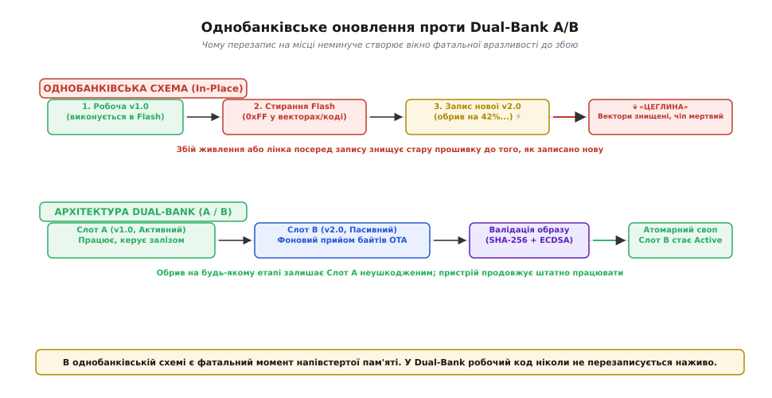
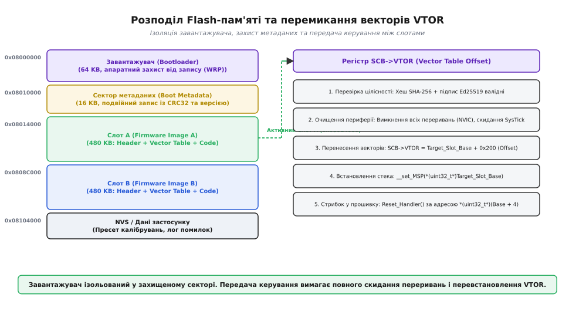
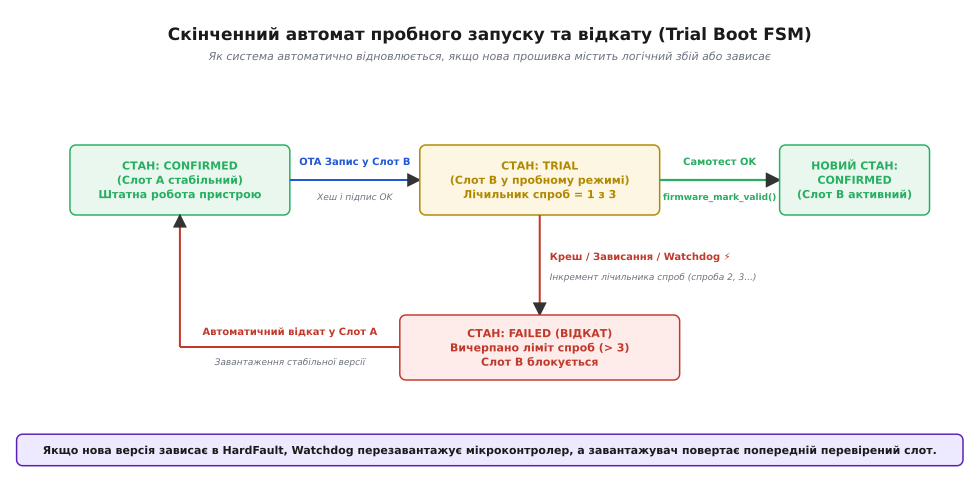

# Завантажувач, який не можна закирпичити

<preknowlist>
- [Способи залити прошивку](root:embedded/sposoby-zalyty-proshyvku) — від апаратного програматора SWD/JTAG до віддаленого OTA-оновлення через радіоканал.
- [Послідовність graceful reset](root:embedded/reset-sequence) — впорядковане згортання периферії та скидання процесора без пошкодження стану.
- [Криптографічні хеш-функції](root:sf-security/cryptographic-hash-functions) — контроль цілісності блоків даних за допомогою алгоритму SHA-256.
- [Пара ключів, підпис, обмін ключами](root:sf-security/public-key-crypto) — асиметрична автентифікація коду через цифрові підписи Ed25519 та ECDSA.
- [Сторож, який справді ловить зависання](root:embedded/storozh-iakyi-spravdi-lovyt-zavysannia) — апаратний таймер Watchdog для виведення мікроконтролера з нескінченних циклів та аварійних блокувань.
</preknowlist>

Датчик вібрації на промисловому насосі змонтовано у герметичному вибухозахищеному боксі на висоті десяти метрів. До найближчого оператора — кілометри технологічних труб, а до роз'єму налагодження SWD на платі можна дістатися, лише повністю зупинивши технологічну лінію і розібравши корпус. Пристрій отримує повітрям оновлення прошивки розміром 400 кілобайтів. На 73-му відсотку передачі поруч вмикається потужний частотний перетворювач: напруга живлення короткочасно просідає нижче порога скидання, радіозв'язок зривається, а мікроконтролер іде на перезавантаження. Якщо завантажувач у цей момент затирав стару програму і писав нові байти поверх неї, на платі залишається напівпорожній масив комірок Flash-пам'яті, де замість векторної таблиці лежить випадкове сміття. Пристрій перетворюється на некерований кремнієвий брусок — так звану «цеглину» (англ. *bricked device*).

Для польової електроніки здатність самостійно відновитися після будь-якого збою під час оновлення — це не зручність, а головна умова виживання. Відмовостійкий завантажувач (англ. *fail-safe bootloader*) проектують за залізним правилом: **жодна комбінація зовнішніх подій — раптове знеструмлення, обрив радіоканалу, передача пошкодженого бінарного файлу чи навіть логічна помилка в новому коді — не має позбавити контролер змоги стартувати працездатну версію системи**. Щоб виконати цю вимогу, системну пам'ять розбивають на ізольовані банки, новий образ верифікують криптографічно до першого виконання, а кожен запуск свіжої прошивки переводять у режим випробувального терміну.


*В однобанківській схемі стирання робочої пам'яті перед записом створює вікно незворотної аварії. У Dual-Bank робочий банк лишається недоторканим упродовж усього сеансу зв'язку.*

### Анатомія перетворення на «цеглину» та фізика збоїв Flash

Традиційна схема прошивки «на місці» (англ. *in-place update*) виглядає оманливо просто: завантажувач виділяє під робочу програму весь доступний простір Flash-пам'яті, окрім перших кількох секторів, зарезервованих під власний стартовий код. Коли надходить команда оновитися, завантажувач зупиняє виконання програми, першим ділом стирає сектори застосунку, переводячи всі біти у стан логічної одиниці (`0xFF`), і починає поблоково записувати нові байти, що надходять через UART, SPI або бездротовий модуль.

У цій схемі закладено фундаментальний фізичний дефект: **між моментом стирання першого сектора старої прошивки та моментом запису останнього байта нової системи взагалі не існує**. Flash-пам'ять типу NOR, яка інтегрована в більшість мікроконтролерів (STM32, NXP, ESP32), має виражену асиметрію операцій: читання виконується зі швидкістю системної шини (десятки наносекунд), запис окремого 32-бітного або 64-бітного слова триває десятки мікросекунд, але стирання сектора розміром 16–128 КБ вимагає від 20 до 500 мілісекунд.

Фізика стирання полягає у тунелюванні Фаулера-Нордгейма або інжекції гарячих носіїв: вбудований зарядний насос генерує напругу порядку 12–18 В для видалення заряду з плаваючих затворів тисяч польових транзисторів одночасно. Під час роботи цього помпового перетворювача внутрішнє споживання струму мікроконтролером різко зростає на 15–30 мА. Якщо на платі встановлено недостатній буферний конденсатор, або лінія живлення має помітний опір, це додаткове навантаження викликає локальну просадку напруги `ΔU = I · R`. Якщо напруга перетинає поріг Brown-Out Reset (BOR), контролер миттєво перезавантажується посеред високовольтного імпульсу.

У результаті частина транзисторів залишається у метастабільному проміжному стані — їхня порогова напруга не відповідає ані логічному «0», ані логічній «1». При наступному читанні внутрішній підсилювач-зчитувач (англ. *sense amplifier*) видає нестабільні значення, а модуль виявлення помилок ECC (англ. *Error Correction Code*) або системна шина генерує апаратну відмову шини (англ. *BusFault* / *HardFault*).

Навіть якщо живлення ідеально стабільне, канал передачі даних у польових умовах завжди ненадійний. Пакет може загубитися, зашифрований потік — спотворитися завадою, а сервер оновлень — розірвати TCP-сесію через вичерпання таймауту. Якщо завантажувач устиг записати 150 КБ із 400 КБ і зв'язок зник, у Flash лежить відсічена половина бінарного коду. Старої версії вже немає, нової ще немає. Завантажувач, перевіряючи контрольний підпис недописаного образу, бачить невідповідність, відмовляється передавати йому керування і зависає в очікуванні повторної команди. Якщо ж модуль зв'язку (наприклад, стільниковий модем або стек Wi-Fi/Bluetooth) ініціалізувався саме кодом застосунку, а не примітивним драйвером усередині крихітного завантажувача, пристрій більше ніколи не вийде в ефір.

Окрема прихована пастка однобанківської схеми — несумісність бібліотек і конфігурації. Уявімо, що образ записався бездоганно, байт у байт, контрольна сума зійшлася, але розробник припустився помилки у виклику ініціалізації кварцового резонатора або переплутав полярність піна живлення зовнішнього приймача. Нова прошивка стартує, за секунду падає в нескінченний обробник відмови процесора `HardFault_Handler` або зависає в очікуванні прапорця готовності PLL. З погляду завантажувача оновлення завершено успішно: код на місці, хеш правильний. Але на практиці пристрій мертвий, бо нова програма не здатна ані виконати корисну роботу, ані запустити новий сеанс прийому виправленої прошивки.

> 🔧 **Навіщо це.** Справжня відмовостійкість вимагає розмежування двох понять: цілісності передачі (чи всі байти доїхали неушкодженими) та функціональної придатності коду (чи здатен цей бінарник працювати в реальному залізі). Однобанківський завантажувач не захищає від жодної з цих бід: при збої зв'язку він знищує старий робочий стан, а при логічній помилці в новому коді опиняється без шляху назад.

### Архітектура Dual-Bank: слоти A/B та карта Flash-пам'яті

Щоб усунути вікно вразливості, пам'ять мікроконтролера фізично або логічно розділяють на два рівновеликі незалежні простори — **Слот A** (Primary) та **Слот B** (Secondary). Це архітектура з двома банками (англ. *A/B partitioning* або *dual-bank layout*).

Поки мікроконтролер виконує перевірену часом прошивку зі Слота A, система продовжує вимірювати тиск, обертати двигуни та підтримувати мережевий зв'язок. Коли сервер надсилає нову версію, фоновий процес застосунку приймає пакети, перевіряє їх і сектор за сектором записує у пасивний Слот B. Якщо під час прийому пропадає живлення, обривається зв'язок чи закінчується таймаут сесії, Слот B просто оголошується недійсним. Пристрій після перезавантаження знову стартує зі Слота A, ніби нічого не сталося.


*Карта Flash-пам'яті системи з подвійним слотом: ізольований завантажувач, сектор метаданих стану та механізм перенесення векторів через регістр SCB->VTOR.*

Типовий розподіл адресної карти 1 МБ Flash-пам'яті мікроконтролера ARM Cortex-M має таку структуру:

| Область пам'яті | Початкова адреса | Розмір | Призначення |
| :--- | :--- | :--- | :--- |
| **Bootloader** | `0x08000000` | 64 КБ | Незмінний код завантажувача, захищений апаратним прапорцем Write Protect |
| **Boot Metadata** | `0x08010000` | 16 КБ | Журнал станів слотів, лічильники спроб, контрольні суми CRC-32 |
| **Slot A (Active)** | `0x08014000` | 470 КБ | Робочий образ прошивки №1 (Заголовок + Вектори + Текст програми) |
| **Slot B (Passive)** | `0x0808A000` | 470 КБ | Резервний/цільовий образ прошивки №2 під оновлення |
| **NVS / User Data** | `0x08100000` | 64 КБ | Енергонезалежні налаштування, ключі шифрування, журнал подій |

Головна апаратна вимога для виконання коду безпосередньо з Flash (XIP, англ. *eXecute In Place*) — це адресація переривань. Процесори лінійки ARM Cortex-M при старті зчитують перше 32-бітне слово за адресою `0x00000000` (або `0x08000000`) як початкове значення покажчика верхівки стека (`MSP`, англ. *Main Stack Pointer*), а друге слово — як адресу точки входу `Reset_Handler`.

Коли завантажувач ухвалює рішення передати керування прошивці зі Слота B (наприклад, за адресою `0x0808A000`), він мусить повідомити ядро, де тепер шукати обробники переривань. Для цього ядро Cortex-M3/M4/M7/M33 містить системний регістр зсуву векторної таблиці `SCB->VTOR` (англ. *Vector Table Offset Register*). 

Зсув векторної таблиці накладає суворе апаратне обмеження: адреса векторів у `SCB->VTOR` має бути вирівняна на ступінь двійки, що перекриває кількість підтримуваних переривань. Для Cortex-M4 з таблицею на 16 системних винятків і 64 зовнішніх переривання (разом 80 векторів по 4 байти = 320 байтів) найближче вирівнювання становить 512 байтів (`0x200`). Якщо адреса не вирівняна, молодші біти ігноруються апаратно, що призводить до зчитування некоректних адрес функцій-обробників.

Існує два принципові способи організації коду під слоти A та B:

1. **Апаратний Dual-Bank Swap (STM32, NXP):** кристал містить два фізично незалежні масиви Flash. Спеціальний конфігураційний біт в Option Bytes (наприклад, `BFB2` або `DBANK`) перемикає відображення адрес: Bank 2 дзеркалюється на базову адресу `0x08000000`, а Bank 1 — на `0x08080000`. У такому режимі обидва образи компонуються під абсолютно ідентичні початкові адреси. Компоновщику не потрібно знати, в який слот потрапить файл.
2. **Логічний поділ та релокація (Position Independence / Multi-Target Linker):** якщо контролер має єдиний фізичний банк Flash (або зовнішню SPI NOR Flash), прошивки або збираються як позиційно-незалежний код (PIC), або бінарний образ збирається з урахуванням зміщення цільового слота (`0x08014000` для слота A і `0x0808A000` для слота B).

На мікроконтролерах ESP32 ця схема реалізована через внутрішній блок керування пам'яттю MMU (англ. *Memory Management Unit*): завантажувач налаштовує таблицю сторінок MMU так, що віртуальний простір виконання інструкцій `0x400D0000` прозоро відображається або на фізичну область Flash-розділу `app0`, або на `app1`. Для самого процесора зміна слота залишається непомітною.

### Криптографічна валідація цілісності та автентичності

Завантажувач не має права запускати бінарний код лише на підставі того, що байти було записано у Flash. Перед передачею керування виконується двоступенева перевірка:
1. **Цілісність (Integrity):** чи не було байти спотворено під час передачі чи запису.
2. **Автентичність (Authenticity):** чи справді цей бінарний файл зібрано довіреним автором, а не сформовано зловмисником, який перехопив незахищений канал.

Звичайної циклічної контрольної суми CRC-32 (англ. *Cyclic Redundancy Check*) вистачає лише для виявлення випадкових шумів у лінії зв'язку. CRC-32 лінійна: зловмисник може додати у файл шкідливий код, змінити кілька додаткових байтів у кінці й отримати те саме значення контрольної суми.

Тому стандарт захищеного завантажувача (Secure Boot) базується на зв'язці **криптографічного хешування SHA-256** та **асиметричного цифрового підпису Ed25519 або ECDSA (secp256r1)**.

Чому саме Ed25519 (крива Edwards25519) набула популярності у вбудованих системах:
- Вона повністю детермінована — процес підпису та перевірки не потребує генератора випадкових чисел (RNG) на мікроконтролері.
- Алгоритм виконується за сталий час (англ. *constant-time execution*), що робить його захищеним від атак за часом виконання (англ. *timing side-channel attacks*).
- Розмір відкритого ключа складає всього 32 байти, а підпису — 64 байти, що економить місце у заголовку образу.

Кожен бінарний образ перед відправкою загортається у контейнер зі стандартизованим заголовком фіксованого розміру (наприклад, 256 або 512 байтів):

```
+-------------------------------------------------------------+
|  Magic Word: 0x424F4F54 ('BOOT') [4 байти]                  |
+-------------------------------------------------------------+
|  Image Version: Major.Minor.Patch [4 байти]                 |
+-------------------------------------------------------------+
|  Security Counter (Anti-Rollback): 0x00000004 [4 байти]     |
+-------------------------------------------------------------+
|  Image Payload Size (Bytes): 0x0005C800 [4 байти]           |
+-------------------------------------------------------------+
|  Payload SHA-256 Hash [32 байти]                            |
+-------------------------------------------------------------+
|  Asymmetric Digital Signature (Ed25519) [64 байти]          |
+-------------------------------------------------------------+
|  Target Execution Address (Entry Point) [4 байти]           |
+-------------------------------------------------------------+
|  Reserved Padding (0xFF) [136 байтів]                       |
+-------------------------------------------------------------+
|  --> Тіло прошивки (Vector Table + Executable Code)         |
+-------------------------------------------------------------+
```

Відкритий ключ виробника (англ. *Public Key*) жорстко вшивається в захищену область пам'яті самого завантажувача або пропікається в одноразові апаратні комірки (eFuse / OTP, англ. *One-Time Programmable Memory*). Закритий ключ (англ. *Private Key*) зберігається виключно на сервері складання прошивок або в апаратному модулі безпеки (HSM) і ніколи не потрапляє у пристрій.

Алгоритм перевірки під час завантаження розгортається ланцюжком:

```
Хеш тіла прошивки:
H = SHA-256(Payload_Bytes)

Верифікація підпису:
Result = Ed25519_Verify(Public_Key, H, Signature)

Якщо Result == OK та Security_Counter >= Hardware_OTP_Counter:
    Образ довірений, переходимо до аналізу статусу запуску
Інакше:
    Образ відхиляється, слот блокується
```

Важливий елемент захисту — **монотонний лічильник безпеки (Anti-Rollback Counter)**. Якщо вразливість знайдено у версії v1.2, а виправлено у v1.3, зловмисник може спробувати примусово залити стару підписану версію v1.2 (атака відкату, англ. *Downgrade / Replay Attack*). Завантажувач порівнює значення `Security Counter` у заголовку образу з поточним апаратним лічильником в OTP. Якщо номер версії менший за зафіксований рівень безпеки, оновлення відхиляється навіть за наявності ідеального криптографічного підпису.

### Пробний запуск (Trial Boot) та автомат станів підтвердження/відкату

Найпідступніша категорія збоїв відбувається вже **після** того, як ідеальний, криптографічно валідний бінарник починає виконуватися. Неправильна конфігурація тактування шини, переповнення стека на першому запиті до мережі або зависання драйвера I2C в очікуванні відповіді від неприпаяного датчика призводять до того, що прошивка втрачає здатність функціонувати.

Щоб пристрій не завис у цьому стані назавжди, завантажувач реалізує **скінченний автомат пробного запуску (Trial Boot FSM)**.


*Автомат станів керування слотами: перехід у режим TRIAL після запису, обмеження спроб запуску через апаратний Watchdog та автоматичний відкат у стабільний слот при збоях.*

Слот у секторі метаданих може перебувати в одному з чотирьох станів:
1. `SLOT_STATE_EMPTY / INVALID`: слот порожній або містить пошкоджені байти.
2. `SLOT_STATE_TRIAL`: записано новий перевірений образ. Йому дозволено обмежену кількість спроб старту (зазвичай 3 спроби).
3. `SLOT_STATE_CONFIRMED`: прошивка успішно стартувала, провела внутрішній самотест і явно підтвердила свою працездатність.
4. `SLOT_STATE_FAILED`: прошивка вичерпала ліміт спроб і не підтвердила роботу. Слот заблоковано від подальших запусків.

Механізм взаємодії завантажувача та нової програми будується за чітким протоколом:

```
[Подія: Завершення запису OTA у Слот B]
Застосунок перевіряє хеш -> записує в метадані:
Slot_B.state = SLOT_STATE_TRIAL
Slot_B.boot_attempts = 0
Slot_B.max_attempts = 3
Застосунок ініціює перезавантаження.

[Подія: Старт завантажувача після Reset]
1. Завантажувач зчитує метадані.
2. Бачить Slot_B.state == SLOT_STATE_TRIAL.
3. Збільшує лічильник: Slot_B.boot_attempts += 1.
4. Зберігає оновлені метадані у Flash.
5. Якщо Slot_B.boot_attempts > Slot_B.max_attempts:
       Slot_B.state = SLOT_STATE_FAILED
       Завантажувач обирає Слот A (CONFIRMED) і стартує його (ROLLBACK).
6. Інакше:
       Завантажувач вмикає Hardware Watchdog на 30 секунд.
       Перемикає VTOR на Слот B і передає керування.

[Подія: Старт нової прошивки у Слоті B]
1. Прошивка ініціалізує критичні модулі (пам'ять, живлення, сенсори).
2. Підключається до радіоканалу або шини зв'язку.
3. Проводить швидкий самотест функцій (POST, англ. Power-On Self Test).
4. Якщо всі перевірки пройшли успішно:
       Прошивка викликає bootloader_confirm_image().
       Слот B переходить у стан SLOT_STATE_CONFIRMED.
       Слот A позначається як неактивний/резервний.
       Продовжується звичайна робота.
5. Якщо прошивка зависає або падає в HardFault:
       Прапорець не виставляється.
       Спрацьовує Hardware Watchdog -> апаратне скидання процесора.
       Завантажувач знову збільшує boot_attempts.
       На 4-му циклі ліміт вичерпано -> завантажувач повертає Слот A!
```

Цей механізм гарантує: **якщо оновлення містить фатальну помилку, час недоступності пристрою обмежений лише кількома періодами спрацювання сторожового таймера**, після чого зв'язок і керування автоматично повертаються на попередню робочу версію.

### Атомарне збереження метаданих: захист від збою живлення під час запису

Слабке місце багатьох саморобних завантажувачів — сам сектор метаданих. Уявімо, що завантажувач зберігає стан слотів у вигляді однієї структури на початку окремого сектора Flash. Щоб збільшити лічильник `boot_attempts` з 1 до 2, він мусить стерти весь сектор (записати туди всі `0xFF`) і записати нові байти.

Якщо живлення зникне рівно в момент між пранням сектора та записом оновленої структури, метадані перетворяться на чисті `0xFF`. Завантажувач при наступному вмиканні не знатиме, де активний слот, які в нього адреси та які лічильники спроб.

Щоб метадані мали абсолютну витривалість (англ. *Flash durability*), застосовують **двосекторну мандрівну структуру або журнал транзакцій із монотонним лічильником**:

1. Під метадані виділяють дві незалежні сторінки Flash: `Sector_Meta_0` та `Sector_Meta_1`.
2. Кожен блок метаданих супроводжується 32-бітним монотонним номером версії запису (`sequence_number`) та 32-бітною контрольною сумою `CRC-32`.
3. При оновленні даних завантажувач формує нову структуру в ОЗП, виставляє їй `sequence_number = prev_sequence_number + 1`, рахує CRC і записує її у **протилежний** сектор, який перед цим стирає.
4. Попередній сектор стирається лише після того, як новий сектор успішно верифіковано за CRC-32.
5. При старті завантажувач читає обидва сектори, перевіряє контрольні суми й обирає той блок, у якого CRC зійшлася, а номер версії `sequence_number` є максимальним.

Якщо живлення вимкнеться під час запису нового сектора, його CRC-32 не зійдеться, і завантажувач просто візьме попередню неушкоджену версію метаданих з іншого сектора.

Альтернативний високонадійний підхід — **послідовне дописування записів (Append-Only Log)** у межах одного сектора. Оскільки у Flash-пам'яті NOR біти можна змінювати з `1` на `0` без стирання всього сектора (доки не заповниться вся сторінка), кожна зміна стану слота записується як новий 16-байтний запис у наступні вільні комірки `0xFF`. Завантажувач при скануванні сектора знаходить останній валідний запис. Сектор стирається лише раз на кілька сотень перезапусків, що значно заощаджує ресурс Flash (який обмежений 10 000–100 000 циклами).

### Реалізація відмовостійкого завантажувача на C та C++

Нижче наведено повну інженерну реалізацію ядра відмовостійкого завантажувача з підтримкою A/B слотів, валідацією контрольних сум, пробним запуском та безпечною передачею керування.

:::tabs
:::code zavantazhuvach-iakyi-ne-mozhna-zakyrpychyty-d/c/realizatsiia.c
:::code zavantazhuvach-iakyi-ne-mozhna-zakyrpychyty-d/cpp/realizatsiia.cpp
:::

### Як нова прошивка підтверджує свою працездатність

Завантажувач бере на себе лише частину шляху — безпечний старт. Друга половина відповідальності лежить на самому застосунку. Після передачі керування нова прошивка не має права одразу позначати себе як стабільну: їй необхідно довести, що ключові підсистеми функціонують штатно.

Типовий протокол самотестування в новому коді виглядає так:

:::tabs
:::code zavantazhuvach-iakyi-ne-mozhna-zakyrpychyty-d/c/iak-nova-proshyvka.c
:::code zavantazhuvach-iakyi-ne-mozhna-zakyrpychyty-d/cpp/iak-nova-proshyvka.cpp
:::

### Інженерні тонкощі та підводні камені

Практична реалізація відмовостійкого завантажувача приховує кілька небезпечних підводних каменів, на яких регулярно розбиваються саморобні системи:

1. **Залишковий стан периферії (Dirty Peripheral State):** якщо завантажувач використовував модуль UART або таймер для діагностики, ці блоки залишаються активними в момент стрибка. Якщо в регістрі UART увімкнено переривання, а новий застосунок ще не встиг налаштувати власні обробники, перший прийнятий байт викличе перехід за вектором переривання в порожнечу (за замовчуванням `Default_Handler`), що призведе до вічного зависання. **Перед стрибком завантажувач зобов'язаний вимкнути всі модулі периферії, очистити біти запитів у NVIC (`NVIC->ICER` та `NVIC->ICPR`), зупинити контролери DMA та скинути таймер SysTick.**
2. **Контроль меж стека:** перший 32-бітний елемент вектора завжди задає покажчик стека `MSP`. Якщо у бінарному файлі через помилку компонувальника вказано адресу поза фізичною пам'яттю ОЗП (наприклад, `0x20080000` замість доступних `0x20040000`), перший же виклик функції або збереження регістра спровокує апаратну відмову пам'яті (HardFault). Перевірка діапазону `initial_msp` у завантажувачі є критично важливою.
3. **Апаратний захист сектора завантажувача (Write Protection):** код самого завантажувача ніколи не повинен бути доступним для запису з боку застосунку. У контролерах STM32 для цього активують захисні біти `WRP` (англ. *Write Protection*) у конфігурації Flash. Навіть якщо прикладний код буде скомпрометовано через переповнення буфера, завантажувач у перших 64 КБ залишиться захищеним і збереже здатність перепрошити пристрій.
4. **Витримка живлення (Hold-up Time):** під час оновлення запис метаданих у Flash вимагає гарантованої напруги. Якщо напруга впаде нижче мінімальної межі програмування (зазвичай 1.7–2.0 В), кристал може заблокувати шину. Апаратний супервізор живлення (BOD, англ. *Brown-Out Detector*) має бути налаштований так, щоб блокувати спроби запису Flash у момент, коли напруга живлення нестабільна.
5. **Тестування введенням несправностей (Fault Injection):** архітектуру Dual-Bank не можна вважати готовою без натурних випробувань. Стенд верифікації завантажувача обов'язково містить кероване реле живлення, яке хаотично розриває лінію живлення мікроконтролера в різні моменти OTA-сеансу: під час прання секторів, посеред запису бінарного тіла, під час оновлення CRC метаданих та на першій секунді старту нової версії. Лише система, яка витримує 10 000 таких випадкових скидань без втрати працездатності, допускається до експлуатації на реальних об'єктах.

Архітектура Dual-Bank з автоматом пробного запуску перетворює оновлення прошивки з лотереї на детермінований інженерний процес. Залишаючи старий робочий образ неушкодженим до моменту повного функціонального підтвердження нового коду, вбудована система отримує імунітет до обривів зв'язку, спотворень файлів та прихованих помилок у нових релізах.
