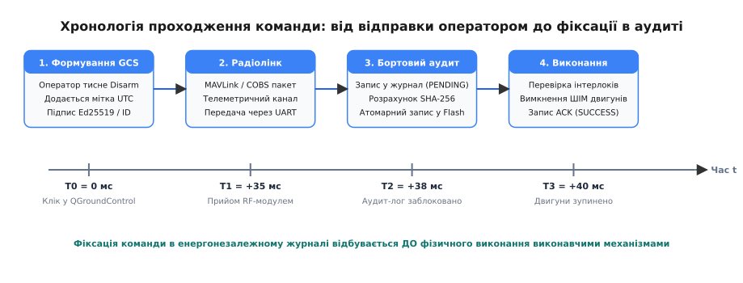
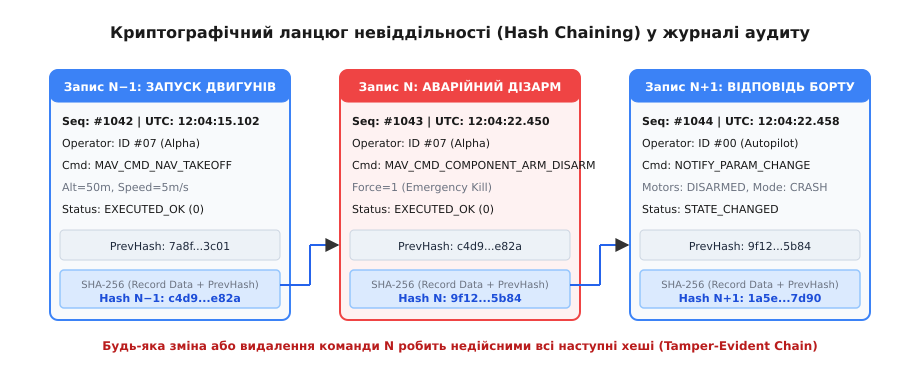
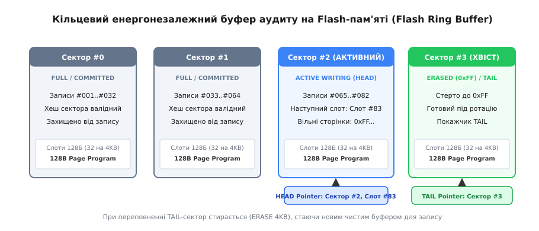

# Журнал дій оператора: хто, коли, що наказав

<preknowlist>
- [Журналювання на борту](root:embedded/zhurnaliuvannia-na-bortu) — рівні логів, бінарні кадри та кільцевий буфер діагностики.
- [Буфер на флеші: накопичити й віддати потім](root:embedded/bufer-na-fleshi) — робота з секторами NOR/NAND Flash та збереження стану при знеструмленні.
- [Аудит-лог як вузол](root:sf-security/audit-logging) — принцип невідворотності подій (non-repudiation) та юридична фіксація дій.
- [Хеш і цифровий підпис](root:sf-security/hash-and-digital-signature) — односторонні криптографічні хеш-функції та асиметрична верифікація автентичності.
- [Кільцевий буфер між перериванням і задачею](root:sf-algorithms/ring-buffer) — безпечна черга без динамічного виділення пам'яті.
- [Мітка часу](root:embedded/mitka-chasu) — різниця між локальним монотонним лічильником мікроконтролера та настінним часом UTC.
- [Формати бортових логів: ULog і DataFlash](root:sys-dron/flight-log-formats) — збереження польотних параметрів і телеметрії в автопілотах.
- [Дрейф годинників](root:sf-distributed/clock-offset-drift) — компенсація часового зміщення між бортовим комп'ютером і наземною станцією.
</preknowlist>

Під час випробувального польоту важкого гексакоптера масою 18 кг на висоті 120 метрів раптово зупиняються всі шість безколекторних двигунів. Апарат переходить у некероване падіння зі швидкістю 24 м/с і розбивається об ґрунт. Під час службового розслідування оператор стверджує, що автопілот самовільно відключив стабілізацію через програмний збій контролера. Наземна станція керування (GCS) показує втрату радіозв'язку за секунду до падіння, а текстовий лог телеметрії містить лише обрив потоку координат. Якщо на борту ведеться лише звичайний телеметричний лог, відрізнити помилкове натискання оператором комбінації аварійного знеструмлення («Emergency Disarm / Motor Cutoff») від фізичного перебивання шини живлення чи помилки в прошивці автопілота технічно неможливо.

Журнал дій оператора (Operator Audit Logging, або «чорна скринька команд») розв'язує цю невизначеність. На відміну від загальної польотної телеметрії, яка фіксує фізичні параметри об'єкта (кути крену, струми моторів, напругу батареї), журнал аудиту фіксує ланцюг суб'єктних рішень: хто саме віддав команду, у який абсолютний момент часу за шкалою UTC, з якими числовими параметрами, чи був наказ підписаний валідним криптографічним ключем і яким був точний статус його виконання бортовими виконавчими механізмами.

> 🔧 **Навіщо це.**
> У безпілотних комплексах, промисловій автоматиці та робототехніці журнал аудиту забезпечує принцип невідворотності дій (non-repudiation) та юридичну фіксацію рішень. Він унеможливлює як приховування оператором критичних помилок керування, так і безпідставне звинувачення персоналу у випадках чисто апаратних відмов чи атак підміни команд (Replay/Spoofing attacks) у радіоканалі.

## Аудит дій проти польотної телеметрії: різниця завдань

У складних автономних комплексах паралельно функціонують дві принципово різні системи накопичення даних:

1. **Потокова телеметрія (Flight Data Logging):** високочастотний запис (50–400 Гц) векторів стану апарата — вимірювання гіроскопів, акселерометрів, барометра, фазних струмів регуляторів ESC. Її мета — аналіз аеродинаміки, оптимізація коефіцієнтів PID-регуляторів та діагностика деградації механічних вузлів. Формати телеметрії (наприклад, ULog у PX4 або DataFlash у ArduPilot) оптимізовані під щільність стиснення та неперервний потік, проте не захищені від локального редагування чи вибіркового вилучення кадрів.
2. **Аудит наказів оператора (Operator Audit Logging):** подієвий запис (Event-driven), що реєструє виключно дискретні транзакції керування: зміну польотних режимів (Manual, AltHold, Auto, Guided), завантаження нового польотного завдання (Waypoints), калібрування сенсорів, перезапуск підсистем, команди активації корисного навантаження та аварійні команди примусової зупинки моторів.

| Характеристика | Потокова телеметрія (ULog / DataFlash) | Журнал аудиту дій оператора |
|---|---|---|
| **Частота запису** | Висока (50–400 Гц, неперервно) | Низька (подієва, 0.1–5 Гц у піках) |
| **Обсяг даних за годину** | 100–500 МБ | 50–500 КБ |
| **Часова мітка** | Монотонний час від старту MCU (`SysTick`, мікросекунди) | Абсолютний час UTC (мілісекунди) з прив'язкою до GNSS |
| **Захист від підробки** | Відсутній або базова контрольна сума CRC-16/32 | Криптографічний ланцюг хешів (SHA-256 Hash Chaining) |
| **Ідентифікація автора** | Анонімно (фіксується стан борту) | Криптографічний ідентифікатор / відбиток ключа оператора |
| **Пріоритет збереження** | Допускає втрату кадрів при заторах шини | Гарантований атомарний запис у Flash ДО виконання команди |


*Хронологія проходження наказу оператора: реєстрація в енергонезалежному журналі відбувається на етапі T2, до фізичної подачі сигналу на силові приводи, що гарантує збереження сліду навіть при миттєвому знеструмленні під час маневру.*

Критичний принцип надійності: наказ оператора фіксується у внутрішньому журналі **до того**, як польотний контролер почне фізично змінювати шпаруватість ШІМ на моторах або віддавати команду реле відстрілу парашута. Якщо аварія спричинить повне руйнування плати живлення чи коротке замикання через 2 мілісекунди після початку маневру, запис про отримання та валідацію команди вже буде надійно зафіксований у кремнії енергонезалежної пам'яті.

## Анатомія двійкового запису аудиту

Текстове журналювання (JSON, CSV чи рядки `syslog`) у задачах криптографічного аудиту мікроконтролерів є неприпустимим. Рядки мають змінну довжину, вимагають парсингу, створюють ризик переповнення стека при форматуванні та унеможливлюють детерміноване обчислення криптографічних хешів на апаратному рівні.

Кадр аудиту проектується як двійкова структура фіксованого розміру 128 байтів (ступінь двійки), що ідеально узгоджується з геометрією сторінок сучасних мікросхем SPI NOR Flash (256 або 512 байтів на сторінку) і дозволяє розмістити рівно два записи в одній сторінці без фрагментації:

```
Байтове зміщення  Розмір (байтів)  Поле кадру                 Призначення
-------------------------------------------------------------------------------------------------
[0..3]            4                Magic Sync (0x41554454)    Маркер кадру 'AUDT'
[4]               1                Format Version (0x01)      Версія схеми структури
[5]               1                Record Flags               Бітова маска прапорців (аварійний, RTC)
[6]               1                Execution Status           Поточний стан обробки наказу
[7]               1                Payload Length             Кількість валідних байтів параметрів
[8..15]           8                Sequence ID (uint64_t)     Монотонний лічильник транзакцій
[16..23]          8                Timestamp UTC (uint64_t)   Час за шкалою Unix Epoch у мс
[24..31]          8                Operator ID (uint64_t)     Відбиток сертифіката / ID пульта
[32..33]          2                Command ID (uint16_t)      Числовий код наказу (MAVLink або custom)
[34]              1                Subsystem Target           Ідентифікатор модуля (Autopilot, Gimbal)
[35]              1                Reserved / Padding         Вирівнювання під 4-байтову межу
[36..67]          32               Command Payload            Сирі параметри (координати, прапори)
[68..99]          32               Previous Record Hash       SHA-256 хеш попереднього кадру
[100..127]        32               Current Record Hash        SHA-256 хеш поточного кадру (з PrevHash)
-------------------------------------------------------------------------------------------------
Разом: 128 байтів (фіксований розмір кадру).
```

Повний програмний контракт структур, функцій ініціалізації та кодів помилок винесено в окремий довідник [Програмний інтерфейс логера дій оператора](root:embedded/zhurnal-dii-operatora/api-audit-logger.md).

### Вирівнювання та апаратні пастки шини

Звернення до 64-бітних полів `sequence_id`, `timestamp_utc_ms` та `operator_id` за непарними адресами на процесорних ядрах ARM Cortex-M0/M0+ викликає апаратне виключення `HardFault`. На ядрах Cortex-M3/M4/M7 такі операції виконуються за рахунок кількох послідовних циклів читання по шині AHB, що знижує швидкість роботи криптографічного конвеєра.

Тому поля структури розташовані з природним вирівнюванням: 64-розрядні цілі числа починаються зі зміщень, кратних 8 (байти 8, 16, 24), 32-розрядні поля — зі зміщень, кратних 4, а 32-байтні криптографічні масиви хешів займають цілісні вирівняні блоки.

### Семантика часової мітки: UTC проти монотонного лічильника

Часова мітка в журналі дій вимагає одночасної підтримки двох часових шкал:

1. **Глобальний час UTC (мілісекунди від 1 січня 1970 року):** отримується від GNSS-приймача (повідомлення `NAV-PVT` за протоколом UBX або NMEA `RMC`) і прив'язується до апаратного фронту секундного імпульсу PPS (Pulse Per Second). Це забезпечує точність кореляції подій між бортом, наземною станцією, камерами відеоспостереження та зовнішніми радарами з похибкою менше ніж 1 мілісекунда.
2. **Монотонний лічильник Sequence ID:** 64-розрядне число, яке збільшується суворо на +1 для кожної нової транзакції. Навіть якщо внаслідок глушіння GPS чи дрейфу внутрішнього генератора RTC станеться стрибок системного годинника, послідовність `sequence_id` унеможливлює маніпуляції з хронологією дій.

## Криптографічний ланцюг невіддільності (Hash Chaining)

Звичайної перевірки цілісності за допомогою контрольних сум CRC-16 або CRC-32 для журналу аудиту недостатньо. Якщо зацікавлена особа після льотної пригоди отримає фізичний доступ до мікросхеми Flash-пам'яті або карти пам'яті MicroSD через програматор, вона може легко змінити байт команди (наприклад, замінити наказ «Emergency Disarm» на нейтральний «Request Status») і за частку мілісекунди перерахувати поле CRC-32.

Для досягнення властивості захисту від підробки (Tamper-Evidence) аудит-лог організовано у криптографічний ланцюг за принципом блокчейну.


*Криптографічний взаємозв'язок записів: хеш попереднього запису H[N-1] входить у вхідні дані для розрахунку хешу H[N]. Зміна навіть одного біта в минулих записах руйнує весь подальший ланцюг.*

### Математичний механізм зв'язування хешів

Позначимо `R[i]` як бінарний блок даних `i`-го запису без фінального поля хешу (тобто перші 96 байтів структури: від `magic` до `prev_hash`). Поле `prev_hash` `i`-го запису містить фінальний хеш попереднього запису `H[i-1]`:

```
H[0] = Initial_Genesis_Hash   [фіксований вектор ініціалізації приладу]
prev_hash[i] = H[i-1]        [зв'язування з попереднім вузлом ланцюга]
H[i] = SHA256( R[i] )        [обчислення 256-бітного дайджесту кадру]
```

Вхідні дані для функції SHA-256 охоплюють усі метадані, параметри та хеш попереднього блоку:

```
R[i] = Magic || Version || Flags || Status || Seq[i] || Time[i] || OpID[i] || Cmd[i] || Payload[i] || H[i-1]
```

Властивості стійкості ланцюга:

1. **Неможливість непомітної модифікації (Pre-image resistance):** Зміна навіть одного біта в параметрах команди `R[k]` кардинально змінює її дайджест `H[k]` (лавинний ефект SHA-256). Оскільки наступний запис `R[k+1]` містить старий `H[k]` у полі `prev_hash`, його власний хеш `H[k+1]` також перестає сходитися. Щоб підробити один запис усередині журналу, зловмиснику довелося б перезаписати всі наступні записи аж до кінця носія.
2. **Неможливість вставки або видалення (Non-insertion & Non-deletion):** Видалення запису `R[k]` розриває рівність `R[k+1].prev_hash == SHA256(R[k-1])`. Вставка фіктивного запису між `k` та `k+1` неможлива без перерахунку всіх хешів уперед.
3. **Ощадливість оперативної пам'яті:** Мікроконтролеру не потрібно зберігати в ОЗП історію всіх попередніх команд. У захищеній пам'яті (Secure RAM або Battery-Backed SRAM) утримується лише 32-байтний поточний стан `H_current`. Для додавання нового запису виконується рівно один блок обчислення SHA-256 над 96 байтами даних.

### Апаратне прискорення та безпечні елементи

На мікроконтролерах класу STM32H7, NXP RT1170 або ESP32 апаратний криптографічний блок (Crypto Accelerator) обчислює SHA-256 для 96-байтного кадру за 1.8–3.5 мікросекунди, що повністю нівелює затримку при виконанні команди.

Для систем із підвищеними вимогами до безпеки (військові дрони, критична інфраструктура) початковий стан ланцюга `H[0]` підписується асиметричним ключем апарата всередині криптографічного чипа (наприклад, ATECC608A або OPTIGA Trust M) за алгоритмом ECDSA (secp256r1) або Ed25519, а фінальний хеш кожної польотної сесії фіксується в захищеному сховищі, захищеному від модифікації навіть при наявності повного доступу до шини SPI.

## Енергонезалежний кільцевий буфер на Flash-пам'яті

Збереження криптографічного журналу на вбудованих носіях стикається з фізичними обмеженнями технології напівпровідникової пам'яті Flash (NOR і NAND):

1. **Асиметрія запису та стирання:** Комірки Flash-пам'яті у вихідному стані містять логічні одиниці (`0xFF`). Операція програмування (Write) може лише перемикати окремі біти з `1` в `0`. Повернути біти з `0` в `1` можна виключно операцією стирання (Erase), яка виконується не побайтово, а великими блоками — секторами (зазвичай 4096 байтів у SPI NOR Flash) або блоками (64 КБ).
2. **Обмежений ресурс зносу (Endurance):** Кожен сектор витримує від 10 000 до 100 000 циклів стирання. Прямий перезапис заголовка журналу за фіксованою адресою знищить сектор за кілька місяців активної експлуатації.
3. **Ризик раптового знеструмлення (Brownout / Power-Cut):** Падіння апарата або аварійне відключення акумулятора призводить до зникнення живлення 3.3 В безпосередньо в момент виконання команди програмування сторінки.


*Організація кільцевого буфера на Flash: сектори проходять життєвий цикл ERASED (0xFF) → ACTIVE WRITING → COMMITTED. Записи укладаються у вирівняні 128-байтні слоти.*

### Секторно-кільцева архітектура

Виділена під журнал область Flash-пам'яті розбивається на фіксовану кількість `K` секторів розміром 4096 байтів кожен. Один 4 КБ сектор вміщує:
- 1 службовий заголовок сектора `audit_sector_header_t` (128 байтів у нульовому слоті);
- 31 слот під записи аудиту `audit_record_t` (по 128 байтів кожен, слоти 1..31).

Разом: 1 × 128 + 31 × 128 = 4096 байтів.

Сектори циклічно утворюють чергу FIFO, керовану двома покажчиками:
- **HEAD (Голова):** вказує на поточний активний сектор і номер вільного слота для запису нової команди.
- **TAIL (Хвіст):** вказує на найстаріший валідний сектор з історією.

### Атомарне закриття секторів та протокол відновлення

Щоб гарантувати цілісність без використання важких файлових систем (типу LittleFS чи FATFS), застосовується двофазний протокол коміту сектора:

1. **Стирання нового сектора (Erase):** Сектор очищується до стану `0xFF`.
2. **Відкриття сектора:** У нульовий слот записується початковий заголовок: `sector_magic = 0x53454354 ('SECT')`, `base_sequence_id` та `start_hash`. Поле `records_count` залишається нестемпованим (`0xFFFFFFFF`), що сигналізує про стан `ACTIVE_WRITING`.
3. **Послідовне заповнення:** Записи 1..31 послідовно програмуються у відповідні 128-байтні сторінки Flash.
4. **Фіксація та закриття сектора (Commit):** Після запису 31-го кадру в нульовий слот у незапрограмовані байти записується фінальне значення `records_count = 31` та `end_hash = H_last`. Переписування байтів, що перебували у стані `0xFF`, у нові значення є легітимною операцією NOR Flash, яка не вимагає стирання всього сектора.
5. **Ротація буфера:** Коли HEAD наздоганяє TAIL, найстаріший сектор у позиції TAIL стирається, а покажчик TAIL зміщується на наступний сектор.

Якщо живлення зникає під час запису кадру, при наступному вмиканні приладу алгоритм ініціалізації:
1. Знаходить сектор зі статусом `ACTIVE_WRITING` (де `records_count == 0xFFFFFFFF`).
2. Послідовно перевіряє 128-байтні слоти, шукаючи перший слот із пошкодженим магічним числом або суцільними `0xFF`.
3. Перевіряє хеш останнього успішно записаного кадру. Якщо останній кадр виявився записаний частково (не сходиться SHA-256), голова відкочується на крок назад, а пошкоджений незавершений слот маркується як недійсний.

## Ресурс Flash-пам'яті та рівномірний знос (Wear Leveling)

Поширене побоювання інженерів — передчасний вихід з ладу мікросхеми Flash-пам'яті через часті операції стирання. Розглянемо детальний числовий розрахунок надійності для типової мікросхеми SPI NOR Flash Winbond W25Q128FV (обсяг 16 МБ, 4096 секторів по 4 КБ):

```
Загальна кількість секторів:           4096 секторів
Слотів аудиту в одному секторі:        31 слот
Місткість буфера до повного обороту:   4096 × 31 = 127 000 команд
Гарантований ресурс стирання:          100 000 циклів на сектор
Сукупний ресурс журналу:               127 000 × 100 000 = 12.7 мільярдів записів
```

Навіть якщо безпілотний комплекс здійснює активне маневрування й генерує в середньому 2 транзакції аудиту на секунду неперервно (вмикання/вимикання сенсорів, коригування траєкторії, зміна висоти), ресурс мікросхеми вичерпається лише через:

```
T_life = 12 700 000 000 / (2 × 3600 × 24 × 365) ≈ 201 рік безперервної роботи
```

Кільцева секторна структура розподіляє операції стирання абсолютно рівномірно по всій площі кремнієвого кристала. Це гарантує, що жоден фізичний сектор не зазнає передчасного зносу порівняно з іншими, усуваючи потребу в складних математичних алгоритмах динамічного вирівнювання зносу.

## Апаратні таймінги та обчислювальний бюджет

При інтеграції логера в систему керування польотом критично важливо оцінити часові затримки, які вносить запис аудиту в основний контур стабілізації:

1. **Розрахунок SHA-256 для 96 байтів:**
   - На ядрі ARM Cortex-M4 (168 МГц, програмна оптимізована реалізація C): 14.2 мікросекунди;
   - На ядрі ARM Cortex-M7 (480 МГц): 4.1 мікросекунди;
   - На апаратному блоці STM32 Cryptographic Engine (CRYP): 1.9 мікросекунди.
2. **Передача кадру по шині SPI (50 МГц):**
   - 128 байтів зі службовими байтами команди `0x02` (Page Program) займають: `(128 + 4) · 8 / 50 МГц = 21.1` мікросекунди.
3. **Фізичне програмування комірок Flash:**
   - Внутрішній автомат мікросхеми виконує програмування сторінки за 0.6–1.2 мілісекунди.
4. **Стирання сектора 4 КБ при переході на новий сектор:**
   - Апаратне стирання займає від 35 до 60 мілісекунд.

Якщо польотний контур стабілізації працює на частоті 400 Гц (період 2.5 мс), блокуюче очікування завершення запису Flash (1.2 мс) вимиває майже половину процесорного часу, а блокування на час стирання сектора (45 мс) призведе до пропуску 18 циклів регулювання моторів і неминучої катастрофи.

Саме тому логер організовується як дворівнева асинхронна система:
- **Критична секція фіксації (в контексті обробника команди):** обчислює SHA-256, оновлює `sequence_id`, копіює 128 байтів у швидкий кільцевий буфер в SRAM (затримка менше ніж 25 мікросекунд) і дозволяє системі негайно продовжити керування.
- **Фонова задача запису (Storage Worker Task):** низькопріоритетний потік RTOS вичищає буфер SRAM через DMA, взаємодіє з мікросхемою Flash по шині SPI та здійснює завчасне асинхронне стирання наступного сектора (Background Sector Pre-Erase) до того, як поточний сектор буде повністю заповнений.

## Захист від атак у радіоефірі та підміни ключів

Окрім розслідування аварій, аудит дій виконує функцію бар'єра кібербезпеки автономного апарата. Сучасні засоби перехоплення радіосигналу дозволяють зловмисникам записувати радіопакети керування та повторно випромінювати їх в ефір.

### Атака повторного відтворення (Replay Attack)

Сценарій: зловмисник перехоплює в ефірі легітимний підписаний пакет «Emergency Land», записаний під час тренувального польоту. Під час бойового завдання ворожий передавач транслює цей самий пакет на частоті телеметрії.

Захист логера аудиту:
1. Кожна команда супроводжується монотонним `Sequence ID` та часовою міткою `Timestamp UTC`.
2. Бортовий валідатор відхиляє будь-яку команду, чий `Sequence ID` менший або рівний останньому зафіксованому номеру в журналі аудиту.
3. Якщо часова мітка команди відстає від бортового GNSS-часу більш ніж на допустиме вікно затримки каналу (наприклад, `Δt > 500` мс), команда негайно відкидається зі статусом `AUDIT_EXEC_REJECTED_AUTH`. Спроба атаки обов'язково записується в аудит-лог із фіксацією джерела та підробленого номера.

### Атака підміни ключів та відбитки сесій (Session Fingerprinting)

Щоб унеможливити відправку команд з неавторизованого пульта чи зламаного ноутбука, наземна станція GCS при кожному підключенні узгоджує з бортом сесійний ключ на основі асиметричної пари ключів (Ed25519 / Curve25519). Поле `operator_id` містить усічений 64-бітний відбиток відкритого ключа оператора, завантаженого в сертифікат допуску. Якщо під час розслідування виявляється, що катастрофічну команду було віддано з валідним підписом, але відбитком не призначеного на місію оператора, це однозначно вказує на компрометацію конкретного наземного термінала.

## Реалізація захищеного логера: C та C++

Нижче наведено повну модульну реалізацію ядра логера аудиту. Реалізація не використовує динамічного виділення пам'яті (`malloc`/`new`), повністю реентрабельна та оперує виключно детермінованими буферами фіксованого розміру.

:::tabs
:::code zhurnal-dii-operatora-d/c/realizatsiia.c
:::code zhurnal-dii-operatora-d/cpp/realizatsiia.cpp
:::

## Методика розслідування інцидентів та виявлення підробок

Коли апарат після аварії повертається до лабораторії, експерти з безпеки вивантажують сирий дамп енергонезалежної пам'яті через апаратний інтерфейс SWD або зчитувач Flash-мікросхем.

Алгоритм верифікації цілісності:

1. **Ініціалізація валідатора:** Встановлюється очікуваний початковий вектор `H[0] = Initial_Genesis_Hash`.
2. **Покроковий прохід:** Валідатор зчитує записи з секторів у порядку зростання `sequence_id`.
3. **Перевірка зв'язку prev_hash:** Для кожного запису `i` перевіряється умова:
   ```
   rec[i].prev_hash == H_expected
   ```
4. **Обчислення власного хешу:** Обчислюється `H_calc = SHA256(rec[i][0..95])`. Якщо `H_calc != rec[i].record_hash`, фіксується факт пошкодження вмісту слота `i`.
5. **Оновлення стану:** Якщо перевірка успішна, `H_expected = H_calc`, і алгоритм переходить до запису `i+1`.

Нижче наведено функцію повної перевірки ланцюга у двох варіантах виконання:

:::tabs
:::code zhurnal-dii-operatora-d/c/metodyka-rozsliduvannia.c
:::code zhurnal-dii-operatora-d/cpp/metodyka-rozsliduvannia.cpp
:::

Якщо в процесі аналізу виявляється розрив ланцюга на записі `K`, експерти отримують математичний доказ:
- Усі записи `1 .. K-1` є автентичними та зберегли первинний порядок;
- Починаючи з запису `K`, дані були або модифіковані стороннім втручанням, або спотворені фізичним руйнуванням кремнієвого кристала.

## Дрейф годинників та кореляція трьох джерел подій

У розподіленій системі, де оператор працює на наземній станції під керуванням Linux/Windows, радіомодем вносить затримку передачі, а бортовий польотний контролер функціонує під керуванням власного таймера, неминуче виникає розходження локальних годинників.

Помилка кореляції часу виникає з двох причин:
1. **Затримка каналу зв'язку (Propagation & Queue Latency):** Від моменту натискання клавіші оператором на пульті до прийому байтів радіомодулем дрона минає від 15 до 120 мілісекунд (залежно від завантаженості буферів передавача).
2. **Температурний дрейф кварцового резонатора:** Низькоякісний кварцовий резонатор годинника реального часу (RTC) зі стабільністю 50 ppm дає похибку до 4.3 секунди на добу при зміні температури від −20 °C до +50 °C.

Щоб розв'язати проблему дрейфу, протокол аудиту використовує двосторонню фіксацію часових міток:
- Команда із наземної станції містить мітку `T_GCS` (час відправки за годинником оператора);
- Бортовий логер при прийомі додає локальну мітку `T_UAV` (час за синхронізованим GNSS PPS годинником борту).

Порівняння цих двох міток дозволяє слідчій комісії точно визначити, чи була затримка реакції дрона спричинена зависанням процесора автопілота, чи команда застрягла в буфері радіомодема через глушіння сигналу засобами радіоелектронної боротьби (РЕБ).

### Покроковий розбір льотного інциденту

Повернімося до аварії гексакоптера зі вступу. Під час аналізу експертна комісія зіставляє три незалежні джерела даних за єдиною хронологічною шкалою:

1. **Лог наземної станції керування (GCS):**
   - `12:04:18.100 UTC`: оператор обрав точку польотного завдання Waypoint #4;
   - `12:04:22.410 UTC`: клавіатурна подія комбінації `Ctrl+Shift+F12` (Emergency Disarm);
   - `12:04:22.415 UTC`: пакет MAVLink відправлено в радіомодем UART.
2. **Бортовий журнал дій оператора (Audit Log):**
   - `12:04:18.145 UTC` (`Seq #1042`): прийнято наказ `MAV_CMD_NAV_WAYPOINT`, статус `EXECUTED_OK`;
   - `12:04:22.450 UTC` (`Seq #1043`): прийнято наказ `MAV_CMD_COMPONENT_ARM_DISARM (Param1=0, Force=1)`, `Operator_ID = 0x07`, статус `EXECUTED_OK`, `Prev_Hash` валідний;
   - `12:04:22.458 UTC` (`Seq #1044`): системна подія `DISARM_NOTIFICATION`, мотори зупинено.
3. **Бортова телеметрія високої частоти (ULog):**
   - `12:04:22.459 UTC`: вихідні сигнали ШІМ регуляторів ESC обнулилися;
   - `12:04:22.500 UTC`: вертикальне прискорення `a_z = -9.81 м/с²` (вільне падіння);
   - `12:04:27.480 UTC`: стрибок акселерометра `a > 40 g` (удар об землю).

Завдяки криптографічному журналу дій технічна комісія отримує беззаперечний висновок: автопілот відключив двигуни не через збій прошивки, а за прямим наказом `Seq #1043`, надісланим із пульта оператора №7 за 5.03 секунди до удару. Нерозривний ланцюг хешів підтвердив, що запис не підроблено і не вставлено заднім числом.
