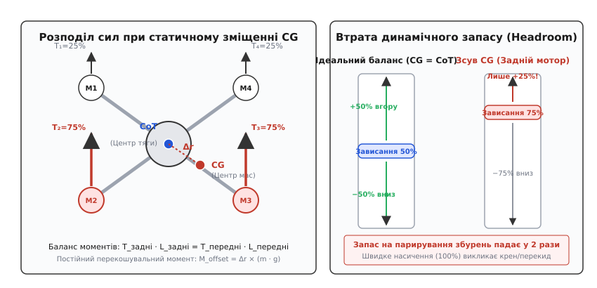
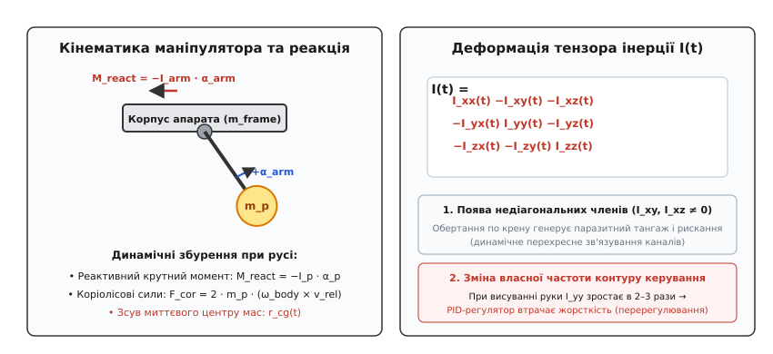
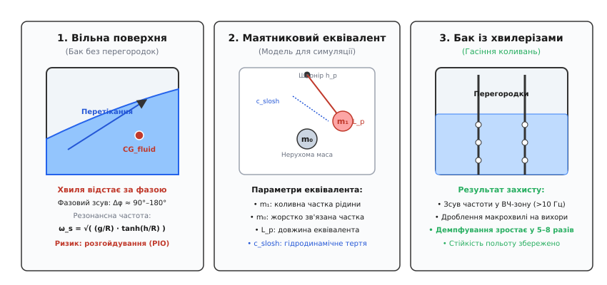
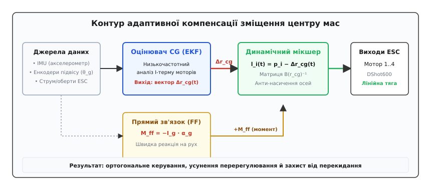

# Зсув центру ваги й рухома маса

<preknowlist>
- [Центр мас](root:ph-mechanics/center-of-mass) — зважена точка рівноваги мас системи, від якої рахують баланс сил і моментів.
- [Момент сили](root:ph-mechanics/torque) — обертальна дія сили на плечі відносно осі обертання.
- [Тензор інерції](root:ph-mechanics/moment-of-inertia) — міра динамічного спротиву тіла кутовому прискоренню по трьох осях.
- [Узгодження сигналів керування](root:embedded/output-mixing) — мікшування команд крену, тангажу, курсу й тяги на фізичні мотори.
</preknowlist>

Коли на чотиримоторний дрон злітною масою 3.0 кг встановлюють важкий тепловізійний оптичний блок або зміщують тяговий акумулятор на 40 мм назад від перетину променів рами, геометричний центр тяги пропелерів (Center of Thrust, CoT) перестає збігатися з центром мас апарата (Center of Gravity, CG). У першу ж секунду зависання цей важіль створює постійний перекошувальний гравітаційний момент силою майже 1.18 Н·м. Щоб утримати горизонт і не впасти на хвіст, польотний контролер змушений розкрутити задню пару моторів до 72% тяги, тоді як передня пара ледь обертається на 28%. Дрон зависає рівно, але ціною прихованої динамічної кризи: запас керування по тангажу скорочується втричі, перший же зустрічний порив вітру вганяє задні мотори в 100% насичення, а нелінійне зростання аеродинамічних втрат на високих обертах скорочує час польоту на 20–25%. 

Зсув маси — це не просто статичне перекошування, а масштабна зміна всієї динамічної моделі літального апарата. Коли ж корисне навантаження рухається в польоті — чи то поворот триосьового підвісу камери, рух шарнірного робототехнічного маніпулятора, чи хвильове плескання рідкого гербіциду в баку агродрона, — система зазнає знакозмінних реактивних моментів, коріолісових сил і неперервної деформації тензора інерції. Якщо алгоритми стабілізації не враховують цієї рухомої механіки, літальний апарат неминуче входить у розгойдування й втрачає керованість.

---

### Анатомія статичного зсуву: центр тяги проти центру мас

Геометрія безпілотного апарата визначає дві ключові просторові точки:
1. **Геометричний центр тяги (CoT)** — точка прикладання результуючого вектора тяги всіх силових установок. Для класичного симетричного квадрокоптера вона лежить строго в точці перетину діагоналей між осями обертання чотирьох пропелерів.
2. **Центр мас системи (CG)** — точка, у якій зосереджена повна маса конструкції, батареї, електроніки та корисного вантажу.

У системі координат корпусу апарата (`Body Frame`), початок якої прив'язаний до точки CoT, положення центру мас задається тривимірним вектором зміщення:

```
r_cg = [Δx, Δy, Δz]ᵀ
```

де `Δx` — поздовжній зсув (ніс / хвіст), `Δy` — поперечний зсув (лівий / правий борт), `Δz` — вертикальний зсув (вище / нижче площини обертання гвинтів).


*Статичний зсув центру мас відносно центру тяги. Зліва: зміщення ваги на вектор Δr створює перекошувальний гравітаційний момент, що вимагає асиметричної тяги моторів (T₂=T₃=75% проти T₁=T₄=25%). Справа: деградація динамічного запасу керування (Headroom) — перевантажений мотор має лише +25% запасу на парирування вітру перед настанням повного насичення.*

#### Гравітаційний момент і статичний дисбаланс моторів

У режимі ідеального зависання в горизонтальному положенні вектор сили тяжіння спрямований строго вниз уздовж осі `Z`. Якщо центр мас зміщений на `Δx` вперед або назад, виникає постійний перекошувальний момент по осі тангажу (Pitch):

```
M_pitch = Δx · m · g
```

Аналогічно, поперечний зсув `Δy` створює постійний момент по осі крену (Roll):

```
M_roll = Δy · m · g
```

Вертикальне зміщення `Δz` у строго горизонтальному висінні не створює обертального моменту навколо осей крену й тангажу, оскільки вектор тяжіння паралельний осі `Z`. Проте щойно дрон нахиляється на кут тангажу `θ` або крену `φ` для здійснення горизонтального прискорення, вертикальне плече `Δz` породжує додатковий момент пари сил `M_z = Δz · m · g · sin(θ)`. Якщо центр мас лежить високо над площиною гвинтів (`Δz > 0`), цей момент є дестабілізуючим (перекидним): він намагається збільшити кут нахилу, знижуючи запас стійкості апарата. Якщо центр мас розташований нижче площини тяги (`Δz < 0`, підвісний вантаж або батарея знизу), сила тяжіння діє як стабілізуючий маятник.

Розглянемо X-подібний квадрокоптер із відстанню між моторами `2 · L` (плече кожного мотора від геометричного центру вздовж осі `X` дорівнює `l_x = L / √2`). Для збереження кутового спокою сума моментів сил тяги моторів відносно центру мас повинна тотожно дорівнювати нулю:

```
Σ M = 0
(T_передні · (l_x - Δx)) - (T_задні · (l_x + Δx)) = 0
```

При нульовому зміщенні (`Δx = 0`) сили тяги симетричні: `T_передні = T_задні = 0.5 · m · g`. Але щойно `Δx > 0` (зсув назад), ефективне плече передніх моторів збільшується, а задніх — зменшується. Щоб компенсувати дисбаланс, сили тяги повинні перерозподілитися за правилом важеля:

```
T_задні  = (m · g / 2) · (1 + Δx / l_x)   [правило важеля: збільшення тяги задніх моторів]
T_передні = (m · g / 2) · (1 - Δx / l_x)   [правило важеля: зменшення тяги передніх моторів]
```

При зсуві `Δx = 0.5 · l_x` задні мотори повинні видавати утричі більшу тягу, ніж передні (`75%` повної ваги проти `25%`).

#### Втрата запасу динамічного керування (Control Headroom)

Кожен безколекторний мотор має фізичну межу максимальної тяги `T_max` при 100% заповненні ШІМ регулятора швидкості (ESC). Запас керування (англ. *control headroom*) — це різниця між поточною тягою мотора у висінні та його максимальною або мінімальною межею:

```
ΔT_up   = T_max - T_hover
ΔT_down = T_hover - T_min
```

Коли центр мас розташований по центру, всі мотори працюють на 50% газу. Запас на створення керуючого моменту симетричний в обидва боки: `+50%` вгору для прискорення і `-50%` вниз для гальмування. 

При статичному зсуві центру мас перевантажений мотор працює, наприклад, на `75%` тяги. Його запас для парирування зовнішніх збурень вгору становить лише `ΔT_up = 25%`. Якщо дрон зазнає різкого висхідного пориву вітру або отримує команду на агресивний маневр, що вимагає додаткового моменту `ΔM > ΔT_up · l_x`, задні мотори миттєво входять у **насичення** (100% ШІМ). 

У стані насичення лінійний зв'язок між виходом PID-регулятора та реальними силами розривається. Польотний контролер більше не може створювати потрібний момент по тангажу без одночасного падіння сумарної вертикальної тяги або втрати стабілізації по крену та курсу. Починається мимовільне завалювання апарата.

#### Енергетична ціна асиметрії: аеродинамічна нелінійність

Крім втрати керованості, статичний дисбаланс істотно збільшує енергоспоживання. Тяга повітряного гвинта `T` пропорційна квадрату кутової швидкості обертання `ω²`, тоді як споживана аеродинамічна потужність `P` пропорційна кубу кутової швидкості `ω³`:

```
T = k_T · ω²
P = k_P · ω³ = (k_P / k_T^(3/2)) · T^(3/2)
```

Функція залежності потужності від тяги `P(T) ∝ T^(3/2)` є строго опуклою вгору. Відповідно до нерівності Єнсена, середня потужність двох моторів із різною тягою завжди строго більша за потужність двох моторів із однаковою сумарною тягою:

```
0.5 · P(T₁ + ΔT) + 0.5 · P(T₁ - ΔT) > P(T₁)
```

Питома тяга гвинта (грам тяги на ват споживаної електричної потужності, г/Вт) різко деградує при зростанні обертів: на 25% газу пропелер видає `9.5` г/Вт, а на 75% газу — лише `4.8` г/Вт. У результаті апарат з асиметрично завантаженими моторами витрачає на 15–25% більше енергії акумулятора під час простого зависання порівняно з ідеально збалансованою платформою, перетворюючи додаткові вати на марний нагрів обмоток перевантажених моторів.

> 🔧 **Навіщо це.** Перед першим вильотом з новим акумулятором або корисним вантажем завжди виконують перевірку статичного балансу. Найпростіший спосіб — тест на вивішування (Hang Test): апарат підвішують за центральну точку рами (CoT). Якщо промені нахиляються більше ніж на 3–5°, акумуляторний відсік або навісне обладнання необхідно фізично пересунути. У логах польоту (Blackbox / DataFlash) статичний дисбаланс діагностується за стійкою різницею середніх значень ШІМ між моторами під час зависання у штиль: якщо різниця між передніми й задніми моторами перевищує 10–12%, механічне центрування є обов'язковим.

---

### Рухома маса: кінематика та змінний тензор інерції

Коли корисне навантаження змінює свою просторову конфігурацію безпосередньо під час польоту — наприклад, камера на триосьовому підвісі нахиляється вниз для зйомки або шарнірна рука маніпулятора висувається для захоплення об'єкта, — апарат перестає бути жорстким тілом зі сталими параметрами.


*Кінематичні та динамічні збурення від рухомого навантаження. Кутове прискорення маніпулятора породжує реактивний крутний момент M_react на корпус. Зміна геометрії деформує тензор інерції I(t), породжуючи недіагональні елементи I_xy, що викликають перехресне зв'язування каналів стабілізації.*

#### Миттєвий центр мас комбінованої системи

Розглянемо дрон як багатотілу систему (`Multi-body System`), що складається з базового корпусу масою `m_b` з центром мас у точці `r_b` та рухомого навантаження масою `m_p`, координати якого в системі корпусу залежать від часу: `r_p(t) = [x_p(t), y_p(t), z_p(t)]ᵀ`.

Миттєвий вектор положення центру мас усієї системи змінюється за законом:

```
r_cg(t) = (m_b · r_b + m_p · r_p(t)) / (m_b + m_p)
```

Швидкість зміщення центру мас відносно корпусу визначається відносною швидкістю руху вантажу `v_rel(t) = dr_p/dt`:

```
v_cg(t) = (m_p / M_total) · v_rel(t)
```

#### Теорема Гюйгенса–Штейнера для змінного тензора інерції

Опір апарата кутовим прискоренням описується симетричним тензором інерції `I` розмірністю `3 × 3`. Якщо в початковому стані головні осі інерції збігалися з будівельними осями апарата (недіагональні елементи дорівнювали нулю), то рух навантаження руйнує цю симетрію.

Згідно з теоремою паралельних осей (теоремою Гюйгенса–Штейнера), тензор інерції комбінованої системи відносно миттєвого центру мас `r_cg(t)` дорівнює:

```
I_total(t)
= I_b + I_p(t) + m_b · ( (r_b - r_cg)ᵀ(r_b - r_cg) · E - (r_b - r_cg)(r_b - r_cg)ᵀ )
  + m_p · ( (r_p(t) - r_cg)ᵀ(r_p(t) - r_cg) · E - (r_p(t) - r_cg)(r_p(t) - r_cg)ᵀ )
```

де `E` — одинична матриця `3 × 3`.

Розкриваючи матричні добутки, бачимо два критичні наслідки:
1. **Зміна діагональних моментів інерції `I_xx(t)`, `I_yy(t)`, `I_zz(t)`**: коли маніпулятор масою 0.8 кг витягується вперед на `d = 0.4` м, момент інерції по осі тангажу зростає на `ΔI_yy ≈ m_p · d² = 0.8 · 0.16 = 0.128` кг·м². Для середнього дрона це збільшення власного моменту інерції у 2–3 рази. PID-регулятор кутової швидкості, налаштований на компактну конфігурацію, стає занадто «м'яким», з'являються запізнення реакції та статична помилка слідкування.
2. **Виникнення недіагональних відцентрових моментів інерції `I_xy(t)`, `I_xz(t)`, `I_yz(t)`**: якщо маніпулятор відхиляється одночасно вбік і вперед, з'являється ненульовий член `I_xy`. Тепер рівняння обертального руху Ейлера набувають перехресного вигляду:

```
M_pitch = I_yy · dω_y/dt + (I_xx - I_zz) · ω_x · ω_z - I_xy · (dω_x/dt - ω_y · ω_z)
```

Спроба контролера створити кутове прискорення виключно по крену (`dω_x/dt`) через член `I_xy` породжує миттєвий паразитичний момент по тангажу. Осі керування стають динамічно зв'язаними (англ. *cross-axis coupling*).

#### Динамічні збурення від прискорення рухомої маси

Крім зміни тензора інерції, сам процес переміщення вантажу генерує на корпус апарата потужні кінематичні сили:

1. **Реактивний крутний момент (3-й закон Ньютона)**:
   Якщо сервопривод підвісу або суглоба маніпулятора розганяє корисне навантаження з кутовим прискоренням `α_arm`, на корпус діє рівний за модулем і протилежний за напрямком реактивний момент:

```
M_react = - I_arm · α_arm
```

При різкому повороті важкої оптичної головки (`I_arm = 0.015` кг·м²) з прискоренням `α = 40` рад/с² реактивний удар досягає `0.6` Н·м, що співмірно з максимальним керуючим моментом самого дрона.

2. **Коріолісові та відцентрові сили**:
   Коли дрон здійснює розворот по курсу з кутовою швидкістю `ω_body`, а маніпулятор одночасно висувається з відносною лінійною швидкістю `v_rel`, у неінерційній системі відліку корпусу виникає коріолісова сила:

```
F_cor = 2 · m_p · (ω_body × v_rel)
```

Ця сила діє перпендикулярно до площини руху руки й намагається перекинути дрон по крену під час швидких маневрів.

---

### Плескання рідини (Liquid Sloshing) у баках дронів

Особливим і найбільш небезпечним різновидом рухомої маси є рідкий вантаж. Агродрони для внесення засобів захисту рослин (ЗЗР) та пожежні безпілотники несуть баки об'ємом від 10 до 50 літрів. На рідину припадає від 50% до 70% повної злітної маси всього літального апарата.

На відміну від твердотілого маніпулятора, рух якого детермінований енкодерами сервоприводів, рідина має вільну поверхню (англ. *free surface*) і є системою з нескінченною кількістю ступенів вільності.


*Динаміка рідинного вантажу в баку. Зліва: вільна поверхня рідини формує гравітаційну хвилю з фазовим запізненням Δφ ≈ 90°–180°. Посередині: еквівалентна маятникова модель для чисельної симуляції (нерухома маса m₀ + коливний маятник m₁). Справа: перфоровані хвилерізи (baffles), що дроблять хвилю та збільшують коефіцієнт демпфування.*

#### Гідродинаміка вільної поверхні та власні резонансні частоти

Під час прискорення або нахилу дрона рідина зміщується під дією комбінації сил інерції та гравітації. Вільна поверхня утворює стоячу хвилю, що коливається від стінки до стінки резервуара.

Для циліндричного бака радіусом `R`, заповненого рідиною до висоти `h`, власна циклічна частота першої (найбільш енергоємної) моди коливань вільної поверхні описується аналітичною формулою:

```
ω_slosh = √( (g · ξ₁ / R) · tanh(ξ₁ · h / R) )
```

де `ξ₁ ≈ 1.8412` — перший корінь похідної функції Бесселя першого роду `J₁'(ξ) = 0`, `g` — прискорення вільного падіння.

У прямокутному баку довжиною `L_tank` власна частота становить:

```
ω_slosh = √( (g · π / L_tank) · tanh(π · h / L_tank) )
```

Для типового бака агродрона діаметром `300` мм (`R = 0.15` м) та висотою рівня рідини `h = 0.25` м розрахунок дає:

```
ω_slosh
= √( (9.81 · 1.8412 / 0.15) · tanh(1.8412 · 0.25 / 0.15) )   [підстановка радіуса R=0.15 м та рівня h=0.25 м]
= √( 120.41 · tanh(3.068) )                                  [обчислення коефіцієнтів під коренем]
= √( 120.41 · 0.995 )                                        [обчислення гіперболічного тангенса]
= 10.94 рад/с ≈ 1.74 Гц                                      [результат: колова та циклічна частота]
```

Власна частота плескання становить приблизно **1.5–2.5 Гц**.

#### Механічний маятниковий еквівалент

Для розрахунку динаміки в польотних контролерах неперервну рідину замінюють її механічним дискретним аналогом:
- **Жорстко зв'язана маса `m₀`**: частина рідини, яка рухається синхронно з баком;
- **Коливний маятник масою `m₁`**: маятник довжиною `L_p`, закріплений на висоті `h_p` від дна бака, з коефіцієнтом в'язкого демпфування `c_slosh`.

Повне аналітичне виведення параметрів еквівалентного маятника з потенціалу швидкостей та числовий розрахунок для 20-літрового резервуара наведено в математичній вставці [Механічний маятниковий еквівалент плескання рідини](root:embedded/zsuv-tsentru-vahy-i-rukhoma-masa/math-sloshing-pendulum.md).

#### Фазовий зсув та автоколивання (PIO)

Головна небезпека рідкого вантажу криється в динамічній взаємодії між власною частотою рідини та контуром кутової стабілізації польотного контролера:

1. **Збіг частотних смуг**: Смуга пропускання каскадного PID-контуру стабілізації кута дрона (Attitude Controller Bandwidth) зазвичай лежить у діапазоні **2.0–4.0 Гц**. Власна частота хвилі рідини (1.5–2.5 Гц) потрапляє точно всередину робочої смуги контролера.
2. **Фазове запізнення на 90°–180°**: Рідина є резонансною коливальною ланкою з дуже низьким власним гідродинамічним демпфуванням (коефіцієнт демпфування чистої води становить менше `ζ < 0.005`). Коли контролер нахиляє дрон вправо, щоб зупинити бічний дрейф, маса рідини досягає правої стінки із запізненням на чверть або половину періоду коливань.
3. **Руйнування від'ємного зворотного зв'язку**: У мить, коли контролер повертає раму в горизонтальне положення, масивна хвиля рідини вдаряє в борт, створюючи перекидний момент у напрямку попереднього нахилу. Контролер бачить нову помилку кута й різко дає протилежну команду моторам. Виникає класична **розгойдувальна нестійкість** — автоколивання, викликані системою керування (англ. *Control-Induced Oscillations, CIO*).

Амплітуда кутових коливань дрона експоненційно зростає за 3–4 періоди, мотори входять у насичення, і апарат зривається в некерований штопор.

#### Конструктивні методи придушення плескання

Програмно придушити плескання рідини без механічного гасіння вкрай важко через фазове запізнення. Тому в конструкції баків обов'язково застосовують спеціальні засоби:
- **Поздовжні та поперечні перегородки (хвилерізи, англ. *Baffles*)**: тонкі пластини з отворами перфорації (діаметром 10–20 мм). Вони розбивають велику макрохвилю на множину дрібних турбулентних вихорів, збільшуючи коефіцієнт демпфування `ζ` у 10–15 разів і зміщуючи власну частоту коливань у безпечну високочастотну зону (> 8–12 Гц).
- **Комірчаста протиплескальна піна (Anti-slosh Foam)**: пористий поліуретановий наповнювач військового стандарту, що заповнює 98% внутрішнього об'єму бака, відбираючи менше 2% корисної місткості, але повністю ліквідуючи вільну хвилю.
- **Багатосекційні сполучені баки**: поділ єдиного резервуара на кілька вузьких ізольованих вертикальних камер із клапанами вирівнювання тиску.

---

### Програмна адаптація та алгоритми компенсації у польотному контролері

Класичні польотні контролери (Betaflight, старі версії ArduPilot/PX4) спираються на припущення, що апарат симетричний, а координати центру мас фіксовані в точці CoT. Щоб дрон зберігав стійкість при зсуві або русі маси, архітектура прошивки доповнюється спеціальними адаптивними контурами.


*Контур адаптивної компенсації. Оцінювач на базі EKF виділяє постійну складову асиметрії з інтеграторів PID та оцінює вектор зміщення Δr_cg. Динамічний мікшер перераховує плечі моторів l_i(t), а блок Feedforward миттєво додає компенсаційний момент M_ff за телеметрією сервоприводів підвісу.*

#### Обмеженість стандартного I-компонента PID-регулятора

У стандартному PID-регуляторі кутової швидкості компенсація постійного перекошувального моменту лягає на інтегральну ланку (`I-term`). 

Інтегратор накопичує похибку кутової швидкості `e_ω(t)`:

```
I_out(t) = k_i · ∫ e_ω(τ) dτ
```

Цей механізм має дві фундаментальні вади:
1. **Низька швидкодія**: Щоб уникнути низькочастотних автоколивань, коефіцієнт `k_i` роблять невеликим. Час наростання інтеграла до величини, здатної скомпенсувати зміщення `Δx = 40` мм, становить від 1.5 до 4.0 секунд. Протягом цього часу апарат помітно просідає за кутом і дрейфує вбік.
2. **Інтегральне насичення та розрив при скиданні вантажу (Integrator Windup)**: Якщо дрон тривалий час летів із важким зміщеним вантажем, інтегратор накопичив величезне значення (`I_out = 0.35`). У мить скидання вантажу (наприклад, відкриття замка контейнера або спрацювання скидача) збурювальний гравітаційний момент миттєво зникає (`M_offset → 0`). Але інтегратор залишається зарядженим: контролер продовжує видавати потужний асиметричний момент у протилежний бік. Апарат здійснює різкий закид за тангажем на 20–40°, що часто призводить до втрати орієнтації або зриву потоку.

#### Онлайн-оцінювач центру мас (Center of Mass Estimator)

Сучасні системи автопілота (модулі оцінки станів в ArduPilot та PX4) використовують фільтр Калмана (EKF) або смуговий спостерігач збурень (Disturbance Observer) для постійного оцінювання вектора `r_cg = [Δx, Δy, Δz]ᵀ`.

Оцінювач базується на математичній моделі динаміки висіння. Знаючи поточну кутову швидкість `ω`, виміряні акселерометром питомі сили `f_imu` та розраховані тяги моторів `T_i`, рівняння спостереження для оцінки поздовжнього зсуву `Δx` має вигляд:

```
d(Δx_est)/dt = -γ · ( (T₁ + T₄) · (l_x - Δx_est) - (T₂ + T₃) · (l_x + Δx_est) + I_yy · dω_y/dt )
```

де `γ` — коефіцієнт збіжності спостерігача (налаштовується так, щоб фільтрувати високочастотні збурення від вітру з частотами `> 0.5` Гц, відстежуючи лише повільний дрейф центру мас).

#### Динамічна адаптація матриці мікшування (Dynamic Mixer Matrix)

У класичному польотному контролері перехід від бажаних керуючих моментів `τ = [τ_roll, τ_pitch, τ_yaw]ᵀ` та загальної тяги `F_thrust` до команд окремих моторів `u = [u₁, u₂, u₃, u₄]ᵀ` виконується через постійну геометричну матрицю мікшування `B`:

```
[ F_thrust ]     [  k_t      k_t      k_t      k_t    ]   [ u₁ ]
[  τ_roll  ]  =  [ -l_y·k_t  l_y·k_t  l_y·k_t -l_y·k_t ] · [ u₂ ]
[ τ_pitch  ]     [  l_x·k_t -l_x·k_t  l_x·k_t -l_x·k_t ]   [ u₃ ]
[  τ_yaw   ]     [ -k_m     -k_m      k_m      k_m    ]   [ u₄ ]
```

де `k_t` — коефіцієнт тяги мотора, `k_m` — коефіцієнт реактивного моменту пропелера, `l_x, l_y` — відстані від CoT до моторів.

Коли центр мас зміщується на `[Δx, Δy]`, матриця `B` втрачає ортогональність. Адаптивний мікшер підставляє в матрицю **миттєві скориговані плечі** кожного мотора відносно оціненого `r_cg`:

```
l_ix(t) = p_ix - Δx_est(t)
l_iy(t) = p_iy - Δy_est(t)
```

Потім контролер знаходить псевдообернену матрицю `B(r_cg)⁺` у реальному часі. У результаті:
- Бажаний момент `τ_pitch` створює чисте обертання навколо реального центру мас без виникнення паразитного зміщення по висоті `F_thrust`;
- Інтеграторам PID більше не потрібно накопичувати постійну похибку — статичний дисбаланс компенсується самою геометрією мікшера.

#### Прямий зв'язок (Feedforward) за телеметрією маніпулятора

Якщо навантаження кероване (підвіс камери або роботизована рука), польотний контролер отримує дані телеметрії безпосередньо від цифрових енкодерів сервоприводів через шину CAN або UART (протоколи MAVLink / DroneCAN):
- Поточні кути суглобів `θ_joint(t)`;
- Кутові швидкості `ω_joint(t)` та прискорення `α_joint(t)`.

Знаючи кінематичну схему маніпулятора за допомогою [прямої кінематики маніпулятора](root:embedded/ugv-platform), контролер аналітично розраховує:
1. **Миттєвий гравітаційний момент вантажу**: `M_grav(t) = r_payload(θ) × (m_p · g)`;
2. **Миттєвий динамічний реактивний момент**: `M_react(t) = - I_payload(θ) · α_joint`.

Сумарний компенсаційний момент прямого зв'язку:

```
M_ff(t) = - M_grav(t) - M_react(t)
```

Цей момент додається безпосередньо до входу мікшера моторів паралельно з PID-регулятором. Коли сервопривод різко повертає камеру, мотори дрона отримують коригувальний імпульс тяги **в ту саму мілісекунду**, повністю нейтралізуючи реактивний удар ще до того, як гіроскоп зафіксує відхилення кута.

---

### Математична та програмна реалізація: оцінювач CG і динамічний мікшер

Нижче наведено повноцінний вбудований модуль адаптивного оцінювання центру мас і динамічного мікшування для X-подібного квадрокоптера. Алгоритм реалізує:
1. Низькочастотну ідентифікацію поздовжнього та поперечного зміщення центру мас `Δx, Δy`;
2. Аналітичний перерахунок геометрії мікшера;
3. Алгоритм пріоритезації моментів стабілізації при насиченні тяги моторів (Actuator Desaturation).

:::tabs
:::code zsuv-tsentru-vahy-i-rukhoma-masa-d/c/cg_adaptive_mixer.c
:::code zsuv-tsentru-vahy-i-rukhoma-masa-d/cpp/CgAdaptiveMixer.hpp
:::

---

### Практичний інженерний регламент та межі безпеки

Щоб уникнути катастрофічних аварій при експлуатації апаратів із рухомими або рідкими вантажами, у польотній практиці дотримуються чітких інженерних правил.

#### 1. Правило 10–15% бази рами

Для збереження гарантованого запасу керованості статичне зміщення центру мас `Δr_cg` ні за яких умов не повинно перевищувати **10–15% від розміру напівбази рами** `l_x, l_y`:

```
|Δx| ≤ 0.12 · l_x
|Δy| ≤ 0.12 · l_y
```

Для рами з відстанню між моторами 450 мм (`l_x ≈ 160` мм) гранично допустимий зсув становить лише `Δx_max ≈ 19` мм. Якщо додаткове обладнання зсуває центр мас сильніше, раму необхідно модифікувати або зміщувати точку кріплення батареї.

#### 2. Запобігання ефекту скидання (Payload Drop Compensation)

Під час скидання вантажу масою понад 20% від злітної маси апарата, прошивка польотного контролера повинна отримувати дискретний сигнал попередження (за 50–100 мс до розмикання замка). 

Алгоритм безпечного скидання:
1. Очищення або миттєве заморожування інтегратора `I-term` відповідної осі;
2. Ступінчасте скидання оцінки зміщення центру мас `Δr_cg_est → 0`;
3. Короткочасне (на 200–300 мс) підвищення коефіцієнта `D-term` для ефективного демпфування раптового закиду кута.

#### 3. Чекліст конфігурації для польотів із рідиною

При налаштуванні автопілотів ArduPilot / PX4 для агродронів:
- Зниження коефіцієнта підсилення контуру кута `ATC_ANG_PIT_P` та `ATC_ANG_RLL_P` на 20–30% для відведення смуги пропускання контролера від резонансної частоти плескання рідини;
- Активація вузькосмугового режекторного фільтра (Notch Filter) на частоті плескання `1.5–2.5` Гц у контурі гіроскопа, якщо бак не обладнано хвилерізами;
- Обов'язкове встановлення перфорованих перегородок з кроком не більше `100–150` мм по довжині та ширині резервуара.
