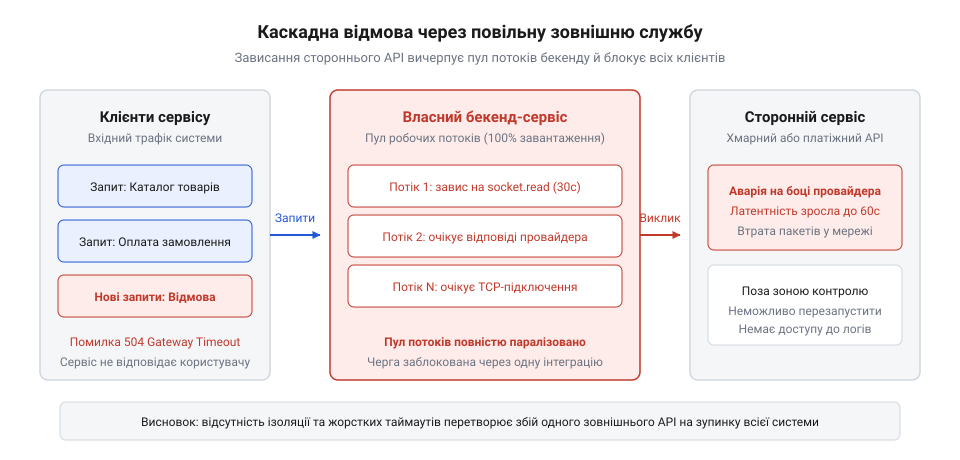
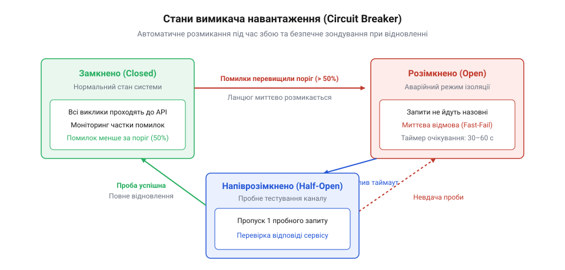

# Служба, якою ти не керуєш

<preknowlist>
- [Їхня аварія — твоя аварія](root:progarch/their-outage-is-your-outage) — кореляція доступності стороннього сервісу із загальним SLA власного продукту
- [Квоти, ліміти й ціна виклику](root:progarch/quotas-limits-call-cost) — вплив обмежень на частоту та обсяг зовнішніх запитів
</preknowlist>

## Чужий сервер у твоєму синхронному ланцюгу

Найпростіший спосіб інтегрувати зовнішній сервіс виглядає напрочуд безневинно: усередині обробника HTTP-запиту твоєї програми викликається мережевий клієнт стороннього API. Користувач натискає кнопку оформлення замовлення, бекенд відкриває транзакцію в базі даних, валідує кошик, робить синхронний HTTP-виклик до платіжного шлюзу чи хмарного SMS-провайдера, чекає на відповідь, записує результат і повертає відповідь клієнту. У локальному середовищі або на етапі розробки цей виклик триває кілька десятків мілісекунд, і все працює бездоганно.

Але в промисловій експлуатації чужий сервер підпорядковується власним законам. Стороння служба може зазнати аварії, зіткнутися з перевантаженням або почати деградувати. У цей момент час її відповіді стрибає від звичних 50 мілісекунд до десятків секунд або взагалі зависає на рівні встановлення TCP-з'єднання. І тут спрацьовує фізика ресурсів твого власного веб-сервера.

Кожен вхідний запит від твого користувача утримує потік виконання *(англ. worker thread)* або пам'ять процесу, а також відкрите з'єднання з пулу бази даних. Коли сторонній ендпойнт припиняє відповідати швидко, запити клієнтів продовжують надходити з тією самою швидкістю. Потоки твого сервера, замість того щоб звільнятися за частки секунди, залишаються заблокованими в очікуванні чужих пакетів. За лічені секунди весь пул потоків веб-сервера вичерпується, черга очікування переповнюється, і твоя програма перестає відповідати на будь-які запити — навіть на ті, які взагалі не мають стосунку до стороннього сервісу (наприклад, перегляд головної сторінки чи віддача статичних файлів).

Щоб зрозуміти невідворотність цієї кризи на рівні операційної системи, погляньмо на динаміку низькорівневих ресурсів ядра. Кожне встановлене або незавершене мережеве з'єднання потребує файлового дескриптора *(англ. file descriptor)* у таблиці дескрипторів процесу та буферів прийому й передачі TCP у просторі ядра ОС. У стандартній конфігурації Linux-сервера ліміт відкритих файлових дескрипторів для процесу часто становить 1024 або кілька тисяч одиниць (`ulimit -n`). Коли сторонній сервіс перестає відповідати, а нові клієнти продовжують підключатися, кількість відкритих сокетів зростає лавиноподібно.

Ситуація загострюється поведінкою стану TCP: сокети, які не завершили рукостискання (SYN-пакети без відповіді SYN-ACK) або застрягли у стані очікування підтвердження, накопичуються в черзі напіввідкритих з'єднань *(англ. SYN backlog queue)*. Якщо в цей момент у процесу закінчуються дескриптори, ядро ОС починає повертати помилку `EMFILE: Too many open files`. У цей момент застосунок втрачає здатність виконувати будь-які системні операції вводу-виводу: він не може відкрити файл конфігурації, записати рядок у журнал на диску, встановити внутрішнє з'єднання з Redis або прийняти новий вхідний сокет від клієнта через системний виклик `accept()`.

Паралельно з дескрипторами вичерпується діапазон ефемерних портів *(англ. ephemeral port exhaustion)*. Для кожного вихідного TCP-з'єднання до IP-адреси провайдера операційна система виділяє локальний порт із діапазону (зазвичай від 32768 до 60999). Якщо сокети застряють або після примусового обриву зависають у стані `TIME_WAIT` протягом двох максимальних часів життя сегмента (2MSL, що часто дорівнює 60 секундам), пул вільних портів спорожнюється. Навіть якщо процесор і оперативна пам'ять залишаються завантаженими лише на 10%, застосунок повністю паралізований, бо ядро просто не має вільних кортежів `(src_ip, src_port, dst_ip, dst_port)` для виходу в мережу.

*Каскадний колапс: сповільнення зовнішнього API блокує потоки виконання власного застосунку, призводячи до вичерпання пулу з'єднань і повної недоступності власного сервісу для користувачів.*

Виникає парадокс: збій стався в чужій інфраструктурі, але в очах користувача зламалася саме твоя система. Якщо твій сервіс викликає десяток зовнішніх API, і кожен із них має доступність 99.9%, їхня послідовна композиція дає значно нижчу сумарну надійність. Наївний синхронний ланцюг перетворює чужу нестабільність на власну фатальну вразливість.

> 🔧 **Навіщо це.** Синхронний виклик стороннього API всередині циклу запит-відповідь передає керування доступністю твого продукту третій стороні. Розуміння того, як вичерпуються системні ресурси (пули потоків, файлові дескриптори, сокети), змушує архітектора проектувати межі системи з розрахунком на обов'язковий і регулярний збій контрагента.

## Межа та ізоляція: шлюз і антикорупційний шар

Прямий виклик чужого API з глибини доменної логіки створює ще одну непомітну, але руйнівну проблему — концептуальне забруднення кодової бази. Сторонній провайдер має власну онтологію, свої найменування статусів, структури помилок і формати ідентифікаторів. Якщо моделі зовнішнього сервісу безпосередньо просочуються в сутності твого бізнес-ядра, будь-яка зміна версії зовнішнього API або вимушений перехід на іншого постачальника вимагатиме переписування коду по всьому застосунку.

Щоб захистити систему від чужого впливу, взаємодію виносять за дві архітектурні конструкції: шлюз *(англ. gateway)* та антикорупційний шар *(англ. anticorruption layer, ACL)*.

Шлюз виступає фасадом над мережевим протоколом сторонньої служби. Він інкапсулює низькорівневі деталі: формування заголовків авторизації, підписання запитів криптографічними ключами, роботу з HTTP-сесіями та парсинг сирого JSON або XML. Для решти твоєї системи шлюз постає у вигляді простого доменного інтерфейсу, що оперує зрозумілими бізнес-операціями.

Антикорупційний шар бере на себе функцію перекладача між чужою мовою та внутрішньою мовою твоєї системи. Він гарантує, що чужі сутності не вийдуть за межі адаптера:
- Чужі числові або рядкові статуси (наприклад, `STATUS_CODE_104_PENDING_APPROVAL`) транслюються у внутрішні доменні переліки (`PaymentStatus.PROCESSING`).
- Чужі помилки й винятки мережевої бібліотеки перехоплюються та перетворюються на типізовані доменні помилки твоєї системи.
- Надлишкові поля з відповіді стороннього сервера відсікаються, а потрібні нормалізуються до внутрішнього формату.

:::code a-service-you-dont-control-d/ts/externalprovidergateway.ts

Справжня сила антикорупційного шару розкривається тоді, коли бізнес вимагає підключення резервного провайдера *(англ. fallback / secondary provider)* на випадок тривалої аварії основного. Якщо зовнішній платіжний партнер падає посеред робочого дня, ручне перемикання або термінове переписування коду неприпустиме: система повинна автоматично маршрутизувати трафік на альтернативний шлюз.

У такій архітектурі доменний інтерфейс `PaymentGateway` залишається єдиним контрактом для бізнес-ядра, але за ним ховається мультипровайдерний складений шлюз *(англ. composite routing gateway)*. Цей компонент керує пулом адаптерів: `PrimaryStripeAdapter` та `BackupAdyenAdapter`. Кожен із них має власний, повністю ізольований антикорупційний шар. 

Якщо Stripe відповідає кодами `402 card_declined` або помилками валідації, ACL визнає це коректною бізнес-відповіддю й повертає результат у домен без повторних спроб: клієнт справді не має грошей, і турбувати іншого провайдера безглуздо. Але якщо основний провайдер повертає `503 Service Unavailable`, сокет падає за таймаутом або запобіжник основного шлюзу розмикає ланцюг, композитний шлюз негайно перенаправляє той самий запит до резервного провайдера.

Антикорупційний шар резервного постачальника перекладає його специфічні структури даних у ті самі канонічні доменні типи. Для бізнес-сервісу замовлень немає жодної різниці, хто саме провів транзакцію: внутрішня модель працює виключно з чистим типом `PaymentResult`. Така схема мультипровайдерності дає змогу реалізувати стратегії динамічного спліту навантаження *(англ. traffic splitting)*, коли 90% трафіку йде на дешевшого постачальника, а 10% постійно підігріває резервний канал, гарантуючи його миттєву готовність до перехоплення навантаження під час кризи.

Завдяки такій межі сторонній сервіс перетворюється на знімний модуль. Якщо завтра зовнішній постачальник кардинально змінить формат даних або доведеться підключити резервного провайдера, зміни торкнуться виключно класу адаптера та антикорупційного шару, тоді як ядро бізнес-логіки залишиться недоторканим.

> 🔧 **Навіщо це.** Антикорупційний шар утримує автономію власної доменної моделі. Він локалізує чужі зміни: коли провайдер випускає оновлення або ламає формат полів, ви змінюєте один модуль-перекладач на межі системи, а не перевіряєте сотні файлів бізнес-логіки.

## Механізми виживання: таймаути, circuit breaker та керована деградація

Коли мережевий шлюз побудовано, постає питання поведінки під час відмов: як саме система реагує, коли зовнішній сервер перестає відповідати? Наївне сподівання на стандартні налаштування HTTP-клієнтів є головною причиною збоїв. У багатьох середовищах таймаут сокета за замовчуванням дорівнює нескінченності або кільком хвилинам. Якщо сервер зависає на рівні читання TCP-пакетів, твій потік виконання чекатиме нескінченно.

Перше залізне правило — розмежування та жорстке обмеження часових лімітів:
1. **Таймаут з'єднання (Connect Timeout):** Час на проходження TCP-рукостискання та TLS-негоціації. Якщо мережа недоступна або маршрут зламано, з'єднання має відсікатися за 500–1000 мілісекунд, а не висіти хвилинами.
2. **Таймаут читання (Socket/Read Timeout):** Максимальний проміжок між отриманням окремих пакетів даних у вже відкритому з'єднанні.
3. **Загальний дедлайн (Request Deadline):** Сумарний час від початку формування запиту до повного отримання відповіді.

Але самого лише таймауту замало. Якщо зовнішній сервіс упав, а твій застосунок продовжує надсилати тисячі запитів на секунду, кожен запит сумлінно чекатиме свого таймауту в 3 секунди, знову вичерпуючи ресурси. Гірше того: якщо додати сліпі повторні спроби *(англ. retries)*, навантаження помножиться, і ти власноруч влаштуєш сторонньому сервісу розподілену атаку на відмову в обслуговуванні (DDoS), добиваючи систему, яка намагається піднятися. Повторні спроби мають право на життя виключно з експоненційним відступом *(англ. exponential backoff)* та рандомізованим тремтінням інтервалу *(англ. jitter)*, щоб розмазати хвилі запитів у часі.

Математика повторних спроб будується на принципі розсіювання пікових хвиль навантаження. Якщо тисяча клієнтських потоків зазнає невдачі одночасно й виконає фіксовану паузу в 1 секунду, рівно за одну секунду на сторонній сервер обрушиться синхронний удар із тієї ж тисячі повторних запитів.

Щоб запобігти цьому резонансу, базовий час очікування для n-ї спроби розраховується за експоненційною формулою з обмеженням стелі: `t_wait = min(t_max, t_base · 2^n)`. Наприклад, при базовому часі `t_base = 100 мс` інтервали складають 100 мс, 200 мс, 400 мс, 800 мс, доки не досягнуть максимального значення `t_max = 5000 мс`. 

Проте самої експоненти недостатньо: потоки все одно рухатимуться згрупованими пачками. Для розриву кореляції між потоками застосовують повне тремтіння *(англ. Full Jitter)*: фактична пауза обирається як випадкове число з рівномірним розподілом від нуля до обчисленого експоненційного максимуму: `sleep = random(0, min(t_max, t_base · 2^n))`. Або застосовують некорельований джитер *(англ. Decorrelated Jitter)*: `sleep = min(t_max, random(t_base, previous_sleep · 3))`. Такий алгоритм повністю згладжує трафік, перетворюючи різкі піки на рівномірний фоновий потік, дозволяючи сторонньому провайдеру спокійно перезапуститися.

Для радикального захисту периметра використовують вимикач навантаження *(англ. circuit breaker)*.

*Життєвий цикл запобіжника: перехід у відкритий стан під час сплеску відмов миттєво відсікає зовнішні запити, а напіввідкритий стан безпечно тестує відновлення провайдера.*

Точність роботи вимикача навантаження визначається налаштуванням його ковзного вікна спостереження *(англ. sliding window)*. Використовують два типи вікон:
- **Вікно на основі лічильника (Count-based):** Зберігає результати останніх N викликів (наприклад, останні 100 запитів). Якщо з цих 100 запитів понад 50 завершилися помилкою або таймаутом (поріг відмов 50%), запобіжник розмикається.
- **Вікно на основі часу (Time-based):** Зберігає статистику за фіксований відрізок часу (наприклад, останні 10 секунд), розбитий на кільцевий буфер секундних кошиків.

Крім відсотка явних помилок, вимикач відстежує частку повільних викликів *(англ. slow call rate threshold)*. Якщо 60% запитів тривають довше за 1.5 секунди (при нормальному часі 50 мс), вимикач переходить у стан Open ще до того, як сторонній сервіс почне повертати явні коди 5xx. Це запобігає прихованому паралічу пулів потоків власного бекенду.

Вимикач працює за аналогією з електричним автоматичним вимикачем і має три дискретні стани:
- **Закритий (Closed):** Нормальний стан. Усі запити проходять до стороннього сервісу. Вимикач веде статистику успіхів і помилок у ковзному вікні часу.
- **Відкритий (Open):** Якщо частка помилок чи таймаутів перевищує встановлений поріг (наприклад, 50% невдач за останні 10 секунд), вимикач розмикає ланцюг. Наступні запити навіть не намагаються встановити мережеве з'єднання — вони миттєво повертають швидку помилку *(англ. fail-fast)*, не витрачаючи сокети й потоки.
- **Напіввідкритий (Half-Open):** Після спливання тайм-ауту очікування (наприклад, 30 секунд) вимикач пропускає рівно один або кілька пробних запитів. Якщо вони завершуються успішно, ланцюг замикається (Closed). Якщо хоч один падає — ланцюг знову відкривається (Open) на наступний період.

Коли вимикач розірвав ланцюг, вмикається механізм керованої деградації *(англ. graceful degradation)* або запасного варіанту *(англ. fallback)*:
- Повернути дані з локального кешу, нехай навіть вони злегка застарілі.
- Повернути безпечне значення за замовчуванням (наприклад, порожній список рекомендацій або стандартний курс валют).
- Зафіксувати намір операції в локальній черзі для пізнішої обробки, повідомивши користувача, що запит прийнято до виконання.

> 🔧 **Навіщо це.** Запобіжник перетворює повільне виснажливе зависання всієї системи на миттєву й контрольовану деградацію другорядного функціоналу. Користувач отримує відповідь за частки секунди, а основне ядро продукту залишається стабільним.

## Асинхронний розрив і локальний стан

Найвищий рівень стійкості до збоїв сторонніх служб досягається тоді, коли ти взагалі вилучаєш зовнішній мережевий виклик із критичного шляху виконання запиту.

Якщо платіж, відправка чека, синхронізація з CRM чи оновлення даних кур'єра відбуваються безпосередньо під час обробки клієнтського HTTP-запиту, доступність твого бекенду завжди обмежена найповільнішим із цих сторонніх компонентів. Асинхронний розрив розв'язує цю залежність у часі.

Замість того, щоб утримувати користувача на дроті, застосунок фіксує подію в локальній базі даних у межах тієї ж транзакції, що й бізнес-зміна. Це класичний патерн надійної вихідної скриньки *(англ. transactional outbox pattern)*. Користувач миттєво отримує підтвердження «Замовлення створено», а окремий фоновий процес вичитує події зі скриньки й надсилає їх сторонньому сервісу через чергу повідомлень.

:::code a-service-you-dont-control-d/ts/createorder.ts

Проте перехід до асинхронного контуру неминуче стикається з фундаментальною теоремою про неможливість гарантії «рівно один раз» *(англ. exactly-once delivery)* у розподілених мережах. Будь-який асинхронний брокер або фоновий обробник вихідної скриньки здатний забезпечити лише доставку «хоча б один раз» *(англ. at-least-once delivery)*.

Уявімо типовий збій: фоновий воркер вичитав запис про платіж із таблиці `outbox`, успішно надіслав HTTP-запит до стороннього платіжного шлюзу, і шлюз успішно списав кошти з картки клієнта. Але в момент, коли відповідь із кодом 200 поверталася по мережі назад, стався обрив з'єднання або рестарт поду твого сервісу. Твій воркер не отримав підтвердження, транзакція оновлення статусу в `outbox` відкотилася, і запис залишився зі статусом `PENDING`. Через тридцять секунд інший воркер вичитує той самий запис і надсилає його провайдеру вдруге. Якщо система не захищена, з користувача спишуть гроші двічі.

Єдиний надійний архітектурний захист від подвійного списання — сувора ідемпотентність *(англ. idempotency)* на обох кінцях з'єднання:
1. **Ключ ідемпотентності (Idempotency Key):** Під час публікації наміру в outbox генерується детермінований ідентифікатор операції (наприклад, `orderId` або хеш від параметрів платежу). Кожен мережевий запит до стороннього API зобов'язаний передавати цей ключ у заголовку (наприклад, `Idempotency-Key: ord_987654`).
2. **Контракт зі стороннім провайдером:** Провайдер, отримавши повторний запит із тим самим ключем, не проводить операцію вдруге, а повертає збережений результат першої успішної обробки.
3. **Обробка зворотних сповіщень (Webhooks):** Якщо провайдер повідомляє про результат через вебхуки, твій власний обробник повинен зберігати оброблені ідентифікатори подій (`webhook_event_id`) в окремій таблиці з унікальним індексом. Спроба вставити дублікат відсікається базою даних на рівні обмеження унікальності, запобігаючи повторній зміні бізнес-стану.

Якщо зовнішній провайдер у цей момент недоступний чи проводить регламентні роботи протягом кількох годин, твій бізнес продовжує приймати замовлення. Черга надійно накопичує повідомлення на диску. Щойно провайдер оживає, фоновий обробник поступово розвантажує накопичений буфер із дотриманням лімітів швидкості.

Другий фундаментальний прийом — локальний зліпок стану *(англ. local state cache/read replica)*. Якщо твоїй системі регулярно потрібні сторонні довідники (списки поштових відділень, курси валют, категорії товарів постачальника), неприпустимо робити HTTP-запит до провайдера під час кожного рендерингу сторінки. Необхідно налаштувати фонову періодичну синхронізацію або підписку на вебхуки провайдера, зберігаючи копію довідника у власній базі даних. Внутрішні запити завжди читають локальні дані, і повний блекаут стороннього партнера ніяк не впливає на читання даних твоїми користувачами.

> 🔧 **Навіщо це.** Асинхронний розрив і локальне кешування довідників ліквідують часову прив'язку до чужої інфраструктури. Навіть якщо сторонній провайдер лежить годинами, твої користувачі не помічають збою, а дані обробляються, щойно партнер відновлює роботу.
