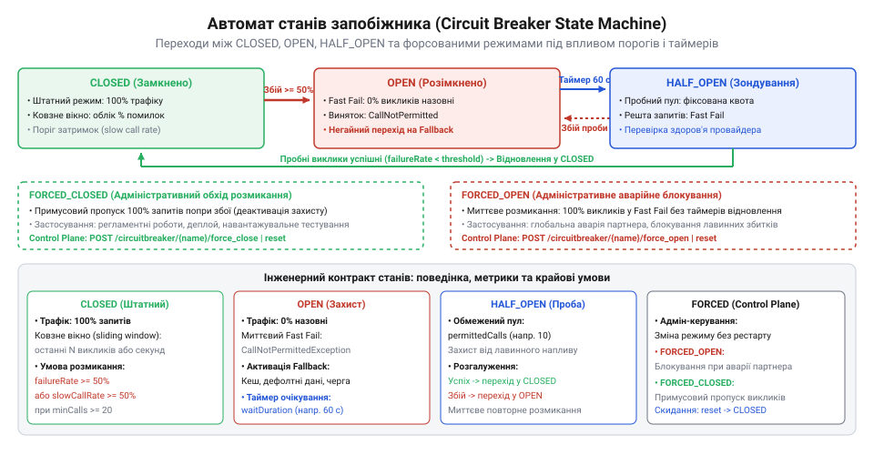
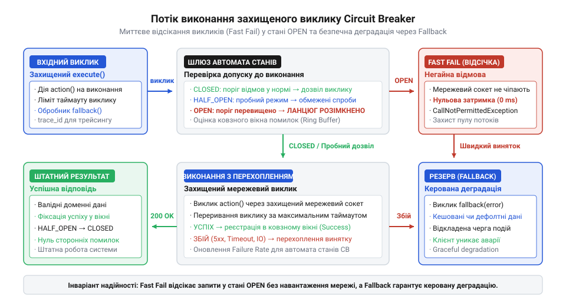
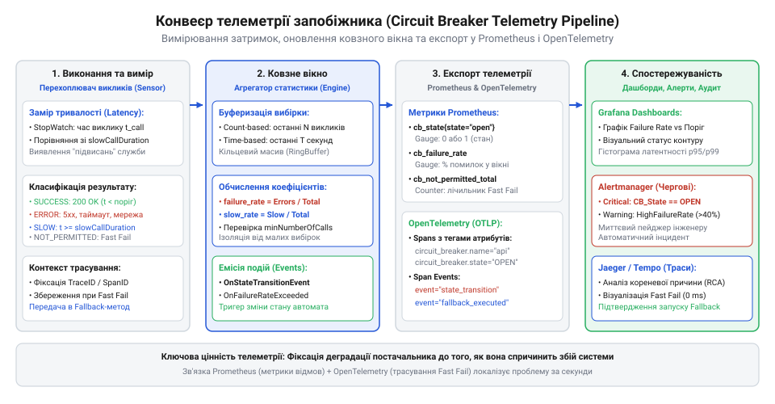

# Служба, якою ти не керуєш

<preknowlist>
- [Їхня аварія — твоя аварія](root:progarch/their-outage-is-your-outage) — як вичерпання пулів потоків і затримки зовнішніх викликів призводять до каскадного колапсу системи
- [Коли вони ламають без попередження](root:progarch/when-they-break-without-warning) — патерни поведінки системи при раптовій деградації зовнішнього сервісу та необхідність негайної ізоляції збійної залежності
</preknowlist>

## Каскадне блокування потоків та потреба в інтерфейсі швидкої відмови

Коли розподілена система взаємодіє із зовнішніми службами — платіжними шлюзами, логістичними провайдерами чи сервісами ідентифікації ([DH: чужі служби в критичному шляху](root:progarch/dh-foreign-services-in-critical-path)), — розробники зазвичай очікують віддаленої відповіді за десятки чи сотні мілісекунд. Проте реальний інтернет сповнений непередбачуваних збоїв. Найнебезпечніший сценарій для архітектури настає не тоді, коли віддалений сервер раптово падає і миттєво обриває TCP-з'єднання пакетом RST, а тоді, коли він починає відповідати надзвичайно повільно або зависає зовсім: [Коли вони ламають без попередження](root:progarch/when-they-break-without-warning).

За замовчуванням більшість мережевих клієнтів мають консервативні сокетні таймаути (@@en|timeout@@; від англ. *time* — час, та *out* — поза, вихід) тривалістю від 30 до 60 секунд. Якщо зовнішня служба під дією внутрішнього перевантаження або втрати зв'язку із базою даних припиняє обробляти запити, клієнтські потоки виконання не звільняються: вони зависають в очікуванні відповіді на заблокованих мережевих сокетах.

Масштаб катастрофи розгортається за законом Літтла: середня кількість одночасно зайнятих ресурсів системи дорівнює добутку інтенсивності вхідного потоку запитів на середній час їх обробки. Якщо в нормальному режимі затримка виклику становить 100 мілісекунд при навантаженні 200 запитів на секунду, то в системі постійно зайнято лише 20 потоків воркерів. Але якщо затримка на стороні провайдера підскакує до 30 секунд, для утримання того самого вхідного потоку застосунку знадобиться вже 6000 одночасно заблокованих потоків.

Жоден типовий веб-сервер не володіє таким пулом з'єднань і пам'яті. У лічені секунди пул обробників повністю вичерпується, вхідні черги переповнюються, а нові запити від реальних користувачів починають масово відкидатися. Система перестає відповідати навіть на ті ендпоінти, які взагалі не залежать від стороннього сервісу. За внутрішніми таймаутами падають перевірки працездатності (health checks), оркестратор контейнерів перезапускає екземпляри застосунку, проте новостворені процеси миттєво поглинаються тим самим шквалом завислих з'єднань і вмирають знову. Локальний збій у стороннього постачальника перетворюється на повний параліч власного сервісу: [Їхня аварія — твоя аварія](root:progarch/their-outage-is-your-outage).

Ситуацію катастрофічно погіршують наївні клієнтські повтори (retries). Коли сервіс замовлень після вичерпання таймауту сліпо повторює запит тричі поспіль, він збільшує навантаження на провайдера в чотири рази. Тисячі клієнтів одночасно бомбардують сервери партнера повторними спробами, перетворюючи тимчасову затримку на масштабний блекаут: [Квоти, ліміти й ціна виклику](root:progarch/quotas-limits-call-cost). Замість того щоб дати сторонній системі відновитися, споживачі остаточно добивають її власним трафіком.

Щоб розірвати це замкнене коло, архітектура вимагає відмови від принципу сліпої надії. Системі необхідний стандартизований інтерфейс швидкої відмови (@@en|fast fail@@; від англ. *fast* — швидкий, та *fail* — збій, відхилення). Замість того щоб безпорадно чекати десятки секунд на сокетних дескрипторах, система на межі інтеграції повинна вміти детерміновано фіксувати факт деградації залежності та миттєво відхиляти подальші приречені запити за субмілісекундний час. Швидка відмова рятує критичні локальні ресурси: потоки не блокуються, пам'ять не переповнюється чергами, а користувач отримує чітке пояснення проблеми або запасний сценарій обслуговування замість нескінченного зависання інтерфейсу.

> 🔧 **Навіщо це.**
> Інтерфейс швидкої відмови рятує систему від каскадного колапсу пулів потоків і пам'яті під час аварій зовнішніх залежностей. Замість очікування вичерпання тривалих сокетних таймаутів запити відсікаються миттєво, захищаючи власну інфраструктуру та запобігаючи паразитному шторму запитів до пошкодженого партнера.

## Архітектура та автомат станів запобіжника

Щоб реалізувати інтерфейс швидкої відмови надійним і детермінованим способом, системна інженерія запозичила концепцію з електротехніки — патерн запобіжника (@@en|circuit breaker@@; від лат. *circuitus* — колообіг, рух по колу, та англ. *breaker* — розмикач). У силових електричних мережах автоматичний вимикач миттєво розриває електричний контур, якщо струм перевищує гранично допустиму норму, рятуючи проводку будівлі від перегріву та пожежі. У програмній архітектурі цей механізм виконує аналогічну захисну функцію: він обгортає виклики до непідконтрольної зовнішньої служби й перериває потік запитів, щойно частка помилок чи неприпустимих затримок перевищує встановлену межу стійкості.

Поведінка запобіжника описується строгою моделлю автомата скінченних станів (@@en|finite state machine@@, FSM; від лат. *finitus* — обмежений, та грец. *mechane* — знаряддя, споруда). На межі системи автомат перебуває в одному з дискретних станів, які регламентують, чи дозволено поточному потоку виконання здійснити реальний мережевий запит до віддаленого сервера.

Робоча поверхня сучасного виробничого запобіжника налічує три базові оперативні стани та три адміністративні режими керування:

1. **Замкнений (CLOSED)**: штатний робочий режим. Електричний ланцюг замкнений, усі запити від бізнес-логіки безперешкодно пропускаються до зовнішнього постачальника. Одночасно запобіжник записує результати кожного виклику (успіх, помилка, тривалість виконання) у ковзне вікно телеметрії. Якщо вікно заповнене мінімально необхідною кількістю спостережень і розрахована частка збоїв перевищує встановлений поріг, автомат здійснює перехід у розімкнений стан.
2. **Розімкнений (OPEN)**: аварійний захисний режим. Контур розірвано: жоден реальний мережевий запит не відправляється до зовнішньої служби. Будь-яка спроба виконати операцію негайно відхиляється типізованим винятком швидкої відмови або передається обробнику запасного сценарію (Fallback). Одночасно під час переходу в стан `OPEN` запускається внутрішній таймер періоду охолодження (`waitDurationInOpenState`). Доки таймер активний, сторонній сервіс отримує повну паузу від навантаження для відновлення працездатності.
3. **Напіввідкритий (HALF_OPEN)**: режим пробного зондування. Коли таймер відкритого стану вичерпується, автомат самостійно переходить у напіввідкритий стан, щоб перевірити, чи усунув партнер свою аварію. У цьому режимі запобіжник пропускає суворо обмежену кількість пробних викликів (`permittedNumberOfCallsInHalfOpenState`), утримуючи решту запитів у режимі відхилення. Якщо всі пробні запити (або їх частка, визначена порогом) завершуються успішно, автомат фіксує відновлення провайдера й повертається у стан `CLOSED`, очищуючи лічильники. Якщо хоча б один пробний запит зазнає невдачі або перевищує таймаут, автомат негайно повертається в стан `OPEN` на новий повний цикл очікування.

Окрім динамічних станів, експлуатаційна модель вимагає підтримки адміністративних станів ручного втручання (Control Plane):

- **Примусово розімкнений (FORCED_OPEN)**: режим безумовного блокування трафіку, ініційований черговим інженером через панель оперативного керування. Контур залишається розімкненим незалежно від метрик і таймерів, доки адміністратор явно не скасує блокування. Застосовується під час планових робіт партнера або під час неоголошених аварій, коли автоматика ще не набрала кворуму спостережень.
- **Примусово замкнений (FORCED_CLOSED)**: режим безумовного пропуску трафіку із примусовим ігноруванням помилок. Використовується для проведення верифікаційних тестів після ремонту мережі чи в критичних бізнес-ситуаціях, коли навіть 90% помилок вважаються кращими за повне припинення спроб.
- **Вимкнений (DISABLED)**: пасивний стан. Запобіжник не блокує трафік і не здійснює переходів, виступаючи виключно пасивним прозорим колектором телеметрії.


*Автомат станів запобіжника: переходи між нормальним виконанням (CLOSED), швидким відсіканням запитів (OPEN) та пробним зондуванням (HALF_OPEN), розширені адміністративними режимами примусового блокування.*

Ключовою особливістю сучасного автомата запобіжника є врахування двох взаємодоповнюючих порогових критеріїв переходу із `CLOSED` у `OPEN`:

- **Поріг частки збоїв (`failureRateThreshold`)**: якщо відсоток запитів, що завершилися мережевими винятками чи HTTP-кодами 5xx, перевищує ліміт (наприклад, `50%`), контур розмикається.
- **Поріг частки повільних викликів (`slowCallRateThreshold`)**: якщо запит не зазнав аварії, проте його час очікування перевищив допустиму межу повільного виклику (`slowCallDurationThreshold`, наприклад, `1500 мс`), він класифікується як деградація затримки. Якщо частка повільних викликів перевищує встановлений відсоток (наприклад, `60%`), контур розмикається так само, як і при відмовах. Це запобігає «повільній смерті» системи, коли віддалений сервер формально відповідає, але блокує клієнтські потоки на неприпустимо довгий час.

Нижче наведено програмний контракт автомата скінченних станів запобіжника, що формалізує можливі стани, структури подій переходів та базовий інтерфейс інспекції:

:::code api-circuit-breaker-telemetry-contract/ts/circuitbreakerstate.ts

Такий автомат станів діє як безкомпромісний фільтр на вході в будь-який віддалений клієнт. Коли доменний код викликає віддалену операцію, першим кроком перевіряється метод `tryAcquirePermission()`. Якщо стан `OPEN` або `FORCED_OPEN`, запит навіть не торкається мережевого сокета — він відсікається миттєво, не споживаючи ані мікросекунди часу очікування введення-виведення.

> 🔧 **Навіщо це.**
> Чітка специфікація автомата станів усуває неоднозначність у поведінці системи під час аварій. Бізнес-код та інфраструктурні адаптери завжди спираються на детерміновані правила: або запит пропускається з реєстрацією метрик у стані CLOSED, або негайно відхиляється в стані OPEN, рятуючи пул з'єднань від вичерпання.

## Програмний контракт захищеного виклику та механіка Fallback

Автомат станів визначає внутрішні правила перемикання режимів, проте для прикладного розробника точкою щоденної взаємодії є програмний контракт виконання захищеного виклику (Execution API). Замість того щоб самостійно перевіряти стан автомата перед кожним зверненням до мережі, бізнес-код делегує виконання уніфікованому декоратору або функціональній обгортці.

Програмний контракт виклику приймає три обов'язкові сутності:
1. **Цільову доменну дію (Protected Action)**: асинхронну функцію без аргументів (Supplier / Callable), яка інкапсулює реальний віддалений виклик через мережевий клієнт і повертає значення типу `Promise<T>`.
2. **Контекст виклику та сигнал скасування (AbortSignal / Context)**: об'єкт для наскрізного поширення таймаутів і ручного скасування операцій.
3. **Обробник запасного сценарію (Fallback Handler)**: альтернативну функцію відступу на запасну позицію (@@en|fallback@@; від англ. *fall* — падати, та *back* — назад), яка викликається лише в разі відмови.

Поведінка контракту суворо розділяється залежно від поточного стану контуру:
- Якщо контур перебуває в стані `CLOSED` (або `HALF_OPEN` з наявними квотами), запит пропускається на виконання до цільової дії. Якщо дія завершується успішно, контракт фіксує успіх у телеметрії й повертає корисні дані `T`. Якщо дія викидає помилку або перевищує таймаут, збій реєструється в автоматі, після чого активується механізм Fallback.
- Якщо контур перебуває в стані `OPEN` чи `FORCED_OPEN`, контракт негайно блокує спробу виклику. Мережевий запит взагалі не створюється. Замість цього контракт генерує стандартизований виняток швидкої відмови — `CallNotPermittedException` (або `CircuitBreakerOpenException`). Тривалість такої відмови становить менше 0.5 мілісекунди, що повністю рятує клієнтський потік від очікування.


*Потік виконання захищеного виклику: запобіжник перевіряє дозвіл на виконання, відсікає запит за відкритого контуру або передає керування до мережевого виклику з перехопленням винятків та активацією Fallback.*

Принциповим є розрізнення між винятком таймауту мережі та винятком відкритого запобіжника:
- **Мережевий таймаут (`TimeoutException`)**: свідчить про те, що система чекала десятки секунд, витратила локальні дескриптори сокетів і не знає, чи обробив віддалений сервер команду. Це небезпечний стан невизначеності.
- **Швидка відмова запобіжника (`CircuitBreakerOpenException`)**: це миттєва, детермінована локальна відповідь системи. Контракт гарантує, що жоден байт не пішов у мережу, а отже, стан віддаленої системи гарантовано не змінився. Це уможливлює безпечне перемикання абонентів на альтернативні шляхи.

Коли стається збій або спрацьовує швидка відмова, контракт виконання активує Fallback. Архітектура розрізняє чотири стандартні патерни запасного виконання:

1. **Статичний фолбек (Stub / Default Fallback)**: повернення заздалегідь зафіксованого порожнього або безпечного значення (наприклад, порожній список рекомендованих товарів чи дефолтний опис профілю). Застосовується для другорядних елементів інтерфейсу, відсутність яких не зупиняє користувача.
2. **Фолбек на застарілий кеш (Stale Cache Fallback)**: зчитування останнього успішного знімка даних із локального або розподіленого кешу (Redis/Memcached) із супровідним заголовком `X-Data-Stale: true`. Дозволяє користувачеві продовжувати роботу з актуальною на 95% інформацією.
3. **Аварійне перемикання на резервного провайдера (Secondary Failover)**: виклик альтернативного адаптера іншого постачальника послуг через спільний доменний порт: [Споживацький контракт із чужим провайдером](root:progarch/consumer-driven-contracts).
4. **Асинхронна буферизація (Buffering / Outbox)**: збереження команди у локальну чергу або таблицю відкладених операцій (Transactional Outbox) для гарантованої фонової доставки після відновлення зв'язку.

> ⚠️ **Застереження**:
> Фолбек категорично заборонено використовувати для операцій списання коштів або незворотних мутацій даних, якщо немає гарантії ідемпотентності чи консистентності. Підміна списання грошей «тихим успіхом» створить фінансову діру в системі. У таких випадках контракт зобов'язаний явно прокинути `CircuitBreakerOpenException` у доменну логіку для інформування клієнта.

Нижче наведено програмну специфікацію контракту захищеного виконання:

:::code api-circuit-breaker-telemetry-contract/ts/circuitbreakeropenexception.ts

> 🔧 **Навіщо це.**
> Програмний контракт виконання ізолює бізнес-код від низькорівневої механіки мережевих таймаутів і підрахунку відмов. Розробник викликає захищений метод через лаконічний API `execute()`, гарантуючи системі миттєвий Fast Fail і передбачувану деградацію через механізм Fallback при будь-яких збоях зовнішнього партнера.

## Специфікація конфігураційного контракту та пограничні режими

Щоб запобіжник реагував на аварії вчасно й без помилкових спрацьовувань, його параметри чутливості мають бути суворо формалізовані. Конфігураційний контракт визначає декларативну схему налаштування поведінки запобіжника для кожної зовнішньої інтеграції: [Документація проти дійсності](root:progarch/docs-vs-reality).

Конфігурація (@@en|configuration@@; від лат. *configuratio* — взаємне розташування, форма) спирається на такі ключові параметри:

1. **Тип ковзного вікна (`slidingWindowType`)**:
   - `COUNT_BASED` (за кількістю викликів): аналізує останні `N` виконаних запитів (наприклад, останні 100 викликів).
   - `TIME_BASED` (за часом): аналізує статистику за останні `S` секунд, розбиту на циклічні часові бакети (наприклад, вікно у 60 секунд із 10 бакетами по 6 секунд).
2. **Розмір вікна (`slidingWindowSize`)**: місткість аналітичного буфера (кількість викликів або секунд).
3. **Мінімальний обсяг вибірки (`minimumNumberOfCalls`)**: мінімальна кількість зафіксованих запитів у вікні, яка необхідна для того, щоб запобіжник почав розраховувати відсоток збоїв і ухвалювати рішення про розмикання.
4. **Поріг частки збоїв (`failureRateThreshold`)**: відсоткове значення (від 1 до 100), перевищення якого переводить запобіжник із `CLOSED` у `OPEN` (стандартне значення: 50%).
5. **Поріг повільних викликів (`slowCallRateThreshold`)**: частка викликів у відсотках, час обробки яких перевищив ліміт повільного запиту (стандартно: 50–70%).
6. **Ліміт тривалості повільного виклику (`slowCallDurationThreshold`)**: час у мілісекундах, починаючи з якого запит вважається повільним (наприклад, 2000 мс).
7. **Тривалість відкритого стану (`waitDurationInOpenState`)**: час у мілісекундах, протягом якого запобіжник утримує стан `OPEN` перед спробою зондування у стані `HALF_OPEN`.
8. **Кількість пробних запитів (`permittedNumberOfCallsInHalfOpenState`)**: фіксована квота викликів, дозволена для перевірки стану системи у напіввідкритому режимі (зазвичай від 3 до 10 запитів).
9. **Предикат класифікації винятків (`recordExceptionPredicate`)**: функція, що визначає, чи повинен конкретний тип винятку враховуватися як системна аварія (мережеві обриви, 5xx), чи ігноруватися (клієнтські 4xx валідації).

Нижче наведено формальну типізовану специфікацію конфігураційного контракту:

:::code api-circuit-breaker-telemetry-contract/ts/slidingwindowtype.ts

Під час експлуатації конфігураційного контракту виникають три критичні пограничні режими, на яких найчастіше спотикаються інженери:

### 1. Пастка «холодного старту» та недогрітого вікна
Якщо сервіс щойно стартував і отримав лише два запити, один із яких завершився випадковим мережевим скиданням, математична частка відмов миттєво сягне 50%. Без запобіжного механізму контур розімкнувся б від єдиного випадкового збою.
Параметр `minimumNumberOfCalls` усуває цю проблему. Доки ковзне вікно не зафіксує мінімально визначену кількість спостережень (наприклад, 20 викликів), автомат перебуває в захищеному режимі прогріву: статистика збирається, проте рішення про зміну стану не ухвалюється.

### 2. Рідкісний трафік і застарілі помилки (Stale Error Trap)
Для ендпоінтів із низькою інтенсивністю викликів (наприклад, один запит на 5 хвилин) конфігурація `COUNT_BASED` із розміром вікна 100 є неприпустимою. Збій, що стався годину тому під час короткочасного перезавантаження комутатора, залишатиметься у вікні викликів протягом кількох діб, утримуючи штучно завищений відсоток помилок.
Для рідкісного трафіку контракт вимагає використання `TIME_BASED` вікна: дані збоїв автоматично зникають із часових бакетів, щойно спливає вікно спостереження, гарантуючи оцінку лише свіжого стану провайдера.

### 3. Хитання станів (State Flapping / Oscillation)
Якщо тривалість перебування у відкритому стані `waitDurationInOpenState` встановлена занадто короткою (наприклад, 2 секунди), а кількість пробних викликів у напіввідкритому стані становить лише 1, система потрапляє в режим нескінченного циклічного хитання станів: `OPEN -> HALF_OPEN -> OPEN -> HALF_OPEN`. Одиничний запит знову б'ється об невідновлений сервер, знову закриває контур, а клієнти постійно отримують непередбачувані сплески помилок.
Для стабілізації конфігураційний контракт рекомендує використовувати експоненційне збільшення паузи очікування (Exponential Backoff) для повторних циклів `OPEN`, а кількість пробних викликів виставляти не менше 5–10 запитів, щоб отримати статистично достовірний результат зондування: [Дублери чужої служби](root:progarch/service-doubles-and-environments).

> 🔧 **Навіщо це.**
> Декларативний конфігураційний контракт дозволяє калібрувати чутливість запобіжника під конкретні характеристики кожного зовнішнього API. Ви чітко розмежовуєте швидкі критичні платіжні виклики та фонові аналітичні запити, запобігаючи як помилковим блокуванням на старті, так і небезпечному зависанню на застарілих даних.

## Контракт телеметрії та метрик спостережуваності (OpenTelemetry / Prometheus)

Запобіжник, який мовчки розмикає ланцюг і відсікає клієнтські запити без експорту свого внутрішнього стану назовні, перетворюється з інструменту захисту на небезпечну «чорну скриньку». Коли користувачі раптово стикаються з масовими відмовами або спрощеними відповідями запасних сценаріїв (Fallback), команда інженерів бачить лише різке падіння успішних бізнес-транзакцій. Без детальної та стандартизованої спостережуваності (@@en|observability@@; від лат. *observabilis* — помітний, гідний уваги) неможливо швидко відповісти на базові діагностичні питання: чи збій стався у внутрішньому коді застосунку, чи зовнішній сервіс порушив домовленості ([Документація проти дійсності](root:progarch/docs-vs-reality)), яка конкретна умова спричинила розмикання контуру і скільки запитів було врятовано від безнадійного зависання на сокетах.

Щоб запобіжник став прозорим для платформи моніторингу, його інтерфейс зобов'язаний експортувати три взаємодоповнюючі класи телеметричних даних:
1. **Числові датчики стану (@@en|gauge@@; від англ. *gauge* — калібр, мірило)**: відображають миттєве поточне положення автомата скінченних станів.
2. **Лічильники подій (@@en|counter@@; від лат. *computare* — підраховувати, лічити)**: монотонно зростаючі накопичувачі кількості виконаних, відхилених і деградованих викликів.
3. **Гістограми розподілу (@@en|histogram@@; від грец. *histos* — стовп, щогла, та *gramma* — запис, риска)**: фіксують спектр латентності запитів і тривалість перебування контуру в аварійному розімкненому стані.

### 1. Стандартизація числових датчиків стану

У системах збору часових рядів на кшталт Prometheus значення будь-якої метрики є числом з рухомою комою. Текстові назви станів (`"OPEN"`, `"CLOSED"`) не можуть бути значеннями метрик, оскільки над ними неможливо обчислювати математичні агрегації та будувати тригерні графіки.

Тому контракт телеметрії фіксує єдину числову шкалу для датчика стану `circuit_breaker_state`:
- `0` — `CLOSED` (замкнений, нормальний режим роботи);
- `1` — `OPEN` (розімкнений аварійний режим, швидка відмова);
- `2` — `HALF_OPEN` (напіввідкритий пробний режим зондування);
- `3` — `FORCED_OPEN` (примусово відкритий інженером через панель керування);
- `4` — `FORCED_CLOSED` (примусово замкнений для аварійного пропуску трафіку);
- `5` — `DISABLED` (запобіжник повністю вимкнений).

Таке кодування перетворює побудову чергових графіків на тривіальну операцію, а правило алертингу в Alertmanager записується лаконічним числовим порівнянням:

```promql
# Оповіщення про перехід будь-якого запобіжника в аварійний розімкнений стан
circuit_breaker_state{job="order-service"} == 1
```

Поруч із датчиком стану ковзне вікно публікує поточні обчислені показники якості:
- `circuit_breaker_failure_rate_ratio`: розрахована частка збоїв у поточному вікні (від `0.0` до `1.0`);
- `circuit_breaker_slow_call_rate_ratio`: частка повільних викликів (від `0.0` до `1.0`);
- `circuit_breaker_buffered_calls_count`: фактична кількість запитів, накопичених у ковзному вікні на даний момент.

### 2. Лічильники викликів та гістограми затримок

Лічильник `circuit_breaker_calls_total` агрегує повний обсяг вхідного навантаження, що проходить крізь захисну межу. Для детального факторного аналізу цей лічильник обов'язково розбивається міткою `kind`:
- `successful`: виклик до зовнішнього сервісу виконано успішно за допустимий час;
- `failed`: виклик завершився перехопленою помилкою (мережевий скид, HTTP 5xx);
- `slow_successful`: виклик успішний, проте його тривалість перевищила поріг повільного виклику (`slowCallDurationThreshold`);
- `slow_failed`: виклик завершився помилкою і водночас був повільним;
- `not_permitted`: виклик заблоковано та миттєво відхилено самим запобіжником без створення сокета (Fast Fail);
- `fallback`: кількість запусків резервного сценарію (з додатковою міткою `status="success|failure"`).

Гістограма `circuit_breaker_call_duration_seconds` реєструє повний час виконання операції від моменту виклику обгортки до отримання результату, а `circuit_breaker_open_duration_seconds` відстежує, скільки секунд контур безперервно провів у стані `OPEN` до першої спроби зондування.


*Схема збору телеметрії та подій: вимірювання затримок і помилок, оновлення ковзного вікна та паралельний експорт числових метрик у Prometheus і розподілених трас в OpenTelemetry для моніторингу та алертингу.*

### 3. Структуровані події зміни стану (StateTransitionEvent)

Метрики показують усереднену динаміку системи, проте під час розслідування інцидентів (postmortem) інженерам потрібен точний хронологічний аудит: коли саме контур розімкнувся, яке конкретне значення перевищило поріг і що стало спусковим гачком переходу.

Контракт телеметрії зобов'язує запобіжник публікувати типізовану подію зміни стану `StateTransitionEvent`:

:::code api-circuit-breaker-telemetry-contract/ts/snippet-4.ts

Ці події спрямовуються у системний структурований лог (JSON) та шину подій для автоматичного створення інцидент-тікетів або сповіщення чергових інженерів у черговому каналі комунікації.

### 4. Інтеграція з розподіленим трасуванням (OpenTelemetry)

Коли розподілений запит проходить через каскад мікросервісів, кожен крок фіксується у вигляді спана (@@en|span@@; від англ. *span* — відрізок, проміжок часу) розподіленого трасування. Якщо запобіжник відсікає запит за відкритим контуром, це не повинно призводити до втрати контексту чи розриву ланцюжка трасування.

Контракт інтеграції запобіжника з OpenTelemetry реалізує такі обов'язкові правила:
1. **Збагачення поточного спана**: до активного спана додаються стандартні атрибути:
   - `circuit_breaker.name`: ім'я цільового контуру;
   - `circuit_breaker.state`: стан автомата на момент входу (`CLOSED`, `OPEN` тощо);
   - `circuit_breaker.execution_permitted`: булевий прапорець дозволу виконання.
2. **Фіксація подій спана (Span Events)**: якщо запит блокується за відкритим контуром, у спан записується подія `circuit_breaker.fast_fail` із деталями поточного стану, а статус спана встановлюється в `STATUS_ERROR` із зазначенням помилки `CallNotPermittedException`.
3. **Збереження контексту для Fallback**: обробник резервного сценарію виконується в межах того самого батьківського контексту трасування. У трасі з'являється дочірній спан з атрибутом `circuit_breaker.fallback=true`, що дозволяє в інтерфейсі Jaeger або Tempo наочно бачити розгалуження логіки: основна гілка відхилена запобіжником за 0.2 мс, після чого успішно відпрацював резервний кеш.

Нижче наведено програмний контракт телеметричного приймача (Telemetry Sink), що поєднує експорт метрик Prometheus та збагачення спанів OpenTelemetry:

:::code api-circuit-breaker-telemetry-contract/ts/circuitbreakertelemetrybridge.ts

> 🔧 **Навіщо це.**
> Контракт телеметрії перетворює внутрішні стани запобіжника на детерміновані операційні сигнали. Стандартизовані числові датчики Prometheus активують своєчасні алерти черговим інженерам, структуровані події формують прозорий журнал інцидентів, а OpenTelemetry зберігає наскрізний контекст трасування при швидкій відмові чи переході на запасні сценарії.

## Адміністративний контракт інспекції та керування (Control Plane API)

Автоматика запобіжника ухвалює рішення виключно на основі локальної статистики ковзного вікна за попередні секунди чи хвилини. Проте в реальній експлуатації регулярно виникають ситуації, коли інженери володіють критичним зовнішнім контекстом, якого автоматична підсистема не знає і принципово не може знати:

1. **Заздалегідь відомі регламентні роботи партнера**: зовнішній платіжний шлюз офіційно повідомив про технічне обслуговування своєї бази даних із 02:00 до 04:00. Якщо покладатися виключно на автоматику, система о 02:00 спочатку надішле сотні приречених користувацьких запитів, зіткнеться зі сплеском таймаутів, заблокує ресурси і лише тоді розімкне контур. Розумніше о 01:59 примусово перевести запобіжник у `FORCED_OPEN`.
2. **Дострокове відновлення або терміновий ремонт**: партнер завершив усунення аварії раніше графіка. Якщо таймер `waitDurationInOpenState` налаштовано на велику паузу (наприклад, 10 хвилин) або на сервісі низька інтенсивність трафіку, черговий інженер повинен мати можливість безпечно подати команду зондування чи скидання, не чекаючи пасивного спрацювання таймерів.
3. **Хибне блокування критичного бізнес-потоку**: якщо через помилково занижений поріг чутливості або неочікуваний сплеск нешкідливих клієнтських помилок 404 запобіжник заблокував генерацію прибутку, інженер повинен мати надійний інструмент аварійного примусового замикання (`FORCED_CLOSED`) для повернення потоку до з'ясування причин.

Для розв'язання цих завдань архітектура розділяє систему на дві функціональні площини (@@en|plane@@; від лат. *planum* — площина, рівень):
- **Площина даних (Data Plane)**: критичний шлях проходження щоденного бізнес-трафіку (виконання захищених викликів, обчислення ковзного вікна).
- **Площина керування (Control Plane API)**: адміністративний інтерфейс для інспекції (@@en|inspection@@; від лат. *inspectio* — пильний розгляд, огляд) та оперативного втручання чергових інженерів.

### 1. Специфікація HTTP/REST ендпоінтів

Адміністративний контракт реалізує стандартизований набір REST-ендпоінтів:

| Метод | Шлях | Призначення | Тіло запиту / відповіді |
| :--- | :--- | :--- | :--- |
| `GET` | `/admin/circuit-breakers` | Огляд стану всіх зареєстрованих запобіжників | Повертає масив зведених статусів |
| `GET` | `/admin/circuit-breakers/:name` | Глибока інспекція конкретного запобіжника | Детальний стан, вікно метрик, конфігурація |
| `POST` | `/admin/circuit-breakers/:name/force-open` | Примусове безумовне розмикання контуру | Обґрунтування оператора, термін блокування |
| `POST` | `/admin/circuit-breakers/:name/force-closed` | Примусове безумовне замикання контуру | Обґрунтування оператора для аварійного байпасу |
| `POST` | `/admin/circuit-breakers/:name/reset` | Скидання метрик і повернення до автоматичного `CLOSED` | Очищення буфера спостережень |

Приклад тіла відповіді для детальної інспекції (`GET /admin/circuit-breakers/payment-gateway`):

```json
{
  "name": "payment-gateway",
  "state": "OPEN",
  "isForced": false,
  "stateDurationSeconds": 42.5,
  "slidingWindow": {
    "type": "COUNT_BASED",
    "bufferCapacity": 100,
    "currentBufferedCalls": 100,
    "failureRatePercentage": 64.0,
    "slowCallRatePercentage": 12.0,
    "failureRateThreshold": 50.0,
    "slowCallRateThreshold": 60.0
  },
  "configuration": {
    "waitDurationInOpenStateSeconds": 60,
    "permittedNumberOfCallsInHalfOpenState": 10,
    "slowCallDurationThresholdSeconds": 2.0
  }
}
```

### 2. Вимоги безпеки, ізоляція та аудит дій

Оскільки Control Plane API володіє повноваженнями повністю відсікти зовнішній трафік або примусово перевантажити збійний сервіс, до нього висуваються безкомпромісні вимоги безпеки:

1. **Мережева ізоляція та виділений порт**: адміністративний API ніколи не публікується в загальний інтернет і не повинен бути доступним через зовнішній API Gateway. Він виноситься на окремий внутрішній порт процесу (наприклад, `:9090`) або обслуговується виключно на локальному петльовому інтерфейсі (`127.0.0.1`), доступному для сервісної сітки (Service Mesh) чи операторів через захищений VPN.
2. **Автентифікація та авторизація (RBAC)**: будь-яка мутаційна команда (`force-open`, `force-closed`, `reset`) вимагає наявності сертифіката взаємної автентифікації mTLS або токена оператора з явною роллю `sre:operator` чи `platform:admin`.
3. **Незмінний аудит-лог дій (@@en|audit@@; від лат. *auditus* — вислуховування, перевірка)**: система не приймає анонімних команд на зміну контуру. Кожен запит на зміну стану зобов'язаний містити ідентифікатор інженера (`operatorId`) та номер інциденту чи тікета в системі відстеження (`ticketId`). Запис про зміну режиму атомарно вноситься до захищеного аудит-логу застосунку.
4. **Атомарне скидання метрик (Atomic Buffer Reset)**: виклик команди `/reset` скидає внутрішній стан автомата в `CLOSED` і очищує кільцевий буфер ковзного вікна. Контракт вимагає, щоб операція скидання виконувалася потокобезпечно (Thread-safe) без зупинки процесу та без блокування наявних бізнес-запитів.

Зібрані під час інспекції логи, зрізи ковзного вікна та зафіксовані факти деградації формують доказову базу для перегляду угод або розслідування порушень SLA: [Споживацький контракт із чужим провайдером](root:progarch/consumer-driven-contracts).

Нижче наведено програмний контракт контролера Control Plane API, який валідує повноваження, фіксує аудит і керує станом запобіжника:

:::code api-circuit-breaker-telemetry-contract/ts/circuitbreakeradmincontroller.ts

> 🔧 **Навіщо це.**
> Адміністративний інтерфейс Control Plane API надає команді експлуатації та черговим SRE-інженерам прямий і безпечний важіль впливу на поведінку системи під час аварій і регламентних робіт. Можливість інспекції внутрішніх метрик, ізольованого скидання помилок та примусового перемикання контурів з обов'язковим аудитом дозволяє швидко локалізувати інциденти без екстреного перескладання коду чи перезапуску сервісів.
