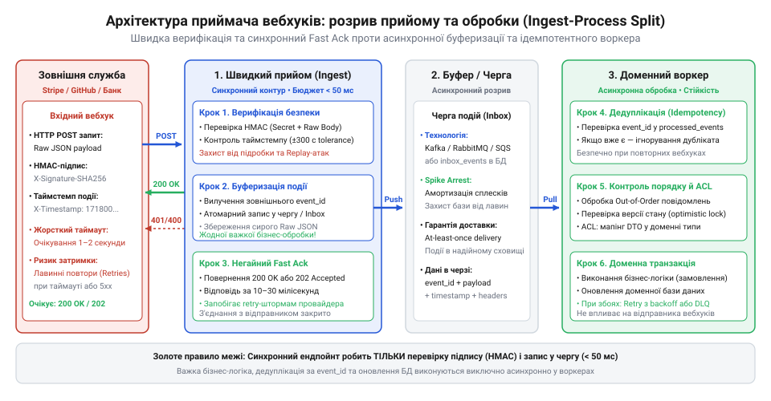
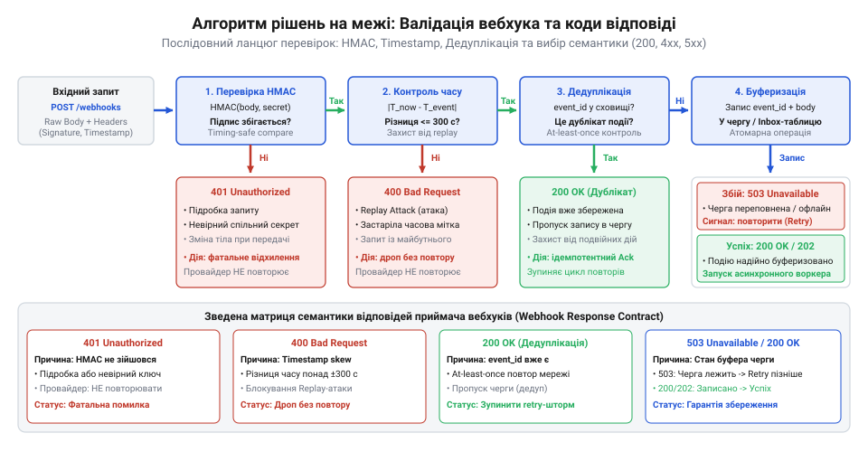
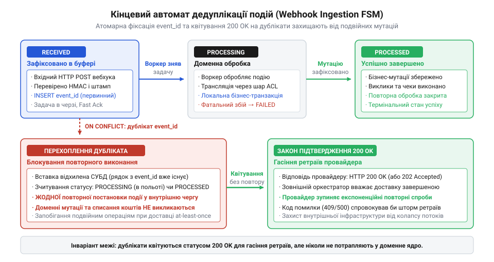
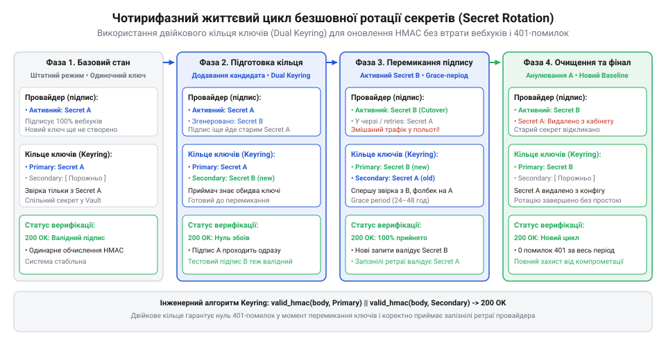

# Служба, якою ти не керуєш

<preknowlist>
- [Їхня аварія — твоя аварія](root:progarch/their-outage-is-your-outage) — неминучість мережевих затримок, ретраїв сторонніх служб та їхній прямий вплив на доступність власної системи
- [Коли вони ламають без попередження](root:progarch/when-they-break-without-warning) — ризики неоголошеної зміни схеми payload або формату викликів провайдера та потреба жорсткої валідації на межі
</preknowlist>

## Пастка наївного обробника вебхуків: підробка трафіку, атаки повторного відтворення та колапс через шторм ретраїв

У сучасних розподілених архітектурах взаємодія із зовнішніми платформами — платіжними шлюзами, логістичними сервісами, хмарними провайдерами авторизації чи CRM-системами — рідко обмежується синхронним викликом нашого клієнта. Оскільки обробка банківського платежу, випуск кредитної картки або оновлення статусу доставки посилки тривають секунди, хвилини або навіть дні, сторонній сервіс повертає клієнту проміжний статус, а про фінальний результат звітує асинхронно через механізм зворотних сповіщень — вебхуків (@@en|webhook@@; від англ. *web* — мережа, павутина, та *hook* — гачок, програмний перехоплювач подій). Стороння служба бере на себе роль клієнта й надсилає HTTP POST-запит на заздалегідь зареєстровану публічну URL-адресу нашого застосунку.

На перший погляд, реалізація точки прийому вебхука здається тривіальною задачею початкового рівня. Розробник реєструє в контролері веб-фреймворку публічний ендпойнт — наприклад, `/api/v1/webhooks/stripe`, — вичитує тіло запиту у форматі JSON і пише лінійний обробник. Усередині цього одного методу система розпаковує подію, знаходить у базі даних відповідне замовлення, переводить його стан у «Сплачено», генерує фіскальний PDF-чек, резервує товар на складі та звертається до зовнішнього SMS-шлюзу, щоб надіслати клієнту повідомлення про успішну операцію. На локальній машині чи під час тестування окремим ручним запитом цей код спрацьовує бездоганно. Але в реальному мережевому середовищі наївний обробник перетворюється на відкриту міну сповільненої дії, що знищує систему одразу з двох боків: безпекового та ресурсного.

Перший фатальний удар завдає відсутність верифікації вхідного периметра. Ендпойнт вебхука мусить бути відкритим для всього інтернету, щоб зовнішні сервери провайдера могли до нього достукатися. Якщо на вході стоїть звичайний парсер JSON без перевірки автентичності (від грец. *authentikos* — справжній, первинний), будь-який сторонній користувач або сканер мережі може надіслати фальшивий пакет `{"event": "payment_intent.succeeded", "order_id": 98124}`. Не перевіряючи цифровий підпис, застосунок сліпо виконає бізнес-логіку: активує преміум-підписку, розблокує доступ до дорогого контенту чи відвантажить замовлення без жодної копійки реальної оплати. Навіть якщо розробник спробує захиститися статичним секретним токеном у рядку запиту (`?token=secret123`), зловмисник, перехопивши валідний трафік, може реалізувати атаку повторного відтворення (@@en|replay attack@@; від англ. *replay* — повторне відтворення): надіслати той самий перехоплений запит ще раз через годину або наступного дня, спричинивши повторне нарахування бонусів або збій облікових реєстрів.

Другий удар, значно масштабніший і руйнівніший, виникає через синхронне виконання важкої бізнес-логіки в потоці прийому HTTP-запиту. Будь-яка стороння платформа встановлює жорсткий внутрішній таймаут на очікування відповіді від нашого сервера — зазвичай від 5 до 10 секунд. Якщо в момент надходження вебхука реляційна база даних перебуває під піковим навантаженням, блокування потрібного рядка триває на три секунди довше, а зовнішній поштовий шлюз раптом повільно віддає сокети, загальний час обробки нашого контролера перевищує ліміт провайдера. Стороння служба обриває TCP-з'єднання й фіксує мережеву помилку доставки.

Оскільки провайдер не знає, чи встигли ми записати платіж до обриву зв'язку, спрацьовує стандартний алгоритм гарантії надійності: сторонній сервер автоматично планує повторні спроби. Але він робить це не для одного клієнта, а для сотень транзакцій одночасно. Виникає шторм повторних спроб (@@en|retry storm@@; шторм ретраїв). Наш веб-сервер, який і так ледве справлявся з поточним навантаженням, зазнає помноженого удару: на кожен незавершений запит провайдер присилає дві, три, а згодом п'ять копій тієї самої події. Робочі потоки сервера (worker threads) і відкриті дескриптори сокетів вичерпуються. Пул з'єднань із базою даних повністю блокується завислими транзакціями. За кілька хвилин застосунок перестає відповідати взагалі: звичайні користувачі не можуть навіть відкрити каталог товарів або переглянути кошик. Система зазнає повного каскадного колапсу, на практиці доводячи головне правило розподілених взаємодій: [Їхня аварія — твоя аварія](root:progarch/their-outage-is-your-outage).

> 🔧 **Навіщо це.**
> Ендпойнт вебхука не можна трактувати як звичайний внутрішній REST-контролер. Це непідконтрольний вхідний шлюз із чужого середовища, де відсутність криптографічного захисту призводить до фінансової компрометації, а синхронна обробка перетворює ретраї провайдера на нищівну атаку на відмову в обслуговуванні власного продукту.

## Архітектурна модель надійної межі: розрив контурів прийому (Ingest & Fast Ack) та доменної обробки

Єдиний спосіб унеможливити колапс наївного ендпойнта — радикально розірвати часову й ресурсну залежність між моментом доставки сповіщення та моментом його бізнес-виконання. У професійній архітектурі точка прийому вебхука проектується не як обробник бізнес-логіки, а як надтонкий, високошвидкісний прикордонний фільтр-буфер (@@en|ingest boundary@@; буфер — від старофранц. *buffe*, поштовх, амортизатор для пом'якшення зіткнення).

Архітектурний контракт розділяє обробку на два повністю незалежних функціональних контури: контур швидкого прийому з миттєвим підтвердженням (@@en|Ingest & Fast Ack@@) та контур асинхронної фонової обробки (@@en|Background Worker Processing@@).


*Архітектура межі приймача: легковаговий шар прийому негайно повертає успішну відповідь після верифікації та запису в буфер, а доменна обробка ізолюється у фонових воркерах.*

Контур швидкого прийому вирішує суворо обмежений перелік інженерних завдань:
1. **Низькорівнева валідація транспорту:** перевірка коректності HTTP-методу (`POST`), наявності службових заголовків та обмеження граничного розміру корисного навантаження для захисту від переповнення буферів пам'яті.
2. **Криптографічна верифікація:** обчислення цифрового підпису сирого масиву байтів запиту та звірка часової мітки для гарантії автентичності відправника й запобігання підробкам.
3. **Фіксація незмінного стану в буфері:** атомарний запис сирого корисного навантаження (raw payload) разом із метаданими події у [вхідний буфер подій (Inbound Event Store)](root:sf-distributed/inbox-pattern) або чергу повідомлень без будь-яких мутацій бізнес-сутностей.
4. **Миттєва відповідь (Fast Ack):** відправлення провайдеру статусу `200 OK` або `202 Accepted` із мінімальним діагностичним тілом.

Весь цикл прийому в контурі Ingest займає лічені мілісекунди — зазвичай від 5 до 25 мс. Отримавши швидке підтвердження, зовнішній провайдер вважає сповіщення успішно врученим і гарантовано гасить таймери повторних спроб. Навіть якщо на сервер одночасно рине хвиля з тисяч подій, легковаговий вхідний контур без блокуючих операцій швидко збереже їх на диск або в чергу, не утримуючи дорогі пули потоків.

Другий контур — фонова доменна обробка — працює у власному темпі й повністю ізольований від зовнішньої мережі. Фоновий воркер вичитує зареєстровану подію з черги, десеріалізує збережений JSON, застосовує антикорупційний шар для перекладу чужих полів у внутрішні доменні типи, оновлює стан замовлення в базі даних та запускає сторонні інтеграції (генерацію документів, відправку повідомлень). Якщо на цьому етапі база даних сповільнюється або падає поштовий шлюз, затримка чи помилка залишаються внутрішньою справою нашої системи: воркер може безпечно повторити спробу за допомогою власного експоненційного відступу або скинути збійне повідомлення в аварійну чергу (Dead Letter Queue, DLQ), не провокуючи лавинного шторму ретраїв від зовнішнього партнера.

Збереження вихідного сирого тіла події «як є» (raw payload) є обов'язковим інваріантом межі. Зовнішні сервіси мають властивість раптово змінювати структуру другорядних полів, додавати нові переліки статусів або випускати неоголошені оновлення: [Коли вони ламають без попередження](root:progarch/when-they-break-without-warning). Якщо вхідний шлюз спробує одразу трансформувати подію у внутрішню доменну модель або відкине «невідомі» поля, будь-яка невідповідність схеми призведе до безповоротної втрати фінансової транзакції. Фіксація сирого незмінного знімка гарантує, що інженери завжди зможуть розібрати інцидент за первинними даними, полагодити логіку перекладача й повторно відтворити обробку збереженої події з журналу.

> 🔧 **Навіщо це.**
> Архітектурний розрив між прийомом події та її виконанням ізолює життєво важливі пули ресурсів системи від зовнішнього трафіку. Він гарантує незмінний час відповіді зовнішньому провайдеру в межах мілісекунд, захищаючи систему від штормів повторних запитів і зберігаючи повну історію первинних повідомлень для безпечного повторного відтворення.

## Вхідний мережевий конверт: транспортні вимоги, сире тіло (Raw Payload) та заголовки підпису

Перехід від архітектурного принципу до практичної реалізації межі вимагає суворої стандартизації вхідного мережевого конверта. Оскільки вебхук надходить із публічної мережі від непідконтрольного сервісу, приймач не має права покладатися на неявні конфігурації веб-фреймворку. Транспортний контракт регламентує жорсткі вимоги до HTTP-запиту, структуру заголовків безпеки та спеціальний режим обробки байтів корисного навантаження.

### Транспортний протокол та інваріанти запиту

Точка входу приймача монтується на окремому виділеному маршруті — наприклад, `/api/v1/webhooks/{provider_name}`. Контракт висуває такі непорушні вимоги до вхідного HTTP-пакета:
1. **Метод HTTP:** виключно `POST`. Будь-які спроби надіслати `GET`, `PUT`, `PATCH` або `HEAD` мають негайно відсікатися сервером зі статусом `405 Method Not Allowed` без завантаження тіла в пам'ять.
2. **Заголовок Content-Type:** обов'язкове значення `application/json` із явним або за замовчуванням кодуванням `charset=utf-8`.
3. **Обмеження розміру (Payload Size Limit):** приймач зобов'язаний жорстко лімітувати максимальний обсяг вхідного потоку на рівні зворотного проксі (Nginx, Envoy) або HTTP-сервера — зазвичай до 1–2 мегабайтів. Запити, що перевищують ліміт, обриваються зі статусом `413 Content Too Large`, захищаючи пам'ять процесу від атак на переповнення буфера.

```http
POST /api/v1/webhooks/stripe HTTP/1.1
Host: api.example.com
Content-Type: application/json; charset=utf-8
Content-Length: 742
User-Agent: Stripe/1.0 (+https://stripe.com/docs/webhooks)
Stripe-Signature: t=1718020800,v1=5257a869e7eceeda32a545b0d7d3e1eb9a9307ffb68ecd9d6910795dbcefac1e
```

### Пастка десеріалізації: чому потрібне саме сире тіло (Raw Payload)

Найпоширеніша й водночас найпідступніша помилка під час реалізації приймача вебхуків — використання стандартних проміжних обробників (middleware) парсингу тіла запиту, таких як `express.json()` у Node.js чи автоматичні моделі Pydantic у FastAPI.

Коли фреймворк автоматично розбирає вхідний потік байтів у внутрішній об'єкт пам'яті (хеш-таблицю чи словник), він безповоротно руйнує первинну форму документа. Парсер JSON може перевпорядкувати ключі об'єкта, нормалізувати пробільні символи між двокрапками й комами, змінити регістр символів екранування Unicode (`\u002f` на `/`) або змінити точність чисел із рухомою комою. Якщо після цього розробник спробує знову перетворити об'єкт у рядок для перевірки підпису за допомогою `JSON.stringify()` чи `json.dumps()`, отриманий рядок відрізнятиметься від надісланого бодай на один пробіл чи порядок полів.

У криптографії діє лавинний ефект (@@en|avalanche effect@@): зміна навіть одного біта у вхідних даних призводить до зміни щонайменше половини бітів вихідного гешу. У результаті підпис ніколи не зійдеться, і валідні платежі будуть помилково відхилені як зламані або підроблені.

Тому фундаментальним інваріантом контракту є збереження сирого тіла (@@en|raw payload@@; серіалізація — від лат. *series*, ряд, послідовність). Приймач мусить вичитувати вхідний потік як незмінний бінарний масив байтів (`Buffer`, `bytes` або `[]byte`) безпосередньо з мережевого сокета до того, як будь-яка бібліотека спробує його розібрати.

### Специфікація стандартизованих заголовків підпису

Для передачі метаданих перевірки автентичності індустрія виробила формат складеного заголовка підпису, який спирається на стандартизовані [схеми підписання вебхуків](root:sf-web/webhook-security). Хоча різні постачальники використовують власні назви заголовків (`Stripe-Signature`, `X-Webhook-Signature`, `Svix-Signature`), їхня внутрішня структура є стандартизованою схемою типу «ключ-значення», розділених комами:

| Компонент | Призначення | Формат і приклад |
|---|---|---|
| `t` | Штамп часу (UNIX epoch time) генерації сповіщення на сервері відправника в секундах. | `t=1718020800` |
| `v1` | Шістнадцятковий геш цифрового підпису, згенерований за алгоритмом HMAC-SHA256. | `v1=5257a869e7eceeda32a5...` |
| `v0` | Застарілий або резервний підпис (якщо провайдер підтримує міграцію алгоритмів). | `v0=7c3f81e...` |

Нерідко офіційні посібники провайдерів містять застарілі приклади найменування заголовків або не описують нюанси кодування роздільників, що на практиці призводить до розбіжностей: [Документація проти дійсності](root:progarch/docs-vs-reality). Один заголовок може містити одразу кілька значень підпису з однаковою схемою (наприклад, два поля `v1=...`), що трапляється під час планової заміни ключів на стороні провайдера. Контракт приймача вимагає розбиття рядка заголовка на окремі схеми та успішної валідації хоча б одного з актуальних підписів.

> 🔧 **Навіщо це.**
> Збереження точного масиву сирих байтів є технічною передумовою будь-якої криптографічної перевірки. Якщо веб-сервер десеріалізує JSON до валідації підпису, лавинний ефект геш-функцій зробить математичну перевірку неможливою, зруйнувавши довіру до контракту на першому ж кроці.

## Криптографічний контракт валідації: HMAC-SHA256, безпечне порівняння та вікно терпимості

Отримавши сирий масив байтів та заголовок підпису, приймач переходить до серцевини контракту безпеки — криптографічної верифікації походження та свіжості повідомлення. Цей процес регламентує строгий покроковий математичний протокол, що виключає як підробку корисного навантаження, так і перехоплення з наступним повторним використанням.

### Алгоритм формування канонічного рядка та обчислення HMAC

Для забезпечення цілісності та неспростовності авторства провайдер і приймач заздалегідь узгоджують спільний секретний ключ підпису — так званий секрет вебхука (наприклад, `whsec_9f8d...`). Секрет генерується на стороні платформи провайдера й завантажується в захищені змінні оточення нашого сервісу.

Протокол обчислення контрольного підпису реалізує механізм HMAC (@@en|HMAC@@; від англ. *Hash-based Message Authentication Code* — код автентифікації повідомлень на основі гешування; криптографія — від грец. *kryptos*, прихований, та *graphein*, писати) у поєднанні з геш-функцією SHA-256.

Алгоритм валідації складається з чотирьох послідовних кроків:
1. **Парсинг заголовка:** вилучення мітки часу `t` та отриманого підпису `v1` із рядка заголовка підпису.
2. **Формування підписуваного навантаження:** створення канонічного бінарного рядка шляхом об'єднання штампа часу, символу крапки `.` та оригінального сирого тіла:
   ```
   signed_payload = t + "." + raw_body
   ```
   Додавання мітки часу `t` безпосередньо у вхідні дані для гешування є критичним інженерним рішенням: воно криптографічно зв'язує тіло події з конкретною секундою в часі. Зловмисник не здатний підробити час без зміни підпису або підмінити тіло без руйнування гешу.
3. **Обчислення очікуваного підпису:** обчислення HMAC-SHA256 від сформованого рядка зі спільним секретом:
   ```
   expected_signature = HMAC-SHA256(webhook_secret, signed_payload).to_hex()
   ```
4. **Звірка підписів:** перевірка збігу обчисленого рядка `expected_signature` з отриманим із заголовка `v1`.

### Захист від атак за часом (Timing Attacks) через порівняння за сталий час

На етапі порівняння двох рядків підпису криється класична вразливість витоку інформації по побічних каналах. Стандартні оператори порівняння рядків у більшості мов програмування (наприклад, `===` у JavaScript/TypeScript чи `==` у Python) реалізовані з оптимізацією швидкого виходу: вони порівнюють символи побайтово зліва направо і переривають виконання на першому ж незбігу.

Якщо розробник використовує наївне порівняння, зловмисник може надсилати тисячі модифікованих запитів і за допомогою високоточних вимірювань мережевої затримки фіксувати різницю в кілька наносекунд. Що більше початкових символів збігається, то довше працює оператор. Це дає змогу байт за байтом підібрати валідний цифровий підпис без знання секретного ключа — класична атака за часом (@@en|timing attack@@).

Щоб забезпечити [захист від атак за часом у криптографічних протоколах](root:sf-security/timing-attack), контракт вимагає виключно алгоритмів порівняння за сталий час (constant-time comparison). Незалежно від того, де саме стався незбіг, функція зобов'язана пройти всі байти масиву до кінця, унеможливлюючи часове профілювання:
- У Node.js / TypeScript: `crypto.timingSafeEqual(bufA, bufB)`
- У Python: `hmac.compare_digest(sigA, sigB)`
- У Go: `subtle.ConstantTimeCompare([]byte(sigA), []byte(sigB))`

### Контроль часового дрейфу: вікно терпимості (Timestamp Tolerance)

Навіть ідеально підписане повідомлення залишається вразливим, якщо зловмисник перехопить валідний мережевий трафік на проміжному маршрутизаторі та надішле його знову пізніше. Щоб забезпечити [захист від атак повторного відтворення](root:sf-security/replay-protection) (replay attacks), контракт вводить правило допустимого часового вікна — вікно терпимості (@@en|timestamp tolerance@@; толерантність — від лат. *tolerare*, терпіти, витримувати).

Приймач звіряє мітку `t` із поточним системним часом сервера `now()`:

```
delta = now() - t
```

Якщо `delta > tolerance` (індустріальний стандарт становить 300 секунд, тобто 5 хвилин) або `delta < -tolerance` (захист від значного розсинхрону годинників у майбутнє), приймач негайно відхиляє запит зі статусом `400 Bad Request` і діагностичним повідомленням про застарілий штамп часу. Оскільки штамп `t` входить до підписуваного гешу, зловмисник не може оновити час у заголовку, що робить перехоплений пакет непридатним для використання вже за 5 хвилин після його відправки.

:::tabs
:::code api-webhook-receiver-contract/ts/verifywebhooksignature.ts
:::code api-webhook-receiver-contract/py/verify-webhook-signature.py
:::

> 🔧 **Навіщо це.**
> Поєднання HMAC-SHA256, порівняння за сталий час та вікна терпимості створює математично неприступний бар'єр. Воно виключає підробку даних, нівелює загрозу витоку ключів через побічні канали пам'яті та гарантує, що перехоплений трафік втрачає цінність за лічені хвилини.

## Матриця кодів відповідей (Response Matrix): протокол керування ретраями провайдера

У класичному синхронному REST API статус-код HTTP інформує клієнта про успіх чи причину помилки виконання операції. Але в архітектурі зворотних сповіщень семантика статус-кодів кардинально змінюється: тут HTTP-відповідь виступає прямим протоколом керування конечним автоматом повторних спроб (ретраїв) зовнішньої платформи.

Провайдер, надіславши повідомлення, аналізує виключно першу цифру отриманого статус-коду (@@en|Response Matrix@@; статус — від лат. *status*, стан, положення). На основі цього коду алгоритм відправника ухвалює бінарне рішення: визнати доставку завершеною та видалити подію з черги відправки чи запланувати повторний виклик за правилом експоненційного відступу.


*Матриця рішень приймача: послідовна валідація відсікає невалідні запити кодами 4xx, дедуплікує повтори успішним кодом 200, а коди 5xx сигналізують провайдеру про тимчасовий збій сховища.*

### Специфікація матриці статус-кодів

Контракт приймача регламентує сувору відповідність між внутрішнім станом перевірки та повертаним HTTP-статусом:

| HTTP-статус | Категорія помилки | Стан приймача | Реакція провайдера на стороні відправника |
|---|---|---|---|
| `200 OK` / `202 Accepted` | Успіх (Success) | Запит верифіковано, сире тіло атомарно зафіксовано у черзі або подія є вже обробленим дублікатом. | Доставка підтверджена. Таймери ретраїв вимикаються, запис видаляється з черги відправника. |
| `400 Bad Request` | Фатальна помилка клієнта | Пошкоджений синтаксис JSON, відсутні обов'язкові службові поля або виявлено неприпустимий часовий дрейф (`timestamp out of tolerance`). | Провайдер фіксує безповоротну помилку клієнта. Повторні спроби скасовуються. |
| `401 Unauthorized` / `403 Forbidden` | Помилка безпеки | Цифровий підпис не зійшовся з обчисленим гешем HMAC-SHA256 або відсутній секретний ключ. | Запит відхилено як неавторизований або скомпрометований. Ретраї блокуються. |
| `404 Not Found` | Відсутність маршруту | Ендпойнт вимкнено або змінено URL-адресу приймача. | Провайдер позначає вебхук як деактивований і надсилає власнику акаунта email про збій конфігурації. |
| `413 Content Too Large` | Перевищення квоти | Розмір вхідного запиту перевищує встановлений ліміт буфера пам'яті (наприклад, > 2 МБ). | Передача обривається, повторні спроби скасовуються. |
| `500 Internal Server Error` / `503 Service Unavailable` | Тимчасовий збій інфраструктури | Локальна аварія приймача: недоступна база вхідного буфера, вичерпано диск або переповнено чергу повідомлень. | Провайдер вважає наш сервіс тимчасово недоступним і планує повторну спробу з експоненційним відступом. |

### Пастка отруйної пігулки (Poison Pill)

Найнебезпечніша помилка під час формування відповідей — перехоплення будь-яких помилок у загальний блок `catch` із поверненням універсального коду `500 Internal Server Error`.

Якщо сторонній провайдер через баг у власному коді або неоголошене оновлення надішле пошкоджений або синтаксично некоректний JSON-пакет, наш парсер викине виняток. Якщо приймач відповість кодом `500`, зовнішній сервер розцінить це як тимчасову внутрішню проблему нашого сервісу. Відповідно до свого регламенту, провайдер поставить цей самий битий пакет у чергу ретраїв і сумлінно бомбардуватиме ним наш ендпойнт щогодини протягом наступних трьох діб (72 години).

Виникає феномен [отруйної пігулки](root:sf-distributed/poison-message) (@@en|poison pill@@; отруйна пігулка — пошкоджене повідомлення, яке неможливо успішно обробити жодною кількістю повторів). Сотні таких «отруйних» запитів зависають у безперервному циклі ретраїв, засмічуючи логи, випалюючи діагностичні квоти та витрачаючи ресурси процесора на нескінченний парсинг безнадійних байтів.

Контракт вимагає чіткого розмежування:
- Усі синтаксичні вади, невалідні підписи, невідомі формати або порушення часового вікна кваліфікуються як фатальні й повертають статус із діапазону `4xx`. Це змушує провайдера негайно зняти отруйну подію з доставки.
- Статуси `5xx` дозволено повертати виключно тоді, коли вхідне повідомлення є валідним і автентичним, але наша внутрішня інфраструктура прийому тимчасово не здатна зберегти його на диск або в чергу.

> 🔧 **Навіщо це.**
> Матриця статус-кодів є мовою команд для віддаленого оркестратора провайдера. Точне використання кодів `4xx` позбавляє систему від нескінченних штормів отруйних повідомлень, тоді як коди `5xx` надійно зберігають дані, змушуючи партнера повторити спробу після відновлення нашого вхідного буфера.

## Канонічна схема події: інваріанти метаданих, типізація та антикорупційний шар

Після того як вхідний HTTP-конверт пройшов криптографічну верифікацію, а приймач повернув швидке підтвердження, сире корисне навантаження передається на десеріалізацію. Попри те, що кожен сторонній постачальник розробляє власні структури даних, промисловий стандарт асинхронних подій спирається на спільні інваріанти метаданих.

### Анатомія канонічної схеми події

Контракт вхідного JSON-документа поділяється на дві чітко розмежовані зони: стандартизовану [оболонку метаданих події](root:sf-distributed/event-envelope-pattern) (@@en|event envelope@@; схема — від грец. *schema*, образ, вигляд, форма) та поліморфне тіло предметної сутності (@@en|payload data@@; поліморфізм — від грец. *polys*, численний, та *morphe*, форма).

```json
{
  "id": "evt_1P4x9Q2eZvKYlo2C9kL3x98a",
  "object": "event",
  "api_version": "2024-06-20",
  "created": 1718020800,
  "type": "payment_intent.succeeded",
  "livemode": true,
  "pending_webhooks": 1,
  "request": {
    "id": "req_8vH29xL1k0",
    "idempotency_key": "order_uuid_987124"
  },
  "data": {
    "object": {
      "id": "pi_3Mtw9B2eZvKYlo2C17gqW7d2",
      "object": "payment_intent",
      "amount": 150000,
      "currency": "uah",
      "status": "succeeded",
      "customer": "cus_98712",
      "metadata": {
        "order_id": "ORD-2026-98124"
      }
    }
  }
}
```

Контракт виділяє такі обов'язкові інваріанти оболонки:
1. `id`: глобально унікальний рядковий ідентифікатор події, згенерований провайдером. Він є незмінним для всіх повторних спроб доставки саме цієї події та слугує природним ключем для алгоритму дедуплікації.
2. `type`: точний рядковий дискримінатор події у просторі імен провайдера (наприклад, `payment_intent.succeeded` або `customer.subscription.deleted`). Контракт вимагає ієрархічної нотації через крапку: `{доменна_сутність}.{дія}`.
3. `created`: штамп часу (UNIX epoch time) фіксації факту події у сховищі відправника.
4. `api_version`: версія схеми даних, згідно з якою було згенеровано вкладений об'єкт `data.object`. Вона дозволяє приймачу визначити, за якими правилами розбирати поля.
5. `livemode`: булевий прапорець середовища (`true` для промислового середовища, `false` для пісочниці чи тестових ключів). Приймач зобов'язаний валідувати цей прапорець: випадкове надходження тестової події у продакшен-базу має негайно відсікатися, щоб запобігти безкоштовному виконанню замовлень.
6. `data.object`: власне предметна сутність провайдера, стан якої змінився.

### Антикорупційний шар (ACL) та ізоляція доменної моделі

Найбільша архітектурна спокуса після розпакування JSON — безпосередньо передати об'єкт `data.object` у методи бізнес-сервісів (наприклад, зберегти структуру `StripePaymentIntent` у репозиторій замовлень). Таке рішення створює пряму залежність внутрішнього ядра від чужої онтології та прихованих конвенцій зовнішнього SDK: [DH: чужі служби в критичному шляху](root:progarch/dh-foreign-services-in-critical-path).

Зовнішній провайдер має власну логіку моделювання: грошові суми передаються в мінімальних одиницях валюти (копійках, центах у вигляді цілих чисел `150000` замість `1500.00`), статуси позначаються специфічними кодами провайдера (`requires_action`, `succeeded`), а назви полів використовують чужий стиль (`customer_email`, `receipt_url`). Якщо ці структури розійдуться по модулях вашого моноліту чи мікросервісів, зміна провайдера або оновлення версії API змусить переписати десятки компонентів: [Споживацький контракт із чужим провайдером](root:progarch/consumer-driven-contracts).

Тому контракт встановлює обов'язкову межу: антикорупційний шар (@@en|anti-corruption layer@@, ACL; адаптер — від лат. *adaptare*, пристосовувати). Адаптер приймача вебхука перехоплює зовнішню подію і транслює її в канонічну доменну подію нашої системи:

:::code api-webhook-receiver-contract/ts/translatetodomainevent.ts

Антикорупційний шар локалізує чужі зміни: якщо завтра постачальник перейменує поле або додасть нові параметри ([Коли вони ламають без попередження](root:progarch/when-they-break-without-warning)), розробник змінює виключно функцію трансляції всередині адаптера, а бізнес-ядро продовжує працювати зі стабільними, чистими типами.

> 🔧 **Навіщо це.**
> Канонізація метаданих події гарантує детерміновану ідентифікацію для дедуплікації, а антикорупційний шар утримує суверенітет власної доменної моделі, перетворюючи сторонній сервіс на взаємозамінну зовнішню деталь.

## Контракт дедуплікації: забезпечення ідемпотентності в умовах доставки «хоча б один раз» (At-Least-Once)

У розподілених мережах не існує надійного способу гарантувати доставку повідомлення рівно один раз без використання важких протоколів двофазної фіксації, які принципово не підтримуються публічними HTTP-вебхуками. Якщо приймач успішно отримав сповіщення від стороннього провайдера, оновив локальні дані, але пакет відповіді `200 OK` затримався в дорозі або був обірваний скиданням TCP-з'єднання, таймер очікування відправника вичерпується. Відправник реєструє мережевий збій і, згідно зі своїм регламентом повторних спроб, надсилає той самий вебхук знову.

Будь-яка промислова платформа вебхуків функціонує за моделлю доставки «хоча б один раз» (@@en|at-least-once delivery@@; дедуплікація — від лат. *de-*, скасування, видалення, та *duplicare*, подвоювати). Це означає, що дублікати вхідних повідомлень — не аномалія чи наслідок системного збою, а стандартний режим повсякденної експлуатації межі: [Їхня аварія — твоя аварія](root:progarch/their-outage-is-your-outage). Якщо приймач не має засобів розпізнавання повторів, система неминуче здійснить подвійне списання коштів, повторну відправку фізичного товару або подвійне нарахування бонусів користувачеві.

Єдиний захист від руйнівних наслідків повторної доставки — контракт ідемпотентності (@@en|idempotency@@; ідемпотентність — від лат. *idem*, той самий, та *potens*, здатний, могутній): властивість операції при повторному застосуванні давати точно такий самий результат, як і при першому виклику.

### Журнал вхідних подій (Inbound Event Store)

Для реалізації ідемпотентності на рівні приймача система повинна вести персистентний журнал отриманих подій із суворим обмеженням унікальності природного ключа `event_id`, наданого провайдером. Спроба спиратися на перевірку стану бізнес-сутностей у доменній базі є хибною: у момент надходження дубліката перший запит може ще перебувати в процесі асинхронного виконання, тому доменний запис матиме статус «не оброблено».

Реляційна схема вхідного буфера фіксує метадані та керує скінченним автоматом життєвого циклу кожної транзакції:

```sql
CREATE TABLE inbound_webhook_events (
    event_id VARCHAR(255) PRIMARY KEY,
    provider VARCHAR(64) NOT NULL,
    event_type VARCHAR(128) NOT NULL,
    status VARCHAR(32) NOT NULL DEFAULT 'RECEIVED',
    payload JSONB NOT NULL,
    received_at TIMESTAMPTZ NOT NULL DEFAULT NOW(),
    processed_at TIMESTAMPTZ,
    error_message TEXT,
    CONSTRAINT chk_inbound_status CHECK (status IN ('RECEIVED', 'PROCESSING', 'PROCESSED', 'FAILED'))
);

CREATE INDEX idx_inbound_status_received ON inbound_webhook_events(status, received_at);
```

Скінченний автомат життєвого циклу запису описує чотири чіткі стани:
1. `RECEIVED`: сире тіло вебхука верифіковане за підписом і штампом часу, збережене в базі та поставлене у внутрішню чергу на виконання. Провайдеру повернуто швидке підтвердження.
2. `PROCESSING`: фоновий воркер зняв подію з черги й виконує бізнес-операції всередині локальної доменної транзакції.
3. `PROCESSED`: доменні мутації зафіксовано, сторонні виклики завершено, повторна обробка суворо заборонена.
4. `FAILED`: сталася невідновна помилка обробки, вичерпано ліміт спроб, запис передано до карантинного контуру для аналізу інженерами.


*Кінцевий автомат дедуплікації подій: послідовні переходи станів забезпечують виконання бізнес-логіки рівно один раз, а перехоплені дублікати негайно квітуються статусом 200 OK.*

### Реакція на дублікат: закон підтвердження 200 OK

Критичний момент контракту — поведінка приймача під час виявлення повторного запиту. 

Коли зовнішній провайдер надсилає вебхук із `event_id`, який уже зафіксований у таблиці зі статусом `PROCESSED` (або `PROCESSING`), приймач зобов'язаний виконати дві непорушні умови:
1. **Жодної повторної публікації**: корисне навантаження не передається повторно у внутрішні черги, а доменні сервіси не викликаються.
2. **Повернення HTTP 200 OK**: відправнику повертається статус успішної доставки.

Повернення коду `200 OK` (або `202 Accepted`) на дублікат є контурінтуїтивним для розробників, які звикли відповідати клієнтськими помилками на кшталт `409 Conflict` чи `400 Bad Request`. Проте для віддаленого оркестратора провайдера будь-який статус, відмінний від `2xx`, свідчить про те, що доставка зазнала краху. Якщо на дублікат відповісти кодом `409`, сторонній сервіс продовжить циклічно бомбардувати наш сервер ретраями або взагалі автоматично заблокує ендпойнт як аварійний. Код `200 OK` повідомляє відправнику: «Повідомлення надійно прийнято, місія завершена». Це зупиняє подальші повтори з боку провайдера, зберігаючи внутрішній бізнес-контур у безпеці: [Патерн ідемпотентного споживача (Idempotent Consumer)](root:sf-distributed/idempotent-consumers-deep).

### Конкурентні дублікати та атомарні обмеження

У разі агресивних налаштувань ретраїв на стороні провайдера або розривів маршрутизації два однакових HTTP-запити можуть потрапити на вхідний балансувальник одночасно — з різницею в мілісекунди. Якщо обидва потоки одночасно зроблять звичайний `SELECT`, отримають відповідь «запис відсутній» і почнуть створювати замовлення, виникне стан гонитви (@@en|race condition@@; змагання — від старослов'янського *гонити*, швидко рухатися).

Щоб запобігти паралельному виконанню, перевірка та фіксація виконуються як єдина атомарна операція бази даних через конструкцію `INSERT ... ON CONFLICT (event_id) DO NOTHING`. Лише той запит, який реально вставив новий рядок у таблицю, отримує право опублікувати задачу у чергу. Паралельний запит натрапляє на конфлікт унікальності, бачить наявний запис і негайно завершується успішним статусом `200 OK`, не зачіпаючи доменну логіку.

:::tabs
:::code api-webhook-receiver-contract/ts/webhookdeduplicationservice.ts
:::code api-webhook-receiver-contract/py/webhookdeduplicationservice.py
:::

> 🔧 **Навіщо це.**
> Доставка «хоча б один раз» робить дублікати гарантованою подією. Реєстрація за унікальним `event_id` та повернення підтвердження `200 OK` без повторної обробки захищає бізнес від фінансових втрат, одночасно припиняючи нескінченні ретраї з боку зовнішньої служби.

## Граничні режими експлуатації: неузгоджений порядок доставки, лавинний беклог та ротація секретів

Реальне середовище експлуатації постійно випробовує межу системи граничними навантаженнями та нештатними аномаліями. Навіть коли перевірка підпису та дедуплікація працюють бездоганно, приймач вебхуків стикається з трьома критичними викликами: порушенням послідовності доставки повідомлень, лавиноподібним напливом беклогу після аварій провайдера та регламентною ротацією ключів безпеки.

### Неузгоджений порядок доставки (Out-of-Order Delivery)

Розподілені черги провайдера працюють на багатьох вузлах і шардах. Якщо перша подія `order.created` зазнає короткочасного мережевого збою і стає в чергу ретраю з відступом у 60 секунд, а користувач за 10 секунд скасовує замовлення, провайдер негайно відправляє подію `order.canceled`. У результаті сповіщення про скасування приходить на наш приймач **раніше**, ніж сповіщення про створення.

Якщо обробник наївно застосовуватиме зміни в міру надходження запитів, станеться фатальна помилка:
- `order.canceled` надійде першим. Оскільки замовлення в базі ще не існує, сервіс або впаде з винятком, або створить аномальний порожній запис зі статусом `CANCELED`.
- За 50 секунд надійде запізніла подія `order.created`. Вона створить або оновить запис, виставивши статус `ACTIVE`, перекресливши попереднє скасування. Замовлення піде на комплектацію на складі, попри те, що клієнт його скасував.

Для запобігання таким колізіям контракт вимагає двох правил:
1. **Монотонне версіонування станів** (@@en|state versioning@@; версіонування — від лат. *versio*, видозміна). Кожна доменна сутність зберігає версію або штамп часу останньої застосованої зміни `last_applied_timestamp`. Якщо вхідна подія має штамп часу `created`, менший або рівний вже зафіксованому (`event.created <= aggregate.last_applied_timestamp`), вона вважається застарілою (stale event) та ігнорується.
2. **Незворотність термінальних станів**. Коли сутність досягає кінцевого стану (`CANCELED`, `REFUNDED`, `CLOSED`), переходи в попередні стани блокуються кінцевим автоматом домену незалежно від типу наступних вхідних подій: [Коли вони ламають без попередження](root:progarch/when-they-break-without-warning).

Якщо ж подія стосується сутності, яка ще не існує в базі через запізнення батьківського вебхука, воркер не повертає провайдеру помилку, а відкладає обробку повідомлення у внутрішню чергу затримки (delayed retry queue) на короткий інтервал (наприклад, 10–30 секунд), даючи батьківській події час дістатися приймача.

### Лавинний беклог, протитиск (Backpressure) та Dead Letter Queue

Коли у стороннього постачальника стається внутрішня аварія тривалістю кілька годин, його шлюзи накопичують мільйони невиконаних повідомлень. Після відновлення працездатності черги провайдера розряджаються шквальним залпом вебхуків на наші сервери: [Квоти, ліміти й ціна виклику](root:progarch/quotas-limits-call-cost).

У цій ситуації рятує архітектурний розрив між прийомом та обробкою. Вхідний контролер не виконує важких операцій, а лише записує сирі байти на диск або в чергу. Проте якщо інтенсивність потоку перевищує пропускну здатність вхідного дискового пулу, виникає потреба в керуванні протитиском (@@en|backpressure@@; беклог — від англ. *backlog*, накопичений залишок незавершених задач):
- Якщо вхідний буфер заповнюється понад безпечний поріг (наприклад, 85% ємності), приймач починає відхиляти запити зі статусом `503 Service Unavailable` та заголовком `Retry-After: 60`. Це змушує віддалений оркестратор провайдера зменшити напір трафіку та притримати ретраї, захищаючи сервер від падіння через вичерпання пам'яті (Out of Memory).
- Для повідомлень, які неможливо обробити навіть після нормативної кількості повторів (через пошкоджену доменну цілісність чи невідому мутацію схеми), застосовується механізм ізоляції — черга мертвих листів (@@en|dead letter queue@@, DLQ; від англ. *dead letter office*, поштове бюро нерозданих листів). Повідомлення вилучається з активного контуру обробки разом зі стеком помилки й контекстом виконання. Це усуває проблему блокування голови черги (head-of-line blocking), дозволяючи іншим вебхукам безперешкодно опрацьовуватися, поки черговий інженер розбирає ізольовану аномалію: [Стратегії ізоляції збійних повідомлень (Dead Letter Queue)](root:sf-distributed/dead-letter-queue).

### Безшовна ротація секретів (Secret Rotation)

Корпоративні стандарти безпеки (PCI DSS, SOC 2) вимагають регулярної заміни спільних секретів підпису (наприклад, кожні 90 днів) або екстреної ротації у разі витоку ключів.

Наївний підхід полягає в заміні рядка секрету у змінних середовища та перезапуску сервера. Проте в розподіленій системі така дія призводить до гарантованого простою:
- Вебхуки, які провайдер уже підписав старим секретом і відправив, дістаються оновленого сервера і провалюють перевірку HMAC (`401 Unauthorized`).
- Якщо ж спершу змінити секрет у панелі провайдера, старий сервер почне масово відхиляти нові повідомлення до завершення розгортання оновленого коду.

Контракт вимагає підтримки двійкового ключового кільця (@@en|keyring@@; ротація — від лат. *rotatio*, круговий рух, колообіг): приймач конфігурується з можливістю одночасної валідації двома активними секретами — основним (`primary_secret`) та вторинним (`secondary_secret`).

Алгоритм верифікації перевіряє підпис спочатку основним ключем. Якщо перевірка успішна — запит пропускається. Якщо підпис не зійшовся, алгоритм негайно робить другу спробу з вторинним ключем. Запит відхиляється статусом `401 Unauthorized` лише тоді, коли підпис не відповідає жодному з ключів кільця:

:::tabs
:::code api-webhook-receiver-contract/ts/verifysignaturewithkeyring.ts
:::code api-webhook-receiver-contract/py/verify-signature-with-keyring.py
:::

Регламент безшовної заміни секрету складається з чотирьох послідовних фаз:
1. **Підготовка**: у конфігурацію приймача додається новий ключ як `secondary_secret`, тоді як діючий залишається `primary_secret`. Здійснюється розгортання сервісу. Тепер приймач приймає обидва підписи.
2. **Перемикання провайдера**: у панелі керування стороннього сервісу генерується новий секрет і призначається активним для надсилання вебхуків.
3. **Моніторинг**: телеметрія фіксує перехід вхідного трафіку з `primary` на `secondary`. Коли частка викликів за старим ключем падає до нуля, перехід визнається успішним.
4. **Завершення**: новий ключ оголошується `primary_secret`, старий ключ повністю вилучається з конфігурації, і сервіс повторно розгортається: [Протоколи безшовної ротації криптографічних секретів](root:sf-security/secrets-management).

Жодне повідомлення під час цієї процедури не відхиляється, а захист межі зберігає неперервну міцність.


*Чотирифазний життєвий цикл ротації секретів: послідовна зміна станів ключового кільця гарантує безперервну верифікацію підписів без відхилення запитів та простою системи.*

> 🔧 **Навіщо це.**
> Граничні режими експлуатації вимагають від межі готовності до хаосу розподіленого середовища: контроль версій нівелює плутанину запізнілих подій, черги DLQ захищають потік від блокування отруйними пакетами, а кільце секретів дозволяє оновлювати криптографічні ключі «на льоту» без втрати жодного вебхука.
