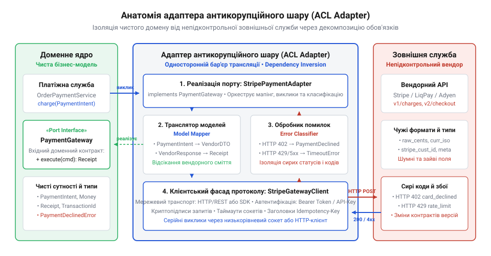
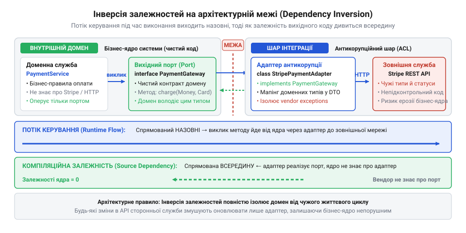
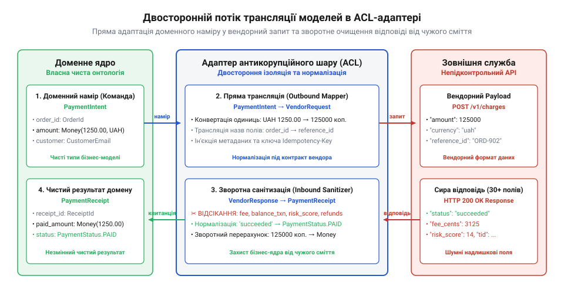
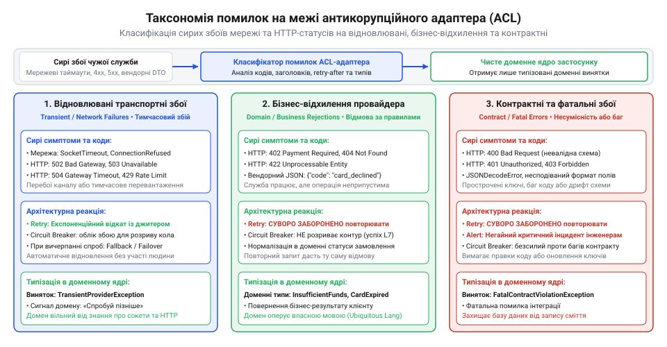
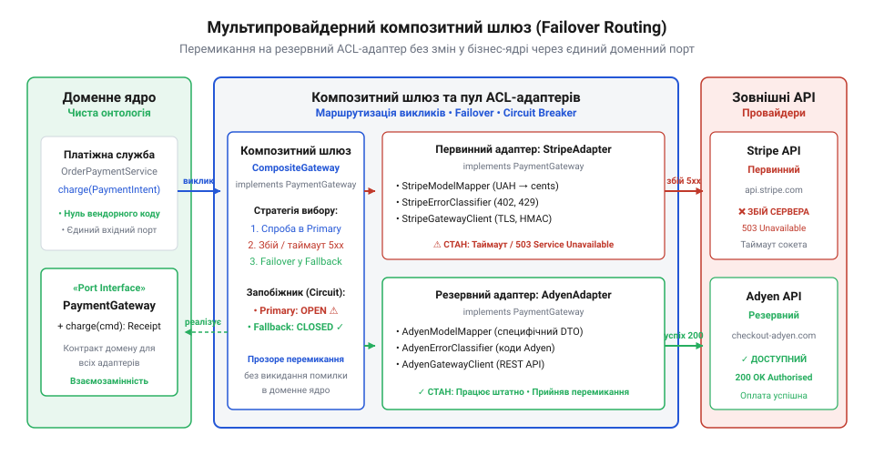

# Служба, якою ти не керуєш

<preknowlist>
- [Коли вони ламають без попередження](root:progarch/when-they-break-without-warning) — чому сторонні постачальники раптово змінюють формати полів і семантику API всупереч документації
- [Їхня аварія — твоя аварія](root:progarch/their-outage-is-your-outage) — як збої та деградація зовнішнього сервісу загрожують загальній доступності власної системи
</preknowlist>

## Чужі поняття у власному домені: як прямий виклик API отруює ядро системи

Коли система зростає, вона неминуче стикається з потребою делегувати частину роботи зовнішнім постачальникам: проводити платежі через банківський шлюз, розсилати SMS через агрегатора зв'язку чи розраховувати тарифи доставки через логістичну платформу. Найпростіший і найшвидший крок, до якого інстинктивно вдається розробник під час першої інтеграції, — встановити офіційну клієнтську бібліотеку постачальника або безпосередньо викликати його HTTP API прямо з коду бізнес-логіки. Якщо модулю замовлень потрібно списати кошти, сервіс замовлень бере об'єкт замовлення, формує запит до стороннього сервера, чекає на відповідь і тут-таки змінює свій внутрішній стан відповідно до отриманих даних.

Поки система працює в тестовому середовищі або на перших сотнях операцій, таке рішення здається ідеальним: мінімум проміжних класів, швидкий вихід у продуктивне середовище й повна відсутність додаткової складності. Проте за цією позірною простотою ховається небезпечна міна уповільненої дії — концептуальне забруднення бізнес-ядра чужою онтологією. Зовнішня служба має власне уявлення про світ, свої назви статусів, структури документів і логіку обробки помилок. Коли ці сутності без перешкод потрапляють усередину вашого застосунку, система непомітно втрачає архітектурну автономію.

Перший симптом зараження з'являється в моделях даних і схемі бази. Сторонній платіжний провайдер повертає статус операції у вигляді рядка на кшталт `STATUS_104_SETTLEMENT_PENDING`. Замість перетворення його на канонічний статус замовлення, цей рядок записують у колонку локальної таблиці, оскільки «так простіше звіряти логи з кабінетом провайдера». За статусом просочуються специфічні ідентифікатори: чужі UUID транзакцій починають використовуватися як первинні ключі для внутрішніх квитанцій, а копійки конвертуються у дробові числа з трьома знаками після коми лише тому, що так вимагає формат чужого JSON. Через кілька місяців розробники виявляють, що умовні конструкції по всьому коду — від генерації звітів до розсилки повідомлень покупцям — безпосередньо перевіряють магічні числові коди та рядкові прапорці стороннього постачальника.

Справжня катастрофа настає в момент, коли зовнішній партнер вирішує оновити свій сервіс. Сторонні провайдери регулярно випускають нові версії API, перейменовують поля, змінюють формати дат із мілісекунд на рядки стандарту ISO-8601 або починають повертати помилки валідації кодом `422 Unprocessable Entity` замість звичного `400 Bad Request`. Якщо ваш застосунок не має захисної межі, будь-яка неоголошена зміна на чужому боці перетворюється на негайний збій у вашій системі: [Коли вони ламають без попередження](root:progarch/when-they-break-without-warning). Зміна одного імені поля в чужому JSON паралізує роботу не одного адаптера, а всього бізнес-ядра, вимагаючи аврального виправлення десятків файлів по всій кодовій базі.

Ситуація стає критичною, коли зовнішня служба зазнає масштабної аварії. Якщо сторонній сервіс виходить з ладу на кілька годин або починає неконтрольовано скидати з'єднання, бізнес негайно вимагає підключити резервного постачальника: [Їхня аварія — твоя аварія](root:progarch/their-outage-is-your-outage). Але в системі, просякнутій чужими типами, підключити другого провайдера неможливо. Новий партнер має власну, зовсім іншу термінологію, інші формати запитів та інші життєві цикли операцій. Додати його до наявного сервісу замовлень означає або продублювати всю бізнес-логіку під другу назву, або переписати ядро застосунку з нуля. Домен опиняється у вендорному заручництві власної недбалості.

> 🔧 **Навіщо це.**
> Пряма залежність доменної логіки від структур даних стороннього сервісу позбавляє систему суверенітету. Будь-яка зміна чужого API або збій на боці партнера ламає ваш код, а перехід на іншого провайдера стає непідйомним за вартістю завданням.

## Внутрішня анатомія адаптера: чотири шари захисного бар'єра

Щоб надійно захистити власну доменну модель від розмивання та чужих змін, архітектура вимагає зведення спеціалізованого бар'єра — антикорупційного шару (@@en|anticorruption layer@@, ACL; від лат. *corruptio* — псування, розклад, та англ. *layer*, шар). Цей патерн уперше формалізував Ерік Еванс (Eric Evans) як механізм трансляції між двома різними обмеженими контекстами (Bounded Contexts), один із яких перебуває поза межами нашого контролю. Проте на рівні конкретної реалізації антикорупційний шар не повинен бути монолітним шматком розмитого коду. Щоб бути надійним і зручним у підтримці, він структурується у вигляді автономного компонента — адаптера антикорупційного шару (@@en|adapter@@; від лат. *adaptare* — пристосовувати).

Внутрішня анатомія повноцінного ACL-адаптера складається з чотирьох строго розмежованих функціональних шарів:

1. **Доменний інтерфейс (Port)**: Чистий контракт, що повністю належить вашому доменному ядру. Він описує операцію мовою внутрішнього бізнесу (`PaymentPort.charge()`), оперуючи виключно внутрішніми командами й сутностями. У цьому інтерфейсі немає жодної згадки про протокол HTTP, конкретного постачальника чи чужі формати даних.
2. **Транслятор моделей (Data Mapper)**: Двосторонній транслятор онтологій (@@en|data mapper@@; від лат. *mappa* — карта, полотно). Він перетворює чистий доменний об'єкт команди у специфічний для вендора формат запиту, а у зворотному напрямку — парсить чужу відповідь, відсікає надлишкові службові поля вендора й нормалізує значення у внутрішній доменний результат.
3. **Класифікатор і перекладач помилок (Error Classifier & Translator)**: Механізм нейтралізації зовнішнього хаосу. Він перехоплює транспортні винятки, HTTP-коди помилок (`4xx`, `5xx`), розриви TCP-з'єднань і вкладені вендорні повідомлення про збої, транслюючи їх у суворо типізовану ієрархію внутрішніх доменних помилок.
4. **Мережевий клієнт протоколу (Protocol Client / Gateway)**: Низькорівневий шлюз (@@en|gateway@@; від давньоангл. *geat* — прохід, та *weg* — шлях), що інкапсулює транспортні деталі. Він формує заголовки авторизації, підписує корисне навантаження криптографічними ключами (HMAC/mTLS), керує пулами HTTP-з'єднань, таймаутами сокетів та серіалізацією байтів у мережу.

*Внутрішня анатомія ACL-адаптера: доменне ядро взаємодіє виключно з чистим портом, тоді як транслятор моделей, класифікатор помилок та мережевий клієнт локалізують деталі чужого протоколу на інфраструктурній межі.*

Погляньмо, як ці чотири складові взаємодіють на практиці. Нижче наведено базовий каркас реалізації адаптера, що ізолює домен від стороннього платіжного шлюзу:

:::code comp-anticorruption-layer-adapter/ts/paymentresult.ts

Такий підхід докорінно змінює архітектурну картину. Сервіс замовлень нічого не знає про те, як влаштоване стороннє API: він викликає метод `charge()` інтерфейсу `PaymentPort`, передаючи внутрішню команду й отримуючи чистий типізований результат `PaymentResult`. Будь-які зміни в найменуваннях полів JSON, оновлення протоколу автентифікації чи несподівані коди помилок зустрічають жорстку відсіч на рівні адаптера: вони локалізуються у класах транслятора й класифікатора помилок, жодним чином не зачіпаючи логіку домену.

> 🔧 **Навіщо це.**
> Чітке розбиття адаптера на чотири окремі ланки (порт, транслятор моделей, класифікатор помилок і мережевий клієнт) перетворює інтеграцію з монолітного спагеті-коду на модульну конструкцію. Ви можете окремо тестувати логіку трансляції даних без мережі й підміняти мережевий транспорт без ризику спотворити доменні контракти.

## Напрямок залежностей та запобігання транзитивному витоку вендорного коду

Навіть коли розробник вирішує створити окремий клас для зв'язку із зовнішньою службою, найчастіше він робить це інтуїтивно: оголошує клас `StripeService`, у якому безпосередньо викликає методи офіційної клієнтської бібліотеки вендора (SDK), а потім передає цей сервіс як залежність у конструктор сервісу замовлень. На рівні виконання код начебто розділений, проте з погляду архітектури залежність залишається прямою: модуль бізнес-логіки знає про конкретну зовнішню службу, імпортує її типи та жорстко прив'язаний до наявності сторонньої бібліотеки в проєкті. Якщо сторонню бібліотеку потрібно замінити або оновити, зміни знову ламають бізнес-код.

Щоб розірвати цей зв'язок, архітектура застосовує принцип інверсії залежностей (@@en|Dependency Inversion Principle@@, DIP; від лат. *dependere* — залежати, звисати, та *invertere* — перевертати, обертати). Цей принцип вимагає, щоб модулі верхніх рівнів (бізнес-ядро) не залежали від модулів нижніх рівнів (інфраструктурних адаптерів та мережевих клієнтів). Обидва рівні мають залежати від абстракцій. При цьому принциповим є питання власності: доменне ядро саме визначає і володіє контрактом інтерфейсу (портом), який описує операцію мовою власного бізнесу, а інфраструктурний адаптер розміщується на периферії системи та реалізує цей інтерфейс.

Завдяки цьому напрямок залежностей вихідного коду стає протилежним до потоку викликів у часі виконання (рантаймі). Коли система оформлює замовлення, потік керування рухається від бізнес-логіки назовні: сервіс замовлень викликає метод інтерфейсу, керування передається в адаптер, а той відправляє байти в сокет стороннього сервера. Але стрілка компіляційної залежності спрямована у протилежний бік: адаптер імпортує інтерфейс із доменного пакета і залежить від нього, тоді як доменний пакет не містить жодного рядка імпорту з пакетів адаптера чи вендорних бібліотек. Бізнес-ядро залишається абсолютно автономним і самодостатнім.

*Інверсія залежностей на межі системи: потік виклику в рантаймі йде назовні до стороннього адаптера, тоді як залежність сирцевого коду спрямована всередину до доменного порту, утримуючи ядро повністю автономним.*

Головна небезпека порушення цього правила полягає у транзитивному витоку вендорного коду (@@en|transitive dependency leak@@; від лат. *transitivus* — перехідний, та англ. *leak* — витік, щілина). Жоден офіційний SDK стороннього постачальника не є ізольованим файлом: він тягне за собою дерево власних допоміжних бібліотек. Це можуть бути специфічні версії HTTP-клієнтів, парсери форматів даних, бібліотеки валідації чи логери. Якщо вендорний SDK потрапляє в спільний контекст компіляції або підключається до кореневого модуля бізнес-логіки, його внутрішні залежності автоматично стають залежностями вашого ядра.

У результаті проєкт опиняється в заручниках «пекла залежностей» (@@en|dependency hell@@). Сторонній платіжний SDK може вимагати строго зафіксовану версію бібліотеки серіалізації, яка конфліктує з версією, необхідною для вашої бази даних чи фреймворку застосунку. При оновленні стороннього SDK до нової мажорної версії вам доведеться оновлювати або перекомпілювати все бізнес-ядро, ризикуючи отримати приховані несумісності рантайму. Крім того, розробники неминуче почнуть використовувати зручні класи зі стороннього SDK безпосередньо у службах домену, перекреслюючи саму ідею ізоляції.

Фізичний захист від транзитивного витоку забезпечується суворим розділенням кодової бази на рівні пакетів або проєктних модулів:

1. **Модуль бізнес-ядра (`core-domain`)**: містить виключно доменні сутності, бізнес-правила та інтерфейси портів. У конфігураційному файлі його залежностей (`package.json`, `pom.xml`, `go.mod` чи `Cargo.toml`) фізично заборонено вказувати будь-які мережеві клієнти, HTTP-бібліотеки або вендорні SDK. Цей модуль компілюється повністю ізольовано.
2. **Модуль інфраструктурного адаптера (`infrastructure/adapters/stripe`)**: підключає модуль `core-domain` як залежність та імпортує потрібний вендорний SDK. Тут живе конкретна реалізація адаптера, яка реалізує доменний інтерфейс і бере на себе весь тягар роботи з чужим SDK.

Погляньмо, як це розмежування реалізується мовою програмування:

:::code comp-anticorruption-layer-adapter/ts/subscriptionrenewalservice.ts

У такій структурі будь-яка спроба імпортувати клас зі сторонньої бібліотеки `stripe` всередині модуля `@domain/billing` викликає помилку компілятора або лінтера модульних меж під час збірки проєкту. Вендорний код залишається надійно замкненим усередині інфраструктурного модуля.

> 🔧 **Навіщо це.**
> Інверсія залежностей і фізична ізоляція вендорного SDK гарантують недоторканність бізнес-ядра. Ви можете безболісно оновлювати бібліотеку провайдера на будь-яку кількість мажорних версій або взагалі викинути її й написати власний прямий HTTP-клієнт — жоден рядок доменної логіки та тестів бізнес-правил не потребуватиме повторної компіляції чи змін.

## Механіка двосторонньої трансляції даних і санітизація корисного навантаження

Розмежування інтерфейсів усуває залежність на рівні вихідного коду, проте дані все одно повинні перетинати кордон системи. Коли домен передає команду назовні, її потрібно транслювати у специфічний формат виклику конкретного постачальника. Коли постачальник повертає відповідь, вона надходить у вигляді сирого корисного навантаження (payload), переповненого специфічними внутрішніми даними вендора.

Якщо дозволити сирій відповіді постачальника проникнути у внутрішні структури системи, виникає прихована ерозія архітектури. Розробники починають неявно покладатися на недекларовані поля, допоміжні прапорці та службові ідентифікатори чужого API. Сторонні постачальники регулярно змінюють внутрішні формати без попередження: [Документація проти дійсності](root:progarch/docs-vs-reality), [Коли вони ламають без попередження](root:progarch/when-they-break-without-warning). Зміна чи видалення одного недекларованого службового поля в чужому JSON призводить до раптового краху бізнес-функціональності.

Щоб запобігти цьому, адаптер антикорупційного шару розгортає суворий митний контроль — транслятор моделей даних (Data Mapper). Транслятор виконує двостороннє функціональне перетворення без збереження стану:

1. **Пряма трансляція (вхідний потік)**: чистий об'єкт доменної команди перекладається у вендорний запит зі специфічною структурою, найменуванням полів (наприклад, snake_case) та технічними параметрами виклику.
2. **Зворотна трансляція та санітизація (вихідний потік)**: сира відповідь провайдера перевіряється, очищається від вендорного шуму, нормалізується і перетворюється у внутрішню доменну сутність або строго типізований результат.

*Потік перетворення даних на онтологічному кордоні ACL-адаптера: доменна команда перекладається у специфічний запит провайдера, а сира відповідь піддається суворій санітизації з відсіканням чужих полів і нормалізацією типів у доменні сутності.*

Центральним правилом зворотної трансляції є агресивне відсікання надлишкових полів (@@en|shedding unused fields@@; від англ. *shed* — скидати, відкидати, та лат. *sanitas* — здоров'я, чистота; санітизація корисного навантаження). Сучасні API платіжних, поштових чи хмарних сервісів у відповідь на один запит повертають від 30 до 80 різних полів: відбитки браузера клієнта, деталі тарифних планів вендора, діагностичні токени телеметрії, коди внутрішньої маршрутизації тощо. 

Поширена інженерна спокуса — скопіювати весь цей сирий JSON у базу даних або зберегти його як нетипізоване поле `metadata` всередині доменного об'єкта «на майбутнє». Робити це категорично заборонено. Як тільки сирі дані стають доступними всередині домену, за законом Гайрама знайдуться частини системи, які почнуть від них залежати. Відсікання надлишкових полів діє за принципом білого списку: мапер видобуває виключно ті атрибути, які прямо визначені контрактом доменного результату, а решту даних негайно знищує.

Окрім відсікання зайвого, транслятор здійснює нормалізацію чотирьох критичних категорій даних:

- **Грошові суми та валюти**: Сторонні сервіси нерідко передають суми дробовими числами (наприклад, `19.99` або рядок `"19.99"`). Використання чисел із плаваючою комою у фінансових розрахунках неприпустиме через накопичення помилок двійкового заокруглення. Доменне ядро повинно вимагати незмінний об'єкт-значення (Value Object) `Money`, де сума зберігається як ціле число в мінімальних неподільних одиницях валюти (копійки, центи) разом із трилітерним кодом за стандартом ISO-4217. Мапер бере на себе безпечну конвертацію, гарантуючи захист від втрати точності.
- **Часові мітки**: Різні провайдери повертають час у несумісних форматах: секунди епохи Unix, мілісекунди, рядки довільного локального формату або рядки стандарту ISO-8601 у змішаних часових поясах. Домен не повинен розбиратися в цих відмінностях: мапер негайно транслює будь-який чужий час у канонічний системний об'єкт дати в нульовому часовому поясі (UTC).
- **Ідентифікатори**: Чужий ідентифікатор транзакції (наприклад, `ch_3OvtL2LkdIwHu7ix`) ніколи не повинен ставати внутрішнім первинним ключем замовлення чи платежу. У домені він зберігається виключно як зовнішнє посилання на чужу систему (`externalReferenceId`), відокремлене від локального доменного ID.
- **Статуси та життєвий цикл**: У стороннього сервісу життєвий цикл операції може налічувати десяток специфічних станів: `requires_payment_method`, `requires_action`, `processing`, `requires_capture`, `succeeded`, `canceled`. Доменний автомат має власну, значно простішу онтологію: платіж або `PENDING` (очікує), або `SUCCEEDED` (успішний), або `FAILED` (відхилений). Мапер виконує редукцію чужих статусів, відображаючи багатозначну множину провайдера на скінченну множину домену. Якщо вендор додає новий статус, якого ще немає в правилах мапера, захисний механізм зобов'язаний перевести операцію в контрольований стан невизначеності або згенерувати типізовану подію невідомого стану для аудиту, не ламаючи бізнес-процес.

Нижче наведено практичну реалізацію мапера даних, який реалізує повний цикл прямої трансляції, агресивного відсікання зайвих полів та санітизації типів:

:::code comp-anticorruption-layer-adapter/ts/domainpaymentstatus.ts

Такий мапер перетворює зовнішні неструктуровані коливання на стабільний потік перевірених фактів. Будь-які оновлення схеми відповіді провайдера, додавання нових технічних атрибутів чи зміна діагностичних ключів залишаються за порогом транслятора, не створюючи жодних побічних ефектів у коді ядра.

> 🔧 **Навіщо це.**
> Агресивне відсікання полів і сувора нормалізація типів на рівні мапера назавжди позбавляють кодову базу від прихованої залежності від чужого формату. Якщо сторонній сервіс змінить внутрішні назви другорядних полів, видалить службові прапорці чи додасть десятки нових параметрів діагностики, домен отримає лише ті канонічні дані, які необхідні для виконання бізнес-правил.

## Класифікація помилок і захист домену від сторонніх винятків

Навіть якщо транслятор моделей бездоганно перекладає валідні успішні відповіді, зовнішній світ неминуче стикається з хаосом. Мережеві кабелі пошкоджуються, балансувальники навантаження стороннього провайдера падають під DDoS-атаками, шлюзи повертають HTTP-коди `502 Bad Gateway`, `503 Service Unavailable`, `429 Too Many Requests` або з'єднання просто обривається посеред передачі байтів. До того ж клієнтські бібліотеки вендора в разі будь-якого збою викидають власні винятки зі специфічною ієрархією: наприклад, `StripeCardError`, `StripeRateLimitError` чи `StripeConnectionError`.

Якщо ці сирі винятки пробивають межу адаптера й потрапляють у модуль бізнес-логіки, архітектурний захист миттєво руйнується. Доменний сервіс вимушений оголошувати конструкції `catch (error: StripeCardError)`, що повертає систему до прямої залежності від типів чужого SDK. Якщо ж виняток лишається неперехопленим, один збій на боці партнера спричиняє раптове падіння всього бізнес-процесу: [Їхня аварія — твоя аварія](root:progarch/their-outage-is-your-outage).

Щоб унеможливити подібні витоки, адаптер антикорупційного шару розгортає спеціалізований механізм — класифікатор і перекладач помилок (Error Classifier & Translator). Будь-який негативний результат — транспортний обрив, таймаут, помилковий HTTP-статус або внутрішній виняток SDK — перехоплюється всередині адаптера й піддається суворій таксономії. Зовнішній хаос розбивається на три чітко розмежовані категорії:

1. **Відновлювані транспортні збої (@@en|transient failures@@; від лат. *transiens* — тимчасовий, перехідний)**: таймаути TCP-з'єднань, раптові розриви сокетів (`ECONNRESET`), серверні помилки провайдера (`500`, `502`, `503`, `504`) та тимчасове вичерпання квот викликів (`429 Too Many Requests`): [Квоти, ліміти й ціна виклику](root:progarch/quotas-limits-call-cost). Для цих ситуацій характерна спільна риса: вони спричинені тимчасовими проблемами інфраструктури, і повторна спроба виклику (retry) або перемикання на резервного провайдера має високі шанси на успіх.
2. **Невідновлювані бізнес-відхилення (@@en|business rejections@@)**: клієнтські статуси `400 Bad Request`, `402 Payment Required`, `422 Unprocessable Entity` або специфічні відповіді провайдера: «недостатньо коштів на балансі», «термін дії картки вичерпано», «операцію заблоковано антифрод-фільтром». Повторювати такий запит у вихідному вигляді безглуздо — він гарантовано завершиться тією самою відмовою. Домен повинен зафіксувати неуспіх операції й перевести замовлення у статус очікування дій від користувача.
3. **Фатальні порушення контракту та конфігурації (@@en|fatal contract errors@@)**: помилки авторизації (`401 Unauthorized`, `403 Forbidden` через протермінований API-ключ), несподівані коди відповідей або отримання HTML-сторінки помилки замість очікуваного JSON. Це свідчить про системну несумісність або неоголошені зміни на чужому боці: [Коли вони ламають без попередження](root:progarch/when-they-break-without-warning). Такі збої вимагають термінового сповіщення чергових інженерів, а не автоматичних повторів.

*Таксономія помилок на межі адаптера: класифікатор структурує зовнішній хаос на відновлювані збої інфраструктури, бізнес-відхилення та контрактні помилки, захищаючи домен від нетипізованих винятків.*

Для повернення результатів операцій у бізнес-ядро рекомендується використовувати типізований контейнер результату (@@en|Result type@@ / @@en|Either@@; від англ. *result* — результат, та лат. *resultare* — відбиватися) замість викидання винятків. Викидання нетипізованих винятків для штатних відхилень платежу руйнує передбачуваність коду, тоді як контейнер результату змушує бізнес-логіку явно обробити як успіх, так і відмову, опираючись на прапорець придатності до повтору (`retryable: boolean`).

Погляньмо, як класифікатор помилок перетворює хаос чужих збоїв на строгу доменну модель:

:::code comp-anticorruption-layer-adapter/ts/domainpaymenterror.ts

Завдяки такій обробці бізнес-ядро позбавляється необхідності гадати, що означає той чи інший внутрішній код партнера. Домен отримує чітко типізований результат і одразу знає ключове: чи можна цю операцію безпечно повторити, чи її слід остаточно відхилити.

> 🔧 **Навіщо це.**
> Класифікатор помилок усуває вендорний шум і запобігає транзитивному протіканню чужих винятків у бізнес-код. Доменна логіка залишається простою, детермінованою та ізольованою від примх мережі й змін внутрішніх кодів помилок постачальника.

## Мультипровайдерність, композитний шлюз та інженерні граблі реалізації

Коли зовнішня служба забезпечує життєво необхідну функцію системи — списання платежів, автентифікацію клієнтів або доставку SMS, — залежність від одного-єдиного провайдера стає неприпустимим операційним ризиком: [DH: чужі служби в критичному шляху](root:progarch/dh-foreign-services-in-critical-path). Якщо єдиний постачальник зазнає масштабної аварії, що триває кілька годин, робота вашого бізнесу повністю паралізується.

Саме тут антикорупційний шар демонструє свою найвищу стратегічну цінність. Оскільки доменне ядро нічого не знає про конкретного постачальника й взаємодіє виключно з чистим портом `PaymentPort`, ви можете реалізувати кілька паралельних, абсолютно взаємозамінних адаптерів: наприклад, `StripeAclAdapter`, `AdyenAclAdapter` та `PayPalAclAdapter`. Кожен із них бере на себе роботу зі своїм постачальником, інкапсулюючи чужі типи, протоколи та формати.

Щоб об'єднати цей пул адаптерів у цілісну відмовостійку систему, архітектура застосовує патерн композитного шлюзу (Composite Routing Gateway). Композитний шлюз сам реалізує той самий доменний інтерфейс `PaymentPort`, але всередині містить посилання на пул адаптерів і правила вибору маршруту. Коли домен надсилає команду, композитний роутер скеровує її до первинного адаптера. Якщо той повертає відновлювану транспортну помилку (`retryable: true`), шлюз миттєво й прозоро для бізнес-ядра виконує аварійне перемикання (@@en|failover@@; від англ. *fail* — збій, та *over* — перехід) на резервний адаптер.

*Архітектура мультипровайдерного шлюзу: бізнес-ядро звертається до єдиного доменного порту, а композитний роутер прозоро розподіляє навантаження та виконує автоматичний failover між незалежними ACL-адаптерами.*

Погляньмо, як реалізується композитний маршрутизатор з автоматичним перемиканням у разі збою:

:::code comp-anticorruption-layer-adapter/ts/compositebillinggateway.ts

Попри очевидну елегантність цієї схеми, розробка та впровадження ACL-адаптерів пов'язані з типовими інженерними пастками, на яких команди регулярно спотикаються:

- **Граблі 1: «Дірявий адаптер» (Leaky Adapter) і протікання чужих ідентифікаторів**. Якщо у доменний інтерфейс закласти методи на зразок `chargeViaStripeToken(stripeToken: string)`, ідея взаємозамінності руйнується. Другий провайдер не розуміє токенів Stripe. Інтерфейс порту повинен оперувати виключно абстрактними або внутрішніми токенами системи. Зв'язок між внутрішнім клієнтом і його ідентифікаторами у конкретних вендорів має зберігатися в окремій допоміжній таблиці прив'язок, прихованій від домену.
- **Граблі 2: Надмірна складність при інтеграції дружніх мікросервісів**. Не кожен віддалений виклик вимагає антикорупційного шару. Якщо ви взаємодієте із сусіднім сервісом своєї ж компанії, який розробляється дружньою командою в єдиному репозиторії за спільними контрактами (наприклад, Protobuf або OpenAPI), створення важкого ACL з повною трансляцією моделей лише породить надлишковий супровідний код. ACL критично необхідний там, де є онтологічний розрив (чужа модель світу) та відсутність контролю над графіком змін партнера.
- **Граблі 3: Тестування на живих сторонніх сервісах (ілюзія перевірки)**. Спроби запускати інтеграційні тести проти «пісочниць» (sandboxes) вендора під час кожної збірки в CI/CD неминуче призводять до сповільнення конвеєра, мережевих флаків та вичерпання квот: [Дублери чужої служби](root:progarch/service-doubles-and-environments). Тестування ACL-адаптера повинно спиратися на споживацькі контрактні тести (@@en|contract testing@@; від лат. *contractus* — договір, угода): [Споживацький контракт із чужим провайдером](root:progarch/consumer-driven-contracts). Ви фіксуєте реальні дампи відповідей постачальника, ізолюєте мережевий клієнт локальними дублерами й тестуєте поведінку маперів та класифікаторів помилок у детермінованому середовищі.

> 🔧 **Навіщо це.**
> Композитний шлюз над пулом взаємозамінних адаптерів перетворює зовнішні сервіси на стандартні витратні матеріали архітектури. Система стає по-справжньому відмовостійкою: збій на боці одного гіганта відбивається локальним перемиканням без втрати клієнтських замовлень і без переписування бізнес-коду.
