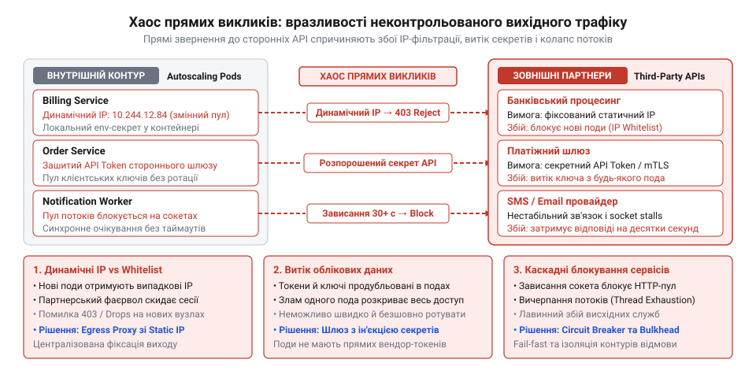
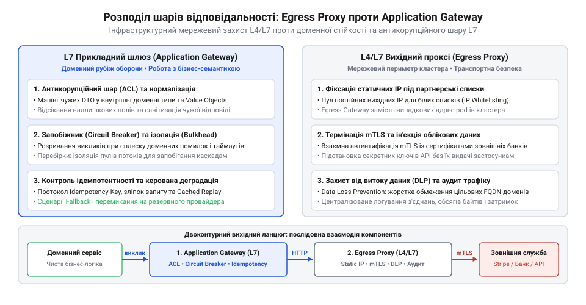
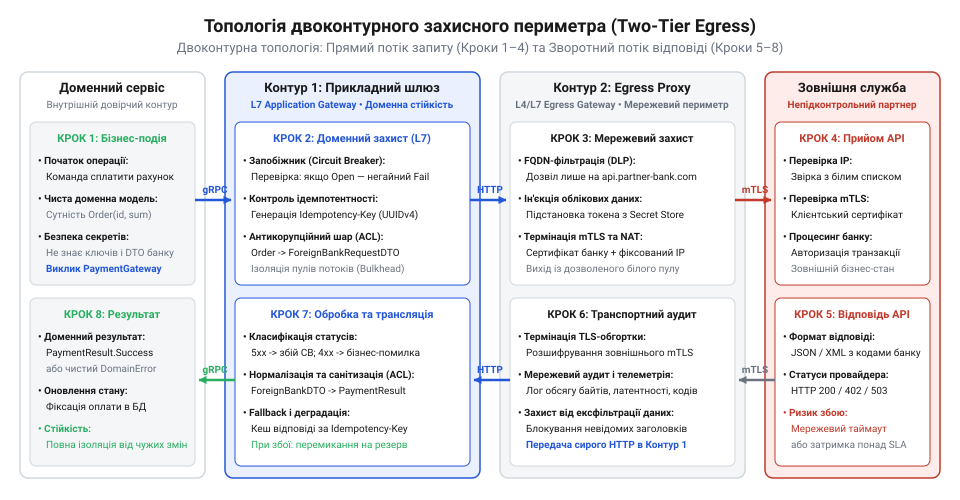

# Служба, якою ти не керуєш

<preknowlist>
- [Їхня аварія — твоя аварія](root:progarch/their-outage-is-your-outage) — розуміння фізики каскадних відмов і прямої кореляції доступності сторонньої служби з надійністю власного продукту.
- [Квоти, ліміти й ціна виклику](root:progarch/quotas-limits-call-cost) — як партнерські обмеження частоти запитів та вимоги до статичних IP-адрес диктують необхідність контролю вихідного периметра.
</preknowlist>

## Анатомія хаосу прямих викликів: криза безпеки та надійності при неконтрольованій взаємодії з чужими службами

Інтеграція зі стороннім сервісом завжди починається з оманливої простоти. Розробнику потрібно провести платіж, відправити сповіщення чи верифікувати податковий номер клієнта. Він створює екземпляр стандартного HTTP-клієнта у своєму коді, прописує базову адресу API провайдера, серіалізує JSON-структуру та надсилає запит назовні. На локальній машині чи в тестовому середовищі це працює бездоганно: запит іде через локальний мережевий інтерфейс, віддалений сервер повертає відповідь за сотню мілісекунд, а бізнес-функція успішно завершує роботу. Зовнішній API сприймається як звичайна функція, хіба що з дещо більшим часом відгуку.

Однак щойно цей код потрапляє в промислове середовище сучасного хмарного кластера, ілюзія простоти миттєво розсипається. У реальній системі працюють десятки різних мікросервісів, кожен із яких розгортається в кількох динамічних репліках. Контейнери невпинно перезапускаються, масштабуються та мігрують між фізичними вузлами. Коли кожен такий процес самостійно ініціює вихідні мережеві з'єднання до зовнішнього світу, виникає стан повного інфраструктурного хаосу, що б'є по системі з чотирьох різних сторін: від мережевої сумісності до катастрофічних дірок у безпеці.

Перший удар завдає несумісність динамічної інфраструктури зі статичними вимогами безпеки партнерів. У сучасному кластері кожен под або віртуальна машина має власну динамічну IP-адресу, або ж виходить у світ через пул змінних адрес хмарного провайдера. Проте серйозні зовнішні організації — платіжні шлюзи, банківські установи, державні реєстри та постачальники фінансових даних — працюють за моделлю суворого мережевого периметра (від грец. @@el|περίμετρος@@ — межа навколо; *peri* — навколо, *metron* — міра). Їхні апаратні брандмауери вимагають жорсткого білого списку IP-адрес (англ. @@en|allowlist@@, від англ. *allow* — дозволяти та *list* — список). Партнер вимагає надати одну або дві фіксовані публічні IP-адреси, з яких дозволено приймати запити. Якщо бекенд звертається до партнера напряму, то кожне масштабування кластера чи перенесення пода в іншу зону доступності призводить до того, що пакети починають виходити з нової, невідомої партнеру адреси. Зовнішній міжмережевий екран миттєво скидає з'єднання або відповідає відмовою доступу. Наслідок фатальний: частина реплік вашого сервісу успішно обробляє замовлення, а інша частина відхиляє їх, створюючи хаотичні й важковідтворювані збої, що прямо порушують домовленості про стабільність ([Квоти, ліміти й ціна виклику](root:progarch/quotas-limits-call-cost)).

Друга проблема — критична вразливість до ексфільтрації секретів та атак підробки запитів на боці сервера (англ. @@en|Server-Side Request Forgery@@, або SSRF; від лат. *servus* — слуга та давньофр. *forgerie* — підробка). Коли будь-який сервіс усередині кластера має необмежений вихід у глобальну мережу, внутрішній периметр безпеки перетворюється на решето. Якщо зловмисник знаходить вразливість у завантажувачі файлів, генераторі PDF-звітів чи обробнику вебхуків ([атак SSRF](root:sf-security/ssrf-attacks)), він змушує бекенд-сервер надіслати запит на підконтрольну хакеру адресу. Неконтрольований вихідний канал дозволяє скомпрометованому поду безперешкодно викачувати шкідливе програмне забезпечення, з'єднуватися з серверами управління атакою або здійснювати ексфільтрацію конфіденційних даних (англ. @@en|data exfiltration@@, від лат. *ex* — назовні та пізньолат. *filtrum* — цідило). Ба більше: без вихідного бар'єра атакувальник може звертатися до внутрішніх адрес метаданих хмарного середовища (`169.254.169.254`), викрадаючи тимчасові токени облікових записів і отримуючи повний контроль над інфраструктурою.

Третій вимір кризи — повна сліпота та неможливість централізованого аудиту. Коли десятки команд і сервісів самостійно звертаються до сотень сторонніх кінцевих точок, в організації зникає будь-яке уявлення про те, куди й навіщо витікає трафік. Жоден інженер не може надати точний перелік усіх зовнішніх інтеграцій. Вихідні виклики губляться в різнорідних форматах логів окремих застосунків. Під час обов'язкового аудиту безпеки чи проходження сертифікацій (PCI-DSS, SOC 2, ISO 27001) компанія не здатна довести, що персональні дані клієнтів не передаються на заборонені сервери. До того ж застарілі фонові процеси або забуті інтеграції можуть роками слати платні запити до вимкнених партнерів, непомітно спалюючи операційний бюджет компанії.

Четвертий удар припадає на загальну стійкість системи під час збоїв партнера. Коли зовнішня служба починає деградувати — збільшувати затримку відповіді або повертати помилки, — кожен внутрішній мікросервіс реагує на це хаотично. Один сервіс не має налаштованого таймауту на з'єднання і намертво блокує власні робочі потоки, доки не впаде за браком пам'яті. Інший сервіс запускає агресивний цикл повторних спроб без жодної паузи, генеруючи шторм ретраїв, що остаточно добиває зовнішню службу і призводить до автоматичного блокування облікового запису за перевищення лімітів. Замість локалізації проблеми в одній точці, аварія зовнішнього постачальника блискавично паралізує всю внутрішню інфраструктуру, підтверджуючи непорушний закон: [Їхня аварія — твоя аварія](root:progarch/their-outage-is-your-outage).

*Хаос прямих неконтрольованих викликів: розпорошення вихідних точок унеможливлює роботу з білими списками IP, відкриває периметр для ексфільтрації даних через SSRF і транслює збої партнерів у внутрішній колапс.*

Прямі виклики зовнішніх систем створюють хибне відчуття, що взаємодія з чужою службою є лише приватною справою конкретного модуля, який надсилає запит. Насправді ж кожне вихідне з'єднання становить спільний ризик для всього кластера: воно вимагає фіксованої мережевої ідентичності, загрожує витоком секретів і здатне обвалити локальні ресурси через чужі проблеми. Надійна експлуатація вимагає відмови від прямої маршрутизації та винесення вихідного трафіку під суворий архітектурний нагляд.

> 🔧 **Навіщо це.**
> Розуміння системних загроз прямого вихідного трафіку дозволяє вчасно зупинити розпорошення зовнішніх викликів по мікросервісах. Замість боротьби з раптовими блокуваннями IP у партнерів та ліквідації наслідків витоку даних через SSRF, інженер усвідомлює необхідність побудови єдиного контрольованого вихідного периметра.

## Інфраструктурний вихідний проксі (Egress Proxy / Forward Proxy): мережевий вартовий периметра

Природна інженерна відповідь на хаос неконтрольованих з'єднань — позбавити робочі вузли кластера прямого доступу до інтернету. У захищеній топології контейнери та сервери розміщують у приватних підмережах без публічних IP-адрес, а таблиці маршрутизації налаштовують так, що будь-який прямий пакет у глобальну мережу безумовно скидається. Щоб надіслати запит назовні, будь-який компонент змушений звернутися до спеціалізованого посередника.

Цей клас компонентів називають інфраструктурним вихідним проксі, або прямим проксі-сервером (англ. @@en|egress proxy@@ або @@en|forward proxy@@; від лат. *egressus* — вихід, та англ. *proxy*, скорочення від англо-норманського *procuracy*, що походить від лат. *procurare* — управляти через уповноваженого або повіреного). Якщо традиційний вхідний зворотний проксі (@@en|reverse proxy@@) захищає внутрішні сервіси від напливу зовнішніх користувачів, то вихідний проксі контролює потік у зворотному напрямку: він стоїть на виході з кластера та регламентує кожен байт, який намагається покинути периметр. Працюючи на транспортному (L4) та загальному прикладному (L7) рівнях моделі OSI, цей компонент бере на себе ключові інфраструктурні задачі мережевої взаємодії.

Перша й найбільш відчутна функція egress-проксі — консолідація вихідних IP-адрес. Проксі-сервер розгортається на фіксованому пулі вузлів, які мають постійні, статичні публічні IP-адреси (наприклад, через закріплені Elastic IP або виділені NAT-шлюзи). Коли сотні внутрішніх сервісів надсилають мільйони запитів, проксі транслює або пересилає ці з'єднання так, що для зовнішнього світу весь трафік надходить виключно з однієї чи двох заздалегідь відомих адрес. Партнеру більше не потрібно відкривати доступ для цілих підмереж хмарного провайдера — його брандмауер отримує лаконічний і незмінний білий список, а масштабування та міграція внутрішніх подів більше не призводять до збоїв авторизації.

Друга фундаментальна роль — [фільтрація вихідного трафіку та запобігання витоку даних](root:sf-security/egress-filtering-and-dlp) за білими списками дозволених доменів (англ. @@en|egress allowlisting@@). Проксі аналізує цільову адресу кожного з'єднання: у незашифрованому HTTP він перевіряє заголовок `Host`, а під час встановлення шифрованого TLS-з'єднання зчитує поле SNI (англ. @@en|Server Name Indication@@ — розширення протоколу TLS, де клієнт передає ім'я бажаного хоста ще під час першого рукостискання, до передачі сертифікатів). Проксі звіряє домен із жорстким переліком дозволених інтеграцій. Якщо скомпрометований внутрішній сервіс або шкідливий скрипт спробує зв'язатися з невідомим командним сервером чи відправити базу даних на зовнішнє сховище, проксі негайно обірве з'єднання і зафіксує інцидент. Периметр стає замкненим.

Третя задача — централізація взаємної автентифікації за протоколом mTLS (англ. @@en|mutual TLS@@; від лат. *mutuus* — взаємний). Банківські та платіжні шлюзи вимагають підтвердження особи клієнта не лише логіном і паролем, а й двостороннім криптографічним рукостисканням, де клієнт пред'являє свій X.509-сертифікат, підписаний довіреним центром сертифікації. Роздавати закриті ключі клієнтських сертифікатів по десятках мікросервісів — це неприпустимий ризик і кошмар супроводу, адже планова ротація ключів перетворюється на одночасне оновлення репозиторіїв багатьох команд. Egress-проксі ізолює цю складність: внутрішні сервіси звертаються до нього стандартним захищеним протоколом, а вже проксі виконує mTLS-рукостискання з зовнішнім партнером, підставляючи корпоративний сертифікат із захищеного сховища секретів.

Четверта функція — запобігання витоку даних (DLP, англ. @@en|Data Loss Prevention@@) та централізований аудит. Проксі фіксує єдиний, стандартизований журнал усіх вихідних підключень: точний час, джерело всередині кластера, домен призначення, обсяг переданих байтів та тривалість TCP-сесії. Більше того, проксі здатний очищати чутливі внутрішні заголовки (наприклад, службові токени трасування чи ідентифікатори користувачів) перед відправкою пакетів у відкриту мережу, а також може самостійно інжектувати партнерські API-ключі у вихідні заголовки, завдяки чому прикладні сервіси взагалі позбавляються необхідності зберігати виробничі секрети сторонніх постачальників.

Де ж проходить принципова межа можливостей вихідного проксі? Попри всю інфраструктурну потужність, egress-проксі — це протокольний і мережевий регулювальник. Працюючи на рівнях L4/L7 моделі OSI, він забезпечує цілісність каналу зв'язку, але залишається абсолютно сліпим до бізнес-семантики корисного навантаження (англ. @@en|payload@@). І саме в цій сліпоті криється головна небезпека для тих, хто намагається покласти на мережевий проксі вирішення задач прикладної надійності:
- **Неможливість розпізнати доменну помилку всередині успішного HTTP-пакета.** Багато сторонніх систем повертають статус-код `200 OK`, але в тілі JSON містять відмову: `{"status": "ERROR", "code": "INSUFFICIENT_FUNDS"}`. Для egress-проксі цей запит є цілковитим успіхом, адже HTTP-контракт дотримано без помилок. Проксі не парсить бізнес-схеми та не розуміє, що транзакція провалилася. Так само проксі не здатен відрізнити тимчасовий збій партнера від фатальної помилки валідації даних, через що спроби налаштувати автоматичні ретраї на рівні проксі призводять до повторної відправки завідомо некоректних запитів або, що значно гірше, до подвійного списання коштів клієнта ([Документація проти дійсності](root:progarch/docs-vs-reality), [Коли вони ламають без попередження](root:progarch/when-they-break-without-warning)).
- **Нездатність сформувати змістовну альтернативну відповідь (Fallback).** Якщо зовнішній партнер недоступний або розриває з'єднання за таймаутом, максимум, що може зробити egress-проксі, — повернути клієнту мережевий код помилки `502 Bad Gateway` чи `504 Gateway Timeout`. Проксі не має доступу до бізнес-контексту: він не може віддати кешовані ціни з бази даних, підставити дефолтні географічні координати чи відправити замовлення в чергу відкладеної синхронізації.
- **Відсутність ізоляції ресурсів домену (Bulkhead).** Якщо одна з операцій партнера починає сповільнюватися, проксі продовжує слухняно утримувати сокети, поки не вичерпає системні дескриптори або ліміти з'єднань, тим самим блокуючи інші, критично важливі для бізнесу виклики.

*Розподіл обов'язків на межі системи: Egress Proxy контролює транспорт і мережевий периметр (L4/L7), але не бачить бізнес-семантики корисного навантаження, залишаючи доменний захист прикладному шлюзу.*

Таким чином, інфраструктурний вихідний проксі розв'язує задачу **безпеки периметра й мережевої гігієни**, але не захищає систему від **доменного краху та прикладних збоїв**. Він гарантує, що запит вийде назовні з правильної IP-адреси, у захищеному mTLS-тунелі та до авторизованого хоста. Проте щойно постає питання збереження транзакційної цілісності, розумного розриву контурів, ізоляції пулів і семантичної деградації, можливості проксі вичерпуються. Тут на сцену виходить зовсім інший архітектурний клас — прикладний інтеграційний шлюз.

> 🔧 **Навіщо це.**
> Чітке розуміння меж Egress Proxy рятує від критичної архітектурної помилки: спроби покласти бізнес-ретраї та логіку стійкості на мережевий шар. Проксі захищає кластер і закриває периметр, але безпека даних і стійкість процесів вимагають прикладного доменного рубежу оборони.

## Прикладний інтеграційний шлюз (Outbound Integration Gateway): доменний редут оборони

Навіть якщо інфраструктурний проксі бездоганно закриває вихідний периметр мережі, серцевина вашої системи — її доменна модель і бізнес-процеси — лишається абсолютно беззахисною перед чужою службою. Мережевий проксі гарантує, що байти безпечно дійдуть до потрібного сервера, але він байдужий до того, що саме несуть ці байти. Сторонній сервіс — це чужа юрисдикція: його структури даних змінюються без попередження, семантика помилок суперечить вашим внутрішнім правилам, а відмови в роботі здатні миттєво заразити внутрішні мікросервіси. Якщо бізнес-код застосунку звертається до зовнішнього API напряму через транспортний проксі, брудні сторонні моделі просочуються в ядро програми, а перше ж сповільнення партнера заморожує клієнтські операції.

Щоб відбити цю загрозу, на стику між прикладним кодом застосунку та мережевим транспортом зводиться спеціалізований компонент — прикладний інтеграційний шлюз (англ. @@en|Application Gateway@@ або @@en|Outbound Gateway@@; шлюз — від нім. @@de|Schleuse@@, що сходить до середньовічного лат. @@la|exclusa@@ — заслінка для води, від @@la|excludere@@ — відокремлювати, не впускати; прикладний — від лат. @@la|applicare@@ — приєднувати, пристосовувати до справи). Цей компонент втілює архітектурну синергію двох фундаментальних патернів: патерна «Шлюз» як єдиного програмного фасаду до зовнішнього ресурсу та антикорупційного шару (ACL, англ. @@en|Anti-Corruption Layer@@), що оберігає чистоту власного домену.

Прикладний шлюз бере на себе шість критичних рубежів оборони, недосяжних для жодного мережевого проксі:

1. **Трансляція чужих DTO та захист інваріантів домену.** Сторонні постачальники мають звичку раптово перейменовувати поля, повертати числа у вигляді рядків чи додавати несподівані нульові значення ([Коли вони ламають без попередження](root:progarch/when-they-break-without-warning)). Шлюз ізолює цей хаос: він приймає від вашого домену чітку внутрішню команду, транслює її у формат виклику партнера (DTO, англ. @@en|Data Transfer Object@@ — об'єкт передавання даних), а отриману відповідь суворо валідує на відповідність очікуваному контракту ([Споживацький контракт із чужим провайдером](root:progarch/consumer-driven-contracts)). Лише після очищення та перетворення сирі дані перетворюються на незмінні сутності або об'єкти-значення вашої системи. Будь-яка зміна схеми на боці провайдера локалізується виключно в мапері шлюзу, не ламаючи бізнес-логіку решти застосунку.

2. **Детерміноване керування ідемпотентністю.** Найнебезпечніший момент у розподіленій системі — коли мережевий запит на списання коштів або створення замовлення надіслано, але відповідь обірвалася за таймаутом. Чи списав партнер гроші? Повторний запит наосліп ризикує продублювати транзакцію. Прикладний шлюз реалізує детермінований протокол ідемпотентності (англ. @@en|idempotency@@, від лат. @@la|idem@@ — той самий, та @@la|potens@@ — здатний): перед викликом він генерує унікальний [ключ ідемпотентності в розподілених викликах](root:sf-distributed/idempotency) (наприклад, на основі SHA-256 відбитка параметрів операції та бізнес-ідентифікатора сутності) і зберігає намір у локальному стані. Усі повторні спроби відправляються з тим самим ключем, дозволяючи зовнішньому провайдеру розпізнати дубль і повернути результат первинної операції без повторного виконання дії.

3. **Семантична класифікація відповідей.** Мережевий код статусу часто вводить в оману ([Документація проти дійсності](root:progarch/docs-vs-reality)). Шлюз виконує глибоку бізнес-діагностику: він розділяє відповіді на тимчасові технічні збої (HTTP 503, HTTP 429 ліміт частоти, обрив з'єднання) та фатальні доменні відхилення (недостатньо коштів на рахунку, заблокований профіль, недійсний IBAN). Тимчасові збої передаються на повторну обробку, тоді як фатальні помилки негайно повертаються домену як остаточний результат, запобігаючи марному спалюванню платних квот ([Квоти, ліміти й ціна виклику](root:progarch/quotas-limits-call-cost)).

4. **Ізоляція ресурсів за патерном Bulkhead.** Якщо партнер починає затримувати відповіді на десятки секунд, наївний клієнт займає всі вільні потоки застосунку. Прикладний шлюз обмежує конкурентність за допомогою відсіків (англ. @@en|Bulkhead@@; від давньосканд. @@non|bálkr@@ — судноплавна перегородка для стримування пробоїни): для кожної зовнішньої інтеграції виділяється власний ізольований семафор або фіксований пул потоків. Якщо платіжний сервіс зависає, вичерпується лише його власний ліміт запитів; сервіси каталогу, авторизації та доставки продовжують працювати без жодних затримок.

5. **Автоматичне розмикання контуру (Circuit Breaker) та адаптивні повтори.** Безперервне бомбардування зламаного партнера запитами лише поглиблює його колапс ([Їхня аварія — твоя аварія](root:progarch/their-outage-is-your-outage)). Шлюз відстежує частку помилок у ковзному вікні. Коли відсоток збоїв перевищує встановлений поріг (наприклад, 50% за останні 10 секунд), [патерн автоматичного розмикання контуру](root:sf-distributed/circuit-breaker-pattern) переводить вимикач (англ. @@en|Circuit Breaker@@; від лат. @@la|circuitus@@ — коловорот, замкнений шлях) у стан «розімкнено» (Open). Усі наступні виклики миттєво відхиляються за 0 мілісекунд без відправки пакетів у мережу. Після періоду охолодження шлюз пропускає тестовий запит (Half-Open), делікатно перевіряючи одужання сервісу. Якщо ж потрібні ретраї, шлюз застосовує експоненційний відступ із випадковим джитером (англ. @@en|jitter@@ — тремтіння, розсіювання), щоб розсинхронізувати повторні спроби.

6. **Сценарії керованої деградації (Fallback).** Коли контур розімкнено або партнер остаточно недоступний, прикладний шлюз не кидає необроблене виключення, а запускає заздалегідь спроєктовану бізнес-альтернативу (англ. @@en|Fallback@@; від англ. *fall* — падати та *back* — назад, відступ на запасну позицію): повертає актуальні дані з кешу з позначкою застарілості, записує завдання у вихідну чергу надійної доставки (Transactional Outbox) для асинхронного виконання або активує резервного вторинного провайдера.

Де проходять межі можливостей прикладного шлюзу? Шлюз живе на рівні прикладного коду або виділеного сервісу-адаптера. Він не є мережевим маршрутизатором і не володіє топологією фізичної мережі кластера. Він не здатний призначити статичну публічну IP-адресу контейнеру, що динамічно мігрує між нодами Kubernetes. Так само покладання на шлюз завдань термінації корпоративних mTLS-сертифікатів змушує копіювати приватні криптографічні ключі у сховища конфігурацій прикладних застосунків, створюючи ризик витоку секретів. Шлюз захищає доменну логіку та керує стійкістю процесу, але не замінює інфраструктурного контролера вихідного периметра.

> 🔧 **Навіщо це.**
> Прикладний інтеграційний шлюз перетворює ненадійний, мінливий і чужорідний зовнішній світ на передбачуваний внутрішній контракт. Завдяки ізоляції ресурсів, контролю ідемпотентності та керованій деградації ваша система залишається працездатною навіть у моменти повної відмови сторонніх партнерів.

## Зведена матриця порівняння: систематичне зіставлення Egress Proxy та Application Gateway

В архітектурних дискусіях інженери нерідко припускаються фундаментальної помилки, сприймаючи Egress Proxy та Application Gateway як взаємовиключні альтернативи: «Що нам краще розгорнути для роботи з банком — Envoy-проксі чи окремий мікросервіс-шлюз?». Це хибне протиставлення двох абсолютно різних інженерних категорій. Перший інструмент діє як мережевий митник на кордоні держави, тоді як другий є дипломатичним перекладачем і охоронцем у приймальні міністерства.

Щоб чітко розмежувати сфери відповідальності, зіставимо обидва класи компонентів за фундаментальними інженерними осями:

### Рівень моделі OSI та семантична глибина
Egress Proxy функціонує на транспортному (L4) та протокольному прикладному (L7) рівнях. Він сприймає трафік як потік байтів, TCP-пакетів або стандартних конвертів HTTP/TLS. Його компетенція обмежується мережевими адресами, портами, TLS SNI, HTTP-методами та службовими заголовками. На противагу цьому Application Gateway функціонує виключно на семантичному рівні L7. Він парсить корисне навантаження (JSON, XML, Protobuf), розпізнає доменні сутності, зіставляє поля за бізнес-правилами та аналізує стан транзакцій.

### Топологія та місце виконання
Egress Proxy розгортається як незалежний інфраструктурний вузол: окремий кластерний сервер під керуванням операційної системи, шлюз на межі хмарного VPC або sidecar-контейнер (боковий причіп, англ. @@en|sidecar@@) поруч з основним застосунком у поді Kubernetes. Його конфігурацією та масштабуванням зазвичай опікуються платформні інженери та фахівці з безпеки (DevOps / SRE). Application Gateway реалізується або як кодова бібліотека в адресному просторі самого застосунку (in-process модуль), або як виділений партнерський мікросервіс-адаптер (BFF, Backend For Frontend). За його логіку та контракти відповідає безпосередньо продуктова команда розробників.

### Характер зчеплення з кодом застосунку
Egress Proxy є прозорим (або майже прозорим) для бізнес-коду. Застосунок надсилає звичайний мережевий виклик, а мережеві правила (iptables або системна змінна `HTTP_PROXY`) непомітно перенаправляють байти через проксі. Застосунок навіть не знає про існування перевірок периметра. Application Gateway, навпаки, є явною архітектурною залежністю. Бізнес-код не викликає мережеві бібліотеки напряму, а звертається до типізованого інтерфейсу шлюзу, впровадженого через механізм інверсії керування (Dependency Injection).

### Механіка реакції на відмови та стійкість
У разі недоступності партнера Egress Proxy реагує виключно мережевими засобами: обриває TCP-сесію (пакет RST) або генерує формальний статус `502 Bad Gateway` чи `504 Gateway Timeout`. Він не має пам'яті про зміст операції та не здатний компенсувати помилку. Application Gateway зустрічає збій арсеналом прикладної стійкості: перемикає автоматичний вимикач (Circuit Breaker), вилучає збережені дані з кешу (Fallback), ставить повідомлення в надійну локальну чергу або повертає домену безпечне деградоване значення, рятуючи транзакцію від провалу.

### Вплив на латентність та накладні витрати
Egress Proxy оптимізований для надшвидкої обробки пакетів. Написаний високоефективними мовами системного рівня (C, C++, Rust, Go), він додає до виклику мізерну затримку (зазвичай менше 1 мілісекунди) та ефективно перевикористовує пули відкритих TCP-з'єднань. Application Gateway додає відчутніший обчислювальний оверхед: час витрачається на десеріалізацію структур даних, валідацію схем, розрахунок криптографічних хешів ідемпотентності та синхронізацію лічильників збоїв. Проте ця ціна є виправданою платою за стабільність домену.

| Інженерна вісь | Інфраструктурний Egress Proxy | Прикладний Application Gateway |
| :--- | :--- | :--- |
| **Рівень моделі OSI** | L4 (TCP) / базовий L7 (HTTP/TLS конверт) | Глибокий L7 (семантика домену та бізнес-схеми) |
| **Місце виконання** | Окремий мережевий хост, кластерний шлюз або sidecar | In-process бібліотека або окремий мікросервіс-адаптер |
| **Власник компонента** | Платформна інженерія, DevOps, Security / SRE | Продуктові розробники, архітектори домену |
| **Зчеплення з кодом** | Прозоре перехоплення трафіку без змін у коді | Явна залежність через типізований інтерфейс (DI) |
| **Головні обов'язки** | Фіксація статичних IP, mTLS, аудит, фільтрація доменів | Мапінг DTO (ACL), ідемпотентність, Bulkhead, Fallback |
| **Поведінка на відмовах** | Мережевий таймаут, TCP RST, HTTP 502/504 | Circuit Breaker, кешований Fallback, черга відкладень |
| **Обізнаність про дані** | Сліпий до бізнес-полів та внутрішніх JSON-помилок | Повний семантичний розбір контрактів та статусів |
| **Вплив на затримку** | Мінімальний (< 1 мс на мережевий хоп) | Помірний (витрати на валідацію, хеші, серіалізацію) |

Наведена матриця дає однозначний критерій вибору під інженерні вимоги:

- Якщо система стикається з мережевими обмеженнями — партнер вимагає білий список IP, корпоративна політика наказує блокувати неавторизовані домени, або потрібно централізовано оновлювати клієнтські mTLS-сертифікати — необхідний **Egress Proxy**.
- Якщо система страждає від ненадійності самого партнера — несподівані зміни полів у JSON, повільні відповіді, що блокують потоки, або загроза подвійних оплат при обриві з'єднання — необхідний **Application Gateway**.
- Якщо ви проєктуєте високонавантажену та відповідальну промислову систему в динамічному хмарному середовищі — вам потрібні **обидва компоненти одночасно**, організовані в ешелонований двоконтурний захист.

> 🔧 **Навіщо це.**
> Зведена матриця запобігає спробам вирішити проблему невідповідним інструментом. Вона чітко розмежовує: мережеві та транспортні обов'язки належать інфраструктурному проксі, а бізнес-контракти, ідемпотентність і деградація — виключно прикладному шлюзу.

## Двоконтурна архітектура: синергія Egress Proxy та Application Gateway

Усвідомлення того, що жоден із двох класів не здатен самотужки закрити всі вимоги до безпеки та надійності, приводить до єдино правильного промислового стандарту: побудови ешелонованого захисту (англ. @@en|defense in depth@@; ешелон — від фр. @@fr|échelon@@, зменшувальне від *échelle* — драбина, що сходить до лат. @@la|scala@@ — сходи). Замість наївного вибору між мережею та застосунком, зріла архітектура об'єднує їх у взаємодоповнюючу двоконтурну систему. У цій зв'язці внутрішній контур (прикладний шлюз) відповідає за доменну чистоту, транзакційні інваріанти та стійкість процесів, а зовнішній контур (інфраструктурний egress-проксі) бере на себе мережеву гігієну, маршрутизацію та криптографічний периметр кластера.

Щоб побачити цю синергію в дії, простежимо повний життєвий шлях вихідного запиту крізь обидва ешелони оборони:

1. **Ініціація та доменний контроль.** Бізнес-сервіс формує команду на виконання дії (наприклад, списання платежу) і звертається до інтерфейсу прикладного шлюзу. Шлюз негайно перевіряє стан автоматичного вимикача (Circuit Breaker). Якщо зовнішня служба здорова, шлюз бронює слот у виділеному семафорі ізоляції ресурсів (Bulkhead), розраховує унікальний ключ ідемпотентності операції та фіксує намір у локальному стані. Далі він серіалізує внутрішні дані в DTO зовнішнього формату, призначає жорсткий прикладний таймаут і додає у вихідні заголовки наскрізний контекст трасування (англ. @@en|Trace Context@@ або @@en|Correlation ID@@; від середньовічного лат. @@la|correlatio@@ — взаємне співвідношення).
2. **Мережева інспекція та вихід за периметр.** Підготовлений HTTP-запит виходить з адресного простору шлюзу та спрямовується до egress-проксі. Проксі виконує перевірку за білим списком доменів (egress allowlisting): переконується, що цільовий хост належить авторизованому партнеру. Далі проксі ініціює mTLS-рукостискання із зовнішнім шлюзом провайдера, підставляючи захищений корпоративний сертифікат, записує подію підключення до централізованого журналу безпеки та випускає пакети у відкритий інтернет через виділену статичну IP-адресу кластера.
3. **Зворотний шлях і семантичний аналіз.** Коли від партнера надходить відповідь, egress-проксі фіксує мережеву метрику затримки, перевіряє цілісність сесії та повертає байти прикладному шлюзу. Шлюз парсить корисне навантаження, перевіряє доменний статус, оновлює статистику відмов Circuit Breaker, транслює зовнішній DTO у внутрішній доменний об'єкт і повертає його бізнес-сервісу. Якщо ж партнер розірвав з'єднання або повернув бізнес-помилку, шлюз вирішує: повторити запит із тим самим ключем ідемпотентності через експоненційний відступ, чи миттєво активувати сценарій деградації (Fallback).

*Двоконтурний периметр: прикладний шлюз тримає доменні рубежі (ідемпотентність, Circuit Breaker, трансляцію DTO), після чого передає трафік інфраструктурному проксі, що контролює мережевий вихід (mTLS, статичний IP, аудит).*

На практиці ця двоконтурна схема втілюється у двох основних топологіях розгортання:

- **Топологія A: Вбудований шлюз + sidecar-проксі (In-process Gateway + Sidecar Proxy).** Прикладний шлюз постачається як кодова бібліотека, скомпільована безпосередньо в бінарник вашого сервісу. Поруч з основним контейнером у кожному поді розгортається легкий екземпляр проксі (Envoy). Запити виходять із бібліотеки на локальну адресу `localhost`, перехоплюються сайдкаром і відправляються назовні. Ця схема мінімізує мережеві затримки всередині кластера та ізолює ресурси окремих сервісів, проте фіксація статичної публічної IP-адреси все одно вимагає наявності виділеного кластерного NAT-шлюзу на мережевому рівні.
- **Топологія B: Виділений мікросервіс-адаптер + централізований Egress Gateway.** Прикладний шлюз виноситься в окремий сервіс (наприклад, `PaymentIntegrationService`), який обслуговує запити від усіх внутрішніх бекендів. Весь його вихідний трафік спрямовується на централізований кластер egress-проксі. Цей підхід ідеальний для великих організацій: партнерський SDK оновлюється лише в одному місці, сертифікати mTLS та приватні ключі зосереджені на виділених нодах безпеки, а внутрішні розробники взагалі не думають про чужі протоколи. Платою за централізацію стає додатковий мережевий хоп і необхідність окремого масштабування адаптера.

Обов'язковим клеєм обох контурів є наскрізний контекст трасування (W3C Trace Context). У кожному виклику ідентифікатор запиту (`traceparent` або `X-Correlation-ID`) генерується бізнес-сервісом, проноситься через шлюз, реєструється в логах проксі та передається в заголовках партнеру. Це дозволяє в разі інциденту за секунди простежити весь шлях виклику від клієнтської кнопки в інтерфейсі до конкретного TCP-пакета на виході з кластера.

> 🔧 **Навіщо це.**
> Двоконтурна архітектура усуває компроміс між безпекою інфраструктури та надійністю бізнесу. Інфраструктурні інженери отримують повний контроль над периметром кластера без втручання в бізнес-код, а прикладні розробники — надійну броню від збоїв і примх зовнішнього провайдера.

## Інженерні пастки та антипатерни експлуатації вихідних компонентів

Навіть бездоганно накреслена архітектурна схема руйнується, якщо під час її реалізації розмиваються зони відповідальності. Нерозуміння фізики взаємодії між проксі, шлюзом і прикладним кодом породжує приховані системні дефекти, які непомітно визрівають у кодовій базі й детонують під час першого ж масштабного збою партнера.

Розглянемо чотири найнебезпечніші інженерні пастки організації вихідного трафіку:

### Пастка 1. Перекладання доменних ретраїв на інфраструктурний проксі
Найпоширеніша спокуса інфраструктурних команд — увімкнути автоматичні повтори (retries) безпосередньо в конфігурації Envoy чи HAProxy: «якщо з'єднання обірвалося або сервер повернув 503, проксі сам спробує тричі». На рівні читання статичних даних (GET-запити) це може виглядати невинно. Але щойно під таку конфігурацію потрапляє запит на зміну стану (POST/PUT-запити на списання коштів, створення бронювання чи зміну балансу), починається катастрофа.
Мережевий проксі сліпий до бізнес-контексту. Він не знає, чи операція підтримує ідемпотентність, і не володіє ключем дедуплікації. Якщо зовнішній партнер встиг успішно списати кошти клієнта, але пакет відповіді загубився на зворотному шляху через мережеве мерехтіння, проксі бачить лише обрив TCP-з'єднання. Слухняно виконуючи правило з конфігурації, проксі надсилає новий HTTP-запит. На боці партнера це сприймається як друга самостійна операція — і рахунок клієнта спустошується вдруге. Повтори мутуючих операцій мають право виконуватися виключно на рівні прикладного шлюзу під суворим контролем детермінованих ключів ідемпотентності.

### Пастка 2. Вузьке місце незахищеного інтеграційного шлюзу
Винесення прикладного шлюзу у виділений мікросервіс створює оманливе відчуття, що проблема стійкості вирішена. Проте якщо шлюз реалізовано без жорстких лімітів конкурентності та черг (патерн Bulkhead), він сам перетворюється на єдину точку відмови для всієї екосистеми.
Коли зовнішній партнер сповільнює обробку запитів із 200 мс до 30 секунд, у виділеному шлюзі накопичується лавина відкритих з'єднань від внутрішніх бекендів. Робочі потоки шлюзу вичерпуються, черги переповнюються, і сервер починає скидати вхідні з'єднання за нестачею дескрипторів або браком оперативної пам'яті. У результаті падіння одного партнера виводить з ладу шлюз, через який проходила взаємодія з десятком інших, цілком здорових сторонніх служб. Інтеграційний шлюз зобов'язаний застосовувати ізольовані квоти конкурентності під кожного провайдера окремо та негайно відсікати навантаження через зворотний тиск (англ. @@en|backpressure@@ — протитиск, опір лавині вхідних запитів).

### Пастка 3. Конфлікт і неузгодженість бюджетів таймаутів
Класичний антипатерн distributed systems — відсутність узгодженого бюджету таймаутів (англ. @@en|timeout budget@@; бюджет — від старофр. @@fro|bougette@@ — шкіряний гаманець) по всьому шляху виклику: клієнт → бізнес-сервіс → прикладний шлюз → egress-проксі → партнер.
Розглянемо типовий конфігураційний розсинхрон:
- Мобільний застосунок користувача чекає на відповідь 3 секунди.
- Внутрішній бізнес-сервіс має таймаут на виклик шлюзу в 5 секунд.
- Прикладний шлюз відводить на операцію 10 секунд (щоб дати партнеру час).
- Egress-проксі налаштований на 15 секунд.

Що відбувається на практиці? Зовнішній партнер затримує обробку на 4 секунди. На третій секунді користувач бачить помилку, закриває застосунок або повторно натискає кнопку оплати. Але бізнес-сервіс, шлюз і проксі продовжують сумлінно утримувати сокети, витрачати пам'ять і процесорний час, виконуючи «зомбі-запит», результат якого вже нікому не потрібен. Гірший зворотний випадок: якщо таймаут проксі налаштовано на 2 секунди, а шлюзу — на 5 секунд. Проксі жорстко розірве з'єднання саме тоді, коли партнер закінчував операцію. Шлюз розцінить це як раптовий мережевий крах, а клієнт отримає відмову, хоча на стороні партнера дія успішно зафіксувалася. Таймаути повинні монотонно спадати від точки входу до точки виходу за принципом [каскадного бюджетування таймаутів у розподілених системах](root:sf-distributed/timeouts-deadlines): кожен наступний шар у ланцюжку повинен мати таймаут, менший за таймаут попереднього, з урахуванням часу на роботу fallback-сценаріїв.

### Пастка 4. Архітектурна ерозія та витік SDK повз периметр
Найпідступніший ворог архітектури — не технічні обмеження, а людський фактор під час еволюції системи. Розробнику нової фічі потрібно терміново відправити одне SMS або розпізнати документ. Замість того, щоб розібратися з контрактом існуючого інтеграційного шлюзу та налаштувати маршрут через egress-проксі, інженер завантажує офіційну бібліотеку (SDK, англ. @@en|Software Development Kit@@) вендора безпосередньо у свій мікросервіс і пише виклик напряму в коді контролера.
Таке рішення створює миттєвий прорив периметра. Код в обхід шлюзу не має ідемпотентності, не захищений Circuit Breaker і розсипається при першому ж збої. Коли сторонній провайдер оновлює API, про цей розкиданий код згадують лише тоді, коли він падає в продакшені ([DH: чужі служби в критичному шляху](root:progarch/dh-foreign-services-in-critical-path), [Їхня аварія — твоя аварія](root:progarch/their-outage-is-your-outage)). Захист вимагає жорсткої дисципліни: [архітектурні фітнес-функції для контролю меж](root:sf-apps/fitness-functions) повинні автоматично відловлювати прямий витік сторонніх SDK у бізнес-код, а будь-яке пряме мережеве звернення з робочих подів у зовнішній інтернет має безумовно блокуватися мережевими політиками кластера, змушуючи розробників підключати зовнішні сервіси виключно через легітимний двоконтурний тракт.

> 🔧 **Навіщо це.**
> Знання антипатернів експлуатації перетворює статичний проєкт системи на життєздатну промислову інфраструктуру. Узгодження таймаутів, суворий розподіл ретраїв та архітектурний контроль точок виходу гарантують, що збудований периметр не деградує під тиском повсякденних правок і бізнес-дедлайнів.
