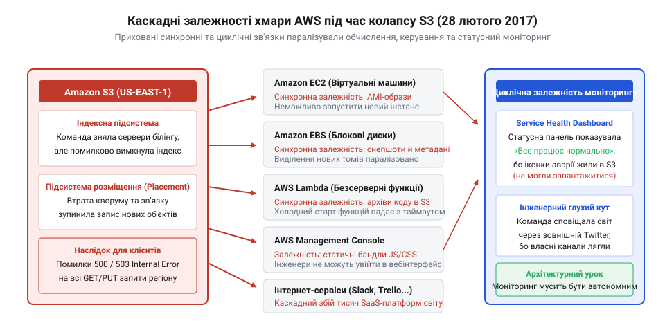
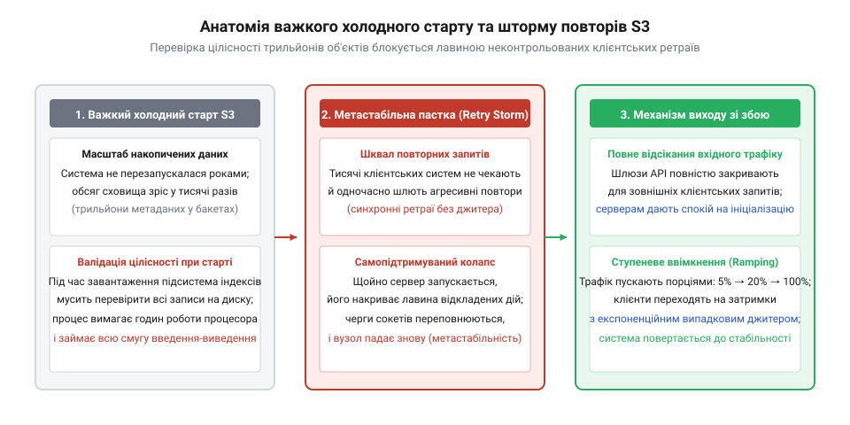

# Служба, якою ти не керуєш

<preknowlist>
- [Їхня аварія — твоя аварія](root:progarch/their-outage-is-your-outage) — чому відмова зовнішньої інфраструктури автоматично стає аварією вашого сервісу, якщо точки інтеграції не ізольовані та перебувають на синхронному критичному шляху
- [Коли вони ламають без попередження](root:progarch/when-they-break-without-warning) — як раптові збої та непередбачувана поведінка провайдера руйнують неявні припущення коду і вимагають захисного програмування на межі системи
</preknowlist>

## 28 лютого 2017 року, 09:37 PST: рутинне обслуговування білінгу і фатальна одруківка

Вранці у вівторок, 28 лютого 2017 року, у дата-центрах регіону Північна Вірджинія (@@en|US-EAST-1@@) компанії Amazon Web Services тривав звичайний робочий день. Цей регіон був найстарішим, найбільшим і найбільш завантаженим кластером у всій інфраструктурі компанії. Саме з нього у 2006 році починалася публічна історія Amazon S3 (@@en|Simple Storage Service@@; простий — від лат. *simplex*; сховище — від прасл. *ховати*). До 2017 року сервіс перетворився на невидимий хребет світового інтернету: у ньому зберігалися трильйони об'єктів, а щосекунди оброблялися мільйони запитів. Маркетингова обіцянка «одинадцяти дев'яток» річної збереженості даних (99.999999999%) заколисала індустрію. Тисячі компаній проєктували власну архітектуру з мовчазною аксіомою: хмарне сховище Amazon — це вічна природна стихія, яка принципово не може зникнути чи вимкнутися.

Реальність під капотом S3 була далекою від міфу про монолітну непорушну плиту. Сховище складалося з багатьох взаємопов'язаних розподілених компонентів, одним із яких була підсистема білінгу (@@en|billing subsystem@@), що фіксувала обсяги збережених даних і переданих гігабайтів для виставлення рахунків клієнтам. Останніми днями ця підсистема почала помітно гальмувати, утворюючи чергу повідомлень. Інженерна команда ухвалила стандартне експлуатаційне рішення: за встановленим регламентом (@@en|playbook@@; регламент — від лат. *regula*, норма, правило) вивести невелику частину серверів білінгу з ротації, щоб перезапустити їх і прискорити обробку накопичених транзакцій. Операцію доручили досвідченому системному інженеру, який мав усі необхідні авторизаційні доступи.

О 09:37 за тихоокеанським стандартним часом (PST) інженер запустив внутрішню консольну утиліту для зняття серверів із навантаження. Потрібно було вимкнути кілька конкретних вузлів білінгу. Проте під час введення аргументів команди людина припустилася простої друкарської помилки (@@en|typo@@, одруківка). Внутрішня утиліта автоматизації, яку роками використовували для адміністрування парку, не мала [запобіжних лімітів в операційному інструментарії](root:sf-release/tooling-guardrails): вона не перевіряла ні частку серверів, що виводяться за один раз, ні мінімальний залишок вузлів, необхідний для підтримки кворуму. Команда без жодного попередження чи запиту на підтвердження прийняла хибний ввід і негайно знеструмила колосальну кількість серверів.

Удар припав далеко за межі білінгу. Разом із вузлами обліку команда видалила сервери двох життєво важливих внутрішніх компонентів усього регіону US-EAST-1:
1. **Підсистеми індексації метаданих** (@@en|index subsystem@@; індекс — від лат. *index*, вказівник; метадані — від грец. *meta*, після/над, та лат. *datum*, дане), яка зберігала інформацію про назви, заголовки, права доступу та точне розташування абсолютно всіх об'єктів у Північній Вірджинії.
2. **Підсистеми розміщення** (@@en|placement subsystem@@), яка керувала пулом вільної дискової місткості в кластерах і визначала, на які саме фізичні накопичувачі записувати нові байти.

Підсистема індексації була серцем S3: жоден запит на читання (`GET`), запис (`PUT`) чи видалення (`DELETE`) не міг виконатися без звернення до її розподіленого індексу. Втративши критичну масу серверів, підсистема миттєво втратила кворум і зупинила обслуговування запитів. О 09:37 за лічені секунди найбільше об'єктне сховище планети перестало відповідати. Клієнти, які зверталися до S3 у Північній Вірджинії, замість відповідей натикалися на глухі таймаути з'єднання або помилки `500 Internal Server Error`.

> 🔧 **Навіщо це.**
> Головний урок перших хвилин аварії полягає в тому, що надійність операційного інструментарію важливіша за надійність коду бізнес-логіки. Якщо внутрішня утиліта адміністрування дозволяє оператору однією командою зняти критичну частку потужностей без [локалізації радіуса ураження](root:sf-distributed/blast-radius-containment) (@@en|blast radius@@) та перевірки мінімального кворуму, катастрофа є лише питанням часу. Безпечна архітектура зобов'язана мати програмні «перила» (@@en|guardrails@@), які блокують руйнівні дії незалежно від рівня привілеїв оператора.

## Падіння гіганта: приховані залежності та параліч хмарного стеку

Перші десять хвилин після аварії інженери за межами Amazon намагалися зрозуміти, що відбувається. Багато архітекторів дотримувалися підходу ізольованих шарів: навіть якщо об'єктне сховище S3 тимчасово деградувало, інші хмарні служби — віртуальні машини, блокові диски та серверлесс-середовища — мали б працювати абсолютно незалежно. Адже Amazon у документації завжди описував кожен сервіс як окремий функціональний блок із власним API та ізольованим життєвим циклом.

Дійсність швидко зруйнувала ці ілюзії. У розподілених системах зв'язність часто ховається під шарами абстракцій: невидиме, недокументоване логічне зчеплення (@@en|coupling@@; зчеплення — від прасл. *čepiti*, хапати, тримати) миттєво перетворило падіння одного S3 на повномасштабний каскад (@@en|cascade@@; від італ. *cascata*, падіння, від лат. *cadere*, падати) по всій платформі AWS:

1. **Amazon EC2 (Elastic Compute Cloud):** наявні віртуальні машини в хмарі продовжували молотити такти процесора, але керувати ними стало неможливо. Спроби запустити нові інстанси, замінити вузли, що збоїли, або розширити пул через групи автоскейлінгу (Auto Scaling Groups) завершувалися аварією. З'ясувалося, що підсистема підготовки образів EC2 синхронно завантажувала базові образи дисків (AMI; Amazon Machine Images) та скрипти ініціалізації безпосередньо з бакетів S3. Без доступу до S3 запуск будь-якої нової віртуальної машини у Вірджинії намертво зависав.
2. **Amazon EBS (Elastic Block Store):** блокові накопичувачі віртуальних машин не могли виділяти нові томи даних. При створенні нового EBS-диска сервіс мав перевірити наявність збережених резервних знімків (@@en|snapshots@@), які з міркувань економії та надійності розміщувалися в тому ж таки S3. Не отримавши відповіді від сховища метаданих, EBS блокував операції виділення дискової місткості.
3. **AWS Lambda:** революційна бессерверна платформа компанії виявилася повністю паралізованою. Контейнери Lambda, покликані виконувати код у відповідь на події, завантажували zip-архіви з кодом функцій клієнтів із системних бакетів S3. Коли S3 зник, виклики функцій почали масово завершуватися внутрішніми помилками середовища виконання.
4. **AWS Management Console:** центральний вебінтерфейс керування інфраструктурою взагалі припинив відкриватися у браузерах. Його статичні JavaScript-бандли, стилі та модулі авторизації хостилися безпосередньо на S3 у Північній Вірджинії. Інженери клієнтських компаній опинилися повністю сліпими: вони не могли увійти в кабінет керування хмарою, щоб змінити конфігурацію DNS чи спробувати вручну перемкнути навантаження на інший географічний регіон.

*Каскадні та циклічні залежності всередині інфраструктури AWS: збій підсистеми індексації метаданих S3 у регіоні US-EAST-1 паралізував ініціалізацію віртуальних машин EC2, виділення дисків EBS, запуск функцій Lambda та власну діагностичну панель платформи.*

Апогеєм драми стала доля офіційного монітора стану — AWS Service Health Dashboard (SHD). Коли мільйони інженерів по всьому світу кинулися перевіряти сторінку здоров'я хмари, вони побачили дивовижну картину: біля кожної служби в регіоні US-EAST-1 незворушно світилися зелені галочки «штатна робота». Інтернет вибухнув обуренням і глузуванням, підозрюючи Amazon у свідомому приховуванні катастрофи.

Проте причина була не в цензурі, а в класичній архітектурній пастці, відомій як [циклічна залежність у контурах відновлення](root:sf-release/circular-dependency-in-recovery) (@@en|circular dependency@@; від лат. *circulus*, коло, та *dependere*, залежати, звисати). Інженери моніторингу намагалися оновити статус на червоний, але скрипти публікації не могли цього зробити, бо графічні піктограми статусів (ті самі зелені й червоні кружечки) та статичні сторінки самого дашборду зберігалися на бакеті S3 у Північній Вірджинії! Щоб повідомити світ про смерть S3, системі сповіщень був потрібен живий S3. Команді довелося поспіхом писати повідомлення в соціальній мережі Twitter, поки інженери шукали обхідні шляхи для прямого оновлення вебсерверів моніторингу.

Цей епізод наочно проілюстрував суворий закон проєктування: [їхня аварія — твоя аварія](root:progarch/their-outage-is-your-outage). Навіть найпотужніший хмарний постачальник стає жертвою власних неізольованих зв'язків, якщо сервіси управління та спостереження мають пряму залежність від інфраструктури, яку вони покликані обслуговувати. Коли зовнішній провайдер [ламає роботу без попередження](root:progarch/when-they-break-without-warning), приховані залежності перетворюють локальний збій одного сховища на глобальний блекаут платформи.

> 🔧 **Навіщо це.**
> Циклічні залежності між інструментами діагностики та керованою інфраструктурою — смертельна небезпека для будь-якої системи. Моніторинг, системи сповіщення та механізми аварійного відновлення (@@en|disaster recovery@@) зобов'язані проєктуватися повністю ізольованими від компонентів, стан яких вони відстежують. Якщо дашборд моніторингу залежить від працездатності бази даних чи сховища, про падіння якого він має сповістити, у момент справжньої кризи ви залишитеся без очей і без засобів зв'язку.

## Глобальне цунамі в інтернеті: коли чужа служба топить твій бізнес

О 09:37 PST ударна хвиля від падіння S3 вийшла за межі дата-центрів Amazon і вдарила по глобальній цифровій інфраструктурі. Мільйони користувачів по всьому світу одночасно побачили білі екрани, нескінченні анімації завантаження або повідомлення про внутрішні помилки сервісів. Проте інженери більшості постраждалих компаній навіть не підозрювали, що причиною паралічу їхнього продукту став збій у сторонньому сховищі даних за тисячі кілометрів від їхніх серверів.

Масштаб ураження охопив увесь спектр інтернет-сервісів:
1. **Колаборативні та контентні платформи:** у системі керування проєктами Trello користувачі не могли відкрити дошки й додати файли, оскільки кожна картка покладалася на вкладення з S3. Платформи Quora та Medium припинили нормально відкриватися: їхні вебсторінки або падали з помилкою `500 Server Error`, або рендерилися у вигляді потворного «голого» тексту, адже файли каскадних таблиць стилів (CSS), шрифти та графічні бандли хостилися на знеструмлених серверах у Вірджинії.
2. **Комунікації та розробка:** у месенджері Slack користувачі втратили здатність передавати файли, ділитися скриншотами та переглядати аватари колег. Сервіс безперервної інтеграції Travis CI зупинив складання програмних проєктів по всій планеті: конвеєри не могли завантажити вихідні образи середовищ або зберегти готові артефакти збірок.
3. **Побутова автоматика та «розумний дім» (IoT):** катастрофа перетнула межу цифрового простору й увірвалася у фізичний світ. Власники розумних термостатів Nest втратили можливість дистанційно регулювати температуру у своїх домівках. Електронні дверні замки August Smart Lock перестали реагувати на мобільні застосунки, залишаючи людей замкненими ззовні або всередині осель. Навіть автоматичні годівнички для домашніх тварин Petnet відмовилися видавати корм.

Причина настільки безпорадного краху тисяч незалежних продуктів полягала не в самій аварії Amazon, а у фатальних помилках проєктування на стороні споживачів хмари. Архітектори змішали два принципово різні поняття: гарантію збереженості даних (@@en|durability@@; від лат. *durabilis*, тривалий, стійкий) та миттєву доступність (@@en|availability@@; від лат. *habilis*, придатний, зручний). Рекламні «одинадцять дев'яток» збереженості означали лише те, що збережений байт не зітреться з диска, але аж ніяк не гарантували, що служба відповідатиме на кожен мережевий запит за 50 мілісекунд.

Ця сліпа довіра породила ланцюгову реакцію відмов через три головні вразливості клієнтських систем:
* **Відсутність мережевих лімітів очікування:** клієнтські бібліотеки роками викликали API S3 без явного встановлення жорсткого таймауту (@@en|timeout@@; таймаут — від англ. *time*, час, та *out*, поза, кінець). За замовчуванням багато системних бібліотек використовували нескінченний час очікування відповіді TCP-сокета. Коли S3 перестав надсилати байти, клієнтські процеси зависли в нескінченному очікуванні.
* **Блокування пулів потоків бекенду:** типовий вебсервер (наприклад, на базі Puma, Gunicorn чи Tomcat) має фіксований пул (@@en|pool@@; від фр. *poule*, спільна ставка, казанок) із кількох десятків або сотень робочих потоків. Щоразу, коли користувач відкривав сторінку, серверний застосунок робив синхронний виклик до S3 — щоб згенерувати підписане посилання, перевірити права на аватар або записати лог. Оскільки жоден виклик не повертав помилки негайно, а сокети висіли відкритими, усі робочі потоки бекенду вичерпалися за кілька секунд. Сервери повністю втратили здатність приймати будь-які нові з'єднання, включно з тими запитами, які взагалі не потребували дискового сховища. Фронтенд-проксі почали масово повертати користувачам `504 Gateway Timeout`.
* **Повна відсутність аварійних сценаріїв:** системи проєктувалися за принципом «все або нічого». Замість м'якої деградації інтерфейсу (@@en|graceful degradation@@; деградація — від лат. *degradatio*, зниження ступеня) — коли відсутній аватар тимчасово замінюється стандартною заглушкою, а сторінка успішно завантажується без другорядного контенту, — помилка читання одного файла валила весь процес обробки бізнес-транзакції.

Сталася класична реалізація закону: [їхня аварія — твоя аварія](root:progarch/their-outage-is-your-outage). Компанії розмістили [чужі служби в критичному шляху](root:progarch/dh-foreign-services-in-critical-path) власної бізнес-логіки. Коли зовнішній провайдер [ламає роботу без попередження](root:progarch/when-they-break-without-warning), будь-яка неізольована синхронна залежність миттєво тягне за собою на дно весь твій бізнес.

> 🔧 **Навіщо це.**
> Зберігайте автономність власної системи за будь-яку ціну. Жоден мережевий виклик до сторонньої хмарної служби не повинен блокувати критичний шлях виконання бізнес-операцій. Використовуйте суворі таймаути (не більше кількох сотень мілісекунд), автоматичні запобіжники (@@en|circuit breakers@@), локальне кешування статичних ресурсів і сценарії м'якої деградації: якщо віддалене сховище недоступне, система повинна повернути збережену версію з локального кешу або показати спрощений інтерфейс, але продовжити приймати замовлення й реєструвати користувачів.

## Проблема «холодного старту» під тиском: чому відновлення тривало годинами

Після того як інженери Amazon виявили причину аварії, першою реакцією технічної спільноти було очікування швидкого розв'язання. Здавалося, що достатньо перезапустити процеси на знеструмлених серверах, відновити кворум підсистем індексації та розміщення — і через п'ятнадцять хвилин S3 повернеться до нормального життя. Проте аварія затягнулася на понад чотири з половиною години (з 09:37 до 14:00 PST). Чому перезапуск програми у XXI столітті забрав стільки часу?

Причина крилася в інженерній пастці, яку приховував феноменальний успіх сервісу: підсистема індексації метаданих у регіоні US-EAST-1 не переживала повного холодного перезапуску (@@en|cold restart@@; старт — від англ. *start*, рушати; холодний — від прасл. *xoldъ*) протягом багатьох років.

Усі попередні роки платформа S3 зростала безперервно:
1. За роки стабільної роботи обсяг збережених даних збільшився від кількох гігабайтів на світанку хмари до багатьох десятків трильйонів об'єктів.
2. Штатне оновлення та обслуговування серверів завжди відбувалося за схемою ковзного перезапуску (@@en|rolling restart@@): окремий вузол виводився з роботи, оновлювався і повертався до кластера, прогріваючи власні кеші та синхронізуючи стан безпосередньо з сусідніх працюючих вузлів. Кластер як цілісний організм ніколи не зупинявся повністю.

Коли ж людська одруківка знесла критичну кількість вузлів одночасно, кворум розсипався, і підсистема індексації померла вся повністю. Це означало, що її довелося підіймати з абсолютно холодного стану — з порожньою оперативною пам'яттю, холодними кешами та несинхронізованими транзакційними логами на дисках.

Перед тим як почати обробляти запити клієнтів, кожному вузлу індексу потрібно було виконати процедуру верифікації цілісності даних (@@en|integrity check@@; цілісність — від лат. *integritas*, повнота, непорочність):
* просканувати розподілені структури метаданих на дисках;
* звірити локальні версії журналів транзакцій із сусідами;
* усунути можливі розбіжності та підтвердити несуперечливість простору ключів для трильйонів записів.

Операція валідації трильйонів ключів із накопичувачів вимагала колосального обсягу дискового вводу-виводу. Навіть на спеціалізованому обладнанні цей процес неможливо було прискорити понад фізичні можливості дискової підсистеми.

Але справжня біда чекала інженерів на наступному кроці. Коли вузли індексації завершили базові перевірки та почали відкривати мережеві порти, вони зіткнулися з явищем, відомим як [метастабільні збої](root:sf-distributed/metastable-failures) (@@en|metastable failure@@; метастабільний — від грец. *meta*, за/через, та лат. *stabilis*, стійкий).

*Холодний перезапуск на екстремальному масштабі: ініціалізація індексу трильйонів об'єктів S3 вимагала тривалої перевірки цілісності метаданих, а підйом підсистем блокувався метастабільним колапсом від некерованого шквалу клієнтських повторних запитів.*

Суть метастабільного збою полягала в тому, що система потрапила в пастку самопідтримуваного колапсу через [шквал повторних запитів](root:sf-distributed/retry-storm) (@@en|retry storm@@; від англ. *retry*, повторна спроба, та *storm*, буря, шквал):
1. За години простою мільйони зовнішніх клієнтських програм та внутрішніх сервісів AWS (EC2, EBS, Lambda) накопичили астрономічні черги невиконаних завдань.
2. Більшість клієнтів не використовували [експоненційне уповільнення з джитером](root:sf-distributed/exponential-backoff-and-jitter) (@@en|exponential backoff with jitter@@; експоненційний — від лат. *exponere*, виставляти назовні; джитер — від англ. *jitter*, тремтіти). Замість того щоб збільшувати паузу між спробами з додаванням випадкового зміщення, тисячі скриптів і фонових процесів довбали API S3 кожні кілька мілісекунд у синхронному резонансі.
3. Щойно сервери індексації з'являлися в мережі, на них одночасно обрушувався трафік, який у десятки разів перевищував звичайне пікове навантаження системи.
4. Оскільки кеші індексних вузлів були ще повністю холодними, кожен вхідний запит змушував процесори читати дані безпосередньо з дисків. Завантаження CPU миттєво підскакувало до 100%, внутрішні черги переповнювалися, а вузли переставали вчасно надсилати контрольні сигнали здоров'я (@@en|heartbeats@@).
5. Балансувальники навантаження вважали такі вузли мертвими, автоматично виводили їх із контуру або перезапускали, скидаючи прогрес і повертаючи систему у вихідну точку катастрофи.

Щоб розірвати це зачароване коло метастабільності, інженерам Amazon довелося вдатися до радикального кроку: повністю перекрити вхідні шлюзи на мережевому периметрі. Вони фізично відсікли весь клієнтський трафік з інтернету, давши серверам індексації змогу завершити перевірку цілісності в повній ізоляції, синхронізувати стан між собою та прогріти внутрішні кеші без зовнішнього тиску. Лише після того як підсистеми стабілізувалися в закритому режимі, інженери почали поступово, малими частками відсотків, відкривати шлюзи для зовнішніх запитів.

> 🔧 **Навіщо це.**
> Завжди тестуйте повний холодний старт власної системи під час планових навчань (@@en|game days@@ та хаос-інжиніринг). Система, яка роками працює без повного перезапуску, неминуче накопичує неявні залежності від розігрітих кешів та поточного стану пам'яті. У клієнтському коді обов'язково впроваджуйте експоненційне уповільнення з випадковим джитером для всіх повторних спроб: без нього під час аварії ваші власні сервіси перетворяться на розподілену DDoS-атаку проти вашої ж інфраструктури, що намагається піднятися.

## Розвінчання міфів: людський фактор, кібератаки та ілюзія «хмарної невразливості»

У перші години після падіння S3 інформаційний простір заповнили конспірологічні теорії. Новинні ресурси та користувачі соціальних мереж наввипередки висували версії про безпрецедентну кібератаку: від скоординованого нападу іноземних військових хакерів до складного вірусу-здирника, що нібито зашифрував дата-центри Amazon. Масштаб паралічу інтернету був настільки разючим, що масовій свідомості було важко повірити в прозаїчне технічне пояснення.

Оприлюднений 2 березня 2017 року офіційний звіт Amazon про інцидент (@@en|Summary of the Amazon S3 Service Disruption in the Northern Virginia (US-EAST-1) Region@@) остаточно розбив ці вигадки. Жодного зовнішнього втручання, шкідливого коду чи атаки на відмову в обслуговуванні не було. Катастрофа була повністю рукотворною і розгорнулася зсередини периметра безпеки.

Але слідом за спростуванням кібератаки спалахнув інший, значно шкідливіший міф: перекладання всієї провини на «людський фактор». У коментарях технологічних медіа звучали заклики покарати або звільнити інженера, який ввів неправильну команду. Такий підхід свідчить про глибоке нерозуміння природи складних соціотехнічних систем.

Сучасна інженерна культура сповідує принципи бездоганного аналізу збоїв (@@en|blameless post-mortem@@; аналіз — від грец. *analysis*, розкладання; постмортем — від лат. *post*, після, та *mortem*, смерть; [бездоганний аналіз інцидентів](root:sf-release/blameless-post-mortem)). Головна теза цього підходу стверджує: дія людини ніколи не є першопричиною катастрофи, вона є лише останнім тригером, який виявляє системні дефекти архітектури.

Якщо звичайна одруківка в консолі адміністратора здатна знищити працездатність континентального хабу хмари, система вже була приречена:
1. Внутрішній інструмент адміністрування не мав перевірки граничних значень (@@en|sanity checks@@): він дозволив ввести число серверів, що перевищувало допустимий поріг безпеки для збереження кворуму.
2. Програма не запитала підтвердження на виконання потенційно деструктивної операції такого масштабу.
3. В інструменті був відсутній попередній режим симуляції чи сухого прогону (@@en|dry run@@; сухий — від прасл. *suxъ*), який би показав оператору точний перелік вузлів перед їхнім вимкненням.

Карати інженера за таких умов безглуздо. Пошук винних лише змушує команду приховувати власні помилки й дрібні збої, що гарантує повторення масштабної катастрофи в майбутньому. Відповідальність лежить на творцях інфраструктури, які не збудували автоматичних бар'єрів навколо небезпечних операцій.

Ще одна небезпечна ілюзія, яку зруйнувала аварія 2017 року, — це сліпа віра в юридичний договір про рівень обслуговування (@@en|Service Level Agreement@@, SLA; угода — від лат. *accordum*; рівень — від фр. *niveau*). Багато технічних директорів помилково сприймали пункт про 99.9% доступності як технічну гарантію безвідмовності.

Дійсність виявилася набагато жорсткішою: [документація проти дійсності](root:progarch/docs-vs-reality). Хмарний SLA — це виключно фінансовий інструмент, а не страховий поліс. Коли S3 впав на кілька годин, компанії зазнали мільйонних збитків від втрати транзакцій, зіпсованої репутації та простою виробництва. Максимум, на що вони могли розраховувати згідно з угодою AWS, — це повернення 10% чи 25% вартості спожитих послуг сховища за відповідний місяць у вигляді кредитів на майбутні рахунки. Тобто за втрачений бізнес на сотні тисяч доларів клієнт отримував знижку в кілька сотень доларів на наступну оплату серверів. Жоден провайдер не відшкодовує упущену вигоду вашого бізнесу.

> 🔧 **Навіщо це.**
> Ніколи не покладайтеся на чужий SLA як на заміну архітектурної стійкості. Юридична угода з хмарним постачальником захищає його гаманець від судових позовів, а не ваш бізнес від простою. Проєктуйте системи за правилом нульової довіри до зовнішньої доступності: кожна стороння служба гарантовано впаде, і ваш застосунок повинен уміти пережити це падіння без втрати користувацьких даних та ключового бізнес-функціоналу.

## Архітектурні уроки для тих, хто будує на чужих службах: ізоляція, деградація та перевірений план катастроф

Події 28 лютого 2017 року назавжди змінили парадигму хмарного проєктування. Вони продемонстрували, що в сучасних взаємопов'язаних мережах географічна віддаленість чи сторонній бренд не рятують від миттєвого інфікування чужим збоєм. Щоб створити надійний продукт поверх зовнішніх сервісів, якими ви не керуєте, інженер зобов'язаний закласти у фундамент архітектури чотири обов'язкові контури захисту.

### 1. Захист операційних інструментів і зменшення радіуса ураження
Будь-який внутрішній скрипт, консольна утиліта чи пайплайн деплою є такою ж частиною продукту, як і клієнтський бекенд. На них поширюються ті самі вимоги надійності:
* **Запобіжні ліміти (@@en|safety guardrails@@):** автоматика повинна жорстко обмежувати відсоток потужностей, які можна зупинити або оновити за один крок (наприклад, не більше 5% серверів за ітерацію).
* **Ступінчасте розгортання:** операції модифікації мають виконуватися канарейковими етапами (@@en|canary rollout@@; від фр. *canari*, острівний птах) із паузами на перевірку метрик стану.
* **Перевірка кворуму на рівні API:** низькорівнева підсистема повинна відхиляти команди керування, якщо їх виконання загрожує втратою мінімально необхідного кворуму системи.

### 2. Розрив циклічних залежностей спостереження
Системи спостереження, моніторингу та аварійного керування не мають права ділити інфраструктуру з компонентами, стан яких вони контролюють. Якщо графічні елементи вашого дашборду, сервери сповіщень чи інструменти перемикання трафіку залежать від головної бази даних або того самого сховища, у момент аварії ви втратите здатність діагностувати проблему та повідомити користувачів. Панелі моніторингу здоров'я повинні працювати на повністю ізольованому, статичному та незалежному хостингу в іншому географічному регіоні чи навіть у резервного хмарного провайдера.

### 3. Захист клієнтського коду від чужих збоїв
Якщо ваш застосунок звертається до зовнішнього API, цей виклик повинен перебувати в ізольованому карантині:
* **Роздільні та жорсткі таймаути:** необхідно явно задавати мінімальний таймаут на встановлення TCP-з'єднання (до 100–200 мс) та окремий таймаут на читання відповіді з сокета (@@en|socket read timeout@@). Без цього завислий сокет паралізує робочий потік вебсервера.
* **Шаблон «Запобіжник» ([circuit breaker](root:sf-distributed/circuit-breaker-pattern); запобіжник — від укр. *запобігати*; ланцюг — від пол. *łańcuch*):** якщо зовнішній сервіс починає повертати помилки або відповідати з неприпустимою затримкою, виклики до нього тимчасово розмикаються. Застосунок негайно повертає аварійну відповідь без виконання реального мережевого запиту, зберігаючи робочі потоки бекенду для інших користувачів.
* **Керована деградація та віддача застарілого стану (@@en|stale cache@@):** якщо віддалений бакет не відповідає, інтерфейс повинен брати статичні файли з локального CDN, віддавати аварійні заглушки або показувати закешовану копію даних за принципом «краще застаріле, ніж зламане».
* **Рандомізоване уповільнення повторів:** клієнтські повторні спроби повинні використовувати експоненційну паузу з обов'язковим додаванням випадкового зсуву (@@en|full jitter@@). Це ліквідує резонансні хвилі трафіку і не дозволяє вашим власним клієнтам перетворитися на руйнівний шквал запитів проти сервісу, що відновлюється.

### 4. Мультирегіональна автономія та регулярні тренування катастроф
Проєктування під роботу в одному регіоні — це завжди згода на неминучий повний простій. Справжня стійкість вимагає розподілу навантаження між незалежними регіонами, що не ділять між собою підсистем індексації та контурів управління.

Проте наявність резервного регіону в конфігураціях тераформу нічого не варта без регулярних практичних перевірок. Архітектурні плани аварійного відновлення (@@en|disaster recovery plan@@) залишаються небезпечною ілюзією, доки вони не верифіковані в бойових умовах. Практика хаос-інжинірингу (@@en|chaos engineering@@) та планові дні навчань (@@en|game days@@) з повним примусовим відключенням окремих підсистем або цілих регіонів — єдиний спосіб переконатися, що система здатна пережити холодний старт і захистити бізнес, коли черговий зовнішній гігант раптово піде на дно.

> 🔧 **Навіщо це.**
> У розподілених системах діє абсолютний інженерний закон: усе, що може зламатися, обов'язково зламається в найгірший момент. Ваше завдання як архітектора — не сподіватися на вічне здоров'я чужого провайдера, а спроєктувати межі застосунку так, щоб смерть будь-якої зовнішньої служби спричиняла лише контрольовану локальну деградацію другорядних функцій, зберігаючи ядро вашого бізнесу живим і прибутковим.
