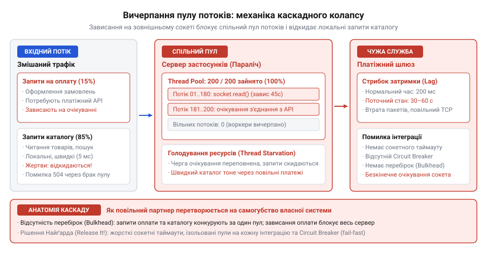
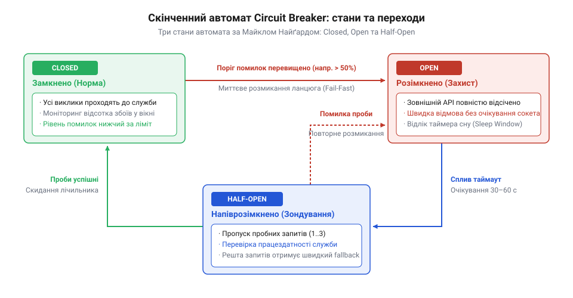
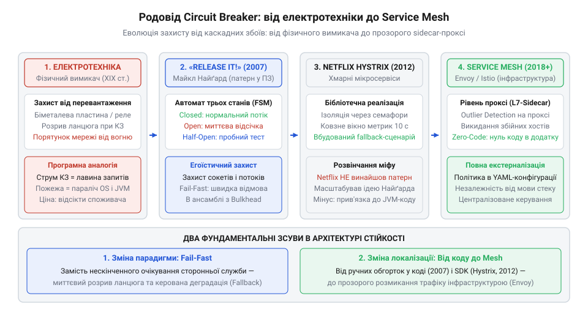

# Служба, якою ти не керуєш

<preknowlist>
- [Їхня аварія — твоя аварія](root:progarch/their-outage-is-your-outage) — кореляція доступності зовнішнього сервісу із загальним SLA власного продукту
- [Квоти, ліміти й ціна виклику](root:progarch/quotas-limits-call-cost) — як перевищення лімітів та перевантаження зовнішнього API призводять до сповільнення та скидання з'єднань
</preknowlist>

## Катастрофа у святковий пік: як повільний шлюз убиває здоровий моноліт

Наприкінці 1990-х та на початку 2000-х років індустрія програмного забезпечення переживала бурхливий перехід у мережу: традиційний бізнес масово відкривав інтернет-магазини, платіжні портали та сервіси бронювання квитків. Архітектурним стандартом тієї доби були монолітні корпоративні системи, розгорнуті на серверах застосунків (BEA WebLogic, IBM WebSphere чи Apache Tomcat). Архітектура обробки запитів у таких серверах спиралася на [модель «потік на запит»](root:sf-os/thread-per-request) (@@en|thread-per-request@@; потік — англ. *thread* від давньоангл. *thrǣd*, прядена нитка). Для кожного вхідного HTTP-підключення операційна система або віртуальна машина Java виділяла окремий робочий потік із заздалегідь сконфігурованого пулу. За звичайних умов пул із 50–100 потоків легко витримував тисячі користувачів на хвилину: клієнт надсилав запит, сервер швидко читав дані з реляційної бази даних, формував HTML-сторінку за 50–100 мілісекунд, віддавав байти в мережу і негайно повертав потік назад у пул для обслуговування наступного клієнта.

Справжні проблеми починалися в так званих точках інтеграції (@@en|integration point@@; від лат. *integratio* — поновлення, об'єднання в ціле), де моноліт мусив звернутися до зовнішньої системи: шлюзу авторизації банківських карток, довідника поштових індексів чи корпоративного складу. Типовий сценарій катастрофи розгортався під час пікових сезонних навантажень — наприклад, у Чорну п'ятницю чи передріздвяний розпродаж, коли наплив покупців зростав у рази. Інженери готували систему до високого трафіку, проводили стрес-тести та оптимізували SQL-запити. Але головна загроза ховалася за межами власної інфраструктури.

У розпал продажів сторонній сервіс авторизації платежів раптово переставав справлятися з напливом транзакцій. Якби він просто аварійно вимикався й розривав TCP-з'єднання пакетом RST, біда була б обмеженою: клієнтські виклики миттєво повертали б мережеву помилку, і потоки веб-сервера звільнялися б за кілька мілісекунд. Проте зовнішній вузол не помирав одразу — він починав деградувати й гальмувати. Час відповіді на платіжний запит стрибав від звичних 200 мілісекунд до десятків секунд або взагалі зависав у сокеті без відповіді.

У цей момент усередині здорового моноліту запускався механізм каскадної відмови (@@en|cascading failure@@; від лат. *cascare* — падати). Покупець оформлював замовлення, робочий потік відправляв мережевий пакет до банку й зависав у системному виклику очікування вводу-виводу. За секунду надходив наступний покупець — і другий потік теж завмирав. За лічені хвилини всі 100 потоків веб-сервера виявлялися заблокованими в очікуванні чужих відповідей. Черга вхідних з'єднань перед сервером застосунків стрімко заповнювалася, після чого система припиняла приймати будь-які нові TCP-підключення.

*Лавиноподібний колапс: сповільнення стороннього сервісу заповнює пул робочих потоків, позбавляючи систему можливості обслуговувати навіть незалежні локальні запити.*

Парадокс полягав у тому, що зовнішній збій вражав сервіси, які взагалі не мали стосунку до оплати. Відвідувач, який просто хотів переглянути каталог товарів, відкрити умови повернення або завантажити статичний ресурс сайту, бачив білий екран і помилку таймауту шлюзу. Уся система була паралізована через затримку одного другорядного партнера, підтверджуючи суворий інженерний закон: [Їхня аварія — твоя аварія](root:progarch/their-outage-is-your-outage).

> 🔧 **Навіщо це.**
> Розуміння фізики каскадного вичерпання потоків позбавляє розробника ілюзії, що зовнішній сервіс можна викликати як звичайний внутрішній метод класу. Будь-яка синхронна точка інтеграції без ізоляції ресурсів передає контроль над працездатністю вашого сервера в чужі неконтрольовані руки.

## Пастка нарощування ресурсів і шторм повторних спроб

Першою інстинктивною реакцією інженерів і системних адміністраторів під час подібних аварій була спроба збільшити ліміти. Логіка здавалася залізобетонною: якщо системі бракує ста робочих потоків для обробки потоку замовлень, треба виділити п'ятсот або дві тисячі. У конфігураційному файлі сервера застосунків міняли одну цифру, перезапускали вузли й очікували, що ширший канал подолає затор. Проте цей крок лише прискорював крах.

Кожен потік у віртуальній машині Java потребує виділення системної пам'яті під власний стек викликів (`-Xss`), обсяг якого за замовчуванням становив від 512 кілобайтів до 1 мегабайта незалежно від пам'яті купи (`-Xmx`). Створення тисячі потоків миттєво відбирало гігабайт оперативної пам'яті лише на утримання стеків. Коли ж сотні потоків починали одночасно боротися за кванти процесорного часу, операційна система витрачала майже весь ресурс CPU на перемикання контексту (@@en|context switching@@) між заблокованими нитками. Гірше того: кожен потік, що застряг на етапі оплати, вже встиг відкрити транзакцію та тримав зайнятим з'єднання з пулу реляційної бази даних. У результаті за вичерпанням потоків сервера слідував параліч пулу бази даних (@@en|connection pool exhaustion@@), і сервери падали з фатальною помилкою вичерпання оперативної пам'яті або нестачі нативних потоків ядра.

Другою хибною реакцією розробників було впровадження наївних повторних спроб (@@en|retries@@). Припускаючи, що мережа нестабільна, у клієнтський код додавали цикл: якщо виклик зазнає невдачі або переривається за таймаутом, негайно спробувати знову три чи п'ять разів. Коли зовнішній партнер переживав короткочасний сплеск навантаження й намагався відновити нормальну роботу, наївні ретраї перетворювали клієнтські системи на некерований ботнет.

Виникав так званий [шторм повторних спроб](root:sf-distributed/retry-storm) (@@en|retry storm@@). Тисячі клієнтських потоків, не отримавши відповіді, синхронно надсилали дублюючі запити. Навантаження на хворий зовнішній сервіс не зменшувалося, а мультиплікувалося втричі чи вп'ятеро. Щойно партнерський сервер завершував перезапуск і піднімав мережевий сокет, на нього обрушувалася спресована лавина відкладених і повторних пакетів, миттєво забиваючи його процесор і вбиваючи щойно піднятий процес. До того ж неконтрольовані шквали запитів миттєво випалювали контрактні ліміти пропускної здатності ([Квоти, ліміти й ціна виклику](root:progarch/quotas-limits-call-cost)), провокуючи провайдера на автоматичне блокування IP-адрес замовника.

Нарощування апаратних ресурсів і сліпі цикли повторення виявилися глухим кутом. Вони базувалися на хибному припущенні, що зовнішній сервіс завжди відповість, якщо почекати довше або спитати частіше. Індустрія гостро потребувала протилежного принципу: механізму, який замість нескінченного терпіння і помноження навантаження здатний швидко й безжально відрізати збійний зв'язок.

> 🔧 **Навіщо це.**
> Спроба погасити інтеграційну пожежу нарощуванням пулів чи нескінченними ретраями без пауз (backoff) лише поглиблює аварію: замість локалізації збою вона вичерпує пам'ять власної системи та добиває шквалом запитів сервіс партнера.

## Електротехнічна аналогія Майкла Найґарда: захист ціною розриву

Коли на початку 2000-х років криза надійності корпоративних систем досягла апогею, стало очевидно: класична інженерія програмного забезпечення вперлася у власні хибні припущення. Розробники писали код так, ніби мережа між серверами надійна, затримка дорівнює нулю, а виклики віддалених сервісів поводяться як звичайні виклики функцій у пам'яті процесу. Проте в реальному середовищі зовнішня служба є автономною сутністю під чужим керуванням, чиї збої та уповільнення неминучі.

У пошуках принципово іншої моделі американський інженер і архітектор Майкл Найґард (Michael Nygard), який роками проводив технічний аудит та розслідування масштабних збоїв у банках і роздрібних мережах, звернувся до фізичного світу. Він помітив разючий контраст між тим, як відмовостійкість проєктують у софті, і тим, як її десятиліттями будують у промисловій та побутовій електротехніці.

В електричній мережі будь-якої будівлі струм від генератора чи підстанції розходиться лініями до споживачів. Якщо в одній із кімнат через несправність приладу виникає коротке замикання або перевантаження, струм у дротах миттєво зростає до небезпечних значень. Якби електромережа покладалася на «терпіння» і сподівалася, що прилад сам стабілізується, надлишковий струм розжарив би мідні жили, розплавив ізоляцію та спалив увесь будинок. Але цього не стається завдяки автоматичному вимикачу — запобіжнику (@@en|circuit breaker@@; від лат. *circuitus* — круговий обхід, об'їзд). Автомат містить біметалеву пластину або електромагнітне реле, яке під час перевищення струмового порогу фізично розмикає електричний контакт за лічені мілісекунди. Світло в окремій кімнаті згасає, але решта будівлі зберігає електропостачання, а кабельні траси в стінах лишаються непошкодженими.

Найґард переніс цей інваріант в архітектуру взаємодії з розподіленими сервісами. Його ключова ідея полягала у свідомому егоїзмі клієнтського застосунку: замість марного очікування відповідей від збійного партнера програма зобов'язана діяти на випередження. Якщо віддалена точка інтеграції демонструє ознаки деградації, логічний ланцюг між клієнтом і сервером мусить бути негайно розірваний. Застосунок має відмовитися від надсилання нових мережевих пакетів, миттєво повертаючи викликаючому коду сигнал помилки за принципом швидкої відмови (@@en|fail-fast@@).

Цей розрив рятує обидві сторони. Власна система зберігає робочі потоки, файлові дескриптори сокетів та оперативну пам'ять для обслуговування інших користувачів, не дозволяючи чужому збою проникнути в критичний шлях [DH: чужі служби в критичному шляху](root:progarch/dh-foreign-services-in-critical-path). Водночас партнерський сервіс дістає так необхідний йому час на охолодження й відновлення, оскільки клієнти припиняють засипати його повторними запитами.

> 🔧 **Навіщо це.**
> Патерн запобіжника змінює мету обробки відмов: замість наївного очікування успішної відповіді будь-якою ціною архітектор ставить на перше місце гарантоване виживання власного вузла за рахунок негайного відсікання небезпечної залежності.

## Три стани стійкості: канонічний автомат книги «Release It!»

У 2007 році у видавництві Pragmatic Bookshelf вийшла книга Майкла Найґарда «Release It! Design and Deploy Production-Ready Software». Її поява стала тектонічним зсувом у практиці проєктування: вона кодифікувала прикладний досвід боротьби з продакшен-катастрофами у вигляді інженерних патернів стабільності. Головним серед них став описаний автором запобіжник, який Найґард сформулював як [строгий скінченний автомат](root:sf-apps/circuit-breaker-fsm) (@@en|finite-state machine@@; скінченний — від лат. *finitus*, визначений, обмежений; автомат — від грец. *automatos*, самодіючий) із трьома дискретними станами.

Перший стан — **замкнений** (@@en|Closed@@). Це нормальний робочий режим системи. Усі клієнтські виклики безперешкодно проходять крізь запобіжник і спрямовуються до зовнішнього сервісу. Одночасно компонент веде невпинний статистичний облік: фіксує кількість успішних відповідей, мережевих помилок і викликів, що перевищили дозволений ліміт часу. Облік ведеться у ковзному часовому вікні або на кільцевому буфері останніх звернень. Якщо частка відмов перевищує встановлену критичну межу (наприклад, понад 50% помилок за останні 10 секунд), автомат автоматично перемикається у другий стан.

Другий стан — **розімкнений** (@@en|Open@@). Ланцюг викликів розірвано. Запобіжник більше навіть не намагається встановити мережеве з'єднання чи надіслати байти до сторонньої служби. Усі вхідні виклики миттєво відхиляються за частки мікросекунди без створення системних сокетів і без блокування робочих потоків. Замість зависання програма повертає викликаючому коду явний виняток або перемикається на резервний сценарій (@@en|fallback@@; від англ. *fall back* — відступати назад): віддає збережені дані з локального кешу, повертає безпечне порожнє значення чи ставить операцію в чергу відкладеної обробки. Перебуваючи у розімкненому стані, автомат запускає таймер очікування відновлення (наприклад, на 30–60 секунд).

Третій стан — **напіввідкритий** (@@en|Half-Open@@). Коли таймер відновлення спливає, запобіжник не повертається одразу до нормальної роботи, адже партнерський сервіс може все ще перебувати під загрозою падіння. Автомат переходить у тестовий режим: він відкриває контрольований шлюз і дозволяє пройти рівно одному або кільком пробним запитам (@@en|probe requests@@), затримуючи решту трафіку. Якщо пробні виклики завершуються успішно, автомат робить висновок, що зовнішній сервіс одужав: він скидає лічильники відмов і замикає ланцюг (Closed). Якщо ж бодай один пробний виклик зазнає краху чи падає за таймаутом, ланцюг миттєво розмикається знову (Open) на наступний повний часовий інтервал.

*Скінченний автомат запобіжника: переходи між станами Closed, Open та Half-Open за порогами відмов та таймерами одужання.*

Проте Найґард окремо наголошував: запобіжник не працює у вакуумі. Він є лише однією ланкою комплексної системи захисту. Без обов'язкових таймаутів (@@en|timeouts@@) на рівні мережевих сокетів запобіжник взагалі не зафіксує збій, якщо сторонній вузол зависне без відповіді. А без [перебірок](root:sf-distributed/bulkhead-isolation) (@@en|bulkheads@@; від давньосканд. *bálkr* — перегородка в трюмі судна), які ізолюють пули потоків під кожен зовнішній інтерфейс, раптовий сплеск затримок до моменту спрацьовування автомата все одно встигне захопити спільні ресурси сервера. Тільки узгоджений ансамбль цих патернів перетворює крихкий моноліт на адаптивну систему, здатну витримувати зовнішні шторми.

> 🔧 **Навіщо це.**
> Скінченний автомат із трьома станами Closed, Open та Half-Open дає математично строгий спосіб відділення здорового трафіку від збійного: він захищає пам'ять і сокети власного процесу від зависання, автоматично зондує стан партнера та самостійно повертається в роботу без втручання чергового інженера.

## Мікросервісний бум, Netflix Hystrix і тінь чужого авторства

На початку 2010-х років індустрія програмного забезпечення пережила черговий масштабний тектонічний зсув: перехід від великих монолітів до мікросервісних архітектур і публічних хмар (насамперед Amazon Web Services). Флагманом цього переходу стала компанія Netflix, яка мігрувала зі свого монолітного бекенду на розподілену мережу із сотень незалежних мікросервісів. Проте в хмарі стара біда точок інтеграції проявилася з небаченою раніше силою. Якщо в моноліті 2000-х виклик стороннього банку траплявся лише під час оформлення кошика, то в мікросервісній мережі кожен клієнтський запит породжував віяло з десятків синхронних міжсервісних RPC-викликів. Найменше уповільнення одного внутрішнього чи зовнішнього вузла загрожувало моментальним каскадним обвалом усього стрімінгового сервісу.

У 2012 році інженерна команда Netflix API під керівництвом Бена Крістенсена (Ben Christensen) випустила у відкритий доступ бібліотеку Hystrix. Її поява справила ефект вибуху: Hystrix став де-факто промисловим стандартом стійкості, а після інтеграції у фреймворк Spring Cloud розробники по всьому світу почали масово застосовувати анотації запобіжника у своїх проєктах.

Саме в цей момент народився стійкий інженерний міф. Ціле покоління програмістів, яке прийшло в професію під час хмарного буму, щиро вважало, що патерн Circuit Breaker винайшли інженери Netflix спеціально для мікросервісів. Реальність, однак, була іншою: автори Hystrix ніколи не претендували на винахід самої концепції. У супровідній документації та публічних виступах Бен Крістенсен прямо посилався на Майкла Найґарда та його книгу «Release It!» 2007 року як на першоджерело й теоретичний фундамент.

Внесок Netflix полягав не у створенні концепції, а в її індустріальній адаптації до вимог хмари. Інженери Netflix переосмислили запобіжник Найґарда у трьох аспектах:
1. **Реактивне неблокуюче виконання:** реалізація базувалася на бібліотеці RxJava, що дозволило відв'язати виконання викликів від блокуючих потоків операційної системи.
2. **Дворівнева перебірка (Bulkhead):** можливість ізоляції ресурсів не лише окремими пулами потоків, але й легковагими семафорами для захисту пам'яті за екстремальних навантажень.
3. **Візуальна телеметрія реального часу:** панель моніторингу Hystrix Dashboard у поєднанні з агрегатором Turbine вперше дозволила інженерам наживо спостерігати стан сотень запобіжників у кластері (телеметрія — від грец. *tele*, далеко, та *metron*, вимірювання).

*Еволюційний родовід патерна: від фізичного вимикача через книгу Найґарда 2007 року до хмарної екосистеми Netflix і перенесення логіки в мережеві проксі Service Mesh.*

У 2018 році Netflix оголосив про переведення Hystrix у режим підтримки, порадивши індустрії переходити на сучасніші інструменти. На рівні застосунку його наступником стала бібліотека Resilience4j, побудована на функціональних ідіомах Java 8. А на рівні інфраструктури логіка запобіжника поступово мігрувала із кодової бази застосунків у [мережеві проксі сервісної сітки](root:sf-distributed/service-mesh-circuit-breaking) (@@en|service mesh@@; наприклад, Envoy та Istio). Завдяки цьому захист від каскадних збоїв став невидимою інфраструктурною функцією, але його серцем і досі лишається той самий скінченний автомат Найґарда.

> 🔧 **Навіщо це.**
> Розуміння справжнього родоводу патерна захищає від технологічного фетишизму: Circuit Breaker не прив'язаний до модної хмари, мікросервісів чи бібліотек Netflix. Це фундаментальний інваріант стійкості, однаковий для важких монолітів 2000-х років, хмарних мікросервісів і сучасних сервісних сіток.

## Межі патерна: небезпека деренчання та ілюзія магічної таблетки

Широка популяризація бібліотек стабільності породила зворотний бік: сприйняття Circuit Breaker як «магічної срібної кулі» (@@en|silver bullet@@). Розробники нерідко вважають, що достатньо навісити готову анотацію над методом мережевого клієнта, і проблема ненадійних залежностей вирішена автоматично. Практичний досвід експлуатації швидко руйнує цю ілюзію.

Найпоширенішою інженерною пасткою є явище брязкоту, або деренчання контактів (@@en|flapping@@; від давньосканд. *flapa* — безладно тріпотіти). В електротехніці так називають механічне коливання контактів перемикача під час замикання кола. У програмних системах деренчання виникає за некоректного налаштування порогів чутливості та таймерів відновлення автомата.

Якщо вікно спостереження обрано надто малим (наприклад, оцінка ведеться лише за останніми п'ятьма запитами), або таймер розімкненого стану встановлено на занадто короткий час (скажімо, дві секунди), запобіжник починає гарячково змінювати стани. Випадковий мережевий сплеск перемикає його в Open; за дві секунди він переходить у Half-Open, пропускає пачку запитів на ще не відновлений партнерський сервер, зазнає чергової поразки й знову розмикається. Система впадає в стан постійних коливань: трафік то блокується, то раптово проривається, перетворюючи час відгуку на хаотичну пилку та позбавляючи сенсу будь-яку метрику моніторингу.

Друга критична ілюзія полягає в очікуванні, що швидка відмова сама по собі рятує бізнес-процес. Запобіжник захищає інфраструктуру власного сервера від виснаження ресурсів, але він нічого не може вдіяти з фактом відсутності відповіді. Якщо розробник не спроєктував дієвий сценарій [деградації](root:sf-apps/graceful-degradation) (@@en|fallback@@; деградація — від лат. *degradatio*, сходження вниз щаблями), користувач замість повільного зависання просто миттєво отримує червоне повідомлення про помилку. Перехід на кероване спрощення обов'язково вимагає підготовки: збереження локального кешу, переходу на асинхронні черги або віддачі безпечних наближених значень.

Нарешті, запобіжник безсилий, якщо зовнішній провайдер раптово змінює контракт або тихо ламає логіку відповідей [Коли вони ламають без попередження](root:progarch/when-they-break-without-warning). Якщо сторонній сервер повертає некоректні дані з кодом `200 OK`, автомат вважає ці виклики успішними й тримає ланцюг замкненим. Справжня надійність ніколи не досягається одним компонентом: Circuit Breaker працює лише як частина системи, що поєднує антикорупційний шар валідації відповідей, жорсткі таймаути та фізичну ізоляцію ресурсів.

> 🔧 **Навіщо це.**
> Запобіжник рятує ресурси процесу, але не замінює бізнес-логіку обробки збоїв. Без коректно налаштованого вікна спостереження він провокує деренчання, а без резервних сценаріїв (fallback) залишає користувача сам на сам із порожнім екраном.
