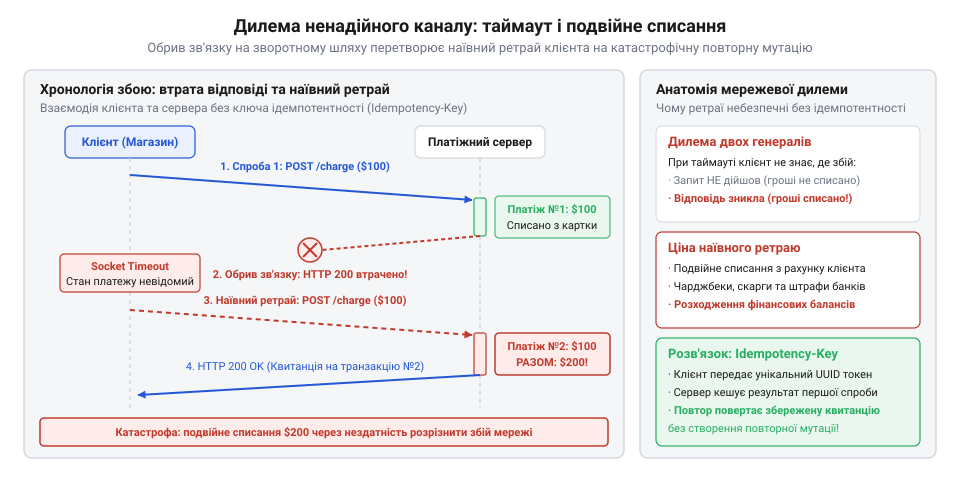

# Служба, якою ти не керуєш

<preknowlist>
- [Їхня аварія — твоя аварія](root:progarch/their-outage-is-your-outage) — неминучість мережевих збоїв та таймаутів під час виклику зовнішніх служб і їхній прямий вплив на стабільність власної системи
- [Квоти, ліміти й ціна виклику](root:progarch/quotas-limits-call-cost) — як сліпі повторні запити та надлишковий трафік призводять до вичерпання лімітів провайдера та прямих фінансових втрат
</preknowlist>

## Фатальна дилема повтору: як ненадійна мережа подвоює списання

На зламі 1990-х і 2000-х років бурхливий розвиток електронної комерції зіткнувся з фундаментальною проблемою, яка не проявлялася в епоху локальних ізольованих застосунків. Магазини, сервіси бронювання квитків та цифрові платформи почали масово підключати платіжні шлюзи — сторонні сервіси авторизації банківських карток. Архітектурно це виглядало тривіально: коли користувач натискав кнопку оплати, бекенд формував HTTP POST-запит до API платіжного провайдера, передаючи суму, валюту та реквізити картки. Якщо зовнішній шлюз відповідав кодом 200 OK із підтвердженням транзакції, замовлення вважалося оплаченим, а товар списувався зі складу. Якщо сервер повертав явну помилку валідації чи відхилення банком (наприклад, недостатньо коштів), замовлення скасовувалося. Усе виглядало передбачувано рівно доти, доки у процес не втручалася фізична природа розподілених мереж.

Комп'ютерна мережа за своєю суттю є асинхронним і ненадійним середовищем. Мережеві пакети можуть губитися на проміжних маршрутизаторах, TCP-з'єднання можуть скидатися через перезавантаження транзитних шлюзів, а тимчасові затримки можуть перевищувати встановлений у клієнтському коді таймаут очікування сокета. У цей момент виникає класична проблема розподілених обчислень, відома як [Задача двох генералів](root:sf-distributed/two-generals-problem).

Уявімо типовий інцидент: інтернет-магазин відправляє платіжному провайдеру запит на списання ста доларів. Платіжний шлюз успішно приймає пакет, взаємодіє з банківською мережею, списує з рахунку покупця кошти й фіксує успіх у своєму реєстрі. Після цього шлюз формує HTTP-відповідь і відправляє її назад клієнту. Але саме в цей момент на зворотному маршруті стається скидання з'єднання пакетом RST, або провайдер зв'язку зазнає короткочасного збою, чи бекенд магазину розриває сокет за таймаутом у 30 секунд. Клієнтська програма отримує виняток мережевого рівня — помилку таймауту або скинутого з'єднання.

Перед бекендом магазину постає нерозв'язна невизначеність. Для клієнта три принципово різні сценарії виглядають абсолютно однаково:
1. Запит узагалі не долетів до платіжного сервера через обрив на прямому маршруті (гроші не знято).
2. Запит дійшов, але платіжний сервер упав у процесі обробки транзакції (стан не визначено).
3. Платіжний сервер повністю і бездоганно провів операцію, але відповідь загубилася на зворотному маршруті (гроші списано).


*Мережева невизначеність: обрив зв'язку після успішної транзакції на сервері змушує клієнта повторити виклик, що спричиняє повторне списання коштів і руйнування бізнес-стану.*

Якщо розробник реалізує наївну логіку повторної спроби — ретрай (@@en|retry@@; від давньофр. *retrier*, випробовувати знову), — система повторно відправляє той самий POST-запит. Якщо реалізувався третій сценарій, платіжний шлюз розглядає цей виклик як нову незалежну транзакцію і списує з клієнта ще сто доларів. Виникає катастрофічне подвійне списання (@@en|double-charging@@). Покупець бачить двічі зняті гроші у виписці, звертається до свого банку й ініціює процедуру примусового повернення платежу — [чарджбек](root:sf-security/chargeback) (@@en|chargeback@@; від англ. *charge*, плата, нарахування, та *back*, назад). За кожне таке оскарження платіжні системи штрафують мерчанта на десятки доларів, а за перевищення порогу чарджбеків магазин ризикує взагалі втратити договір еквайрингу.

Якщо ж навпаки, бекенд через страх подвійного списання забороняє повторні спроби й вважає таймаут остаточною відмовою, страждає бізнес. Якщо реалізувався третій сценарій, гроші з покупця вже списані, але магазин маркує замовлення як «неоплачене» й не формує доставку товару. Покупець залишається і без грошей, і без замовлення, обриваючи лінії технічної підтримки. Обидва варіанти поведінки за наївного підходу руйнівні, адже зовнішня служба перебуває в критичному ланцюгу виконання ([DH: чужі служби в критичному шляху](root:progarch/dh-foreign-services-in-critical-path)), а її збої безпосередньо стають вашою аварією ([Їхня аварія — твоя аварія](root:progarch/their-outage-is-your-outage)).

Неможливість розв'язати цю дилему на рівні коду породила культовий і сумний символ раннього вебу: тривожні червоні банери на платіжних сторінках. Інтернет-магазини писали великими літерами: «У жодному разі не натискайте кнопку "Оплатити" двічі й не оновлюйте сторінку в браузері, інакше з вашої картки буде списано подвійну суму!». Інженери просто перекладали відповідальність за архітектурну безпорадність мережевого протоколу на плечі звичайного користувача.

> 🔧 **Навіщо це.**
> Розуміння невідворотності мережевої невизначеності руйнує небезпечну ілюзію, ніби мережевий виклик можна трактувати як звичайний виклик локальної функції. Будь-яка мутація стану зовнішньої системи через ненадійний канал без спеціального протокольного захисту неминуче призводить або до подвійного виконання бізнес-дії, або до втрати узгодженості даних.

## Глухий кут традиційних рішень: від розподілених транзакцій до ручного звіряння

У пошуках порятунку від подвійних списань інженери намагалися адаптувати перевірені академічні та корпоративні інструменти, розроблені для великих корпоративних баз даних. Головною надією здавалися класичні розподілені транзакції. У закритих банківських контурах і системах на базі серверів застосунків давно існував протокол двофазної фіксації — двофазний комміт (@@en|two-phase commit@@, 2PC; від лат. *committo* — з'єднувати, доручати) та транзакційний стандарт XA.

Ідея 2PC полягала в наявності центрального координатора транзакцій. На першій фазі (Prepare) координатор опитував усіх учасників (базу даних магазину та базу даних платіжного шлюзу), чи готові вони зафіксувати зміни. Отримавши згоду від обох сторін, на другій фазі (Commit) координатор віддавав наказ зберегти транзакцію. Якщо хоча б один вузол давав збій чи не відповідав, транзакція повністю відкочувалася (Rollback).

Проте спроба перенести 2PC у відкритий веб через протокол HTTP зазнала нищівного фіаско через фізику розподілених систем:
- **Утримання блокувань на час мережевих затримок:** Під час фази Prepare реляційна база даних блокує відповідні рядки таблиці, унеможливлюючи паралельні операції. У глобальній мережі затримки вимірюються сотнями мілісекунд, а мережеві розриви можуть тривати хвилинами. Якщо зв'язок із координатором зникав після підготовки, записи в базах залишалися заблокованими на невизначений час, паралізуючи роботу обох систем.
- **Відсутність єдиного довіреного координатора:** Двофазний комміт вимагає повної взаємної довіри між вузлами та єдиної точки оркестрації. Жоден комерційний платіжний шлюз у світі не дозволить сторонньому клієнтському бекенду керувати транзакціями у своїй внутрішній базі даних і утримувати блокування банківських рахунків. Це створювало б катастрофічну вразливість для відмови в обслуговуванні.

Коли непридатність 2PC стала очевидною, провайдери першого покоління (Authorize.Net, CyberSource, ранній PayPal) запропонували інший шлях: спеціальні кінцеві точки для опитування статусів (@@en|status polling@@). Контракт пропонував таке правило: якщо під час POST-запиту стався таймаут, клієнт не повинен повторювати списання, а зобов'язаний надіслати GET-запит на ендпойнт пошуку транзакції за номером замовлення магазину чи часовим інтервалом.

Але й цей підхід на практиці виявився надзвичайно крихким через асинхронну природу внутрішнього клірингу:
1. **Стан гонитви під час опитування:** Внутрішня архітектура шлюзів часто складалася з кількох підсистем: платіжного ядра, що спілкувалося з Visa/Mastercard, та асинхронної репліки бази даних для пошукових запитів. Коли інтернет-магазин після таймауту надсилав пошуковий запит через 2 секунди, репліка ще не встигала отримати оновлення й повертала відповідь `Transaction not found` («Транзакцію не знайдено»). Магазин робив логічний висновок, що операція не відбулася, відправляв новий платіжний запит — і в цей момент первинна транзакція нарешті з'являлася в базі. Результат був тим самим: повторне списання.
2. **Шторм запитів і вичерпання квот:** Під час масових мережевих збоїв тисячі клієнтів одночасно починали агресивно опитувати платіжний шлюз. Це спричиняло перевантаження пошукових інтерфейсів шлюзу та миттєве спалювання встановлених лімітів викликів ([Квоти, ліміти й ціна виклику](root:progarch/quotas-limits-call-cost)), після чого провайдер просто блокував клієнтські IP-адреси.

Останнім рубежем захисту залишалося постфактумне ручне звіряння реєстрів — реконсиляція (@@en|reconciliation@@; від лат. *reconciliatio* — відновлення, примирення). Щоночі платіжні шлюзи та банки-екваєри формували так звані файли розрахунків (зазвичай у форматі CSV або банківських фіксованих реєстрів за минулу добу). Бухгалтерія та технічні фахівці інтернет-магазинів писали нічні скрипти чи вручну порівнювали список замовлень у власній базі даних із банківською випискою.

Якщо виявлялося, що з клієнта списали гроші двічі, оператор вручну оформлював повернення коштів (Refund). Проте за кожне таке повернення магазин знову платив комісію платіжному шлюзу, а клієнт протягом однієї або двох діб залишався зі зменшеним балансом на картці, що призводило до втрати довіри до платформи.

Індустрія зайшла у глухий кут. Стало зрозуміло: проблему неможливо подолати ані перенесенням важких корпоративних транзакцій у веб, ані наївним ручним опитуванням статусів, ані нічним розбором банківських реєстрів. Потрібен був принципово новий контракт на рівні самого прикладного протоколу, який дозволив би клієнту явно задекларувати: «Цей запит є повторенням мого попереднього наміру; якщо ти його вже виконав — поверни мені збережений результат, але в жодному разі не проводь дію вдруге».

> 🔧 **Навіщо це.**
> Досвід невдач із 2PC та опитуванням статусів доводить: у ненадійних гетерогенних мережах не можна будувати надійність на блокуваннях чи наївних перевірках стану через звичайні GET-запити. Надійність вимагає від архітектора проектування операцій, де сама дія спроможна безпечно виконуватися повторно без додаткових перевірок і без ризику дублювання.

## Революція developer-first і народження заголовка Idempotency-Key

На початку 2010-х років ландшафт веб-розробки зазнав тектонічного зсуву. До того часу інтеграція онлайн-платежів була тривалим і виснажливим процесом: традиційні банківські провайдери вимагали тижнів паперового оформлення, а їхні інтерфейси спиралися на громіздкі протоколи SOAP і негнучкі формати XML із незрозумілими числовими кодами помилок. У 2011 році на ринок вийшов стартап Stripe, заснований ірландськими підприємцями Патріком та Джоном Коллісонами (Patrick & John Collison). Їхньою головною інновацією стала концепція @@en|developer-first@@: лаконічне, передбачуване REST-подібне API, у якому прийом банківської картки зводився до семи рядків зрозумілого коду, а відповіді поверталися у чистому форматі JSON.

Проте справжнім випробуванням для нової платформи став бурхливий розвиток мобільних технологій. У період 2012–2015 років споживачі масово перейшли на смартфони: з'явилися мобільні маркетплейси, сервіси виклику таксі та доставка їжі. Користувачі купували квитки на ходу, переходили між стільниковими вишками 3G/LTE, заходили в метро або підключалися до нестабільних публічних точок Wi-Fi. У таких умовах скидання з'єднань і таймаути сокетів перестали бути рідкісними винятками продакшену — вони стали щохвилинною буденністю мільйонів транзакцій.

Стара інженерна школа вимагала перекладати ці збої на розробника: мовляв, клієнтський застосунок мусить сам відловлювати мережеві винятки, опитувати статуси чи показувати користувачеві повідомлення про помилку. Команда Stripe поглянула на проблему з протилежного боку: якщо мережа в реальному світі неминуче рветься, платіжна платформа зобов'язана надати розробникам інструмент, який робить повторні виклики абсолютно безпечними за замовчуванням.

Для цього інженери звернулися до математичної концепції ідемпотентності (@@en|idempotency@@; від лат. *idem* — той самий, та *potens* — здатний, могутній). У математиці та теоретичній інформатиці операція вважається ідемпотентною, якщо її багаторазове застосування до об'єкта дає той самий результат, що й одноразове: `f(f(x)) = f(x)`. У специфікації HTTP/1.1 методи `GET`, `PUT` і `DELETE` первинно проектувалися як ідемпотентні, проте ключовий метод створення ресурсів — `POST` — за стандартом вважається неідемпотентним, адже кожен новий запит створює новий запис або виконує нове списання коштів.

Щоб подолати це обмеження, у середині 2010-х років інженери Stripe впровадили в архітектуру свого API спеціальний HTTP-заголовок — `Idempotency-Key`. 

Суть механізму полягала в передачі контролю над дедуплікацією на бік клієнта:
1. Перед відправкою небезпечного мутуючого запиту (створення платежу, списання коштів, підписка) клієнтський застосунок генерує унікальний ідентифікатор — UUID (@@en|Universally Unique Identifier@@; від лат. *universalis* — загальний, та *unicus* — єдиний). Цей ключ прив'язується до конкретної бізнес-дії (наприклад, спроби оплатити замовлення №1042).
2. Клієнт передає згенерований токен у стандартному заголовку: `Idempotency-Key: 9b1deb4d-3b7d-4bad-9bdd-2b0d7b3dcb6d`.
3. Платіжний сервер, отримавши запит, перевіряє наявність такого ключа у своєму реєстрі. Якщо ключ надходить уперше, сервер проводить транзакцію, списує кошти і зберігає пару «ключ — повна відповідь» у надійному сховищі.
4. Якщо на зворотному шляху мережа обривається за таймаутом, клієнт більше не ворожить, чи пройшов платіж. Він спокійно відправляє абсолютно той самий POST-запит із тим самим заголовком `Idempotency-Key`.
5. Сервер виявляє відомий ключ, розуміє, що операцію вже виконано, і замість повторного звернення до банківського шлюзу миттєво віддає збережену копію первинної відповіді.

Stripe інтегрував цю поведінку безпосередньо у свої офіційні клієнтські бібліотеки (SDK). Якщо мережевий виклик зазнавав невдачі через скидання сокета або таймаут, бібліотека самостійно виконувала повторну спробу з тим самим ключем і експоненційною паузою. Розробникам більше не потрібно було писати громіздку захисну логіку: взаємодія із зовнішньою непідконтрольною службою вперше набула властивості гарантованої надійності без загрози подвійних списань.

> 🔧 **Навіщо це.**
> Клієнтсько-керований ключ ідемпотентності перетворює небезпечний неідемпотентний POST-запит на безпечну операцію. Він ліквідує мережеву невизначеність: у разі будь-якого збою на лінії зв'язку клієнт має право повторювати виклик без остраху пошкодити стан чи двічі списати гроші.

## Інженерна анатомія Брандура Ліча: атомарність, блокування та зліпки

Попри концептуальну простоту ідеї «перевір ключ і поверни кеш», реалізація ідемпотентності на рівні високонавантаженої платформи таїла в собі підступні пастки розподілених систем. Якщо розробник спробує реалізувати цей патерн наївно — наприклад, перевіряючи наявність ключа простим читанням перед викликом бізнес-логіки, — система миттєво втратить узгодженість під час першої ж конкурентної кризи.

У лютому та жовтні 2017 року провідний інженер інфраструктури Stripe Брандур Ліч (Brandur Leach) опублікував дві знакові праці: статтю в офіційному інженерному блозі компанії «Designing robust and predictable APIs with idempotency» та докладний розбір практичної реалізації «Implementing Stripe-like Idempotency Keys in Postgres». Ліч розкрив внутрішню інженерну анатомію виробничого рішення, виділивши три фундаментальні стовпи надійної ідемпотентності.

Перший стовп — **залізна ACID-атомарність (@@en|atomicity@@; від грец. *atomos* — неподільний)**. Найнебезпечніша помилка полягає у відокремленні збереження ключа від збереження бізнес-результату. Якщо сервіс спочатку виконує списання в основній базі чи списує кошти через шлюз, а потім окремою операцією записує ключ ідемпотентності в таблицю (або сторонній кеш), між цими діями завжди існує часовий зазор. Сервер може знеструмитися, процес може вбити планувальник операційної системи, або з'єднання з базою може обірватися саме між цими двома кроками. У результаті бізнес-дія відбулася, а запис про ключ не зберігся — наступний ретрай призведе до того ж фатального подвійного списання. Ліч наполягав: фіксація ключа ідемпотентності та мутація бізнес-стану зобов'язані відбуватися в межах єдиної неподільної транзакції реляційної СУБД (`BEGIN ... COMMIT`).

Другий стовп — **[блокування запитів «у польоті»](root:sf-distributed/distributed-locks) (@@en|in-flight locking@@; від англ. *in flight*, у польоті)**. Що станеться, якщо клієнтський SDK через короткий таймаут у 500 мілісекунд відправить повторний запит у той момент, коли перший виклик ще активний і продовжує оброблятися всередині бази даних або очікує підтвердження від карткової мережі? Якщо другий потік просто перевірить статус, він не знайде готового результату. Обидва запити почнуть виконувати списання коштів паралельно, створюючи стан гонитви.

Для розв'язання цієї проблеми Stripe ввів механізм блокувань рядків бази даних і скінченний життєвий цикл станів ключа:
- Коли запит із новим ключем надходить уперше, сервер відкриває транзакцію й миттєво вставляє рядок у таблицю ключів зі статусом `processing` («у процесі»), захоплюючи ексклюзивне блокування рядка на рівні СУБД.
- Якщо до завершення обробки надходить паралельний дублікат із тим самим ключем, він натикається на блокування рядка або статус `processing`. Залежно від конфігурації, другий потік або стає в чергу очікування звільнення замка, або негайно повертає клієнту код `409 Conflict` із проханням зачекати завершення поточної операції. Це повністю унеможливлює паралельне виконання однієї дії.


*Життєвий цикл ключа ідемпотентності: атомарна фіксація наміру, блокування паралельних запитів у польоті та детерміноване повернення збереженої відповіді на повторні спроби.*

Третій стовп — **[зліпки запитів](root:com-protocol/api-idempotency) проти колізій (@@en|request fingerprinting@@; від англ. *finger*, палець, та *print*, відбиток)**. Що робити, якщо клієнт через баг у власному коді повторно використав той самий UUID для зовсім іншої дії — наприклад, спочатку відправив платіж на $50 за підписку, а через хвилину використав цей же ключ для оплати замовлення на $500? Якби сервер сліпо повернув збережену відповідь першого виклику, клієнт замовлення на $500 отримав би фіктивне підтвердження успіху, але гроші не були б списані, що призвело б до фінансової діри в обліку.

Щоб унеможливити такі інциденти, Stripe рахує криптографічний хеш-зліпок від комбінації параметрів виклику: HTTP-методу, шляху URL та повного тіла корисного навантаження запиту (зазвичай за допомогою алгоритму SHA-256). Цей хеш зберігається поруч із ключем ідемпотентності. Коли надходить повторний виклик із тим самим ключем, сервер порівнює новий хеш зі збереженим:
- Якщо хеші ідентичні — це добросовісний ретрай: сервер повертає збережену відповідь.
- Якщо хеші відрізняються — сервер миттєво відхиляє виклик із кодом помилки `400 Bad Request` або `422 Unprocessable Entity` і повідомленням про неприпустимість повторного використання ключа з іншими параметрами.

Четвертим компонентом архітектури стало детерміноване відтворення збереженої відповіді. У таблиці ідемпотентності серіалізується не лише бізнес-сутність, а повна HTTP-відповідь: статус-код (наприклад, 200 чи 201), специфічні заголовки та повний рядок JSON-тіла. Під час повторного виклику сервер навіть не торкається бізнес-шару чи внутрішніх доменних сервісів — проміжний обробник (middleware) на межі системи десеріалізує збережений результат і віддає його клієнту, заощаджуючи ресурси процесора та пам'яті.

> 🔧 **Навіщо це.**
> Повноцінна ідемпотентність тримається на трьох непорушних інваріантах: єдиній транзакції збереження, блокуванні запитів у польоті та перевірці хеш-зліпка тіла. Пропуск хоча б одного з цих елементів перетворює захист на ілюзію, що неминуче ламається під час пікових навантажень або клієнтських помилок.

## Тріумф стандарту IETF і розвінчання міфу про першість Stripe

Успіх реалізації Stripe справив колосальний вплив на всю індустрію програмної інженерії. У період між 2015 та 2020 роками модель клієнтських ключів ідемпотентності поширилася серед провідних технологічних компаній світу. Amazon Web Services (AWS) інтегрувала токени клієнтських запитів (@@en|ClientRequestToken@@) у ядро сервісів DynamoDB та EC2; GitHub додав заголовок `Idempotency-Key` до своїх публічних REST та GraphQL API; хмарні платформи зв'язку на кшталт Twilio та міжнародні платіжні шлюзи Adyen, Square і Shopify зробили передачу цього заголовка обов'язковим стандартом для будь-яких фінансових операцій.

Логічним апогеєм цієї експансії стала діяльність Інженерної ради інтернету (IETF). У 2019–2020 роках робоча група HTTP API розпочала офіційну стандартизацію специфікації `draft-ietf-httpapi-idempotency-key-header`. Концепція, яка починалася як внутрішнє архітектурне рішення платіжного стартапу, перетворилася на офіційний стандарт прикладного мережевого протоколу для всього інтернету.

Широке визнання та блискучі публікації Stripe породили в інженерній спільноті стійкий міф: ніби компанія Stripe власноруч винайшла саму концепцію ідемпотентності та дедуплікації транзакцій. У численних статтях, виступах на конференціях та навчальних курсах почали стверджувати, що до появи Stripe індустрія не знала способу безпечно повторювати платіжні запити.

Проте реальна історія комп'ютерних систем свідчить про інше:
1. **Математичне походження:** Поняття ідемпотентності не є винаходом програмістів. Його ввів американський математик Бенджамін Пірс (Benjamin Peirce) ще у 1870 році у фундаментальній праці з лінійної асоціативної алгебри. У середині XX століття термін увійшов у теоретичну інформатику для опису операцій, чиє повторення не змінює стан пам'яті.
2. **Банківський стандарт ISO 8583 (1987):** За чверть століття до появи Stripe міжнародна банківська індустрія щодня обробляла сотні мільйонів операцій по картках за допомогою спеціалізованого стандарту ISO 8583 (Financial transaction card originated messages). Цей протокол, розроблений для зв'язку банкоматів і платіжних терміналів із кліринговими центрами Visa та Mastercard, уже містив жорсткі [інструменти дедуплікації](root:sf-distributed/idempotency):
   - Аудиторський номер системного сліду — STAN (@@en|System Trace Audit Number@@; шестизначний лічильник термінала).
   - Номер посилання для пошуку — RRN (@@en|Retrieval Reference Number@@; дванадцятисимвольний унікальний ідентифікатор транзакції).
   Якщо банкомат після видачі готівки втрачав зв'язок із сервером авторизації й не отримував фінального підтвердження, він автоматично генерував повідомлення про реверс (@@en|reversal@@; від лат. *reversus* — повернутий назад) із тими самими значеннями STAN та RRN. Мережевий процесинг банку миттєво виявляв дублікат за цими ключами й скасовував блокування коштів без людського втручання.
3. **Мережеві файлові системи:** Ще в 1995 році протокол Network File System версії 3 (NFS v3, RFC 1813) використовував ідентифікатори транзакцій (XID) та кеш повторних запитів (Duplicate Request Cache, DRC) на боці сервера, щоб клієнти могли безпечно повторювати мережеві операції створення чи видалення файлів над ненадійним протоколом UDP.

У чому ж полягав справжній інженерний тріумф Stripe? Їхня заслуга полягала не у винаході самої математичної концепції, а в геніальній демократизації та стандартизації складного індустріального патерна. Інженери Stripe взяли суворі, але закриті практики банківських мейнфреймів і теорії розподілених систем і трансформували їх у прозорий, елегантний та доступний контракт веб-розробки. Вони довели, що надійність банківського рівня можна реалізувати поверх звичайного HTTP без залучення спеціалізованого апаратного забезпечення, уклавши зрозумілий [споживацький контракт із чужим провайдером](root:progarch/consumer-driven-contracts).

> 🔧 **Навіщо це.**
> Розвінчання міфу про походження ідемпотентності позбавляє інженера технологічного карго-культу. Розуміння того, що дедуплікація за унікальним номером є універсальним інваріантом розподілених систем від банківських мереж 1980-х до сучасних хмарних API, допомагає проектувати власні надійні інтерфейси на фундаменті перевірених часом законів обробки даних.

## Пастка кешування в Redis, транзакційний Outbox та межі надійності

Популярність і простота зовнішнього вигляду заголовка `Idempotency-Key` приховують небезпеку поверхневої реалізації. У сучасній практиці проектування систем архітектори часто припускаються фатальних помилок як на боці сервера, що надає API, так і на боці клієнта, що інтегрує непідконтрольну службу.

Найпоширенішим антипатерном на боці сервера стала так звана «пастка шлюзу» (@@en|API Gateway Redis Trap@@). Прагнучи додати ідемпотентність без зміни коду бекенд-сервісів, команди часто намагаються реалізувати її у вигляді проміжного фільтра на рівні API-шлюзу (Kong, Envoy або Nginx), зберігаючи ключі в оперативному кеші Redis. Логіка шлюзу здається привабливою: перехопити вхідний заголовок, виконати команду `SET key NX` у Redis із часом життя (TTL) на 24 години, пропустити запит до внутрішнього мікросервісу, а потім зберегти тіло відповіді в той самий Redis.

Ця схема зазнає неминучого краху через класичну проблему подвійного запису (@@en|dual-write problem@@):
- Redis і основна база даних мікросервісу є двома незалежними розподіленими сховищами, між якими немає транзакційної узгодженості.
- Якщо внутрішній мікросервіс під час обробки платежу впав через збій бізнес-правил або помилку бази даних і відкотив свою внутрішню транзакцію, ключ у Redis уже зафіксовано як зайнятий. Наступний клієнтський ретрай поверне збережену помилку або натрапить на заблокований стан, хоча повторна спроба могла б пройти успішно.
- Якщо ж навпаки, бекенд успішно списав кошти в базі, але під час збереження відповіді в Redis стався збій мережі чи перезапуск вузла кешу, запис про ключ губиться. Наступна повторна спроба клієнта безперешкодно пройде крізь шлюз і здійснить повторне списання коштів в основній базі.

Ідемпотентність принципово не може існувати як зовнішній «плагін» до системи, якщо вона відірвана від основного джерела істини: перевірка та фіксація ключа зобов'язані бути атомарно інтегровані в ту саму транзакцію, де змінюється баланс або стан замовлення.

На боці клієнта існує не менш руйнівна ілюзія — випадкові ключі в циклі повторів. Часто розробники наївно пишуть клієнтський код:
```
поки є спроби:
    ключ = згенерувати_новий_UUID()  // ФАТАЛЬНА ПОМИЛКА!
    відповідь = надіслати_запит(з_ключем: ключ)
```
Якщо на кожну ітерацію циклу генерується новий випадковий токен, заголовок ідемпотентності повністю втрачає сенс. Сервер бачить перед собою три абсолютно різні ключі й сприймає їх як три окремі незалежні наміри, сумлінно списуючи гроші тричі.

Справжня надійність вимагає від клієнта суворої детермінованості (від лат. *determinare* — обмежувати, визначати):
1. **Зв'язування з доменною сутністю:** Ключ ідемпотентності зобов'язаний бути похідним від бізнес-ідентифікатора операції (наприклад, `payment_order_48291`). Хоч скільки б разів клієнт не перезапускав спробу оплатити замовлення №48291, ключ у заголовку мусить лишатися незмінним.
2. **Локальний транзакційний Outbox:** Щоб пережити падіння власного сервера чи перезапуск контейнера, клієнт перед відправкою запиту зберігає намір оплати у власній базі даних поруч із бізнес-замовленням. Це класичний [патерн вихідної скриньки](root:sf-distributed/outbox-pattern) (@@en|transactional outbox@@; від англ. *outbox*, кошик вихідної пошти). Фоновий воркер вичитує запис з `outbox`, надсилає його зовнішньому платіжному шлюзу зі збереженим ключем, і навіть якщо воркер аварійно перезапуститься, наступний процес візьме той самий детермінований ключ і безпечно завершить операцію.

Наостанок архітектор має чітко бачити межі можливостей патерна. Заголовок `Idempotency-Key` розв'язує рівно одну локальну проблему — безпеку повторення одного конкретного мережевого виклику між двома вузлами. Він не здатен автоматично забезпечити узгодженість складного наскрізного бізнес-процесу.

Якщо бізнес-операція складається з кількох послідовних кроків у різних зовнішніх службах — наприклад, забронювати номер у готелі, списати кошти за карткою та відправити SMS-повідомлення, — ключ ідемпотентності гарантує, що жоден з окремих кроків не виконається двічі під час таймаутів. Але якщо оплата пройшла, а бронювання готелю відхилено, система не може покладатися лише на ключі: потрібне проєктування розподіленої саги (@@en|saga@@; від давньоісл. *saga* — оповідь, розповідь) та компенсуючих транзакцій (@@en|compensating transaction@@; від лат. *compensare* — врівноважувати) для повернення коштів клієнту. Ключ ідемпотентності — це надійний цеглинка в точці контакту з чужою службою, але загальну стійкість архітектури формує гармонійне поєднання вихідної скриньки, саги та контролю за квотами ([Квоти, ліміти й ціна виклику](root:progarch/quotas-limits-call-cost)).

> 🔧 **Навіщо це.**
> Безпечна робота з непідконтрольною службою вимагає наскрізної інженерної дисципліни: детермінованого формування ключів на клієнті через Transactional Outbox, відмови від наївного кешування на шлюзах та розуміння меж патерна. Ідемпотентність робить мережевий крок стійким до повторів, але узгодженість усього розподіленого сценарію гарантують компенсуючі транзакції.
