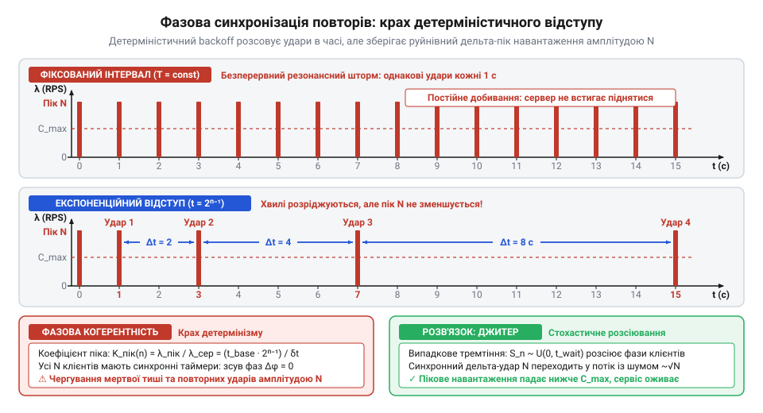
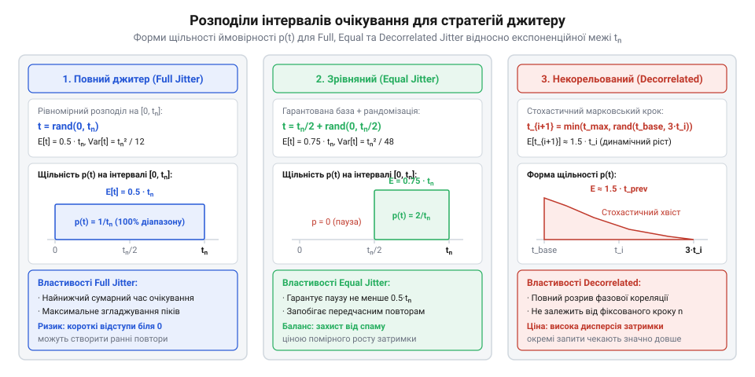

# Служба, якою ти не керуєш

<preknowlist>
- [Їхня аварія — твоя аварія](root:progarch/their-outage-is-your-outage) — зв'язок доступності зовнішньої служби із надійністю власної системи та наслідки сплесків помилок
- [Квоти, ліміти й ціна виклику](root:progarch/quotas-limits-call-cost) — як перевищення лімітів та перевантаження зовнішнього API призводять до сповільнення та скидання з'єднань (HTTP 429)
</preknowlist>

## Резонансна синхронізація та шторм повторних спроб

Уяви типовий сценарій збою на стику із зовнішнім провайдером. Стороння платіжна служба, авторизаційний шлюз або поштовий сервіс зазнає короткочасного спотикання: перезапуск процесу, перемикання репліки бази даних або мережеве мерехтіння тривалістю буквально дві секунди. У штатному режимі крізь твій бекенд до партнера тече рівний стаціонарний потік — скажімо, 1000 запитів щосекунди. Поки зовнішній вузол лежить, вхідний трафік від твоїх користувачів не зупиняється. Усі виклики, надіслані протягом цього короткого вікна, завершуються невдачею: виникає когорта з `N = 2000` збійних операцій, зосереджених у вузькому часовому проміжку.

Наївна інженерна реакція на рівні мережевого клієнта здається очевидною: тимчасова завада минула, отже треба почекати фіксовану паузу й спробувати знову. У кодовій базі з'являється класичний цикл із синхронним очікуванням:

```
поки спроба < 3:
    відповідь = надіслати_запит()
    якщо успіх:
        повернути відповідь
    заснути(1 с)
```

З погляду одного ізольованого запиту пауза в одну секунду виглядає безпечною. Але в розподіленій системі спрацьовує фізика спільних фаз. Усі `N = 2000` клієнтських потоків або легковагих задач зафіксували першу відмову приблизно в один і той самий фізичний момент `t = 0`. Оскільки час сну для кожного з них є однаковою фіксованою константою `Δt = 1 с`, таймери очікування у всіх клієнтів спрацюють одночасно в момент `t = 1 с`.

У результаті рівномірний фоновий потік трансформується у фазову синхронізацію: усі клієнти одночасно прокидаються й генерують синхронний дельта-імпульс звернень до зовнішнього сервісу. Інтенсивність навантаження `λ_пік` у мить пробудження визначається відношенням кількості клієнтів `N` до апаратної похибки планувальника операційної системи `δt` (яка зазвичай вимірюється одиницями мілісекунд):

```
λ_пік = N / δt                       [миттєва інтенсивність сплеску]
```

Якщо дві тисячі з'єднань одночасно намагаються пройти фазу рукостискання TCP або відправити HTTP-пакети у вікні завширшки `δt = 10 мс = 0.01 с`, миттєва швидкість надходження запитів сягає:

```
λ_пік = 2000 / 0.01 с
      = 200 000 запитів/с            [розрахунок для N=2000 та δt=10мс]
```

Миттєвий удар у 200 000 запитів за секунду в двісті разів перевищує штатну пропускну здатність зовнішнього шлюзу. Провайдер, який щойно оговтався від перезавантаження й почав піднімати внутрішні пули з'єднань, отримує нищівний гідроудар. Черга вхідних з'єднань ядра ОС (@@en|SYN backlog@@) переповнюється за мілісекунди, сокети обриваються, а процесор стороннього вузла марнує всі ресурси на обробку апаратних переривань від переповнених мережевих буферів. Замість успішної відповіді провайдер знову падає або захищається поверненням статусів обмеження частоти відповідно до [Квоти, ліміти й ціна виклику](root:progarch/quotas-limits-call-cost).

Далі вмикається руйнівний механізм додатної петлі зворотного зв'язку — шторм повторних спроб (@@en|retry storm@@). Усі дві тисячі запитів знову фіксують помилку в момент `t = 1 с`. Оскільки алгоритм незмінний, усі вони знову засинають на `1 с`. Але за цю секунду до них додається свіжа порція первинних запитів від нових користувачів, які також не змогли достукатися до перевантаженого сервера. У момент `t = 2 с` на сторонній вузол обрушується вже не 2000, а 3000 синхронних запитів.

У фізиці це явище відоме як резонанс: періодична зовнішня сила, прикладена з частотою, що збігається з власними коливаннями системи, безмежно розгойдує амплітуду коливань. У розподілених системах це зветься «тупотом стада» (@@en|thundering herd@@). Короткочасний локальний збій стороннього сервісу за наявності фіксованих пауз між повторами самоорганізується у незгасаючу хвилю ударних імпульсів, перетворюючи локальну заваду контрагента на повний колапс власного продукту згідно з правилом [Їхня аварія — твоя аварія](root:progarch/their-outage-is-your-outage).

> 🔧 **Навіщо це.**
> Фіксована затримка в циклі повторних спроб детерміністично організовує клієнтів у єдиний синхронний фронт. Розуміння механізму фазового резонансу доводить: сталі інтервали між спробами перетворюють клієнтські застосунки на мимовільну розподілену ботнет-мережу, що блокує відновлення відмовної служби.

## Детерміністичний експоненційний відступ і збереження когерентності

Природною відповіддю на катастрофу сталого кроку є адаптивне розширення часових інтервалів: якщо провайдер не відповів одразу, наступного разу треба чекати відчутно довше. Цю логіку реалізує експоненційний відступ (@@en|exponential backoff@@), винайдений ще на світанку мережевих технологій для розв'язання колізій у протоколі Ethernet.

Математична модель класичного детерміністичного відступу визначає тривалість паузи для спроби з порядковим номером `n` (`n = 1, 2, 3, ...`) через геометричну прогресію зі штучною стелею:

```
t_wait(n) = min(t_max, t_base · 2ⁿ⁻¹)         [експоненційний відступ зі стелею]
```

Параметр `t_base` задає початковий базовий інтервал очікування (наприклад, 100 мс), множник 2 подвоює паузу після кожної чергової невдачі, а константа `t_max` обмежує експоненту зверху, запобігаючи нескінченному зростанню затримки.

Для поодинокого виклику ця формула бездоганна: вона експоненційно зменшує частоту спроб клієнта, розвантажуючи черги й даючи серверу спокійний проміжок для самовідновлення. Сумарний час, витрачений клієнтом до моменту виконання `n`-ї спроби, обчислюється як сума членів геометричної прогресії:

```
T_сума(n) = ∑[k=1 .. n] (t_base · 2ᵏ⁻¹)
          = t_base · (2ⁿ - 1)                 [сума геометричної прогресії]
```

Проте в розподіленому середовищі, де сотні або тисячі клієнтів взаємодіють зі спільним провайдером, детерміністичний відступ зазнає концептуального фіаско. Причина полягає у математичній властивості детермінізму: функція `t_wait(n)` не містить жодної випадкової складової й повертає строго однакове значення для кожного учасника:

```
∀ i, j ∈ [1 .. N]: t_wait,i(n) = t_wait,j(n)   [тотожність інтервалів для всіх клієнтів]
```

Якщо `N` незалежних клієнтів зазнали відмови у початковий момент `t = 0`, моменти їхніх наступних звернень до сервера будуть математично еквівалентними:

```
t_спроба(1) = t_wait(1) = t_base
t_спроба(2) = t_wait(1) + t_wait(2) = 3 · t_base
t_спроба(3) = t_wait(1) + t_wait(2) + t_wait(3) = 7 · t_base
t_спроба(n) = t_base · (2ⁿ - 1)               [синхронний момент n-ї спроби]
```

Детерміністичний відступ ідеально зберігає фазову когерентність (@@en|phase coherence@@) між усіма клієнтами. Замість ліквідації імпульсу він просто переносить той самий дельта-пік навантаження амплітудою `N` у нові, більш розріджені моменти часу.

Оцінімо динаміку співвідношення між середнім та піковим навантаженням. Середня інтенсивність запитів `λ_середнє` на `n`-му кроці дійсно зменшується пропорційно зростанню довжини інтервалу:

```
λ_середнє(n) = N / t_wait(n)
             = N / (t_base · 2ⁿ⁻¹)            [середнє навантаження на кроці n]
```

Проте миттєвий пік `λ_пік = N / δt` у момент спрацьовування таймерів залишається незмінним. Відношення пікового навантаження до середнього на кроці `n` дорівнює:

```
K_пік(n) = λ_пік / λ_середнє(n)
         = (N / δt) / (N / t_wait(n))
         = t_wait(n) / δt
         = (t_base · 2ⁿ⁻¹) / δt               [коефіцієнт загострення піка]
```

Коефіцієнт пікового навантаження `K_пік(n)` із кожною спробою експоненційно зростає. Графіки середнього навантаження створюють оманливу ілюзію стабілізації, але для вхідних буферів сервера реальність виглядає як чергування тривалих періодів мертвої тиші та раптових, сконцентрованих ударів повною амплітудою `N`.


*Синхронізація фаз: фіксована затримка генерує безперервні імпульси, а детерміністичний експоненційний відступ лише збільшує інтервали між ними, зберігаючи руйнівну пікову амплітуду навантаження.*

Коли номер спроби перевищує поріг виходу на стелю `t_max`, алгоритм вироджується в періодичну решітку з постійним кроком `t_max`. На цьому етапі експоненційний ефект повністю вичерпується, і система повертається до звичайного резонансного шторму, лише з більшим періодом повторення.

Отже, маніпулювання виключно тривалістю інтервалів неспроможне вирішити проблему перевантаження у багатоагентній системі. Щоб усунути пікові гідроудари, математичний апарат повторних спроб зобов'язаний зруйнувати фазову когерентність між клієнтами шляхом введення випадкового тремтіння інтервалу — джитеру.

> 🔧 **Навіщо це.**
> Детерміністичний відступ розвантажує мережу в середньому, але зберігає пікові навантаження, здатні вбити сервіс у моменти колективних спроб. Щоб захистити сторонню службу, архітектор має керувати не лише масштабом затримок, а й фазовим розсіюванням точок виклику.

## Стохастична десинхронізація: алгоритми джитеру та закон кореня з N

Детерміністичний відступ зазнав невдачі через спільність фаз: масштабування інтервалів розсовує хвилі в часі, але залишає їх когерентними. Єдиний математичний спосіб зруйнувати когерентність — зробити момент пробудження кожного клієнта незалежною випадковою величиною. Цей прийом називається випадковим тремтінням інтервалу — джитером (@@en|jitter@@).

Замість фіксованої детерміністичної затримки `t_wait(n)` тривалість паузи для клієнта стає стохастичною величиною `S_n`. У сучасній розподіленій архітектурі канонічними вважаються три ймовірнісні моделі джитеру, сформульовані та досліджені Марком Брукером (@@en|Marc Brooker@@) в архітектурних дослідженнях AWS:

1. **Повне тремтіння (@@en|Full Jitter@@):** Пауза обирається випадково з рівномірного розподілу на відрізку від нуля до експоненційного максимуму `t_n = min(t_max, t_base · 2ⁿ⁻¹)`:

```
S_n ~ U(0, t_n)                      [випадковий вибір на повному інтервалі]
```

Густина ймовірності є сталою величиною `f(s) = 1 / t_n` на всьому відрізку `[0, t_n]`. Будь-яка пауза — від нуля до повної стелі — має однакові шанси випасти.

2. **Зрівняне тремтіння (@@en|Equal Jitter@@):** Половина експоненційного інтервалу резервується як гарантована детерміністична підлога, а випадковим робиться лише залишок:

```
S_n = (t_n / 2) + U(0, t_n / 2)       [гарантована база плюс випадковий хвіст]
```

Тут густина ймовірності зосереджена на відрізку `[t_n / 2, t_n]` і дорівнює `f(s) = 2 / t_n`. Ця стратегія гарантує, що жоден клієнт не почне повторну спробу надто рано (немає небезпечно малих пауз біля нуля), але між собою клієнти все одно десинхронізуються.

3. **Некорельоване тремтіння (@@en|Decorrelated Jitter@@):** Стохастичний процес марковського типу, де наступна пауза генерується на основі фактичної тривалості попереднього сну `S_n-1`, без потреби зберігати порядковий номер спроби `n`:

```
S_0 = t_base
S_n = min(t_max, U(t_base, S_n-1 · 3)) [блукання від бази до потроєного кроку]
```

Алгоритм щоразу розширює інтервал у діапазоні від базового часу `t_base` до потроєного попереднього значення, запобігаючи накопиченню жорсткої кореляції між конкуруючими клієнтами.


*Функції розподілу пауз: Full Jitter рівномірно покриває весь інтервал від нуля до tn, Equal Jitter гарантує поріг tn/2, а Decorrelated Jitter здійснює випадкове блукання з прив'язкою до попереднього кроку.*

Щоб зрозуміти, як стохастика ліквідує руйнівні гідроудари, виведемо закон розподілу навантаження в часі. Нехай `N` незалежних клієнтів обирають час пробудження за схемою Full Jitter на інтервалі `[0, T]`.

Розглянемо довільне вузьке вікно спостереження `Δt` (де `Δt ≪ T`). Оскільки вибір кожного клієнта рівномірний і незалежний, імовірність `p` для одного конкретного клієнта прокинутися саме в межах цього вікна дорівнює відношенню тривалості вікна до загального інтервалу:

```
p = Δt / T                            [імовірність потрапляння у вікно]
```

Кількість клієнтів `K`, що прокинуться у вікні `Δt`, є біноміальною випадковою величиною `K ~ Binom(N, p)`. Математичне сподівання кількості прибуттів і середня інтенсивність потоку становлять:

```
E[K] = N · p
     = N · (Δt / T)                   [математичне сподівання прибуттів]

λ_середнє = E[K] / Δt
          = (N · Δt / T) / Δt
          = N / T                     [стаціонарне середнє навантаження]
```

Оскільки `p ≪ 1` при малому вікні `Δt`, дисперсія біноміального розподілу з високою точністю дорівнює математичному сподіванню:

```
Var(K) = N · p · (1 - p)
       ≈ N · p
       = N · (Δt / T)                 [дисперсія прибуття за вікно]

σ_K = √(Var(K))
    = √(N · Δt / T)                   [середньоквадратичне відхилення]
```

За правилом трьох сигм випадкові флуктуації кількості звернень у будь-якому вікні майже ніколи (з імовірністю 99.7%) не перевищують величину `E[K] + 3σ_K`. Відповідно, пікова миттєва інтенсивність навантаження з джитером обмежується формулою:

```
λ_пік = (E[K] + 3σ_K) / Δt
      = (N / T) + 3 · √(N / (T · Δt)) [пікове навантаження зі стохастичним шумом]
```

Порівняймо це з детерміністичним ударом на конкретних числах. Нехай `N = 10000` клієнтів, інтервал відступу `T = 5 с`, а ширина вікна реакції планувальника `Δt = 10 мс = 0.01 с`.

У детерміністичному випадку всі 10 000 клієнтів б'ють усередині вікна 0.01 с:

```
λ_детерм = 10000 / 0.01 с
         = 1 000 000 запитів/с        [детерміністичний дельта-імпульс]
```

Зі стохастичним джитером ті самі 10 000 клієнтів розподіляються на 5 секунд:

```
E[K] = 10000 · (0.01 / 5)
     = 20 запитів                     [середнє число звернень у вікні]

σ_K = √20
    ≈ 4.47 запитів                    [флуктуація порядку кореня]

K_пік ≈ 20 + 3 · 4.47
      ≈ 33.41 запити                  [максимум запитів у вікні за 3σ]

λ_пік = 33.41 / 0.01 с
      ≈ 3341 запит/с                  [пікове навантаження з джитером]
```

Миттєвий пік упав з одного мільйона до трьох тисяч трьохсот запитів на секунду — у триста разів! Відносна величина випадкових брижів `σ_K / E[K] = 1 / √(N · p)` зменшується обернено пропорційно кореню з `N`. Що більша кількість клієнтів у системі, то рівнішим стає сумарний трафік. Стохастичне тремтіння розбиває когерентну хвилю на статистичний шум, перетворюючи смертельний удар на штатні коливання, цілком сумісні з [Квоти, ліміти й ціна виклику](root:progarch/quotas-limits-call-cost).

> 🔧 **Навіщо це.**
> Джитер перетворює синхронний сплеск амплітудою `N` на стаціонарний потік із коливаннями порядку `√N`. Завдяки закону великих чисел масштаб системи починає працювати на архітектора: що більше клієнтів конкурують за сервіс, то ефективніше випадковість розмазує навантаження в часі.

## Статистичні характеристики та латентний податок джитеру

Кожна зі стратегій джитеру розсіює сплески навантаження, проте робить це з різними статистичними характеристиками. Вибір алгоритму визначається балансом між ступенем розвантаження стороннього сервера та часом завершення операції на стороні клієнта.

Аналітично виведемо математичне сподівання `E[S_n]` та дисперсію `Var(S_n)` тривалості очікування на `n`-му кроці для кожної моделі (де `t_n = min(t_max, t_base · 2ⁿ⁻¹)`).

Для моделі **Full Jitter** випадкова величина розподілена неперервно й рівномірно на `[0, t_n]`:

```
E[S_n] = (0 + t_n) / 2
       = t_n / 2                      [середня пауза Full Jitter]

Var(S_n) = (t_n - 0)² / 12
         = t_n² / 12                  [дисперсія Full Jitter]

σ(S_n) = t_n / √12
       ≈ 0.289 · t_n                  [стандартне відхилення]
```

Для моделі **Equal Jitter** випадкова величина є сумою константи `t_n / 2` та рівномірної складової `X ~ U(0, t_n / 2)`:

```
E[S_n] = (t_n / 2) + E[X]
       = (t_n / 2) + (t_n / 4)
       = (3 / 4) · t_n                [середня пауза Equal Jitter]

Var(S_n) = Var(X)
         = (t_n / 2)² / 12
         = t_n² / 48                  [дисперсія Equal Jitter]

σ(S_n) = t_n / √48
       ≈ 0.144 · t_n                  [стандартне відхилення]
```

Дисперсія Equal Jitter у чотири рази менша за Full Jitter, а стандартне відхилення — удвічі менше. Equal Jitter щільніше групує виклики навколо позначки `0.75 · t_n`, гарантуючи, що клієнт ніколи не зробить повтор раніше ніж через `0.5 · t_n`.

Для моделі **Decorrelated Jitter** процес у фазі експоненційного росту (поки значення далекі від `t_max`) описується умовним математичним сподіванням відносно попереднього кроку:

```
E[S_n | S_n-1] = (t_base + 3 · S_n-1) / 2
               ≈ 1.5 · S_n-1          [середній ріст при S_n-1 ≫ t_base]

Var(S_n | S_n-1) = (3 · S_n-1 - t_base)² / 12
                 ≈ (9 / 12) · S_n-1²
                 = 0.75 · S_n-1²      [умовна дисперсія кроку]
```

У Decorrelated Jitter середній темп розширення інтервалу становить приблизно 1.5 раза за крок (проти подвоєння 2.0 у класичній експоненті), але алгоритм повністю ізольований від глобального лічильника `n`.

Зведемо фундаментальні властивості стратегій у порівняльну матрицю:

| Характеристика | Full Jitter | Equal Jitter | Decorrelated Jitter |
| :--- | :--- | :--- | :--- |
| Математичне сподівання `E[S_n]` | `0.50 · t_n` | `0.75 · t_n` | `≈ 1.50 · S_n-1` |
| Дисперсія `Var(S_n)` | `t_n² / 12` | `t_n² / 48` | `0.75 · S_n-1²` |
| Гарантована нижня межа | `0` (можливий ранній повтор) | `t_n / 2` | `t_base` |
| Захист від шторму (згладжування) | Максимальний | Високий | Середній |
| Складність реалізації | Потребує лічильник `n` | Потребує лічильник `n` | Достатньо `S_n-1` |

Тепер погляньмо на систему очима клієнта, який очікує завершення бізнес-операції. Сумарний час вимушеної затримки клієнта після `M` невдалих спроб є сумою випадкових величин:

```
T_сума = ∑[k=1 .. M] S_k              [сумарний час очікування]
```

З лінійності математичного сподівання сумарний середній час очікування клієнта дорівнює сумі середніх пауз:

```
E[T_сума] = ∑[k=1 .. M] E[S_k]        [середній повний час очікування]
```

Для серії з `M = 4` спроб із базовим інтервалом `t_base = 100 мс` і множником 2 (кроки `t_k` становлять 100, 200, 400, 800 мс, їхня сума 1500 мс):
- За детерміністичного відступу клієнт гарантовано чекає `1500 мс`.
- За Full Jitter середнє очікування складає `E = 0.5 · 1500 = 750 мс`.
- За Equal Jitter середнє очікування становить `E = 0.75 · 1500 = 1125 мс`.

На перший погляд Full Jitter виглядає беззаперечним лідером: він забезпечує якнайкраще розсіювання навантаження на стороні сервера та найменше середнє очікування клієнта. Проте саме тут проявляється поняття латентного податку (@@en|latency tax@@).

Латентний податок — це ціна, яку клієнтський запит сплачує у хвості розподілу затримки заради виживання спільної інфраструктури. Оскільки у Full Jitter дисперсія `t_n² / 12` є найбільшою, випадкова величина `T_сума` має широкий розмах.

Згідно з центральною граничною теоремою, сума незалежних випадкових пауз прямує до нормального розподілу `N(E[T_сума], Var(T_сума))`. За високої дисперсії 99-й процентиль затримки `p99` відсувається далеко вправо:

```
p99(T_сума) ≈ E[T_сума] + 2.33 · √(Var(T_сума)) [оцінка 99-го процентиля]
```

Крім того, Full Jitter створює ймовірність генерації майже нульових пауз (`S_n ≈ 0`). Якщо зовнішній сервіс переживає збій тривалістю кілька секунд, клієнт із Full Jitter ризикує витратити всі свої спроби за лічені мілісекунди, так і не дочекавшись підняття провайдера, і передчасно впасти за правилом [Їхня аварія — твоя аварія](root:progarch/their-outage-is-your-outage).

Equal Jitter, навпаки, захищає спроби клієнта від марного спалювання: пауза не може бути коротшою за `t_n / 2`. Клієнт платить вищим середнім часом очікування (1125 мс проти 750 мс), але натомість отримує суттєво меншу дисперсію та компактний хвіст `p99`, запобігаючи вильоту за загальний дедлайн системи.

> 🔧 **Навіщо це.**
> Архітектурний вибір алгоритму джитеру — це не пошук універсальної формули, а свідомий компроміс. Якщо критично захистити зовнішній сервіс від колапсу — обирають Full Jitter. Якщо пріоритетом є передбачуваний час відповіді клієнту без передчасного марнування спроб — обирають Equal Jitter.

## Інженерний розрахунок і калібрування параметрів під бюджет дедлайну

Теоретичне розуміння ймовірнісних моментів джитеру набуває практичної цінності тоді, коли архітектор мусить сконфігурувати параметри повторів у виробничому коді: базовий інтервал `t_base`, стелю `t_max`, мультиплікатор зростання `b` та граничну кількість спроб `M`.

У реальних системах клієнт не володіє нескінченним терпінням. Будь-який запит обмежений загальним дедлайном операції `T_budget` — наприклад, жорстким таймаутом API-шлюзу у 5000 мс або угодою про рівень обслуговування (SLA) для користувача. Крім того, кожна окрема мережева спроба обмежена власним таймаутом з'єднання та читання `T_timeout` (скажімо, 800 мс). Якщо провайдер не відповідає, клієнт витрачає повний час `T_timeout`, перш ніж зафіксувати невдачу й розпочати стохастичну паузу.

Сумарний час, витрачений клієнтом після виконання `M` спроб, складається з тривалості самих викликів і суми випадкових пауз між ними:

```
T_витрачено = M · T_timeout + ∑[k=1 .. M-1] S_k [структура повного часу операції]
```

Головний інженерний інваріант вимагає, щоб повний час операції гарантовано вкладався у виділений бюджет за заданого рівня довіри `1 - α` (наприклад, для 95-го процентиля `p95`):

```
M · T_timeout + p95(∑[k=1 .. M-1] S_k) ≤ T_budget [інваріант бюджету дедлайну]
```

Покажемо наскрізний числовий розрахунок на практичному прикладі інтеграції, що спирається на [DH: чужі служби в критичному шляху](root:progarch/dh-foreign-services-in-critical-path).

Нехай загальний бюджет операції становить `T_budget = 5000 мс`, таймаут окремого запиту `T_timeout = 800 мс`, базовий інтервал `t_base = 200 мс`, мультиплікатор `b = 2.0`, а як алгоритм обрано Equal Jitter.

Для Equal Jitter максимальна тривалість паузи на кроці `k` дорівнює детерміністичній межі `t_k = min(t_max, t_base · 2ᵏ⁻¹)`. Оцінимо найгірший випадок (стелю затримки) для різної кількості спроб:

1. Для `M = 3` спроб:
Клієнт робить три мережеві спроби та дві паузи між ними (`S_1` та `S_2`):

```
T_мережа = 3 · 800 мс = 2400 мс
t_1 = 200 мс,   t_2 = 400 мс
T_паузи_max = 200 мс + 400 мс = 600 мс
T_витрачено_max = 2400 мс + 600 мс = 3000 мс ≤ 5000 мс  [запас 2000 мс]
```

2. Для `M = 4` спроб:
Клієнт робить чотири виклики та три паузи:

```
T_мережа = 4 · 800 мс = 3200 мс
t_1 = 200 мс,   t_2 = 400 мс,   t_3 = 800 мс
T_паузи_max = 200 мс + 400 мс + 800 мс = 1400 мс
T_витрачено_max = 3200 мс + 1400 мс = 4600 мс ≤ 5000 мс  [запас 400 мс]
```

3. Для `M = 5` спроб:
Чотири паузи додають ще `t_4 = 1600 мс`:

```
T_мережа = 5 · 800 мс = 4000 мс
T_паузи_max = 1400 мс + 1600 мс = 3000 мс
T_витрачено_max = 4000 мс + 3000 мс = 7000 мс > 5000 мс  [дедлайн зірвано!]
```

Розрахунок однозначно показує, що гранично допустимою кількістю спроб є `M = 4`. Спроба встановити `M = 5` призведе до того, що під час тривалого збою провайдера клієнтський запит буде примусово обірвано зовнішнім шлюзом на півдорозі, а ресурси п'ятої спроби згорять марно.


*Конверт бюджету дедлайну: накопичений час мережевих таймаутів і випадкових пауз із кожною спробою наближається до стелі T_budget, відсікаючи гранично допустиме число спроб M.*

Калібрування стелі `t_max` підпорядковується середньому часу відновлення провайдера (@@en|Mean Time to Recovery, MTTR@@). Якщо статистика збоїв показує, що типове спотикання стороннього сервера (скидання кешу, перевантаження GC) триває від 1 до 2 секунд, стелю `t_max` доцільно фіксувати на рівні 2000–3000 мс. Менше значення не дозволить дочекатися відновлення партнера, а більше — вичерпає клієнтський бюджет дедлайну на одній-єдиній паузі.

Вибір мультиплікатора `b` задає геометрію зростання:
- Значення `b = 2.0` є золотим стандартом для більшості взаємодій: воно агресивно розширює інтервали, швидко гасячи сплески.
- Значення `b = 1.5` використовують для низьколатентних внутрішніх викликів, де важливо вловити швидке відновлення без надмірного затягування паузи.
- Значення `b = 3.0` застосовують для дорогих публічних операцій із жорстким тарифікаційним лімітом за [Квоти, ліміти й ціна виклику](root:progarch/quotas-limits-call-cost).

> 🔧 **Навіщо це.**
> Параметри повторних спроб — це не магічні числа в конфігураційному файлі. Розрахунок граничної кількості спроб `M` через нерівність дедлайну гарантує, що клієнт не марнуватиме сокети й час на спроби, які все одно будуть анульовані вищим рівнем системи.

## Межі математичної стійкості: зв'язок із бюджетом повторів і запобіжником

Стохастичний експоненційний відступ і джитер вирішують задачу розсіювання фаз, але вони мають фундаментальну математичну межу: алгоритми відступу не усувають роботу, а лише відтерміновують її виконання.

Розглянемо критичну ситуацію повного збою зовнішньої служби (@@en|hard outage@@, доступність `A = 0`). Коли партнер повністю лежить протягом годин, корисна робота дорівнює нулю. Якщо на твій сервіс надходить `N` первинних запитів користувачів, і кожен запит запрограмований на виконання `M` спроб, загальна кількість звернень до мережі та інфраструктури провайдера становить:

```
N_сумарне = N · M                      [множення навантаження при тотальному збої]
```

При конфігурації `M = 4` навантаження помножується на 400%. Хоч би як ідеально джитер розмазував запити в часі, кожен клієнт сумлінно вичерпає всі чотири спроби. Коли сторонній провайдер намагається запуститися після аварії, його інфраструктура перебуває в найуразливішому стані: кеші порожні, з'єднання з базою даних ще не прогріті, а компілятор JIT не оптимізував гарячі шляхи. У цей момент на нього обрушується вчетверо помножений обсяг накопиченого трафіку.

Виникає режим метастабільної відмови (@@en|metastable failure@@): система не здатна вийти зі стану збою навіть після усунення первинної технічної причини аварії, бо сам механізм повторів клієнтів створює нездоланний надлишковий тиск. Джитер розсіяв піки, але не зменшив площу під кривою навантаження.

Для подолання цієї межі теорія стійкості доповнює джитер двома незалежними механізмами регулювання.

Перший механізм — **бюджет повторів (@@en|retry budget@@)**, реалізований у сучасних проксі-серверах (Envoy) та протоколах (gRPC) за моделлю кошика жетонів (@@en|token bucket@@). Бюджет повторів переносить контроль із рівня окремого виклику на рівень усього вихідного каналу.

Замість фіксованого ліміту спроб на запит система вводить глобальний інваріант: частка повторних викликів `R` не може перевищувати встановлений відсоток `β` від загального обсягу успішного первинного трафіку `L_первинний` (зазвичай `β = 0.1`, тобто 10%):

```
R ≤ β · L_первинний                   [інваріант бюджету повторів]
```

За нормальної роботи кожен успішний запит поповнює кошик жетонів на величину `β`, а кожна повторна спроба спалює один жетон. Якщо зовнішній сервіс починає масово збоїти, кошик миттєво спорожнюється. Щойно баланс жетонів вичерпано, клієнтські бібліотеки блокують будь-які повторні спроби:

```
L_сумарне = L_первинний + R
          ≤ (1 + β) · L_первинний
          = 1.10 · L_первинний        [максимальне навантаження при збої]
```

Бюджет повторів гарантує, що хоч би скільки запитів падало, сумарний трафік ніколи не зросте більше ніж на 10% від штатного. Некероване чотирикратне множення `N · M` замінюється суворою стелею `1.10 · N`.

Другий механізм — **запобіжник (@@en|circuit breaker@@)**. Якщо бюджет повторів дозує трафік, то запобіжник повністю розмикає ланцюг, коли частка помилок у ковзному вікні перевищує критичний поріг (наприклад, 50% відмов):

```
M → 0                                 [скидання кількості спроб у стані Open]
```

У розімкненому стані (@@en|Open@@) запити негайно повертають швидку помилку без звернення до мережі. Провайдер дістає період абсолютної тиші, необхідний для відновлення процесу та прогріву структур даних. Після тайм-ауту очікування запобіжник переходить у напіввідкритий стан (@@en|Half-Open@@), пропускаючи мінімальний пробний трафік для перевірки готовності партнера відповідно до правил [Споживацький контракт із чужим провайдером](root:progarch/consumer-driven-contracts).

Утворюється трирівневий математичний захисний контур:
1. **Експоненційний відступ і джитер** працюють на мікрорівні: десинхронізують фази поодиноких клієнтів і згладжують короткочасні сплески затримки.
2. **Бюджет повторів** діє на мезорівні: обмежує сумарне розмноження запитів на рівні пулу трафіку стелею `+10%`.
3. **Запобіжник** стоїть на макрорівні: повністю обнуляє потік при системних катастрофах, захищаючи обидві сторони відповідно до принципів [Їхня аварія — твоя аварія](root:progarch/their-outage-is-your-outage).

> 🔧 **Навіщо це.**
> Джитер без бюджету повторів і запобіжника лише естетично розтягує катастрофу в часі. Справжня стійкість досягається системною тріадою: джитер ліквідує резонанс, бюджет повторів блокує розмноження запитів, а запобіжник забезпечує захисне знеструмлення каналу.
