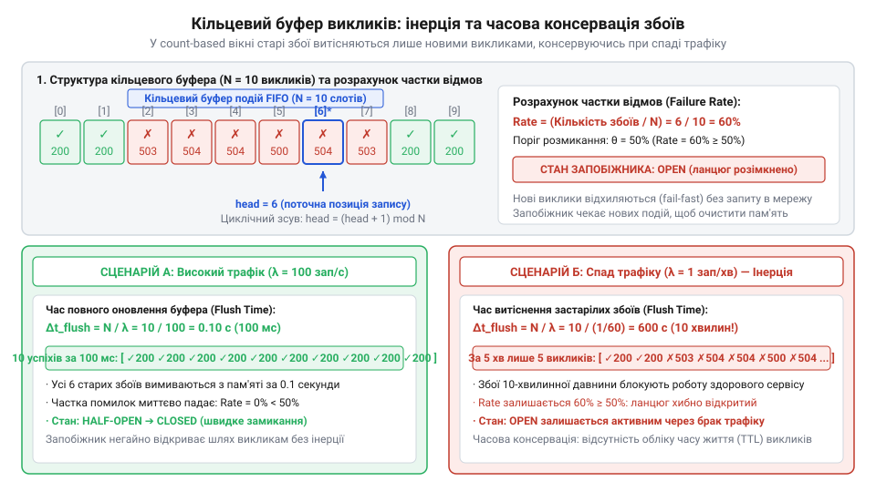
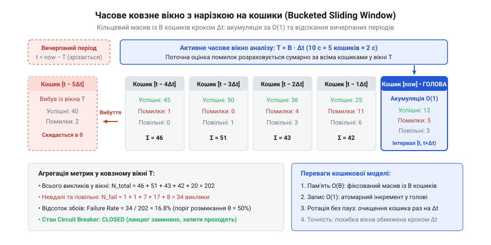
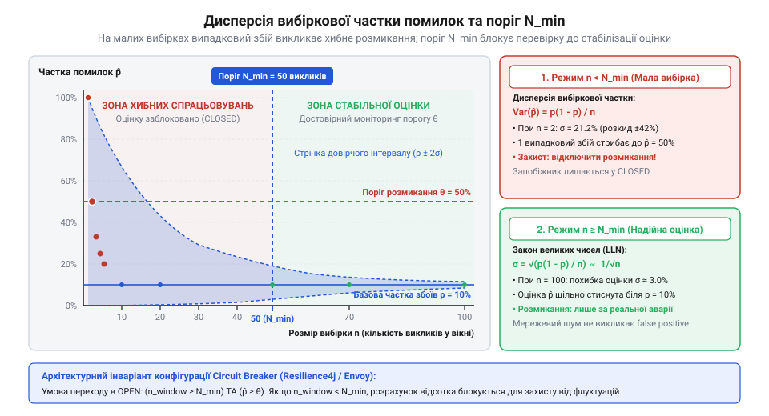
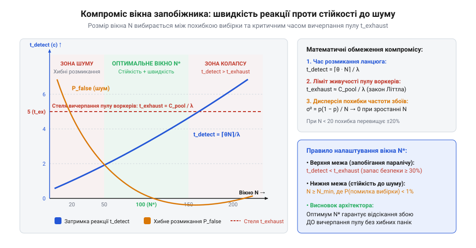
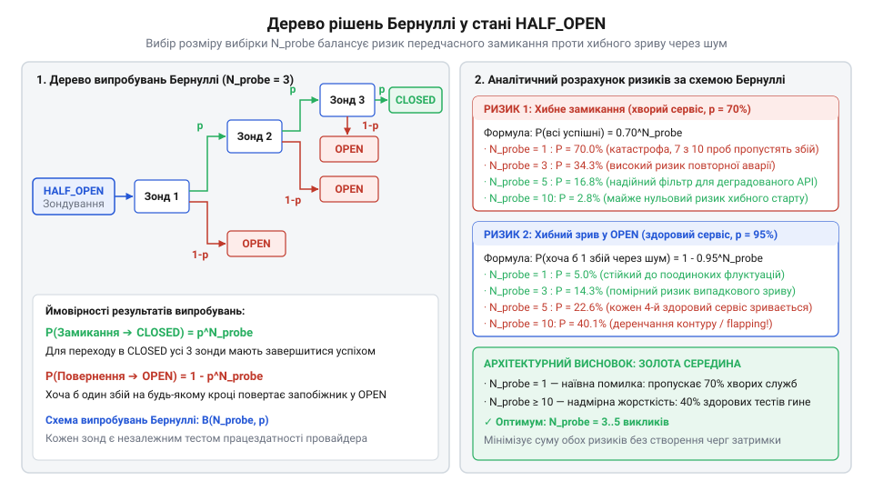

# Служба, якою ти не керуєш

<preknowlist>
- [Їхня аварія — твоя аварія](root:progarch/their-outage-is-your-outage) — розуміння того, як деградація затримки та збої зовнішніх інтеграцій безпосередньо загрожують доступності й загальному SLA власної системи
- [Квоти, ліміти й ціна виклику](root:progarch/quotas-limits-call-cost) — як перевищення лімітів та перевантаження зовнішнього API призводять до сповільнення та скидання з'єднань (HTTP 429)
- [Коли вони ламають без попередження](root:progarch/when-they-break-without-warning) — патерни поведінки клієнтського застосунку під час раптових аварій зовнішнього провайдера
</preknowlist>

## Пастка наївних лічильників відмов та потреба в ковзному вікні

Коли сервіс інтегрується зі стороннім постачальником послуг — платіжним шлюзом, SMS-провайдером чи зовнішньою білінговою системою ([DH: чужі служби в критичному шляху](root:progarch/dh-foreign-services-in-critical-path)), — він потрапляє в середовище, де помилки мережі, таймаути та коди 5xx є невіддільною частиною щоденної дійсності. Архітектурна реальність невблаганна: чужа аварія завжди стає твоєю власною аварією ([Їхня аварія — твоя аварія](root:progarch/their-outage-is-your-outage)). Якщо стороннє API раптово деградує або припиняє відповідати, клієнтські синхронні потоки блокуються на таймаутах у 10–30 секунд. Вхідні запити користувачів накопичуються в чергах веб-сервера, вичерпуючи пул воркерів і пам'ять процесу, що врешті-решт спричиняє повний каскадний колапс власного застосунку.

Щоб запобігти такому самознищенню, у розподілених архітектурах застосовують патерн захисного запобіжника (@@en|circuit breaker@@; від англ. *circuit* — електричний ланцюг, контур, та *breaker* — переривач, вимикач), концепцію та поведінку якого розкривають [Стани запобіжника (Circuit Breaker)](root:sf-distributed/circuit-breaker-pattern). Його завдання — вчасно помітити кризову деградацію зовнішньої служби, розімкнути контур (перейти в стан OPEN), припинити відправлення приречених запитів у прірву та миттєво повертати клієнтам помилку без затримок. Але серцевиною цього механізму є алгоритм виявлення відмов: як саме система ухвалює математичне рішення, що зовнішня служба зламалася?

На перший погляд здається, що для фіксації аварії достатньо найпростішого лічильника відмов. Проте за умов реального трафіку інтуїтивні лічильні евристики зазнають цілковитого краху через власні внутрішні математичні дефекти.

### Пастка глобального кумулятивного лічильника

Перша наївна ідея полягає у веденні двох загальних змінних від моменту старту процесу: лічильника всіх виконаних викликів `total_calls` та лічильника помилкових відповідей `total_failures`. Частка збоїв визначається як відношення:

    P[fail] = total_failures / total_calls

Якщо обчислена частка перевищує заданий поріг чутливості (наприклад, `θ = 0.5`, тобто 50% помилок), контур розмикається.

Уявімо реальну ситуацію: система успішно опрацювала піковий денний інтервал, здійснивши 100 000 успішних запитів без жодного збою (`total_calls = 100000`, `total_failures = 0`). О 20:00 сторонній провайдер зазнає раптової аварії та перестає відповідати ([Коли вони ламають без попередження](root:progarch/when-they-break-without-warning)). Починається повний блекаут: наступні 500 запитів поспіль зазнають невдачі за таймаутом.

Обчислимо стан глобального лічильника після 500 невдач поспіль:

    P[fail]
    = total_failures / total_calls
    = (0 + 500) / (100000 + 500)       [підстановка накопичених значень]
    = 500 / 100500                    [арифметичне додавання]
    ≈ 0.004975                        [обчислення частки]
    ≈ 0.498%                          [переведення у відсотки]

Отримана частка збоїв становить менше ніж 0.5%. За порогового значення `θ = 0.5` запобіжник продовжує вважати, що зовнішній сервіс надійний на 99.5%, і не робить жодної спроби розімкнути контур.

Розрахуємо, скільки помилок поспіль `k_needed` має статися, щоб кумулятивний лічильник нарешті зрівнявся з порогом `θ = 0.5`:

    k_needed
    = (θ · total_successful) / (1 - θ)
    = (0.5 · 100000) / (1 - 0.5)      [підстановка параметрів системи]
    = 50000 / 0.5                     [спрощення чисельника та знаменника]
    = 100000                          [розрахунок необхідної кількості збоїв]

Системі доведеться надіслати 100 000 приречених запитів у мертву службу, перш ніж лічильник досягне 50%. За цей час синхронний пул потоків буде паралізовано сотні разів ([Закон Літтла та вичерпання пулу потоків](root:sf-tasks/thread-pool)), черги переповнять оперативну пам'ять, а клієнти зіткнуться з повною недоступністю вашого сервісу. Глобальна історія успіху створює гігантську математичну інерцію, яка робить систему сліпою до катастрофи, що розгортається просто зараз.

### Пастка лічильника послідовних збоїв

Бажаючи позбутися тягаря минулої історії, інженери часто переходять до іншої крайності: рахують лише неперервний ланцюжок помилок. Логіка проста: якщо відбулося `k` збоїв поспіль (наприклад, `k = 5`), запобіжник розмикає контур. Якщо ж трапився бодай один успішний виклик, лічильник скидається в 0.

Ця евристика містить дві дзеркальні пастки:

1. **Пастка мерехтливого сервісу (flapping):**
   Припустимо, що сторонній сервер перевантажений і починає скидати кожне друге з'єднання через вичерпання лімітів чи квот ([Квоти, ліміти й ціна виклику](root:progarch/quotas-limits-call-cost)). Потік відповідей набуває вигляду:

       [1, 0, 1, 0, 1, 0, 1, 0, ...]

   де `1` позначає помилку, а `0` — успіх.

   Реальний коефіцієнт відмов становить рівно 50%. Половина запитів користувачів гине, ресурси процесу спалюються на очікуванні, але лічильник послідовних помилок жодного разу не перевищить одиницю. Кожен парний успішний виклик миттєво обнуляє лічильник, контур ніколи не розмикається, і система нескінченно працює в режимі хронічної аварії.

2. **Пастка випадкового мережевого шуму:**
   Зворотна ситуація: високонадійний сервіс обслуговує 2000 запитів за секунду з доступністю 99.99%. Короткочасна переконфігурація маршруту в мережі чи скидання транзитного буфера спричиняє мікросплеск втрати пакетів тривалістю лише 15 мілісекунд. П'ять запитів, що надійшли в цей короткий інтервал, повертають мережеву помилку. Лічильник миттєво фіксує 5 збоїв поспіль і розмикає запобіжник. Повністю здоровий провайдер виявляється відрізаним, що створює штучний блекаут на рівному місці.

### Вимога рухомого локального інтервалу

Обидві наївні евристики провалюються через те, що вони беруть статистичну вибірку з неправильного часового масштабу: або нескінченно широкий глобальний інтервал, що розмиває гострі збої, або мікроскопічний миттєвий зв'язок без урахування ширшого контексту.

Звідси постає фундаментальна інженерна вимога: для точного розпізнавання аварій система повинна оцінювати коефіцієнт відмов (@@en|failure rate@@; від лат. *fallere* — обманювати, хибити, та *rata* — розрахована частка) на рухомому локальному інтервалі спостережень — ковзному вікні (@@en|sliding window@@; від англ. *slide* — ковзати, та *window* — вікно). Таке вікно мусить постійно витісняти застарілі спостереження, згладжувати випадковий шум за рахунок достатнього обсягу статистики та оперативно реагувати на системну деградацію провайдера.

> 🔧 **Навіщо це.**
> Відмова від наївних лічильників на користь ковзного вікна усуває два протилежні ризики надійності: катастрофічну інерцію глобальної статистики, що блокує реакцію на блекаут, та надмірну нервозність покрокових перевірок, яка перетворює поодинокі мережеві спайки на хибні зупинки всієї системи.

## Ковзне вікно за кількістю викликів (Count-based Sliding Window): математична модель та часовий відрив

Найпрямішим способом обмежити історію фіксованою вибіркою є ковзне вікно за кількістю викликів (@@en|count-based sliding window@@; від англ. *count* — підрахунок, кількість). У цій моделі ми аналізуємо фіксовану кількість останніх подій `N`, незалежно від того, скільки фізичного часу знадобилося на їхнє здійснення.

### Математична структура кільцевого буфера

Канонічною структурою даних для реалізації count-based вікна є кільцевий буфер (@@en|ring buffer@@ або @@en|circular buffer@@; від лат. *circulus* — коло, та англ. *buffer* — амортизатор, накопичувач) фіксованої місткості `N`.

Результат кожного виклику кодується бінарною випадковою величиною `f[i] ∈ {0, 1}`:
- `f[i] = 1`, якщо виклик завершився збоєм (таймаут, помилка 5xx, обрив з'єднання);
- `f[i] = 0`, якщо виклик успішно повернув коректну відповідь.

Кільцевий масив містить `N` комірок. Спеціальний індекс голови `head` вказує на позицію найстарішого елемента. Коли надходить новий виклик зі значенням `f_new`, старе значення `f_old = buffer[head]` заміщується новим, а індекс зсувається по колу:

    head = (head + 1) mod N

Вибіркова частка відмов `P[f]` у вікні розміром `N` обчислюється як середнє арифметичне всіх комірок:

    P[f] = (1 / N) · ∑[i=1..N] f[i]

Щоб уникнути повного обходу масиву за час `O(N)` при кожному запиті, підтримується лічильник суми невдач `S = ∑[i=1..N] f[i]`. Оновлення суми та розрахунок частки виконуються за сталий час `O(1)`:

    S = S - f_old + f_new
    P[f] = S / N

*Схема кільцевого буфера розміром N викликів: запис бінарних статусів (успіх/збій), зміщення вказівника голови, обчислення частки помилок та часова консервація застарілих збоїв при падінні трафіку.*

### Аналітичний розрахунок затримки реакції

Нехай конфігурація запобіжника визначає поріг спрацьовування `θ ∈ (0, 1]` (наприклад, `θ = 0.5`, що відповідає 50% збоїв). Контур розмикається, якщо виконується умова:

    P[f] ≥ θ

Припустимо, що система перебувала в ідеальному стані: буфер був повністю заповнений нулями (`S = 0`, `P[f] = 0.0`). У певний момент зовнішній сервіс зазнає повної раптової відмови, і кожен наступний виклик гарантовано повертає помилку (`f_new = 1`).

Визначимо точну кількість невдалих викликів поспіль `k`, необхідних для досягнення порогу `θ`:

    P[f] ≥ θ
    k / N ≥ θ                         [заміна частки збоїв відношенням k до N]
    k ≥ θ · N                         [множення обох частин на N]
    k = ⌈θ · N⌉                       [найменше ціле число кроків]

Оператор `⌈x⌉` позначає операцію округлення вгору (стеля), яка знаходить найменше ціле число, не менше за `x`.

Для розміру вікна `N = 100` та порогу `θ = 0.5` отримаємо:

    k
    = ⌈0.5 · 100⌉                     [підстановка значень]
    = ⌈50.0⌉                          [множення]
    = 50                              [необхідна кількість послідовних збоїв]

Якщо поріг встановлено на рівні `θ = 0.2` (20% відмов):

    k
    = ⌈0.2 · 100⌉
    = 20

Тепер перейдемо від абстрактної кількості запитів до фізичного часу. Нехай вхідний потік запитів до сторонньої служби має інтенсивність `λ` викликів за секунду. Тоді фізична затримка виявлення аварії `t[detect]` становить:

    t[detect]
    = k / λ                           [час накопичення k запитів за інтенсивності λ]
    = ⌈θ · N⌉ / λ                     [підстановка виведеного порогу k]

Якщо `N = 100`, `θ = 0.5`, а інтенсивність становить `λ = 200` викликів за секунду, час детекції аварії є швидким:

    t[detect]
    = 50 / 200
    = 0.25 с                          [запобіжник зреагує за 250 мілісекунд]

### Програмна реалізація моделі кільцевого буфера

Нижче наведено мінімальну потокобезпечну концептуальну модель кільцевого буфера на Python, що реалізує розрахунок метрики за `O(1)`:

:::code math-circuit-breaker-sliding-window/py/countbasedslidingwindow.py

### Відрив від фізичного часу (Traffic-Rate Decoupling)

Незважаючи на алгоритмічну простоту та сталу складність `O(1)`, ковзне вікно за кількістю викликів має критичний недолік — повний відрив від фізичного часу.

Фізична часова тривалість вікна `Δt[window]` не є фіксованою, а залежить від миттєвого темпу трафіку:

    Δt[window] = N / λ

У розподілених системах це призводить до двох небезпечних аномалій:

1. **Консервація застарілих помилок при спаді навантаження:**
   Нехай у денний час при навантаженні `λ = 500` викликів/с система зафіксувала 40 помилок у буфері `N = 100` (`P[f] = 0.40`). Поріг `θ = 0.50` не був перевищений, запобіжник залишився замкненим.
   Уночі трафік падає до `λ = 0.1` викликів/с (один виклик на 10 секунд).
   Час повного витіснення застарілих помилок `t[flush]` складе:

       t[flush]
       = N / λ
       = 100 / 0.1                       [підстановка параметрів]
       = 1000 с                          [час оновлення]
       ≈ 16.7 хв                         [майже сімнадцять хвилин]

   Денні помилки лишаються законсервованими у вибірці майже на третину години. Якщо в цей час відбудеться бодай десяток невдалих спроб, буфер досягне 50% і розімкнеться. Зовнішній сервіс давно працює бездоганно, але запобіжник продовжує тримати лінію розімкненою, бо буфер не старіє без нових викликів.

2. **Стиснення вікна та гіперчутливість при стрибках навантаження:**
   Зворотна ситуація: під час раптового сплеску трафіку (наприклад, маркетингової розсилки) інтенсивність зростає до `λ = 10000` викликів/с.
   Фізична тривалість вікна `N = 100` стискається до мікроскопічної величини:

       Δt[window]
       = 100 / 10000
       = 0.01 с                          [тривалість вікна складає 10 мілісекунд]

   На інтервалі в 10 мілісекунд будь-яка короткочасна мережева перерва (наприклад, затримка комутатора через оновлення таблиці маршрутизації на 15 мс) затримує 50 пакетів. Запобіжник миттєво відкривається, перериваючи обслуговування надійного провайдера під час пікового бізнес-трафіку. Вікно втратило здатність згладжувати випадковий шум, бо стало занадто вузьким у часі.

Count-based ковзне вікно є ефективним лише за стаціонарного та передбачуваного навантаження. Для сервісів зі змінним трафіком необхідний інший клас вікон — прив'язаних не до кількості подій, а до астрономічного часу.

> 🔧 **Навіщо це.**
> Розрахунок затримки `k = ⌈θ · N⌉` та розуміння явища часового відриву допомагають обрати між count-based і time-based запобіжником. Якщо трафік має виражені нічні просідання або вибухові сплески, count-based буфер призведе до хибних аварій чи зависання у стані відмови, вимагаючи переходу на вікна з часовою дискретизацією.

## Часове ковзне вікно з нарізкою на кошики (Time-based Bucketed Sliding Window): алгоритм та просторова складність

Ковзне вікно за кількістю викликів виявилося безпорадним перед стрибками та спадами навантаження через відрив від фізичного часу: уночі застарілі денні помилки годинами блокують відновлення, а вдень вибуховий сплеск трафіку стискає вікно спостереження до мілісекунд. Щоб оцінка працездатності сторонньої служби була адекватною реальності, система повинна вимірювати якість відповідей на фіксованому інтервалі астрономічного часу `T` (наприклад, останні 60 секунд), незалежно від того, надійшло за цей час десять запитів чи сто тисяч.

Проте пряма реалізація часового вікна таїть у собі важку алгоритмічну пастку.

### Крах наївного збереження часових міток

Найпростіший підхід, який часто намагаються впровадити в код, — це зберігати кожен окремий виклик у динамічній черзі або двозв'язному списку у вигляді пари `(timestamp, outcome)`. При надходженні нового виклику з поточною міткою часу `t_now` алгоритм очищає чергу від усіх елементів, для яких `t_now - timestamp > T`, після чого підраховує частку невдач серед вузлів, що залишилися.

У розподілених сервісах із високим навантаженням такий підхід призводить до миттєвої деградації:

1. **Необмежене роздування пам'яті:**
   Якщо вхідна інтенсивність потоку становить `λ` викликів за секунду, то за вікно тривалістю `T` секунд у черзі одночасно накопичується `M` об'єктів:

       M = λ · T

   Просторова складність такого сховища є прямо пропорційною навантаженню — `O(λ · T)`. При типовому навантаженні високонавантаженого шлюзу `λ = 50000` викликів/с та вікні `T = 60` секунд системі доведеться одночасно утримувати в оперативній пам'яті три мільйони об'єктів:

       M
       = 50000 · 60
       = 3000000                       [кількість об'єктів у черзі]

2. **Руйнування збирача сміття (GC):**
   Постійне виділення та видалення сотень тисяч дрібних об'єктів на секунду створює колосальний тиск на пам'ять. Збирач сміття (Garbage Collector) потрапляє в режим тривалих зупинок (@@en|stop-the-world@@-пауз), що спричиняє внутрішні затримки у вашому власному застосунку. Замість захисту від стороннього провайдера клієнтський сервіс сам себе паралізує.

### Дискретна нарізка на кошики: інваріант пам'яті O(B)

Щоб усунути залежність від темпу трафіку `λ`, архітектура переходить від поштучного збереження подій до агрегованого часового ковзного вікна з нарізкою на дискретні кошики (@@en|bucket@@; від англ. *bucket* — відро, кошик, сегмент накопичення).

Загальний інтервал часу `T` розбивається на `B` однакових часових відрізків тривалістю:

    Δt = T / B

Структура даних є циклічним масивом із `B` фіксованих комірок. Кожен кошик містить лише два або три цілочисельні лічильники: кількість усіх викликів `total` та кількість збоїв `failed` за відповідний квант часу `Δt`.

Просторова складність стає строго постійною:

    S = O(B)

Незалежно від того, обробляє сервіс 1 запит за годину чи 100 000 запитів за секунду, обсяг займаної пам'яті залишається незмінним і складає лише кілька кілобайтів для всього масиву з `B` комірок.

Кожен виклик у фізичний момент часу `t` однозначно відображається на індекс відповідного кошика за допомогою модульної арифметики:

    bucket_index = ⌊t / Δt⌋ mod B

Операція взяття нижньої межі (підлога `⌊x⌋`) визначає цілий номер кванта часу від початку епохи, а взяття за модулем `mod B` закольцовує адресацію в масиві фіксованої довжини. Акумуляція події в поточному кошику виконується за сталий час `O(1)` шляхом атомарного інкременту лічильників: для усунення конфліктів у пам'яті під час паралельного оновлення метрик застосовують [неблокуючі лічильники LongAdder і CAS](root:sf-tasks/cas-and-longadder-counters).

*Часова шкала та циклічний масив B кошиків тривалістю Δt: ротація часового вікна T, акумуляція викликів у поточному кошику за O(1) та зрізання вичерпаних періодів.*

### Механіка ротації та похибка дискретизації

Коли фізичний час перетинає часову межу `Δt`, поточний квант завершується. При надходженні наступного виклику, чий розрахований часовий слот випереджає слот найстарішого кошика в масиві, відбувається ротація:
1. Кошик, чий часовий інтервал вийшов за межі `T`, очищається (його лічильники скидаються в 0).
2. Очищений кошик отримує нову мітку епохи й стає новим «лідером» для запису поточних подій.

Загальна частка помилок у вікні обчислюється як сума лічильників усіх `B` активних кошиків:

    P[f]
    = (∑[j=1..B] failed[j]) / (∑[j=1..B] total[j])

Ця модель породжує фундаментальний інженерний компроміс: **похибку дискретизації (фазове запізнення)**.

Оскільки події всередині одного кошика не мають внутрішніх міток часу, найстаріший кошик скидається не плавно мілісекунда за мілісекундою, а квантовано — одразу за весь інтервал `Δt`. Максимальна похибка оцінки та фазове запізнення зрізання застарілих даних складає рівно величину одного кванта `Δt`.

Вибір кількості кошиків `B` визначається балансом двох факторів:
- **Мале B (наприклад, B = 2, при T = 60 с):** Крок дискретизації величезний — `Δt = 30` секунд. Очищення кошика спричиняє різкі стрибки метрики на 50% кожні пів хвилини, що призводить до грубої неточності оцінки.
- **Надмірно велике B (наприклад, B = 600, при T = 60 с):** Крок становить `Δt = 100` мілісекунд. Вікно є надзвичайно плавним, проте операції ротації, оновлення міток та блокування між потоками створюють помітні накладні витрати процесора.

Канонічним виробничим компромісом є вибір `B ∈ [10, 60]`. Наприклад, для вікна тривалістю `T = 60` секунд розбиття на `B = 60` кошиків дає крок дискретизації `Δt = 1` секунда. При цьому фазове запізнення становить менше ніж 1.7% від ширини вікна, а накладні витрати на ротацію раз на секунду є абсолютно невідчутними для CPU.

Нижче наведено алгоритмічну реалізацію time-based bucketed вікна на Python:

:::code math-circuit-breaker-sliding-window/py/timebasedslidingwindow.py

> 🔧 **Навіщо це.**
> Нарізка часу на кошики з інваріантом пам'яті `O(B)` ліквідує залежність від обсягу вхідного навантаження. Це дозволяє безпечно захищати навіть мікросервіси із сотнями тисяч RPS без загрози вичерпання пам'яті та руйнівних пауз збирача сміття.

## Статистична валідність, мінімальний обсяг вибірки (N[min]) та поріг повільних викликів

Часове ковзне вікно гарантує сталий час спостереження, проте породжує нову математичну вразливість — парадокс малих вибірок на старті роботи або в періоди низького трафіку.

### Парадокс малих вибірок та гіперболічна дисперсія

Розглянемо виклики зовнішнього сервісу як послідовність незалежних випробувань Бернуллі (@@en|Bernoulli trial@@; на честь швейцарського математика Якоба Бернуллі, Jacob Bernoulli). Кожен окремий виклик є випадковою величиною `X[i] ∈ {0, 1}`, яка набуває значення `1` (аварія) з істинною ймовірністю провайдера `p`, та `0` (успіх) з імовірністю `1 - p`.

Вибіркова частка відмов `p̂` за `n` спостережень є статистичною оцінкою параметра `p`:

    p̂ = (1 / n) · ∑[i=1..n] X[i]

Математичне сподівання цієї вибіркової оцінки збігається з істинною ймовірністю:

    E[p̂] = p

Проте дисперсія вибіркової частки `σ²` має вигляд:

    σ² = Var(p̂) = p(1 - p) / n

Стандартне відхилення (похибка вимірювання) дорівнює:

    σ = √[ p(1 - p) / n ]

Зверніть увагу на знаменник: обсяг вибірки `n` стоїть у знаменнику. Коли кількість спостережень `n` прямує до малих величин, дисперсія гіперболічно зростає. Оцінка стає екстремально нестабільною і хаотично стрибає між нулем та одиницею.

Уявімо роботу сервісу одразу після перезапуску або вночі. У поточному вікні зафіксовано всього `n = 2` виклики. Істинна надійність стороннього провайдера складає 99% (`p = 0.01`). Якщо за випадковим збігом обставин перший виклик пройшов успішно, а другий зазнав поодинокої мережевої невдачі (`n = 2, failed = 1`), формальний розрахунок дає:

    p̂
    = failed / n
    = 1 / 2
    = 0.5                             [50% відмов]

Якщо поріг чутливості запобіжника встановлено на рівні `θ = 0.5`, запобіжник негайно розімкнеться. Лише одна випадкова помилка на практично бездоганній зовнішній службі викличе катастрофічне хибне спрацьовування!

Закон великих чисел стверджує: вибіркова частка `p̂` сходиться до істинної ймовірності `p` лише тоді, коли обсяг вибірки є достатньо великим. На вибірці з двох елементів математична частка 50% не має жодної статистичної значущості.

*Графік залежності дисперсії вибіркової частки помилок від розміру вибірки n: катастрофічна невизначеність на малій кількості викликів та стабілізація оцінки вище порогу N_min.*

### Поріг мінімального обсягу вибірки N[min]

З теорії ймовірностей випливає жорстке правило захисту: запобіжнику категорично заборонено перевіряти поріг відмов `θ`, доки у вікні не накопичився мінімальний статистично достовірний обсяг спостережень `N[min]`.

Умова перевірки формулюється як кон'юнкція:

    TripCondition = (n[window] ≥ N[min]) ∧ (P[fail] ≥ θ)

Якщо `n[window] < N[min]`, контур залишається замкненим (CLOSED), якою б високою не була відносна частка збоїв.

Розрахуємо математичне обґрунтування величини `N[min]`. Нехай ми вимагаємо, щоб стандартна похибка вимірювання частки відмов не перевищувала допустимої похибки `ε` (наприклад, `ε = 0.1` або 10%) із рівнем довіри 95% (коефіцієнт квантиля нормального розподілу `z ≈ 2`). Найгірший випадок максимальної дисперсії досягається при `p = 0.5`, коли добуток `p(1 - p) = 0.25`:

    ε = z · √[ p(1 - p) / n ]
    ε² = z² · p(1 - p) / n             [піднесення до квадрата]
    n ≥ z² · p(1 - p) / ε²             [вираження розміру вибірки]

Підставимо числові значення для довірчої ймовірності 95% та похибки 10%:

    N[min]
    ≥ (2² · 0.25) / (0.1)²
    = (4 · 0.25) / 0.01                [обчислення чисельника]
    = 1 / 0.01
    = 100                              [мінімальний обсяг вибірки]

Якщо бізнес допускає ширшу похибку `ε = 0.2` (20% невизначеності):

    N[min]
    ≥ 1 / (0.2)²
    = 1 / 0.04
    = 25

Саме тому в промислових реалізаціях (Resilience4j, Sentinel) поріг `N[min]` за замовчуванням завжди лежить у діапазоні від 20 до 100 викликів. Будь-яке число, менше за 20, не забезпечує базової статистичної валідності.

### Загроза повільних викликів (Slow Calls)

Повні аварії сторонньої служби (коди 500, скидання сокета TCP RST) зазвичай повертаються швидко — за десятки мілісекунд. Проте найбільш підступною формою деградації є не миттєва відмова, а сповільнення відповідей.

Причини цього описано в темі вичерпання лімітів та перевантаження API ([Квоти, ліміти й ціна виклику](root:progarch/quotas-limits-call-cost)): сторонній сервіс перестає встигати опрацьовувати черги, і затримка зростає з 200 мілісекунд до 15–30 секунд.

Чому повільні виклики вбивають систему швидше за прямі помилки? Це пояснює фундаментальний закон теорії масового обслуговування — [Закон Літтла та вичерпання пулу потоків](root:sf-tasks/thread-pool):

    L = λ · W

де `L` — середня кількість зайнятих потоків у системі, `λ` — темп надходження запитів, а `W` — середній час очікування відповіді.

Якщо сторонній сервіс працює штатно (`W = 0.2` с) при навантаженні `λ = 100` запитів/с:

    L = 100 · 0.2 = 20 потоків

Коли ж сервіс «зависає» на таймауті `W = 10` секунд:

    L = 100 · 10 = 1000 потоків

Потреба в потоках зростає у 50 разів! Якщо пул веб-сервера обмежений ємністю в 200 воркерів, усі вони вичерпуються за дві секунди. Нові запити від користувачів не можуть навіть розпочати обробку, і вся ваша система впадає в кому. При цьому провайдер формально ще не повернув жодної помилки 5xx!

### Дуальний поріг розмикання контуру

Щоб запобігти виснаженню пулу воркерів від повільних викликів, метрика ковзного вікна доповнюється параметром повільного виклику (@@en|slow call@@; від англ. *slow* — повільний, та *call* — виклик).

Вводиться часовий поріг деградації `τ[slow]` (наприклад, `τ[slow] = 2.0` секунди).
Виклик кваліфікується як повільний, якщо його тривалість `t` задовольняє умову:

    t > τ[slow]

У кожному кошику ковзного вікна ведеться окремий лічильник `slow_calls`. Частка повільних викликів визначається аналогічно до частки помилок:

    P[slow] = (∑[j=1..B] slow[j]) / (∑[j=1..B] total[j])

Критерій розмикання контуру стає комбінованим (дуальним). Запобіжник розмикає ланцюг, якщо накопичено мінімальну вибірку `N[min]` і або частка прямих збоїв `P[fail]`, або частка повільних викликів `P[slow]` перевищила встановлений критичний відсоток:

    TripCondition = (n[window] ≥ N[min]) ∧ (max(P[fail], P[slow]) ≥ θ)

Або, якщо для повільних викликів задано окремий поріг `θ[slow]`:

    TripCondition = (n[window] ≥ N[min]) ∧ ( (P[fail] ≥ θ[fail]) ∨ (P[slow] ≥ θ[slow]) )

Такий дуальний критерій ізолює деградуючого провайдера задовго до того, як завислі з'єднання встигнуть заповнити черги та зруйнувати внутрішні пули воркерів.

> 🔧 **Навіщо це.**
> Поєднання статистичного порогу `N[min]` та обліку повільних викликів `τ[slow]` закриває дві головні вразливості захисту: захищає систему від фальшивих аварій при малому обсязі запитів та вчасно розмикає ланцюг при «тихій смерті» провайдера через затримку, рятуючи пул потоків клієнта.

## Аналітичний компроміс: швидкість реакції проти стійкості до шуму

Налаштування параметрів ковзного вікна в патерні [Стани запобіжника (Circuit Breaker)](root:sf-distributed/circuit-breaker-pattern) стикається з вічним архітектурним протиріччям: система повинна реагувати на справжні катастрофи блискавично, але водночас залишатися абсолютно незворушною до природного мережевого шуму.

Ширина ковзного вікна — чи то за кількістю викликів `N`, чи за астрономічним часом `T` — є головним регулятором двох взаємовиключних характеристик:
1. Затримки виявлення аварії (@@en|detection lag@@; від лат. *detegere* — відкривати, виявляти, та давньосканд. *lag* — затримка, відставання).
2. Імовірності хибного спрацьовування (@@en|false positive@@; від лат. *falsus* — помилковий, та *positivus* — ствердний).

### Дилема ширини вікна: чутливість проти інерції

Розглянемо крайні випадки вибору ширини вікна:

- **Вузьке вікно (мале N або мале T):**
  Якщо вікно містить лише `N = 20` викликів за порогу `θ = 0.5`, контур розмикається вже після `k = ⌈0.5 · 20⌉ = 10` невдалих викликів. За інтенсивності `λ = 100` запитів/с фізичний час реакції складе лише 100 мілісекунд:

      t[detect]
      = ⌈θ · N⌉ / λ
      = 10 / 100
      = 0.10 с                          [час спрацьовування 100 мс]

  Захисна реакція миттєва: клієнтські потоки навіть не встигають заповнити чергу. Проте платою за швидкість стає екстремальна вразливість до шуму. Випадковий сплеск у комутаторі чи перекидання маршруту BGP, що спричинили втрату 10 пакетів за 100 мілісекунд, негайно відріжуть повністю працездатний сервіс.

- **Широке вікно (велике N або велике T):**
  Якщо встановити `N = 2000` викликів, дисперсія вибіркової частки стає мізерною. Випадкові сплески з 10–20 помилок становлять менше 1% вибірки й не мають шансу підняти метрику до порогу 50%. Хибні спрацьовування на шумі практично усунені.
  Проте ціна цього — катастрофічна затримка детекції: для розмикання контуру потрібно накопичити `k = ⌈0.5 · 2000⌉ = 1000` помилок поспіль! При `λ = 100` запитів/с затримка складе:

      t[detect]
      = 1000 / 100
      = 10 с                            [десять секунд безперервного падіння]

  Ба більше, виникає небезпечна інерція витіснення (@@en|expulsion inertia@@): навіть після повного відновлення провайдера ці 1000 зафіксованих збоїв будуть розмиватися свіжим трафіком ще щонайменше 10–20 секунд, утримуючи контур у розімкненому стані.

*Сімейство кривих компромісу між затримкою розмикання t_detect та ймовірністю хибного спрацьовування: вибір розміру вікна відносно критичного часу вичерпання пулу воркерів t_exhaust.*

### Гранична умова безпеки: час вичерпання пулу потоків

Як знайти точну межу між занадто вузьким і занадто широким вікном? Архітектурну відповідь дає фізичне обмеження ресурсів нашого власного сервера — ємність пулу синхронних воркерів `C[pool]` (наприклад, розмір пулу з'єднань HTTP-клієнта або пулу потоків сервлета).

Коли зовнішня служба зазнає повної аварії або впадає в кому повільних відповідей ([Коли вони ламають без попередження](root:progarch/when-they-break-without-warning)), кожен вхідний запит блокує один потік до моменту спливання таймауту сокета.

Якщо вхідний трафік надходить з інтенсивністю `λ` запитів за секунду, весь пул потоків `C[pool]` буде вичерпано до останнього воркера за критичний час:

    t[exhaust] = C[pool] / λ

Уявімо сервер із пулом `C[pool] = 100` потоків під навантаженням `λ = 50` запитів/с:

    t[exhaust]
    = 100 / 50
    = 2.0 с                           [дві секунди до повного паралічу]

Звідси випливає **золоте правило безпеки**: запобіжник зобов'язаний виявити аварію та розімкнути контур суворо раніше, ніж вичерпається пул потоків сервера:

    t[detect] < t[exhaust]

Підставимо у цю нерівність виведену раніше формулу затримки реакції:

    ⌈θ · N⌉ / λ < C[pool] / λ
    ⌈θ · N⌉ < C[pool]                 [множення обох частин на λ]
    θ · N < C[pool]                   [наближення для інженерних розрахунків]
    N < C[pool] / θ                   [ділення на поріг θ]

Це фундаментальне математичне обмеження. Якщо в конфігурації вказано поріг `θ = 0.5` (50% збоїв) при ємності пулу `C[pool] = 100`, розмір вікна зобов'язаний задовольняти умову:

    N
    < 100 / 0.5
    = 200                             [максимально допустимий розмір вікна]

Якщо інженер необдумано налаштує вікно розміром `N = 500`, для розмикання контуру знадобиться `⌈0.5 · 500⌉ = 250` збоїв. Але вже на сотому запиті пул воркерів закінчиться, нові запити почнуть відкидатися операційною системою, і сервер впаде задовго до того, як запобіжник узагалі зрозуміє, що сталася біда.

Об'єднуючи умову статистичної достовірності `N[min]` з умови безпеки ресурсів, отримуємо двосторонній допустимий інтервал для розміру вікна:

    N[min] ≤ N < C[pool] / θ

> 🔧 **Навіщо це.**
> Гранична умова `N < C[pool] / θ` замінює суб'єктивні здогадки математичним розрахунком. Вона встановлює жорстку верхню межу розміру вікна, гарантуючи, що запобіжник встигне спрацювати до того, як застряглі запити вичерпають доступні потоки веб-сервера.

## Математика відновлення у стані HALF_OPEN та замкнене інженерне калібрування

Розімкнувши контур (стан OPEN), запобіжник повністю припиняє надсилання запитів до аварійного сервісу ([DH: чужі служби в критичному шляху](root:progarch/dh-foreign-services-in-critical-path)), надаючи сторонній системі час на одужання або перезапуск. Ця пауза визначається таймаутом очікування `T[wait]` (зазвичай від 10 до 60 секунд): щоб запобігти резонансу та узгодженим хвилям навантаження від багатьох клієнтів, розрахунок затримок між спробами покладають на [стохастичні алгоритми експоненційного відступу та джитеру](root:sf-distributed/retries-backoff).

Коли таймер `T[wait]` спливає, запобіжник переходить у стан випробування — напіввідкритий контур (@@en|half-open@@; від англ. *half* — половина, та *open* — відкритий). У цьому стані система не відкриває шлюзи для всього потоку трафіку, а відправляє суворо обмежену вибірку тестових зондувальних запитів (@@en|probe requests@@; від лат. *probare* — випробовувати, перевіряти) обсягом `N[probe]`.

### Ймовірнісна модель зондування Бернуллі

Мета стану HALF_OPEN — ухвалити одне з двох рішень:
1. Якщо сервіс одужав — повернутися у робочий стан CLOSED і відновити пропуск повного трафіку.
2. Якщо сервіс досі зламаний — негайно розімкнути контур назад у стан OPEN ще на один період `T[wait]`.

Нехай сторонній сервіс характеризується істинною ймовірністю відмови `p`. Результат відправлення `N[probe]` зондувальних запитів моделюється біноміальним розподілом:

    K ~ Binomial(N[probe], p)

де `K` — випадкова кількість невдалих зондів.

Поведінка переходу визначається правилом: якщо частка невдач серед зондів не перевищує тестовий поріг (найчастіше вимагається нуль помилок або `K / N[probe] ≤ θ[probe]`), контур замикається; інакше — відкривається знову.

Розглянемо дві класичні статистичні помилки, які виникають на цьому етапі:

1. **Помилка першого роду (передчасне замикання на хворий сервіс):**
   Сервіс насправді **не одужав** і продовжує відмовляти з високою ймовірністю `p` (наприклад, `p = 0.5` або 50% відмов). Проте за випадковим збігом обставин усі тестові зонди виявилися успішними (`K = 0`), і запобіжник помилково відкриває шлюзи на повну потужність.
   Імовірність такої катастрофічної помилки дорівнює:

       P(Type I) = (1 - p)^N[probe]

   Якщо вибрати наївний розмір вибірки `N[probe] = 1` (як робили ранні бібліотеки):

       P(Type I)
       = (1 - 0.5)¹
       = 0.50                            [50% ймовірності фатальної помилки!]

   Один успішний випадковий запит відкриває лавину трафіку на напівмертвий сервіс, миттєво добиваючи його й паралізуючи власну систему.
   Якщо ж збільшити вибірку зондів до `N[probe] = 10`:

       P(Type I)
       = (1 - 0.5)¹⁰
       ≈ 0.000976                        [менше ніж 0.1% ризику]

   Навіть за помірної деградації сервісу (`p = 0.3` або 30% помилок):

       P(Type I)
       = (1 - 0.3)¹⁰
       = (0.7)¹⁰
       ≈ 0.0282                          [лише 2.8% ризику, що гарантує надійність > 97%]

2. **Помилка другого роду (хибне відхилення одужалого сервісу):**
   Сервіс **повністю одужав** і працює у штатному режимі з природним фоновим рівнем шуму `p = 0.01` (99% доступності). Якщо алгоритм вимагає виключно нуль помилок серед зондів (`K = 0`), то ймовірність випадково спіймати бодай один фоновий збій становить:

       P(Type II)
       = 1 - (1 - p)^N[probe]
       = 1 - (0.99)¹⁰
       ≈ 1 - 0.9044
       ≈ 0.0956                          [майже 10% ймовірності хибного зриву в OPEN]

   Щоб усунути цей ризик, у стані HALF_OPEN застосовують не жорстку вимогу нуля помилок, а м'який поріг відмов `θ[probe] ≈ θ[fail]`. При вибірці `N[probe] = 10` допускається 1 невдача (`1 / 10 = 10% ≤ θ`).

Оптимальний інженерний діапазон обсягу зондів складає `N[probe] ∈ [10, 20]`. Він гарантує надійне відсікання хворих систем без надмірного затягування фази випробування.

*Дерево ймовірностей випробувань Бернуллі у стані HALF_OPEN: розрахунок ризиків помилкового замикання та випадкового відхилення залежно від розміру тестової вибірки N_probe.*

### Замкнена матриця інженерного калібрування запобіжника

Підсумуємо всі виведені формули у покрокову матрицю проєктування та калібрування Circuit Breaker:

| Параметр | Позначення | Розрахункова формула / Правило вибору | Типовий діапазон |
| :--- | :--- | :--- | :--- |
| **Тип вікна** | — | Часове (Time-based) при нерівномірному трафіку; кількісне (Count-based) лише при строго стаціонарному темпі | Time-based |
| **Ширина вікна** | `T` або `N` | `N < C[pool] / θ` (захист від вичерпання пулу) та `T < t[exhaust] / θ` | `T ∈ [10, 60]` с, `N ∈ [50, 200]` |
| **Кількість кошиків** | `B` | Компроміс похибки: `Δt = T / B`, допустиме фазове запізнення `Δt ≤ 0.05 · T` | `B ∈ [10, 60]` |
| **Статистичний поріг** | `N[min]` | `N[min] ≥ z² · p(1 - p) / ε²` при `ε = 0.1, z = 2` | `N[min] ∈ [20, 100]` |
| **Поріг відмов** | `θ[fail]` | Баланс між чутливістю та SLA зовнішнього провайдера | `θ[fail] ∈ [0.3, 0.5]` (30–50%) |
| **Поріг повільного виклику**| `τ[slow]` | `τ[slow] = 3 · P95` нормальної тривалості відповіді стороннього сервісу | `τ[slow] ∈ [1.5, 3.0]` с |
| **Поріг частки повільних** | `θ[slow]` | Запобігання вичерпанню черги за законом Літтла `L = λ · W` | `θ[slow] ∈ [0.5, 0.7]` (50–70%) |
| **Таймаут очікування** | `T[wait]` | Оцінка середнього часу відновлення стороннього сервісу (MTTR) | `T[wait] ∈ [15, 60]` с |
| **Вибірка зондування** | `N[probe]` | `(1 - p)^N[probe] ≤ 0.05` для 95% захисту від помилки першого роду | `N[probe] ∈ [10, 20]` |

Спираючись на цю систему формул, архітектор перетворює конфігурування захисту з ризикованої лотереї на точний математичний розрахунок, що гарантує виживання власної системи в умовах будь-яких штормів у зовнішніх непідконтрольних службах.

> 🔧 **Навіщо це.**
> Математичний розрахунок вибірки зондів `N[probe]` та зведена матриця параметрів завершують побудову відмовостійкого запобіжника. Це виключає катастрофічні зриви у фазі відновлення та забезпечує повний баланс між чутливістю детекції, збереженням пулу потоків та безпечним поверненням у робочий режим.
