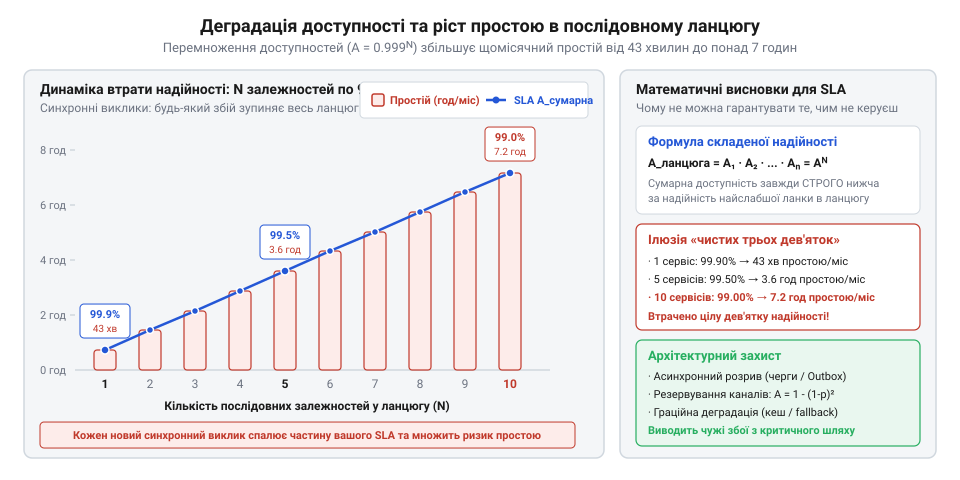
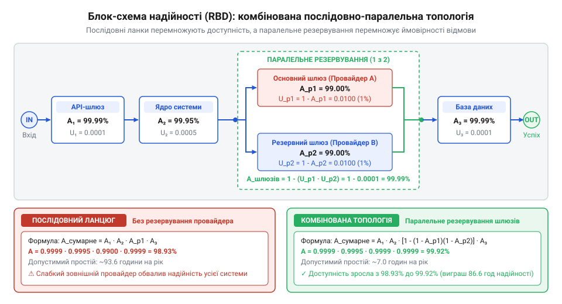
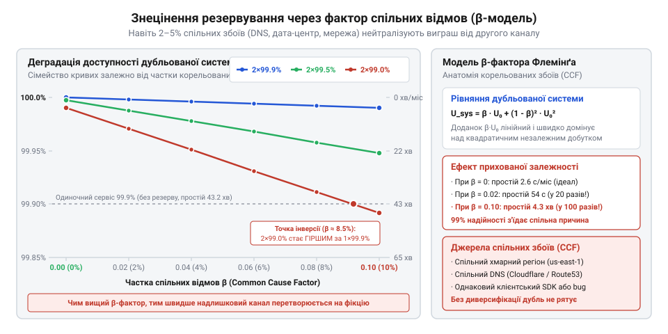

# Служба, якою ти не керуєш

<preknowlist>
- [Їхня аварія — твоя аварія](root:progarch/their-outage-is-your-outage) — зв'язок між падінням або сповільненням зовнішньої служби та загальним простоєм власного продукту в очах користувача.
- [Квоти, ліміти й ціна виклику](root:progarch/quotas-limits-call-cost) — як перевищення лімітів та сплески запитів спричиняють масові відмови стороннього сервісу (429 Too Many Requests), що зменшують його доступність.
- [DH: чужі служби в критичному шляху](root:progarch/dh-foreign-services-in-critical-path) — архітектурний приклад реальної системи з кількома зовнішніми провайдерами у критичному синхронному шляху.
</preknowlist>

## Парадокс надійних компонентів: як три «дев'ятки» спалюють клієнтський контракт

Уявімо типову інженерну ситуацію, з якою стикається команда розробки цифрової платформи чи корпоративного бекенду. Бізнес укладає важливий комерційний договір про рівень обслуговування (@@en|Service Level Agreement, SLA@@; від лат. *servitium* — служіння та *ligare* — зв'язувати). За контрактом система зобов'язується демонструвати доступність на рівні 99.9% — так звані «три дев'ятки». У перерахунку на календарний місяць тривалістю 30 діб (43 200 хвилин) це означає, що допустимий сумарний час простою (@@en|downtime@@; від англ. *down* — донизу та *time* — час) становить не більше ніж 43.2 хвилини. Якщо сервіс недоступний довше, компанія сплачує клієнту суттєві фінансові неустойки та зазнає репутаційних втрат.

Архітектор проєктує критичний бізнес-процес оформлення замовлення, де задіяна низка зовнішніх контрагентів ([DH: чужі служби в критичному шляху](root:progarch/dh-foreign-services-in-critical-path)). Щоб провести операцію, сервер у межах одного синхронного запиту звертається до трьох зовнішніх служб: авторизує транзакцію у сторонньому платіжному шлюзі, перевіряє адресу покупця через географічний сервіс логістичного оператора та надсилає одноразовий пароль через хмарного SMS-провайдера. Команда підходить до вибору постачальників із максимальною суворістю: у договорі з кожним із них чорним по білому прописано той самий гарантований рівень SLA — 99.9%. Логіка інженерів видається бездоганною: якщо всі складові частини мають найвищий стандарт надійності, то й побудований із них сервіс апріорі відповідатиме тим самим трьом дев'яткам.

Реальність промислової експлуатації завдає удару в перший же місяць. Наприкінці звітного періоду сервіс-менеджери збирають звіти про інциденти від партнерів:
- Платіжний шлюз сумарно лежав через технічні збої 38 хвилин.
- Сервіс валідації адрес зазнав кількох аварій на магістральних каналах загальною тривалістю 40 хвилин.
- Хмарний SMS-провайдер мав проблеми з чергами доставки повідомлень протягом 35 хвилин.

Кожен із трьох провайдерів урочисто заявляє про зразкове виконання контрактних зобов'язань: жоден із них не перевищив дозволеного ліміту у 43.2 хвилини простою, і юридично до них немає жодних претензій. Проте власний бекенд компанії за цей самий місяць сумарно був паралізований протягом 113 хвилин. Усі ці періоди збоїв припали на різні дні та години. Для кінцевого покупця не має жодного значення, яка саме з проміжних ланок дала осічку: якщо платіж не пройшов, адреса не перевірилася або не надійшов SMS-код, кнопка «Оформити» видає помилку, а кошик залишається неоплаченим.

У свідомості користувача зламалася не чужа служба — зламався ваш продукт. Тут безжально спрацьовує правило [Їхня аварія — твоя аварія](root:progarch/their-outage-is-your-outage): клієнт фіксує майже дві години простою, договірний ліміт перевищено майже втричі, а компанія вимушена виплачувати штрафи. Виникає кричущий парадокс: система, складена виключно з надійних компонентів, виявилася катастрофічно ненадійною. Наївне припущення розробників про те, що загальна надійність дорівнює надійності окремих компонентів, розбилося об фундаментальний закон природи розподілених систем, який вимагає суворого математичного апарату.

> 🔧 **Навіщо це.**
> Сліпа довіра до показників надійності зовнішніх служб без урахування їхньої топологічної взаємодії створює приховану фінансову міну під проєктом. Інженер зобов'язаний вміти прораховувати реальну складену надійність системи ще на етапі проєктування архітектурних меж, а не після того, як компанія отримає судові позови за зірвані зобов'язання.

## Математика послідовного з'єднання: закон множення доступностей і вигорання бюджету

Щоб знайти причину розриву між надійністю окремих служб і надійністю системи в цілому, звернімося до мови теорії ймовірностей. 

Визначимо доступність (@@en|availability@@; від лат. *habilis* — придатний, зручний, що позначається літерою `A`) як імовірність того, що сервіс у довільний момент часу виконує свої функції штатно, або як частку успішних запитів за фіксоване вікно спостереження. Відповідно, ненадійність (@@en|unavailability@@, позначається `U`) — це ймовірність перебування системи у стані відмови:

```
U = 1 - A                              [доповнення ймовірності до одиниці]
```

Розглянемо синхронний ланцюг обробки транзакції з `n` зовнішніх служб. Щоб користувач отримав успішну відповідь, безвідмовно має спрацювати перша служба, **і** друга служба, **і** третя, аж до `n`-ї. Позначимо подію безвідмовної роботи `i`-го вузла через `X_i = 1`, а стан збою — через `X_i = 0`. Працездатність усього синхронного ланцюга `S` є логічною кон'юнкцією (операцією «І») станів усіх його ланок:

```
S = X₁ ∧ X₂ ∧ … ∧ Xₙ
```

Якщо припустити, що збої в різних сторонніх провайдерів є статистично незалежними подіями (жодна служба не ділить із іншою серверів, мереж чи спільних баз даних), то ймовірність спільного настання незалежних подій дорівнює добутку їхніх індивідуальних імовірностей:

```
A_seq
= P(X₁ = 1 ∧ X₂ = 1 ∧ … ∧ Xₙ = 1)
= P(X₁ = 1) · P(X₂ = 1) · … · P(Xₙ = 1) [правило множення для незалежних подій]
= A₁ · A₂ · … · Aₙ                      [підстановка доступностей окремих служб]
= ∏[i=1 .. n] A_i                      [компактний запис добутку]
```

Оскільки доступність будь-якої реальної служби є числом, строго меншим за одиницю (`0 < A_i < 1`), кожен новий співмножник неминуче зменшує загальний добуток. Звідси випливає фундаментальна теорема про верхню межу надійності:

```
A_seq ≤ min(A₁, A₂, …, Aₙ)
```

Синхронний ланцюг математично ніколи не може бути надійнішим за свій найслабший компонент. Ба більше: якщо навіть усі `n` служб мають абсолютно однаковий рівень доступності `A`, підсумкова доступність системи становить `A^n`.

Щоб побачити, як при цьому поводиться ненадійність (ризик збою), виведемо формулу для `U_seq`:

```
U_seq
= 1 - A_seq                            [означення ненадійності системи]
= 1 - ∏[i=1 .. n] A_i                  [підстановка добутку доступностей]
= 1 - ∏[i=1 .. n] (1 - U_i)            [перехід до ненадійностей окремих вузлів]
```

Розкриємо цей вираз для випадку двох незалежних сервісів:

```
U_seq
= 1 - (1 - U₁) · (1 - U₂)
= 1 - (1 - U₁ - U₂ + U₁ · U₂)          [перемноження біномів]
= U₁ + U₂ - U₁ · U₂                    [зведення подібних доданків]
```

У високодоступних промислових системах індивідуальна ненадійність `U_i` становить соті або тисячні частки (`U = 0.001` для 99.9%). Добуток двох таких величин `U₁ · U₂ = 0.000001` є величиною другого порядку малості. Відкидаючи його, отримуємо фундаментальне інженерне наближення першого порядку:

```
U_seq ≈ ∑[i=1 .. n] U_i                [лінійне адитивне наближення ненадійностей]
```

Ця формула формулює закон вигорання надійності: у послідовному синхронному контурі **ненадійності додаються**. Кожен новий зовнішній виклик не просто додає затримку, він безпосередньо вкладає весь свій допустимий час простою в загальну скарбничку системного колапсу.

Перевіримо це на конкретних числах для нашого наскрізного прикладу. Візьмемо календарний місяць (43 200 хвилин), де кожен сторонній сервіс має доступність `A = 0.999` (`U = 0.001` або 43.2 хвилини допустимого простою). Подивимося, як тане надійність зі зростанням довжини ланцюга `n`:

**Випадок 1: одна ланка (`n = 1`):**
```
A_seq = 0.999¹ = 0.9990 (99.90%)
T_down = 43 200 · 0.001 = 43.2 хвилини
```

**Випадок 2: три ланки (`n = 3`, як у нашому сценарії):**
```
A_seq
= 0.999³
= 0.997002999                          [точний добуток]
≈ 99.70%

U_seq
= 1 - 0.997003
= 0.002997                             [точне значення]
≈ 3 · 0.001 = 0.003                    [за формулою адитивного наближення]

T_down
= 43 200 · 0.002997
≈ 129.5 хвилин                         [понад 2 години 9 хвилин простою на місяць]
```

**Випадок 3: п'ять ланок (`n = 5`):**
```
A_seq = 0.999⁵ ≈ 0.9950 (99.50%)
T_down ≈ 43 200 · 0.005 ≈ 216 хвилин   [3 години 36 хвилин простою]
```

**Випадок 4: десять ланок (`n = 10`):**
```
A_seq = 0.999¹⁰ ≈ 0.9900 (99.00%)
T_down ≈ 43 200 · 0.010 ≈ 430 хвилин   [понад 7 годин 10 хвилин простою]
```

Три дев'ятки на десятьох ланках повністю деградували до двох дев'яток, а сумарний простій зріс у десять разів.


*Падіння надійності в синхронному ланцюгу: кожна додана зовнішня служба з доступністю 99.9% додає свій час простою, обвалюючи початкові «три дев'ятки» до 99.0% на десяти вузлах.*

Ось чому компанія зазнала краху: три незалежні сервіси з надійністю 99.9% математично гарантують системі не 43 хвилини, а майже 130 хвилин простою на місяць. Їхній сумарний [бюджет помилок](root:sf-release/slo-sli-sla) (@@en|error budget@@; budget — від старофранц. *bougette*, шкіряний мішечок) спалився втричі швидше, ніж очікувала команда. Якщо ж партнер у години пікових навантажень вичерпує ліміти викликів і починає масово повертати коди `429 Too Many Requests` ([Квоти, ліміти й ціна виклику](root:progarch/quotas-limits-call-cost)), його індивідуальна доступність просідає ще глибше, лавиноподібно спалюючи залишки клієнтського SLA.

> 🔧 **Навіщо це.**
> Лінійне наближення `U_seq ≈ ∑ U_i` дає архітектору інструмент миттєвої перевірки життєздатності вимог бізнесу. Якщо продукту виставляють вимогу SLA 99.9% (бюджет відмов 0.1%), а в критичному шляху стоять чотири зовнішні API, то в середньому на кожну зовнішню службу має припадати не більше ніж 0.025% ненадійності (доступність 99.975%), або ж зовнішні виклики повинні бути терміново ізольовані від синхронного контуру.

## Мультипровайдерне резервування та математика паралельного надлишку

У послідовному ланцюгу кожна ланка є критичною: вихід із ладу будь-якого зовнішнього сервісу миттєво обриває всю операцію, а доступності безжально перемножуються донизу. Якщо постачальник платіжних послуг забезпечує надійність лише на рівні 99.0%, вся ваша система ні за яких умов не зможе перетнути цю межу. Щоб подолати обмеження найслабшої ланки, інженерія надійності звертається до структурного резервування (@@en|redundancy@@; від лат. *redundantia* — надмірність, переповнення): критичний функціонал дублюється альтернативним незалежним постачальником.

Класичний приклад — архітектура мультипровайдерного шлюзу платежів. Замість прив'язки до єдиного партнера система інтегрує двох постачальників: основного (`Stripe`) та резервного (`Adyen`). Якщо основний шлюз перестає відповідати, внутрішній композитний адаптер перенаправляє запит на резервний канал.

З погляду математичної логіки паралельна група працездатна тоді, коли функціонує **бодай один** із `m` дублюючих вузлів. Позначимо стан паралельної підсистеми через `P`, а працездатність окремих провайдерів через `Y_j ∈ {0, 1}`. Стан системи є логічною диз'юнкцією (операцією «АБО»):

```
P = Y₁ ∨ Y₂ ∨ … ∨ Yₘ
```

Паралельний блок зазнає повної відмови (стан `¬P`) тоді й лише тоді, коли відмовляють **усі** компоненти одночасно:

```
¬P = ¬Y₁ ∧ ¬Y₂ ∧ … ∧ ¬Yₘ
```

Якщо збої провайдерів є взаємно незалежними випадковими подіями, ймовірність їхнього одночасного збою за правилом множення незалежних величин дорівнює добутку їхніх індивідуальних ненадійностей `U_j = 1 - A_j`:

```
U_par
= P(¬Y₁ = 1 ∧ ¬Y₂ = 1 ∧ … ∧ ¬Yₘ = 1)
= U₁ · U₂ · … · Uₘ                     [множення ймовірностей незалежних збоїв]
= ∏[j=1 .. m] U_j
= ∏[j=1 .. m] (1 - A_j)                [вираження через доступності окремих вузлів]
```

Звідси результуюча доступність паралельної групи становить:

```
A_par
= 1 - U_par
= 1 - ∏[j=1 .. m] (1 - A_j)            [доступність паралельного надлишку]
```

У цій формулі криється кардинальна відмінність від послідовного ланцюга. Якщо в послідовній схемі перемножувалися доступності `A_i` (числа, близькі до 1.0), зменшуючи надійність, то в паралельній схемі перемножуються **ненадійності** `U_j` (малі числа, близькі до 0). Добуток кількох малих часток дає мізерну величину, стрімко підносячи сумарну надійність.

Проілюструємо це числовим розрахунком. Припустимо, ми обрали двох недорогих провайдерів із вельми скромною доступністю `99.0%` (`A₁ = A₂ = 0.99`, тобто ненадійність `U₁ = U₂ = 0.01`). Окремо кожен із них простоює понад 7 годин на місяць (432 хвилини із 43 200). Обчислимо надійність їхньої паралельної зв'язки:

```
U_par
= (1 - 0.99) · (1 - 0.99)
= 0.01 · 0.01
= 0.0001                               [ненадійність зменшилася у 100 разів]

A_par
= 1 - 0.0001
= 0.9999 (99.99%)                      [підсумкові «чотири дев'ятки»]

T_down
= 43 200 · 0.0001
= 4.32 хвилини на місяць               [скорочення простою з 432 хв до 4 хв]
```

Два посередні сервіси, об'єднані паралельно з автоматичним перемиканням, теоретично дають систему вищого класу надійності, ніж будь-який дорогий сервіс із трьома дев'ятками.

У промисловій практиці архітектура ніколи не буває суто послідовною чи суто паралельною. Вона являє собою змішану послідовно-паралельну топологію, яку розраховують за допомогою [блок-схем надійності](root:math-probability/system-reliability-math) (@@en|Reliability Block Diagram, RBD@@; від франц. *bloc* — колода, брила).


*Блок-схема надійності змішаної топології: паралельне резервування підсистеми платежів множить ненадійності провайдерів, захищаючи спільний послідовний ланцюг транзакції.*

Розглянемо реалістичний приклад: власне ядро бекенду оформлення замовлень (`A_core = 0.9995`), дубльований платіжний вузол (`Stripe` з `A₁ = 0.99` та `Adyen` з `A₂ = 0.99`) і зовнішня служба нотифікацій (`A_notif = 0.999`). Підсумкова доступність транзакції є добутком доступностей послідовних ділянок:

```
A_total
= A_core · A_pay · A_notif
= A_core · (1 - (1 - A₁) · (1 - A₂)) · A_notif   [підстановка формули паралельного вузла]
= 0.9995 · (1 - 0.01 · 0.01) · 0.999
= 0.9995 · 0.9999 · 0.999
= 0.9984004                            [~99.84%]

T_down
= 43 200 · (1 - 0.9984)
≈ 69.1 хвилини на місяць
```

Завдяки дублюванню платіжного шлюзу ненадійність найбільш крихкого вузла практично випарувалася з підсумкового рівняння, і слабким місцем системи знову стала служба нотифікацій.

> 🔧 **Навіщо це.**
> Паралельне дублювання — єдиний інженерний спосіб підняти доступність сервісу вище за рівень сторонніх служб, із яких він складається. Якщо бізнес вимагає доступності 99.99%, а ринок пропонує зовнішні API з максимумом 99.5%, проєктування мультипровайдерного шлюзу стає математичною необхідністю.

## Руйнування незалежності: корельовані збої та стеля спільної причини

Отримані чотири дев'ятки (`99.99%`) із двох ненадійних провайдерів виглядають математичним тріумфом. Але в реальній експлуатації ця ідилія регулярно перетворюється на катастрофу. Команди витрачають місяці на інтеграцію другого платіжного шлюзу, налаштовують тестові дублери ([Дублери чужої служби](root:progarch/service-doubles-and-environments)), але під час першої ж серйозної аварії виявляють, що обидва провайдери впали одночасно.

Причина краху полягає в хибності ключової передумови: гіпотези про статистичну незалежність відмов (@@en|independence assumption@@; від лат. *dependere* — залежати, звисати). Рівність `P(E₁ ∩ E₂) = P(E₁) · P(E₂)` справедлива лише тоді, коли події `E₁` та `E₂` не мають жодного спільного фактора впливу. У сучасній глобальній хмарній інфраструктурі повної незалежності не існує в принципі.

Два формально різні сервіси майже завжди мають приховані спільні точки колапсу — так звані [відмови зі спільної причини](root:math-probability/system-reliability-math) (@@en|Common Cause Failures, CCF@@; від лат. *communis* — спільний та *causa* — причина):
1. **Спільна хмарна інфраструктура:** Обидва вендори можуть орендувати обчислювальні ресурси в одного й того самого хмарного гіганта (наприклад, у регіоні AWS `us-east-1`). Коли там трапляється збій мережевої фабрики або системи охолодження датацентру, обидва «незалежні» партнери вимикаються в одну й ту саму секунду.
2. **Спільні платформи захисту й маршрутизації:** Обидва шлюзи закриті мережею доставки контенту й захисту від атак Cloudflare чи Fastly. Якщо глобальний конфігураційний реліз CDN спричиняє масовий збій DNS чи помилки 502 ([Коли вони ламають без попередження](root:progarch/when-they-break-without-warning)), трафік втрачають обидва провайдери водночас.
3. **Спільні банківські комутатори:** На рівні фінансового клірингу всі платіжні шлюзи конкретної країни звертаються до єдиного шлюзу центрального банку або процесингового вузла платіжної системи.

Щоб математично врахувати залежність збоїв, у теорії надійності використовують модель бета-фактора (модель Флемінга). У ній загальна ненадійність провайдера `U` розщеплюється на дві складові:

```
U = U_indep + U_common
```

де `U_common = β · U` — частка збоїв, викликаних спільною зовнішньою причиною, а `U_indep = (1 - β) · U` — частка суто внутрішніх, незалежних відмов провайдера. Параметр `β ∈ [0, 1]` називається фактором спільної причини (@@en|beta-factor@@).

Для двох однакових за надійністю дублюючих вузлів система зазнає краху, якщо стається або спільна аварія, або дві незалежні відмови водночас:

```
U_total
= U_indep² + U_common                  [комбінація незалежного добутку та спільної частки]
= ((1 - β) · U)² + β · U
```

Оскільки `((1 - β) · U)² ≤ U²` є величиною другого порядку малості, а доданок `β · U` має перший порядок, навіть крихітне значення `β` починає миттєво домінувати над усім виразом:

```
U_total ≈ U² + β · U                   [наближення для малих імовірностей збою]
```

Оцінимо руйнівну силу цього доданка на нашому попередньому прикладі. Нагадаємо: два провайдери мали `U = 0.01` (доступність 99.0%). За повної незалежності (`β = 0`) ненадійність дорівнювала `U_total = 0.01² = 0.0001` (доступність 99.99%, або 4.3 хвилини простою на місяць).

Тепер припустимо, що лише 5% їхніх аварій викликані спільними причинами (`β = 0.05` — спільна хмара або магістральний провайдер зв'язку). Обчислимо фактичну ненадійність системи:

```
U_total
= ((1 - 0.05) · 0.01)² + 0.05 · 0.01
= (0.95 · 0.01)² + 0.0005
= 0.0095² + 0.0005
= 0.00009025 + 0.0005
= 0.00059025                           [зростання ненадійності майже у 6 разів!]

A_total
= 1 - 0.00059025
≈ 0.99941 (99.94%)

T_down
= 43 200 · 0.00059025
≈ 25.5 хвилин на місяць                 [замість очікуваних 4 хвилин]
```

Якщо ж залежність провайдерів від спільної хмари чи інтернет-провайдера становить помірні 20% (`β = 0.20`), маємо:

```
U_total
≈ 0.0001 + 0.20 · 0.01
= 0.0021                               [ненадійність зросла у 21 раз]

A_total ≈ 0.9979 (99.79%)

T_down
= 43 200 · 0.0021
≈ 90.7 хвилин на місяць                [понад півтори години простою!]
```


*Знецінення надлишковості під впливом кореляції: навіть незначна частка відмов зі спільної причини (β > 0.01) руйнує теоретичні «чотири дев'ятки», повертаючи надійність до рівня єдиної інфраструктурної точки збою.*

Звідси випливає фундаментальна теорема про стелю надлишковості: доступність дубльованого вузла ніколи не може перевищити надійності його спільної інфраструктурної основи:

```
A_par ≤ A_common = 1 - β · U
```

Якщо обидва платіжні шлюзи покладаються на один і той самий датацентр або один DNS-сервіс із доступністю 99.9%, то хоч би скільки альтернативних вендорів ви підключили паралельно, підсумкова надійність ніколи не сягне 99.99%.

> 🔧 **Навіщо це.**
> Підключаючи резервного контрагента, інженер повинен шукати не іншу назву компанії, а іншу інфраструктурну основу. Резервний шлюз зобов'язаний працювати в іншому хмарному провайдері, використовувати незалежну мережу DNS та обслуговуватися іншим банком-еквайєром. Якщо другого провайдера розгорнуто в тому самому регіоні AWS, кошти на його підтримку викинуто на вітер.

## Умовна доступність, керована деградація та виграш асинхронності

Досі ми розглядали надійність у спрощеній бінарній моделі: або система бездоганно відповідає на всі запити, або зазнає повної відмови. Проте реальний користувацький досвід не є чорно-білим. Сучасний застосунок надає десятки різних бізнес-функцій із принципово різною критичністю для бізнесу.

Щоб відмовитися від наївного бінарного підходу, у теорії розподілених систем застосовують апарат [зваженої функціональної доступності](root:sf-apps/functional-availability) (@@en|weighted functional availability@@). Нехай система підтримує `K` користувацьких функцій або сценаріїв `F_k` (наприклад: перегляд каталогу, додавання товару в кошик, генерація персональних рекомендацій, списання коштів та відправка квитанції). Кожній функції призначається ваговий коефіцієнт бізнес-критичності `w_k ≥ 0`, причому сума ваг нормована до одиниці:

```
∑[k=1 .. K] w_k = 1
```

Підсумкова доступність системи `A_sys` розраховується як зважена сума доступностей окремих функцій:

```
A_sys = ∑[k=1 .. K] w_k · A(F_k)       [зважена доступність системи]
```

Якщо зовнішній сервіс товарних рекомендацій із скромною вагою `w_rec = 0.05` повністю виходить із ладу, але функції пошуку (`w_search = 0.35`) та оформлення замовлення (`w_order = 0.60`) працюють штатно, система зберігає 95% своєї функціональної цінності.

Для некритичних зовнішніх викликів справжнім архітектурним порятунком є керована деградація (@@en|graceful degradation@@; від лат. *degradatio* — зниження щабля) за допомогою захисних варіантів (@@en|fallback@@; від англ. *fall* — падати та *back* — назад). Замість того, щоб аварійно завершувати запит кодом HTTP 500 через збій чужого сервера, застосунок перехоплює помилку та повертає безпечний замінник: застарілі дані з локального кешу, заздалегідь згенерований статичний список чи порожній масив.

Сформулюємо математичну модель умовної доступності функції, захищеної фолбеком. Нехай `A_core` — доступність власного коду обробника, `A_ext` — доступність стороннього провайдера, а `P_fallback` — імовірність того, що захисний варіант задовольнить вимоги користувача (наприклад, що кешовані дані ще не застаріли критично). Успіх операції досягається, якщо сторонній сервіс відповів успішно **або** за його відмови спрацював фолбек:

```
A_feature
= A_core · P(успіх_ext ∨ успіх_fallback)
= A_core · (A_ext + (1 - A_ext) · P_fallback)   [умовна доступність із захисним фолбеком]
```

Оцінимо ефект фолбека на числах. Припустимо, сторонній сервіс рекомендацій дуже нестабільний і має доступність лише `80.0%` (`A_ext = 0.80`, тобто падає у 20% випадків). Проте в системі налаштовано локальний кеш, який успішно покриває потреби користувача у 95% звернень (`P_fallback = 0.95`). За умови бездоганної роботи власного ядра (`A_core = 1.0`):

```
A_feature
= 0.80 + (1 - 0.80) · 0.95
= 0.80 + 0.20 · 0.95
= 0.80 + 0.190
= 0.990 (99.0%)                         [приріст надійності майже на порядок]
```

Завдяки фолбеку ненадійність підсистеми скоротилася з 20% до 1%, повністю нівелювавши більшість зовнішніх збоїв.

Проте найрадикальніший математичний виграш забезпечує повне вилучення зовнішнього мережевого виклику з критичного синхронного ланцюга — перехід до асинхронного розриву за патерном надійної вихідної скриньки (@@en|Transactional Outbox@@).

Зіставимо два підходи. У синхронному контурі відправка SMS чи нотифікації банку множить доступності:

```
A_sync = A_core · A_ext
```

Якщо внутрішнє ядро надійне (`A_core = 0.9995`), а провайдер нотифікацій має надійність `99.0%` (`A_ext = 0.99`), синхронний виклик миттєво зрізає доступність операції до `0.9895` (понад 450 хвилин простою на місяць).

При асинхронному розриві факт створення замовлення та намір відправити повідомлення фіксуються в локальній базі даних в одній атомарній транзакції. Клієнт негайно отримує відповідь `200 OK`, щойно дані збережено на диск:

```
A_async = A_core · A_local_db ≈ A_core [доступність реєстрації операції]
```

Оскільки локальна реляційна база даних не залежить від зовнішнього інтернету, доступність реєстрації замовлення ізолюється від стану провайдера: `A_async >> A_sync`. Окремий фоновий процес вичитує записи зі скриньки та передає їх провайдеру. Якщо зовнішній сервіс лежить годинами, повідомлення надійно накопичуються в черзі на диску, а після його підняття розвантажуються без жодної втрати даних. Інженер замінює фатальну втрату доступності на тимчасове збільшення затримки доставки (@@en|latency trade-off@@).

> 🔧 **Навіщо це.**
> Перенесення некритичних зовнішніх операцій у локальну вихідну скриньку (outbox) ліквідує множник чужої ненадійності `A_ext` із рівняння доступності продукту. Користувач отримує миттєве підтвердження операції, а бізнес перестає втрачати гроші через падіння другорядних партнерів.

## Контрактні пастки SLA та методика інженерного бюджетування

Математичний апарат композитної надійності бездоганно працює з числами. Але коли інженер намагається взяти ці числа з договорів про рівень обслуговування (SLA) сторонніх постачальників, він потрапляє в юридичну пастку. Документ із гучним заголовком «SLA 99.9%» створюється юридичним відділом провайдера не для того, щоб гарантувати стабільність вашої системи, а для того, щоб обмежити фінансову відповідальність вендора ([Споживацький контракт із чужим провайдером](root:progarch/consumer-driven-contracts), [Документація проти дійсності](root:progarch/docs-vs-reality)).

Аналіз реальних угод виявляє три фундаментальні розбіжності між юридичним текстом та інженерною практикою:

1. **Контрактні винятки (Excluded Downtime):** Договір розраховує доступність не за фактичним часом помилок у сокетах, а за відфільтрованим списком:
   - *Регламентні роботи (@@en|scheduled maintenance@@; від лат. *manu tenere* — тримати в руці):* Вендор виключає з розрахунку доступності заплановані технічні вікна (наприклад, щонеділі з 01:00 до 05:00). Якщо сервіс щомісяця оновлюється сумарно 16 годин, формально його SLA залишається бездоганним (99.9%), але ваші клієнти щотижня бачать помилки з'єднання.
   - *Мережеві збої та треті сторони:* Аварії транзитних інтернет-провайдерів рівня Tier-1 чи блокування магістральних маршрутів вендор списує на форс-мажорні обставини, за які він не несе відповідальності.

2. **Маскування збоїв великими вікнами усереднення:** Більшість провайдерів обчислюють виконання SLA за підсумками повного календарного місяця (43 200 хвилин) або кварталу (130 000 хвилин). Якщо платіжний шлюз наглухо впав на 40 хвилин у пік «Чорної п'ятниці», коли сайт мав обслужити половину денного виторгу, вендор вкладається у свої щомісячні 43.2 хвилини допустимого простою. Юридично провайдер виконав контракт на 100%, але ваш бізнес зазнав катастрофічних збитків.

3. **Асиметрія фінансової відповідальності (Service Credits):** При порушенні SLA вендор повертає клієнту не відшкодування втраченого виторгу, а символічні знижки на наступний розрахунковий період — так звані сервісні кредити (@@en|service credits@@; від лат. *credere* — вірити, довіряти). За простій у 2–3 години провайдер зазвичай нараховує 10–25% знижки на місячний рахунок. Якщо підписка на шлюз коштує 200 доларів на місяць, компенсація складе 20–50 доларів, тоді як втрати вашого бізнесу на зірваних замовленнях та штрафах перед власними замовниками можуть сягати десятків тисяч доларів.

Щоб не стати жертвою цих ілюзій, архітектор повинен застосовувати методику [інженерного бюджетування SLA](root:sf-release/slo-sli-sla) та зворотного розрахунку. Її мета — вивести реалістичні договірні зобов'язання перед користувачами, спираючись на фізичні обмеження залежностей.

Методика складається з чотирьох послідовних кроків:

**Крок 1. Виділення нерозривного критичного шляху:** Інвентаризація всіх зовнішніх викликів `i = 1 .. n`, які неможливо винести в асинхронний фон чи прикрити повноцінним локальним кешем.

**Крок 2. Розрахунок ефективної ненадійності вендора (Discounted Availability):** Замість контрактного значення `A_vendor` розраховується ефективна ненадійність `U_eff,i`, що обов'язково враховує час планових вікон обслуговування `T_maint`:

```
U_eff,i = (1 - A_vendor,i) + (T_maint,i / T_window)   [ефективна ненадійність провайдера]
```

**Крок 3. Додавання внутрішньої ненадійності платформи:** Власний код, помилки конфігурації, перезапуски контейнерів та збої бази даних створюють внутрішній бюджет ненадійності `U_internal`.

**Крок 4. Закладання запасу безпеки та формування власного зобов'язання:** Загальний бюджет ненадійності, який бізнес має право пообіцяти кінцевим замовникам, повинен перевищувати суму всіх потенційних відмов на коефіцієнт ризику (@@en|safety margin@@; від лат. *margo* — край, межа; зазвичай 1.3–1.5 для компенсації корельованих збоїв):

```
U_promised ≥ (U_internal + ∑[i=1 .. n] U_eff,i) · K_margin
```

Здійснимо числовий розрахунок на конкретному прикладі. Припустимо, власний бекенд має внутрішню доступність `99.95%` (`U_internal = 0.0005`, або ~21 хвилина простою на місяць). У критичному синхронному ланцюгу стоять два сторонні API, кожен із яких декларує SLA `99.9%`, але резервує у договорі щотижневе регламентне вікно тривалістю 1 година (`T_maint = 4 години = 240 хвилин` на місяць із 43 200 хвилин):

```
U_eff,i
= (1 - 0.999) + (240 / 43 200)
= 0.001 + 0.00555
= 0.00655                              [ефективна ненадійність кожного вендора]

U_sum
= U_internal + U_eff,1 + U_eff,2
= 0.0005 + 0.00655 + 0.00655
= 0.01365                              [сумарна інженерна ненадійність]

A_actual
= 1 - U_sum
= 1 - 0.01365
= 0.98635 (98.64%)

T_down
= 43 200 · 0.01365
≈ 589 хвилин на місяць                 [майже 10 годин реального простою!]
```

Якщо за таких умов бізнес-відділ підпише з клієнтом договір на доступність `99.9%` (ліміт 43 хвилини), компанія гарантовано збанкрутує на виплаті штрафів у перший же квартал. Фізична стеля такої системи становить ледь понад `98.5%`. 

Щоб виконати обіцянку в `99.9%`, у компанії є рівно два інженерні шляхи: або вимагати від вендорів контрактів рівня Enterprise без права на денні зупинки, або архітектурно розірвати синхронний ланцюг за допомогою асинхронних черг і мультипровайдерного дублювання, вилучивши слабкі ланки з критичного шляху.

> 🔧 **Навіщо це.**
> Зворотний інженерний розрахунок SLA охолоджує небезпечний оптимізм продуктового менеджменту. Він замінює сліпу віру в рекламу вендорів на суворий розрахунок фізичних ризиків, рятуючи компанію від підписання завідомо невиконуваних юридичних зобов'язань.
