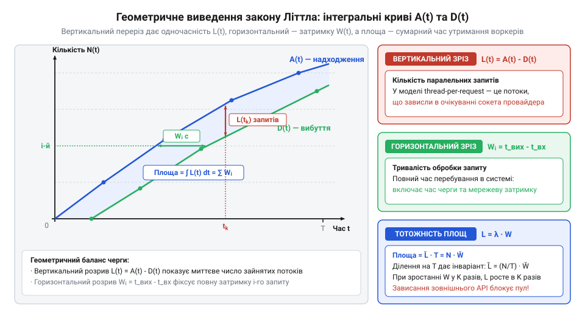
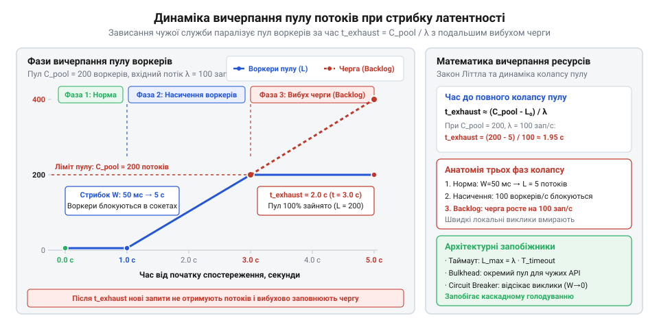
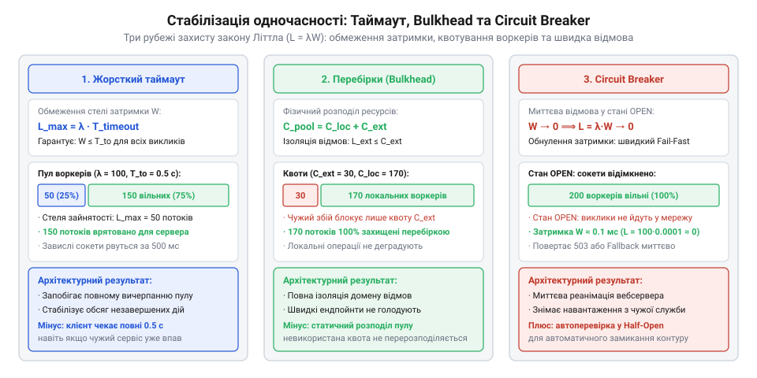

# Служба, якою ти не керуєш

<preknowlist>
- [Їхня аварія — твоя аварія](root:progarch/their-outage-is-your-outage) — розуміння того, як деградація затримки та збої зовнішніх інтеграцій безпосередньо загрожують доступності й загальному SLA власної системи
- [Квоти, ліміти й ціна виклику](root:progarch/quotas-limits-call-cost) — поняття лімітів швидкості запитів (rate limiting) та поведінка стороннього сервісу за їх перевищення зі штучним затягуванням відповідей
</preknowlist>

## Катастрофа каскадного блокування: чому чужа затримка паралізує весь сервер

Найприродніший спосіб побудувати сервер застосунків — виділити для кожного вхідного запиту окремий робочий потік із фіксованого пулу (@@en|thread-per-request@@, від англ. *thread* — нитка, потік). Поки система виконує лише власні обчислення або звертається до локальної бази даних у межах швидкої локальної мережі, кожен запит опрацьовується за лічені мілісекунди. Проте реальний продукт рідко існує у вакуумі: оформлення замовлення вимагає авторизації платежу через сторонній банківський шлюз, доставка потребує розрахунку тарифу через API кур'єрської служби, а реєстрація надсилає SMS через хмарного провайдера.

Усередині коду такий виклик зазвичай виглядає як просте звернення до клієнтської бібліотеки: обробник відкриває мережевий сокет, надсилає HTTP-запит і чекає на байти відповіді. У звичайних умовах стороння служба працює штатно, повертаючи результат за 50 мс (0.05 с). Якщо на бекенд надходить потік у 200 запитів за секунду, робочі потоки встигають швидко прийняти завдання, звернутися до партнера, віддати відповідь клієнту й негайно повернутися в пул. Система працює плавно, а процесор і пам'ять сервера залишаються майже вільними.

Катастрофа починається в мить, коли чужий сервер деградує. Причини можуть бути будь-якими: від аварії в дата-центрі партнера та вичерпання пулу його бази даних до прихованих лімітів, про які детально йдеться у темі [Квоти, ліміти й ціна виклику](root:progarch/quotas-limits-call-cost). Час відповіді зовнішнього ендпойнта стрибає від штатних 50 мс до 5 секунд, або ж TCP-з'єднання взагалі зависає без руху, бо сокет не отримав пакету `FIN` і чекає на дані за відсутності встановленого таймауту читання.

У цей момент у власному сервері вмикається жорстка фізика синхронного блокування. Потік виконання, який викликав системний виклик `recv()` або метод `socket.read()`, переводиться ядром операційної системи у стан очікування (@@en|blocked / sleeping state@@). Він не виконує корисних обчислень на процесорі, але продовжує монопольно утримувати виділений стек пам'яті (зазвичай від 1 до 2 МБ на потік в операційних системах сімейства POSIX та Windows), активні дескриптори сокетів і нерідко відкрите з'єднання з пулу реляційної бази даних, захоплене на час зовнішньої бізнес-транзакції.

А вхідний потік користувачів не зупиняється. Клієнти продовжують натискати кнопки й надсилати ті самі 200 запитів щосекунди. За першу ж секунду деградації сервера 200 нових запитів блокують 200 робочих потоків. Якщо весь пул сервера містить 200 воркерів, за одну секунду він спорожнюється повністю: вільних виконавців не залишається взагалі. Наступні вхідні запити потрапляють у системну чергу очікування сокетів (@@en|listen backlog queue@@). Щойно вичерпується місткість черги, операційна система починає скидати нові підключення пакетами `TCP RST` або обривати їх після закінчення часу очікування шлюзу з помилкою `504 Gateway Timeout`.

У цьому полягає головний парадокс інтеграції: з ладу вийшов зовнішній платіжний партнер, а перестає працювати вся власна система, що формулює принцип [Їхня аварія — твоя аварія](root:progarch/their-outage-is-your-outage). Користувач, який відкрив головну сторінку магазину, переглядає каталог товарів або завантажує статичні зображення, не потребує жодних сторонніх викликів — його запит вимагає лише 2 мс роботи локального процесора. Але сервер не може навіть прийняти з'єднання: усі воркери паралізовані очікуванням чужих сокетів. Виникає голодування потоків (@@en|thread starvation@@), за якого швидкі локальні операції гинуть разом із повільними.

Наївна спроба «залити пожежу ресурсами» — збільшити пул потоків із 200 до 2000 чи 5000 — лише прискорює загальний колапс. Виділення тисяч стеків пам'яті миттєво з'їдає гігабайти оперативної пам'яті процесу, провокуючи аварійне завершення через нестачу пам'яті (@@en|OutOfMemoryError@@). Одночасно планувальник операційної системи витрачає весь ресурс процесора на перемикання контексту (@@en|context switching thrashing@@) між тисячами заблокованих потоків замість виконання реальної корисної роботи.

> 🔧 **Навіщо це.**
> Розуміння механіки вичерпання пулу потоків змушує архітектора відмовитися від ілюзії, ніби зовнішній збій можна ізолювати простою терплячістю сервера. Щоб захистити власні ресурси від паралічу, інженер зобов'язаний спиратися на математичний розрахунок одночасності та жорстко обмежувати час очікування зовнішніх операцій.

## Закон Літтла: фундаментальна арифметика одночасності

Щоб керувати конкурентністю системи й не допускати вичерпання ресурсів, інтуїтивних здогадок недостатньо — потрібен строгий математичний інструмент, що пов'язує пропускну здатність, затримку та кількість одночасних завдань. Таким універсальним інваріантом є закон Літтла (@@en|Little's Law@@), сформульований і доведений американським математиком Джоном Літтлом (John D. C. Little) у 1961 році в праці про теорію черг.

Закон установлює співвідношення між трьома фундаментальними характеристиками будь-якої стабільної системи обробки:

1. Темп надходження `λ` (грецька літера «лямбда», @@en|arrival rate@@) — середня кількість запитів, які надходять до системи за одиницю часу (наприклад, запитів за секунду).
2. Середній час перебування `W` (від англ. *wait* або *residence time*) — повний середній час, який запит проводить у системі від моменту надходження до повного завершення обробки й вибуття.
3. Середня кількість запитів у системі `L` (від англ. *length* або *load*, concurrency) — середня кількість запитів, які одночасно перебувають усередині системи в стані обробки чи очікування (@@en|in-flight requests@@).

Математичне формулювання закону Літтла має вигляд тотожності:

```
L = λ · W                            [закон Літтла]
```

Фізичну суть цієї рівності легко відчути на побутовому прикладі. Уявіть кав'ярню, до якої в середньому заходить 120 відвідувачів за годину (`λ = 120` людей/год, або 2 людини на хвилину). Кожен клієнт проводить у закладі в середньому 15 хвилин (`W = 0.25` години). Помноживши темп надходження на час перебування, дістаємо середню кількість людей у залі в будь-який довільний момент: `L = 120 · 0.25 = 30` відвідувачів. Неможливо змінити кількість людей у залі, не змінивши або темп їхнього входу, або час, який вони там проводять.

Головна сила теореми Літтла полягає в її винятковій інваріантності. Рівність `L = λ · W` виконується без жодних припущень про природу випадкових процесів:
- Вона не вимагає пуассонівського чи показникового розподілу інтервалів між запитами.
- Вона не залежить від закону розподілу часу обслуговування (розподіл може бути детермінованим, рівномірним, логнормальним чи важкохвостим).
- Вона не залежить від внутрішньої дисципліни черги: правила обробки можуть бути «першим прийшов — першим пішов» (FIFO), «останнім прийшов — першим пішов» (LIFO), пріоритетними або з розділенням процесора (Processor Sharing).

Єдина умова чинності закону — стаціонарність і стабільність системи: темп надходження запитів за тривалий час має дорівнювати темпу їх вибуття, а сама система не повинна безмежно накопичувати роботу всередині або губити її без реєстрації.

Геометричний зміст закону Літтла розкривається через інтегральне зіставлення траєкторій накопиченого надходження `A(t)` (кількість запитів, що прийшли до моменту часу `t`) та накопиченого вибуття `D(t)` (кількість запитів, що покинули систему до моменту `t`).


*Геометричне обґрунтування закону Літтла: площа між інтегральними кривими надходження A(t) та завершення D(t) фіксує сумарний час утримання ресурсів, де середня одночасність L точно дорівнює добутку темпу λ на час перебування W.*

У кожен момент часу `t` вертикальна відстань між кривими показує миттєву кількість запитів, які зараз перебувають усередині системи: `L(t) = A(t) - D(t)`. Горизонтальна відстань між кривими для конкретного `i`-го запиту відповідає його індивідуальному часу перебування в системі `W_i`.

Сумарний час, витрачений усіма запитами всередині системи за інтервал спостереження `[0 .. T]`, геометрично дорівнює повній площі між кривими `A(t)` та `D(t)`. Цю площу можна інтегрувати двома еквівалентними способами:

```
Площа = ∫[0 .. T] L(t) dt            [інтегрування миттєвої одночасності по часу]
      = ∑[i=1 .. N] W_i              [сумування часу перебування всіх N запитів]
```

Розділивши обидві частини рівності на повний час спостереження `T`, отримуємо строге аналітичне виведення:

```
(1 / T) · ∫[0 .. T] L(t) dt
= (1 / T) · ∑[i=1 .. N] W_i          [ділення на інтервал спостереження T]
= (N / T) · (1 / N) · ∑[i=1 .. N] W_i [перегрупування множників через загальну кількість N]
= λ · W                              [підстановка середніх значень: N/T = λ, сума/N = W]
```

Ліва частина рівності за означенням є часовим середнім кількості одночасних запитів `L`. Перший множник правої частини `N / T` — це середній темп надходження `λ`, а другий множник — вибіркове середнє часу перебування `W`. Так геометрична тотожність площ перетворюється на закон Літтла `L = λ · W`.

Тепер застосуймо цей апарат до моделі сервера застосунків. У моделі з пулом потоків величина `L` є матеріальним відображенням кількості зайнятих воркерів.

Розрахуймо базову ємність для штатного режиму роботи:

```
λ = 200 зап/с
W_0 = 50 мс = 0.05 с

L_0 = λ · W_0
    = 200 · 0.05
    = 10 потоків                     [середня кількість зайнятих воркерів]
```

Для пулу розміром `C_pool = 200` потоків базова утилізація становить лише `10 / 200 = 5%`. Сервер практично вільний і має колосальний запас міцності.

Але щойно зовнішня служба деградує і час відповіді `W` зростає зі 100-кратним уповільненням до 5 секунд, закон Літтла безапеляційно вимагає відповідного масштабування одночасності:

```
λ = 200 зап/с
W_деградації = 5 с

L_потрібне = λ · W_деградації
           = 200 · 5
           = 1000 потоків            [необхідна кількість паралельних воркерів]
```

Закон Літтла доводить: щоб продовжувати обробляти потік у 200 запитів/с за затримки 5 секунд, сервер фізично зобов'язаний одночасно утримувати 1000 робочих потоків. Якщо ж фізичний ліміт пулу дорівнює лише 200 (`C_pool = 200`), умова стабільності порушується: система не здатна вивести більше ніж `C_pool / W = 200 / 5 = 40` запитів/с. Різниця між надходженням (200 зап/с) і вибуттям (40 зап/с) утворює дефіцит у 160 запитів щосекунди, які негайно переповнюють черги й руйнують систему.

> 🔧 **Навіщо це.**
> Закон Літтла встановлює залізний баланс: неможливо зменшити кількість заблокованих потоків `L` без впливу на вхідний темп `λ` або час утримання `W`. Якщо сторонній сервіс сповільнився, єдиний спосіб врятувати пул потоків від насичення — штучно примусово обмежити `W` зверху (за допомогою таймаутів) або відсікти `λ` (через вимикач навантаження чи ліміти конкурентності).

## Динаміка насичення пулу та час до повного колапсу

Закон Літтла описує систему у стаціонарній рівновазі: за фіксованого часу відповіді `W` та темпу `λ` кількість активних запитів усереднено дорівнює `L = λ · W`. Проте раптовий збій зовнішньої служби миттєво вибиває сервер зі стаціонарного стану. Робочі потоки не вичерпуються самі по собі в абстрактній нескінченності — вони заповнюються в реальному часі за конкретною динамічною траєкторією.

Розгляньмо систему безпосередньо в момент стрибка затримки. Нехай у штатному режимі сервер обробляє вхідний потік `λ = 200` запитів/с із базовою затримкою `W_0 = 50` мс (0.05 с). Середня кількість зайнятих воркерів становить:

```
L_0 = λ · W_0
    = 200 · 0.05
    = 10 потоків                     [базова кількість активних воркерів]
```

Якщо фізичний розмір пулу сервера обмежений значенням `C_pool = 200` потоків, у нормальному стані зайнято лише 10 воркерів, а 190 потоків перебувають у стані очікування нових завдань.

У момент часу `t = 0` зовнішній сервіс зазнає аварії, і тривалість виклику стрибає до `W_деградації = 3` с. Для підтримки рівноваги системі знадобилося б `L_потрібне = 200 · 3 = 600` потоків, але в наявності є лише 200. Виникає дефіцит пропускної здатності.

Опишемо динаміку накопичення заблокованих потоків `L(t)` у перехідному режимі (@@en|transient regime@@, від лат. *transitus* — перехід). Швидкість зміни кількості зайнятих воркерів визначається балансом між темпом надходження нових запитів `λ` та темпом вибуття оброблених запитів `μ(t)`:

```
dL/dt = λ - μ(t)                     [диференціальний баланс зайнятості пулу]
```

Протягом перших трьох секунд після аварії (`0 ≤ t < W_деградації`) жоден із нових запитів, що звернулися до зовнішньої служби, у принципі не може завершитися: кожен із них зобов'язаний висіти на мережевому сокеті щонайменше 3 секунди. Тобто для нового потоку трафіку темп завершення дорівнює нулю (`μ ≈ 0`). Завершуються лише ті 10 початкових запитів, які надійшли до моменту аварії.

Отже, у перші миті колапсу швидкість захоплення потоків практично точно дорівнює повній швидкості вхідного трафіку `λ`:

```
dL/dt ≈ λ                            [накопичення без відтоку]
L(t) ≈ L_0 + λ · t                   [лінійна фаза поглинання пулу]
```

Пул вичерпується повністю в момент часу `t_колапсу`, коли `L(t)` досягає фізичної місткості `C_pool`:

```
C_pool = L_0 + λ · t_колапсу
t_колапсу = (C_pool - L_0) / λ       [критичний час вичерпання пулу воркерів]
```

Підставимо параметри нашої системи:

```
t_колапсу = (200 - 10) / 200
          = 190 / 200
          = 0.95 с                   [час до повного паралічу воркерів]
```

Виснаження відбувається менш ніж за одну секунду: через 950 мілісекунд після сповільнення стороннього сервісу всі 200 потоків сервера заблоковані очікуванням відповідей від чужих сокетів. Навіть якщо врахувати, що частина запитів завершується з максимальною пропускною здатністю за деградації `μ_max = C_pool / W_деградації = 200 / 3 ≈ 66.7` зап/с, баланс `dL/dt = 200 - 66.7 = 133.3` зап/с дає час вичерпання `190 / 133.3 ≈ 1.42` секунди.


*Динаміка вичерпання пулу: після стрибка затримки зовнішнього API потік воркерів насичується за час t_exhaust < 1 с, після чого настає фаза переповнення черги очікування й лавиноподібне відкидання запитів.*

Щойно час перетинає позначку `t_колапсу`, система переходить у другу фазу катастрофи — переповнення черги очікування завдань (@@en|task queue backlog@@). Нові вхідні TCP-з'єднання більше не можуть отримати вільний потік і осідають у черзі ядра операційної системи. Якщо місткість цієї черги складає, наприклад, `B = 500` запитів, швидкість її наповнення дорівнює:

```
dQ/dt = λ - C_pool / W_деградації
      = 200 - 66.7
      = 133.3 зап/с                  [темп зростання черги завдань]
```

Черга переповнюється всього за `500 / 133.3 ≈ 3.75` секунди. Водночас час очікування в черзі `W_черги = Q / μ_max` додається до власного часу обробки, роздуваючи сумарну затримку для користувача до `7.5 + 3 = 10.5` секунд. Клієнти, не дочекавшись відповіді, обривають з'єднання за власними таймаутами та тиснуть кнопку повтору, породжуючи лавину повторних запитів і остаточно добиваючи вузол.

> 🔧 **Навіщо це.**
> Розрахунок критичного часу `t_колапсу` демонструє, що аварія розвивається за секунди, а не хвилини. Системи автоматичного масштабування хмари (Auto Scaling), яким на запуск нового інстансу потрібно від 45 до 180 секунд, фізично не встигають зреагувати на кризу вичерпання пулу: захист має спрацьовувати всередині першої секунди на рівні самого застосунку.

## Парадокс змішаного навантаження та голодування локальних потоків

У промислових застосунках сервіс ніколи не виконує лише один тип операцій. Веб-сервер одночасно обслуговує змішаний потік запитів, у якому співіснують важкі інтеграційні транзакції та легкі локальні операції. Інтуїтивно розробники часто вважають: якщо повільний зовнішній сервіс викликається лише в 10% сценаріїв, то й негативний вплив на сервер обмежиться лише цими десятьма відсотками. Математичний аналіз доводить протилежне.

Розділімо вхідний потік на два класи:

1. **Клас A (повільні зовнішні виклики):** оформлення замовлення або оплата, що звертаються до стороннього шлюзу. Їхня частка складає `p = 0.1` (10% від загального трафіку `λ = 200` зап/с), тобто `λ_A = p · λ = 20` зап/с. Час обробки через затримку зовнішнього партнера дорівнює `W_A = 5` с.
2. **Клас B (швидкі локальні виклики):** перегляд каталогу, читання кешу, пошук товарів або системна перевірка здоров'я вузла (`/health`). Їхня частка становить `1 - p = 0.9` (90% трафіку), тобто `λ_B = (1 - p) · λ = 180` зап/с. Час обробки локальним процесором складає всього `W_B = 10` мс (0.01 с).

Якщо обидва класи запитів ділять один спільний пул потоків, сумарна кількість зайнятих воркерів визначається сумою індивідуальних рівноваг закону Літтла:

```
L_сумарне = L_A + L_B
          = λ_A · W_A + λ_B · W_B    [сумарне навантаження двох класів]
```

Обчислімо навантаження, яке створює кожен клас окремо:

```
L_A = 20 · 5 = 100 потоків           [зайнятість пулу повільними платежами]
L_B = 180 · 0.01 = 1.8 потока        [зайнятість пулу швидким каталогом]

L_сумарне = 100 + 1.8 = 101.8 потока
```

Зіставимо пропорції зайнятості пулу:

```
L_A / L_B = (p · λ · W_A) / ((1 - p) · λ · W_B)
          = (p · W_A) / ((1 - p) · W_B)
          = (0.1 · 5) / (0.9 · 0.01)
          = 0.5 / 0.009
          ≈ 55.5                     [співвідношення зайнятих воркерів]
```

Виникає парадокс: виклики Класу A, що становлять лише 10% вхідного трафіку, захоплюють `100 / 101.8 ≈ 98.2%` усього пулу потоків сервера. Натомість операції каталогу, якими користуються 90% відвідувачів, займають менше 2% ресурсу.


*Парадокс змішаного трафіку: повільні зовнішні виклики (10% трафіку) через затримку 5 с поглинають 98.2% місткості пулу, залишаючи швидким локальним запитам менше 2% ресурсу та прирікаючи їх на чергу.*

Якщо затримка Класу A зросте хоча б до 10 секунд або частка оплат тимчасово підніметься до 15%, необхідна кількість потоків для Класу A складе `L_A = 30 · 10 = 300` потоків, що геть перекриє ємність усього пулу `C_pool = 200`.

У цей момент настає явище голодування потоків (@@en|thread starvation@@). Коли на сервер приходить черговий швидкий запит на перегляд товару, ймовірність знайти вільний воркер дорівнює нулю: усі 200 потоків застрягли на системних викликах читання чужих сокетів. Швидкий запит змушений чекати в черзі. Його фактичний час очікування визначається не власними 10 мс виконання, а тривалістю звільнення чужих заблокованих потоків. Система стає повністю непрацездатною для всіх категорій клієнтів.

Спроби усунути проблему простим масштабуванням пулу воркерів до кількох тисяч потоків натикаються на обмеження ядра операційної системи:

1. **Витрати пам'яті:** кожен потік операційної системи резервує фіксований стек пам'яті `StackSize` (типово від 1 до 2 МБ). Для пулу на `C_pool = 5000` потоків лише під стеки знадобиться:
   ```
   M_стеків = C_pool · StackSize
            = 5000 · 1 МБ
            = 5000 МБ ≈ 5 ГБ         [витрати пам'яті лише на структури потоків]
   ```
   Це спричиняє вичерпання пам'яті процесу та аварійне завершення з помилкою `OutOfMemoryError: unable to create native thread`.

2. **Деградація планувальника ОС:** коли кількість активних потоків перевищує кількість фізичних ядер процесора в сотні разів, час ядра витрачається на перемикання контексту (@@en|context switching@@) та інвалідацію процесорних кешів L1/L2 (@@en|TLB cache invalidation@@). Частка процесорного часу в режимі ядра (@@en|system / kernel CPU time@@) сягає 80–90%, перетворюючи систему на нерухомий затор.

> 🔧 **Навіщо це.**
> Математичний аналіз змішаного навантаження доводить фундаментальне правило: у спільному пулі ресурсів найповільніший компонент завжди паразитарно монополізує систему пропорційно своєму часу затримки `W`. Єдиний спосіб запобігти краху швидких операцій — фізично розділити пули ресурсів (перебірки) і не дозволяти повільним інтеграціям претендувати на загальну ємність сервера.

## Математичне обґрунтування меж стійкості: таймаути, перебірки та запобіжник

Катастрофа вичерпання пулу розгортається блискавично: за відсутності обмежень навіть міноритарний повільний виклик захоплює понад 98% ресурсів сервера менш ніж за секунду. Причина криється у фундаментальній тотожності Літтла: середня кількість активних запитів `L` неминуче роздувається пропорційно часу затримки `W` за незмінного вхідного потоку `λ`.

Щоб сервер не втрачав керованості, архітектура має задовольняти базову умову стійкості: у будь-який момент часу сумарна кількість активних запитів у системі не повинна перевищувати фізичну місткість пулу потоків:

```
L ≤ C_pool                           [фундаментальна умова непотоплюваності системи]
```

Оскільки виклики сторонньої служби виконуються в середовищі, яке ми не контролюємо, зовнішня затримка `W_зовн` є випадковою величиною, здатною зростати до десятків секунд або прямувати до нескінченності (`W_зовн → ∞`) при обривах зв'язку та зависанні сокетів. Якщо архітектор покладається на те, що сторонній сервіс «сам вчасно відповість», умова `L ≤ C_pool` порушується автоматично.

Керувати законом Літтла `L = λ · W` в інтеграційному контурі можна лише трьома математичними важелями:
1. Покласти штучну верхню межу на час перебування запиту `W`.
2. Квантувати простір ресурсів `C_pool`, ізолювавши стелю для окремого джерела трафіку.
3. Миттєво звести час виконання `W` до нуля в разі виявлення аномалії.

### Важіль 1: Жорсткий таймаут як обмеження стелі одночасності

Якщо не обмежувати тривалість мережевого виклику, час очікування відповіді від завішеного віддаленого вузла визначається внутрішніми таймаутами протоколу TCP ядра ОС. За замовчуванням у стеку Linux виявлення мертвого TCP-з'єднання без активного обміну даними (@@en|TCP keepalive@@) може тривати від кількох хвилин до кількох годин.

Встановлення жорсткого таймауту або дедлайну (@@en|deadline@@, від англ. *dead line* — мертва лінія) означає штучне насильницьке обмеження максимального часу перебування запиту в системі:

```
W ≤ T_timeout                        [штучне обмеження часу життя виклику]
```

Якщо кожен виклик гарантовано переривається через час `T_timeout`, то за законом Літтла максимальна кількість одночасних запитів, яку цей виклик спроможний утримати в системі в найгіршому випадку (коли всі 100% запитів упираються в граничний таймаут), жорстко обмежена зверху:

```
L_max = λ · T_timeout                [максимальна одночасність за найгіршого сценарію]
```

Щоб гарантувати виконання умови стійкості `L_max < C_pool`, граничний час очікування мусить підпорядковуватися строгому інженерному правилу:

```
λ · T_timeout < C_pool
T_timeout < C_pool / λ               [критична верхня межа таймауту]
```

Проілюструємо це розрахунком. Нехай сервіс обслуговує потік звернень до платіжного провайдера з інтенсивністю `λ = 50` запитів/с, маючи пул на `C_pool = 100` потоків. Обчислимо граничний таймаут:

```
T_timeout < 100 / 50
          < 2.0 с                    [гранично допустимий час дедлайну]
```

Якщо розробник залишить на клієнті HTTP типовий бібліотечний таймаут за замовчуванням у 30 секунд, то під час аварії зовнішнього провайдера потрібна для рівноваги ємність складе:

```
L_потрібне = λ · T_default
           = 50 · 30
           = 1500 потоків            [катастрофічний дефіцит ємності]
```

Пул у 100 потоків буде вичерпано менш ніж за 2 секунди, після чого сервер увійде в стан каскадного паралічу. Жорсткий дедлайн `T_timeout < 2` секунди повертає системі контроль над верхньою межею `L_max`.

### Важіль 2: Перебірки (Bulkhead) як фізична ізоляція квот ємності

Таймаут обмежує пікову кількість одночасних запитів, але якщо потік зовнішніх викликів ділить один пул із локальними операціями, навіть значення `L_max = 100` потоків повністю знекровлює сервер, позбавляючи легкі локальні ендпойнти жодного вільного воркера (явище голодування, розібране в попередньому розділі).

Для захисту швидких операцій застосовують патерн перебірок (@@en|bulkhead isolation@@, від англ. *bulkhead* — водонепроникна перегородка між відсіками судна). У кораблебудуванні, якщо пробито один відсік трюму, вода заповнює лише його, а решта герметичних секцій утримують корабель на плаву.

В архітектурі програмного забезпечення перебірка реалізується шляхом поділу загального пулу потоків `C_pool` на фізично незалежні пули або семафорні квоти:

```
C_pool = C_A + C_B                   [квантування місткості на ізольовані сектори]
```

де:
- `C_A` — фіксований ліміт потоків, виділений виключно для ненадійної зовнішньої служби A;
- `C_B` — зарезервована квота потоків для внутрішніх критичних операцій B (каталог, читання кешу, системні перевірки здоров'я).

Доведемо математичну стійкість ізольованого контуру:

Нехай стороння служба A зазнає катастрофічної аварії, і час її відповіді прямує до нескінченності: `W_A → ∞`. Оскільки кількість потоків у відсіку A жорстко обмежена розміром його перебірки, кількість заблокованих зовнішніх викликів не може перевищити стелю `C_A`:

```
L_A(t) ≤ C_A                         [стеля блокування в ізольованому відсіку]
```

Усі надлишкові зовнішні запити, що приходять понад ємність `C_A`, негайно відкидаються на межі відсіку. Водночас для швидких локальних операцій Класу B залишається недоторканою гарантована пропускна здатність:

```
C_B = C_pool - C_A                   [гарантований резерв воркерів для локального коду]
```

За базової потреби локального трафіку `L_B = λ_B · W_B` (наприклад, `180 · 0.01 = 1.8` потока) локальний функціонал продовжує працювати на повній швидкості без черг і затримок, незалежно від стану зовнішнього партнера. Аварія локалізована в межах виділеного відсіку.

### Важіль 3: Запобіжник (Circuit Breaker) як миттєве обнулення часу очікування

Перебірка зберігає життєздатність сервера в цілому, проте всередині самого відсіку A ресурс `C_A` залишається заблокованим протягом усього інтервалу `T_timeout`. Якщо зовнішня служба повністю недоступна, змушувати клієнтів чекати 2 секунди лише заради отримання помилки 504 Gateway Timeout — це марнування потоків і часу.

Для усунення цього дефекту застосовують патерн запобіжника (@@en|circuit breaker@@, від англ. *автоматичний вимикач електричного кола*). В електриці автомат розмикає ланцюг при короткому замиканні, рятуючи проводку від пожежі. В архітектурі систем запобіжник відстежує стан взаємодії з віддаленою службою і має три стани:

1. **Замкнений (CLOSED):** нормальний режим роботи, запити вільно йдуть до зовнішнього API.
2. **Розімкнений (OPEN):** аварійний режим. Щойно частка помилок чи таймаутів за вікно спостереження перевищує критичний поріг `θ_err` (наприклад, понад 50% збоїв за останні 10 секунд), запобіжник миттєво розмикає ланцюг.
3. **Напіврозімкнений (HALF-OPEN):** після спливу таймера остигання `T_cool` запобіжник пропускає обмежений пробний трафік `λ_test ≪ λ_A` для перевірки відновлення стороннього сервісу.

Математична сутність запобіжника полягає в механізмі швидкої відмови (@@en|fail-fast@@, від англ. *миттєвий збій без очікування*). Коли ланцюг розімкнено (`OPEN`), запити взагалі не відправляються в мережу. Клієнтська бібліотека перехоплює виклик у пам'яті процесу й повертає локальний виняток або резервне значення (@@en|fallback@@).

У результаті тривалість виконання виклику колапсує від мережевого таймауту `T_timeout` до часу виконання кількох процесорних інструкцій:

```
W_open ≈ 0                           [обнулення часу затримки в режимі fail-fast]
```

Згідно із законом Літтла, кількість утримуваних потоків у відсіку A миттєво падає:

```
L_A = λ_A · W_open
    = λ_A · 0
    = 0 потоків                      [миттєве вивільнення воркерів пулу]
```

Запобіжник ліквідує затримку біля самого джерела, повністю звільняючи потоки перебірки `C_A` для повернення до штатної роботи.


*Математичні важелі обмеження L: таймаут кладе верхню стелю на час W, перебірка (Bulkhead) ізолює ємність пулу C_A, а запобіжник (Circuit Breaker) обнуляє затримку через швидку відмову, миттєво звільняючи потоки.*

### Синтез: інженерна формула розрахунку стійкого інтеграційного контуру

Об'єднаємо розглянуті механізми в єдину інженерну методику проєктування стійких контурів. Нехай сервер взаємодіє з `N` сторонніми службами, кожна з яких характеризується власним піковим темпом надходження запитів `λ_i`, штатним часом виконання `W_{0, i}` та граничним дедлайном `T_{timeout, i}`.

Для забезпечення безумовної стабільності системи архітектура повинна задовольняти систему обмежень:

1. **Баланс загальної місткості сервера:**
   ```
   C_pool ≥ C_local + ∑ [i=1..N] C_i   [непересічний розподіл ємності пулу]
   ```
   де `C_local ≥ λ_local · W_local` — недоторкана квота швидких операцій сервісу.

2. **Місткість кожної окремої перебірки:**
   Розмір виділеного відсіку `C_i` для кожної зовнішньої інтеграції мусить гарантувати обслуговування трафіку аж до межі таймауту:
   ```
   C_i ≥ λ_i · T_{timeout, i}          [мінімальний розмір перебірки за найгіршого сценарію]
   ```

3. **Динамічне навантаження з урахуванням запобіжника:**
   Фактична зайнятість воркерів у відсіку `i` в довільний момент часу описується функцією:
   ```
   L_i(t) = λ_i · ( (1 - u_i(t)) · W_i(t) + u_i(t) · W_fail_fast )
   ```
   де `u_i(t) ∈ {0, 1}` — дискретний стан запобіжника (`u = 0` — CLOSED, `u = 1` — OPEN).

Якщо стороння служба потрапляє в аварію, як описано в темі [Їхня аварія — твоя аварія](root:progarch/their-outage-is-your-outage), або якщо провайдер затягує відповіді через перевищення квот, про що йдеться в статті [Квоти, ліміти й ціна виклику](root:progarch/quotas-limits-call-cost), цей трирівневий бар'єр діє як скоординована ешелонована оборона:
- Таймаут гарантує, що жоден виклик не зависне довше за `T_{timeout, i}`;
- Перебірка `C_i` виключає вплив аварії на інші компоненти системи й локальний трафік;
- Запобіжник `u_i(t) → 1` скидає навантаження до нуля, зберігаючи ресурси процесора та пам'яті до моменту повного одужання партнера, що є критичним для сервісів на шляху виконання бізнес-транзакцій, як у [DH: чужі служби в критичному шляху](root:progarch/dh-foreign-services-in-critical-path).

> 🔧 **Навіщо це.**
> Архітектура стійкості до зовнішніх збоїв не будується на сподіваннях чи збільшенні потужностей заліза. Вона спирається на сувору математику закону Літтла: будь-яке сповільнення `W` мусить бути обмежене таймаутом, локалізоване квотою перебірки `C_i` та обнулене запобіжником. Тільки такий трирівневий контур гарантує, що відмова чужого сервісу ніколи не перетвориться на смерть вашого власного сервера.
