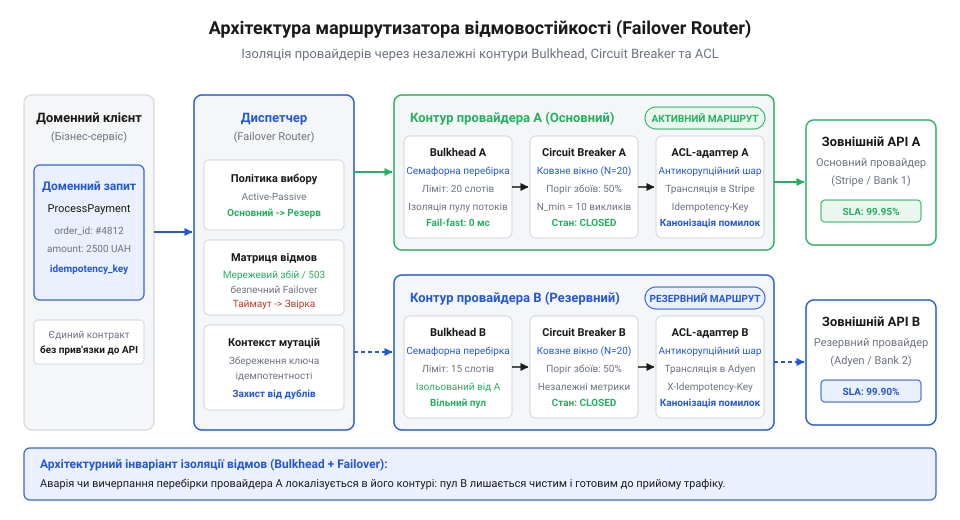
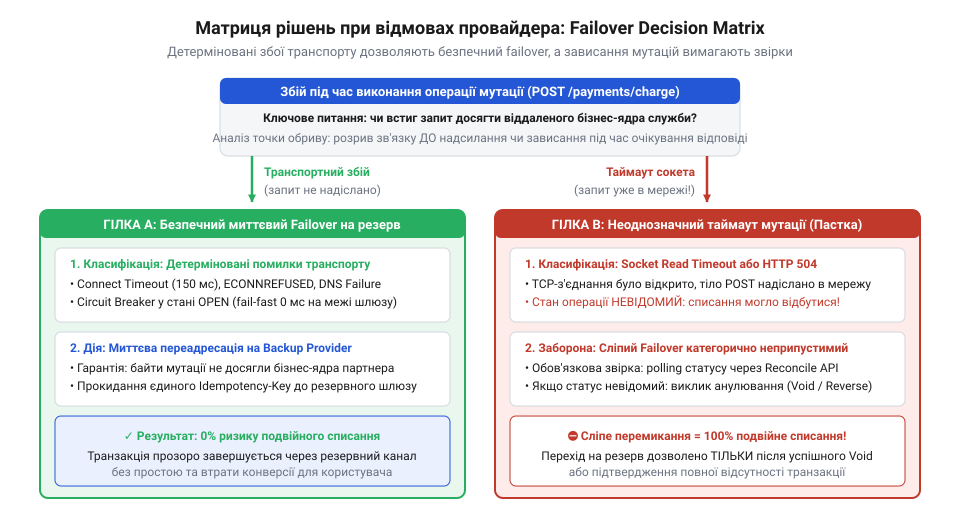
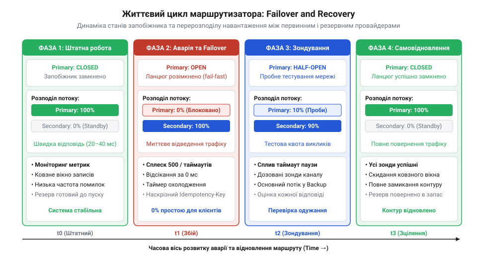

# Служба, якою ти не керуєш

<preknowlist>
- [Їхня аварія — твоя аварія](root:progarch/their-outage-is-your-outage) — механізми виникнення каскадних відмов через сповільнення або збій сторонньої системи та необхідність ізоляції ресурсів
- [Дублери чужої служби](root:progarch/service-doubles-and-environments) — техніка побудови контрольованих тестових дублерів для імітації затримок, обривів сокетів і збоїв сторонніх API
</preknowlist>

## Постановка задачі: криза монополії єдиного зовнішнього провайдера та анатомія відмови

Уявіть платіжний шлюз електронної комерції або сервіс відправки критичних одноразових паролів, який щодня надійно обробляє десятки тисяч клієнтських операцій. Протягом багатьох місяців інтеграція працює бездоганно, бізнес зростає, а розробники звикають вважати зовнішній сервіс непохитною частиною інфраструктури. Та одного дня на стороні партнера стається катастрофа: пожежа в центрі обробки даних, помилка в конфігурації глобальних BGP-маршрутів або аварія кластера баз даних. Виклики до API сторонньої служби починають безпорадно висіти десятками секунд, сокети обриваються через скидання з'єднань, а клієнти бачать системні помилки. Оскільки застосунок жорстко прив'язаний до єдиного SDK цього провайдера, оформлення замовлень повністю паралізується. Покупці покидають кошики, служба підтримки захлинається скаргами, а компанія щохвилини зазнає прямих фінансових збитків.

Ця криза розкриває суворий закон розподілених систем: [їхня аварія — твоя аварія](root:progarch/their-outage-is-your-outage). Якщо непідконтрольна стороння служба перебуває на критичному шляху обробки бізнес-транзакції ([DH: чужі служби в критичному шляху](root:progarch/dh-foreign-services-in-critical-path)), надійність вашого продукту математично не може перевищити надійність цієї зовнішньої залежності.

### Математика монополії: деградація доступності

Розглянемо систему як послідовний ланцюг двох компонентів: власного бекенд-сервісу з коефіцієнтом доступності `A_app` та зовнішнього провайдера з доступністю `A_provider`. Якщо сервіс жорстко залежить від єдиного провайдера, сумарна доступність операції `A_total` дорівнює їхньому добутку:

```
A_total
= A_app · A_provider             [формула доступності послідовної системи]
= 0.9995 · 0.9900                [підстановка параметрів SLA: 99.95% та 99.0%]
= 0.989505                       [розрахунок результуючої доступності]
≈ 98.95%                         [деградація на порядок]
```

Навіть якщо ваша внутрішня інфраструктура спроєктована за найвищими стандартами відмовостійкості (доступність 99.95% означає не більше 4.38 годин простою на рік), залежність від провайдера з доступністю 99.0% (до 3.65 днів простою на рік) миттєво зводить загальну надійність до 98.95%. Ваша команда інвестує ресурси у висококласні кластери та резервування, проте бізнес змушений миритися з кількома днями простою через чужі проблеми.

### Пастка наївного перемикання (if/else у бізнес-коді)

Першою інстинктивною реакцією інженерів є спроба поспіхом підключити резервного постачальника безпосередньо в точці виклику:

```go
// Наївна спроба реалізації резервування в бізнес-коді
resp, err := primaryClient.Charge(ctx, amount, cardToken)
if err != nil {
    // Якщо основний провайдер впав — викликаємо дублера
    resp, err = backupClient.MakePayment(ctx, amountInCents, cardToken)
}
```

Такий підхід здається простим лише на перший погляд, але в умовах високого навантаження він створює три руйнівні інженерні проблеми:

1. **Спагеті-архітектура та витік деталей реалізації:** Бізнес-логіка оформлення замовлення починає тонути в умовних конструкціях перевірки статусів двох абсолютно різних вендорів. Вона змушена знати, що перший партнер приймає дробове число гривень, а другий вимагає цілі копійки; що перший повертає код `402`, а другий — текстовий статус у тілі з HTTP-кодом `200`. При додаванні третього провайдера код перетворюється на некерований лабіринт.
2. **Параліч ресурсів через повільні збої:** Найнебезпечніший збій зовнішньої служби — це не миттєве повернення помилки, а повільне «зависання» мережевих пакетів. Якщо первинний провайдер деградував і відповідає із затримкою у 30 секунд за таймаутом сокета, кожен запит користувача заморожує потік виконання на пів хвилини. За кілька секунд весь пул потоків вашого сервісу вичерпується, черги переповнюються, і сервер перестає відповідати на будь-які запити. До виклику блоку `else` черга навіть не доходить — система гине раніше.
3. **Катастрофа подвійних операцій:** У розподілених мережах розрив з'єднання або таймаут не означає, що операція не відбулася на сервері провайдера. Якщо гроші з картки клієнта списано, але пакет із підтвердженням загубився в мережі, наївне автоматичне перемикання на резервний шлюз повторно спише ту саму суму через іншого партнера. Компанія стикається з масовими скаргами, чарджбеками та репутаційними втратами.

### Автономний шар маршрутизації (Failover Router)

Єдиним архітектурно зрілим рішенням проблеми є повне усунення монополії одного постачальника через виділення спеціалізованого автономного компонента — **відмовостійкого маршрутизатора між провайдерами** (@@en|Multi-Provider Failover Router@@; від франц. *route* — шлях, напрямок, та англ. *failover* — автоматичне перемикання при відмові).

```
[ Клієнтський бізнес-код ]
            │
            ▼ (Чистий доменний намір: ProcessPayment)
┌─────────────────────────────────────────────────────────────┐
│                 Failover Router                             │
│  ┌──────────────────┐  ┌─────────────────────────────────┐  │
│  │ Контур Primary   │  │ Контур Secondary                │  │
│  │ [Bulkhead]       │  │ [Bulkhead]                      │  │
│  │ [CircuitBreaker] │  │ [CircuitBreaker]                │  │
│  │ [ACL-адаптер]    │  │ [ACL-адаптер]                   │  │
│  └────────┬─────────┘  └────────────────┬────────────────┘  │
└───────────┼─────────────────────────────┼───────────────────┘
            ▼                             ▼
    [ Зовнішній API #1 ]          [ Зовнішній API #2 ]
```

Маршрутизатор бере на себе роль єдиного диспетчера стійкості:
- Приймає уніфікований доменний намір операції, повністю приховуючи вендорську специфіку від доменного коду застосунку.
- Ізолює кожного зовнішнього партнера в незалежний контур захисту ресурсів, запобігаючи вичерпанню потоків застосунку.
- Реалізує сувору матрицю класифікації помилок, розрізняючи безпечні транзитні збої та небезпечні зависання мутацій із ризиком дублювання.
- Керує стратегіями перемикання (Active-Passive або динамічне балансування за якістю) та автоматично відновлює основний маршрут, коли первинна служба одужує.

> 🔧 **Навіщо це.**
> Виділення маршрутизатора в окремий архітектурний шар розв'язує конфлікт відповідальностей: бізнес-код фокусується виключно на правилах предметної області, тоді як технічні ризики взаємодії з ненадійними зовнішніми партнерами інкапсулюються у спеціалізованому контурі стійкості. Це дозволяє безшовно змінювати, оновлювати або додавати зовнішніх постачальників без переписування та повторного тестування ядра системи.

## Уніфікований доменний контракт та антикорупційний шар (ACL)

Зовнішні провайдери ніколи не домовляються про спільні стандарти. Кожен вендор проєктує свій API виходячи з власної історії, мови програмування та поглядів на архітектуру.

Розглянемо типовий конфлікт протоколів на прикладі двох популярних платіжних провайдерів:
- **Провайдер A (міжнародний шлюз):** Очікує суму операції в мінімальних неподільних одиницях валюти (цілі центи, наприклад `1050` для позначення $10.50), трилітерний код валюти в нижньому регістрі (`usd`), ключ ідемпотентності в заголовку `Idempotency-Key` та повертає JSON-документ із полем `{"status": "succeeded"}` або HTTP-код `402 Payment Required`.
- **Провайдер B (локальний банківський процесинг):** Очікує суму у вигляді рядка з десятковою комою (`"10.50"`), числовий код валюти згідно зі стандартом ISO 4217 (`840`), ідентифікатор транзакції в тілі запиту під назвою `merchant_order_id`, а у разі відхилення платежу повертає статус HTTP `200 OK` із внутрішнім полем відмови `{"response_code": "05", "error_description": "Do not honor"}`.

Якщо дозволити цим різнорідним структурам даних, іменам полів та форматам помилок безпосередньо потрапити у внутрішній код застосунку, архітектура зазнає ерозії: поняття чужих систем «забруднять» доменну модель, а будь-яка зміна у контракті одного з партнерів спричинить лавиноподібні правки по всьому репозиторію ([коли вони ламають без попередження](root:progarch/when-they-break-without-warning)).

### Патерн Anti-Corruption Layer (Антикорупційний шар)

Щоб надійно захистити чистоту предметної моделі, між внутрішнім ядром застосунку та зовнішніми шлюзами зводять **антикорупційний шар** (@@en|Anti-Corruption Layer, ACL@@; від лат. *corruptio* — псування, спотворення, та англ. *layer* — шар).

Антикорупційний шар складається з трьох ключових елементів:
1. **Єдиний доменний інтерфейс:** чіткий вендор-нейтральний контракт операції, сформульований у термінах вашої предметної області.
2. **Адаптери провайдерів (Adapters):** спеціалізовані модулі, кожен із яких відповідає за зв'язок із конкретним стороннім API.
3. **Двосторонні транслятори (Translators):** компоненти всередині адаптерів, що транслюють уніфіковані доменні сутності у специфічні пакети вендора та нормалізують сирі відповіді зовнішньої служби у стандартизовані системні типи.

### Проєктування вендор-нейтрального контракту

Основою відмовостійкого маршрутизатора є строго типізований інтерфейс `Provider`, який абстрагує фізичну мережеву взаємодію з будь-яким зовнішнім сервісом.

Розглянемо структуру цього контракту мовою Go у файлі `provider.go`:

:::code proj-multi-provider-failover-router/go/provider.go

Уніфікований контракт базується на трьох принципових сутностях:

1. **Модель уніфікованого запиту (`Request`):**
   - `ID`: глобальний ідентифікатор бізнес-операції для наскрізного трасування (Distributed Tracing).
   - `Method` та `Endpoint`: логічна дія та адреса ресурсу.
   - `Payload`: корисне навантаження операції, сформоване у нейтральному форматі.
   - `IdempotencyKey`: детерміністичний токен операції (@@en|idempotency@@; від лат. *idem* — той самий, та *potens* — могутній, здатний). Він гарантує, що якщо провайдер отримає один і той самий запит двічі через збій мережі, він виконає списання коштів лише один раз.
   - `IsIdempotent`: критичний прапорець, який сповіщає маршрутизатор, чи безпечно повторювати цю операцію при збоях без ризику мутацій (наприклад, читання профілю завжди безпечне, а списання без ключа ідемпотентності — небезпечне).

2. **Модель стандартизованої відповіді (`Response`):**
   - `StatusCode`: нормалізований HTTP-статус. Навіть якщо провайдер повернув код 200 із помилкою всередині тіла, адаптер зобов'язаний розпізнати відмову і записати відповідний код деградації (наприклад, 400 чи 502).
   - `Body`: сирі або попередньо розпарсені байти відповіді.
   - `Duration`: точний час обробки виклику від моменту надсилання першого байта до отримання останнього байта відповіді. Ця метрика необхідна для роботи запобіжника (Circuit Breaker), який виявляє повільні виклики.
   - `ProviderID`: рядок із назвою фактичного провайдера, що успішно виконав запит. Це гарантує повну прозорість аудиту: бізнес завжди знає, через чий термінал пройшов кожен платіж.

3. **Інтерфейс взаємодії (`Provider`):**
   - Метод `ID()`: повертає унікальний ідентифікатор служби (наприклад, `"primary-stripe"` чи `"backup-adyen"`).
   - Метод `Execute(ctx, req)`: виконує виклик з обов'язковою підтримкою дедлайну через `context.Context`. Якщо виділений часовий бюджет вичерпано, контекст перериває мережеве з'єднання, вивільняючи системні дескриптори.

### Механіка двосторонньої нормалізації в адаптері

Кожен конкретний адаптер провайдера реалізує інтерфейс `Provider` та інкапсулює повний цикл перетворення даних:

```
                  ┌──────────────────────────────────────────────┐
                  │             PrimaryProviderAdapter           │
                  │                                              │
Доменний запит   ──► [ Транслятор Inbound ]                     │
Request           │   - Конвертація суми в центи                 │
                  │   - Встановлення Idempotency-Key             │
                  │   - Формування вендорського JSON             │
                  │                   │                          │
                  │                   ▼                          │
                  │   [ HTTP Клієнт з таймаутом сокета ]         │
                  │                   │                          │
                  │                   ▼                          │
                  │   [ Транслятор Outbound ]                    │
                  │   - Перевірка вендорських кодів помилок      │
                  │   - Нормалізація статусів у системні коди    │
                  │   - Розрахунок часу виконання Duration       │
                  │                   │                          │
                  └───────────────────┼──────────────────────────┘
                                      ▼
                        Уніфікована відповідь Response
```

Транслятор на вході позбавляє зовнішній сервіс можливості нав'язати свою форму даних внутрішнім структурам. Якщо віддалений провайдер вирішить змінити найменування поля `user_id` на `customer_reference`, зміни торкнуться виключно відповідного файлу адаптера — жоден інший компонент застосунку про це навіть не дізнається.

Транслятор на виході нормалізує специфічні помилки провайдера: наприклад, мережевий збій DNS, помилка відхилення платежу емітентом картки або відмова шлюзу через перевантаження (HTTP 503) транслюються у строгу ієрархію системних помилок. Саме ця нормалізація дозволить класифікатору помилок у наступних розділах ухвалювати математично безпомилкові рішення щодо можливості безпечного перемикання на резервний канал.

> 🔧 **Навіщо це.**
> Антикорупційний шар ліквідує пряму зв'язність між бізнес-вимогами застосунку та протоколами сторонніх компаній. Він гарантує, що система зберігає контроль над власною архітектурою: ви володієте своїм доменним контрактом, а адаптери виконують «брудну роботу» з перекладу, захищаючи ваш код від чужого хаосу.

## Захист обчислювальних ресурсів: персональні перебірки (Bulkhead) та запобіжники (Circuit Breaker)

Наявність резервного постачальника створює оманливе відчуття повної захищеності: розробникам здається, що в разі збою первинного шлюзу достатньо просто перехопити помилку й викликати альтернативний API. Проте в реальних розподілених системах найнебезпечніший збій — це не миттєва відмова з кодом помилки, а деградація затримки (@@en|latency degradation@@). Якщо основний провайдер починає відповідати із затримкою у 20–30 секунд через внутрішні черги чи перевантаження бази даних, система опиняється у пастці закону Літтла (@@en|Little's Law@@):

`L = λ · W`

Коли час перебування запиту в системі `W` зростає в сотні разів при незмінному вхідному потоці `λ`, необхідна кількість одночасно оброблюваних запитів `L` пропорційно вибухає. Якщо виклики до обох провайдерів використовують спільний пул горутин чи системних потоків, повільний первинний провайдер монополізує всі ресурси за лічені секунди. До моменту, коли перший запит нарешті відвалиться за таймаутом, у сервера вже не залишиться вільних потоків, каналів чи дескрипторів сокетів для здійснення виклику до резервного партнера. Спільне ресурсне середовище перетворює локальну проблему одного постачальника на загальний параліч усієї системи: [їхня аварія — твоя аварія](root:progarch/their-outage-is-your-outage).

### Семафорна перебірка (Bulkhead) для кожного апстріму

Щоб деградація одного зовнішнього каналу не могла втопити весь корабель, кожен провайдер має бути фізично ізольований у власну незалежну комірку ресурсів. Цей архітектурний патерн запозичено з морського суднобудування: перебірка (@@en|bulkhead@@; від нідерл. *balk* — колода, брус, та давньосканд. *hefi* — розділення) являє собою герметичну водонепроникну перегородку всередині корпусу судна. Якщо корпус зазнає пробоїни й вода затоплює один відсік, сусідні відсіки залишаються сухими, зберігаючи плавучість усього судна.

В архітектурі програмного забезпечення перебірки реалізують двома шляхами:
1. **Ізоляція пулом потоків (@@en|Thread Pool Bulkhead@@):** виділення персонального пулу воркерів під кожного клієнта. Це створює надійну ізоляцію пам'яті стека, але несе накладні витрати на перемикання контексту операційної системи.
2. **Семафорна ізоляція (@@en|Semaphore Bulkhead@@):** використання атомарного лічильника паралелізму без виділення окремих потоків. Це надзвичайно ефективно в асинхронних рушіях і мові Go, де операції виконуються в легковагих горутинах поверх пулу `M:N` планувальника ядра.


*Архітектурна ізоляція: вхідний диспетчер розподіляє запити між автономними контурами провайдерів, де кожен апстрім має власну семафорну перебірку та персональний запобіжник.*

У нашому маршрутизаторі семафорна перебірка реалізована за допомогою буферизованих каналів Go у файлі `bulkhead.go`. Канал `semaphore` обмежує кількість одночасних активних операцій, а канал `queueSem` формує суворо лімітовану чергу очікування:

:::code proj-multi-provider-failover-router/go/bulkhead.go 15-30

Алгоритм проходження запиту крізь перебірку реалізує триступеневий захист із детермінованим швидким відсіканням (@@en|fail-fast@@):

:::code proj-multi-provider-failover-router/go/bulkhead.go 41-76

Механіка методу `Execute` працює без блокування системних ресурсів:
1. Запит спершу намагається миттєво захопити слот у каналі `b.semaphore`. Якщо ліміт `MaxConcurrent` не вичерпано, операція стартує негайно.
2. Якщо всі робочі слоти зайняті, запит намагається стати в чергу очікування `b.queueSem`. Якщо черга досягла межі `MaxQueueSize`, перебірка не чекає — вона викидає `ErrBulkheadFull` за нуль мілісекунд. Це рятує пам'ять від накопичення черг, які однаково згорять за таймаутом.
3. Якщо запит потрапив у чергу, таймер `QueueTimeout` обмежує час очікування. Щойно вільний слот не з'являється вчасно, очікування припиняється з поверненням помилки.

### Персональний запобіжник (Circuit Breaker) з ковзним вікном

Семафорна перебірка обмежує паралелізм, але вона не зупиняє приречені виклики: якщо провайдер повністю відмовив, система продовжуватиме штурмувати його сокети аж до вичерпання слотів. Щоб припинити надсилання викликів до несправного вузла, перед перебіркою встановлюється **вимикач навантаження** (@@en|Circuit Breaker@@; запобіжник — від нім. *Sicherung*, захист від електричного перевантаження).

Критичне архітектурне правило маршрутизації: **кожен провайдер зобов'язаний мати свій персональний екземпляр Circuit Breaker**. Якщо застосувати спільний запобіжник до всього маршрутизатора, падіння основного постачальника призведе до розмикання контуру всієї системи, заблокувавши трафік і до абсолютно здорового резервного партнера.

Скінченний автомат запобіжника функціонує у трьох станах:
- `CLOSED` (замкнений): штатний стан, запити проходять без перешкод, статистика записується в ковзне вікно.
- `OPEN` (розімкнений): поріг відмов перевищено; запити до цього провайдера негайно відхиляються помилкою `ErrCircuitOpen` за 0 мс без виходу в мережу. Це вивільняє диспетчер для миттєвого перемикання на резервного провайдера.
- `HALF_OPEN` (напіввідкритий): після періоду охолодження `OpenTimeout` контур пропускає обмежену квоту пробних запитів (@@en|probes@@) для зондування стану здоров'я провайдера.

У файлі `circuit_breaker.go` параметри автомата та ковзне вікно на базі кільцевого буфера сконфігуровані таким чином:

:::code proj-multi-provider-failover-router/go/circuit_breaker.go 38-46

Кільцевий буфер `SlidingWindow` усуває проблему розмивання статистики в часі. Старі результати автоматично витісняються новими викликами зі складністю за часом `O(1)`. Для захисту від хибних спрацьовувань задіяно закон великих чисел:

:::code proj-multi-provider-failover-router/go/circuit_breaker.go 86-94

Якщо в системі накопичилося менше половини вікна спостережень (`w.size / 2`), розрахунок відсотка відмов блокується. Це унеможливлює ситуацію, коли один випадковий розрив з'єднання вночі при мізерному трафіку помилково спричинить розмикання ланцюга. Крім того, запобіжник відстежує не лише жорсткі помилки, а й повільні виклики (`SlowCallDuration`): запит, що триває довше планового бюджету, прирівнюється до збою, запобігаючи невидимій деградації сервісу.

> 🔧 **Навіщо це.**
> Поєднання персональної семафорної перебірки та індивідуального запобіжника створює ізольовану зону ураження навколо кожного постачальника. Якщо первинний партнер сповільнюється або зазнає аварії, його контур розмикається за лічені мілісекунди, відсікаючи марні мережеві виклики. Диспетчер дізнається про непрацездатність провайдера миттєво (fail-fast за 0 мс) і негайно спрямовує чисті запити на резервний шлюз, не втрачаючи жодної секунди користувацького часу.

---

## Головна пастка: таймаути завислих з'єднань і збереження ідемпотентності при перемиканні

У розподілених системах існує фундаментальна асиметрія: читати чужі дані безпечно, але змінювати їх — смертельно небезпечно без дотримання суворих математичних інваріантів. Найбільш критична помилка інженера при створенні відмовостійкого маршрутизатора полягає у наївному припущенні: «Будь-яка помилка від основного постачальника означає, що запит треба негайно повторити через резервного».

Ця ілюзія розбивається об [трифазну невизначеність мережевого таймауту](root:sf-distributed/distributed-fallacies) (@@en|Three-State Network Ambiguity@@). Коли клієнтський HTTP-запит до платіжного або SMS-шлюзу обривається за таймаутом сокета чи дедлайном контексту (`context.DeadlineExceeded`), клієнт перебуває в стані повної невизначеності:

```
                          [ Клієнтський шлюз ]
                                   │
               1. Запит у дорозі   │   3. Відповідь у дорозі
                      ──────►      │      ◄──────
                                   ▼
                        [ Зовнішній партнер ]
                                   │
                        2. Виконання мутації
                        (Списання грошей з рахунку)
```

Можливі три абсолютно різні фізичні сценарії:
1. **Запит не дійшов до сервера:** обрив зв'язку стався на локальному маршрутизаторі або каналі провайдера до того, як сторонній сервер прийняв байти. Операція гарантовано не відбулася.
2. **Запит завис під час виконання:** пакет дійшов, сторонній сервер поставив його в чергу обробки, але не встиг завершити транзакцію до спливу таймауту клієнта.
3. **Запит успішно виконано, але відповідь втрачено:** сторонній сервер успішно списав кошти з картки клієнта, сформував підтвердження, але при зворотному надсиланні пакетів мережевий сокет розірвався, або клієнтський дедлайн закінчився на частку мілісекунди раніше.

Якщо в третьому сценарії маршрутизатор сліпо перенаправить виклик на резервного провайдера, клієнт заплатить двічі (катастрофа @@en|double charge@@). Підприємство зіткнеться з арбітражними штрафами міжнародних платіжних систем, блокуванням мерчант-акаунтів і втратою довіри користувачів.

### Пастка міжпровайдерної ідемпотентності

Для боротьби з повторними списаннями в межах одного провайдера використовують механізм ідемпотентності (@@en|idempotency@@; від лат. *idem* — той самий, та *potens* — могутній, здатний). Клієнт генерує унікальний детерміністичний токен `IdempotencyKey` і передає його в заголовках. Якщо провайдер бачить той самий ключ повторно, він не виконує мутацію ще раз, а просто повертає збережену попередню відповідь.

Проте тут ховається головна інженерна пастка: **міжпровайдерної ідемпотентності не існує в природі**. Провайдер B нічого не знає про базу транзакцій і ключі ідемпотентності провайдера A. Якщо ви передасте замовлення спочатку в Stripe, операція зависне за таймаутом на фазі підтвердження, а ви надішлете той самий запит у локальний банківський процесинг — банківський процесинг спише гроші вдруге, тому що для нього це абсолютно нова унікальна операція.


*Матриця рішень: детерміновані транспортні збої дозволяють негайне перемикання, тоді як таймаут мутуючої операції блокує сліпий failover задля збереження ідемпотентності.*

### Матриця рішень класифікатора помилок (ErrorClassifier)

Щоб унеможливити подвійні операції, архітектура маршрутизатора вводить строгий компонент — класифікатор помилок (`ErrorClassifier`), що реалізує детерміновану матрицю рішень. Класифікатор аналізує тип помилки, семантику операції та наявність ключів захисту, повертаючи одну з трьох політик поведінки:

:::code proj-multi-provider-failover-router/go/classifier.go 10-29

Реалізація логіки класифікації у файлі `classifier.go` чітко розмежовує безпечні помилки від потенційно небезпечних станів:

:::code proj-multi-provider-failover-router/go/classifier.go 39-98

Матриця класифікатора базується на чотирьох аксіомах надійності:

1. **Внутрішні помилки ізоляції безпечні для резервування:** Якщо виклик було відхилено власною перебіркою (`ErrBulkheadFull`) або розімкненим запобіжником (`ErrCircuitOpen`), запит гарантовано не покидав меж нашого процесу і не потрапляв у мережу. Перемикання на резервного провайдера є абсолютно безпечним (`RetryRequiresFallback`).
2. **Детерміновані клієнтські збої (4xx) повторювати заборонено:** Помилки валідації, авторизації чи відхилення платежу банком-емітентом через нестачу коштів (400, 401, 402, 422) будуть ідентично відхилені будь-яким іншим провайдером. Спроба повторити такий запит лише спалить квоту викликів ([квоти, ліміти й ціна виклику](root:progarch/quotas-limits-call-cost)). Політика — `RetryDeny`.
3. **Ідемпотентні операції читання (GET) завжди безпечні:** Запити на отримання балансу, перевірку статусу чи читання курсу валют (`req.IsIdempotent == true`) не здійснюють мутацій на боці сервера і допускають безпечний failover (`RetrySafe`).
4. **Зависання неідемпотентної мутації категорично блокує failover:** Якщо під час виконання мутуючої операції стався мережевий таймаут сокета (`netErr.Timeout()`), а бізнес-операція не має надійного двостороннього механізму звірки — класифікатор повертає `RetryDeny`. Автоматичне перемикання на дублера блокується.

### Інтеграція класифікатора в диспетчер маршрутизації

Диспетчер маршрутизатора (`Dispatcher`) у файлі `dispatcher.go` використовує вердикт класифікатора для прийняття остаточного рішення про долю транзакції:

:::code proj-multi-provider-failover-router/go/dispatcher.go 50-70

Коли основний провайдер зазнає таймауту на операції списання коштів без підтвердженої ідемпотентності, диспетчер перевіряє умову `policy == RetryDeny` і повертає помилку вищому шару:

```text
dispatcher: первинний збій, перемикання заборонено через ризик дублювання: context deadline exceeded
```

У цей момент система не ризикує грошима клієнта. Замість сліпого перезапуску операція переводиться в спеціальний стан очікування звірки (`PENDING_INQUIRY`). Розв'язання долі платежу покладається на безпечні стратегії компенсації:
- **[Запит статусу](root:sf-distributed/reconciliation) (Status Inquiry):** фоновий воркер через інтервал часу запитує API провайдера A про стан транзакції за її унікальним внутрішнім `ID`.
- **Асинхронні повідомлення (Webhooks):** сервіс очікує вхідного підтвердження про завершення або відхилення операції від первинного партнера згідно з правилами [споживацького контракту з чужим провайдером](root:progarch/consumer-driven-contracts).
- **Ідемпотентне анулювання (Void / Reverse):** якщо таймаут стався, система надсилає команду скасування транзакції в провайдер A, і лише після отримання гарантованого підтвердження скасування відкриває можливість виконання платежу через провайдера B.

Реальність зовнішніх інтеграцій завжди складніша за оптимістичні описи в посібниках постачальників: [документація проти дійсності](root:progarch/docs-vs-reality). Тільки закладання в код найгіршого сценарію трифазної невизначеності мережі гарантує збереження фінансових інваріантів системи.

> 🔧 **Навіщо це.**
> Матриця класифікації відмов знімає з диспетчера сліпий фаталізм перемикання. Вона гарантує, що прагнення забезпечити 100% доступність не порушить бізнес-інваріанти цілісності даних. Краще повідомити користувачеві про затримку обробки транзакції для уточнення статусу, ніж двічі списати з його рахунку кошти через наївний failover на резервний шлюз.

## Двигун маршрутизації: стратегії Active-Passive, динамічна вага та автоматичне самозцілення

Наявність автономних захисних механізмів — семафорних перебірок, ковзних запобіжників та матриці класифікації помилок — формує фундамент надійності, але сама по собі ще не створює стійкої системи. Якщо ці компоненти залишаються розрізненими бібліотеками, бізнес-код знову вимушений вручну перевіряти стан контурів, організовувати повторні виклики та писати розгалуження для резервних шлюзів. Справжня стійкість вимагає об'єднання всіх рубежів захисту в автономний диспетчер (@@en|dispatcher@@; від лат. *dispeccare* — розділяти, спрямовувати на різні шляхи), або відмовостійкий маршрутизатор (@@en|failover router@@).

Завдання двигуна маршрутизації — діяти як невидимий інтелектуальний посередник між клієнтським кодом і зовнішніми сервісами. Він приймає уніфікований доменний запит, самостійно оцінює стан здоров'я провайдерів, виконує безпечні повторні спроби за алгоритмом експоненційного згладжування з дрижанням затримки (@@en|jitter@@; від давньоангл. *gitrian* — тремтіти), здійснює миттєве перемикання на резервного партнера в разі аварії первинного і — що найважливіше — без людського втручання забезпечує автоматичне повернення трафіку на основний канал після його стабілізації (@@en|self-healing@@).

### Композиція захисних шарів: ProtectedProvider та Dispatcher

Щоб керування кількома зовнішніми партнерами було однорідним, кожен зовнішній постачальник об'єднується зі своїми персональними рубежами захисту в єдину структурну одиницю — `ProtectedProvider`. 

Порядок вкладення компонентів у цій структурі критично важливий для збереження ресурсів пам'яті та процесора:

```
Запит від Dispatcher
        │
        ▼
┌─────────────────────────────────────────────────────────┐
│                   ProtectedProvider                     │
│                                                         │
│   ┌─────────────────────────────────────────────────┐   │
│   │ 1. Bulkhead (семафор паралелізму + черга)       │   │
│   │    Захищає системні потоки та пам'ять           │   │
│   │                                                 │   │
│   │   ┌─────────────────────────────────────────┐   │   │
│   │   │ 2. Circuit Breaker (ковзне вікно)       │   │   │
│   │   │    Відсікає виклики до мертвого вузла   │   │   │
│   │   │                                         │   │   │
│   │   │   ┌─────────────────────────────────┐   │   │   │
│   │   │   │ 3. Provider (мережевий адаптер) │   │   │   │
│   │   │   │    Виконує прямий виклик по сокету│ │   │   │
│   │   │   └─────────────────────────────────┘   │   │   │
│   │   └─────────────────────────────────────────┘   │   │
│   └─────────────────────────────────────────────────┘   │
└─────────────────────────────────────────────────────────┘
```

Першою стоїть семафорна перебірка (`Bulkhead`). Вона контролює ліміт одночасних операцій і не дозволяє запитам накопичуватися в нескінченних системних чергах. Якщо перебірка пропустила запит у робочий слот, управління переходить до запобіжника (`Circuit Breaker`). Якщо контур провайдера розімкнено (`OPEN`), виклик негайно завершується помилкою `ErrCircuitOpen` за 0 мілісекунд, не торкаючись мережевого сокета. Слот перебірки миттєво звільняється для інших операцій, а диспетчер дістає можливість перенаправити запит на дублера.

У файлі `dispatcher.go` моделі захищеного постачальника та диспетчера оголошені так:

:::code proj-multi-provider-failover-router/go/dispatcher.go 16-30

Конструктор `NewDispatcher` приймає сконфігуровані структури первинного та вторинного провайдерів, класифікатор помилок, ліміт повторних спроб `maxRetries` та базову затримку експоненційного очікування `baseDelay`:

:::code proj-multi-provider-failover-router/go/dispatcher.go 33-47

### Захищений цикл виконання: повтори та алгоритм Full Jitter

Найбільша загроза при тимчасових мережевих збоях — виникнення шторму повторних запитів (@@en|retry storm@@). Якщо сотні одночасних запитів зазнають невдачі в один момент часу і синхронно спробують повторити виклик через фіксований проміжок (наприклад, рівно через 1 секунду), вони обрушать на провайдера синхронізовану ударну хвилю навантаження (@@en|thundering herd problem@@). Такий штурм остаточно добиває хворий сервіс і не дає йому піднятися.

Для запобігання цьому явищу метод `executeWithResilience` поєднує експоненційний бекоф із алгоритмом **повного випадкового дрижання** (@@en|Full Jitter@@):

:::code proj-multi-provider-failover-router/go/dispatcher.go 72-109

Логіка циклу працює за суворим регламентом:
1. На кожній ітерації, починаючи з першого повтору (`attempt > 0`), вираховується інтервал затримки за допомогою методу `computeFullJitter`.
2. Запит спрямовується крізь ланцюг «Перебірка → Запобіжник → Провайдер».
3. Якщо операція повернула помилку, викликається `classifier.Classify(req, resp, err)`. Якщо класифікатор визнає повтор небезпечним (`RetryDeny` через неідемпотентний таймаут чи клієнтську помилку 4xx) або сигналізує про необхідність негайного перемикання (`RetryRequiresFallback`), цикл повторів до поточного провайдера негайно обривається.

Метод обчислення випадкової паузи реалізує математичний розподіл Full Jitter:

:::code proj-multi-provider-failover-router/go/dispatcher.go 111-119

Математично алгоритм розраховує верхню межу експоненційного вікна `T_max` для кожної спроби `i` та обирає рівномірно розподілену випадкову величину в діапазоні від 0 до `T_max`:

```
T_max[i]
= T_base · 2^(i - 1)                 [експоненційне подвоєння максимального вікна]

T_wait
= rand(0, T_max[i])                  [випадковий вибір часу очікування за схемою Full Jitter]
```

**Розрахунок інтервалів очікування при базовій затримці `T_base = 20 мс`:**

```
T_max[1]
= 20 мс · 2⁰                         [перша повторна спроба: i = 1]
= 20 мс · 1
= 20 мс                              [діапазон вибору: від 0 до 20 мс]

T_max[2]
= 20 мс · 2¹                         [друга повторна спроба: i = 2]
= 20 мс · 2
= 40 мс                              [діапазон вибору: від 0 до 40 мс]
```

Оскільки кожна горутина обирає власне випадкове значення в інтервалі `[0, T_max]`, колишній синхронний пік трафіку «розмазується» по всій часовій шкалі. Провайдер отримує плавний і розріджений потік звернень замість руйнівних ударних хвиль.

### Стратегії вибору маршруту: Active-Passive проти динамічного зважування

Диспетчер маршрутизації може розподіляти потоки викликів між постачальниками за двома фундаментальними стратегіями:

#### 1. Пріоритетна схема Active-Passive (Primary-Fallback)
У схемі **Active-Passive** (від лат. *activus* — дієвий, та *passivus* — сприйнятливий, пасивний) 100% штатного трафіку спрямовується виключно на основного провайдера (`Primary`). Резервний канал (`Secondary`) перебуває в стані очікування і залучається лише тоді, коли первинний контур відмовляє.

Саме ця схема закладена в основу нашого диспетчера:

:::code proj-multi-provider-failover-router/go/dispatcher.go 50-70

Ця стратегія є беззаперечним стандартом для фінансових транзакцій і платіжних систем:
- **Комерційні тарифи та комісії:** бізнес зазвичай має ексклюзивні знижки за обсяг транзакцій на основному шлюзі. Розпорошення платежів між кількома еквайрами призводить до втрати пільгових тарифів і подорожчання кожного виклику ([квоти, ліміти й ціна виклику](root:progarch/quotas-limits-call-cost)).
- **Простота аудиту та звірки:** коли всі транзакції за день проходять через одного партнера, бухгалтерія та процеси реконсиляції мають єдине джерело правди.
- **Локалізація токенів карток:** клієнтські платіжні токени часто прив'язані до конкретного платіжного шлюзу і не можуть бути безпосередньо передані сторонньому конкуренту.

#### 2. Динамічна маршрутизація на базі метрик якості (Dynamic Quality Score)
У високонавантажених сервісах передачі даних, відправки повідомлень чи географічно розподілених CDN часто застосовують динамічний балансир (@@en|latency and error-rate routing@@). Обидва канали вважаються активними (Active-Active), а частка трафіку між ними розраховується на основі штрафного індексу якості `Score`:

```
Score_provider
= w_latency · (L_p99 / L_target) + w_error · (E_rate / E_target)    [лінійна зважена оцінка деградації каналу]
```

де:
- `L_p99` — латентність 99-го перцентиля за останнє ковзне вікно,
- `E_rate` — поточна частка помилок у вікні спостережень,
- `w_latency` та `w_error` — вагові коефіцієнти значущості параметрів (`w_latency + w_error = 1`).

Якщо основний канал має `Score = 0.2`, а резервний `Score = 0.8`, роутер пропорційно розподіляє запити (наприклад, 80% на 20%). Коли в основного провайдера зростають затримки або виникають втрати пакетів, його `Score` стрімко зростає, і диспетчер автоматично зливає потік на більш стабільного партнера.

Проте за динамічну гнучкість доводиться платити високу ціну: системі необхідно паралельно утримувати відкриті пули з'єднань до всіх постачальників, постійно генерувати фоновий трафік для актуалізації метрик і розв'язувати складні колізії ідемпотентності на обох сторонах. Тому для критичних мутуючих операцій детермінована модель Active-Passive залишається найнадійнішим вибором.

### Механізм автоматичного самозцілення: зондування Half-Open

Найскладніший момент у життєвому циклі відмовостійкого маршрутизатора настає тоді, коли аварійний основний провайдер починає оживати.

Типова помилка інженерів-початківців — наївне миттєве повернення всього робочого навантаження на первинний шлюз, щойно один тестовий запит пройшов успішно. Якщо віддалений сервіс щойно пережив перезапуск або холодний старт після пожежі в базі даних, миттєвий шквал із тисяч запитів, накопичених за час аварії, вдруге покладе його на лопатки за лічені частки секунди.

Щоб запобігти повторній катастрофі, відновлення здійснюється у три контрольовані фази:


*Життєвий цикл аварійного перемикання: перехід із замкненого стану у відкритий при деградації основного шлюзу, переведення трафіку на резерв, тестове зондування у стані Half-Open та плавне повернення на первинний маршрут після стабілізації.*

Як показано на діаграмі, життєвий цикл самозцілення складається з чітких хронологічних етапів:

1. **Нормальний стан (`CLOSED`):** первинний провайдер обробляє запити в межах допустимих затримок. Запобіжник замкнений, резервний канал не навантажується.
2. **Деградація та розмикання (`OPEN`):** провайдер починає повертати помилки (наприклад, 503) або перевищує ліміт повільних викликів `SlowCallDuration`. Щойно частка збоїв у ковзному буфері досягає порогу `FailureThreshold` (наприклад, 50%), запобіжник спрацьовує і переходить у стан `OPEN`. Поточний час фіксується в полі `openedAt`.
3. **Миттєвий Failover:** усі нові виклики до первинного контуру відсікаються запобіжником за 0 мс. Диспетчер, бачачи відмову контуру, моментально спрямовує чисті запити на вторинного провайдера (`Secondary`). Бізнес продовжує працювати без втрати жодного замовлення.
4. **Період охолодження та перехід у `HALF_OPEN`:** протягом часу `OpenTimeout` (наприклад, 200 мс у тестах або 30 секунд у продакшені) первинного провайдера залишають у повному спокої. Коли таймер спливає, перший наступний запит атомарно перемикає стан на `HALF_OPEN`:

:::code proj-multi-provider-failover-router/go/circuit_breaker.go 127-145

5. **Тестове зондування (@@en|probing@@; від лат. *probare* — випробовувати, перевіряти):** у стані `HALF_OPEN` контур відкриває вузький шлюз лише для строго лімітованої квоти пробних запитів `HalfOpenProbeCount` (у нашій реалізації — 3 запити):

:::code proj-multi-provider-failover-router/go/circuit_breaker.go 155-168

Усі інші паралельні виклики понад квоту probe-запитів продовжують негайно отримувати `ErrCircuitOpen` і перенаправлятися диспетчером на резервний шлюз. Таким чином, основний провайдер тестується мінімально можливим струмом навантаження.

6. **Остаточний вердикт та скидання стану:**
Результати проходження тестових зондів обробляються методом `recordHalfOpenResult`:

:::code proj-multi-provider-failover-router/go/circuit_breaker.go 192-208

Тут діє строге асиметричне правило:
- **Будь-який одиничний збій тестового зонда** (помилка або перевищення `SlowCallDuration`) доводить, що провайдер ще не готовий до навантаження. Контур миттєво відкидається назад у стан `OPEN`, а таймер охолодження запускається з нуля.
- **Повернення в стан `CLOSED` відбувається лише за умови 100% успіху всіх призначених зондів.** Лічильник `halfOpenSuccess` мусить досягти значення `HalfOpenProbeCount`. Лише тоді статистика ковзного вікна скидається (`cb.window.Reset()`), контур замикається, і диспетчер плавно та безшовно відновлює спрямування 100% основного трафіку на первинний шлюз.

### Математична фільтрація флуктуацій: випробування Бернуллі

Чому для повернення контуру в робочий стан обов'язково вимагати успіху кількох зондів поспіль, а не задовольнятися одним успішним запитом?

Розглянемо провайдера, який перебуває в нестабільному, [миготливому стані](root:sf-distributed/circuit-breaker-pattern) (@@en|flapping service@@): він успішно відповідає лише на частку запитів `p = 0.30`, а у 70% випадків зазнає збою. Якщо критерієм відновлення обрати один єдиний пробний запит (`k = 1`), система передчасно відкриє шлюз із ймовірністю 30%, що призведе до повторного зриву робочого потоку.

Якщо ж система вимагає успішного проходження серії з `k = 3` незалежних пробних запитів, за схемою випробувань Бернуллі ймовірність помилкового відкриття контуру стрімко падає:

```
P_false_recovery
= p^k                                [ймовірність успіху k послідовних випробувань Бернуллі]
= (0.30)³                            [підстановка p = 0.30 при квоті k = 3]
= 0.027                              [ймовірність передчасного повернення всього 2.7%]
```

Для справді здорового сервісу з показником успіху `p = 0.98`:

```
P_true_recovery
= (0.98)³                            [підстановка p = 0.98 при квоті k = 3]
= 0.941192                           [ймовірність успішного відновлення понад 94.1%]
```

Таким чином, квота з кількох послідовних зондів виступає як надійний математичний фільтр високих частот: вона впевнено відсікає випадкові сплески активності напівмертвого провайдера, але забезпечує безперешкодне самозцілення щойно система відновлює стабільність. Навіть якщо постачальник зазнає аварії без жодного сповіщення ([коли вони ламають без попередження](root:progarch/when-they-break-without-warning)), клієнтський маршрутизатор самостійно діагностує проблему, захистить ресурси та без втрат поверне трафік на штатний маршрут.

> 🔧 **Навіщо це.**
> Двигун маршрутизації об'єднує локальні правила стійкості в єдину інтелектуальну парасольку. Без нього розробники змушені городити громіздкі ланцюги `try/catch` на кожному бізнес-виклику. Завдяки диспетчеру застосунок отримує прозорий шлюз: він самостійно класифікує збої, відсікає шторми повторів випадковим дрижанням затримки, плавно тестує канали, що оживають, і повертає потік даних без простоїв сервісу та без ризику подвійних мутацій.

## Хаос-тестування та верифікація стійкості контуру

Архітектурні креслення та викладки надійності на папері завжди виглядають переконливо: семафорні перебірки ізолюють слоти, запобіжники декларують fail-fast, а класифікатор обіцяє захист від подвійних мутацій. Проте в розподілених системах діє невблаганне правило: будь-який механізм стійкості, не перевірений під реальними деструктивними навантаженнями, гарантовано підведе під час першої ж нічної аварії. 

Перевірити відмовостійкий маршрутизатор на справжньому продакшен-оточенні неможливо: жоден комерційний платіжний еквайр чи оператор зв'язку не погодиться на прохання розробників штучно вимкнути свої сервери на 15 хвилин, скидати TCP-з'єднання чи симулювати втрати пакетів. Єдиний інженерний шлях довести надійність системи — використати методи хаос-інженерії (@@en|chaos engineering@@; від давньогрец. *chaos* — первісна бездонна порожнеча, безладдя, та лат. *ingenium* — винахідливість, інженерний розум) на базі контрольованих програмних дублерів ([дублери чужої служби](root:progarch/service-doubles-and-environments)).

### Архітектура тестового стенда: генератор хаосу ChaosSimulator

Для всебічної верифікації нашого контуру у файлі `main.go` реалізовано керований імітатор стороннього сервісу — `ChaosSimulator`. Він імплементує інтерфейс `Provider` і дозволяє в динаміці, без перезапуску процесу, змінювати профіль затримок і частоту генерації помилок:

:::code proj-multi-provider-failover-router/go/main.go 13-67

Механіка імітатора інкапсулює два головні інструменти дестабілізації:
1. **Штучна латентність сокета (`latency`):** таймер `time.After(lat)` симулює затримки вводу-виводу або зависання віддаленої бази даних. Якщо контекст операції скасовується викликувачем за дедлайном раніше, ніж спливає латентність (`ctx.Done()`), симулятор негайно вивільняє ресурси, дозволяючи тестувати граничні умови таймаутів.
2. **Стохастична ін'єкція помилок (`failPercent`):** генератор псевдовипадкових чисел `rand.Intn(100)` відхиляє заданий відсоток запитів кодом HTTP 503 (Service Unavailable).
3. **Потокобезпечна мутація поведінки (`SetBehavior`):** захист м'ютексом `sync.Mutex` дозволяє тестувальнику прямо посеред інтенсивного багатопотокового навантаження «підпалити» провайдера, різко змінивши його стан з ідеального на повністю аварійний.

Збірка повного контуру маршрутизації зі створенням двох конкуруючих провайдерів — `PrimaryPay` (основний) та `BackupPay` (резервний) — виконується у функції `main()`:

:::code proj-multi-provider-failover-router/go/main.go 69-120

Кожен провайдер упакований у власну семафорну перебірку (10 паралельних слотів, буфер черги на 5 позицій) та персональний запобіжник на базі кільцевого вікна (розмір 10 викликів, поріг відхилень 50%, таймаут відновлення 200 мс). Обидва захищені вузли передаються в `Dispatcher`.

---

### Сценарій 1: Сплеск відмов 503 та перемикання Active-Passive під навантаженням

Верифікація поведінки маршрутизатора розбита на три послідовні фази екстремального стрес-тесту.

#### Фаза 1: Базова лінія працездатності (Baseline)
Спершу система виконує 5 послідовних запитів за ідеальних умов: `PrimaryPay` відповідає зі штатною затримкою 10 мс без жодних збоїв.

:::code proj-multi-provider-failover-router/go/main.go 121-137

Результат у консолі фіксує 100% проходження через основного провайдера:

```text
--- ФАЗА 1: Нормальний стан системи (PrimaryPay здоровий) ---
Запит req-001: УСПІХ [PrimaryPay] за 10ms (код 200)
Запит req-002: УСПІХ [PrimaryPay] за 10ms (код 200)
Запит req-003: УСПІХ [PrimaryPay] за 10ms (код 200)
Запит req-004: УСПІХ [PrimaryPay] за 10ms (код 200)
Запит req-005: УСПІХ [PrimaryPay] за 10ms (код 200)
```

#### Фаза 2: Ін'єкція повної відмови та шквал конкурентних запитів
Далі стенд імітує раптову аварію інфраструктури основного партнера: викликом `primaryMock.SetBehavior(20*time.Millisecond, 100)` основний канал переводиться в режим 100% генерації помилок 503. Одночасно на диспетчер обрушується хвиля з 15 паралельних горутин:

:::code proj-multi-provider-failover-router/go/main.go 139-180

Під час цієї фази в системі розгортається ланцюгова захисна реакція:
1. Перші запити хвилі потрапляють до `PrimaryPay`, стикаються з помилкою 503 і фіксуються в кільцевому буфері запобіжника `primaryCB`.
2. Оскільки запити мають `IsIdempotent = true` та валідний `IdempotencyKey`, класифікатор дозволяє повтор і failover. Диспетчер непомітно для клієнта спрямовує їх на `BackupPay`.
3. Щойно частка помилок у ковзному вікні `PrimaryPay` досягає 50%, запобіжник розмикається (`StateOpen`).
4. Усі наступні запити хвилі відсікаються на первинному шлюзі за 0 мс (`ErrCircuitOpen`) і миттєво передаються резервному шлюзу `BackupPay`.

Звіт хаос-тесту демонструє абсолютну стійкість контуру:

```text
--- ФАЗА 2: Хаос-інжекція (PrimaryPay деградує, 100% збоїв 503) ---
Результати хаос-тесту під навантаженням:
  Всього запитів:         15
  Успішно опрацьовано:    15
  Перемикань на Backup:   15 (Active-Passive failover)
  Відхилено (fail-fast):  0
  Стан CircuitBreaker Primary: OPEN
```

**Математичний аналіз ефективності failover:**

Коефіцієнт доступності системи `A_test` під час тотального падіння основного провайдера зберігся на максимальному рівні:

```
A_test
= N_success / N_total                 [формула емпіричної доступності системи під навантаженням]
= 15 / 15                             [підстановка кількості успішних відповідей та загального числа запитів]
= 1.0                                 [100% збереження бізнес-доступності завдяки автоматичному failover]
```

Оцінимо [виграш у часі відгуку](root:sf-distributed/latency-savings-percentiles) (@@en|latency savings@@) на рівні 99-го перцентиля (@@en|percentile@@; від лат. *per centum* — на сотню). Якби маршрутизатор не мав запобіжника, кожен із 15 запитів блокував би горутину на повний дедлайн контексту `T_timeout = 500 мс`. Завдяки стану `OPEN` запит відхиляється за 0 мс і обслуговується резервним провайдером за `T_secondary = 15 мс`:

```
T_failover
= T_open_reject + T_secondary         [час обробки запиту при розімкненому контурі первинного шлюзу]
= 0 мс + 15 мс                        [fail-fast відсікання за 0 мс та обробка резервним шлюзом]
= 15 мс                               [затримка в межах норми замість 500 мс очікування таймауту]

ΔT
= T_timeout - T_failover              [зменшення затримки на рівні p99]
= 500 мс - 15 мс
= 485 мс                              [економія 97% часу очікування клієнта]
```

---

### Сценарій 2: Деградація затримок і захист від вичерпання ресурсів

Другий критичний сценарій — ситуація, коли сторонній сервіс не повертає явних статус-кодів помилок, а починає нескінченно «зависати» (наприклад, через деградацію дискової підсистеми або вичерпання пулу з'єднань з базою). 

Якщо встановити симулятору поведінку `primaryMock.SetBehavior(300*time.Millisecond, 0)` при клієнтському порозі повільного виклику `SlowCallDuration = 50 мс`:
1. Перші 10 паралельних запитів миттєво захоплюють усі 10 робочих слотів семафора `Bulkhead`.
2. Наступні 5 запитів заповнюють буфер очікування `queueSem`.
3. Шістнадцятий конкурентний запит негайно отримує відмову `ErrBulkheadFull` за 0 мс, оскільки вільних слотів і місць у черзі більше немає. Застосунок не створює нових горутин і не перевантажує планувальник Go.
4. Одночасно ковзне вікно запобіжника фіксує виклики, що тривали понад 50 мс, як приховані відмови (`isSuccess = false`).
5. Запобіжник розмикається у стан `OPEN`, знімаючи навантаження з перебірки і перемикаючи потік запитів на `BackupPay`.

Цей тест наочно підтверджує захист від каскадного паралічу: навіть за умови тривалого «зависання» апстріму наші системні ресурси залишаються недоторканими ([DH: чужі служби в критичному шляху](root:progarch/dh-foreign-services-in-critical-path)).

---

### Сценарій 3: Захист від подвійних мутацій при неідемпотентних операціях

Третій сценарій перевіряє поведінку системи на найбільш підступному типі транзакцій: фінансовому переказі коштів без наданого клієнтського токена ідемпотентності.

У фазі 3 тесту формується неідемпотентний запит `req-unsafe-001` із прапорцем `IsIdempotent: false` та порожнім полем `IdempotencyKey`:

:::code proj-multi-provider-failover-router/go/main.go 182-194

Під час виконання розгортається сценарій захисту:
1. Запит спрямовується до `PrimaryPay` (контур якого перебуває у стані `OPEN` або повертає помилку).
2. Отримавши збій, диспетчер звертається до класифікатора: `classifier.Classify(req, resp, err)`.
3. Класифікатор аналізує прапорці запиту. Оскільки операція мутуюча (POST на `/api/transfer`), а ключ ідемпотентності відсутній, класифікатор повертає категоричний вердикт `RetryDeny`.
4. Диспетчер негайно зупиняє ланцюг обробки, блокуючи автоматичне перемикання на `BackupPay`.

Результат у консолі підтверджує спрацьовування запобіжного клапана:

```text
--- ФАЗА 3: Захист від подвійних мутацій (Non-Idempotent запит) ---
Запит без ідемпотентності безпечно заблоковано від повторного списання: dispatcher: первинний збій, перемикання заборонено через ризик дублювання: circuit breaker: контур розімкнено (OPEN), провайдер недоступний
```

Якби маршрутизатор наївно спробував виконати цей переказ через резервного провайдера, виникла б критична загроза повторного списання коштів із балансу користувача. Краще повернути клієнту контрольовану помилку з проханням перевірити статус операції, ніж створити фінансовий дисбаланс.

---

### Сценарій 4: Верифікація самозцілення та плавне повернення трафіку

Останній етап хаос-тестування — перевірка автоматичного відновлення штатної конфігурації маршрутизатора після ліквідації аварії на боці партнера:
1. Тестовий стенд повертає нормальну поведінку первинного постачальника: `primaryMock.SetBehavior(10*time.Millisecond, 0)`.
2. Тестовий потік робить паузу на час, що перевищує інтервал охолодження `OpenTimeout` (понад 200 мс).
3. Перший наступний запит ініціює перехід запобіжника в стан `HALF_OPEN`.
4. Диспетчер виділяє квоту з 3 тестових зондів (`HalfOpenProbeCount = 3`). Вони проходять через `PrimaryPay` успішно та вкладаються в часовий норматив 10 мс.
5. Метод `recordHalfOpenResult` фіксує 3 успішні спроби, очищає статистику ковзного вікна (`Reset()`) і переводить запобіжник у стан `CLOSED`.
6. Наступні запити автоматично повертаються на штатний канал `PrimaryPay`, а резервний провайдер знову переходить у режим пасивного очікування.

Жодного перезапуску процесу, жодних ручних правок конфігураційних файлів чи втручання чергового інженера — маршрутизатор виконав повний цикл адаптивного самозцілення.

> 🔧 **Навіщо це.**
> Хаос-тестування перетворює теоретичні припущення про стійкість архітектури на емпірично доведений факт. Симуляція затримок, відмов і неідемпотентних мутацій на контрольованому стенді дає 100% впевненість у тому, що система витримає будь-які катастрофи зовнішніх сервісів, збереже фінансові інваріанти бізнесу і не залишить користувачів без обслуговування.
